# BACON: Budgeted Human Calibration for Modeling and Evaluation with Multiple AI Judges

Lei Shi Affiliation: Adobe Research    Anlan Zhang Affiliation: Adobe
Research    Rita Lyu Affiliation: University of California, Berkeley   
Zhengmian Hu Affiliation: Adobe Research    Tong Yu Affiliation: Adobe
Research    David Arbour Affiliation: Adobe Research     
Avi Feller Affiliation: University of California, Berkeley    Saayan
Mitra Affiliation: Adobe Research    Ritwik Sinha Affiliation: Adobe
Research

###### Abstract

AI judges are increasingly used to reduce the cost of human evaluation.
While they provide a scalable and inexpensive alternative, their outputs
can be biased relative to human preferences and highly item-dependent,
with substantial variation across judges, tasks, and domains. When
practitioners rely on uncalibrated AI evaluations for model ranking,
item scoring, or population-level quality reporting, systematic bias can
propagate directly into downstream decisions and make the conclusions
unreliable. We propose BACON, a four-stage pipeline that combines
budgeted human calibration with multiple AI-judge outputs to obtain more
accurate annotations. BACON first constructs full-coverage auxiliary
features for every item in the evaluation pool, including multi-judge
scores, token-level uncertainty statistics, and contextual embeddings.
It then obtains human labels for a small sampled subset and trains a
cross-fitted outcome model to produce calibrated item-level surrogate
predictions. These predictions support two downstream modes: the first
is population-level estimation of summary metrics, such as means,
quantiles, or other estimands, using an augmented estimating-equation
estimator with valid confidence intervals; and the second is
individual-level surrogate scoring for item scoring and ranking.
Throughout, BACON treats AI judges as auxiliary measurements rather than
ground truth: human labels provide the calibration anchor, while
AI-derived signals serve as surrogate predictions and improve
efficiency. We validate BACON on a variety of tasks and domains. Across
settings and labeling budgets, the cross-fitted outcome model improves
predictive accuracy and ranking consistency, while the
estimating-equation estimator reduces bias and variance relative to raw
AI outputs and purely human-label-based methods. These results suggest
that BACON provides a practical framework for scalable, statistically
grounded evaluation with limited human annotation.

## 1 Introduction

### 1.1 Background: Bias in AI-assisted evaluations

Many important decisions rely on large-scale human evaluations: grading
student writing, scoring persuasive essays, and rating the aesthetics,
trustworthiness, and usability of websites, among others. Human labels
are expensive, especially when the goal is not only to score individual
items but also to estimate population-level summary statistics, such as
the mean quality of a corpus, under a fixed budget. Using generative AI
as scalable judges has become a popular practice, providing low-cost
scores for large item pools. However, AI-judge outputs can be
systematically biased relative to human preferences, and their errors
are often item-dependent and model-specific. Below, we give three
examples showing that this mismatch appears across tasks and modalities.

Case Study 1: Essay scoring with PERSUADE Dataset. The PERSUADE dataset
(Crossley et al., 2024) contains over 25,000 argumentative essays from
U.S. students in grades 6–12, each assigned a holistic human score from
1 to 6. We prompt several LLMs to score the same essays and compare
their outputs to the human labels (prompt in Appendix B). Figure 1(a)
compares human and LLM score distributions on PERSUADE. Human scores are
more heavy-tailed than the AI scores, and some AI models (e.g.
llama-3.1-8b) concentrate around an entirely different peak.

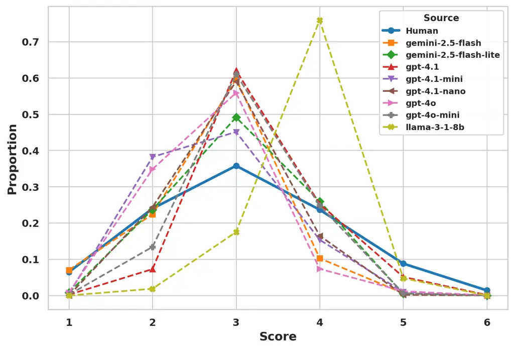

(a)

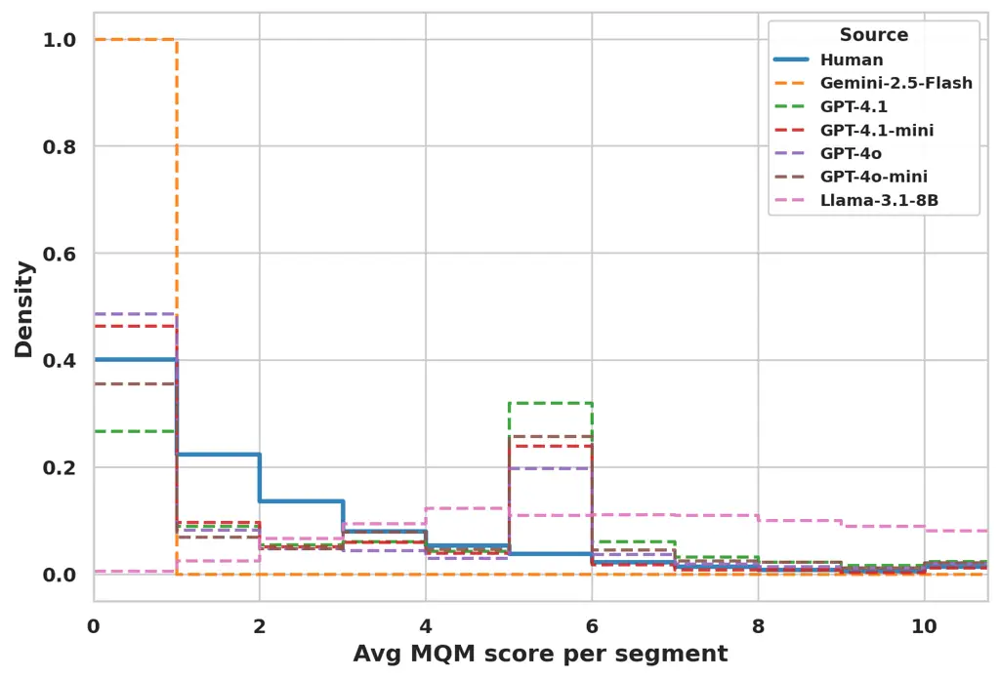

(b)

Figure 1: Score distribution comparisons between human raters and AI
judges for PERSUADE and MQM. Panel (a): Grade-10 PERSUADE score
proportions for human labels and all 8 LLM judges (scores 1–6). Human
shown as solid line; LLMs as dashed lines. Panel (b): MQM segment-level
score distributions for human raters and six LLM judges on WMT 2020
en–de. Both datasets show systematic disagreement between human labels
and AI judges.

Case Study 2: Machine translation evaluation. We also study the WMT 2020
English–German MQM dataset (Freitag et al., 2021), where expert raters
annotate translation errors by category and severity and each segment
receives a non-negative MQM score (lower is better). We use six LLM
judges (listed in Figure 1(b)) to produce MQM-style annotations across
ten MT systems, including three human translations. Figure 1(b) shows
systematic miscalibration: some LLM judges largely underestimate or
overestimate error rates (Gemini-2.5-Flash and Llama-3.1-8B), while
others demonstrate a two peak distribution that is not observed in human
labels.

Case Study 3: Web-design scoring. Finally, we consider visual evaluation
of website screenshots, where models must judge perceptual qualities
such as aesthetics, trustworthiness, typicality, and usability
(Miniukovich and Figl, 2023). Figure 2 shows the score distributions for
the Universities subset of the WebDesign dataset and reveals substantial
disagreement between human labels and VLM judges.

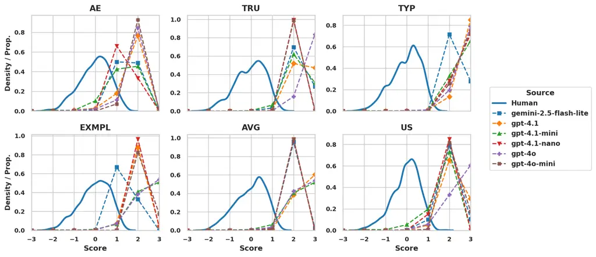

Figure 2: WebDesign Universities score distributions for six perceptual
outcomes (scores $`-3`$ to $`3`$). Human scores are shown as KDE curve;
VLM judges as proportion lines.

Together, these examples show a common problem: AI scores usually don’t
target the same measurement as the human labels. If practitioners simply
average AI scores or use them to rank items or systems, they are making
an implicit and usually unvalidated measurement assumption. We propose
BACON to address this problem.

### 1.2 BACON framework overview and our contributions

BACON is an evaluation protocol for making human-aligned claims under
limited labels. For a target item population, the evaluator specifies
the human outcome and the evaluation report of interest, such as a
population mean, system ranking, or item-level score. BACON collects
full-coverage auxiliary measurements from multiple AI judges, including
scores, uncertainty statistics, and item embeddings. A small portion of
samples is then labeled by humans and used to fit a cross-fitted
calibration model from AI measurements to the target human outcome.
BACON reports calibrated item-level surrogate scores and aggregate
human-aligned estimates with uncertainty intervals. Throughout the
protocol, AI judges are treated as auxiliary measurements rather than
replacements for human labels: human calibration anchors the validity of
the final claim, while AI measurements improve efficiency when they are
predictive.

To summarize, we make the following contribution:

\(1\) Human-calibrated AI-judge evaluation protocol. We formulate
AI-assisted evaluation as a budgeted human-calibration problem in which
multiple AI judges are treated as auxiliary measurements, not ground
truth. AI judge scores provide full-coverage outcome predictions, and a
small uniform human sample supplies a bias correction, decoupling
estimation accuracy from the quality of the outcome model.

\(2\) Multi-judge calibration recipes. BACON distinguishes two
evaluation tasks: empirically calibrated item-level surrogate scoring
and statistically valid summary metric estimation. For item-level
evaluation, we propose building outcome models from multiple judge
scores, uncertainty summaries, and context embeddings, and discuss
practical model choices for different type of outcomes such as ordinal,
zero-inflated, continuous, and categorical evaluation outcomes. For
summary statistics report, BACON follows an estimating equation-based
statistical framework to deliver estimators that are consistent for
human assessment and provide valid uncertainty quantification through
confidence intervals.

\(3\) Cross-domain empirical study of AI-judge calibration. We validate
BACON across three real-world datasets spanning multiple tasks and
modalities, including PERSUADE essay scoring, MQM machine translation
evaluation, and WebDesign web-design scoring. The results demonstrate
substantial improvements in judge-model predictive accuracy for
individual item quality and the estimation efficiency for summary
metrics over several baselines. The code for replication is hosted in
the following GitHub repo (anonymized for review):
[https://github.com/diaryofnewton/bacon-calibration](https://github.com/diaryofnewton/bacon-calibration).

### 1.3 Related Works

LLM-as-a-judge. Zheng et al. (2023) establish the canonical LLM-as-judge
paradigm via MT-Bench and Chatbot Arena; Liu et al. (2023) extend it
with chain-of-thought prompting for text-generation evaluation; and
Dubois et al. (2024) develop AlpacaEval for instruction-following
comparison. Despite their utility, LLM judges exhibit systematic biases
in terms of position, verbosity, and self-enhancement (Wang et al.,
2023a), that distort rankings; surveys (Li et al., 2024; Gu et al., 2024) catalog these failure modes. BACON highlights such biases as a
starting point and provides a principled calibration framework to
correct them using a small sample of human labeled data.

Multi-judge aggregation. Self-consistency (Wang et al., 2023b) and
multi-agent debate (Du et al., 2024; Liang et al., 2024) use ensembles
of reasoning paths or models to improve reliability. In the evaluation
setting, ChatEval (Chan et al., 2023), jury-style panels (Verga et al.,
2024), and structured multi-agent collaboration (Qian et al., 2025) show
that aggregating diverse judges reduces individual biases. BACON
differs: rather than debate or ad-hoc ensembling, we treat judge scores
as features in a supervised outcome model fit against human labels,
yielding statistically grounded estimates.

Prediction-powered inference (PPI) and semi-supervised estimation.
Angelopoulos et al. (2023a) introduce PPI, using model predictions plus
a small labeled set to form valid confidence intervals; Angelopoulos et
al. (2023b) extend this to PPI++ with adaptive weighting; Zrnic (2024)
remove the held-out requirement via cross-fitting. These ideas root in
classical survey regression estimators (Särndal et al., 1992; Cassel et
al., 1976) and semi-supervised inference (Zhang et al., 2019; Cai and
Guo, 2020). In the application of summary metrics estimation, BACON
follows directly this line of work. For the special case of estimating a
population mean, our estimator is mathematically equivalent to a PPI /
regression-adjusted estimator with a learned prediction function. The
contribution of BACON is therefore not a new mean estimator. Instead,
BACON addresses a problem left open by generic PPI formulations: how to
construct reliable auxiliary predictions in AI-assisted evaluation when
the available predictors are multiple biased AI judges, uncertainty
statistics, as well as item embeddings, and how to report both aggregate
inferential quantities and item-level surrogate scores without treating
AI judgments as ground truth, which serves as the protocol layer between
LLM-as-judge and PPI.

Training and fine-tuning LLM judges. JudgeLM (Zhu et al., 2025),
Prometheus (Kim et al., 2024a; Kim et al., 2024b), and PandaLM (Wang et
al., 2024) fine-tune open-source models as scalable evaluators, while Li
et al. (2023) produce evaluative rationales rather than scalar scores.
However, Huang et al. (2025) find that fine-tuned judges often
underperform GPT-4 out-of-domain. BACON is training-free: off-the-shelf
judge outputs feed a lightweight calibration layer, requiring no
judge-specific training data and supporting closed-source models.

## 2 BACON Framework

### 2.1 Overview and notation setup

We present a training-free pipeline for AI-assisted evaluation. BACON
integrates three components to mitigate bias in AI judge outputs: (1)
aggregating predictions from multiple judges to capture cross-judge
variability; (2) leveraging contextual features to debias judge
predictions; and (3) calibrating AI evaluations using a small sample of
human-labeled data.

We study AI-assisted modeling and evaluation under limited human
labeling budgets. Suppose we have a pool of items, each associated with
a scalar or vector-valued human outcome. Our goal is to estimate
population-level performance and improve item-level prediction by
combining AI judge outputs in a principled way, with a small amount of
human labels for calibration.

Formally, for item $`i\in\{1,\dots,N\}`$, let $`y_{i}`$ denote the human
score (or one outcome component), and let
$`\mathbf{\ell}_{i}\in\mathbb{R}^{M}`$ collect $`M`$ model-judge scores.
We also construct contextual embedding features $`e_{i}`$ (e.g., text
embeddings for essays and image embeddings for screenshots). We then fit
predictive models for $`y_{i}`$ using judge scores, uncertainty
features, and embedding features to capture their relationship with
human evaluations.

### 2.2 Budgeted Evaluation Framework

The proposed evaluation framework is as follows; Figure 3 gives an
overview.

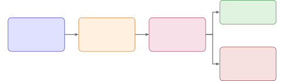

Figure 3: BACON evaluation pipeline. Stage 1 prepares inputs (context
features and AI jury scores) for all items; Stage 2 collects a small
human label sample; Stage 3 fits the outcome model with cross-fitting;
Stage 4 routes to summary-metric estimation or individual scoring and
ranking.

\(1\) Stage 1: Model input preparation. (i) Context features extraction.
For each item in the evaluation pool, we extract some context features.
This includes the content embeddings, summary statistics, emotion and
psychological attributes, among others (Mozer and Miratrix, 2025). (ii)
AI Jury Scoring. We use multiple AI judges to score all the items in the
pool. We can record auxiliary information such as the token entropy and
perplexity. We can also run the AI judges for multiple rounds.

\(2\) Stage 2: Human Label Sampling. We sample a small number of items
to get human labels. The basic approach is to sample items uniformly at
random, given a fixed budget. Also, we can apply adaptive sampling
strategies to improve the sampling efficiency. We leave an detailed
discussion of adaptive sampling strategies to Appendix D.

\(3\) Stage 3: Outcome Model Fitting. We fit an outcome model to the
human labels and the AI scores. For this part, we use cross-fitting to
obtain out-of-fold predictions to avoid overfitting.

\(4\) Stage 4: Route the model for downstream tasks. Here we list two
representative tasks to use the scores: (i) Estimate summary metrics. We
build regression-adjusted estimators to estimate aggregated metrics such
as the population average of human scores, as well as providing
uncertainty quantifications through confidence intervals. (ii) Get
individual item predictions and ranks. We can use the model to predict
surrogate human scores and rank the items. The surrogate scores can be
used to flag low quality items.

### 2.3 Details of the BACON Framework

Joint modeling of context features and multi-judge evaluations. Overall,
we try to fit a predictive model for $`y_{i}`$ from the context features
$`e_{i}`$ and the judge evaluations $`\ell_{i}`$. Moreover, we can
incorporate additional features $`u_{i}`$ which encodes the uncertainty
of the judge evaluations. We propose to fit a joint model for $`y_{i}`$
from the context features $`e_{i}`$, the judge evaluations $`\ell_{i}`$
with uncertainty features $`u_{i}`$:

```math
\displaystyle\widehat{y}_{i}=f(e_{i},\ell_{i},u_{i}),
```

where $`f`$ is a function that we need to learn from data. We will
discuss the choice of $`f`$ later. Intuitively, we hope the function
$`f`$ can serve as a meta-judge that aggregates the single-judge
evaluations and steer the prediction towards the human preferences.

Embedding features $`e_{i}`$ capture item-level effects, such as topic,
style, visual composition, that are not explained by judge scores alone,
acting as fixed-effect controls. Multiple judge scores $`\ell_{i}`$ are
combined via model fitting rather than ad-hoc majority voting or
averaging, allowing the outcome model to down-weight biased or
unreliable judges. Uncertainty features $`u_{i}`$ encode judge
confidence: token-level entropy (available when log-probabilities are
accessible) or sample-level variance from multiple judge runs
(applicable to any model).

Example models. The choice of $`f`$ depends on the score pattern of the
outcome. Table 1 summarizes several instantiations; all share the same
feature inputs $`(e_{i},\ell_{i},u_{i})`$.

|                             |                                                      |                                                                                                                                                                                                                                                 |
| --------------------------- | ---------------------------------------------------- | ----------------------------------------------------------------------------------------------------------------------------------------------------------------------------------------------------------------------------------------------- |
| Score pattern               | Example model                                        | Key idea                                                                                                                                                                                                                                        |
| Real-valued                 | Ridge regression                                     | Linear predictor $`\widehat{y}_{i}=\alpha_{0}+\alpha_{e}^{\top}e_{i}+\alpha_{\ell}^{\top}\ell_{i}+\alpha_{u}^{\top}u_{i}`$; $`\ell_{2}`$ penalty controls judge collinearity.                                                                   |
| Non-negative, zero-inflated | Hurdle model (logistic gate $`+`$ conditional ridge) | Gate $`\Pr(z_{i}{=}1)`$ predicts whether $`y_{i}{>}0`$; conditional ridge predicts $`\widehat{y}_{i}^{+}`$ on positive examples; final prediction $`\widehat{y}_{i}=\Pr(z_{i}{=}1)\cdot\widehat{y}_{i}^{+}`$.                                   |
| Ordinal                     | Proportional-odds (ordered logit)                    | Linear predictor $`\eta_{i}=\alpha_{0}+\alpha_{e}^{\top}e_{i}+\alpha_{\ell}^{\top}\ell_{i}+\alpha_{u}^{\top}u_{i}`$ with $`K{-}1`$ ordered cutpoints $`\theta_{1}{<}\cdots{<}\theta_{K-1}`$; $`\Pr(Y_{i}{\leq}k)=\sigma(\theta_{k}-\eta_{i})`$. |
| Categorical                 | Multinomial regression                               | $`\Pr(Y_{i}{=}k)=\exp(\eta_{i}^{(k)})/\sum_{j=1}^{K}\exp(\eta_{i}^{(j)})`$, where $`\eta_{i}^{(k)}=\alpha_{0}^{(k)}+\alpha_{e}^{(k)\top}e_{i}+\alpha_{\ell}^{(k)\top}\ell_{i}+\alpha_{u}^{(k)\top}u_{i}`$.                                      |

Table 1: Example outcome models in BACON. All models use embeddings
$`e_{i}`$, judge scores $`\ell_{i}`$, and uncertainty features $`u_{i}`$
as inputs.

Cross-fitting for outcome model fitting. A key requirement is that the
outcome model $`\widehat{f}`$ must not be fitted on the same sampled
observations whose residuals are used for bias correction. If the same
data is used for both fitting and prediction, the in-sample fit can be
overly optimistic—a model that memorises its training labels will
produce near-zero residuals, inflating bias for complex,
low-regularization models. Cross-fitting (Chernozhukov et al., 2018)
resolves this by partitioning the sampled set
$`\mathcal{S}=\{i:S_{i}=1\}`$ into $`K`$ folds
$`\mathcal{S}_{1},\ldots,\mathcal{S}_{K}`$. For each fold $`k`$, the
outcome model $`\widehat{f}^{(-k)}`$ is trained on all sampled
observations _except_ fold $`k`$, and its predictions on fold $`k`$ are
used as the out-of-fold (OOF) predictions. Formally, for
$`i\in\mathcal{S}_{k}`$:

```math
\widehat{y}_{i}=\widehat{f}^{(-k)}(e_{i},\ell_{i},u_{i}),\qquad\widehat{f}^{(-k)}=\operatorname{fit}\!\left(\{(e_{j},\ell_{j},u_{j},Y_{j}):j\in\mathcal{S}\setminus\mathcal{S}_{k}\}\right).
```

Then we fit the an aggregated model $`\widehat{f}`$ on the full sample
$`S`$ and use it to predict the labels for items that are not in $`S`$.
Through this formulation, the predictions $`\widehat{y}_{i}`$’s cover
all $`N`$ items. Because $`\widehat{f}^{(-k)}`$ is fitted on a held-out
split, the residuals $`Y_{i}-\widehat{y}_{i}`$ are honest as they
reflect genuine generalisation error rather than in-sample fit. This
prevents overfit models from artificially suppressing the
bias-correction variance, and makes the variance estimate more stable
when the outcome model is complex. In practice, we use $`K{=}5`$ folds,
each trained on 80% of the sampled data, which balances the
bias–variance trade-off for the OOF predictions.

Summary metrics estimation with uncertainty quantification. Summary
metrics include population mean, median/quantiles, variance, etc. We can
unify the estimation of common summary metrics using an estimating
equation framework. Let $`Y`$ be the observed human scores (with NA if
no human label is collected), $`S`$ be the indicator variable indicating
whether a human label is collected, $`X`$ be some measurements for the
context, such as the embedding features, the judge scores and
uncertainty summary metrics, etc. Below we provide an estimating
equation framework (Hardin and Hilbe, 2002).

Suppose we are interested in a target parameter
$`\theta^{\star}=\theta(\mathbb{P}_{Y,S,X})`$, which is the solution to
the following estimating equation:
$`{\mathbb{E}\left\{m(Y,S,X;\theta^{\star},\gamma^{\star})\right\}}=0,`$
where $`m(Y,S,X;\theta,\gamma)`$ is the estimating equation, and
$`\gamma^{\star}`$ is a nuisance parameter. For example, for the mean
and $`\tau`$-th quantile, we have

```math
m_{\text{mean}}(Y,S,X;\theta,\gamma)=\frac{SY}{\pi(X)}-\theta,\quad\text{and}\quad m_{\text{quantile}}(Y,S,X;\theta,\gamma)=\frac{S\bm{1}\left\{Y\leq\theta\right\}}{\pi(X)}-\tau,
```

respectively. Here $`\pi(X)`$ is the labeling propensity and serves as a
given nuisance parameter $`\gamma^{\star}`$. In practice, we can apply
many classical sampling schemes to collect the human labels, which
corresponds to different choices of $`\pi(X)`$. For example, we can draw
items uniformly at random, or perform stratified sampling based on some
context features $`X`$. Alternatively, we may learn the labeling
propensity from some pilot data using a propensity model. See Appendix D
for more details.

It is usually desirable to incorporate a regression adjustment term to
the estimating equation to improve the efficiency of the estimator. For
the above examples, we can augment the estimating equation as:

```math
\displaystyle m_{\text{mean}}(Y,S,X;\theta,\gamma)=\frac{S(Y-\mu(X))}{\pi(X)}+\mu(X)-\theta,
```

```math
\displaystyle m_{\text{quantile}}(Y,S,X;\theta,\gamma)=\frac{S(\bm{1}\left\{Y\leq\theta\right\}-\phi(X;\theta))}{\pi(X)}+\phi(X;\theta)-\tau,
```

respectively. Here $`\mu(X)`$ is a regression adjustment for the human
scores and $`\phi(X;\theta)`$ is a regression adjustment for the
quantile. We can then estimate the target parameter $`\theta^{\star}`$
by solving the following estimating equation:
$`\mathbb{E}_{N}(m(Y,S,X;\widehat{\theta},\widehat{\gamma}))=N^{-1}\sum_{i=1}^{N}m(Y_{i},S_{i},X_{i};\widehat{\theta},\widehat{\gamma})=0`$,
which we call as the augmented estimating-equation (AEE) estimator.
Under some regularity conditions (Appendix C.1), the estimator
$`\widehat{\theta}`$ is consistent and asymptotically normal:
$`\sqrt{N}(\widehat{\theta}-\theta^{\star})\rightsquigarrow\mathcal{N}(0,\Sigma_{\theta}).`$
The asymptotic covariance takes the sandwich form
$`\Sigma_{\theta}=A^{-1}BA^{-T}`$, where $`A`$ and $`B`$ are given by

```math
A={\mathbb{E}\left\{\nabla_{\theta}m(Y,S,X;\theta^{\star},\gamma^{\star})\right\}},\quad\text{and}\quad B={\mathbb{E}\left\{m(Y,S,X;\theta^{\star},\gamma^{\star})\,m(Y,S,X;\theta^{\star},\gamma^{\star})^{\top}\right\}}.
```

Accordingly, a plug-in sandwich estimator of
$`\textup{Var}\{\widehat{\theta}\}`$ is
$`\widehat{v}=\frac{1}{n}\widehat{A}^{-1}\widehat{B}\widehat{A}^{-T}`$,
with $`\widehat{A}`$ and $`\widehat{B}`$ given by

```math
\widehat{A}=\mathbb{E}_{N}{\nabla_{\theta}m(Y,S,X;\widehat{\theta},\widehat{\gamma})},\quad\text{and}\quad\widehat{B}=\mathbb{E}_{N}{m(Y,S,X;\widehat{\theta},\widehat{\gamma})\,m(Y,S,X;\widehat{\theta},\widehat{\gamma})^{\top}}.
```

Then we can construct a confidence interval for $`\theta^{\star}`$ as
$`\widehat{\theta}\pm z_{\alpha/2}\sqrt{\widehat{v}}`$ with confidence
level $`1-\alpha`$. When the target is the population mean, the AEE
estimator is equivalent to the inverse-propensity weighted estimator
upon regression adjustment in survey sampling (Särndal et al., 1992;
Cassel et al., 1976) or predictive powered inference (Angelopoulos et
al., 2023a). For a rigorous technical presentation, please refer to
Appendix C.1.

## 3 Real-World Results

### 3.1 Setup

Datasets and Outcomes. (i) PERSUADE. We use the PERSUADE training corpus
with essay-level holistic labels (Crossley et al., 2024). In particular,
main experiments target grade-10 essays. (ii) Machine translation. We
use the WMT 2020 English–German MQM (Multidimensional Quality Metrics)
dataset (Freitag et al., 2021), where expert human raters annotate
translation errors by category and severity. Each segment receives a
non-negative MQM score (lower is better; zero means no errors detected).
(iii) WebDesign. We use screenshot datasets from multiple universities
(Miniukovich and Figl, 2023). For each screenshot, we model six
human-rated outcomes: Aesthetics, Trustworthiness, Typicality, Exemplar
Goodness, Family Resemblance, and Usability. Due to space limit, we
defer the WebDesign results to Appendix A.2.

Embedding Features. (i) Text embeddings. Essays/Machine translation
segments are embedded using text-embedding-3-large¹¹ 1
[https://developers.openai.com/api/docs/models/text-embedding-3-large](https://developers.openai.com/api/docs/models/text-embedding-3-large)
from OpenAI. (ii) Image embeddings. Screenshots are embedded with SigLIP
(Zhai et al., 2023). To stabilize downstream linear models, we apply PCA
to high-dimensional embeddings, retaining a tunable number of principal
components.

Baselines and general metrics. We compare BACON against both
uncalibrated AI-judge baselines and calibrated outputs. The uncalibrated
baselines use raw judge scores directly, including single-judge scores
and averages across judges. For calibrated models, to isolate the value
of different signals, we evaluate calibrated models using only judge
scores and uncertainty features, only embedding features, or the full
joint feature set. For item-level prediction, we report $`R^{2}`$, root
mean squared error (RMSE), and Spearman correlation. For summary-metric
estimation, we report bias, standard deviation, and RMSE across repeated
sampling trials. Monte Carlo experiments are run on a server with an
Intel Xeon Platinum 8275CL CPU (96 cores, 3.00 GHz, 1.1 TB RAM).

### 3.2 PERSUADE

Oracle performance. Table 2 reports out-of-fold judge performance when
fitting the outcome model on grade-10 essays under six configurations
with all human labels revealed, in order to evaluate the oracle
performance of the model. We use an ordinal regression model. The full
8-judge model combined with embeddings achieves the best performance.
Single-judge results reveal a slight performance drop with embeddings,
and a large performance drop without embeddings, indicating that
embedding features carry substantial predictive signal. As uncalibrated
baselines, simply averaging all judges’ raw scores (no outcome model)
yields $`R^{2}{=}0.361`$, and averaging per-judge raw metrics yields
$`R^{2}{=}0.150`$—substantially below all calibrated configurations.

|                                  |              |            |       |                   |
| -------------------------------- | ------------ | ---------- | ----- | ----------------- |
| Configuration                    | Type         | $`R^{2}`$  | RMSE  | Spearman $`\rho`$ |
| Eight judges + embedding         | Calibrated   | 0.699      | 0.602 | 0.831             |
| Eight judges (no embedding)      | Calibrated   | 0.399      | 0.851 | 0.619             |
| Single judge + embedding         | Calibrated   | 0.683      | 0.618 | 0.822             |
| Single judge avg. (no embedding) | Calibrated   | 0.269      | 0.938 | 0.460             |
| Embedding-only (ordinal)         | Calibrated   | 0.674      | 0.627 | 0.816             |
| Intercept-only constant          | Calibrated   | $`-`$0.000 | 1.098 | $`-`$0.020        |
| Raw avg. of all judges           | Uncalibrated | 0.361      | 0.877 | 0.601             |
| Raw single-judge avg.            | Uncalibrated | 0.150      | 1.007 | 0.502             |

Table 2: PERSUADE judge-model performance (5-fold OOF CV, ordinal
regression). Lower RMSE is better; higher $`R^{2}`$ and Spearman
$`\rho`$ are better.

Simulation on summary metrics. We evaluate how well several
configurations support the bias and efficiency claim of the AEE
estimator under a uniform sampling budget
$`\eta\in\{0.05,\ldots,0.30\}`$. In each Monte Carlo trial, a fraction
$`\eta`$ of grade-10 essays is sampled uniformly at random. We run 200
independent trials per budget and report estimator bias, standard
deviation (SD), and RMSE across trials.Figure 4(a) shows the AEE
estimator quality as a function of $`\eta`$. All calibrated methods are
approximately unbiased when the sampling budget is appropriate, while
the uncalibrated baselines are biased. The full hybrid model mostly
achieves the lowest SD and RMSE across budgets, demonstrating that a
better outcome model directly translates to a more efficient estimator.
Across all budgets, the reduction in estimator variance from the full
model over the intercept-only baseline reflects the predictive $`R^{2}`$
gains seen in Table 2.

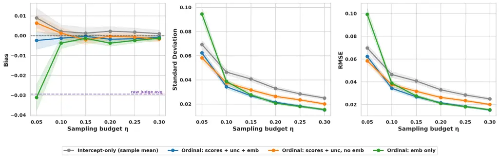

(a) Estimating-equation estimator quality

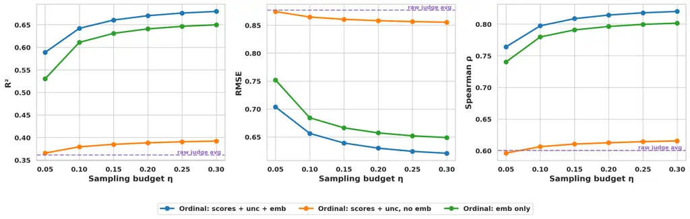

(b) Outcome model quality vs. budget $`\eta`$.

Figure 4: PERSUADE experimental results. Top: bias, standard deviation,
and RMSE as a function of $`\eta`$ (200 MC trials) for mean estimation.
Bottom: Outcome model quality vs. $`\eta`$: out-of-fold $`R^{2}`$, RMSE,
and Spearman $`\rho`$ fitted on the sampled essays.

Outcome model quality vs. budget. A key question is how well the outcome
model itself can be estimated from the sampled essays. Figure 4(b)
traces out-of-fold $`R^{2}`$, RMSE, and Spearman $`\rho`$ of the judge
model as $`\eta`$ increases, using only the sampled subset for fitting.
At the smallest budget ($`\eta{=}0.05`$, roughly 230 essays), the full
model already achieves meaningful predictive performance; quality
improves steadily as more essays are observed. This confirms that the
joint model provides sufficient signal for reliable outcome modelling
even at modest sampling rates, supporting the practical viability of
BACON in annotation-scarce settings.

### 3.3 Machine translation

We apply the BACON framework to machine translation quality evaluation
using the WMT 2020 English–German MQM dataset.

Simulation on summary metrics. We evaluate each outcome model as a
plug-in for the AEE estimator under uniform sampling budgets
$`\eta\in\{0.05,\ldots,0.30\}`$ across all ten MT systems. In each of
200 Monte Carlo trials, a fraction $`\eta`$ of segments per system is
sampled uniformly; 5-fold cross-fitting with winsorised LLM score
features is used in the evaluation. Figure 5 reports estimator bias, SD,
and RMSE across trials.

All methods remain approximately unbiased throughout (max
$`|\text{bias}|<0.02`$), confirming that the AEE estimator corrects for
outcome-model misspecification. The hurdle models (both full and no-emb
variants) reduce estimator SD relative to the intercept-only baseline at
every budget. The embedding-only hurdle is slightly less efficient than
the full model at larger budgets, suggesting that LLM judge scores
contribute residual predictive signal beyond text embeddings alone.
Besides, all calibrated methods maintain Bonferroni-corrected CI
coverage at or above the nominal 95% level throughout, which suggests
the validity of the uncertainty quantification.

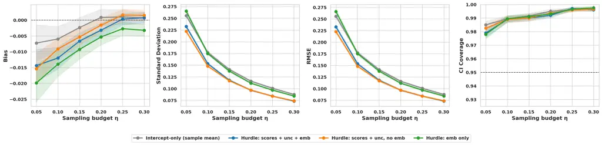

Figure 5: MQM AEE estimator quality vs. sampling budget $`\eta`$ in
terms of bias, SD, and RMSE and Bonferroni-corrected 95% CI coverage.

Translation system comparison under budgeted sampling. One key practical
goal is correctly ranking the MT systems by quality given limited human
labels. Figure 6 reports Spearman $`\rho`$, Kendall $`\tau`$, and mean
absolute rank error (MAE) of rankings derived from AEE estimates vs. the
true system ranking under budgets. All methods produce increasingly
accurate rankings as $`\eta`$ grows. For this goal, hurdle models with
both full and multiple-judge-only configurations achieve strong
performance at only small budgets. This suggests that system ranking can
be achieved with limited human label and proper calibration.

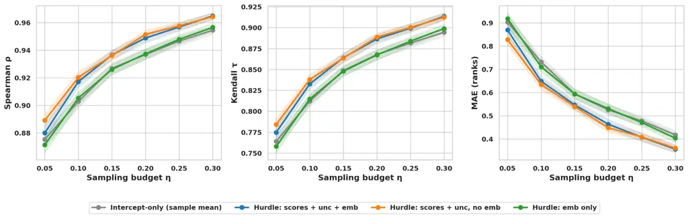

Figure 6: MQM system ranking quality vs. sampling budget $`\eta`$ (200
MC trials, 5-fold cross-fitting). Spearman $`\rho`$, Kendall $`\tau`$,
and mean absolute rank error (MAE) comparing rankings estimated from AEE
to the true system ranking. Hurdle models improve over the intercept
baseline at all budgets.

Additional evaluation results. Section A.1 provides more details on the
MQM evaluation, including the oracle performance of the outcome model
and the individual item score quality.

## 4 Discussion

What BACON adds. BACON is a pipeline that aims to provide better
guidance for the use of AI judges in evaluation. The item-wise labeling
part is closely related to LLM-as-a-judge approaches and LLM
collaboration literature, while aggregated estimators are closely
related to regression-adjusted survey estimators and PPI-style
estimators. The contribution is to bridge these practices in an unified
framework and make them operational. Our experiments suggest that this
calibration layer matters: raw judge averages can be misaligned with
human labels, while calibrated outcome models mitigate the bias by
combining the auxiliary signals from multiple sources.

Limitations. BACON’s two output modes have different guarantees.
Aggregate reports, such as corpus means or system-level averages, are
anchored by human labels and inherit uncertainty quantification under
the sampling assumptions. Item-level BACON scores are only calibrated
surrogate predictions: they are useful for triage, ranking, and
auditing, but should not be interpreted as unbiased measurements for
each item. Moreover, calibration may degrade under distribution shift in
items, prompts, model versions, or rating rubrics; practical deployment
requires periodic recalibration, version logging, and residual
monitoring on fresh human labels.

Future work. Natural extensions include video evaluation, mobile UI
assessment, and agentic task evaluation. Future work should also develop
stronger item-level uncertainty tools, such as conformal prediction
sets, and adaptive sampling strategies that improve efficiency without
creating extreme propensities or hiding subgroup failures.

## References

- Angelopoulos et al. (2023a) A. N. Angelopoulos, S. Bates, C.
  Fannjiang, M. I. Jordan, and T. Zrnic Prediction-powered inference.
  Science 382 (6671), pp. 669–674. Cited by: §1.3, §2.3.
- Angelopoulos et al. (2023b) A. N. Angelopoulos, J. C. Duchi, and T.
  Zrnic PPI++: efficient prediction-powered inference. arXiv preprint
  arXiv:2311.01453. Cited by: §1.3.
- Cai and Guo (2020) T. T. Cai and Z. Guo Semi-supervised inference for
  explained variance in high-dimensional linear regression and its
  applications. Journal of the Royal Statistical Society: Series B 82
  (2), pp. 391–419. Cited by: §1.3.
- Cassel et al. (1976) C. M. Cassel, C. Särndal, and J. H. Wretman Some
  results on generalized difference estimation and generalized
  regression estimation for finite populations. Biometrika 63 (3),
  pp. 615–620. Cited by: §1.3, §2.3.
- Chan et al. (2023) C. Chan, W. Chen, Y. Su, J. Yu, W. Xue, S.
  Zhang, J. Fu, and Z. Liu ChatEval: towards better LLM-based evaluators
  through multi-agent debate. arXiv preprint arXiv:2308.07201. Cited by:
  §1.3.
- Chernozhukov et al. (2018) V. Chernozhukov, D. Chetverikov, M.
  Demirer, E. Duflo, C. Hansen, W. Newey, and J. Robins Double/debiased
  machine learning for treatment and structural parameters. The
  Econometrics Journal 21 (1), pp. C1–C68. Cited by: §2.3.
- Crossley et al. (2024) S. A. Crossley, Y. Tian, P. Baffour, A.
  Franklin, M. Benner, and U. Boser A large-scale corpus for assessing
  written argumentation: persuade 2.0. Assessing Writing 61, pp. 100865.
  Cited by: §1.1, §3.1.
- Du et al. (2024) Y. Du, S. Li, A. Torralba, J. B. Tenenbaum, and I.
  Mordatch Improving factuality and reasoning in language models through
  multiagent debate. In Proceedings of the 41st International Conference
  on Machine Learning, Cited by: §1.3.
- Dubois et al. (2024) Y. Dubois, X. Li, R. Taori, T. Zhang, I.
  Gulrajani, J. Ba, C. Guestrin, P. Liang, and T. B. Hashimoto
  AlpacaEval: an automatic evaluator of instruction-following models.
  Note:
  [https://github.com/tatsu-lab/alpaca_eval](https://github.com/tatsu-lab/alpaca_eval)
  Cited by: §1.3.
- Freitag et al. (2021) M. Freitag, G. Foster, D. Grangier, V.
  Ratnakar, Q. Tan, and W. Macherey Experts, errors, and context: a
  large-scale study of human evaluation for machine translation.
  Transactions of the Association for Computational Linguistics 9,
  pp. 1460–1474. Cited by: §1.1, §3.1.
- Gu et al. (2024) J. Gu, X. Jiang, Z. Shi, H. Tan, X. Zhai, C. Xu, W.
  Li, L. Shen, S. Zhu, F. Cheng, and J. Ma A survey on LLM-as-a-judge.
  arXiv preprint arXiv:2411.15594. Cited by: §1.3.
- Hamilton et al. (2025) M. Hamilton, J. Lai, W. Zhao, S. Maji, and D.
  Sheldon Active measurement: efficient estimation at scale. arXiv
  preprint arXiv:2507.01372. Cited by: §D.1.
- Hardin and Hilbe (2002) J. W. Hardin and J. M. Hilbe Generalized
  estimating equations. chapman and hall/CRC. Cited by: §2.3.
- Huang et al. (2025) H. Huang, X. Bu, H. Zhou, K. Li, X. Fan, Y.
  Guo, H. Fei, Q. He, J. Li, and F. Mi An empirical study of
  LLM-as-a-judge for LLM evaluation: fine-tuned judge model is not a
  general substitute for GPT-4. In Findings of the Association for
  Computational Linguistics: ACL 2025, Cited by: §1.3.
- Kim et al. (2024a) S. Kim, J. Shin, Y. Cho, J. Han, S. Cha, M. Lee,
  and M. Seo Prometheus: inducing fine-grained evaluation capability in
  language models. In International Conference on Learning
  Representations, Cited by: §1.3.
- Kim et al. (2024b) S. Kim, J. Suk, S. Longpre, B. Y. Lin, J. Shin, S.
  Welleck, G. Neubig, M. Lee, K. Lee, and M. Seo Prometheus 2: an open
  source language model specialized in evaluating other language models.
  arXiv preprint arXiv:2405.01535. Cited by: §1.3.
- Li et al. (2024) H. Li, Q. Dong, J. Chen, H. Su, Y. Hui, Y. Shi, S.
  Fang, X. Zhu, Q. Liu, and Y. Liu LLMs-as-judges: a comprehensive
  survey on LLM-based evaluation of NLP. arXiv preprint
  arXiv:2402.08862. Cited by: §1.3.
- Li et al. (2023) J. Li, S. Sun, W. Yuan, R. Fan, H. Zhao, and P. Liu
  Generative judge for evaluating alignment. arXiv preprint
  arXiv:2310.05470. Cited by: §1.3.
- Li et al. (2025) P. Li, T. Zrnic, and E. Candès Robust sampling for
  active statistical inference. arXiv preprint arXiv:2511.08991. Cited
  by: §D.1.
- Liang et al. (2024) T. Liang, Z. He, W. Jiao, X. Wang, Y. Wang, R.
  Wang, Y. Yang, S. Shi, and Z. Tu Encouraging divergent thinking in
  large language models through multi-agent debate. In Proceedings of
  the 2024 Conference on Empirical Methods in Natural Language
  Processing, Cited by: §1.3.
- Liu et al. (2023) Y. Liu, D. Iter, Y. Xu, S. Wang, R. Xu, and C. Zhu
  G-Eval: NLG evaluation using GPT-4 with better human alignment. In
  Proceedings of the 2023 Conference on Empirical Methods in Natural
  Language Processing, pp. 2511–2522. Cited by: §1.3.
- Miniukovich and Figl (2023) A. Miniukovich and K. Figl The effect of
  prototypicality on webpage aesthetics, usability, and trustworthiness.
  International Journal of Human-Computer Studies 179, pp. 103103. Cited
  by: §1.1, §3.1.
- Mozer and Miratrix (2025) R. Mozer and L. Miratrix More power to you:
  using machine learning to augment human coding for more efficient
  inference in text-based randomized trials. The Annals of Applied
  Statistics 19 (1), pp. 440–464. Cited by: §2.2.
- Qian et al. (2025) Y. Qian, S. Zhang, Y. Zhou, A. Balakrishnan, J.
  Li, S. K. Jauhar, A. Kannan, and R. Tian Enhancing LLM-as-a-judge via
  multi-agent collaboration. arXiv preprint arXiv:2501.05366. Cited by:
  §1.3.
- Särndal et al. (1992) C. Särndal, B. Swensson, and J. Wretman Model
  assisted survey sampling. Springer, New York. Cited by: §1.3, §2.3.
- Verga et al. (2024) P. Verga, S. Hofstätter, S. Althammer, Y. Su, A.
  Piktus, N. Arkil, P. Ferão, M. Z. Razavi, S. Saeidi, S. Ruder, and P.
  Roth Replacing judges with juries: evaluating LLM generations with a
  panel of diverse models. arXiv preprint arXiv:2404.18796. Cited by:
  §1.3.
- Wang et al. (2023a) P. Wang, L. Li, L. Chen, D. Zhu, B. Lin, Y.
  Cao, Q. Liu, T. Liu, and Z. Sui Large language models are not fair
  evaluators. arXiv preprint arXiv:2305.17926. Cited by: §1.3.
- Wang et al. (2023b) X. Wang, J. Wei, D. Schuurmans, Q. Le, E. Chi, S.
  Narang, A. Chowdhery, and D. Zhou Self-consistency improves chain of
  thought reasoning in language models. In International Conference on
  Learning Representations, Cited by: §1.3.
- Wang et al. (2024) Y. Wang, Z. Yu, Z. Zeng, L. Yang, C. Wang, H.
  Chen, C. Jiang, R. Xie, J. Wang, X. Xie, W. Ye, S. Zhang, and Y. Zhang
  PandaLM: an automatic evaluation benchmark for LLM instruction tuning
  optimization. In International Conference on Learning Representations,
  Cited by: §1.3.
- Zhai et al. (2023) X. Zhai, B. Mustafa, A. Kolesnikov, and L. Beyer
  Sigmoid loss for language image pre-training. In Proceedings of the
  IEEE/CVF international conference on computer vision, pp. 11975–11986.
  Cited by: §3.1.
- Zhang et al. (2019) A. Zhang, L. D. Brown, and T. T. Cai
  Semi-supervised inference: general theory and estimation of means. The
  Annals of Statistics 47 (5), pp. 2538–2566. Cited by: §1.3.
- Zheng et al. (2023) L. Zheng, W. Chiang, Y. Sheng, S. Zhuang, Z.
  Wu, Y. Zhuang, Z. Lin, Z. Li, D. Li, E. P. Xing, H. Zhang, J. E.
  Gonzalez, and I. Stoica Judging LLM-as-a-judge with MT-bench and
  chatbot arena. In Advances in Neural Information Processing Systems,
  Vol. 36. Cited by: §1.3.
- Zhu et al. (2025) L. Zhu, X. Wang, and X. Wang JudgeLM: fine-tuned
  large language models are scalable judges. In International Conference
  on Learning Representations, Cited by: §1.3.
- Zrnic (2024) T. Zrnic Cross-prediction-powered inference. Proceedings
  of the National Academy of Sciences 121 (26), pp. e2322083121. Cited
  by: §1.3.

## Appendix A Additional Evaluation Results

### A.1 More on MQM evaluation

##### Importance of fitting the appropriate outcome model.

Table 3 reports pooled 5-fold OOF metrics for predicting human MQM
scores. Features include per-LLM mean scores and variance-based
uncertainty, with embeddings from a large text embedding model. Because
MQM scores are non-negative with a substantial zero mass ($`\sim`$13%
pooled, up to 29% for human translations), we compare the standard Ridge
model against a *Hurdle model* (logistic gate predicting
$`P(\text{MQM}>0)`$ combined with Ridge on the positive subset). We also
compare two variance encodings: the original
$`\log(\mathrm{Var}+\epsilon)`$ transform versus $`\sqrt{\mathrm{Var}}`$
with a binary has-variance indicator, since 57–67% of items have zero
LLM variance (all raters agree), creating an artificial bimodal cliff at
$`\log(10^{-8})\approx-18.4`$ in the log encoding.

|                               |           |          |
| ----------------------------- | --------- | -------- |
| Configuration                 | $`R^{2}`$ | Spearman |
| Full (sqrt, hurdle)           | 0.369     | 0.657    |
| Full (sqrt, ridge)            | 0.355     | 0.646    |
| Full (log, hurdle)            | 0.365     | 0.646    |
| Full (log, ridge)             | 0.351     | 0.634    |
| LLM scores only (sqrt, ridge) | 0.287     | 0.557    |
| Embedding-only ridge          | 0.167     | 0.497    |
| Intercept-only baseline       | 0.000     | 0.000    |

Table 3: MQM pooled judge-model ablation (5-fold OOF, all 10 systems,
$`n{=}14{,}180`$). The Hurdle model with $`\sqrt{\mathrm{Var}}`$
encoding achieves the best $`R^{2}`$ while eliminating negative
predictions.

The $`\sqrt{\mathrm{Var}}`$ encoding resolves pathological failures on
high-quality systems: for Human-B.0 (29% zeros), Ridge with log-variance
yields $`R^{2}=-0.14`$ due to extreme predictions driven by the
$`-18.4`$ floor, whereas $`\sqrt{\mathrm{Var}}`$ with Hurdle achieves
$`R^{2}=0.24`$. For MT systems with fewer zeros, both encodings perform
similarly.

##### Per-system ablation.

Table 4 reports the Hurdle model with $`\sqrt{\mathrm{Var}}`$ encoding
across all ten translation systems and the pooled corpus. The full model
(LLM + uncertainty + embeddings) consistently dominates the LLM-only and
embedding-only ablations. LLM scores alone explain much of the variance
for MT systems ($`R^{2}`$ 0.36–0.44) but substantially less for human
translations ($`R^{2}`$ 0.15–0.21), where inter-rater noise is higher.
Embeddings alone provide a complementary signal ($`R^{2}`$ 0.10–0.20)
that is especially valuable for the human-translation systems where LLM
scores are weakest. Combining both sources yields consistent gains
across all systems.

|                     |           |          |           |          |                |          |                |          |
| ------------------- | --------- | -------- | --------- | -------- | -------------- | -------- | -------------- | -------- |
|                     | Full      |          | LLM only  |          | Embedding only |          | Intercept only |          |
| System              | $`R^{2}`$ | $`\rho`$ | $`R^{2}`$ | $`\rho`$ | $`R^{2}`$      | $`\rho`$ | $`R^{2}`$      | $`\rho`$ |
| Human-A.0           | 0.273     | 0.554    | 0.191     | 0.427    | 0.150          | 0.448    | 0.000          | 0.000    |
| Human-B.0           | 0.236     | 0.516    | 0.150     | 0.359    | 0.139          | 0.452    | 0.000          | 0.000    |
| Human-P.0           | 0.328     | 0.581    | 0.207     | 0.478    | 0.197          | 0.491    | 0.000          | 0.000    |
| Huoshan_Translate   | 0.385     | 0.660    | 0.384     | 0.644    | 0.105          | 0.398    | 0.000          | 0.000    |
| OPPO                | 0.425     | 0.691    | 0.388     | 0.649    | 0.160          | 0.470    | 0.000          | 0.000    |
| Online-A            | 0.441     | 0.703    | 0.391     | 0.691    | 0.112          | 0.375    | 0.000          | 0.000    |
| Online-B            | 0.369     | 0.646    | 0.399     | 0.641    | 0.116          | 0.365    | 0.000          | 0.000    |
| Tencent_Translation | 0.435     | 0.690    | 0.398     | 0.642    | 0.160          | 0.461    | 0.000          | 0.000    |
| Tohoku-AIP-NTT      | 0.377     | 0.656    | 0.360     | 0.636    | 0.130          | 0.405    | 0.000          | 0.000    |
| eTranslation        | 0.449     | 0.707    | 0.436     | 0.673    | 0.130          | 0.441    | 0.000          | 0.000    |
| Pooled              | 0.369     | 0.657    | 0.287     | 0.557    | 0.167          | 0.497    | 0.000          | 0.000    |

Table 4: Per-system MQM judge-model performance (5-fold OOF, Hurdle
model, $`\sqrt{\mathrm{Var}}`$ encoding). $`R^{2}`$ and
Spearman $`\rho`$ are reported for each feature ablation.

### A.2 WebDesign evaluation

For the Universities subset, we ran the same judge ablation protocol
across six outcomes (Aesthetics, Trustworthiness, Typicality, Exemplar
Goodness, Family Resemblance, Usability), including a constant
intercept-only baseline. Table 5 reports average 5-fold OOF metrics
across outcomes. The full hybrid model (VLM scores + uncertainty +
SigLIP intercept) achieves the best overall performance, improving over
both the VLM-only and SigLIP-only ablations. As uncalibrated baselines,
using raw VLM scores directly yields highly negative $`R^{2}`$ (due to a
scale mismatch: human ratings are z-scored while VLM scores are on their
original integer scale), though Spearman correlation remains moderate
(0.56), confirming that outcome-model calibration is essential in this
domain.

|                                      |              |                |           |               |
| ------------------------------------ | ------------ | -------------- | --------- | ------------- |
| Configuration                        | Type         | Avg. $`R^{2}`$ | Avg. RMSE | Avg. Spearman |
| VLM scores + uncertainty + SigLIP    | Calibrated   | 0.555          | 0.462     | 0.727         |
| VLM scores + uncertainty (no SigLIP) | Calibrated   | 0.390          | 0.544     | 0.591         |
| SigLIP-only                          | Calibrated   | 0.497          | 0.492     | 0.690         |
| Intercept-only constant              | Calibrated   | $`-`$0.001     | 0.699     | $`-`$0.047    |
| Raw avg. of all judges               | Uncalibrated | $`-`$9.719     | 2.258     | 0.561         |
| Raw single-judge avg.                | Uncalibrated | $`-`$10.151    | 2.291     | 0.340         |

Table 5: WebDesign (Universities) judge-model ablation results. Values
are averaged across six outcomes. Lower RMSE is better; higher $`R^{2}`$
and Spearman are better. Uncalibrated rows use raw VLM scores directly
(no outcome-model fitting); note that human ratings are z-scored while
VLM scores are on their original integer scale, so scale mismatch
explains the negative $`R^{2}`$.

##### Simulation on summary metrics.

We evaluate each configuration as an AEE outcome model under uniform
sampling budgets $`\eta\in\{0.05,\ldots,0.30\}`$ across all six
perceptual outcomes. In each trial a fraction $`\eta`$ of websites is
sampled uniformly; the AEE estimator combines population-level
predictions from the judge model with an in-sample bias correction.
Figures 7 and 8 report estimator and outcome-model quality per outcome
and on average.

##### Estimator quality (Figure 7).

All models are approximately unbiased across budgets. The full hybrid
model (VLM scores + uncertainty + SigLIP intercept) achieves the lowest
standard deviation and RMSE for most outcomes, confirming that the
variance-reduction gains from the judge model carry through to the AEE
estimator. Perceptual outcomes vary considerably in difficulty:
Aesthetics and Usability are better predicted than Exemplar Goodness and
Typicality, and this ordering is reflected in estimator efficiency. The
AVG panel shows that the full model consistently outperforms both the
VLM-only and SigLIP-only ablations when averaged across outcomes.

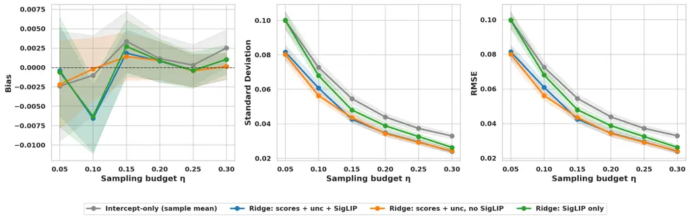

(a) Aesthetics

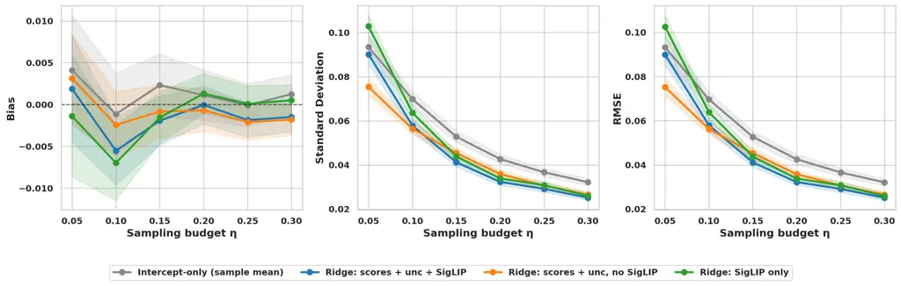

(b) Trustworthiness

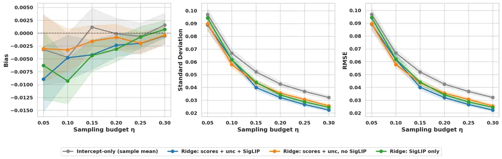

(c) Typicality

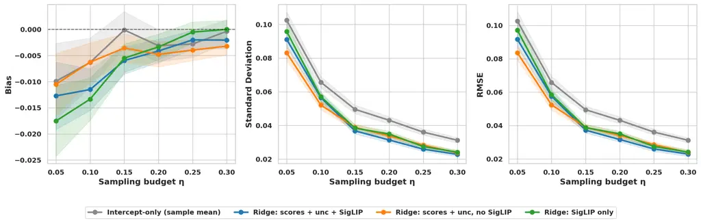

(d) Exemplar Goodness

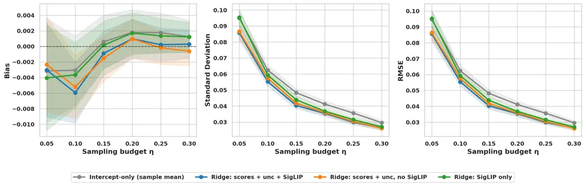

(e) Usability

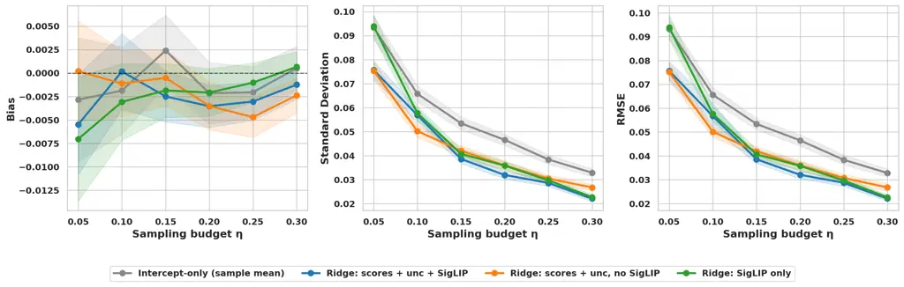

(f) Average (across all outcomes)

Figure 7: WebDesign (Universities) AEE estimator quality: bias, SD, and
RMSE vs. sampling budget $`\eta`$, per perceptual outcome and averaged.
Lower is better. The full hybrid model achieves the lowest estimator
variance for most outcomes.

##### Outcome model quality (Figure 8).

Figure 8 traces the out-of-fold predictive performance of each outcome
model as a function of $`\eta`$. Even at the smallest budget
($`\eta{=}0.05`$, roughly 30–40 websites), the full model achieves
nontrivial $`R^{2}`$ and Spearman correlation for several outcomes,
demonstrating that VLM judge scores and SigLIP embeddings together
provide a strong prior that makes efficient use of limited human labels.
Outcome-model quality improves consistently with budget, and the full
hybrid model leads on $`R^{2}`$ and Spearman for most outcomes, matching
the pattern observed in the static ablation (Table 5).

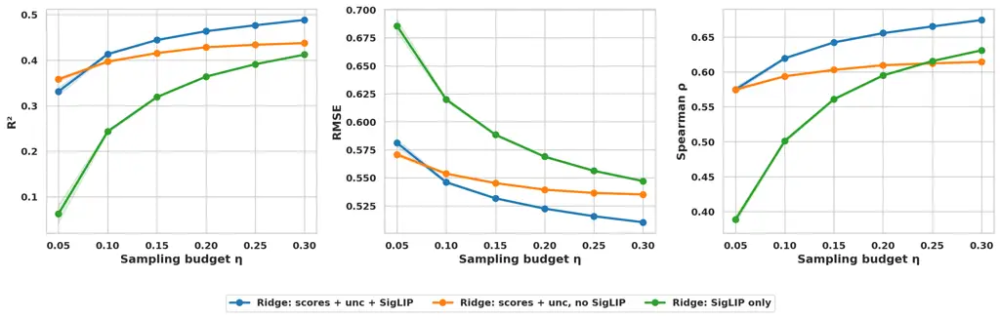

(a) Aesthetics

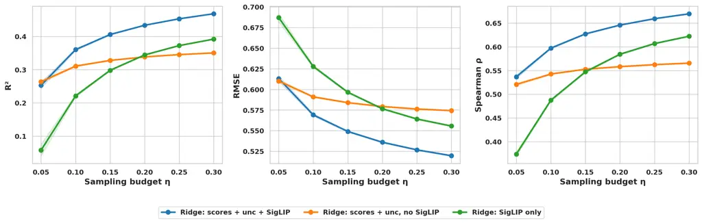

(b) Trustworthiness

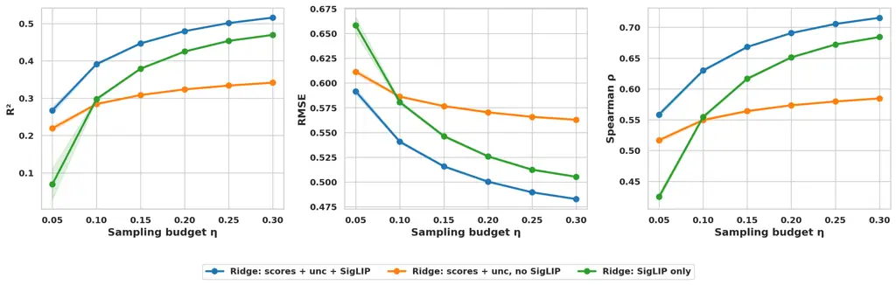

(c) Typicality

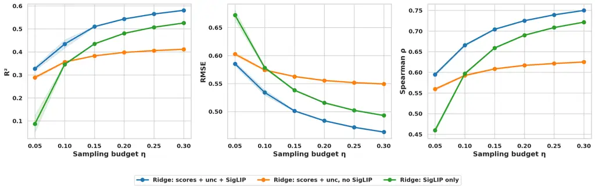

(d) Exemplar Goodness

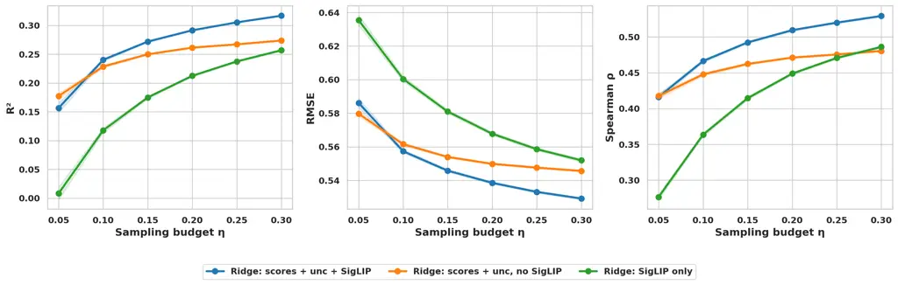

(e) Usability

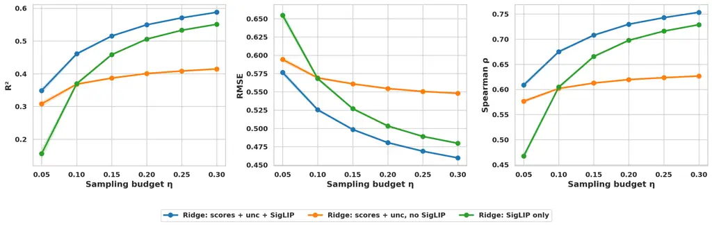

(f) Average (across all outcomes)

Figure 8: WebDesign (Universities) outcome model quality vs. sampling
budget $`\eta`$: out-of-fold $`R^{2}`$, RMSE, and Spearman $`\rho`$ per
perceptual outcome and averaged. Higher $`R^{2}`$/Spearman and lower
RMSE are better. The full model leads on most outcomes.

## Appendix B Model-Judge Scoring Protocol

For each item, we query a panel of language or vision-language judges
through a unified API endpoint. Prompts enforce strict scalar outputs to
reduce parse ambiguity and improve comparability across models. We use
fixed templates:

Essay scoring (LLMs).

> You are an essay grader. You will be given a student essay and its
> writing prompt.  
> Rate the essay’s holistic quality on a scale of 1 to 6:  
> 1 = Very poor, 2 = Poor, 3 = Below average, 4 = Above average, 5 =
> Good, 6 = Excellent.  
> You MUST respond with ONLY a single digit (1, 2, 3, 4, 5, or 6).  
> No explanation, no reasoning, no other text - just the number.

> Essay prompt: {prompt_name}
>
> Essay:  
> {full_text}

Each judge receives this system and user text; we take the first
substring matching a digit in $`\{1,\dots,6\}`$ as the score (same rule
as in the scoring script).

Web-design scoring (VLMs).

> You are a strict visual evaluator. Return only the requested six
> lines.

> Rate this screenshot from a {domain_label} on six dimensions.  
> Return ONLY six integer scores in \[-3, -2, -1, 0, 1, 2, 3\], one per
> line, exactly:  
> AE: \<score\>  
> TRU: \<score\>  
> TYP: \<score\>  
> EXMPL: \<score\>  
> AVG: \<score\>  
> US: \<score\>
>
> Definitions:
>
> - AE (Aesthetics): visually appealing overall design.
> - TRU (Trustworthiness): appears credible and trustworthy.
> - TYP (Typicality): {prompt_typ}
> - EXMPL (Exemplar Goodness): {prompt_exmpl}
> - AVG (Family Resemblance): {prompt_avg}
> - US (Usability): easy to navigate and understand.

The placeholders {domain_label}, {prompt_typ}, {prompt_exmpl}, and
{prompt_avg} are filled from a domain table (university/college,
commercial-bank, online fashion-shopping, online homeware-shopping)
matching our dataset splits. Each judge receives this user text together
with one screenshot (system role as above); responses are parsed as six
lines of the form AE: $`\ldots`$, TRU: $`\ldots`$, etc.

Machine translation scoring (LLMs).

> You are a professional MQM annotator following the official WMT MQM
> human evaluation guidelines at the segment level.  
> Identify up to five target-side errors, each with a category
> (Accuracy, Fluency, Terminology, Style, Locale conventions, or Other,
> including subcategories such as Mistranslation or Grammar; also Source
> error or Non-translation when applicable), a severity (Major, Minor,
> or Neutral), and the exact span from the source or hypothesis.  
> If the translation is too garbled or unrelated to the source, return
> exactly one error: Non-translation with severity Major.  
> Source errors are listed separately and do not count toward the five
> target-error limit.  
> Do not double-count the same underlying issue; when multiple issues
> overlap one span, keep only the most severe; when severities tie,
> prefer Accuracy $`>`$ Fluency $`>`$ Terminology $`>`$ Style $`>`$
> Locale conventions $`>`$ Other.  
> Be conservative and return JSON only (no prose outside the object).

> \[Source\]  
> {source}
>
> \[Hypothesis\]  
> {hypothesis}
>
> Return JSON only: a single object with an errors array; each entry has
> string fields category, severity, and span.

Each judge receives the source segment and the system hypothesis
(machine translation) and returns structured segment-level MQM
annotations in that JSON format.

For every API response, we log token-level statistics (including
per-token log probabilities and top alternatives when available) and
derive uncertainty summaries such as mean token entropy and perplexity.
Failed requests are retried with bounded concurrency and backoff;
unresolvable failures are marked NA and excluded from
successful-completion counts during resume runs.

## Appendix C Additional results

### C.1 Properties of the estimating equation estimator

In this section, we will present the theoretical properties of the
estimating equation estimator.

###### Theorem 1 (Consistency and asymptotic normality of the AEE estimator).

Let $`\theta^{\star}\in\Theta\subset{\mathbb{R}}^{p}`$ be the unique
solution to

```math
\Psi(\theta,\gamma^{\star}):={\mathbb{E}\left\{m(Y,S,X;\theta,\gamma^{\star})\right\}}=0.
```

Assume:

1.  1.  Identification. $`\theta^{\star}`$ is the unique zero of
        $`\Psi(\theta,\gamma^{\star})`$ in a neighborhood of the truth.
2.  2.  Positivity and MAR. There exists $`\epsilon>0`$ such that
        $`\pi^{\star}(X)\geq\epsilon`$ almost surely, and
        $`S\perp Y\mid X`$.
3.  3.  Smoothness. The map $`\theta\mapsto m(Y,S,X;\theta,\gamma)`$ is
        continuously differentiable near $`\theta^{\star}`$, and

    ```math
    A:={\mathbb{E}\left\{\nabla_{\theta}m(Y,S,X;\theta^{\star},\gamma^{\star})\right\}}
    ```

    exists and is nonsingular.

4.  4.  Nuisance estimation.
        $`\|\widehat{\gamma}-\gamma^{\star}\|=o_{p}(1)`$ and

    ```math
    \mathbb{E}_{N}\!\left[m(Y,S,X;\theta^{\star},\widehat{\gamma})\right]-\mathbb{E}_{N}\!\left[m(Y,S,X;\theta^{\star},\gamma^{\star})\right]=o_{p}(N^{-1/2}).
    ```

    This holds, for example, under Neyman orthogonality together with
    standard consistency rates for the nuisance estimators.

5.  5.  Empirical process control. A uniform law of large numbers and a
        central limit theorem hold for the relevant class of score functions
        in a neighborhood of $`(\theta^{\star},\gamma^{\star})`$.

If $`\widehat{\theta}`$ satisfies

```math
\mathbb{E}_{N}\!\left[m(Y,S,X;\widehat{\theta},\widehat{\gamma})\right]=o_{p}(N^{-1/2}),
```

then $`\widehat{\theta}\overset{p}{\to}\theta^{\star}`$. Moreover,

```math
\sqrt{N}(\widehat{\theta}-\theta^{\star})=-A^{-1}\frac{1}{\sqrt{N}}\sum_{i=1}^{N}m(Y_{i},S_{i},X_{i};\theta^{\star},\gamma^{\star})+o_{p}(1),
```

and hence

```math
\sqrt{N}(\widehat{\theta}-\theta^{\star})\rightsquigarrow\mathcal{N}(0,\Sigma_{\theta}),\qquad\Sigma_{\theta}=A^{-1}BA^{-T},
```

where

```math
B={\mathbb{E}\left\{m(Y,S,X;\theta^{\star},\gamma^{\star})m(Y,S,X;\theta^{\star},\gamma^{\star})^{\top}\right\}}.
```

###### Corollary 1 (Consistency of the sandwich variance estimator).

If, in addition, $`\widehat{A}\overset{p}{\to}A`$ and
$`\widehat{B}\overset{p}{\to}B`$, then

```math
\widehat{{\operatorname{Var}\left\{\widehat{\theta}\right\}}}=\frac{1}{n}\widehat{A}^{-1}\widehat{B}\widehat{A}^{-T}
```

is a consistent estimator of the asymptotic covariance of
$`\widehat{\theta}`$.

###### Remark 1.

This theorem applies directly to the augmented estimating equations for
the population mean and quantiles introduced above. In those cases, the
nuisance functions are the labeling propensity $`\pi(X)`$ together with
the regression adjustments $`\mu(X)`$ or $`\phi(X;\theta)`$. Neyman
orthogonality is especially useful because it makes the estimator
insensitive, to first order, to regularization bias from flexible
nuisance fits.

### C.2 Proof of Theorem 1

###### Proof.

Consistency follows from standard $`Z`$-estimation arguments. By the
uniform law of large numbers and nuisance consistency,

```math
\sup_{\theta\in\Theta}\left\|\mathbb{E}_{N}[m(Y,S,X;\theta,\widehat{\gamma})]-\Psi(\theta,\gamma^{\star})\right\|=o_{p}(1).
```

Since $`\Psi(\theta,\gamma^{\star})`$ has a unique zero at
$`\theta^{\star}`$, any approximate empirical root must converge in
probability to $`\theta^{\star}`$.

For asymptotic normality, expand the empirical moment around
$`(\theta^{\star},\gamma^{\star})`$:

```math
0=\mathbb{E}_{N}[m(Y,S,X;\widehat{\theta},\widehat{\gamma})]=\mathbb{E}_{N}[m(Y,S,X;\theta^{\star},\gamma^{\star})]+A(\widehat{\theta}-\theta^{\star})+r_{N},
```

where $`r_{n}=o_{p}(n^{-1/2})`$ by differentiability, stochastic
equicontinuity, and the assumed negligible first-order effect of
nuisance estimation. Rearranging gives

```math
\sqrt{N}(\widehat{\theta}-\theta^{\star})=-A^{-1}\sqrt{N}\,\mathbb{E}_{N}[m(Y,S,X;\theta^{\star},\gamma^{\star})]+o_{p}(1).
```

The multivariate central limit theorem yields

```math
\sqrt{N}\,\mathbb{E}_{N}[m(Y,S,X;\theta^{\star},\gamma^{\star})]\rightsquigarrow\mathcal{N}(0,B),
```

and Slutsky’s theorem implies the stated Gaussian limit with covariance
$`A^{-1}BA^{-T}`$. ∎

## Appendix D Extension: constrained Weighting Optimization for Adaptive Sampling

### D.1 Framework

Suppose we can learn a good outcome model from the one round of
labeling, we can then solve a constrained weighting objective to
optimize future sampling schema under a fixed budget when the goal is to
estimate the population summary metrics. We use population means as an
example. Formally, we want to solve the following problem:

```math
\min_{\sigma}\sum_{i}\frac{r_{i}^{2}}{e(x_{i})}\quad\text{subject to}\quad\frac{1}{N}\sum_{i}e(x_{i})\leq\eta,
```

where $`e(x_{i})=\pi+(1-\pi)\sigma(b+x_{i}^{\top}\beta)`$ is the
inclusion probability for item $`i`$, and $`b`$ and $`\beta`$ are the
parameters of the outcome model. We use an augmented Lagrangian approach
with a hinge-squared penalty for constraint violations. This formulation
encourages larger weights on high-residual items while enforcing a
global sampling-rate cap.

We propose the following finite-population labeling workflow:

1.  1.  Draw an initial random sample (stage 1), collect human labels, and
        fit an outcome model $`f`$.
2.  2.  Fit a propensity model $`\sigma`$ from features (primarily embedding
        PCs) to approximate hardness-informed inclusion scores.
3.  3.  Sample additional items adaptively (stage 2) using probabilities
        derived from $`\sigma`$ under an overall budget $`\eta`$.
4.  4.  Estimate the population mean using the AEE estimator that combines
        inverse-propensity correction with outcome-model augmentation.

This objective prioritizes high-residual items while enforcing a global
sampling-rate cap. This is relevant to active statistical inference
literature: (Li et al., 2025; Hamilton et al., 2025).

### D.2 Variance characterization of the AEE estimator

First, let’s think about the variance of the AEE estimator. For
simplicity, let’s assume that the outcomes are i.i.d. draws from a super
population $`(y,x)`$ from some distribution $`P`$. Then, we can write
the AEE estimator as

```math
\displaystyle\widehat{\mu}=\frac{1}{N}\sum_{i}\frac{S_{i}(y_{i}-f(x_{i}))}{e(x_{i})}+f(x_{i}).
```

Due to independence, the variance of $`\widehat{\mu}`$ is given by

```math
\displaystyle\frac{1}{N}{\operatorname{Var}\left\{\frac{S(y-f(x))}{e(x)}+f(x)\right\}}.
```

Now we compute the variance term. First, notice the following
decomposition:

```math
\displaystyle\frac{S(y-f(x))}{e(x)}+f(x)
```

```math
\displaystyle= \displaystyle\underbrace{\frac{S(y-f^{\star}(x))}{e(x)}}_{\text{Term I}}+\underbrace{f^{\star}(x)}_{\text{Term II}}+\underbrace{\frac{(S-e(x))(f^{\star}(x)-f(x))}{e(x)}}_{\text{Term III}},
```

Note that Term I, II and III are mutually orthogonal, i.e.

```math
\displaystyle{\operatorname{Cov}\left\{\text{Term I},\text{Term II}\right\}}= \displaystyle 0
```

```math
\displaystyle{\operatorname{Cov}\left\{\text{Term I},\text{Term III}\right\}}= \displaystyle 0
```

```math
\displaystyle{\operatorname{Cov}\left\{\text{Term II},\text{Term III}\right\}}= \displaystyle 0.
```

Therefore, the variance of $`\widehat{\mu}`$ is given by

```math
\displaystyle\frac{1}{N}{\operatorname{Var}\left\{\text{Term I}\right\}}+\frac{1}{N}{\operatorname{Var}\left\{\text{Term II}\right\}}+\frac{1}{N}{\operatorname{Var}\left\{\text{Term III}\right\}}.
```

Now we compute the variance of each term.

```math
\displaystyle{\operatorname{Var}\left\{\text{Term I}\right\}}={\mathbb{E}\left\{\frac{\sigma^{*2}(x)}{e(x)}\right\}}.
```

For Term II, we have

```math
\displaystyle{\operatorname{Var}\left\{\text{Term II}\right\}}={\mathbb{E}\left\{(f^{\star}(x)-\mu)^{2}\right\}}.
```

For Term III, we have

```math
\displaystyle{\operatorname{Var}\left\{\text{Term III}\right\}}={\mathbb{E}\left\{\frac{(1-e(x))(f^{\star}(x)-f(x))^{2}}{e(x)}\right\}}.
```

Therefore we summarize two forms of the variance of the AEE estimator:

- •
  Form 1:

  ```math
  \displaystyle{\operatorname{Var}\left\{\widehat{\mu}\right\}}=\frac{1}{N}{\mathbb{E}\left\{\frac{\sigma^{*2}(x)}{e(x)}+(f^{\star}(x)-\mu)^{2}+\frac{(1-e(x))(f^{\star}(x)-f(x))^{2}}{e(x)}\right\}}.
  ```

- •
  Form 2:

  ```math
  \displaystyle{\operatorname{Var}\left\{\widehat{\mu}\right\}}=\frac{1}{N}{\mathbb{E}\left\{\frac{(y-f(x))^{2}}{e(x)}+(f^{\star}(x)-\mu)^{2}-(f^{\star}(x)-f(x))^{2}\right\}}.
  ```

##### What are we actually optimizing when we optimize the propensity score?

From Form 1, we can see that given a fixed propensity model, we can
benefit from fitting a better outcome model to reduce the variance of
the AEE estimator.

From Form 2, we can see that given a fixed outcome model, we can benefit
from fitting a better propensity model to reduce the variance of the AEE
estimator. More importantly, the best choice of propensity model should
be proportional to the square root of the conditional quadratic error of
the outcome model. To show this, let’s try to optimize the propensity
model based on Form 2. Define the conditional squared error as:

```math
\displaystyle\sigma^{2}_{f}(x)={\mathbb{E}\left\{(y-f(x))^{2}\mid x\right\}}.
```

When $`f=f^{\star}`$, we have $`\sigma^{2}_{f}(x)=\sigma^{*2}(x)`$. By
Cauchy-Schwarz inequality, we have

```math
\displaystyle{\mathbb{E}\left\{\sigma_{f}(x)\right\}}^{2}\leq{\mathbb{E}\left\{\frac{\sigma^{2}_{f}(x)}{e(x)}\right\}}\cdot{\mathbb{E}\left\{e(x)\right\}}\leq\eta{\mathbb{E}\left\{\frac{\sigma^{2}_{f}(x)}{e(x)}\right\}}.
```

Therefore, we have the following lower bound:

```math
\displaystyle{\mathbb{E}\left\{\frac{\sigma^{2}_{f}(x)}{e(x)}\right\}}\geq\frac{{\mathbb{E}\left\{\sigma_{f}(x)\right\}}^{2}}{\eta}.
```

The equality holds when

```math
\displaystyle e(x)\propto\sigma_{f}(x).
```

That is, the best choice of propensity model should be proportional to
the square root of the conditional quadratic error of the outcome model.
This is consistent with the intuition that we should sample more items
that are harder to predict.

### D.3 Synthetic experiments on summary metrics

To isolate the benefit of adaptive sampling under controlled
heteroskedasticity, we construct a synthetic labeling environment that
inherits the covariate structure of the real PERSUADE corpus but
replaces human scores with outcomes drawn from a known data-generating
process (DGP).

#### D.3.1 Data-Generating Process

Let $`e_{i}\in\mathbb{R}^{d}`$ denote the OpenAI text embedding for
essay $`i`$, and let $`\bar{\ell}_{i}`$ be the average LLM-judge score
across the model panel. We compute principal components from the
standardised embedding matrix and define the conditional mean

```math
\mu_{i}\;=\;\sum_{j=1}^{5}\mathrm{PC}_{ij}\;+\;\bar{\ell}_{i},
```

so that the outcome depends on both intrinsic essay features (through
the first five PCs) and the aggregate model-judge signal. Conditional
variance is heteroskedastic in the first principal component:

```math
\sigma_{i}^{2}\;=\;0.1\,\exp\bigl(\lambda\,\mathrm{PC}_{i1}\bigr),
```

with $`\lambda>0`$ governing the severity of heteroskedasticity. For
each item we draw

```math
Y_{i}\;\sim\;\mathcal{N}\!\bigl(\mu_{i},\;\sigma_{i}^{2}\bigr).
```

This DGP makes high-PC1 items intrinsically noisier while low-PC1 items
remain relatively clean, creating a directional heteroskedasticity that
the propensity model can exploit by selectively oversampling the noisy
tail.

#### D.3.2 Simulation Protocol

We sweep $`\lambda\in\{0.5,1.0,1.5,2.0,2.5,3.0\}`$ to trace the effect
of increasing heteroskedasticity. For each value of $`\lambda`$, the
synthetic outcomes are generated once and held fixed across Monte Carlo
trials. Each trial then executes one of three estimation strategies
under a common total labeling budget $`\eta`$:

1.  1.  Baseline 1 (Direct Sample Mean). Draw $`\lfloor\eta N\rfloor`$ items
        uniformly at random, collect their labels, and report the sample
        mean.
2.  2.  Baseline 2 (One-Stage estimation). Draw $`\lfloor\eta N\rfloor`$
        items uniformly, fit an outcome model $`\widehat{f}`$ by ridge
        regression on embedding PCs, and form an AEE estimator with constant
        propensity $`e(x_{i})=\eta`$.
3.  3.  Two-Stage Adaptive estimation. Draw a stage-1 pilot sample at rate
        $`\pi<\eta`$. Fit an outcome model $`\widehat{f}`$ and compute
        squared residuals $`r_{i}^{2}=(Y_{i}-\widehat{f}(x_{i}))^{2}`$ on
        the pilot. Fit a propensity model $`\sigma(x_{i})`$ on embedding PCs
        to predict hardness, then draw stage-2 items with inclusion
        probability $`e(x_{i})=\pi+(1-\pi)\sigma(x_{i})`$ subject to a
        mean-budget constraint $`\frac{1}{N}\sum_{i}e(x_{i})\leq\eta`$.
        Combine both stages via an AEE estimator with item-specific
        propensities $`e(x_{i})`$.

The propensity model solves the constrained weighting problem described
above using an augmented Lagrangian optimizer, where
$`e(x_{i})=\pi+(1-\pi)\,\sigma(b+x_{i}^{\top}\beta)`$ and $`(b,\beta)`$
are chosen to minimize $`\sum_{i}r_{i}^{2}/e(x_{i})`$ subject to
$`\frac{1}{N}\sum_{i}e(x_{i})\leq\eta`$. We allow separate PCA
dimensionalities for the outcome model and the propensity model.

Performance is assessed by the root mean squared error (RMSE) of each
estimator relative to the true population mean
$`\mu=N^{-1}\sum_{i}\mu_{i}`$, computed over repeated Monte Carlo
trials. We additionally report bias and standard deviation to diagnose
whether improvements stem from variance reduction or bias correction.

#### D.3.3 Synthetic Simulation Results

Figure 9 reports the bias, variance, and MSE of all three estimators as
$`\lambda`$ increases. The direct sample mean (Baseline 1) maintains
near-zero bias but its variance stays flat and high across all
$`\lambda`$ values, as uniform sampling cannot adapt to the
heteroskedastic noise structure. The one-stage AEE estimator
(Baseline 2) substantially reduces variance relative to the direct mean
at low $`\lambda`$ by leveraging the outcome model, but its variance
grows steadily with $`\lambda`$ as residual heteroskedasticity
overwhelms the constant-propensity correction. The two-stage adaptive
AEE estimator achieves the lowest MSE across all $`\lambda`$ values. Its
advantage widens as heteroskedasticity increases: at $`\lambda=3.0`$ the
two-stage MSE is roughly half that of the one-stage AEE estimator and
over an order of magnitude below the direct mean. All three estimators
remain approximately unbiased throughout the sweep, confirming that the
MSE gains are driven entirely by variance reduction through adaptive
allocation of the labeling budget toward the noisy tail of the PC1
distribution.

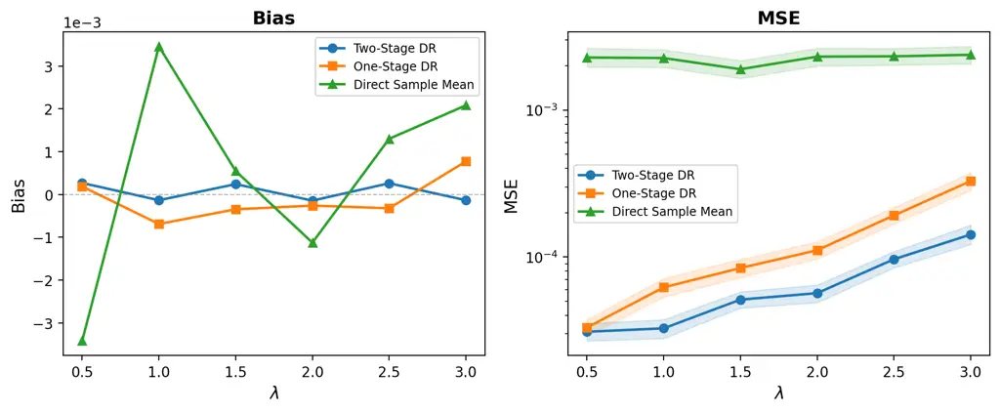

Figure 9: Synthetic simulation: bias and MSE of three population-mean
estimators as a function of the heteroskedasticity
parameter $`\lambda`$. Budget $`\eta=0.40`$, pilot rate $`\pi=0.15`$,
400 Monte Carlo trials per $`\lambda`$ value.

#### D.3.4 Sensitivity to Pilot Rate and Budget

We next fix $`\lambda=1.5`$ and study how estimation quality depends on
the pilot rate $`\pi`$ and the total budget $`\eta`$.

##### Varying $`\pi`$ (fixed $`\eta=0.40`$).

Figure 10 sweeps $`\pi\in\{0.05,0.10,\ldots,0.30\}`$. Because the
baselines use the full budget $`\eta`$ in a single uniform draw, their
MSE is invariant to $`\pi`$. The two-stage AEE estimator is relatively
stable across this range, with a slight optimum near $`\pi=0.15`$; very
small pilots ($`\pi=0.05`$) leave the outcome model under-trained, while
large pilots ($`\pi\geq 0.25`$) consume too much budget before the
adaptive stage can act. All estimators remain approximately unbiased.

##### Varying $`\eta`$ (fixed $`\pi=0.15`$).

Figure 11 sweeps $`\eta\in\{0.20,0.25,\ldots,0.45\}`$. As expected, MSE
decreases monotonically with budget for all three methods. The two-stage
AEE estimator maintains a consistent advantage over both baselines at
every budget level: even at the tightest budget ($`\eta=0.20`$) it
achieves lower MSE than the direct mean at $`\eta=0.45`$. The relative
improvement of two-stage AEE estimator over one-stage AEE estimator is
largest at small $`\eta`$, where the adaptive allocation of the scarce
remaining budget after the pilot is most valuable.

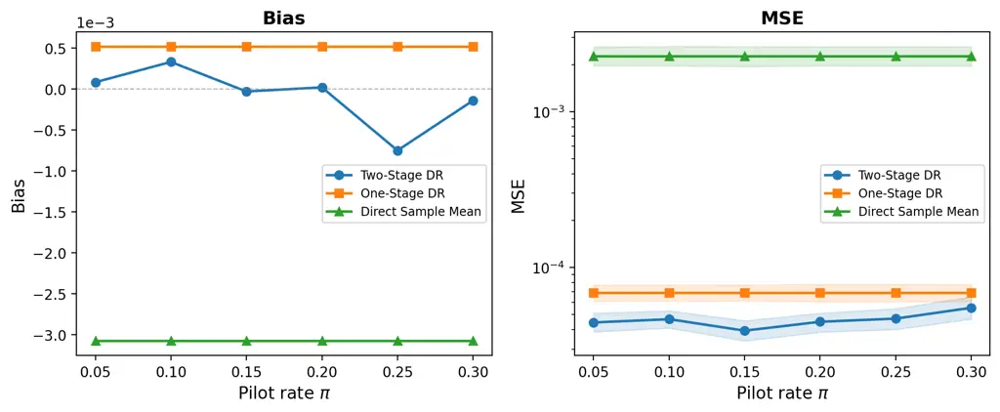

Figure 10: Sensitivity to pilot rate $`\pi`$ with fixed budget
$`\eta=0.40`$ and $`\lambda=1.5`$. Left: bias; right: MSE (log scale).
400 trials per setting.

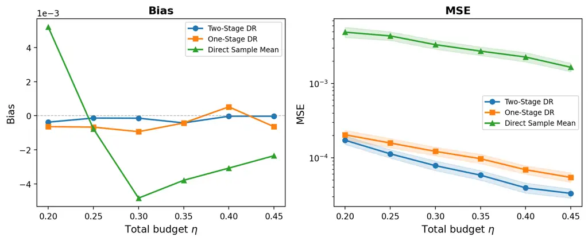

Figure 11: Sensitivity to total budget $`\eta`$ with fixed pilot rate
$`\pi=0.15`$ and $`\lambda=1.5`$. Left: bias; right: MSE (log scale).
400 trials per setting.
