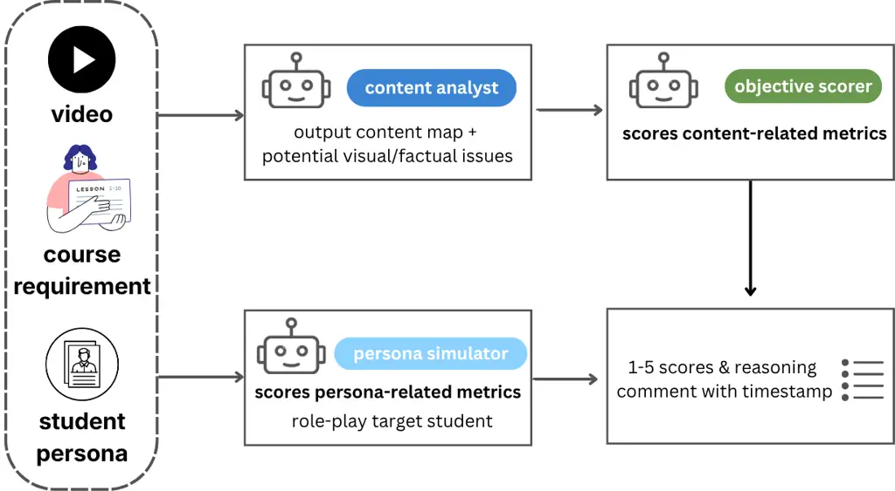
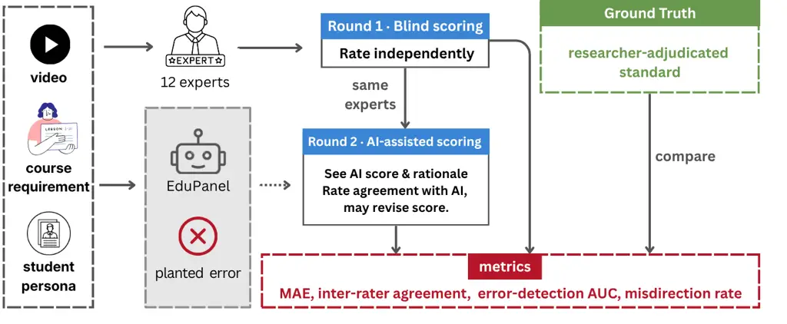
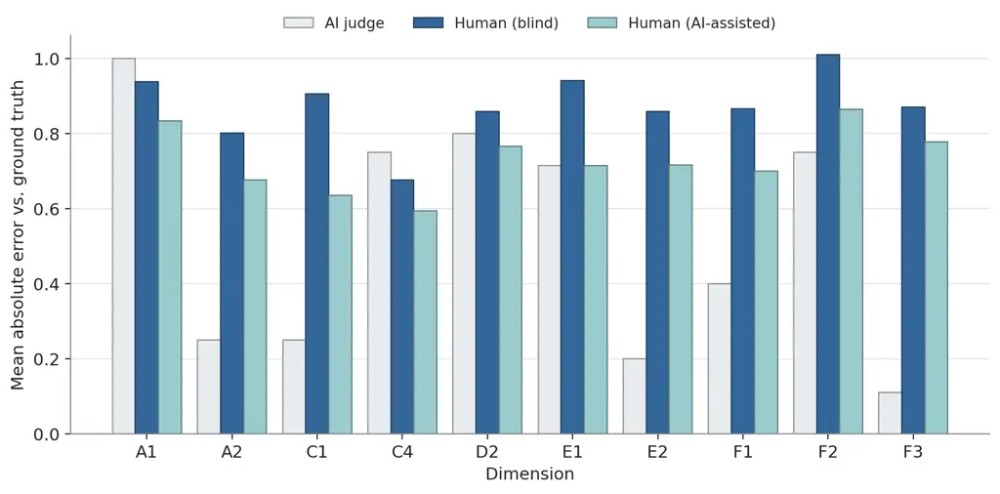
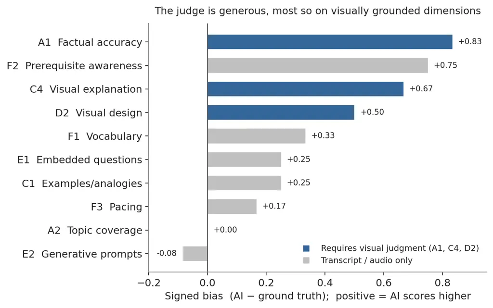
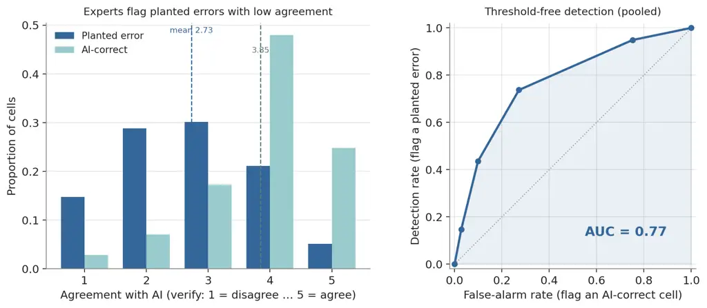

# EduPanel: A Three-Agent LLM Judge for Teaching Videos — Reliability, Complementarity, and Human Trust Calibration

Jia-Kai Dong Affiliation:  National Taiwan University
Email: [b11901067@ntu.edu.tw](mailto:)    Yi-Cheng Lin Affiliation: 
National Taiwan University    Hung-yi Lee Affiliation:  National Taiwan
University Affiliation:  NTU Artificial Intelligence Center of Research
Excellence

###### Abstract

Teaching videos are becoming a major medium for education, creating a
growing need for scalable evaluation of their pedagogical quality.
Existing automatic judges do not fully address this setting because
teaching quality depends on multimodal evidence and should be evaluated
with respect to the intended learner rather than as a universal
property. We present EduPanel, a rubric-grounded, learner-conditioned
LLM judge that decomposes evaluation across specialized agents to
produce interpretable assessments for different aspects of teaching
quality. Across expert studies, architecture ablations, and
learner-persona analyses, EduPanel achieves reliability comparable to a
median human expert. In expert evaluation, its feedback improves scoring
accuracy (MAE 0.87→0.73), while experts remain able to detect unreliable
outputs (AUC = 0.77) instead of accepting them blindly. These results
suggest that EduPanel can serve as an effective assistant for
educational evaluation rather than a replacement for human experts.

## 1 Introduction

Instructional videos have become a major medium for education, from
online courses and flipped classrooms to AI-generated educational
content \[34, 17, 8, 43\]. As AI lowers the cost of producing
instructional videos, the supply of educational content is rapidly
expanding. This abundance creates a new challenge: learners and
educators must increasingly identify which videos are pedagogically
suitable for a particular learner, rather than merely find content that
is factually correct. Reliable automatic evaluation could provide
scalable feedback, help identify videos requiring revision before
deployment, and reduce the cost of expert review. Human evaluation
against pedagogical rubrics remains the gold standard \[29\], but it is
difficult to scale. Applying a pedagogical rubric requires trained
raters, repeated viewing, and careful comparison between narration,
visual presentation, learning objectives, and intended audience.
Moreover, many aspects of teaching quality are inherently subjective,
limiting agreement even among experienced evaluators \[29\]. Large
language models (LLMs) have therefore become increasingly popular as
automatic judges of open-ended outputs \[42, 22, 19, 15\]. Yet
pedagogical evaluation differs from the text-quality settings where LLM
judges have primarily been studied in two important ways. First, the
signal is inherently _multimodal_. Judgments about pacing, on-screen
worked examples, and whether narration aligns with the visual
presentation depend on what is _shown_, not only what is said. Although
recent video–language models can describe and reason over video content
\[26, 41\], existing LLM judges are not designed to incorporate such
multimodal evidence. Second, and central to this paper, pedagogical
quality is inherently _learner-dependent_: the same instructional
material may be effective for one student but inappropriate for another.
For example, a mathematically detailed explanation of neural networks
may benefit advanced students but overwhelm beginners who lack the
necessary prerequisites. Effective teaching therefore depends on the
learner’s prior knowledge and expertise \[18\], which a
learner-independent judge cannot capture.

We introduce EduPanel, a multimodal, rubric-grounded judge that
evaluates teaching videos with respect to a specified learner, rather
than assigning a single learner-independent quality score. Recent work
has explored simulated learners for educational applications \[25\]; in
contrast, we use learner profiles as an evaluation condition, allowing
the same video to be assessed differently for different intended
audiences.

Evaluating a teaching video requires several distinct forms of
reasoning. An evaluator must reconstruct and fact-check what the video
teaches, assess its alignment with the course specification, and
determine whether the instruction is appropriate for the target learner.
Rather than asking a single model to perform all of these tasks,
EduPanel decomposes the evaluation across three specialized agents. This
decomposition follows the structure of the evaluation itself, allowing
each agent to focus on a different source of evidence and type of
judgment. It also makes the evaluation more transparent: each score is
accompanied by an inspectable content map, identified issues, and
supporting rationale instead of a single opaque score. Section 3.2
describes the architecture in detail.

Having built such a system, we argue that evaluating it should go beyond
whether it _agrees_ with human raters. A practical judge should not only
produce accurate scores, but also _complement_ experts by identifying
problems they miss rather than merely reproducing their judgments \[37,
12, 27, 15\]. Moreover, if the judge is intended to assist rather than
replace experts, its commentary should serve as a reference signal that
experts can critically verify, adopting useful suggestions while
remaining able to detect incorrect ones.

We therefore evaluate EduPanel from three perspectives: evaluation
reliability, design factors, and usefulness in expert workflows.

#### Research questions.

RQ1 (evaluation quality): How reliably does EduPanel evaluate teaching
videos, and how does its behavior vary across rubric dimensions and
information modalities? RQ2 (design validation): Which design choices,
including video access, learner conditioning, and agent decomposition,
contribute to EduPanel’s behavior? RQ3 (practical utility): Does
EduPanel provide useful and critically verifiable assistance in an
expert evaluation workflow, including complementary error detection?

We answer these questions through the following contributions.

#### Contributions.

1.  1.  We introduce EduPanel, an open-source, multimodal, rubric-grounded,
        learner-conditioned three-agent judge for teaching videos¹¹ 1
        [https://github.com/snooow1029/edupanel](https://github.com/snooow1029/edupanel)
        (Sections 3.2, 4.3).
2.  2.  We show that learner conditioning and agent decomposition enable
        evaluation tailored to intended learners while providing inspectable
        intermediate evidence.
3.  3.  We provide a system-level evaluation of EduPanel, including
        per-dimension reliability analysis, persona sensitivity, and
        architecture and input ablations (Sections 4.1–4.3).
4.  4.  We evaluate EduPanel in a realistic expert workflow and show that
        its commentary improves expert scoring while contributing
        complementary observations. A planted-error study further shows that
        experts can distinguish unreliable outputs from reliable ones
        ($`\mathrm{AUC}=0.77`$), indicating that they use the judge
        critically rather than accepting it wholesale (Sections 4.4, 4.5).

Our experiments are conducted on a deliberately small, curated benchmark
consisting of 12 videos, 10 evaluation dimensions, four subject domains,
and one deployed backbone.

Accordingly, our conclusions concern the proposed system and its
calibration rather than population-level estimates.

## 2 Related Work

#### From LLM judges to multimodal, multi-agent judges.

LLMs are now widely used as judges of open-ended outputs, reaching high
agreement with human preferences \[42, 22, 19\], though with known
biases and typically meta-evaluated against curated, text-only
benchmarks \[15, 21\]. Two extensions bring this closer to our setting.

First, multimodal models enable judging beyond text-only outputs by
incorporating visual and audio-visual signals \[7, 41\]. However,
existing judges primarily target images or short clips, and to our
knowledge no prior judge evaluates full-length teaching videos along
_pedagogical_ dimensions. Second, decomposing evaluation across
_role-differentiated agents_ has been used to structure evaluative
reasoning \[11, 6\]. We build on both threads but change both the
evaluation _target_ and the purpose of the decomposition. Whereas prior
judges estimate response quality as an absolute property, EduPanel
performs learner-conditioned evaluation of educational videos by
estimating _pedagogical fitness_, namely quality relative to a specific
learner. It uses role decomposition to improve _auditability and
role-level controllability_ rather than aggregate accuracy. It is
studied not only as an evaluator but as a member of a human rating
workflow.

#### Generating and assessing teaching content.

A growing line of work focuses on automatically generating instructional
and presentation videos from lecture material, slides, scripts, or
research papers \[34, 17, 8, 43\]. Several of these pipelines even
introduce their own generation-time quality metrics, such as
VLM-as-a-judge aesthetic scores and knowledge-recovery quizzes \[8,
43\]—but these ask whether information is _conveyed_, not whether a
video teaches well. Educational assessment proper, by contrast, has
moved from human rubric instruments such as CLASS \[29\] to LLM-based
rubric grading of student and teaching artifacts \[38, 10\], yet remains
almost entirely _text_-based (essays, transcripts, short answers) and
graded against an _absolute_ rubric. EduPanel sits in the gap these two
lines leave open and differs on both axes: it scores the _video_ on
dimensions that turn on what is shown, and it scores _pedagogical
fitness_ for a specified learner rather than absolute quality—so it
could in principle serve as an automatic quality gate or
formative-feedback signal for the generation pipelines above, an
application we do not evaluate here.

#### Personalized, learner-conditioned evaluation.

Most automated assessment approaches evaluate instructional quality
without explicitly modeling learner characteristics. However,
pedagogical research has long shown that instructional effectiveness
depends on the learner’s prior knowledge and expertise \[18\]. Recent
work shows LLMs can role-play learners with specified backgrounds
convincingly enough to stand in for them \[28\], a capability used in
education to train teachers against synthetic students \[24\]. Closest
to us, Lu and Wang \[23\] simulate diverse student profiles to
_evaluate_ the quality of static question items. We extend this
evaluative use from static items to teaching videos: a persona-simulator
agent scores each video relative to a target learner, so the judge
measures _pedagogical fitness_ for that learner rather than absolute
quality. Crucially, unlike tutoring or role-play uses, treating a
simulated learner as an _evaluator_ is only meaningful if the persona
actually changes the resulting scores; our persona-sensitivity analysis
(Section 4.3) tests exactly this, which prior simulated-learner work
does not establish.

#### Human–AI collaboration and critical use.

Human–AI teams benefit when their errors differ \[33, 2\], but realizing
this benefit is hard: people over-rely on automation, and explanations
do not reliably fix it \[32, 3, 5\]. This raises the question of how
much decision authority to leave with a human when an algorithm is “in
the loop” \[14\]. This evidence, however, concerns reliance on AI
_assistants_ or classifiers—and, more recently, on LLM outputs
\[31\]—rather than on LLMs acting as _evaluators_ whose commentary
experts weigh while scoring. The methodologically closest design is the
human–LLM annotation pipeline of Wang et al. \[39\], where an LLM
labels, a verifier scores label quality, and humans re-annotate
low-confidence cases. We adapt this verify-then-revise structure to
expert rating of teaching videos and ask a question this pipeline leaves
open: whether the judge’s commentary functions as a useful reference
signal that experts adopt _critically_, benefiting from it while
remaining able to detect when it is wrong. To quantify rater consistency
in this workflow, we evaluate reliability using Krippendorff’s
$`\alpha`$ \[20, 16\]. Table 1 summarizes the positioning: prior lines
each cover some of our axes, but to our knowledge none is at once
multimodal, rubric-grounded, and learner-conditioned while also analyzed
as a member of a human rating team—and in particular the pairing of
_learner-conditioned evaluation_ with _analysis inside a human rating
workflow_ is previously unoccupied.

|                                           |        |          |             |            |
| ----------------------------------------- | ------ | -------- | ----------- | ---------- |
|                                           | Multi- | Rubric-  | Learner-    | Human-team |
| Line of work                              | modal  | grounded | conditioned | analysis   |
| LLM-judge bias / benchmarks \[15, 21\]    |        |          |             |            |
| VLM-as-judge \[7, 41\]                    | ✓      | (✓)      |             |            |
| Multi-agent judges \[11, 6\]              |        | (✓)      |             |            |
| Teaching-video generation \[8, 43\]       | ✓      |          |             |            |
| Educational assessment \[38, 10\]         |        | ✓        |             |            |
| Simulated-learner evaluation \[23\]       |        | (✓)      | ✓           |            |
| Simulated learners (role-play) \[28, 24\] |        |          | (✓)         |            |
| This work                                 | ✓      | ✓        | ✓           | ✓          |

Table 1: Positioning against the closest lines of work. ✓$`=`$ a
_central_ concern of the cited line; (✓) $`=`$ present but not a central
claim; blank $`=`$ not addressed. “Human-team analysis” means studying
the judge’s complementarity with, and critical use by, human experts
while they score—not merely agreement with a reference.

## 3 Method

### 3.1 Materials and rubric

We use 12 teaching videos spanning four subject areas (physics, biology,
mathematics, and computer science). Each subject contains one
instructional topic represented by three independently created videos,
yielding four topics and twelve videos in total. Every video is paired
with the course requirement and the target student persona for which it
was authored. The complete list of videos and topics is provided in
Table 7 in Appendix A. The course requirement follows a backward-design
specification consisting of a big concept, topic, target Bloom’s levels,
learning goal, and key learning points. It is provided to the judge
together with the video as part of the evaluation input. The student
persona specifies the intended learner through grade level, attention
budget, and explicit Has/Lacks prerequisite knowledge. The judge
receives the persona together with the video and course requirement. An
example is provided in Appendix A (Figure 6). Videos are evaluated using
a pedagogy rubric containing 24 metrics grouped into six dimensions
(A–F). The rubric is derived from learning-science principles, including
backward design and Bloom’s taxonomy \[40, 4, 1\], multimedia learning
and cognitive load \[36, 35\], cognitive apprenticeship \[9\], and
generative and active learning \[13, 30\]. Dimension F evaluates learner
adaptability through three metrics: vocabulary appropriateness (F1),
prerequisite awareness (F2), and pacing fit (F3). These metrics are
scored with respect to the provided student persona.

#### Metric selection.

The initial rubric contains 24 metrics derived from learning-science
theories. We evaluated these metrics on a separate pilot set of
high-quality teaching videos, disjoint from the 12 evaluation videos.
Several metrics exhibited a ceiling effect, with the judge assigning
near-uniform top scores across the pilot set, limiting their ability to
discriminate between videos. We therefore retained a curated subset of
10 metrics (Table 2) for the main human–AI evaluation. The selected
metrics cover content accuracy and coverage, explanation quality,
generative and active learning, and learner adaptability while excluding
metrics that saturated on the pilot set. Details of the pilot analysis
are provided in Appendix A.

| Code | Dimension                  | needs               | Group      |
| ---- | -------------------------- | ------------------- | ---------- |
| A1   | Factual accuracy           | transcript + visual | Visual     |
| A2   | Topic coverage             | transcript          | Transcript |
| C1   | Examples / analogies       | transcript          | Transcript |
| C4   | Visual explanation power   | transcript + visual | Visual     |
| D2   | Visual design              | visual              | Visual     |
| E1   | Embedded questions         | transcript          | Transcript |
| E2   | Generative prompts         | transcript          | Transcript |
| F1   | Vocabulary appropriateness | transcript          | Transcript |
| F2   | Prerequisite awareness     | transcript          | Transcript |
| F3   | Pacing fit                 | transcript + audio  | Transcript |

Table 2: The 10 evaluated dimensions and their rubric-declared
information modality (needs). Only A1, C4, D2 require visual
information.

### 3.2 The three-agent judge

Figure 1: Architecture of EduPanel, our three-agent judge. A
content-analyst VLM (Agent 1) watches the video and extracts a content
map and potential factual/visual issues; an objective text scorer
(Agent 2) reads Agent 1’s report and scores the objective dimensions
(A1, A2); a persona-simulator VLM (Agent 3) role-plays the target
student and scores the experiential dimensions. Dimension routing is set
by the rubric’s evaluator field; all agents share one backbone
(gemini-3-flash) and each video is scored over three averaged passes.

EduPanel (Figure 1) takes the video together with its course requirement
and student persona, and produces a score from 1 to 5 for each rubric
dimension. All three agents use the same backbone (gemini-3-flash), and
each video is evaluated over three independent passes whose scores are
averaged.

- •
  Agent 1 — content analyst (sees the video): produces a timestamped
  content map and a list of potential factual/visual issues, including
  on-screen figure/diagram correctness.
- •
  Agent 2 — objective scorer (text only): scores the objective
  dimensions from Agent 1’s report.
- •
  Agent 3 — persona simulator (video + persona): scores the
  learner-dependent dimensions using the provided student persona.

The assignment of rubric dimensions is specified by the rubric’s
evaluator field rather than hard-coded into the system: A1 and A2 are
assigned to Agent 2, while the remaining dimensions are assigned to
Agent 3. Both Agent 1 and Agent 3 receive the full video as input,
whereas Agent 2 operates only on Agent 1’s report. The contribution of
this decomposition is evaluated through the ablation studies in
Section 4.2.

### 3.3 Procedure

#### Participants.

The 12 expert raters were recruited from universities in Taiwan. All
held at least an undergraduate degree, had prior teaching experience,
and were compensated for their time.

#### Rating protocol.

Twelve experts rated all 12 videos in two rounds (Figure 2). The
two-round verify-then-revise protocol follows the human–LLM
collaborative annotation framework of Wang et al. \[39\], adapted from
crowd text annotation to expert evaluation of teaching videos. In Round
1 (blind) they watched each video and scored the 10 dimensions
independently, without seeing the AI. In Round 2 (AI-assisted) they saw
the judge’s score and rationale for each cell, recorded their agreement
on a 1–5 scale (_verify_), and could optionally revise their own score.
Participants were instructed that “the assistant can be wrong—verify,
don’t copy”; raters were _not_ told that any scores had been
deliberately manipulated, nor how many, and planted cells were visually
indistinguishable from ordinary AI output.

Figure 2: Two-round rating procedure. The same 12 experts rate blind,
then with AI assistance; some AI scores are deliberately planted errors.

#### Ground truth as researcher adjudication.

Ground truth (GT) was established by a researcher-adjudicator after
reviewing the experts’ blind ratings, their discussion, and the AI’s
commentary.

Because AI feedback was incorporated during adjudication, we
additionally evaluate agreement against an AI-free human consensus,
computed as the trimmed mean of the 12 blind expert ratings after
removing the highest and lowest score for each evaluation cell.

#### Planted errors.

To evaluate experts’ ability to detect unreliable AI feedback, some AI
scores shown in Round 2 were deliberately replaced with planted errors.
These consisted of both false positives (over-praise) and false
negatives (over-criticism), with at most three manipulated cells per
video across the ten evaluation dimensions. Each planted score differed
from the original AI score by at least two points. Candidate planted
errors were screened to ensure that they could be verified from the
video itself. We excluded cases in which expert consensus was unclear or
where identifying the error required off-video domain knowledge. This
process yielded 26 valid planted errors (9 false positives and 17 false
negatives). AI outputs without planted errors served as the negative
class (the 80 AI-correct cells; see Section 3.4) in the detection
analysis. The complete list of planted items and screening decisions is
provided in the supplementary material.

### 3.4 Measures

Our primary evaluation metrics are mean absolute error (MAE), Pearson
correlation ($`r`$), and Krippendorff’s $`\alpha`$. We additionally
report the within-1 rate relative to GT as a secondary metric because it
is less sensitive to differences in score variance. For the
planted-error analysis, we separately evaluate error detection and
behavioral response. Error detection is measured by ROC AUC computed
from agreement ratings on planted and unmodified AI outputs, while
behavioral response is measured by the misdirection rate, namely whether
revised ratings move toward the planted score and away from the
reference. We report cluster-bootstrap 95% confidence intervals by
resampling videos ($`B=5000`$). Additional robustness analyses,
including leave-one-video-out evaluation and ordinal alternatives to the
primary metrics, are provided in Appendix D. Different analyses use
different subsets of the 120 evaluation cells: RQ1 evaluates agreement
on all 120 cells; the expert-assistance analysis uses the 86 completely
unmodified (non-planted) cells; and the planted-error analysis compares
the 26 valid planted errors (excluding 8 of the 34 originally
manipulated cells that were screened out as invalid) against the 80
AI-correct cells (defined as non-planted cells where the AI score is
within 1 point of the ground truth, leaving 6 cells with larger natural
discrepancies excluded).

### 3.5 Reproducibility and release

EduPanel is released as an open-source pipeline together with the full
agent prompts, pedagogy rubric, per-dimension routing, per-video course
requirements and personas, raw outputs from all three passes, the
complete planted-error annotations, and de-identified blind and
AI-assisted ratings (Appendix C). All judge runs use temperature=0,
seed=42, and a pinned gemini-3-flash-preview model snapshot. The
released outputs and ground-truth labels support recomputation of all
quantitative analyses. Because the ground truth was produced through
human adjudication, its construction is documented in Section 3.3 rather
than reproduced by script. We also release the per-pass outputs so that
the reported analyses can be reproduced without re-querying the closed
model endpoint.

## 4 Results

### 4.1 RQ1 — EduPanel’s evaluation reliability and error profile

#### Consistency with human raters.

EduPanel achieves consistency comparable to a typical human rater.
Against the AI-free trimmed human consensus over all 120 cells, EduPanel
achieves an MAE of 0.85, comparable to the median blind expert (MAE =
0.87; range 0.58--1.00).²² 2 Experts are compared against a consensus
they helped form, whereas EduPanel is evaluated externally against the
same reference. Agreement against the adjudicated ground truth is higher
(MAE = 0.55; within-1 = 92%). Because the GT incorporated AI commentary
during adjudication (Section 3.3), we treat agreement against the
AI-free human consensus as the primary comparison when evaluating
EduPanel against human raters. Importantly, the adjudicated GT did not
simply reproduce the AI’s outputs: it differed from the judge on 47% of
evaluation cells, including 8% that differed by two points or more.
Blind inter-rater agreement is moderate ($`\alpha=0.38`$; Section 4.4),
so “human-level” here refers to agreement with a group of experts whose
own ratings are not perfectly consistent. Per-dimension errors
(Figure 3) reveal a clear modality effect: EduPanel performs best on
transcript-grounded dimensions (A2, C1, E2, F3) and least accurately on
visually grounded ones (A1, C4, D2). We revisit this pattern in the
expert-assistance analysis (Section 4.4).

Figure 3: Per-dimension MAE against GT on the 86 non-planted cells.
EduPanel is most accurate on transcript-grounded dimensions and least
accurate on visually grounded ones. AI-assisted human ratings are closer
to GT than blind ratings on nearly every dimension. Each dimension
contains at most 12 cells (86 in total after excluding planted cells)
and should therefore be interpreted descriptively.

#### A modality-graded leniency on the deployed backbone LLM.

On the deployed Gemini backbone, the judge exhibits a systematic
positive bias that varies across information modalities (Figure 4). The
three visually grounded dimensions show an average signed bias of +0.67,
compared with +0.24 for transcript-only dimensions. The gradient tracks
_modality_, not which agent scores the dimension (the objective and
subjective agent groups differ by only $`+0.06`$), and one ablation ties
it to the video itself: with no picture to judge (transcript-only,
Section 4.2) the visual leniency vanishes and reverses
($`+0.67\!\rightarrow\!-0.45`$). This modality-dependent pattern is not
observed on the GPT backbone (Table 3), suggesting that it may reflect
characteristics of the deployed Gemini model rather than a universal
property of LLM judges.

Figure 4: Per-dimension signed bias (AI$`-`$GT). Visually grounded
dimensions (A1, C4, D2) exhibit larger positive bias than
transcript-grounded dimensions (group means +0.67 vs. +0.24). Dashed
lines indicate group means. Each dimension contains 12 evaluation cells
and should therefore be interpreted descriptively.

#### Complementarity.

Aggregate agreement does not capture whether the judge identifies
different errors from human experts. EduPanel occasionally identified
valid problems that no expert initially noticed. For example, in a
meiosis video it correctly flagged that the narration places DNA
replication in Prophase I, whereas DNA replication occurs during the
S phase of Interphase. All 12 blind experts accepted the explanation as
essentially correct, and one explicitly commented that they lacked the
domain knowledge to judge the issue. This pattern was not unique to a
single example. Across the non-planted cells, we identified 16 cases in
which GT differed from the blind-expert mean by at least 0.8 points
toward EduPanel’s evidenced judgment, suggesting that the judge
sometimes identifies issues overlooked by the expert group. Because some
of these cases may reflect disagreement among experts rather than
uniquely AI-discovered errors, we treat 16 as an upper-bound estimate of
complementary cases. The complete list, together with the experts’
comments, is provided in the supplementary material.

#### Cross-backbone robustness.

Re-scoring the 12 teaching videos with a GPT backbone (using the same
pipeline with sampled video frames) yields two findings (Table 3).
First, overall evaluation accuracy is robust across backbones. Against
the AI-free human consensus, Gemini and GPT achieve similar performance
(MAE = 0.85 vs. 0.87). Second, the modality-dependent signed bias is
backbone-dependent. Gemini exhibits systematic positive bias (visual:
+0.67; transcript: +0.24), whereas GPT shows no net visual bias (+0.06),
although this group mean averages over dimensions of opposite sign (A1
+0.66). Only the positive bias on the visual factual-accuracy dimension
(A1) appears consistently across both backbones (+0.83 vs. +0.66). Taken
together, these results indicate that overall evaluation accuracy
transfers across backbones, whereas the modality-dependent bias does
not.

| Backbone                  | MAE vs. GT | MAE vs. consensus | Bias visual | Bias transcript |
| ------------------------- | ---------- | ----------------- | ----------- | --------------- |
| gemini-3-flash (deployed) | $`0.55`$   | $`0.85`$          | $`+0.67`$   | $`+0.24`$       |
| GPT (cross-backbone)      | $`1.00`$   | $`0.87`$          | $`+0.06`$   | $`+0.02`$       |

Table 3: Cross-backbone comparison using the same three-agent pipeline
on the 12 teaching videos (GPT uses sampled video frames). Overall
evaluation accuracy is similar across backbones when measured against
the AI-free human consensus, whereas the modality-dependent signed bias
is observed only on the deployed Gemini backbone.

### 4.2 RQ2 — Validating EduPanel’s design: architecture ablation

We evaluate the contribution of each design component through four
ablations that modify one component at a time while keeping the
remainder of the pipeline unchanged (Table 4). The four configurations
respectively (1) collapse the three agents into a single model call
(_monolithic_), (2) remove the content-analysis agent, (3) replace the
learner persona with a neutral persona, and (4) remove video input
(_transcript-only_). Performance changes ($`\Delta`$MAE) are reported
relative to the deployed full pipeline (MAE = 0.55).

#### Video is indispensable.

Removing the video causes the largest performance degradation among all
ablations. Transcript-only MAE rises $`0.55\!\rightarrow\!1.07`$
(within-1 $`92\%\!\rightarrow\!72\%`$) and its scores flatten toward the
scale center (SD $`0.66`$, $`r`$ vs. GT $`0.23`$), with the visual
dimensions defaulting to a neutral score. The visual leniency of
Section 4.1 even flips sign ($`+0.67\!\rightarrow\!-0.45`$), confirming
that the generosity is a property of actually watching the video, not a
text artifact. Removing visual input substantially degrades evaluation
performance, indicating that transcript-only judging cannot recover the
information provided by the video.

#### Persona conditioning selectively affects learner-adaptability dimensions.

Replacing the target learner with a neutral persona selectively degrades
the learner-adaptability dimensions (F-family MAE:
0.42$`\rightarrow`$0.90), with all three F dimensions worsening (F2:
0.75$`\rightarrow`$1.17). In contrast, the objective content dimensions
remain largely unchanged (A-family MAE: 0.67$`\rightarrow`$0.72), with
differences comparable to run-to-run variation. A within-batch re-run of
the full pipeline gave MAE = 0.60, so we treat differences within ±0.05
MAE as run-to-run variation (per-pass stability is reported in
Table 10).

#### The monolithic judge compresses score variance.

Collapsing the three agents into a single model call leaves mean error
essentially unchanged (MAE $`0.55`$ vs. $`0.55`$; within-1 $`95\%`$ vs.
$`92\%`$). However, the monolithic judge uses a substantially narrower
portion of the rating scale (SD $`0.77`$ vs. GT’s $`1.22`$), never
assigning the highest score, whereas the full pipeline produces a score
distribution closer to the reference (SD $`1.44`$). The full pipeline
also achieves a higher correlation with GT ($`r=0.84`$ vs. $`0.78`$).
Among these differences, score variance is the most robust: the SD gap
remains significant under video-level bootstrap (95% CI
$`[+0.52,+0.76]`$), whereas the correlation difference is suggestive but
not conclusive (95% CI $`[-0.01,+0.17]`$).

#### Effects of agent decomposition.

Removing the content-analysis agent has little effect on aggregate
accuracy (+0.06, comparable to run-to-run variation) but eliminates the
intermediate evidence produced by the full pipeline, including
timestamped content maps, coverage checklists, and identified factual
and visual issues. The monolithic configuration also substantially
reduces the signed bias ($`+0.37\rightarrow+0.04`$) while increasing the
error on the learner-adaptability dimension F3 (MAE
$`0.17\rightarrow 0.86`$).

| Configuration           | MAE $`\downarrow`$ | $`\Delta`$MAE | within-1 $`\uparrow`$ | A-fam    | F-fam    | $`r`$ vs. GT $`\uparrow`$ | score SD |
| ----------------------- | ------------------ | ------------- | --------------------- | -------- | -------- | ------------------------- | -------- |
| Full 3-agent (deployed) | $`0.55`$           | —             | $`92\%`$              | $`0.67`$ | $`0.42`$ | $`\mathbf{0.84}`$         | $`1.44`$ |
| Monolithic              | $`0.55`$           | $`0.00`$      | $`95\%`$              | $`0.61`$ | $`0.61`$ | $`0.78`$                  | $`0.77`$ |
| No content-analyst      | $`0.61`$           | $`+0.06`$     | $`93\%`$              | $`0.72`$ | $`0.56`$ | $`0.81`$                  | $`1.32`$ |
| Persona-ablated         | $`0.75`$           | $`+0.20`$     | $`87\%`$              | $`0.72`$ | $`0.90`$ | $`0.74`$                  | $`1.34`$ |
| Transcript-only         | $`1.07`$           | $`+0.52`$     | $`72\%`$              | $`0.94`$ | $`1.19`$ | $`0.23`$                  | $`0.66`$ |

Table 4: Architecture ablation on the 12 teaching videos (120 evaluation
cells). All configurations use the same gemini-3-flash backbone and
evaluation protocol, differing only in the removed component.
$`\Delta`$MAE is measured relative to the deployed full pipeline (MAE =
0.55). A-family denotes objective content dimensions (A1–A2), and
F-family denotes learner-adaptability dimensions (F1–F3). Score SD
measures the spread of each configuration’s predictions.

### 4.3 RQ2 — Validating learner-conditioned evaluation: persona sensitivity

If learner conditioning is functioning as intended, changing the target
learner should change the evaluation. To test this, we conducted a
persona-sensitivity study on a separate set of 32 teaching videos. Both
EduPanel and a non-expert participant pool scored each video twice, once
assuming a middle-school learner and once assuming a first-year
university learner. We then compared the magnitude and direction of the
resulting score changes.

EduPanel responds to changes in the target learner. Changing the target
persona from a middle-school learner to a first-year university learner
increases the fitness score by $`\Delta=+1.43`$ for vocabulary and
$`\Delta=+1.47`$ for prerequisite knowledge (Table 5). The score shifts
point toward better fit on 25/32 and 23/32 videos, respectively. Human
raters show the same directional pattern, but with substantially smaller
shifts ($`+0.57`$ for both dimensions).

The judge’s score changes also track human judgments across videos. The
pooled video-level correlation between judge and human score changes is
$`0.37`$, with the strongest agreement on vocabulary ($`r=0.41`$),
followed by prerequisite knowledge ($`r=0.20`$) and pacing ($`r=0.19`$).

The effect is not uniform across all learner-adaptability dimensions.
Vocabulary and prerequisite awareness respond consistently to persona
changes, whereas pacing changes only modestly ($`\Delta=+0.36`$) and
shows the expected direction on 15 of 32 videos. Accordingly, we make no
claim that pacing is reliably learner-conditioned.

This finding is consistent with the architecture ablation (Section 4.2),
where removing the persona selectively increases error on the
learner-adaptability dimensions (F-family MAE $`0.42\rightarrow 0.90`$)
while leaving the objective dimensions largely unchanged.

| Dimension       | Judge $`\Delta`$ | Human $`\Delta`$ | Judge correct-dir.   |
| --------------- | ---------------- | ---------------- | -------------------- |
| F1 jargon       | $`+1.43`$        | $`+0.57`$        | $`25/32`$ ($`78\%`$) |
| F2 prerequisite | $`+1.47`$        | $`+0.57`$        | $`23/32`$ ($`72\%`$) |
| F3 pacing       | $`+0.36`$        | $`+0.20`$        | $`15/32`$ ($`47\%`$) |

Table 5: Persona sensitivity on the learner-adaptability dimensions
(F1–F3). Both EduPanel and the human participant pool rated the same 32
videos under two target personas (middle-school and first-year
university learner). $`\Delta`$ denotes the mean score change
(university $`-`$ middle-school), where positive values indicate that
the video is judged to better fit the more advanced learner.
“Correct-dir.” reports the number of videos for which EduPanel shifts in
the expected direction.

### 4.4 RQ3 — EduPanel in an expert workflow: does it help experts?

EduPanel provides measurable benefits when used as an expert-assistance
tool. On the 86 non-planted cells, where the judge presents its original
outputs, expert accuracy improved after viewing the judge’s scores and
explanations. Mean MAE decreased from 0.87 (blind) to 0.73
(AI-assisted), an improvement of 0.14 (95% cluster-bootstrap CI
$`[0.10,0.19]`$), with 8 of the 12 experts improving and none worsening
beyond run-to-run variation. Expert agreement also increased.
Krippendorff’s $`\alpha`$ rose from 0.38 to 0.50 ($`\Delta=+0.12`$, 95%
CI $`[0.06,0.17]`$), while the mean per-cell standard deviation
decreased from 0.98 to 0.85. Both improvements remain directionally
consistent under all five ground-truth construction rules (Table 6).
However, the magnitude of the MAE improvement decreases when evaluated
against AI-free reference rules, from +0.14 under the adjudicated GT to
+0.08–+0.10 under AI-free consensus references (and +0.05 under the mode
rule). Because the study follows a within-subject blind-then-assisted
design without a no-AI re-rating control, the observed improvement
should be interpreted as associational rather than causal. Nevertheless,
the increase in inter-rater agreement does not depend on the GT
construction and therefore provides independent evidence that EduPanel
helps experts reach more consistent judgments.

| GT rule               | Blind | Assisted | $`\Delta`$MAE | AUC  | Misdir. |
| --------------------- | ----- | -------- | ------------- | ---- | ------- |
| Curated (adjudicated) | 0.87  | 0.73     | $`+0.14`$     | 0.77 | 17%     |
| Mean (rounded)        | 0.79  | 0.69     | $`+0.10`$     | 0.77 | 14%     |
| Median                | 0.76  | 0.68     | $`+0.08`$     | 0.77 | 15%     |
| Mode                  | 0.78  | 0.73     | $`+0.05`$     | 0.78 | 17%     |
| Trimmed mean          | 0.78  | 0.68     | $`+0.10`$     | 0.77 | 15%     |

Table 6: Sensitivity of the expert-assistance results to five
ground-truth construction rules. Blind and assisted MAE are reported
under each rule, together with the resulting improvement ($`\Delta`$MAE
= blind $`-`$ assisted). Detection performance is summarized by ROC AUC
and misdirection rate.

### 4.5 RQ3 — Verifying EduPanel’s errors: operational safety

Beyond improving expert ratings, a useful judge should also allow
experts to recognize when it is wrong. We therefore evaluate both error
detection and subsequent revision behavior.

Error detection. Experts assigned substantially lower agreement to
planted errors than to AI-correct outputs (mean verify score 2.73 vs.
3.85; Figure 5). This yields a pooled ROC AUC of 0.77 (95%
cluster-bootstrap CI $`[0.74,0.80]`$), meaning that a planted error
receives lower agreement than a correct AI output 77% of the time.
Detection performance is robust across all five GT construction rules
(Table 6). Overall catch rates (verify $`\leq 2`$) are 51% for false
positives, 40% for false negatives, and 44% overall, with a 10%
false-alarm rate on AI-correct outputs. Detection also increases with
planted-error magnitude (29%, 41%, and 55% for gaps of 2, 3, and 4
points, respectively).

Detection does not imply revision. Experts rarely revised their ratings.
The misdirection rate was 17% (of revised ratings on planted-error
cells), compared with a constructive-adoption rate of 16% (of all
individual rating instances on AI-correct outputs). Overall rating-level
revision rates remained similarly low for correct and incorrect AI
outputs: only 17% of the 960 individual rating instances on AI-correct
cells were revised, compared with 21% of the 312 instances on incorrect
(planted) cells. At the cell level, these revisions were highly
clustered, occurring on only 19% of the 80 AI-correct cells (i.e., 81%
of these cells had zero expert revisions). Together with the high
detection AUC, these findings suggest that experts often recognize
problematic AI outputs without necessarily changing their own ratings.

Figure 5: Verify-agreement distributions for planted errors and
AI-correct outputs. Experts are expected to disagree with planted errors
and agree with AI-correct outputs. Their separation is summarized by the
ROC AUC.

## 5 Discussion

#### Beyond multimodal judging.

Our contribution is not simply a new judge, but a different evaluation
objective. Rather than estimating a single notion of instructional
quality, EduPanel evaluates pedagogical fitness for a specified learner.
The conditioning is substantive: changing the learner changes the
evaluation, while removing the learner profile selectively degrades
learner-adaptability dimensions.

#### Experimental insights.

Three findings emerge.

First, evaluation quality depends on information modality. EduPanel
performs well on transcript-grounded dimensions but is more lenient on
visually grounded ones. Because this pattern is absent on the GPT
backbone, it appears specific to Gemini rather than a general property
of LLM judges.

Second, the three-agent architecture improves calibration more than
aggregate accuracy. A monolithic judge achieves comparable MAE but
compresses the score distribution, whereas the full pipeline preserves
greater score dispersion and provides interpretable intermediate
evidence.

Third, persona conditioning selectively affects learner-adaptability
dimensions, indicating that learner representations actively guide
evaluation.

#### Implications for deployment.

Our workflow study suggests that EduPanel should assist experts rather
than replace them. Experts improved both accuracy and consistency after
seeing the judge, while still identifying many incorrect AI outputs.
Notably, this discernment occurred mainly during verification rather
than score revision: experts often recognized problematic outputs but
rarely changed their ratings. Thus, disagreement can serve as an
informative signal for additional review, especially on visually
grounded dimensions where the judge is least reliable.

As AI-generated educational videos scale, scalable evaluation becomes
equally important. Our results suggest that learner-conditioned
multimodal judges can support experts, but should currently serve as
decision-support systems rather than autonomous evaluators.

## 6 Limitations

Our findings should be interpreted within the scope of the present
study.

_Ground truth construction._ The reference standard is based on
adjudication by a single researcher who incorporates AI commentary.
Consequently, agreement with the adjudicated GT does not constitute an
independent validation of the judge itself. To reduce this dependence,
we additionally report results against an AI-free human consensus and
evaluate robustness under five alternative GT construction rules.

_Causal interpretation of expert assistance._ The expert study adopts a
within-subject blind-then-assisted design without a no-AI re-rating
control. Consequently, the observed improvement in expert accuracy
cannot be cleanly separated from practice effects, scale
familiarization, or repeated exposure. Establishing a causal effect of
AI assistance therefore requires an additional controlled condition.

_Scale and statistical power._ The evaluation benchmark contains 12
videos and 10 analyzed rubric dimensions. Accordingly, per-dimension
results should be interpreted as descriptive trends rather than precise
estimates, and our conclusions are limited to this curated benchmark
rather than teaching-video evaluation in general.

_Scope of learner conditioning._ Persona sensitivity is evaluated using
only two learner profiles and a crowd reference instead of expert
raters. Furthermore, while the judge internally adjusts scores in the
expected direction for both vocabulary and prerequisite dimensions, its
co-variation with human-assessed shifts is moderate only for vocabulary
adaptation, remaining weak for prerequisite awareness and especially
pacing. Whether learner conditioning generalizes to a broader range of
learner characteristics remains an open question.

_Scope of the architectural findings._ The proposed three-agent
architecture improves transparency, controllability, and
persona-dependent evaluation, but provides only limited gains in
aggregate accuracy over a monolithic judge on this benchmark. Likewise,
the observed modality-dependent leniency appears specific to the
deployed Gemini backbone and should not be interpreted as a general
property of LLM judges.

Overall, these limitations delineate the scope of our conclusions and
motivate future work on larger-scale benchmarks, stronger ground-truth
protocols, controlled studies of AI-assisted evaluation, and broader
learner modeling.

## 7 Future Work

Several directions naturally follow from this work. First, future
studies should establish the causal effect of AI assistance through
controlled experimental designs and stronger ground-truth protocols,
including AI-blind adjudication. Second, evaluating EduPanel on larger
and more diverse benchmarks, additional LLM backbones, and a broader
range of learner personas will clarify the generality of the findings.
Finally, extending learner-conditioned evaluation beyond instructional
videos to other forms of educational content may help build scalable
evaluation pipelines for AI-generated educational materials.

## 8 Conclusion

We presented EduPanel, a multimodal, rubric-grounded judge that
evaluates teaching videos relative to their intended learner rather than
against a single universal notion of quality. Across a curated
benchmark, EduPanel achieves human-level consistency on some evaluation
dimensions, while revealing clear limitations on others, particularly
those requiring visual reasoning. Our workflow study further suggests
that learner-conditioned judges can serve as effective decision-support
tools: experts improve both their accuracy and agreement while remaining
able to recognize many incorrect AI judgments. As educational content
becomes easier to generate, evaluating whether it teaches the right
learner may become as important as generating the content itself.

## Acknowledgments

We thank the twelve expert raters for their time, thoughtful
evaluations, and constructive discussions throughout the study. We are
especially grateful to Chun-Wei Chen for designing the learner personas
and for many valuable discussions on the evaluation protocol. We also
thank Yun-Man Hsu for coordinating and supporting the human-subject
study.

## References

- \[1\] L.W. Anderson and D.R. Krathwohl (2001) A taxonomy for learning,
  teaching, and assessing: a revision of bloom’s taxonomy of educational
  objectives. Longman. External Links: ISBN 9780801319037, LCCN
  lc00063423, [Link](https://books.google.com/books?id=EMQlAQAAIAAJ)
  Cited by: §3.1.
- \[2\] G. Bansal, B. Nushi, E. Kamar, E. Horvitz, and D. S. Weld (2021)
  Is the most accurate AI the best teammate? Optimizing AI for teamwork.
  In Proceedings of the AAAI Conference on Artificial Intelligence, Vol.
  35, pp. 11405–11414. Cited by: §2.
- \[3\] G. Bansal, T. Wu, J. Zhou, R. Fok, B. Nushi, E. Kamar, M. T.
  Ribeiro, and D. Weld (2021) Does the whole exceed its parts? The
  effect of AI explanations on complementary team performance. In
  Proceedings of the 2021 CHI conference on human factors in computing
  systems, pp. 1–16. Cited by: §2.
- \[4\] B.S. Bloom, D.R. Krathwohl, and B.B. Masia (1956) Taxonomy of
  educational objectives: the classification of educational goals. D.
  McKay. External Links:
  [Link](https://books.google.com/books?id=hos6AAAAIAAJ) Cited by: §3.1.
- \[5\] Z. Buçinca, M. B. Malaya, and K. Z. Gajos (2021) To trust or to
  think: cognitive forcing functions can reduce overreliance on AI in
  AI-assisted decision-making. Proceedings of the ACM on Human-computer
  Interaction 5 (CSCW1), pp. 1–21. Cited by: §2.
- \[6\] C. Chan, W. Chen, Y. Su, J. Yu, W. Xue, S. Zhang, J. Fu, and Z.
  Liu (2024) ChatEval: towards better llm-based evaluators through
  multi-agent debate. In International conference on learning
  representations, Vol. 2024, pp. 9079–9093. Cited by: §2, Table 1.
- \[7\] D. Chen, R. Chen, S. Zhang, Y. Wang, Y. Liu, H. Zhou, Q.
  Zhang, Y. Wan, P. Zhou, and L. Sun (2024) MLLM-as-a-Judge: assessing
  multimodal llm-as-a-judge with vision-language benchmark. In
  Proceedings of the 41st International Conference on Machine Learning,
  pp. 6562–6595. Cited by: §2, Table 1.
- \[8\] Y. Chen, K. Q. Lin, and M. Z. Shou (2025) Code2Video: a
  code-centric paradigm for educational video generation. arXiv preprint
  arXiv:2510.01174. Cited by: §1, §2, Table 1.
- \[9\] A. Collins, J. S. Brown, and S. E. Newman (1989) Cognitive
  apprenticeship: teaching the crafts of reading, writing, and
  mathematics. In Knowing, Learning, and Instruction: Essays in Honor of
  Robert Glaser, pp. 453–494. Cited by: §3.1.
- \[10\] D. Demszky, J. Liu, H. C. Hill, D. Jurafsky, and C.
  Piech (2024) Can automated feedback improve teachers’ uptake of
  student ideas? Evidence from a randomized controlled trial in a
  large-scale online course. Educational Evaluation and Policy Analysis
  46 (3). Cited by: §2, Table 1.
- \[11\] Y. Du, S. Li, A. Torralba, J. B. Tenenbaum, and I.
  Mordatch (2024) Improving factuality and reasoning in language models
  through multiagent debate. In Proceedings of the 41st International
  Conference on Machine Learning, pp. 11733–11763. Cited by: §2, Table
  1.
- \[12\] Y. Dubois, B. Galambosi, P. Liang, and T. B. Hashimoto (2024)
  Length-controlled AlpacaEval: a simple way to debias automatic
  evaluators. arXiv preprint arXiv:2404.04475. Cited by: §1.
- \[13\] L. Fiorella and R. Mayer (2015) Learning as a generative
  activity: eight learning strategies that promote understanding.
  Cambridge University Press. External Links: ISBN 1107069912,
  [Document](https://dx.doi.org/10.1017/CBO9781107707085) Cited by:
  §3.1.
- \[14\] B. Green and Y. Chen (2019) The principles and limits of
  algorithm-in-the-loop decision making. Proc. ACM Hum.-Comput.
  Interact. 3 (CSCW). External Links:
  [Link](https://doi.org/10.1145/3359152),
  [Document](https://dx.doi.org/10.1145/3359152) Cited by: §2.
- \[15\] J. Gu, X. Jiang, Z. Shi, H. Tan, X. Zhai, C. Xu, W. Li, Y.
  Shen, S. Ma, H. Liu, et al. (2026) A survey on llm-as-a-judge. The
  Innovation 7 (6). Cited by: §1, §1, §2, Table 1.
- \[16\] A. F. Hayes and K. Krippendorff (2007) Answering the call for a
  standard reliability measure for coding data. Communication Methods
  and Measures 1 (1), pp. 77–89. External Links:
  [Document](https://dx.doi.org/10.1080/19312450709336664),
  [Link](https://doi.org/10.1080/19312450709336664),
  https://doi.org/10.1080/19312450709336664 Cited by: §2.
- \[17\] A. Holmberg (2025) Generating narrated lecture videos from
  slides with synchronized highlights. arXiv preprint arXiv:2505.02966.
  Cited by: §1, §2.
- \[18\] S. Kalyuga, P. Ayres, P. Chandler, and J. Sweller (2003) The
  expertise reversal effect. Educational Psychologist 38 (1), pp. 23–31.
  External Links:
  [Document](https://dx.doi.org/10.1207/S15326985EP3801%5F4),
  [Link](https://doi.org/10.1207/S15326985EP3801_4),
  https://doi.org/10.1207/S15326985EP3801_4 Cited by: §1, §2.
- \[19\] S. Kim, J. Shin, J. Jang, S. Longpre, H. Lee, S. Yun, R.
  Shin, S. Kim, J. Thorne, M. Seo, et al. (2024) Prometheus: inducing
  fine-grained evaluation capability in language models. In
  International Conference on Learning Representations, Vol. 2024,
  pp. 29927–29962. Cited by: §1, §2.
- \[20\] K. Krippendorff (2004) Content analysis: an introduction to its
  methodology. 2nd edition, Sage. Cited by: §2.
- \[21\] N. Lambert, V. Pyatkin, J. Morrison, L. Miranda, B. Y. Lin, K.
  Chandu, N. Dziri, S. Kumar, T. Zick, Y. Choi, et al. (2025)
  RewardBench: evaluating reward models for language modeling. In
  Findings of the Association for Computational Linguistics: NAACL 2025,
  pp. 1755–1797. Cited by: §2, Table 1.
- \[22\] Y. Liu, D. Iter, Y. Xu, S. Wang, R. Xu, and C. Zhu (2023)
  G-eval: NLG evaluation using GPT-4 with better human alignment. In
  Proceedings of the 2023 conference on empirical methods in natural
  language processing, pp. 2511–2522. Cited by: §1, §2.
- \[23\] X. Lu and X. Wang (2024) Generative students: using
  llm-simulated student profiles to support question item evaluation. In
  Proceedings of the Eleventh ACM conference on learning@ Scale,
  pp. 16–27. Cited by: §2, Table 1.
- \[24\] J. M. Markel, S. G. Opferman, J. A. Landay, and C. Piech (2023)
  GPTeach: interactive TA training with GPT-based students. In
  Proceedings of the Tenth ACM Conference on Learning @ Scale, L@S ’23,
  New York, NY, USA, pp. 226–236. External Links: ISBN 9798400700255,
  [Link](https://doi.org/10.1145/3573051.3593393),
  [Document](https://dx.doi.org/10.1145/3573051.3593393) Cited by: §2,
  Table 1.
- \[25\] L. Marquez-Carpintero, A. Lopez-Sellers, and M. Cazorla (2026)
  Simulating students with large language models: a review of
  architecture, mechanisms, and role modeling in education with
  generative AI. Computer Science Review 62, pp. 101008. Cited by: §1.
- \[26\] T. Nguyen, Y. Bin, J. Xiao, L. Qu, Y. Li, J. Z. Wu, C.
  Nguyen, S. K. Ng, and L. A. Tuan (2024) Video-language understanding:
  a survey from model architecture, model training, and data
  perspectives. In Findings of the Association for Computational
  Linguistics: ACL 2024, pp. 3636–3657. Cited by: §1.
- \[27\] A. Panickssery, S. R. Bowman, and S. Feng (2024) Llm evaluators
  recognize and favor their own generations. Advances in Neural
  Information Processing Systems 37, pp. 68772–68802. Cited by: §1.
- \[28\] J. S. Park, J. O’Brien, C. J. Cai, M. R. Morris, P. Liang,
  and M. S. Bernstein (2023) Generative agents: interactive simulacra of
  human behavior. In Proceedings of the 36th annual acm symposium on
  user interface software and technology, pp. 1–22. Cited by: §2, Table
  1.
- \[29\] R.C. Pianta, K.M.L. Paro, and B.K. Hamre (2008) Classroom
  assessment scoring system (class) manual, k-3. Paul H. Brookes
  Publishing Company. External Links: ISBN 9781557669421, LCCN
  2007027235, [Link](https://books.google.com/books?id=NBeaGgAACAAJ)
  Cited by: §1, §2.
- \[30\] M. Prince (2004) Does active learning work? A review of the
  research. Journal of Engineering Education 93, pp. 223–231. External
  Links:
  [Document](https://dx.doi.org/10.1002/j.2168-9830.2004.tb00809.x)
  Cited by: §3.1.
- \[31\] C. Si, N. Goyal, T. Wu, C. Zhao, S. Feng, H. Daumé III, and J.
  Boyd-Graber (2024) Large language models help humans verify
  truthfulness–except when they are convincingly wrong. In Proceedings
  of the 2024 Conference of the North American Chapter of the
  Association for Computational Linguistics: Human Language Technologies
  (Volume 1: Long Papers), pp. 1459–1474. Cited by: §2.
- \[32\] L. J. Skitka, K. L. Mosier, and M. Burdick (1999) Does
  automation bias decision-making?. International Journal of
  Human-Computer Studies 51 (5), pp. 991–1006. External Links: ISSN
  1071-5819,
  [Document](https://dx.doi.org/https%3A//doi.org/10.1006/ijhc.1999.0252),
  [Link](https://www.sciencedirect.com/science/article/pii/S1071581999902525)
  Cited by: §2.
- \[33\] M. Steyvers, H. Tejeda, G. Kerrigan, and P. Smyth (2022)
  Bayesian modeling of human–AI complementarity. Proceedings of the
  National Academy of Sciences 119 (11), pp. e2111547119. External
  Links: [Document](https://dx.doi.org/10.1073/pnas.2111547119),
  [Link](https://www.pnas.org/doi/abs/10.1073/pnas.2111547119),
  https://www.pnas.org/doi/pdf/10.1073/pnas.2111547119 Cited by: §2.
- \[34\] A. Sun, X. Zhang, T. Ling, J. Wang, N. Cheng, and J.
  Xiao (2022) Pre-avatar: an automatic presentation generation framework
  leveraging talking avatar. In 2022 IEEE 34th International Conference
  on Tools with Artificial Intelligence (ICTAI), pp. 1002–1006. Cited
  by: §1, §2.
- \[35\] J. Sweller (1988) Cognitive load during problem solving:
  effects on learning. Cognitive Science 12 (2), pp. 257–285. External
  Links: [Document](https://dx.doi.org/10.1207/s15516709cog1202%5F4),
  [Link](https://onlinelibrary.wiley.com/doi/abs/10.1207/s15516709cog1202_4)
  Cited by: §3.1.
- \[36\] (2014) The cambridge handbook of multimedia learning. 2nd
  edition, Cambridge Handbooks in Psychology, Cambridge University
  Press. Cited by: §3.1.
- \[37\] P. Wang, L. Li, L. Chen, Z. Cai, D. Zhu, B. Lin, Y. Cao, L.
  Kong, Q. Liu, T. Liu, et al. (2024) Large language models are not fair
  evaluators. In Proceedings of the 62nd Annual Meeting of the
  Association for Computational Linguistics (Volume 1: Long Papers),
  pp. 9440–9450. Cited by: §1.
- \[38\] R. Wang and D. Demszky (2023) Is chatgpt a good teacher coach?
  Measuring zero-shot performance for scoring and providing actionable
  insights on classroom instruction. In Proceedings of the 18th Workshop
  on Innovative Use of NLP for Building Educational Applications (BEA
  2023), pp. 626–667. Cited by: §2, Table 1.
- \[39\] X. Wang, H. Kim, S. Rahman, K. Mitra, and Z. Miao (2024)
  Human-llm collaborative annotation through effective verification of
  llm labels. In Proceedings of the 2024 CHI Conference on Human Factors
  in Computing Systems, CHI ’24, New York, NY, USA. External Links: ISBN
  9798400703300, [Link](https://doi.org/10.1145/3613904.3641960),
  [Document](https://dx.doi.org/10.1145/3613904.3641960) Cited by: §2,
  §3.3.
- \[40\] G.P. Wiggins and J. McTighe (2005) Understanding by design.
  Gale Reference, Association for Supervision and Curriculum
  Development. External Links: ISBN 9781416600350, LCCN 98025513,
  [Link](https://books.google.com/books?id=N2EfKlyUN4QC) Cited by: §3.1.
- \[41\] T. Xiong, X. Wang, D. Guo, Q. Ye, H. Fan, Q. Gu, H. Huang,
  and C. Li (2025) LLaVA-Critic: learning to evaluate multimodal models.
  In Proceedings of the Computer Vision and Pattern Recognition
  Conference, pp. 13618–13628. Cited by: §1, §2, Table 1.
- \[42\] L. Zheng, W. Chiang, Y. Sheng, S. Zhuang, Z. Wu, Y. Zhuang, Z.
  Lin, Z. Li, D. Li, E. Xing, et al. (2023) Judging llm-as-a-judge with
  MT-Bench and Chatbot Arena. Advances in neural information processing
  systems 36, pp. 46595–46623. Cited by: §1, §2.
- \[43\] Z. Zhu, K. Q. Lin, and M. Z. Shou (2025) Paper2Video: automatic
  video generation from scientific papers. arXiv preprint
  arXiv:2510.05096. Cited by: §1, §2, Table 1.

## Appendix A Materials and rubric details

| Subject          | Topic                                |
| ---------------- | ------------------------------------ |
| Physics          | Circular motion & Kepler’s third law |
| Biology          | Mitosis & meiosis                    |
| Mathematics      | Triangle centers                     |
| Computer science | Overfitting vs. underfitting         |

Table 7: Teaching videos used in the evaluation. Each instructional
topic is represented by three independently created videos.

#### Ceiling-effect pilot.

The dimension-selection pilot (Section 3.1) scored 10 strong human
teaching videos—disjoint from the 12 evaluation videos—with the judge
over the full 24-metric rubric (Table 8). Several content-reasoning
metrics saturate (A3 logical structure $`4.90\pm 0.30`$, A6 Bloom
alignment $`4.80\pm 0.40`$, C2 scaffolding $`4.80\pm 0.40`$, C3
concept/procedure balance $`4.60\pm 0.49`$): strong videos are
indistinguishable on them, so they cannot support human–AI agreement
analysis. This motivates the curated 10-metric subset ($`\star`$) used
in the alignment study.

| Code | $`\mu\pm\sigma`$ | Band     | Study     | Code | $`\mu\pm\sigma`$ | Band     | Study     |
| ---- | ---------------- | -------- | --------- | ---- | ---------------- | -------- | --------- |
| A1   | $`4.40\pm 1.28`$ | mid      | $`\star`$ | C4   | $`3.80\pm 0.87`$ | mid      | $`\star`$ |
| A2   | $`4.50\pm 0.50`$ | near     | $`\star`$ | D1   | $`3.80\pm 0.75`$ | mid      |           |
| A3   | $`4.90\pm 0.30`$ | CEIL     |           | D2   | $`3.80\pm 0.75`$ | mid      | $`\star`$ |
| A4   | $`3.30\pm 0.64`$ | frontier |           | D3   | $`3.60\pm 1.11`$ | frontier |           |
| A5   | $`4.70\pm 0.64`$ | near     |           | D4   | $`4.40\pm 0.92`$ | mid      |           |
| A6   | $`4.80\pm 0.40`$ | CEIL     |           | E1   | $`3.30\pm 1.42`$ | frontier | $`\star`$ |
| B1   | $`3.80\pm 0.60`$ | mid      |           | E2   | $`3.00\pm 1.10`$ | frontier | $`\star`$ |
| B2   | $`4.00\pm 0.89`$ | mid      |           | E3   | $`3.60\pm 0.66`$ | frontier |           |
| B3   | $`4.30\pm 0.90`$ | mid      |           | F1   | $`4.10\pm 0.83`$ | mid      | $`\star`$ |
| B4   | $`4.30\pm 0.90`$ | mid      |           | F2   | $`4.20\pm 0.87`$ | mid      | $`\star`$ |
| C1   | $`4.10\pm 0.94`$ | mid      | $`\star`$ | F3   | $`3.80\pm 1.08`$ | mid      | $`\star`$ |
| C2   | $`4.80\pm 0.40`$ | CEIL     |           |      |                  |          |           |
| C3   | $`4.60\pm 0.49`$ | CEIL     |           |      |                  |          |           |

Table 8: Ceiling-effect pilot on 10 strong human teaching videos:
per-metric mean$`\pm`$SD over the full 24-metric rubric, with band and
whether the metric is included in the alignment study ($`\star`$). Bands
are partitioned by score mean $`\mu`$ and SD $`\sigma`$: CEIL
($`\mu\!\geq\!4.6,\sigma\!<\!0.55`$), near ($`4.5\!\leq\!\mu\!<\!4.6`$
or $`\mu\!\geq\!4.6`$ with $`\sigma\!\geq\!0.55`$), mid
($`3.7\!\leq\!\mu\!\leq\!4.4`$), and frontier ($`\mu\!\leq\!3.6`$).

#### Full rubric and dimension routing.

The full rubric contains 24 metrics in six dimensions (A–F), each with
1–5 anchors and an evaluator field naming the scoring agent; dimension F
is scored relative to the target persona. Table 9 lists the ten
alignment-study dimensions and their routing. Agent 1 (content analyst)
and Agent 3 (persona simulator) are vision–language models with full
video access; Agent 2 (objective scorer) is text-only and consumes
Agent 1’s report.

| Code | Dimension                  | Scoring agent       | Modality            |
| ---- | -------------------------- | ------------------- | ------------------- |
| A1   | Factual accuracy           | Agent 2 (objective) | transcript + visual |
| A2   | Topic coverage             | Agent 2 (objective) | transcript          |
| C1   | Examples / analogies       | Agent 3 (persona)   | transcript          |
| C4   | Visual explanation power   | Agent 3 (persona)   | transcript + visual |
| D2   | Visual design              | Agent 3 (persona)   | visual              |
| E1   | Embedded questions         | Agent 3 (persona)   | transcript          |
| E2   | Generative prompts         | Agent 3 (persona)   | transcript          |
| F1   | Vocabulary appropriateness | Agent 3 (persona)   | transcript          |
| F2   | Prerequisite awareness     | Agent 3 (persona)   | transcript          |
| F3   | Pacing fit                 | Agent 3 (persona)   | transcript + audio  |

Table 9: Rubric-declared routing for the ten evaluated dimensions
(evaluator field). A1–A2 are scored by the objective agent; the
remaining eight by the persona-simulator agent.

#### Example course requirement and persona.

Figure 6 shows the two conditioning artifacts for the meiosis video
(Section 4.1), lightly condensed. The persona’s Lacks list (“chromosome
structure vocabulary; mitosis vs. meiosis”) directly operationalizes the
pedagogical-fitness dimensions for this video.

COURSE REQUIREMENT  
Big Concept: Heredity  
Topic: Cell Division and Meiosis  
Bloom’s Taxonomy: understand  
Learning Goal: (1) cells can divide; (2) chromosomes change during
division; (3) chromosomes replicate and are equally distributed;
(4) division relates to growth and reproduction.  
Key Learning Points: cell division; chromosome changes during division;
chromosome replication; equal distribution of chromosomes.  
STUDENT PERSONA  
Grade: 7th grade  
Focus Time: 15 minutes  
Background Knowledge --- Has: everyday ideas that living things grow and
are made of cells; rough sense that cells can split. Lacks: chromosome
structure vocabulary; mitosis vs. meiosis; technical labels beyond
plain-language cell division.

Figure 6: The course requirement and student persona supplied to the
judge (and to human raters) for one video (lightly condensed). Both are
authored per video; the persona’s Has/Lacks inventory is what renders
the F dimensions scorable relative to a specific learner (Section 4.3).

## Appendix B Ground truth and planted errors

#### Ground-truth construction rules.

The five GT rules in the sensitivity analysis (Table 6), all over the 12
per-cell blind expert scores:

- •
  Curated — the researcher’s adjudication (Section 3.3), the primary GT;
  consolidates blind scores and discussion and consults AI commentary.
- •
  Mean / Median / Mode — blind-score mean (rounded half-up), median
  (half up), or mode (ties toward the value nearest the median). All
  AI-free.
- •
  Trimmed mean — drop one highest and one lowest blind score, then mean
  (robust to outlier raters). AI-free.

#### Planted errors.

The 26 valid planted cells (9 FP / 17 FN, $`\leq 3`$ per video) each
differ from the AI’s real evidenced score by $`\geq 2`$ points. The
validity screen is described in Section 3.3; the full per-item list
(video, dimension, error type, real vs. planted score, gap, screen
decision) is in the supplementary material.

## Appendix C Judge configuration and reproducibility

All three agents use gemini-3-flash (native MP4 ingestion); the GPT
variant for the cross-backbone comparison samples $`\sim`$48 evenly
spaced frames. Each video is scored over three independent passes and
averaged; run-to-run stability is in Table 10. All scores were collected
in a fixed window (snapshot gemini-3-flash-preview, temperature 0,
decode seed 42), and we release the full per-pass outputs—together with
the rubric, agent prompts, per-video requirements and personas,
anonymized rater data, planted-error file, and analysis scripts—so
results can be re-derived without re-querying the closed endpoint.

| Backbone                  | Mean per-cell SD | Highest-variance dimensions                 |
| ------------------------- | ---------------- | ------------------------------------------- |
| gemini-3-flash (deployed) | $`\approx 0.13`$ | F2, F3 ($`\approx 0.20`$)                   |
| GPT (cross-backbone)      | $`\approx 0.25`$ | F2 ($`0.39`$), C4 ($`0.34`$), A1 ($`0.31`$) |

Table 10: Judge run-to-run reliability: mean per-cell standard deviation
across the three scoring passes (1–5 scale), and the dimensions with the
largest pass-to-pass variance. The deployed Gemini judge is highly
stable; the GPT backbone is noisier, with its instability concentrated
on the more subjective/visual dimensions (F2, C4, A1), consistent with
Section 4.1. This table reports only the GPT backbone’s run-to-run
_stability_; its _accuracy_ and bias versus Gemini are in Table 3.

## Appendix D Robustness re-analyses

Three zero-cost re-analyses, all recomputed from the released per-cell
scores, check that the headline results do not depend on modeling or
resampling choices.

#### Rank-based and ordinal treatments.

Replacing the interval treatment of the ordinal scores with rank/ordinal
analogues leaves every conclusion intact. The judge–GT discrimination is
$`\rho=0.82`$ under Spearman versus $`r=0.84`$ under Pearson; the
assistance-driven reliability gain is blind $`0.36\!\rightarrow\!`$
assisted $`0.47`$ under ordinal Krippendorff $`\alpha`$ versus
$`0.38\!\rightarrow\!0.50`$ under interval $`\alpha`$ (both remain below
the conventional $`0.667`$ threshold).

#### Leave-one-video-out.

Because the study has only 12 video clusters—below the range where the
cluster bootstrap is reliably calibrated—we additionally drop each video
in turn and recompute the three headline numbers. None is propped up by
a single video: the judge’s MAE against GT stays in $`[0.51,0.60]`$
(full sample $`0.55`$), the assistance $`\Delta`$MAE in
$`[+0.13,+0.16]`$ and positive throughout (full $`+0.14`$), and the
detection AUC in $`[0.76,0.78]`$ (full $`0.77`$).

#### Retained-dimension variance.

The 10 alignment dimensions were selected for _judge_ score variance on
the ceiling pilot (Section 3.1); all 10 also carry substantial _human_
blind-score variance (per-dimension SD $`1.07`$–$`1.44`$), so the
retained set is not one on which only the judge discriminates. Because
the experts never scored the 14 excluded dimensions, we cannot recompute
the selection itself from human variance; this check bounds, but does
not eliminate, the concern that selection favors dimensions the judge
discriminates on (Section 3.1).
