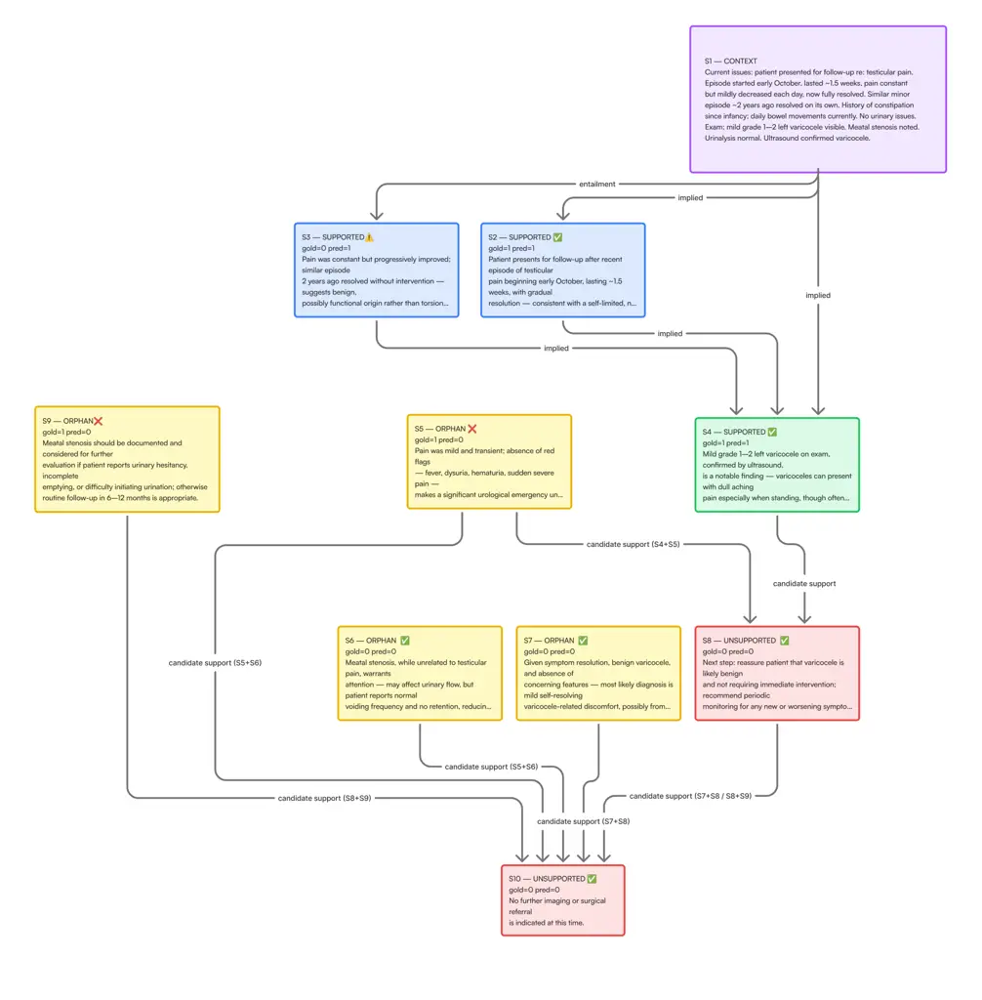

# Reference-Free Evaluation of Reasoning in Open-Ended Question Answering

Guneet Singh Kohli Affiliation: Queen Mary University of London   
Yuxiang Zhou Affiliation: Queen Mary University of London    Michael
Schlichtkrull Affiliation: Queen Mary University of London    Gregory
Dean Affiliation: Temple University^(\*)Corresponding author:
g.s.kohli@qmul.ac.uk    Maria Liakata Affiliation: Queen Mary University
of London

###### Abstract

We propose a reasoning-based reference-free framework for auditing
LLM-generated outputs. The method decomposes a reasoning trace generated
for a given response into segments, labels local premise–target
relations using Natural Language Inference (NLI) and organizes these
relations into a hypergraph. A deterministic backward AND–OR search
algorithm assigns segment-level audit NLI labels to indicate how each
segment is grounded within the generated response. We evaluate the
framework in two distinct settings: Deductive mathematical reasoning
(Hard2Verify) and medical reasoning, by introducing UroReason, a new
physician-annotated benchmark of LLM reasoning traces from real clinical
cases. We show that our NLI-hypergraph audit provides a more reliable
reference-free evaluation signal than direct LLM-as-judge baselines. In
the clinical setting, state-of-the-art LLM judges often fail to identify
problematic reasoning segments, over-accepting fluent but weakly
grounded responses. We show that QA evaluation should reflect how
inferential relations compose across a reasoning trace, rather than
relying only on final answers or LLMs as verifiers ¹¹ 1 We will make
UroReason available through an API and our code as open source.

## 1 Introduction

Users increasingly rely on language models for open-ended questions in
high-stakes domains such as medicine, law, and scientific analysis. In
these settings, Responses are fluent but without a reference answer or
gold rationale there isn’t a reliable way to verify whether any given
response and the reasoning behind it is trustworthy.

Final-answer evaluation, the current norm, is insufficient for this
setting since open-ended responses constitute reasoning traces composed
of facts, assumptions, intermediate claims, and recommendations. A final
answer may appear plausible even when the reasoning path contains
unsupported, hedged, partially true, or locally plausible but ungrounded
statements. Evaluation therefore needs to be granular: it should inspect
how a response is constructed, not only whether the final output appears
correct.

A natural solution is step-level evaluation, often implemented by using
a strong LLM as a judge (Lightman et al., 2023). This is convenient
because LLM judges can assess open-ended outputs without exact-match
references. However, direct judging can reward fluent and familiar
reasoning rather than checking actual groundedness. Prior work shows
that LLM judge verdicts are sensitive to prompt formulation and rubric
design (Sclar et al., 2024; Zhuo et al., 2024), and can exhibit
preferences for familiar styles or self-similar outputs (Panickssery
et al., 2024; Wataoka et al., 2025). In our experiments, this
brittleness appears clearly: while LLM judges perform well in assessing
deductive mathematical reasoning, on open-ended clinical reasoning they
over-accept generated segments.

We address this gap with a reference-free structural evaluation
framework (audit) for LLM-generated reasoning traces. The framework
looks at the step-by-step reasoning generated by an LLM as segments,
labels local premise–target relations with NLI relations, and organizes
them into a hypergraph. A deterministic backward AND–OR search algorithm
then identifies which segments are Supported, Unsupported, or Orphan,
turning evaluation into a granular audit of how the response grounds its
own reasoning. The framework has three components:

#### Local NLI as the learning signal.

We use NLI (Bowman et al., 2015; Havaldar et al., 2025) to label
individual premise–target relations with one of four labels: Entailment
for strong deductive support, Implied for weaker abductive support,
Neutral for insufficient information on relation determination, and
Contradiction for conflict. This four-way scheme extends standard NLI
with a separate label for abductive support, which is the dominant
inferential mode in open-ended reasoning, often conflated with
neutrality in three-way NLI.

#### NLI hypergraph as the global structure.

Reasoning targets often depend on the joint contribution of several
earlier segments, in a way no pairwise NLI judgement can capture.
Therefore, we represent each trace as an NLI-labelled hypergraph, where
hypernodes denote candidate premise _sets_ and hyperedges denote
directed support from those sets to a target statement.

#### Backward AND–OR search as the audit decision.

For each segment $`S_{j}`$, we temporarily treat it as the _sink_ which
refers to the current target segment being audited, not necessarily the
final answer. Starting from this target, we perform deterministic
backward search over the hypergraph. The search alternates between an OR
choice and an AND requirement: OR, because a segment may have several
candidate supporting hypernodes; AND, because once a hypernode is
chosen, all of its premises must themselves be grounded.

A segment is labelled Supported when a complete grounded support tree is
recovered back to the context or context-grounded leaves. It is labelled
Unsupported when local support edges exist but none can be expanded into
a complete grounded tree. It is labelled Orphan when a segment has no
incoming support edges or an ungrounded leaf.

To evaluate the framework in a realistic open-ended setting, we
introduce UroReason, a real-case medical reasoning benchmark for
auditing LLM-generated clinical reasoning. This domain was chosen as it
is of great clinical importance yet constitutes a very small part of LLM
training and is not saturated unlike most reasoning datasets. The
dataset contains 40 clinical cases consisting of corresponding evidence
collected by practising physicians. For each case, an LLM generates a
recommendation and reasoning trace for the next best clinical step, and
physicians annotate the trace at the statement level. Unlike exam-style
medical QA (Pal et al., 2022; Zuo et al., 2025), UroReason provides
evidence for the auditor rather than merely giving an answer: it can
test whether an evaluator can detect errors, unsupported claims,
hedging, and partial truths in LLM generated clinical reasoning. We also
use Hard2Verify (Pandit et al., 2025) to compare evaluation behaviour
across deductive mathematical reasoning. Hence,we make the following
core contributions:

1.  1.  A reference-free Evaluation Paradigm. We introduce an evaluation
        framework for the quality assessment of LLM outputs. It converts an
        LLM-generated reasoning trace into an NLI-labelled hypergraph and
        audits each statement through deterministic backward AND–OR search.
        The framework requires no gold reference answers and is domain
        independent.
2.  2.  UroReason: A real life medical cases based benchmark with
        physician-labelled LLM reasoning traces, annotated at each reasoning
        step, for auditing open-ended clinical question answering.
3.  3.  Detailed experiments evaluating the effectiveness of our
        reference-free reasoning based evaluation framework based on
        UroReason and Hard2Verify.
4.  4.  A new failure mode for LLM-as-judge evaluation. We show that direct
        LLM judges can severely over-trust open-ended clinical reasoning,
        with specificity dropping to $`0.04`$–$`0.41`$ on UroReason. Our
        NLI-hypergraph method mitigates this failure by decomposing
        evaluation into local inference labeling and deterministic grounded
        search.

## 2 Related Work

#### LLM-as-judge evaluation.

LLM-as-judge evaluation has become a practical approach for assessing
open-ended generations because it doesn’t need exact-reference matching
and can score free-form responses (Zheng et al., 2023). However,
judge-based evaluation is sensitive to prompt formulation, formatting,
and rubric design (Sclar et al., 2024; Zhuo et al., 2024). Reliable use
requires careful standardization, bias mitigation, and consistency
checks (Chehbouni et al., 2025). For high-stakes domains like medicine,
this level of uncertainty is risky and can reduce the adoption on a
wider scale.

Step-level verification and process supervision. Step-level verification
addresses some limitations of final-answer evaluation by assessing
intermediate reasoning steps, and has become central to process
supervision and reasoning evaluation (Lightman et al., 2023; Zheng
et al., 2025). However, much of the current literature is concentrated
in mathematical or exam-style reasoning. Benchmarks such as MR-Ben (Zeng
et al., 2024), ProcessBench (Zheng et al., 2025), PRMBench (Song et al., 2025) are largely derived from math-heavy sources. This setting
encourages a primarily deductive view of verification, where each step
is expected to follow from previous steps through explicit inference.
This does not fully capture open-ended reasoning in complex domains. In
medicine, law, and scientific analysis, a response often moves from
incomplete evidence to plausible hypotheses, recommendations, or
explanations. Such reasoning is frequently abductive rather than
deductive.

Complex-domain reasoning benchmarks. Recent work has begun extending
reasoning evaluation beyond mathematics. REVEAL studies relevance,
attribution, and logical correctness in open-domain reasoning (Jacovi
et al., 2024). Medical reasoning resources such as Med-PRM (Yun et al.,
2025), and MedThink-Bench (Zhou et al., 2025) move toward step-level or
rationale-based clinical evaluation. Other benchmarks target legal,
biomedical, scientific, and narrative reasoning (Shojaee et al., 2025;
Chlapanis et al., 2025). However, many existing resources remain tied to
benchmark-style inputs and multiple-choice sources, which limits their
ability to capture realistic open-ended QA.

NLI as a reasoning primitive. NLI provides a practical primitive for
decomposing reasoning into local premise–conclusion relations. Textual
entailment was introduced through the Recognising Textual Entailment
challenges (Pavlick and Kwiatkowski, 2019) and later scaled through SNLI
and MNLI (Bowman et al., 2015; Williams et al., 2018). Abductive NLI
extends this view by modelling inference toward plausible explanations
rather than strict entailment alone (Bhagavatula et al., 2019). NLI has
also been used for explanation and reasoning verification (Valentino
et al., 2021; Quan et al., 2024). This makes NLI a natural formalism for
our setting. Deduction can be approximated through entailment-like
support, while abduction can be represented through weaker implied
support.

## 3 Methodology

Figure 1: NLI-hypergraph audit framework. The response is segmented into
reasoning units, candidate premise–target relations are labelled with
NLI, and the resulting relations are organized into a hypergraph. A
backward AND–OR search then composes local support relations to
determine whether each segment is grounded in the generated trace,
yielding audit labels such as Supported, Unsupported, and Orphan. Orange
arrows refer to the implied relation, and Green refers to the entailment
relation.

We propose a reference-free method for auditing rationales generated by
language models when providing a response to open-ended question
answering (see Figure 1). Instead of checking every statement against
external evidence, we ask whether each statement is supported by the
model’s own earlier reasoning. This lets us identify which parts of a
rationale accompanying an output are grounded, which are weakly
supported, and which appear without enough support. A statement is
grounded if it can be connected to earlier parts of the response through
clear local inference relations. It is non-grounded if it lacks support,
conflicts with earlier content, or depends on another statement that
could not be justified.

The framework has two stages. First, we convert the trace into an
NLI-labelled hypergraph, where edges encode local premise–conclusion
relations between earlier segments and later targets. Second, we apply
deterministic graph analysis to this hypergraph, where we filter noisy
support relations, recover grounded support trees through backward
AND–OR search, and assign statement-level audit labels.

### 3.1 Representation: Reasoning Trace as an NLI Hypergraph

Assume a rationale/reasoning trace is generated by an LLM to justify a
response to a question, in the form of a sequence of textual segments.

```math
T=(S_{1},S_{2},\ldots,S_{n}),
```

where $`S_{1}`$ denotes the context, question, or problem statement, and
$`S_{2},\ldots,S_{n}`$ are generated reasoning segments. For each
non-context segment $`S_{j}`$, the framework predicts a binary
structural label $`\hat{y}_{j}\in\{0,1\}`$, where $`\hat{y}_{j}=1`$
indicates that $`S_{j}`$ is grounded in the recovered support structure
and $`\hat{y}_{j}=0`$ indicates that it is contradicted, unsupported, or
disconnected.

A purely linear chain of pairwise relations is too restrictive for
open-ended reasoning. Later segments often depend on several earlier
observations jointly, rather than on a single preceding step. We
therefore define support over candidate premise sets. For each target
segment $`S_{j}`$, we consider premise sets as

```math
P\subseteq\{S_{1},\ldots,S_{j-1}\},\qquad m_{\min}\leq|P|\leq m_{\max},
```

where $`P`$ is a candidate set of earlier segments. An NLI model
classifies the relation from $`P`$ to $`S_{j}`$, producing a labelled
hyperedge

```math
e=(P,S_{j},\ell).
```

The resulting structure is a directed labelled hypergraph

```math
G=(V,E),
```

where $`V`$ contains the original segments and premise-set hypernodes,
and $`E`$ contains NLI-labelled relations from premise sets to target
segments (See §1 for the set of NLI labels).

### 3.2 Support Edge Selection

The raw NLI hypergraph contains all scored premise–target relations,
many of which are weak, redundant, or unsuitable for grounding. We
therefore prune the graph before running the AND–OR search algorithm.

Pruning: Entailment and Implied are treated as candidate support edges.
Neutral is discarded as insufficient support. Contradiction is not used
as support, but is retained separately as negative evidence for the
target segment. We apply two deterministic pruning rules. First, Implied
edges are kept only when the closest premise is within a fixed distance
$`\tau`$ of the target, reflecting the locality of abductive support.
Entailment bypasses this filter. Second, when several premise sets
support the same target, we remove redundant or dominated alternatives
and prefer simpler or stronger candidates. The same $`\tau`$ and rules
are used across both domains; details and ablations are in Appendix A.1.
The pruned graph is then passed to the AND–OR search algorithm.

### 3.3 Grounded AND–OR Support Search Algorithm

Support-edge selection yields local relations $`P\rightarrow S_{j}`$,
but local support alone is not enough. We need to make sure every
premise in $`P`$ must also be grounded. We therefore treat each segment
$`S_{j}`$ as a candidate sink and run backward to build a hypergraph
representation.

We view the selected hypergraph as a bipartite AND–OR graph with two
node types: segment nodes $`S_{j}`$, and hypernodes $`H_{P}`$, where
$`H_{P}`$ represents a premise set $`P=\{S_{a_{1}},\ldots,S_{a_{k}}\}`$.
A support edge $`P\rightarrow S_{j}`$ is traversed backward as

```math
S_{j}\rightarrow H_{P}\rightarrow\{S_{a_{1}},\ldots,S_{a_{k}}\}.
```

The first transition is an OR decision: a segment may have multiple
candidate supporting hypernodes, and any one of them may explain the
segment. The second transition is an AND decision: once $`H_{P}`$ is
selected, all premise segments in $`P`$ must be recursively grounded.

The search alternates between these two operations. At a segment node,
the algorithm chooses among alternative supporting hypernodes. At a
hypernode, it expands to all premise segments that constitute the
hypernode. A branch terminates successfully when it reaches a grounded
leaf.

In our setting, grounded leaves are the context segment $`S_{1}`$. Fig.
2 shows the first expansion process.

### 3.4 Segment-Level Audit Labels

The grounded search assigns each non-context segment a structural audit
label. A segment is labelled Supported if at least one complete grounded
support tree is found leading from it to grounded leaf nodes (see Fig. 2
) . It is labelled Unsupported if incoming support edges exist, but
every candidate expansion fails to produce a complete grounded tree. It
is labelled Orphan if no usable incoming support edge is available when
the segment is treated as a sink. If contradiction evidence is detected,
the segment is treated as a negative grounding case. We map Supported to
$`\hat{y}=1`$, and Unsupported, Orphan, and contradiction cases to
$`\hat{y}=0`$. These labels indicate whether a segment is structurally
grounded in the generated trace; they do not claim external factual
correctness. For efficiency, we use bounded deterministic search,
prioritizing stronger NLI labels and closer premise–target relations.
Fig. 2 illustrates the difference between a valid grounded tree and a
failed candidate expansion.


Figure 2: Segment-level grounding outcomes. In (a), sink $`S_{8}`$ is
Supported because every premise required by the selected hypernode
reaches a context-grounded leaf. In (b), $`S_{9}`$ has an incoming
support candidate, but the AND condition fails because one required
premise, $`S_{7}`$, is an Orphan. Therefore no complete grounded tree is
recovered and $`S_{9}`$ is labelled Unsupported.

### 3.5 Scope and Interpretation

The framework audits structural trust within a generated response. It
identifies how segments are organized, which claims are supported by
earlier claims, and which parts of the trace are contradicted,
unsupported, or disconnected. It does not perform external factual
verification. If an early premise is false but later reasoning follows
coherently from it, later segments may still be marked as structurally
supported.

This scope is intentional. In open-ended question answering, exhaustive
references may be unavailable or expensive to construct, and LLM-based
judges can be opaque. Our method provides an intermediate audit layer:
it converts a generated response into an inspectable reasoning structure
and exposes where support is present, missing, contradictory, or
unstable.

## 4 Experimental Setup

We evaluate our framework in two reasoning settings: an established
deductive mathematical benchmark as a controlled baseline, and a new
open-ended clinical reasoning dataset as an out-of-distribution test
where evaluators face realistic abductive reasoning. Together these
settings allow us to determine the generalisability of our
reasoning-based reference-free evaluation framework.

#### Datasets

For mathematical reasoning, we use Hard2Verify(Pandit et al., 2025), an
established step-level verification benchmark for Olympiad mathematical
reasoning. We randomly sample 100 questions to form our deductive
control setting.

Figure 3: Overview of UroReason. Real clinical cases are used to elicit
LLM-generated next-step recommendations and reasoning traces. These
traces are segmented into reasoning units and annotated by physicians,
producing a benchmark for evaluating step-level reasoning-audit methods.

For open-ended real-world reasoning, we introduce UroReason, a medical
reasoning-audit benchmark developed with practising clinicians. It is
built from physician-curated real patient scenarios, each containing
multiple sources of evidence including clinical history, examination
findings, investigations, and clinical impressions. Given a case, an LLM
is prompted to recommend the next best clinical step and generate a
reasoning trace to justify the response. Human experts then label the
trace at the segment level, allowing us to evaluate whether step-level
judges or audit frameworks can identify unsupported, incomplete, or
clinically problematic reasoning in open-ended question answering
pertaining to real-world medical reasoning.

The final dataset contains 40 clinical cases and 305 labelled reasoning
segments. To our knowledge, UroReason is the first step-level
verification benchmark focused on open-ended real-world medical
reasoning, moving beyond multiple-choice or exam-style medical QA.

#### Generating reasoning traces.

We generate traces using Qwen3-4B-Think-2507 (Team, 2025) where the LLM
is prompted to recommend the next best clinical step and justify its
reasoning.

#### Trace segmentation and annotation.

Each generated rationale is split into reasoning units (segments) using
natural punctuation boundaries in the model output. Two physicians, one
senior and one junior, then annotate each segment in the context of the
full clinical case. Segments are labeled as correct, incorrect,
hedging/inconclusive, or partially true.

For evaluation, we collapse these labels into a binary audit setting:
segments that are clearly correct and clinically appropriate are mapped
to $`y=1`$, while incorrect, hedging/inconclusive, and partially true
segments are mapped to $`y=0`$. This conservative mapping reflects the
goal of UroReason: to identify segments that should be trusted without
review. In clinical reasoning, a partially true or inconclusive
statement can still mislead by omitting or overstating a finding, or
supporting an inappropriate recommendation; such segments should
therefore be flagged rather than endorsed.

#### Evaluation paradigms.

We compare two evaluation paradigms. In the _LLM-as-judge_ paradigm, an
LLM directly classifies each reasoning segment as trustworthy or
problematic. This represents the standard direct-verification baseline.
In our _structural audit_ paradigm, the LLM is not used as the final
verifier. Instead, it is used only to provide local NLI labels for
directed premise–target relations $`(P\rightarrow S_{j})`$. These local
labels are then composed by the deterministic AND–OR grounding algorithm
described in §3.

We evaluate the same four open-weight model families in both paradigms:
GPT-OSS-120B, GPT-OSS-20B, Gemma 4-31b-it, and Qwen3-30B. We also
include 4 frontier API models: Claude Sonnet 4.6, DeepSeek V4 flash, and
Gemini-3.1-Flash-Lite and GPT 5.4-mini as direct judges, to test whether
the observed patterns hold beyond open-weight models. The NLI prompt is
domain-general and held fixed across both mathematics and medicine (we
do not perform per-domain prompt tuning). Thus, variation across NLI
sources is treated as a robustness test for our framework. All judge
prompts, NLI prompts, and decoding parameters are provided in
Appendix X.

#### Metrics.

We report sensitivity (TPR, recall on $`y=1`$), specificity (TNR, recall
on $`y=0`$), Class 0 F1 ($`F1_{0}`$), and balanced F1. Following
Hard2Verify, balanced F1 is the harmonic mean of TPR and TNR:

```math
\text{Bal F1}=\frac{2\cdot\text{TPR}\cdot\text{TNR}}{\text{TPR}+\text{TNR}},
```

giving a single summary statistic that is robust to class imbalance and
that penalises evaluators with degenerate one-sided behaviour (uniform
acceptance or uniform flagging).

## 5 Results and Analysis

We organize the results around three questions. First, how do direct LLM
judges behave when evaluation shifts from deductive mathematical
reasoning to open-ended clinical reasoning? Second, what changes when
the same LLMs are used only as local NLI sources inside our hypergraph
audit? Third, what does the recovered graph reveal about how reasoning
fails across domains?

Section 5.1 reports the main performance comparison. Section 5.2
analyzes audit-label distributions, showing that mathematical failures
often resemble broken chains, while clinical failures more often involve
unanchored claims. Section 5.3 grounds this pattern in a qualitative
case study.

### 5.1 Main Results

|                                               |                             |       |                |            |       |                |                |
| --------------------------------------------- | --------------------------- | ----- | -------------- | ---------- | ----- | -------------- | -------------- |
|                                               | LLM as Step Level Evaluator |       |                | Ours (NLI) |       |                |                |
| LLM                                           | TPR                         | TNR   | Step-level Bal | TPR        | TNR   | Step-level Bal | $`\Delta`$ Bal |
| Maths — Hard2Verify, 100 traces, 916 segments |                             |       |                |            |       |                |                |
| GPT-OSS-120B                                  | 0.964                       | 0.530 | 0.684          | 0.529      | 0.788 | 0.633          | $`-0.051`$     |
| GPT-OSS-20B                                   | 0.913                       | 0.535 | 0.674          | 0.569      | 0.763 | 0.652          | $`-0.022`$     |
| Gemma 4                                       | 0.974                       | 0.365 | 0.531          | 0.633      | 0.725 | 0.676          | $`+0.145`$     |
| Qwen3-30B                                     | 0.970                       | 0.306 | 0.465          | 0.484      | 0.790 | 0.600          | $`+0.135`$     |
| Medical — UroReason, 40 cases, 305 segments   |                             |       |                |            |       |                |                |
| GPT-OSS-120B                                  | 0.950                       | 0.207 | 0.340          | 0.525      | 0.641 | 0.577          | $`+0.237`$     |
| GPT-OSS-20B                                   | 0.975                       | 0.103 | 0.187          | 0.563      | 0.586 | 0.574          | $`+0.387`$     |
| Gemma 4                                       | 0.988                       | 0.228 | 0.370          | 0.519      | 0.607 | 0.559          | $`+0.189`$     |
| Qwen3-30B                                     | 0.956                       | 0.041 | 0.079          | 0.594      | 0.510 | 0.549          | $`+0.470`$     |

(a) Paired comparison of evaluation paradigms.

|                   |             |       |       |           |       |       |
| ----------------- | ----------- | ----- | ----- | --------- | ----- | ----- |
|                   | Hard2Verify |       |       | UroReason |       |       |
| Evaluator         | TPR         | TNR   | Bal   | TPR       | TNR   | Bal   |
| Ours-best         | 0.633       | 0.725 | 0.676 | 0.525     | 0.641 | 0.577 |
| GPT-5.4-mini      | 0.563       | 0.857 | 0.679 | 0.819     | 0.434 | 0.568 |
| Claude Sonnet 4.6 | 0.972       | 0.456 | 0.621 | 0.900     | 0.407 | 0.560 |
| Ours-worst        | 0.484       | 0.790 | 0.600 | 0.519     | 0.510 | 0.549 |
| DeepSeek V4-Flash | 0.748       | 0.700 | 0.724 | 0.931     | 0.283 | 0.434 |
| Gemini3.1-Flash   | 0.989       | 0.222 | 0.362 | 0.975     | 0.152 | 0.263 |

(b) Cross-domain generalization gap.

Table 1: Comprehensive evaluation results. (a) Shows the impact of
shifting from a vanilla LLM-as-judge to our NLI-based structural audit
using identical open-weights. Positive $`\Delta`$ values indicate an
increase in Balanced F1. (b) Highlights the generalization gap across
domains for closed-source models.

Direct judges fail under open-ended clinical reasoning. Table 1(b)
compares strong direct LLM judges across Hard2Verify and UroReason. On
Hard2Verify, several judges remain competitive, with the best model
reaching $`0.724`$ balanced-F1. On UroReason, direct judging becomes
less reliable: TPR remains high, but TNR drops sharply, reaching only
$`0.434`$ for GPT-5.4-mini, $`0.407`$ for Claude Sonnet4.6, and
$`0.152`$ for Gemini3.1-Flash. This high-TPR/low-TNR pattern indicates
over-acceptance: judges often mark problematic, hedged, or partially
true clinical segments as trustworthy.

This motivates UroReason as a stress test for evaluator reliability.
Direct judging can appear effective on deductive verification while
failing in open-ended medical reasoning, where plausibility and
correctness are harder to separate (The variance in the results of
DeepseekV4 is a prime example of this). Our NLI-hypergraph audit is more
stable in this setting, with the best configuration achieving the
highest UroReason balanced-F1 and the weakest configuration remaining
competitive with frontier judges.

The proposed NLI-hypergraph audit improves reliability.

Table 1 (a) compares direct judging with our NLI-hypergraph method using
the same four open-weight LLMs: GPT-OSS-120B, GPT-OSS-20B, Gemma 4, and
Qwen3-30B. The open-weight judges reproduce the same false-trust pattern
on UroReason: TPR remains high ($`0.956`$–$`0.988`$), but TNR collapses
to $`0.041`$–$`0.228`$, giving balanced-F1 scores of
$`0.079`$–$`0.370`$. When the same models are used only for local NLI
labelling and their outputs are processed by our graph algorithm,
balanced-F1 rises to $`0.549`$–$`0.577`$. Qwen3-30B improves from
$`0.079`$ to $`0.549`$, GPT-OSS-20B from $`0.187`$ to $`0.574`$, Gemma 4
from $`0.370`$ to $`0.559`$, and GPT-OSS-120B from $`0.340`$ to
$`0.577`$.

The gains are not limited to UroReason. On Hard2Verify, the method
substantially improves weaker direct judges: Gemma 4 rises from
$`0.531`$ to $`0.676`$, and Qwen3-30B from $`0.465`$ to $`0.600`$. The
strongest direct judges remain competitive on math, as expected for
explicit deductive chains and existing open benchmarks. Overall, the
framework converts local NLI signals into a more robust evaluator, with
the largest gains appearing when step into out of domain tasks.

|               |                  |        |               |                    |        |               |
| ------------- | ---------------- | ------ | ------------- | ------------------ | ------ | ------------- |
|               | Maths Domain (%) |        |               | Medical Domain (%) |        |               |
| LLM Evaluator | Orph.            | Unsup. | Ratio         | Orph.              | Unsup. | Ratio         |
| GPT-OSS-120B  | 32.0             | 26.4   | 1.2$`\times`$ | 46.2               | 6.6    | 7.0$`\times`$ |
| GPT-OSS-20B   | 29.3             | 22.9   | 1.3$`\times`$ | 40.3               | 6.9    | 5.8$`\times`$ |
| Gemma 4       | 31.4             | 28.7   | 1.1$`\times`$ | 42.6               | 9.8    | 4.3$`\times`$ |
| Qwen3-30B     | 26.0             | 33.2   | 0.8$`\times`$ | 37.7               | 6.2    | 6.1$`\times`$ |

Table 2: Global Audit Failure Modes. Comparison of Orphan and
Unsupported segment classifications produced by our framwork. The ratio
(Orphan / Unsupported) highlights the structural contrast: Medical
reasoning fails primarily by floating without anchors, while
Mathematical reasoning fails through collapsed logic chains.

### 5.2 Structural Signatures Across Domains

The previous section shows that the NLI-hypergraph method is more stable
than direct judging, especially on UroReason. We next examine what the
method reveals about the structure of the generated reasoning traces. We
focus on the audit outcomes produced by the graph search: Grounded,
Orphan, and Unsupported. These labels are structural diagnostics, not
factual truth labels. A segment marked Orphan or Unsupported is not
necessarily false but it only means that it’s not grounded in the
generated trace.

Medical reasoning is more orphan-dominant. Table 2 shows a consistent
difference between Hard2Verify and UroReason. In math, Orphan and
Unsupported occur at comparable rates across NLI sources: Orphan ranges
from $`26.0\%`$ to $`32.0\%`$, while Unsupported ranges from $`22.9\%`$
to $`33.2\%`$. This suggests that mathematical failures often occur
inside attempted derivational chains: some local support exists, but
recursive grounding fails.

In UroReason, the pattern changes. Orphan dominates across all NLI
sources, ranging from $`37.7\%`$ to $`46.2\%`$, while Unsupported
remains much lower, between $`6.2\%`$ and $`9.8\%`$. This reflects the
structure of open-ended medical reasoning. LLMs often introduce multiple
hypotheses, plausible observations, or recommendation-like claims
without explicitly anchoring each one in prior case evidence. These
claims may sound clinically plausible, but if the trace does not provide
a recoverable support path, the graph search marks them as Orphan.

The pattern is stable across NLI sources. The same qualitative contrast
appears for all four NLI sources. Although the exact percentages vary,
every configuration shows a more orphan-dominant profile on UroReason
than on Hard2Verify. This stability matters because it suggests that the
observed difference is not an artefact of one local labeller. The
graph-level outcomes consistently separate the two domains: mathematical
reasoning more often fails through broken chains, while clinical
reasoning more often fails through unanchored claims.

### 5.3 Qualitative Case Study: Local Plausibility vs. Grounding

Table 5 in the appendix illustrates why direct LLM judges over-accept
open-ended clinical reasoning. The generated trace is not irrelevant or
incoherent. It uses real case facts: the patient has a mild varicocele,
no obvious emergency features, and meatal stenosis. However, the
reasoning moves from these local observations to a management
recommendation that the physician marks as clinically misdirected. In
particular, the response moves toward reassurance and no further
imaging, while the physician notes that the next step should consider
voiding stream assessment, voiding diary, possible urethromeatoplasty,
and follow-up imaging. A full tree representation created by our
algorithm is showcased at Figure 5

The audit exposes where this reasoning flow breaks. $`S_{4}`$, which
identifies the varicocele as clinically relevant, is marked Supported;
the trace contains enough local evidence for this observation. By
contrast, $`S_{6}`$ and $`S_{7}`$ are marked Orphan: they introduce
plausible claims about meatal stenosis and self-resolving
varicocele-related discomfort, but no recoverable support path is found
for them in the trace. The recommendation-level claims in $`S_{8}`$ and
$`S_{10}`$ are marked Unsupported: candidate support exists, but it
depends on weakly grounded or orphaned premises and does not compose
into a grounded path to the appropriate next step.

This example showcases the types of errors that our framework can
capture. Medical reasoning can sound plausible while still being poorly
grounded. A direct judge may reward fluent medical prose and locally
reasonable statements, but miss that the global support flow is broken.
The NLI-hypergraph audit enforces that the response grounds its own
reasoning and captures: where support is present, where it disappears,
and where final recommendations rely on ungrounded premises.

## 6 Conclusion

We present a reference-free framework for auditing LLM-generated
rationales for output responses. Instead of relying on final-answer
matching or direct LLM-as-judge scores, our method analyses response
segments by modelling local NLI relations, and using grounded hypergraph
search to identify which segments are Supported, Unsupported, or Orphan.

We introduce UroReason, a physician-annotated benchmark for open-ended
medical reasoning. Our results show that direct LLM judges often
over-accept fluent medical reasoning, while our NLI-hypergraph audit
provides a more balanced signal across both deductive (Hard2Verify) and
open-ended real-world reasoning (UroReason). The structural analysis
further shows that math and medical reasoning fail differently: in the
former errors often appear as broken support chains, whereas traces of
the latter often contain plausible but unanchored claims.

Future work will extend this framework by training smaller NLI relation
models, to avoid dependency on LLM and expanding stepwise auditing to
additional medical and high-stakes domains. Overall, our findings
suggest that trustworthy evaluation of open-ended QA should inspect how
reasoning steps connect, not only whether the final answer appears
plausible.

## Limitations

Our work has several limitations. First, the framework currently relies
on LLMs to produce local NLI labels. This is a practical choice:
existing NLI models are not yet reliable enough for the kinds of long,
domain-specific, and multi-premise reasoning relations studied here,
especially in mathematical and clinical traces. However, this means that
the audit is not fully independent of LLM behaviour. We mitigate this by
restricting the LLM to local premise–target relation labelling and using
deterministic hypergraph search for the final decision, but future work
should train smaller specialized NLI models for reasoning-trace
auditing.

Second, we do not study test-time scaling. All judge and NLI-label runs
use fixed prompting and greedy decoding. Exploring self-consistency,
repeated sampling, debate-style judging, or verifier ensembles may
improve both direct LLM-as-judge baselines and local NLI labelling. We
leave this analysis to future work due to compute constraints for
open-weight models and cost constraints for frontier API models.

Third, UroReason is intentionally specialized and relatively small. It
contains 40 real paediatric urology cases and 305 labelled reasoning
segments. The dataset size reflects the cost of collecting realistic
clinical cases and obtaining high-quality physician annotations. The
annotations were produced with practising clinicians, including a senior
paediatric urologist with more than 25 years of experience and a junior
physician in the same clinical setting. This gives the benchmark high
clinical relevance, but it also limits domain coverage. Future releases
should expand to more specialties, institutions, and case types.

Finally, our focus is open-ended reasoning rather than multiple-choice
QA. Many existing medical benchmarks condition model reasoning on
predefined answer options, which can constrain the hypothesis space and
reduce the kinds of free-form hallucination, hedging, and partial-truth
behaviour seen in real user interactions. UroReason targets this more
realistic setting, but future work should test whether the same
structural audit principles transfer to other open-ended high-stakes
domains such as law, finance, and policy reasoning.

## References

- Bhagavatula et al. (2019) Chandra Bhagavatula, Ronan Le Bras,
  Chaitanya Malaviya, Keisuke Sakaguchi, Ari Holtzman, Hannah Rashkin,
  Doug Downey, Scott Wen-tau Yih, and Yejin Choi. 2019. Abductive
  commonsense reasoning. _arXiv preprint arXiv:1908.05739_.
- Bowman et al. (2015) Samuel R. Bowman, Gabor Angeli, Christopher
  Potts, and Christopher D. Manning. 2015. [A large annotated corpus for
  learning natural language
  inference](https://arxiv.org/abs/1508.05326). _Preprint_,
  arXiv:1508.05326.
- Chehbouni et al. (2025) Khaoula Chehbouni, Mohammed Haddou, Jackie CK
  Cheung, and Golnoosh Farnadi. 2025. [Neither valid nor reliable?
  investigating the use of llms as
  judges](https://proceedings.neurips.cc/paper_files/paper/2025/file/829e8f32d76a6248815bf5b01633811d-Paper-Position_Paper_Track.pdf).
  In _Advances in Neural Information Processing Systems_, volume 38.
  Curran Associates, Inc.
- Chlapanis et al. (2025) Odysseas S. Chlapanis, Dimitrios Galanis,
  Nikolaos Aletras, and Ion Androutsopoulos. 2025. [GreekBarBench: A
  challenging benchmark for free-text legal reasoning and
  citations](https://doi.org/10.18653/v1/2025.findings-emnlp.1368). In
  _Findings of the Association for Computational Linguistics: EMNLP
  2025_, pages 25099–25119, Suzhou, China. Association for Computational
  Linguistics.
- Havaldar et al. (2025) Shreya Havaldar, Hamidreza Alvari, John
  Palowitch, Mohammad Javad Hosseini, Senaka Buthpitiya, and Alex
  Fabrikant. 2025. [Entailed between the lines: Incorporating
  implication into nli](https://arxiv.org/abs/2501.07719). _Preprint_,
  arXiv:2501.07719.
- Jacovi et al. (2024) Alon Jacovi, Yonatan Bitton, Bernd Bohnet,
  Jonathan Herzig, Or Honovich, Michael Tseng, Michael Collins, Roee
  Aharoni, and Mor Geva. 2024. [A chain-of-thought is as strong as its
  weakest link: A benchmark for verifiers of reasoning
  chains](https://doi.org/10.18653/v1/2024.acl-long.254). In
  _Proceedings of the 62nd Annual Meeting of the Association for
  Computational Linguistics (Volume 1: Long Papers)_, pages 4615–4634,
  Bangkok, Thailand. Association for Computational Linguistics.
- Lightman et al. (2023) Hunter Lightman, Vineet Kosaraju, Yura Burda,
  Harri Edwards, Bowen Baker, Teddy Lee, Jan Leike, John Schulman, Ilya
  Sutskever, and Karl Cobbe. 2023. [Let’s verify step by
  step](https://arxiv.org/abs/2305.20050). _Preprint_, arXiv:2305.20050.
- Pal et al. (2022) Ankit Pal, Logesh Kumar Umapathi, and Malaikannan
  Sankarasubbu. 2022. [Medmcqa : A large-scale multi-subject
  multi-choice dataset for medical domain question
  answering](https://arxiv.org/abs/2203.14371). _Preprint_,
  arXiv:2203.14371.
- Pandit et al. (2025) Shrey Pandit, Austin Xu, Xuan-Phi Nguyen, Yifei
  Ming, Caiming Xiong, and Shafiq Joty. 2025. [Hard2verify: A step-level
  verification benchmark for open-ended frontier
  math](https://arxiv.org/abs/2510.13744). _Preprint_, arXiv:2510.13744.
- Panickssery et al. (2024) Arjun Panickssery, Samuel R. Bowman, and Shi
  Feng. 2024. [Llm evaluators recognize and favor their own
  generations](https://doi.org/10.52202/079017-2197). In _Advances in
  Neural Information Processing Systems_, volume 37, pages 68772–68802.
  Curran Associates, Inc.
- Pavlick and Kwiatkowski (2019) Ellie Pavlick and Tom
  Kwiatkowski. 2019. [Inherent disagreements in human textual
  inferences](https://doi.org/10.1162/tacl_a_00293). _Transactions of
  the Association for Computational Linguistics_, 7:677–694.
- Quan et al. (2024) Xin Quan, Marco Valentino, Louise A. Dennis, and
  Andre Freitas. 2024. [Verification and refinement of natural language
  explanations through LLM-symbolic theorem
  proving](https://doi.org/10.18653/v1/2024.emnlp-main.172). In
  _Proceedings of the 2024 Conference on Empirical Methods in Natural
  Language Processing_, pages 2933–2958, Miami, Florida, USA.
  Association for Computational Linguistics.
- Sclar et al. (2024) Melanie Sclar, Yejin Choi, Yulia Tsvetkov, and
  Alane Suhr. 2024. Quantifying language models’ sensitivity to spurious
  features in prompt design or: How i learned to start worrying about
  prompt formatting. In _International Conference on Learning
  Representations_, volume 2024, pages 25055–25083.
- Shojaee et al. (2025) Parshin Shojaee, Ngoc-Hieu Nguyen, Kazem
  Meidani, Amir Barati Farimani, Khoa D Doan, and Chandan K Reddy. 2025.
  [Llm-srbench: A new benchmark for scientific equation discovery with
  large language models](https://arxiv.org/abs/2504.10415). _Preprint_,
  arXiv:2504.10415.
- Song et al. (2025) Mingyang Song, Zhaochen Su, Xiaoye Qu, Jiawei Zhou,
  and Yu Cheng. 2025. [PRMBench: A fine-grained and challenging
  benchmark for process-level reward
  models](https://doi.org/10.18653/v1/2025.acl-long.1230). In
  _Proceedings of the 63rd Annual Meeting of the Association for
  Computational Linguistics (Volume 1: Long Papers)_, pages 25299–25346,
  Vienna, Austria. Association for Computational Linguistics.
- Team (2025) Qwen Team. 2025. [Qwen3 technical
  report](https://arxiv.org/abs/2505.09388). _Preprint_,
  arXiv:2505.09388.
- Valentino et al. (2021) Marco Valentino, Ian Pratt-Hartmann, and André
  Freitas. 2021. [Do natural language explanations represent valid
  logical arguments? verifying entailment in explainable NLI gold
  standards](https://aclanthology.org/2021.iwcs-1.8/). In _Proceedings
  of the 14th International Conference on Computational Semantics
  (IWCS)_, pages 76–86, Groningen, The Netherlands (online). Association
  for Computational Linguistics.
- Wataoka et al. (2025) Koki Wataoka, Tsubasa Takahashi, and Ryokan
  Ri. 2025. [Self-preference bias in
  llm-as-a-judge](https://arxiv.org/abs/2410.21819). _Preprint_,
  arXiv:2410.21819.
- Williams et al. (2018) Adina Williams, Nikita Nangia, and Samuel R.
  Bowman. 2018. [A broad-coverage challenge corpus for sentence
  understanding through
  inference](https://doi.org/10.18653/v1/N18-1101). In _Proceedings of
  the 2018 Conference of the North American Chapter of the Association
  for Computational Linguistics: Human Language Technologies, Volume 1
  (Long Papers)_, pages 1112–1122, New Orleans, Louisiana. Association
  for Computational Linguistics.
- Yun et al. (2025) Jaehoon Yun, Jiwoong Sohn, Jungwoo Park, Hyunjae
  Kim, Xiangru Tang, Daniel Shao, Yong Hoe Koo, Ko Minhyeok, Qingyu
  Chen, Mark Gerstein, Michael Moor, and Jaewoo Kang. 2025. [Med-PRM:
  Medical reasoning models with stepwise, guideline-verified process
  rewards](https://doi.org/10.18653/v1/2025.emnlp-main.837). In
  _Proceedings of the 2025 Conference on Empirical Methods in Natural
  Language Processing_, pages 16554–16571, Suzhou, China. Association
  for Computational Linguistics.
- Zeng et al. (2024) Zhongshen Zeng, Yinhong Liu, Yingjia Wan, Jingyao
  Li, Pengguang Chen, Jianbo Dai, Yuxuan Yao, Rongwu Xu, Zehan Qi, Wanru
  Zhao, Linling Shen, Jianqiao Lu, Haochen Tan, Yukang Chen, Hao Zhang,
  Zhan Shi, Bailin Wang, Zhijiang Guo, and Jiaya Jia. 2024. [Mr-ben: A
  meta-reasoning benchmark for evaluating system-2 thinking in
  llms](https://doi.org/10.52202/079017-3797). In _Advances in Neural
  Information Processing Systems_, volume 37, pages 119466–119546.
  Curran Associates, Inc.
- Zheng et al. (2025) Chujie Zheng, Zhenru Zhang, Beichen Zhang, Runji
  Lin, Keming Lu, Bowen Yu, Dayiheng Liu, Jingren Zhou, and Junyang
  Lin. 2025. [ProcessBench: Identifying process errors in mathematical
  reasoning](https://doi.org/10.18653/v1/2025.acl-long.50). In
  _Proceedings of the 63rd Annual Meeting of the Association for
  Computational Linguistics (Volume 1: Long Papers)_, pages 1009–1024,
  Vienna, Austria. Association for Computational Linguistics.
- Zheng et al. (2023) Lianmin Zheng, Wei-Lin Chiang, Ying Sheng, Siyuan
  Zhuang, Zhanghao Wu, Yonghao Zhuang, Zi Lin, Zhuohan Li, Dacheng Li,
  Eric Xing, and 1 others. 2023. Judging llm-as-a-judge with mt-bench
  and chatbot arena. _Advances in neural information processing
  systems_, 36:46595–46623.
- Zhou et al. (2025) Shuang Zhou, Wenya Xie, Jiaxi Li, Zaifu Zhan,
  Meijia Song, Han Yang, Cheyenna Espinoza, Lindsay Welton, Xinnie Mai,
  Yanwei Jin, Zidu Xu, Yuen-Hei Chung, Yiyun Xing, Meng-Han Tsai, Emma
  Schaffer, Yucheng Shi, Ninghao Liu, Zirui Liu, and Rui Zhang. 2025.
  [Automating expert-level medical reasoning evaluation of large
  language models](https://arxiv.org/abs/2507.07988). _Preprint_,
  arXiv:2507.07988.
- Zhuo et al. (2024) Jingming Zhuo, Songyang Zhang, Xinyu Fang, Haodong
  Duan, Dahua Lin, and Kai Chen. 2024. [ProSA: Assessing and
  understanding the prompt sensitivity of
  LLMs](https://doi.org/10.18653/v1/2024.findings-emnlp.108). In
  _Findings of the Association for Computational Linguistics: EMNLP
  2024_, pages 1950–1976, Miami, Florida, USA. Association for
  Computational Linguistics.
- Zuo et al. (2025) Yuxin Zuo, Shang Qu, Yifei Li, Zhangren Chen, Xuekai
  Zhu, Ermo Hua, Kaiyan Zhang, Ning Ding, and Bowen Zhou. 2025.
  Medxpertqa: Benchmarking expert-level medical reasoning and
  understanding. _arXiv preprint arXiv:2501.18362_.

## Appendix A Implementation Details

This appendix provides implementation details for the support-edge
selection rules and the prompts used in our experiments. These details
are included for reproducibility; the main paper describes the
conceptual framework and reports the primary results.

### A.1 Support Edge Selection

Before running grounded support-tree search, we prune the raw NLI
hypergraph. The raw graph contains all scored premise–target relations,
including weak, redundant, or noisy edges. The goal of support-edge
selection is to keep only relations that can plausibly contribute to
grounding a target segment.

We order NLI labels by support strength:

```math
\textsc{Contra}<\textsc{Neutral}<\textsc{Implied}<\textsc{Entail}.
```

Entailment and Implied are treated as candidate support edges. Neutral
edges are not used for support-tree construction. Contradiction edges
are retained separately as negative evidence for the target segment.

For each target $`S_{j}`$, we compare multi-premise support edges
against their singleton components. If a multi-premise edge provides
stronger support than its components, the combination is retained. If a
simpler edge already provides strong support, the redundant combination
is removed. If combining premises weakens otherwise strong support, the
target is flagged as unstable. Repeated weak support is handled
conservatively to avoid introducing noisy abductive paths.

We also apply a locality prior to weak support. Entailment edges bypass
this prior, while Implied edges may be removed when their closest
premise, farthest premise, or premise span exceeds a fixed threshold.
These thresholds are treated as implementation parameters and are
ablated separately.

|                   |                                            |                                                               |
| ----------------- | ------------------------------------------ | ------------------------------------------------------------- |
| Pattern           | Typical form                               | Action                                                        |
| Conjunctive       | Combination improves over components       | Keep the multi-premise edge.                                  |
| Redundant         | Simpler strong support already exists      | Keep the simpler edge; remove the redundant combination.      |
| Asymmetric        | One component carries stronger support     | Retain the usable support edge.                               |
| Degraded          | Strong components weaken under combination | Flag the target as unstable; remove the weakened combination. |
| Consistently Weak | Weak evidence remains weak                 | Remove the weak cluster conservatively.                       |
| Contradicted      | Contradiction evidence exists              | Mark the target as contradicted.                              |

Table 3: Implementation-level support-edge selection patterns. These
patterns are used to clean the NLI hypergraph before support-tree search
and are not treated as final semantic audit labels.

## Appendix B Prompt Templates

We provide the exact prompt templates used for direct LLM-as-judge
baselines and for NLI relation labelling. Variables populated
dynamically during inference are shown in monospaced font, e.g.,
{problem}.

### B.1 Direct LLM-as-Judge Prompts

The following prompts are used for the vanilla LLM-as-judge baselines.
In this setting, the LLM directly predicts whether each reasoning step
is correct or incorrect. The prompts differ slightly across math and
clinical domains to match the terminology of each task, but both require
a step-level verdict.


### B.2 NLI Relation Prompt

The following prompt is used in the first stage of our framework to
label local premise–target relations. The prompt enforces directed local
inference: the model must evaluate whether the premise $`P`$ supports
the proposed conclusion $`C`$, without using global context unless it is
explicitly included in $`P`$.


## Appendix C Additional Structural Diagnostics

Figure 4 provides additional structural diagnostics comparing
mathematical and clinical reasoning traces. These diagnostics supplement
the audit-label analysis in Section 5.2.

Figure 4: Structural signatures of mathematical and medical reasoning
traces. The recovered graph shows a shift from more entailment-driven
support in mathematical reasoning to more implied and abductive support
in open-ended clinical reasoning.

## Appendix D Qualitative Case Studies

This section provides additional qualitative examples supporting the
analysis in Section 5.3. The main paper reports a compact case analysis;
here we include fuller traces and annotations.

### D.1 Full Clinical Case Study

Table 4 provides the full UroReason case discussed in Section 5.3. The
case involves follow-up after testicular pain, mild left varicocele, and
meatal stenosis. We report the generated reasoning segment, physician
annotation, binary gold label, and audit label assigned by our
framework.

|            |                                                                                                                                                                                                                                                 |                                                                                                                            |      |             |
| ---------- | ----------------------------------------------------------------------------------------------------------------------------------------------------------------------------------------------------------------------------------------------- | -------------------------------------------------------------------------------------------------------------------------- | ---- | ----------- |
| Step       | Generated reasoning segment                                                                                                                                                                                                                     | Physician annotation                                                                                                       | Gold | Audit label |
| $`S_{2}`$  | The patient presents for follow-up after a recent episode of testicular pain that began in early October and lasted approximately one and a half weeks, with gradual resolution over time, consistent with a self-limited, non-acute condition. | Correct.                                                                                                                   | 1    | Supported   |
| $`S_{3}`$  | The constant but progressively improving pain, together with a similar episode two years ago that resolved without intervention, suggests a benign vascular or mechanical cause rather than torsion or infection.                               | Uncertain: explanation is incomplete and underspecified; unclear what is meant by a “benign vascular or mechanical cause.” | 0    | Supported   |
| $`S_{4}`$  | The mild grade 1–2 left varicocele, confirmed by ultrasound, is notable because varicoceles can occasionally cause dull aching pain, especially with standing or prolonged activity.                                                            | Correct.                                                                                                                   | 1    | Supported   |
| $`S_{5}`$  | The pain was mild and transient, and the absence of fever, dysuria, hematuria, or sudden severe pain makes a significant urological emergency unlikely.                                                                                         | Correct.                                                                                                                   | 1    | Orphan      |
| $`S_{6}`$  | Meatal stenosis is noted, but the response states that it is not directly related to testicular pain, while also noting possible urinary-flow effects.                                                                                          | Uncertain: incomplete; narrowed meatus can create backpressure with retrograde flow into the epididymis.                   | 0    | Orphan      |
| $`S_{7}`$  | Given symptom resolution, benign varicocele, and absence of concerning features, the response concludes that the likely diagnosis is mild, self-resolving varicocele-related discomfort.                                                        | Uncertain: incomplete; varicocele pain is typically intermittent and recurrent, not self-limiting.                         | 0    | Orphan      |
| $`S_{8}`$  | The response recommends reassurance and periodic monitoring, stating that the varicocele is likely benign and does not require immediate intervention.                                                                                          | Incorrect: should observe voiding stream and consider urethromeatoplasty or voiding diary.                                 | 0    | Unsupported |
| $`S_{9}`$  | The response recommends documenting meatal stenosis and considering further evaluation only if urinary hesitancy, incomplete emptying, or difficulty initiating urination develops.                                                             | Correct but incomplete: decision to proceed with urethromeatoplasty is driven by quality of urinary stream.                | 1    | Orphan      |
| $`S_{10}`$ | The response states that no further imaging or surgical referral is indicated at this time.                                                                                                                                                     | Incorrect: annual ultrasound is needed to track testis volume.                                                             | 0    | Unsupported |

Table 4: Full qualitative UroReason case. The example illustrates why
clinical reasoning is difficult to audit: several problematic segments
are plausible, incomplete, or partially true rather than obviously
false. Orphan indicates that no recoverable incoming support is found in
the generated trace; Unsupported indicates that candidate support exists
but does not compose into a grounded reasoning path. These labels are
structural review signals, not external clinical truth judgements.

### D.2 Recovered Support Trees for the Clinical Case

Table 5 summarizes the support structures recovered for the clinical
case in Table 4. We report only the interpretable support paths used by
the audit, rather than the full raw hypergraph.

### D.3 Recovered Support Trees for the Clinical Case

Table 5 summarizes the support structures recovered for the clinical
case in Table 4. The goal is to show where the audit finds grounded
reasoning and where the reasoning flow breaks. We report the
interpretable support paths used by the audit rather than the full raw
hypergraph.

|                 |               |                                                                                                                                 |                                                                                                                                                                                                                                                                                                                                                                 |
| --------------- | ------------- | ------------------------------------------------------------------------------------------------------------------------------- | --------------------------------------------------------------------------------------------------------------------------------------------------------------------------------------------------------------------------------------------------------------------------------------------------------------------------------------------------------------- |
| Target          | Audit outcome | Recovered / candidate support                                                                                                   | Interpretation                                                                                                                                                                                                                                                                                                                                                  |
| $`S_{2},S_{3}`$ | Supported     | $`S_{1}\rightarrow S_{2}`$, $`S_{1}\rightarrow S_{3}`$                                                                          | The early pain-history interpretation is connected to the case context. This establishes the initial local grounding of the trace, although $`S_{3}`$ is physician-labelled problematic because its explanation is underspecified.                                                                                                                              |
| $`S_{4}`$       | Supported     | $`S_{1}\rightarrow S_{4}`$; $`\{S_{2},S_{3}\}\rightarrow S_{4}`$                                                                | The audit recovers a valid support point: the mild varicocele is grounded in the case context and in the early pain-history discussion. This shows that the framework does not reject the trace wholesale; it identifies the part that is locally supported.                                                                                                    |
| $`S_{5}`$       | Orphan        | No retained grounded support tree                                                                                               | This is the first breakpoint. The claim that a urological emergency is unlikely may be clinically acceptable, but the audit does not recover a support path that connects it cleanly to the earlier grounded trace. It is therefore flagged as a conservative review point.                                                                                     |
| $`S_{6}`$       | Orphan        | No retained grounded support tree                                                                                               | The trace introduces meatal stenosis but treats it as not directly related to pain. The audit identifies this as an unanchored claim: it enters the reasoning without a recoverable support path. This aligns with the physician concern that the mechanism is incomplete.                                                                                      |
| $`S_{7}`$       | Orphan        | No retained grounded support tree                                                                                               | The response shifts from a grounded varicocele observation to a diagnosis-like claim about self-resolving varicocele discomfort. The audit marks this as a second breakpoint: the claim sounds plausible, but it is not grounded by the preceding trace.                                                                                                        |
| $`S_{8}`$       | Unsupported   | Candidate: $`\{S_{4},S_{5}\}\rightarrow S_{8}`$                                                                                 | The audit finds why the recommendation is tempting: $`S_{4}`$ makes the varicocele locally relevant and $`S_{5}`$ suggests no emergency. However, this support path does not ground the correct management step. Since $`S_{5}`$ is not itself grounded and the path does not address the physician-relevant next step, the recommendation remains unsupported. |
| $`S_{9}`$       | Orphan        | No retained grounded support tree                                                                                               | The statement about documenting meatal stenosis is physician-labelled correct but incomplete. The audit flags it because the trace does not recoverably connect it to the earlier reasoning. This illustrates the conservative nature of the audit.                                                                                                             |
| $`S_{10}`$      | Unsupported   | Candidates: $`\{S_{5},S_{6}\}\rightarrow S_{10}`$, $`\{S_{7},S_{8}\}\rightarrow S_{10}`$, $`\{S_{8},S_{9}\}\rightarrow S_{10}`$ | The final no-imaging/no-referral claim has local candidate supports, but each path depends on earlier orphaned or unsupported segments. The audit therefore identifies the final collapse: the recommendation is not merely unsupported in isolation, but built from a weak reasoning path.                                                                     |

Table 5: Recovered and failed support structures for the qualitative
clinical case. The audit identifies the main breakpoints in the
reasoning flow: early varicocele-related observations are locally
grounded, but later diagnostic and management claims become Orphan or
Unsupported. This shows how a fluent clinical trace can move from
plausible local facts to an unsupported final recommendation.

## Appendix E Experimental Setup

### E.1 LLM Inference Setup

All LLM-as-judge baselines and NLI relation-labelling prompts are
decoded greedily with temperature $`0.0`$. For open-weight models, we
serve the models using vLLM on a single H100 96GB GPU. The maximum model
length is set to $`8192`$, and the maximum number of output tokens is
set to $`4096`$.

For API-based models accessed through OpenRouter, we use a maximum
context length of $`4096`$ for both Hard2Verify and UroReason, again
with temperature $`0.0`$. Direct LLM-as-judge baselines produce
segment-level labels end-to-end. In contrast, for our framework, the LLM
is used only to generate local NLI relations; the final segment-level
audit labels are produced by deterministic hypergraph search.

### E.2 Hypergraph Audit Configuration

Table 6 reports the main configuration for the proposed NLI-hypergraph
audit. The implementation uses deterministic candidate ordering and
bounded search to ensure reproducibility and avoid combinatorial
expansion.

|                       |                        |                                                                      |
| --------------------- | ---------------------- | -------------------------------------------------------------------- |
| Component             | Setting                | Role                                                                 |
| Premise size          | $`1`$–$`2`$            | Allows singleton and two-premise support.                            |
| Context premises      | Enabled                | Allows $`S_{1}`$ to ground early reasoning.                          |
| Support labels        | Entail, Implied        | Candidate edges for tree search.                                     |
| Negative labels       | Neutral, Contradiction | Neutral is excluded; contradiction is retained as negative evidence. |
| Premise prefilter     | Gap-based              | Removes distant weak Implied support edges.                          |
| Closest-gap threshold | $`3`$                  | Locality threshold for weak support.                                 |
| Tree search           | Best-first             | Deterministic bounded support-tree construction.                     |
| Max tree depth        | $`100`$                | Upper bound on recursive search.                                     |
| Max trees per sink    | $`50`$                 | Prevents tree explosion.                                             |
| Max subtrees per node | $`50`$                 | Bounds recursive branching.                                          |

Table 6: Main configuration for the proposed NLI-hypergraph audit. These
settings control support-edge construction, locality filtering, and
bounded grounded tree search.

### E.3 Hypergraph Search Configuration

Table 6 summarizes the main configuration used for our NLI-hypergraph
audit. The configuration controls three stages: premise construction,
locality-based edge filtering, and bounded support-tree search.

### E.4 Gap-Based Filtering and Best-First Search

#### Gap-based locality filtering.

For a candidate support edge $`P\rightarrow S_{j}`$, let
$`P=\{S_{i_{1}},\ldots,S_{i_{k}}\}`$ be the premise set and $`S_{j}`$
the target segment, where all premises occur before the target:
$`i_{m}<j`$. We define three distance quantities:

```math
d_{\min}(P,S_{j})=j-\max_{S_{i}\in P}i,
```

```math
d_{\max}(P,S_{j})=j-\min_{S_{i}\in P}i,
```

```math
\operatorname{span}(P)=\max_{S_{i}\in P}i-\min_{S_{i}\in P}i.
```

Here, $`d_{\min}`$ is the distance from the target to its closest
premise, $`d_{\max}`$ is the distance to its farthest premise, and
$`\operatorname{span}(P)`$ measures how spread out the premises are.

We use these quantities as a locality prior for weak support. In the
main configuration, Implied edges are removed when the closest premise
is beyond the configured gap threshold:

```math
d_{\min}(P,S_{j})\geq\tau.
```

Entailment edges bypass this filter because they represent stronger
support. The motivation is practical: abductive or weak support is more
reliable when it is local, while distant Implied edges are more likely
to reflect topical similarity rather than usable support. In our main
setting, the gap filter is enabled with $`\tau=3`$, while farthest-gap
and premise-span thresholds are set high enough not to bind. The
implementation exposes these as ablation parameters.

#### Best-first grounded search.

After filtering, each segment $`S_{j}`$ is treated as a candidate sink.
The goal is to determine whether $`S_{j}`$ can be grounded by
recursively tracing support edges backward to the context or to early
context-grounded steps.

For each sink $`S_{j}`$, the algorithm considers candidate incoming
edges

```math
e=(P\rightarrow S_{j}),
```

where $`P`$ is a premise set. Candidate edges are sorted
deterministically by the priority key

```math
\pi(e)=\left(-r(e),\;d_{\min}(e),\;|P|,\;P\right),
```

where $`r(e)`$ is the NLI label rank:

```math
r(\textsc{Entailment})=3,\qquad r(\textsc{Implied})=2.
```

Thus, the search first tries stronger NLI edges, then closer support
edges, then smaller premise sets, and finally a stable index order over
premises. This makes the search deterministic and reproducible.

For an edge $`P\rightarrow S_{j}`$ to form a valid support tree, every
premise $`S_{i}\in P`$ must itself be grounded. The algorithm therefore
recursively searches each premise. If all branches reach the context
$`S_{1}`$ or an accepted context-grounded early step, the tree is valid
and $`S_{j}`$ is labelled Supported. If no incoming support edge exists,
$`S_{j}`$ is labelled Orphan. If incoming candidate edges exist but
every recursive expansion fails, $`S_{j}`$ is labelled Unsupported.
Search is bounded by maximum depth, maximum trees per sink, and maximum
subtrees per node to prevent combinatorial blow-up.

#### Interpretation.

These settings do not change the semantic meaning of the labels. They
are practical constraints for turning a dense NLI hypergraph into a
usable grounding graph. A segment is labelled Supported only if at least
one complete grounded tree is found. It is labelled Orphan if no usable
incoming support survives edge selection, and Unsupported if candidate
support exists but cannot be recursively grounded.

#### Dataset statistics.

UroReason contains 40 clinical cases and 305 labelled reasoning
segments, with an average of 7.62 segments per case. Segment lengths are
moderate, with a mean of 39.60 words and a median of 37 words per
segment. At the raw annotation level, 160 segments are labelled correct
(52.46%), 74 incorrect (24.26%), and 71 uncertain (23.28%). For binary
audit evaluation, we map only clearly correct segments to $`y=1`$, while
incorrect and uncertain segments are mapped to $`y=0`$. This yields a
balanced split of 160 trustworthy segments (52.46%) and 145 problematic
segments (47.54%).



Figure 5: A break down representation of how the reasoning hypergraph
looks like

|                             |        |
| --------------------------- | ------ |
| Statistic                   | Value  |
| Clinical cases              | 40     |
| Labelled reasoning segments | 305    |
| Mean segments per case      | 7.62   |
| Median segments per case    | 7      |
| Min / max segments per case | 5 / 12 |
| Mean words per segment      | 39.60  |
| Median words per segment    | 37     |

Table 7: Summary statistics for UroReason. Segment counts exclude the
clinical case context and include only generated reasoning units.

|                       |       |         |
| --------------------- | ----- | ------- |
| Label                 | Count | Percent |
| Correct               | 160   | 52.46   |
| Incorrect             | 74    | 24.26   |
| Uncertain             | 71    | 23.28   |
| Trustworthy ($`y=1`$) | 160   | 52.46   |
| Problematic ($`y=0`$) | 145   | 47.54   |

Table 8: Annotation distribution in UroReason. For binary audit
evaluation, only clearly correct segments are treated as trustworthy;
incorrect and uncertain segments are treated as problematic.

## Appendix F Physician Annotation Guidelines

This section describes the guidelines provided to physician annotators
for labelling the clinical reasoning traces in UroReason. Annotators
were asked to evaluate each generated reasoning segment as if they were
reviewing an explanation written by a fellow clinician. The goal was not
to grade the final answer alone, but to identify which parts of the
reasoning trace were clinically sound, incomplete, misleading, or
incorrect.

### F.1 Annotation Task

For each clinical case, annotators were shown the full patient scenario
and an LLM-generated reasoning trace. The trace was divided into
reasoning segments. Annotators were asked to judge each segment in the
context of the full case and the preceding reasoning.

Annotators were instructed to answer the following question for each
segment:

> Is this reasoning segment clinically appropriate, supported by the
> case, and safe to treat as trustworthy in the context of the full
> explanation?

They were also asked to provide a short comment whenever a segment was
not clearly correct, explaining the clinical issue.

### F.2 Annotation Labels

Each segment was assigned one of three labels: Correct, Incorrect, or
Uncertain. The labels were defined as follows.

#### Correct.

A segment should be labelled Correct if it is clinically appropriate,
supported by the case information, and does not omit an important
qualification that would change the interpretation. A correct segment
may be a factual observation, a clinically reasonable inference, or an
appropriate recommendation.

#### Incorrect.

A segment should be labelled Incorrect if it contains a clinically wrong
statement, contradicts the case, misinterprets a finding, recommends an
inappropriate next step, or could mislead clinical decision-making.

#### Uncertain.

A segment should be labelled Uncertain if it is not clearly false but is
incomplete, vague, overconfident, hedged, insufficiently justified, or
only partially true. Annotators were asked to use this label when a
statement sounded plausible but lacked enough specificity or omitted an
important clinical qualifier.

### F.3 General Annotation Principles

Annotators were asked to follow these principles:

- •
  Judge each segment in the context of the full clinical case, not in
  isolation.
- •
  Evaluate whether the segment is clinically justified by the provided
  history, examination, investigations, and impressions.
- •
  Do not reward a segment only because it sounds fluent or plausible.
- •
  Mark a segment as problematic if it omits a clinically important
  qualification.
- •
  Mark a segment as problematic if it supports an inappropriate
  diagnosis, recommendation, or management plan.
- •
  Use Uncertain for partially true or under-specified reasoning rather
  than forcing a binary correct/incorrect judgement.
- •
  Provide a brief rationale for every Incorrect or Uncertain label.

### F.4 Examples of Label Decisions

#### Correct segment.

A statement that accurately identifies a finding present in the case and
gives a clinically reasonable interpretation should be labelled Correct.
For example, if the case reports a varicocele and the reasoning states
that varicoceles can sometimes be associated with dull aching pain, this
can be labelled correct if the statement is appropriately qualified.

#### Incorrect segment.

A statement should be labelled Incorrect if it leads to an inappropriate
management recommendation. For example, if the reasoning states that no
further imaging is needed when follow-up imaging is clinically required,
the segment should be labelled incorrect.

#### Uncertain segment.

A statement should be labelled Uncertain if it is plausible but
incomplete. For example, a segment that refers to a “benign vascular or
mechanical cause” without specifying the mechanism or clinical relevance
may be labelled uncertain because it lacks sufficient explanatory
detail.

### F.5 Binary Mapping for Evaluation

For evaluation, we collapse the physician labels into binary audit
labels. Segments labelled Correct are mapped to $`y=1`$. Segments
labelled Incorrect or Uncertain are mapped to $`y=0`$.

This conservative mapping reflects the intended use of UroReason as an
audit benchmark. In clinical reasoning, a partially true, vague, or
inconclusive statement can still mislead a downstream reader by omitting
a necessary qualifier, overstating a finding, or supporting an
inappropriate recommendation. Such segments should therefore be flagged
for review rather than treated as trustworthy.
