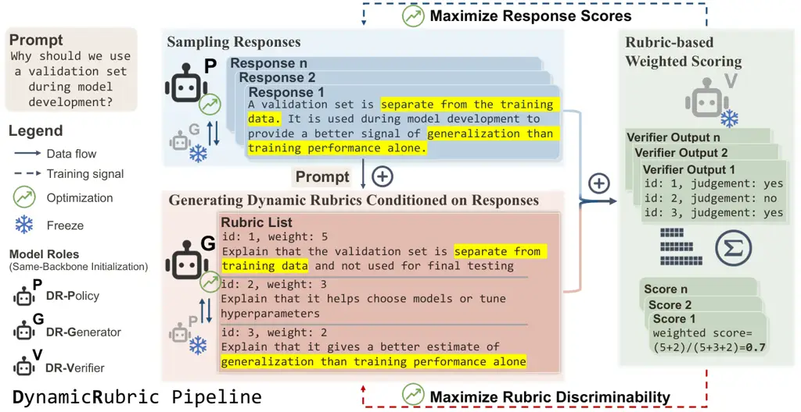
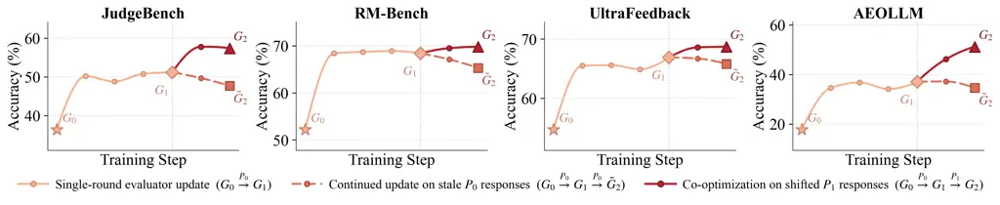
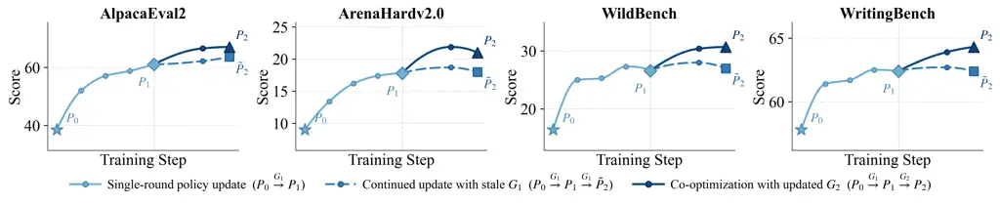
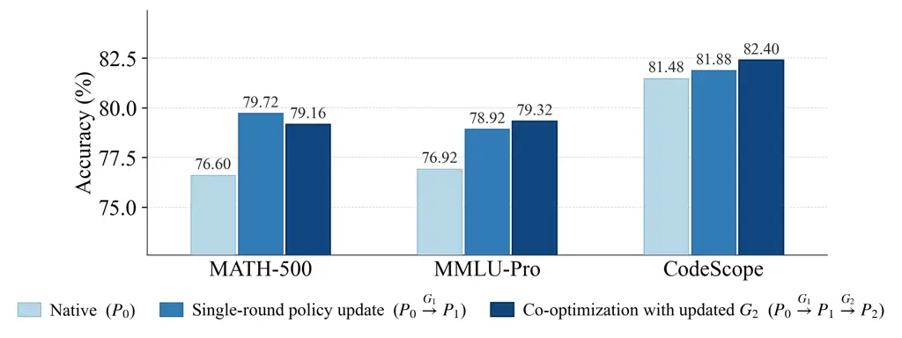
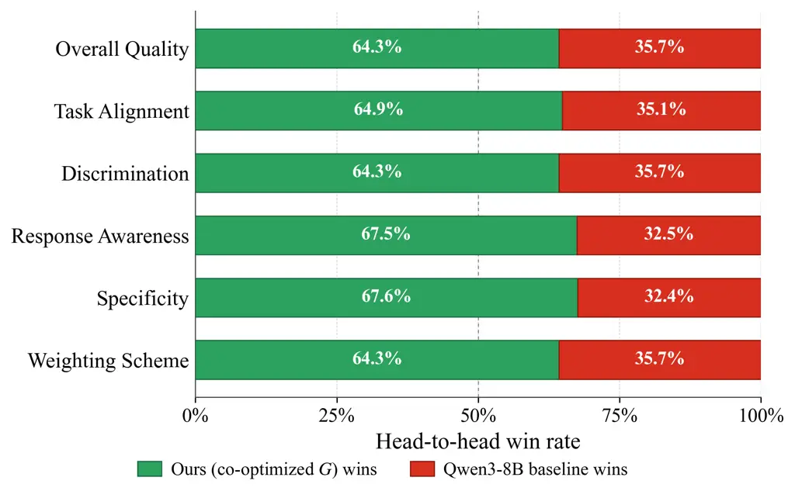

# Co-Evolving LLM Evaluators and Policies via DynamicRubric

Beining Wang Affiliation: Department of Computer Science and Technology,
Tsinghua University Affiliation: WeChat, Tencent    Weihang Su
Affiliation: Department of Computer Science and Technology, Tsinghua
University    Hongtao Tian Affiliation: WeChat, Tencent    Hao Kong
Affiliation: WeChat, Tencent    Tao Yang Affiliation: WeChat, Tencent   
Ting Yao Affiliation: WeChat, Tencent    Qingyi Pan
Affiliation: Department of Computer Science and Technology, Tsinghua
University    Yueyue Wu Affiliation: Department of Computer Science and
Technology, Tsinghua University    Qingyao Ai Affiliation: Department of
Computer Science and Technology, Tsinghua University    Min Zhang
Affiliation: Department of Computer Science and Technology, Tsinghua
University    Yiqun Liu Affiliation: Department of Computer Science and
Technology, Tsinghua University

###### Abstract

Post-training with evaluator feedback on policy-induced samples serves
as a major mechanism for improving large language models. As policies
improve, these sampled responses become close in quality. These close
candidates create a bottleneck for policy optimization: collapsed
relative evaluator score gaps yield weak or misleading policy
supervision. We theoretically characterize why these gaps matter through
a probability allocation view, showing that the directional gain of
shifting probability mass from one response to another is exactly the
evaluator score gap between them. This identifies relative score gaps as
the policy optimization signals that guide updates. Motivated by this
view, we propose DynamicRubric, a response-set-conditioned
evaluator–policy co-evolution framework that generates weighted binary
rubric items for each candidate set and aggregates the resulting
judgments into response-level scores. In our experiments with 8B
backbones, DynamicRubric improves evaluator performance and provides
stronger policy supervision than baselines using a 70B reward model or a
235B static rubric generator. DynamicRubric-optimized policies also show
gains on verifiable reasoning and coding tasks. A
DynamicRubric-optimized model is fully deployed in WeChat Search’s AI
answering scenario, where it serves all online traffic across tens of
millions of requests per day and improves key online metrics. These
results suggest a principle for evaluator-guided post-training:
evaluators should evolve with the policies they supervise.

^(†)^(†)footnotetext: ^(†)Email:
wbn23@mails.tsinghua.edu.cn^(†)^(†)footnotetext: ^(‡)Corresponding
author. Email: aiqy@tsinghua.edu.cn

## 1 Introduction



Figure 1: Overview of DynamicRubric. For each prompt, DR-Policy samples
a candidate response set, DR-Generator produces weighted binary rubric
items conditioned on the candidate responses, and a frozen DR-Verifier
applies the rubrics to compute response-level scores used to co-optimize
DR-Policy and DR-Generator.

Post-training with feedback from evaluators has become a central
mechanism for improving large language models (LLMs) (Ouyang et al.,
2022; Rafailov et al., 2023). In these pipelines, policies are optimized
using feedback on responses sampled from the current policy. As
optimization improves a policy, its sampled responses often become close
in quality, making the remaining useful differences subtle and
instance-specific. This creates a central bottleneck for
evaluator-guided optimization: policy updates depend on relative score
gaps among close candidates, which determine how probability mass should
be reallocated. Existing reward models and LLM-as-Judge evaluators are
often unreliable for such fine-grained comparisons (Lambert et al.,
2024; Tan et al., 2025). When these gaps collapse or point in the wrong
direction, policy optimization receives weak or misleading feedback.

Rubric-based evaluation offers a natural way to make fine-grained
differences explicit by decomposing holistic judgments into
criteria (Liu et al., 2023; Ye et al., 2023; Kim et al., 2024; Song et
al., 2024). Yet a rubric helps policy optimization only when its
criteria separate the responses that the current policy actually
produces. As policies improve, these candidate responses often satisfy
broad criteria such as helpfulness and clarity. Once these broad
criteria become saturated, the distinctions that matter for policy
optimization become more instance-specific: a missed constraint, a
flawed reasoning step, or a choice that fails to match the user’s
intent. Rubrics written before observing the candidate responses can
easily overlook the distinctions that determine the next policy update.

Taken together, this gap-preservation requirement motivates _dynamic_,
response-set-conditioned rubric evaluation. Given a prompt and responses
sampled from the current policy, the evaluator generates binary rubric
items aimed at the differences that matter within the set. A verifier
applies these items to every response and aggregates the yes/no
judgments into response-level scores. The shared rubric makes the
resulting score gaps directly comparable within the set and traceable to
explicit judgments, yielding feedback aligned with the comparisons that
drive policy optimization.

We theoretically ground this design through a probability allocation
view of policy optimization. Under this view, conditioned on a prompt
and a sampled response set, the directional gain of shifting probability
mass from one candidate to another is exactly the evaluator score gap
between them. This identity turns evaluator discriminability into an
optimization quantity: relative score gaps are the signals that guide
policy updates within the response set. We further establish that
response-set-conditioned evaluators include prompt-only evaluators as a
special case, while the response-set input allows the evaluator to adapt
to the candidates being compared. Since policy updates continually
change the response distribution, the evaluator must adapt to the
response sets it is used to supervise. Together, these results yield an
evaluator–policy co-evolution principle: adapt the evaluator to
current-policy response sets, then optimize the policy using the adapted
evaluator.

To instantiate this bilevel principle, we propose DynamicRubric, a
response-set-conditioned rubric framework. As illustrated in Figure 1,
given a prompt and candidate responses sampled from the current policy,
DR-Generator produces weighted binary rubric items targeting
distinctions within the response set. DR-Verifier applies each item to
each response, producing yes/no judgments that are aggregated by weights
into response-level scores. DynamicRubric alternates between adapting
DR-Generator on response sets from the evolving DR-Policy and optimizing
DR-Policy using the resulting rubric-based scores as supervision
signals.

Experiments show that DynamicRubric improves both evaluator performance
and downstream policy optimization. Using Qwen3-8B as the backbone, the
trained DR-Generator outperforms larger evaluator baselines on
preference evaluation, including a Qwen3-32B zero-shot dynamic rubric
generator. When used as the supervision signal for policy optimization,
DynamicRubric consistently improves open-ended generation over
supervision from a 70B reward model and static rubric supervision from a
235B rubric generator. Policies optimized with DynamicRubric also obtain
consistent gains on math, coding and scientific QA benchmarks,
suggesting its policy-level benefits extend beyond open-ended generation
to verifiable reasoning tasks. Continuous co-evolution experiments
further show that evolved evaluators provide stronger supervision than
stale evaluators. Beyond benchmark evaluation, we deploy a
DynamicRubric-optimized model in WeChat Search’s AI answering scenario,
a large-scale online production setting that serves tens of millions of
requests per day. Online A/B tests against the previous production model
show statistically significant improvements in total search volume, user
duration, and absolute positive user behaviors. The resulting model is
fully deployed in production and currently serves all online traffic,
replacing the previous production model. Together, these results point
to a central requirement for post-training evaluators: they should
evolve with the policies to maintain relative discriminability.
DynamicRubric meets this requirement by letting the rubric evaluator
evolve with the response sets encountered during optimization, keeping
evaluation focused on the comparisons that determine the next policy
update.

## 2 Related Work

### 2.1 Rubric-Based Evaluation and Feedback

LLM-based evaluators are widely used to assess open-ended generation and
approximate human preferences at scale (Zheng et al., 2023; Liu et al.,
2023). Rubric-based evaluation improves interpretability by decomposing
response quality into explicit criteria, structured forms, or
fine-grained dimensions (Liu et al., 2023). G-Eval uses chain-of-thought
and form-filling prompts for natural language generation evaluation,
while FLASK decomposes instruction following into fine-grained alignment
skills (Liu et al., 2023; Ye et al., 2023). Prometheus trains
open-source evaluator models to follow customized grading rubrics and
FineSurE designs multi-dimensional fine-grained evaluation for
summarization (Kim et al., 2024; Song et al., 2024). Rubrics have also
been explored as reward signals for on-policy reinforcement learning
beyond domains with deterministic verifiers (Gunjal et al., 2025; Zhang
et al., 2025).

### 2.2 Policy Optimization with Feedback for LLMs

Post-training with feedback is a standard approach for improving LLM
policies. RLHF trains reward models from human preference comparisons
for policy optimization, while RLAIF uses AI-generated feedback to
reduce human annotation cost (Ouyang et al., 2022; Bai et al., 2022).
Direct preference optimization further simplifies preference learning by
optimizing policies directly from preference pairs without explicitly
training a reward model (Rafailov et al., 2023). Recent
reasoning-oriented systems extend RL-based post-training with
verifiable, outcome-based rewards to improve mathematical, coding, and
general reasoning abilities (Shao et al., 2024; Guo et al., 2025a). The
effectiveness of these methods depends on the reliability of the
feedback signal during policy optimization, and imperfect reward models
can lead to overoptimization (Gao et al., 2023). These observations
motivate our evaluator-side perspective: post-training should preserve
discriminative score gaps on the response distribution being optimized.

## 3 Methodology

### 3.1 Relative Evaluator Score Gaps as Optimization Signals

In LLM post-training, useful evaluators are expected to maintain
discriminability among close current-policy responses (Ouyang et al.,
2022; Zhang et al., 2025). This section formalizes this requirement by
showing that relative evaluator score gaps within policy-induced
response sets are exactly the optimization signals.

Formally, let $`x\sim\mathcal{D}`$ be a prompt, and let the policy
$`\pi_{\theta}(y\mid x)`$ denote the conditional generation distribution
of the current LLM. $`E(x,y)\in\mathbb{R}`$ denotes the scalar score
assigned by an evaluator to a prompt-response pair. For $`x`$, we sample
$`K`$ responses from the current policy and denote the sampled response
set by $`\mathcal{C}`$:

```math
y_{1},\dots,y_{K}\stackrel{{\scriptstyle\mathrm{i.i.d.}}}{{\sim}}\pi_{\theta}(\cdot\mid x),\qquad\mathcal{C}=\{y_{1},\dots,y_{K}\}. \tag{1}
```

To characterize the relative score structure that an evaluator should
preserve, we introduce an analysis-time pair distribution
$`P(\cdot\mid x,\mathcal{C})`$. This distribution is supported on
ordered pairs $`(y^{+},y^{-})`$ within $`\mathcal{C}`$, where the
direction from $`y^{-}`$ to $`y^{+}`$ is determined by
evaluator-independent reference quality. Define the average relative
evaluator score gap on $`\mathcal{C}`$ as

```math
\begin{split}\Delta_{\mathrm{gap}}(E;\theta)=\mathbb{E}_{x\sim\mathcal{D}}&\mathbb{E}_{\mathcal{C}\sim\pi_{\theta}(\cdot\mid x)}\mathbb{E}_{(y^{+},y^{-})\sim P(\cdot\mid x,\mathcal{C})}\\
&\left[E(x,y^{+})-E(x,y^{-})\right].\end{split} \tag{2}
```

Equation 2 measures the average relative score gap that the evaluator
exposes on ordered pairs from the current response set. From a local
probability allocation perspective, this gap is also the local
optimization signal for moving probability mass from $`y^{-}`$ to
$`y^{+}`$. To see this, for a fixed $`x`$ and $`\mathcal{C}`$, we define
the normalized policy mass on $`\mathcal{C}`$ as

```math
\alpha_{i}=\frac{\pi_{\theta}(y_{i}\mid x)}{\sum_{j=1}^{K}\pi_{\theta}(y_{j}\mid x)},\qquad\sum_{i=1}^{K}\alpha_{i}=1. \tag{3}
```

In the local coordinates
$`\boldsymbol{\alpha}=(\alpha_{1},\dots,\alpha_{K})`$, we consider the
local proxy objective

```math
\mathcal{J}^{\mathrm{local}}_{x,\mathcal{C}}(\boldsymbol{\alpha};E)=\sum_{i=1}^{K}\alpha_{i}E(x,y_{i}). \tag{4}
```

Let $`\mathbf{d}=(d_{1},\dots,d_{K})`$ be any feasible local direction
on the probability simplex, satisfying $`\sum_{i=1}^{K}d_{i}=0`$, and
define the local path
$`\boldsymbol{\alpha}(\varepsilon)=\boldsymbol{\alpha}+\varepsilon\mathbf{d}`$.
For sufficiently small $`|\varepsilon|`$, this path remains inside the
simplex. Since $`\mathcal{J}^{\mathrm{local}}_{x,\mathcal{C}}`$ is
linear in $`\boldsymbol{\alpha}`$, its directional derivative along this
path is

```math
\left.\frac{\mathrm{d}}{\mathrm{d}\varepsilon}\mathcal{J}^{\mathrm{local}}_{x,\mathcal{C}}(\boldsymbol{\alpha}+\varepsilon\mathbf{d};E)\right|_{\varepsilon=0}=\sum_{i=1}^{K}d_{i}E(x,y_{i}). \tag{5}
```

Thus, the local improvement directions on $`\mathcal{C}`$ are determined
by the relative structure of evaluator scores. For any pair
$`(y_{i},y_{j})`$, define the transfer direction
$`\mathbf{d}_{i\leftarrow j}=e_{i}-e_{j}`$, where $`e_{i},e_{j}`$ are
standard basis vectors. This direction transfers an infinitesimal amount
of probability mass from $`y_{j}`$ to $`y_{i}`$ while leaving the
remaining coordinates unchanged. The directional derivative along this
direction is

```math
\left.\frac{\mathrm{d}}{\mathrm{d}\varepsilon}\mathcal{J}^{\mathrm{local}}_{x,\mathcal{C}}(\boldsymbol{\alpha}+\varepsilon\mathbf{d}_{i\leftarrow j};E)\right|_{\varepsilon=0}=E(x,y_{i})-E(x,y_{j}). \tag{6}
```

Thus, for an ordered pair $`(y^{+},y^{-})`$, the relative score gap is
exactly the local directional gain of transferring probability mass from
$`y^{-}`$ to $`y^{+}`$. Since general local updates can be decomposed
into such pairwise transfers, relative score gaps characterize the local
improvement directions on $`\mathcal{C}`$. When these gaps collapse, the
optimization signal exposed by the evaluator shrinks, and policy
optimization becomes less effective on the sampled response set.

The above identity holds pointwise for each fixed $`x`$,
$`\mathcal{C}`$, and ordered pair $`(y^{+},y^{-})`$. Taking expectation
under the same sampling process gives the expected local optimization
signal. Let $`\mathbf{d}_{+\leftarrow-}`$ denote the transfer direction
from $`y^{-}`$ to $`y^{+}`$. Then

```math
\begin{split}\mathbb{E}_{x\sim\mathcal{D}}&\mathbb{E}_{\mathcal{C}\sim\pi_{\theta}(\cdot\mid x)}\mathbb{E}_{(y^{+},y^{-})\sim P(\cdot\mid x,\mathcal{C})}\\
&\left[\left.\frac{\mathrm{d}}{\mathrm{d}\varepsilon}\mathcal{J}^{\mathrm{local}}_{x,\mathcal{C}}(\boldsymbol{\alpha}+\varepsilon\mathbf{d}_{+\leftarrow-};E)\right|_{\varepsilon=0}\right]\\
=&\mathbb{E}_{x\sim\mathcal{D}}\mathbb{E}_{\mathcal{C}\sim\pi_{\theta}(\cdot\mid x)}\mathbb{E}_{(y^{+},y^{-})\sim P(\cdot\mid x,\mathcal{C})}\\
&\left[E(x,y^{+})-E(x,y^{-})\right]\\
=&\Delta_{\mathrm{gap}}(E;\theta)\qquad\text{(by Equation~\eqref{eq:delta-gap})}.\end{split} \tag{7}
```

Therefore, $`\Delta_{\mathrm{gap}}(E;\theta)`$ is the expected local
optimization signal exposed by the evaluator. Evaluator updates should
preserve these relative score gaps as optimization signals under
policy-induced response set distribution shift.

### 3.2 Response-Set-Conditioned Evaluation

Preserving this signal requires relative scores that adapt to the
candidates being compared. We therefore study how the evaluator input
structure affects its capacity to model response-set-specific score
gaps. We compare two evaluator function classes. A prompt-only evaluator
assigns a fixed score $`E(x,y)`$ to a prompt-response pair, while a
response-set-conditioned evaluator additionally takes the current
response set as input and assigns a score $`E(x,y\mid\mathcal{C})`$.
Formally, consider

```math
\displaystyle\mathcal{E}_{\mathrm{prompt}} \displaystyle=\{E:(x,y)\mapsto E(x,y)\in\mathbb{R}\}, \tag{8}
```

```math
\displaystyle\mathcal{E}_{\mathrm{set}} \displaystyle=\{E:(x,y,\mathcal{C})\mapsto E(x,y\mid\mathcal{C})\in\mathbb{R}\}.
```

A prompt-only evaluator is the special case satisfying
$`E(x,y\mid\mathcal{C})=E(x,y)`$. Therefore,
$`\mathcal{E}_{\mathrm{prompt}}\subseteq\mathcal{E}_{\mathrm{set}}`$. We
define the local ranking loss functional

```math
\begin{split}&\mathcal{L}_{x,\mathcal{C}}(E)\\
=&\mathbb{E}_{(y^{+},y^{-})\sim P(\cdot\mid x,\mathcal{C})}\left[\ell\left(E(x,y^{+}\mid\mathcal{C})-E(x,y^{-}\mid\mathcal{C})\right)\right],\end{split} \tag{9}
```

where $`\ell`$ is any fixed ranking loss that is monotone non-increasing
in the relative score gap. By the function-class inclusion, we have

```math
\begin{split}\inf_{E\in\mathcal{E}_{\mathrm{prompt}}}&\mathbb{E}_{\mathcal{C}\sim\pi_{\theta}(\cdot\mid x)}\left[\mathcal{L}_{x,\mathcal{C}}(E)\right]\\
\geq\inf_{E\in\mathcal{E}_{\mathrm{set}}}&\mathbb{E}_{\mathcal{C}\sim\pi_{\theta}(\cdot\mid x)}\left[\mathcal{L}_{x,\mathcal{C}}(E)\right].\end{split} \tag{10}
```

Equation 10 shows that a response-set-conditioned evaluator has no
larger optimal expected local ranking loss than a prompt-only evaluator.
This motivates using response-set-conditioned evaluators as the basis
for preserving relative score gaps.

### 3.3 Bilevel Policy-Evaluator Updates under Policy-Induced Response-Set Shift

The remaining issue is training-time response-set shift, since policy
optimization changes the response sets on which relative gaps must be
preserved. As policy optimization improves generations, candidate
responses become closer in quality. Reward models and LLM judges are
known to be less reliable on such fine-grained comparisons (Tan et al.,
2025; Lambert et al., 2024; Li et al., 2024). Consequently, an evaluator
trained on earlier response sets may provide weaker relative signals on
current policy samples. Therefore, the evaluator must be updated along
with policy-induced response sets to maintain the relative scoring
structure required for policy optimization.

This joint update requirement naturally yields a coupled optimization
problem. The policy update depends on response-level scores produced by
the current evaluator, while the evaluator update depends on response
sets sampled from the current policy. For evaluator $`\phi`$ and policy
$`\theta`$ at round $`t`$, we formalize this as the following bilevel
problem:

```math
\displaystyle\max_{\theta} \displaystyle\mathcal{J}_{\mathrm{policy}}^{t}(\theta;\phi_{t}^{\star}) \tag{11}
```

```math
\displaystyle\text{s.t.} \displaystyle\phi_{t}^{\star}\in\arg\max_{\phi}\;\mathcal{J}_{\mathrm{evaluator}}^{t}(\phi;\theta_{t-1}).
```

This coupling makes evaluator learning track response-set shift during
optimization and preserve relative discriminability for policy
optimization.

### 3.4 DynamicRubric

We instantiate this bilevel formulation with DynamicRubric, a
co-evolution framework realized through a two-stage optimization loop.
At each round, DynamicRubric first fixes the current policy and adapts
the evaluator on response sets sampled from that policy; it then fixes
the updated evaluator and optimizes the policy using the resulting
scores. As illustrated in Figure 1, the evaluator consists of a
learnable DR-Generator and a frozen DR-Verifier. Given a prompt and a
response set sampled from DR-Policy, DR-Generator produces weighted
rubric items that define evaluation criteria and their relative
importance. DR-Verifier applies these rubrics to each response and
returns binary outcomes for each criterion. The weighted outcomes are
aggregated into response-level scores.

Formally, given $`(x,\mathcal{C})`$, DR-Generator outputs a rubric list
$`\{(r_{m},w_{m})\}_{m=1}^{M}`$. Given a response $`y`$, DR-Verifier
returns a yes/no judgment for each rubric item, denoted by
$`v_{m}(y;\mathcal{C})\in\{0,1\}`$. Here, each $`r_{m}`$ is a rubric
item and $`w_{m}\in\{1,\cdots,5\}`$ is its weight. We do not fix $`M`$
or prescribe item weights, allowing DR-Generator to determine both
during training. Aggregating rubric-level outcomes by normalized weights
gives the response-level evaluator

```math
E_{\phi}(x,y\mid\mathcal{C})=\frac{\sum_{m=1}^{M}w_{m}v_{m}(y;\mathcal{C})}{\sum_{m=1}^{M}w_{m}}. \tag{12}
```

At round $`t`$, DynamicRubric fixes the current policy $`\theta_{t-1}`$
and samples a response set
$`\mathcal{C}=\{y_{i}\}_{i=1}^{K}\sim\pi_{\theta_{t-1}}(\cdot\mid x)`$.
These online sampled responses typically lack ranking labels. Thus, on
the current policy-induced distribution, the evaluator can be updated by
a direction-free signal that encourages generated rubrics to separate
responses. For each rubric item $`r_{m}`$, define
$`\bar{v}_{m}=\frac{1}{K}\sum_{i=1}^{K}v_{m}(y_{i};\mathcal{C})`$ and
the discriminability reward as

```math
R_{\mathrm{disc}}(x,\mathcal{C};\phi)=\frac{\sum_{m=1}^{M}w_{m}\,\bar{v}_{m}(1-\bar{v}_{m})}{\sum_{m=1}^{M}w_{m}}. \tag{13}
```

This reward is the weighted Bernoulli variance of rubric outcomes on
$`\mathcal{C}`$. It encourages DR-Generator to produce rubric items that
induce non-trivial yes/no splits over the current response set. The
corresponding discriminability objective is

```math
\mathcal{J}_{\mathrm{disc}}^{t}(\phi;\theta_{t-1})=\mathbb{E}_{x\sim\mathcal{D}}\mathbb{E}_{\mathcal{C}\sim\pi_{\theta_{t-1}}(\cdot\mid x)}\left[R_{\mathrm{disc}}(x,\mathcal{C};\phi)\right]. \tag{14}
```

Optimizing this objective alone encourages separations, but does not
determine whether they are quality-aligned. Indeed, flipping all yes/no
outcomes preserves $`R_{\mathrm{disc}}`$ while reversing the induced
relative score gaps. Thus, the objective can also reward superficial
splits. Updating the evaluator therefore requires a direction-aware
ranking signal to calibrate which separations are useful.

Let $`\mathcal{A}`$ denote ranked anchor data. Each anchor example
contains a prompt $`x`$ and a fully ranked anchor response list
$`\mathcal{C}_{\mathrm{anchor}}=(y_{1}^{0},\dots,y_{n}^{0})`$ satisfying
$`y_{1}^{0}\succ y_{2}^{0}\succ\cdots\succ y_{n}^{0}`$. Given a
conditioning response set $`\mathcal{C}`$, DR-Generator observes only
$`(x,\mathcal{C})`$, and the rubrics generated from $`\mathcal{C}`$ are
applied to $`\mathcal{C}_{\mathrm{anchor}}`$. The induced score gaps
provide preference-alignment supervision, calibrating local separations
without exposing anchor-specific shortcuts. For each anchor response
$`y_{i}^{0}\in\mathcal{C}_{\mathrm{anchor}}`$, define
$`S_{i}=E_{\phi}(x,y_{i}^{0}\mid\mathcal{C})`$. The anchor reward uses a
Bradley–Terry style (Bradley and Terry, 1952) contrastive ranking
objective with Rank-Biased Precision style (Moffat and Zobel, 2008)
weighting:

```math
R_{\mathrm{anchor}}(x,\mathcal{C},\mathcal{C}_{\mathrm{anchor}};\phi)=\sum_{i=1}^{n-1}\sum_{j=i+1}^{n}\frac{\log\sigma(S_{i}-S_{j})}{(j-i)\times 2^{i-1}}. \tag{15}
```

Here, $`\sigma(\cdot)`$ is the logistic sigmoid. The term
$`\log\sigma(S_{i}-S_{j})`$ encourages score gaps in the anchor ranking
direction. The weighting scheme increases the weight on top-ranked
responses and emphasizes fine-grained distinctions between nearby ranked
responses. The corresponding anchor objective is

```math
\begin{split}&\mathcal{J}_{\mathrm{anchor}}^{t}(\phi;\theta_{t-1})\\
&=\mathbb{E}_{(x,\mathcal{C}_{\mathrm{anchor}})\sim\mathcal{A}}\mathbb{E}_{\mathcal{C}\sim\pi_{\theta_{t-1}}(\cdot\mid x)}\left[R_{\mathrm{anchor}}(x,\mathcal{C},\mathcal{C}_{\mathrm{anchor}};\phi)\right].\end{split} \tag{16}
```

Combining these two objectives gives the evaluator objective

```math
\mathcal{J}_{\mathrm{evaluator}}^{t}(\phi;\theta_{t-1})=\mathcal{J}_{\mathrm{disc}}^{t}(\phi;\theta_{t-1})+\lambda\mathcal{J}_{\mathrm{anchor}}^{t}(\phi;\theta_{t-1}), \tag{17}
```

where $`\lambda`$ controls the relative scale of the anchor reward.
Although $`R_{\mathrm{anchor}}`$ is non-positive, maximizing it directly
improves agreement with the anchor ranking. The evaluator objective is
designed as a tractable proxy for the relative score gap
$`\Delta_{\mathrm{gap}}(E_{\phi};\theta_{t-1})`$ in Equation 7.
Appendix J further shows that there exist constants
$`c_{\mathrm{disc}},c_{\mathrm{anchor}}>0`$ and a $`t`$-dependent
residual $`\epsilon_{t}`$ such that

```math
\begin{split}&\Delta_{\mathrm{gap}}(E_{\phi};\theta_{t-1})\\
&\geq c_{\mathrm{disc}}\,\mathcal{J}_{\mathrm{disc}}^{t}(\phi;\theta_{t-1})+c_{\mathrm{anchor}}\,\mathcal{J}_{\mathrm{anchor}}^{t}(\phi;\theta_{t-1})+\epsilon_{t}.\end{split} \tag{18}
```

Therefore, maximizing the combination of the discriminability and anchor
objectives increases a lower bound on the target relative score gap.

|                           |      |                  |                  |                  |                  |                  |                  |                  |                  |
| ------------------------- | ---- | ---------------- | ---------------- | ---------------- | ---------------- | ---------------- | ---------------- | ---------------- | ---------------- |
| Evaluator                 | Size | JudgeBench       | Personalized-RB  | RM-Bench         | UltraFeedback    | AEOLLM           |                  | LMSYS-Chat-1M    |                  |
|                           |      | Acc.$`\uparrow`$ | Acc.$`\uparrow`$ | Acc.$`\uparrow`$ | Acc.$`\uparrow`$ | Acc.$`\uparrow`$ | nDCG$`\uparrow`$ | Acc.$`\uparrow`$ | nDCG$`\uparrow`$ |
| Scalar Reward Models      |      |                  |                  |                  |                  |                  |                  |                  |                  |
| Skywork-27B               | 27B  | 52.1             | 64.7             | 67.7             | 63.4             | 43.8             | 0.826            | 21.0             | 0.720            |
| Skywork-27B w/ responses  | 27B  | 56.1             | 60.6             | 65.8             | 65.2             | 37.5             | 0.805            | 21.6             | 0.717            |
| Nemotron-70B              | 70B  | 66.0             | 68.6             | 85.2             | 72.8             | 57.5             | 0.868            | 20.4             | 0.718            |
| Nemotron-70B w/ responses | 70B  | 64.8             | 61.9             | 83.2             | 77.4             | 57.5             | 0.867            | 17.2             | 0.706            |
| Dynamic Rubric Methods    |      |                  |                  |                  |                  |                  |                  |                  |                  |
| Qwen3-8B zero-shot        | 8B   | 36.4             | 53.7             | 52.2             | 54.7             | 17.8             | 0.894            | 12.0             | 0.762            |
| Qwen3-32B zero-shot       | 32B  | 46.4             | 67.6             | 64.7             | 64.6             | 29.7             | 0.902            | 15.1             | 0.763            |
| DR-Generator-8B           | 8B   | 57.4             | 73.3             | 69.8             | 68.7             | 51.2             | 0.898            | 28.0             | 0.779            |

Table 1: Evaluator performance on pairwise and listwise benchmarks.
Scalar reward models marked as “w/ responses” receive the candidate
response set during scoring. DR-Generator-8B uses Qwen3-8B as the
backbone. Acc. denotes strict (ties excluded) accuracy. nDCG is reported
for listwise benchmarks. The overall best is in bold and the best among
dynamic rubric generators under the same verifier (details in
Appendix F.1) is underlined.

After the evaluator update, the policy objective uses the response-level
reward from the evaluator:

```math
\mathcal{J}_{\mathrm{policy}}^{t}(\theta;\phi_{t})=\mathbb{E}_{x\sim\mathcal{D}}\mathbb{E}_{\mathcal{C}\sim\pi_{\theta}(\cdot\mid x)}\left[\frac{1}{|\mathcal{C}|}\sum_{y\in\mathcal{C}}E_{\phi_{t}}(x,y\mid\mathcal{C})\right]. \tag{19}
```

Thus, the overall training procedure is

```math
\left\{\begin{aligned} \phi_{t}&\in\arg\max_{\phi}\;\mathcal{J}_{\mathrm{evaluator}}^{t}(\phi;\theta_{t-1}),\qquad t\geq 1,\\
\theta_{t}&\in\arg\max_{\theta}\;\mathcal{J}_{\mathrm{policy}}^{t}(\theta;\phi_{t}),\qquad t\geq 1,\end{aligned}\right. \tag{20}
```

where $`\theta_{0}`$ denotes the initial policy model.

Notably, DynamicRubric can be implemented in a fully self-contained
manner: given only ranked anchor data, DR-Generator, DR-Verifier, and
DR-Policy can be instantiated as separate copies of the same backbone
model, without requiring any external reward model or judge.

|                           |                 |           |             |               |           |              |
| ------------------------- | --------------- | --------- | ----------- | ------------- | --------- | ------------ |
| Supervision Method        | Supervisor Size | Backbone  | AlpacaEval2 | ArenaHardv2.0 | WildBench | WritingBench |
| Baselines                 |                 |           |             |               |           |              |
| Native                    | –               | Qwen3-8B  | 38.5        | 9.0           | 16.4      | 57.8         |
| Native                    | –               | Qwen3-32B | 50.2        | 20.8          | 29.7      | 62.0         |
| Scalar Reward Models      |                 |           |             |               |           |              |
| Skywork-27B               | 27B             | Qwen3-8B  | 50.6        | 15.3          | 22.3      | 60.2         |
| Skywork-27B w/ responses  | 27B             | Qwen3-8B  | 48.2        | 12.3          | 20.5      | 58.6         |
| Nemotron-70B              | 70B             | Qwen3-8B  | 35.2        | 10.3          | 17.5      | 56.2         |
| Nemotron-70B w/ responses | 70B             | Qwen3-8B  | 41.9        | 9.2           | 18.9      | 58.2         |
| Static Rubric             |                 |           |             |               |           |              |
| RaR (Gunjal et al., 2025) | 235B            | Qwen3-8B  | 58.5        | 15.7          | 25.2      | 61.6         |
| Dynamic Rubric            |                 |           |             |               |           |              |
| DR-Generator-8B           | 8B              | Qwen3-8B  | 67.1        | 21.0          | 30.7      | 64.3         |

Table 2: Policy performance on open-domain generation benchmarks across
different supervision methods. AlpacaEval2 and ArenaHardv2.0 report win
rates. WildBench and WritingBench report benchmark scores in their
standard evaluation scales. All scores are reported such that higher is
better. In each column, the best is in bold.



(a) DR-Generator optimization on original versus updated DR-Policy
response distribution.



(b) DR-Policy optimization with dynamic rubric supervision from previous
versus updated DR-Generators.

Figure 2: Effect of evaluator–policy co-evolution in DynamicRubric.
$`G_{0}`$ and $`P_{0}`$ are separately initialized from Qwen3-8B. The
co-evolution process starts by adapting $`G_{0}`$ on responses sampled
from $`P_{0}`$.

## 4 Experiments

### 4.1 Experimental Setup

#### Datasets.

We construct the training data from Nectar (Zhu et al., 2023), an
open-domain dataset with seven ranked responses for each prompt, which
we use as the anchor data. For evaluator evaluation, we use four
pairwise and two listwise preference benchmarks and report AVG@5. For
policy evaluation, we use four open-ended generation benchmarks. Details
of the datasets and benchmarks are provided in Appendices B and C.

#### Models.

We initialize DR-Policy and DR-Generator from independent Qwen3-8B (Yang
et al., 2025) copies and optimize both with GRPO (Shao et al., 2024).
For DR-Policy, GRPO turns evaluator scores into relative advantages
within each sampled set, aligning policy optimization with the score-gap
view. For DR-Generator, discriminability and anchor rewards are combined
at the advantage level, which reduces scale mismatch and allows us to
set $`\lambda=1`$. Training details are provided in Appendix D. We
repeat the full pipeline with Llama-3.1-8B-Instruct (Grattafiori et al., 2024) in Appendix F.3, demonstrating robustness to model backbones.

### 4.2 Evaluator Optimization with DynamicRubric

We first examine whether DynamicRubric improves fine-grained preference
evaluation. Our evaluator uses a DR-Generator initialized from Qwen3-8B
and trained with DynamicRubric, denoted DR-Generator-8B. We compare it
with the larger same-family Qwen3-32B used as a dynamic rubric
generator, and with strong scalar reward models, including
Skywork-Reward-Gemma2-27B (Liu et al., 2024) and
Nemotron-70B-Reward-Multilingual (Wang et al., 2025). To control for
response-set access, we also evaluate scalar reward models that receive
the same response set during scoring. This setup isolates the effect of
rubric generator training under matched response-set access while
comparing against strong baselines.

Table 1 shows that DR-Generator-8B consistently improves over zero-shot
dynamic rubric evaluators, including the larger Qwen3-32B generator, on
all accuracy metrics. In contrast, the scalar variants show mixed
changes, indicating that response-set access alone does not reliably
improve evaluation. Notably, DR-Generator-8B also outperforms
Skywork-27B and its response-set variant on every reported metric.
Overall, DR-Generator-8B provides consistent gains over larger zero-shot
dynamic rubric evaluators and achieves performance competitive with
substantially larger scalar reward models. We also include qualitative
analysis and a case study in Appendices G and H to examine whether
DynamicRubric training turns response-set access into high-quality
rubrics that identify decisive differences. The analysis shows that
training yields more discriminative criteria, and the case study
illustrates how these criteria produce clear score gaps and the correct
top-ranked response.

### 4.3 Policy Optimization with DynamicRubric

Next, we evaluate whether these finer score gaps translate into
effective downstream DR-Policy supervision signals. We compare against
other supervision approaches including scalar reward models, their
response-set-conditioned variants, and Rubric-as-Reward (Gunjal et al.,
2025), a static rubric supervision approach where rubrics are generated
only from the prompt with Qwen3-235B-A22B-Instruct-2507 as the
generator. Qwen3-32B is also included as a same-family strong policy
baseline.

Table 2 shows that DR-Generator-8B supervision produces a DR-Policy that
consistently outperforms policies trained with larger reward models,
static rubric supervision from a 235B generator, and the strong 32B
baseline across all benchmarks. We use DeepSeek-V4-Flash (DeepSeek-AI, 2026) as the judge. Appendix F.2 re-evaluates policies with GPT-4.1 and
reports consistent gains, supporting the reliability of the evaluation.
Together, these results show that DynamicRubric converts
response-set-conditioned evaluator gains into effective reward signals
for policy optimization.

|                                |                                 |                                   |                  |                  |                  |                  |                  |                  |                   |
| ------------------------------ | ------------------------------- | --------------------------------- | ---------------- | ---------------- | ---------------- | ---------------- | ---------------- | ---------------- | ----------------- |
| Evaluator Objective            | $`\mathcal{J}_{\mathrm{disc}}`$ | $`\mathcal{J}_{\mathrm{anchor}}`$ | JudgeBench       | Personalized-RB  | RM-Bench         | UltraFeedback    | AEOLLM           | LMSYS-Chat-1M    | Average           |
|                                |                                 |                                   | Acc.$`\uparrow`$ | Acc.$`\uparrow`$ | Acc.$`\uparrow`$ | Acc.$`\uparrow`$ | Acc.$`\uparrow`$ | Acc.$`\uparrow`$ | Macro$`\uparrow`$ |
| w/o anchor objective           | ✓                               | \-                                | 56.1             | 72.4             | 69.8             | 67.9             | 47.3             | 27.7             | 56.9              |
| w/o discriminability objective | \-                              | ✓                                 | 50.0             | 73.8             | 66.3             | 66.8             | 38.8             | 20.7             | 52.7              |
| Full objective                 | ✓                               | ✓                                 | 57.4             | 73.3             | 69.8             | 68.7             | 51.2             | 28.0             | 58.1              |

Table 3: Ablation of evaluator optimization objectives. In each column,
the best is in bold.

### 4.4 Continuous Co-Evolution of Evaluator and Policy

We then test the continuous co-evolution claim by isolating evaluator
and policy updates. Let $`G_{0}`$ and $`P_{0}`$ be two separate copies
initialized from the native Qwen3-8B backbone. The first DR-Generator
update, $`G_{0}\overset{P_{0}}{\rightarrow}G_{1}`$, trains the generator
to produce dynamic rubrics for response sets sampled from $`P_{0}`$. The
resulting $`G_{1}`$ then supervises DR-Policy optimization,
$`P_{0}\overset{G_{1}}{\rightarrow}P_{1}`$, shifting the policy-induced
response distribution. The next round isolates two dependencies in this
co-evolution loop. For evaluator training, we compare continuing to
train on the original policy distribution,
$`G_{1}\overset{P_{0}}{\rightarrow}\tilde{G}_{2}`$, against updating on
the current policy distribution,
$`G_{1}\overset{P_{1}}{\rightarrow}G_{2}`$. For policy optimization, we
compare updating $`P_{1}`$ with the previous DR-Generator,
$`P_{1}\overset{G_{1}}{\rightarrow}\widetilde{P}_{2}`$, against updating
it with the current DR-Generator,
$`P_{1}\overset{G_{2}}{\rightarrow}P_{2}`$.

Figure 2 shows the empirical effect of continuous evaluator–policy
co-evolution in DynamicRubric. For evaluator adaptation, training
DR-Generator on responses from the current DR-Policy yields stronger
gains, while continuing on the stale $`P_{0}`$ distribution can degrade.
For policy optimization, the updated generator $`G_{2}`$ provides
stronger supervision for $`P_{1}`$ and improves all four generation
benchmarks. In contrast, the stale generator $`G_{1}`$ yields smaller
gains, as criteria calibrated to $`P_{0}`$ can saturate or induce noisy
gaps on $`P_{1}`$ samples. These results support the core design
principle of DynamicRubric: evaluator learning should track the evolving
policy-induced response distribution, and policy optimization should use
the evaluator most recently adapted to that distribution.



Figure 3: Performance of the initial policy and two DynamicRubric
optimized policies on verifiable tasks.

### 4.5 Online A/B Test and Deployment in Production

Finally, we evaluate DynamicRubric in a large-scale production
environment: WeChat Search’s AI answering scenario, which serves tens of
millions of requests per day. We use the previous production model as
the online baseline. Both models use WeLM-V4-80B-A3B WeChat AI Team
(2026), an large language model developed by WeChat. Due to business
confidentiality, we omit the exact values of online measurements and
describe the production results textually. In the online A/B test, the
DynamicRubric-optimized model achieves statistically significant
relative improvements over the production baseline in total search
volume, user duration, and absolute positive user behaviors. Given the
stable online gains, the resulting model is fully deployed in production
and currently serves all online traffic, replacing the previous
production model. These results demonstrate that the policy supervision
produced by DynamicRubric remains effective at production scale in a
real-world AI answering scenario. In production, DynamicRubric further
enables anchor-guided continual self-improvement: refreshed anchors
recalibrate the direction of evaluator feedback, allowing subsequent
policy iterations to track evolving objectives.

## 5 Analysis

### 5.1 Ablation Study on Evaluator Optimization Objectives

We ablate two objective terms used to optimize the evaluator in
DynamicRubric: the discriminability objective
$`\mathcal{J}_{\mathrm{disc}}`$ and the anchor objective
$`\mathcal{J}_{\mathrm{anchor}}`$. All variants start from the same
DR-Generator and are optimized on response sets sampled from the same
policy for the same number of steps, isolating the effect of the
objective components.

Table 3 shows that the full objective achieves the highest macro average
across benchmarks. Removing $`\mathcal{J}_{\mathrm{anchor}}`$ leaves the
signal vulnerable to separations that are not quality-relevant, while
removing $`\mathcal{J}_{\mathrm{disc}}`$ weakens adaptation to current
response sets. This pattern indicates that separation and ranking
calibration provide complementary supervision for DR-Generator, and
their combination yields a stronger evaluator across benchmarks.

### 5.2 DynamicRubric Policy Gains Transfer to Verifiable Tasks

DR-Policies are optimized for open-ended generation. Prior work reports
that open-ended generation optimization can cause regressions on
reasoning and coding tasks (Ouyang et al., 2022; Kirk et al., 2024).
This raises the question of whether the benefits of DynamicRubric extend
to reasoning abilities. We evaluate DR-Policies and report AVG@5 on
mathematics, scientific QA, and coding benchmarks detailed in
Appendix C. Figure 3 shows that DR-Policies consistently improve over
the initial policy across these out-of-distribution tasks, indicating
that DynamicRubric improves open-ended generation and that its
policy-level benefits transfer to verifiable reasoning and coding tasks.

## 6 Conclusion

We identify a central bottleneck in evaluator-guided policy
optimization: as current-policy responses become close in quality,
effective updates require evaluators to maintain discriminability. We
formalize this requirement through a probability allocation view, where
moving probability mass between two responses yields a gain equal to
their evaluator score gap. This yields a simple principle: evaluators
should evolve with the policies they supervise, adapting to
current-policy response sets before the next policy update. We propose
DynamicRubric to instantiate this principle with
response-set-conditioned rubrics aggregated into response-level scores
for supervision. Experiments show gains in evaluation, open-ended
generation, and verifiable tasks, highlighting relative discriminability
on the policy-induced response distribution as central to effective
post-training evaluators.

## Limitations

#### Training-time computational cost.

DynamicRubric introduces additional training-time cost because policy
optimization requires generator and verifier calls. Although Appendix E
reports that this overhead remains lower than supervision from larger
reward model or rubric generator baselines in our setup, serial
generator–verifier calls still increase wall-clock latency during policy
training. This cost may become more significant with larger generators,
stronger verifiers, or larger response sets. Future work can reduce this
overhead through parallel verification, asynchronous evaluator updates,
and more efficient verifier scheduling.

#### Verifier scope.

DynamicRubric relies on verifier feedback to score responses under
generated rubrics, so the verifier choice defines the supervision
available during training. Although Appendix F.1 evaluates verifiers of
different scales and from different model families, our study does not
include stronger black-box verifiers such as GPT-4.1 during training
because of evaluation cost. We also keep DR-Verifier frozen rather than
training a dedicated verifier. Future work can study stronger verifier
families, adaptive verifier training, and calibration strategies for
rubric-based scoring.

## References

- Ahmadian et al. (2024) A. Ahmadian, C. Cremer, M. Gallé, M. Fadaee, J.
  Kreutzer, O. Pietquin, A. Üstün, and S. Hooker Back to basics:
  revisiting reinforce style optimization for learning from human
  feedback in llms. External Links: 2402.14740,
  [Link](https://arxiv.org/abs/2402.14740) Cited by: Appendix D.
- Bai et al. (2022) Y. Bai, S. Kadavath, S. Kundu, A. Askell, J.
  Kernion, A. Jones, A. Chen, A. Goldie, A. Mirhoseini, C. McKinnon, C.
  Chen, C. Olsson, C. Olah, D. Hernandez, D. Drain, D. Ganguli, D.
  Li, E. Tran-Johnson, E. Perez, J. Kerr, J. Mueller, J. Ladish, J.
  Landau, K. Ndousse, K. Lukosuite, L. Lovitt, M. Sellitto, N.
  Elhage, N. Schiefer, N. Mercado, N. DasSarma, R. Lasenby, R.
  Larson, S. Ringer, S. Johnston, S. Kravec, S. E. Showk, S. Fort, T.
  Lanham, T. Telleen-Lawton, T. Conerly, T. Henighan, T. Hume, S. R.
  Bowman, Z. Hatfield-Dodds, B. Mann, D. Amodei, N. Joseph, S.
  McCandlish, T. Brown, and J. Kaplan Constitutional ai: harmlessness
  from ai feedback. arXiv preprint arXiv:2212.08073. Cited by: §2.2.
- Bradley and Terry (1952) R. A. Bradley and M. E. Terry Rank analysis
  of incomplete block designs: i. the method of paired comparisons.
  Biometrika 39 (3/4), pp. 324–345. Cited by: §3.4.
- Chen et al. (2025) J. Chen, H. Li, Z. Chu, Y. Liu, and Q. Ai Overview
  of the ntcir-18 automatic evaluation of llms (aeollm) task. External
  Links: 2503.13038, [Link](https://arxiv.org/abs/2503.13038) Cited by:
  §C.1.
- Cui et al. (2023) G. Cui, L. Yuan, N. Ding, G. Yao, W. Zhu, Y. Ni, G.
  Xie, Z. Liu, and M. Sun Ultrafeedback: boosting language models with
  high-quality feedback. Cited by: §C.1.
- DeepSeek-AI (2026) DeepSeek-AI DeepSeek-v4: towards highly efficient
  million-token context intelligence. Cited by: §C.2, §4.3.
- Dubois et al. (2024) Y. Dubois, B. Galambosi, P. Liang, and T. B.
  Hashimoto Length-controlled alpacaeval: a simple way to debias
  automatic evaluators. arXiv preprint arXiv:2404.04475. Cited by: §C.2.
- Dubois et al. (2023) Y. Dubois, X. Li, R. Taori, T. Zhang, I.
  Gulrajani, J. Ba, C. Guestrin, P. Liang, and T. B. Hashimoto
  AlpacaFarm: a simulation framework for methods that learn from human
  feedback. External Links: 2305.14387 Cited by: §C.2.
- Gao et al. (2023) L. Gao, J. Schulman, and J. Hilton Scaling laws for
  reward model overoptimization. In International Conference on Machine
  Learning, pp. 10835–10866. Cited by: §2.2.
- Grattafiori et al. (2024) A. Grattafiori, A. Dubey, A. Jauhri, A.
  Pandey, A. Kadian, A. Al-Dahle, A. Letman, A. Mathur, A. Schelten, A.
  Vaughan, A. Yang, A. Fan, A. Goyal, A. Hartshorn, A. Yang, A.
  Mitra, A. Sravankumar, A. Korenev, A. Hinsvark, A. Rao, A. Zhang, A.
  Rodriguez, A. Gregerson, A. Spataru, B. Roziere, B. Biron, B. Tang, B.
  Chern, C. Caucheteux, C. Nayak, C. Bi, C. Marra, C. McConnell, C.
  Keller, C. Touret, C. Wu, C. Wong, C. C. Ferrer, C. Nikolaidis, D.
  Allonsius, D. Song, D. Pintz, D. Livshits, D. Wyatt, D. Esiobu, D.
  Choudhary, D. Mahajan, D. Garcia-Olano, D. Perino, D. Hupkes, E.
  Lakomkin, E. AlBadawy, E. Lobanova, E. Dinan, E. M. Smith, F.
  Radenovic, F. Guzmán, F. Zhang, G. Synnaeve, G. Lee, G. L.
  Anderson, G. Thattai, G. Nail, G. Mialon, G. Pang, G. Cucurell, H.
  Nguyen, H. Korevaar, H. Xu, H. Touvron, I. Zarov, I. A. Ibarra, I.
  Kloumann, I. Misra, I. Evtimov, J. Zhang, J. Copet, J. Lee, J.
  Geffert, J. Vranes, J. Park, J. Mahadeokar, J. Shah, J. van der
  Linde, J. Billock, J. Hong, J. Lee, J. Fu, J. Chi, J. Huang, J.
  Liu, J. Wang, J. Yu, J. Bitton, J. Spisak, J. Park, J. Rocca, J.
  Johnstun, J. Saxe, J. Jia, K. V. Alwala, K. Prasad, K. Upasani, K.
  Plawiak, K. Li, K. Heafield, K. Stone, K. El-Arini, K. Iyer, K.
  Malik, K. Chiu, K. Bhalla, K. Lakhotia, L. Rantala-Yeary, L. van der
  Maaten, L. Chen, L. Tan, L. Jenkins, L. Martin, L. Madaan, L. Malo, L.
  Blecher, L. Landzaat, L. de Oliveira, M. Muzzi, M. Pasupuleti, M.
  Singh, M. Paluri, M. Kardas, M. Tsimpoukelli, M. Oldham, M. Rita, M.
  Pavlova, M. Kambadur, M. Lewis, M. Si, M. K. Singh, M. Hassan, N.
  Goyal, N. Torabi, N. Bashlykov, N. Bogoychev, N. Chatterji, N.
  Zhang, O. Duchenne, O. Çelebi, P. Alrassy, P. Zhang, P. Li, P.
  Vasic, P. Weng, P. Bhargava, P. Dubal, P. Krishnan, P. S. Koura, P.
  Xu, Q. He, Q. Dong, R. Srinivasan, R. Ganapathy, R. Calderer, R. S.
  Cabral, R. Stojnic, R. Raileanu, R. Maheswari, R. Girdhar, R.
  Patel, R. Sauvestre, R. Polidoro, R. Sumbaly, R. Taylor, R. Silva, R.
  Hou, R. Wang, S. Hosseini, S. Chennabasappa, S. Singh, S. Bell, S. S.
  Kim, S. Edunov, S. Nie, S. Narang, S. Raparthy, S. Shen, S. Wan, S.
  Bhosale, S. Zhang, S. Vandenhende, S. Batra, S. Whitman, S. Sootla, S.
  Collot, S. Gururangan, S. Borodinsky, T. Herman, T. Fowler, T.
  Sheasha, T. Georgiou, T. Scialom, T. Speckbacher, T. Mihaylov, T.
  Xiao, U. Karn, V. Goswami, V. Gupta, V. Ramanathan, V. Kerkez, V.
  Gonguet, V. Do, V. Vogeti, V. Albiero, V. Petrovic, W. Chu, W.
  Xiong, W. Fu, W. Meers, X. Martinet, X. Wang, X. Wang, X. E. Tan, X.
  Xia, X. Xie, X. Jia, X. Wang, Y. Goldschlag, Y. Gaur, Y. Babaei, Y.
  Wen, Y. Song, Y. Zhang, Y. Li, Y. Mao, Z. D. Coudert, Z. Yan, Z.
  Chen, Z. Papakipos, A. Singh, A. Srivastava, A. Jain, A. Kelsey, A.
  Shajnfeld, A. Gangidi, A. Victoria, A. Goldstand, A. Menon, A.
  Sharma, A. Boesenberg, A. Baevski, A. Feinstein, A. Kallet, A.
  Sangani, A. Teo, A. Yunus, A. Lupu, A. Alvarado, A. Caples, A. Gu, A.
  Ho, A. Poulton, A. Ryan, A. Ramchandani, A. Dong, A. Franco, A.
  Goyal, A. Saraf, A. Chowdhury, A. Gabriel, A. Bharambe, A.
  Eisenman, A. Yazdan, B. James, B. Maurer, B. Leonhardi, B. Huang, B.
  Loyd, B. D. Paola, B. Paranjape, B. Liu, B. Wu, B. Ni, B. Hancock, B.
  Wasti, B. Spence, B. Stojkovic, B. Gamido, B. Montalvo, C. Parker, C.
  Burton, C. Mejia, C. Liu, C. Wang, C. Kim, C. Zhou, C. Hu, C. Chu, C.
  Cai, C. Tindal, C. Feichtenhofer, C. Gao, D. Civin, D. Beaty, D.
  Kreymer, D. Li, D. Adkins, D. Xu, D. Testuggine, D. David, D.
  Parikh, D. Liskovich, D. Foss, D. Wang, D. Le, D. Holland, E.
  Dowling, E. Jamil, E. Montgomery, E. Presani, E. Hahn, E. Wood, E.
  Le, E. Brinkman, E. Arcaute, E. Dunbar, E. Smothers, F. Sun, F.
  Kreuk, F. Tian, F. Kokkinos, F. Ozgenel, F. Caggioni, F. Kanayet, F.
  Seide, G. M. Florez, G. Schwarz, G. Badeer, G. Swee, G. Halpern, G.
  Herman, G. Sizov, Guangyi, Zhang, G. Lakshminarayanan, H. Inan, H.
  Shojanazeri, H. Zou, H. Wang, H. Zha, H. Habeeb, H. Rudolph, H.
  Suk, H. Aspegren, H. Goldman, H. Zhan, I. Damlaj, I. Molybog, I.
  Tufanov, I. Leontiadis, I. Veliche, I. Gat, J. Weissman, J.
  Geboski, J. Kohli, J. Lam, J. Asher, J. Gaya, J. Marcus, J. Tang, J.
  Chan, J. Zhen, J. Reizenstein, J. Teboul, J. Zhong, J. Jin, J.
  Yang, J. Cummings, J. Carvill, J. Shepard, J. McPhie, J. Torres, J.
  Ginsburg, J. Wang, K. Wu, K. H. U, K. Saxena, K. Khandelwal, K.
  Zand, K. Matosich, K. Veeraraghavan, K. Michelena, K. Li, K.
  Jagadeesh, K. Huang, K. Chawla, K. Huang, L. Chen, L. Garg, L. A, L.
  Silva, L. Bell, L. Zhang, L. Guo, L. Yu, L. Moshkovich, L.
  Wehrstedt, M. Khabsa, M. Avalani, M. Bhatt, M. Mankus, M. Hasson, M.
  Lennie, M. Reso, M. Groshev, M. Naumov, M. Lathi, M. Keneally, M.
  Liu, M. L. Seltzer, M. Valko, M. Restrepo, M. Patel, M. Vyatskov, M.
  Samvelyan, M. Clark, M. Macey, M. Wang, M. J. Hermoso, M. Metanat, M.
  Rastegari, M. Bansal, N. Santhanam, N. Parks, N. White, N. Bawa, N.
  Singhal, N. Egebo, N. Usunier, N. Mehta, N. P. Laptev, N. Dong, N.
  Cheng, O. Chernoguz, O. Hart, O. Salpekar, O. Kalinli, P. Kent, P.
  Parekh, P. Saab, P. Balaji, P. Rittner, P. Bontrager, P. Roux, P.
  Dollar, P. Zvyagina, P. Ratanchandani, P. Yuvraj, Q. Liang, R.
  Alao, R. Rodriguez, R. Ayub, R. Murthy, R. Nayani, R. Mitra, R.
  Parthasarathy, R. Li, R. Hogan, R. Battey, R. Wang, R. Howes, R.
  Rinott, S. Mehta, S. Siby, S. J. Bondu, S. Datta, S. Chugh, S.
  Hunt, S. Dhillon, S. Sidorov, S. Pan, S. Mahajan, S. Verma, S.
  Yamamoto, S. Ramaswamy, S. Lindsay, S. Lindsay, S. Feng, S. Lin, S. C.
  Zha, S. Patil, S. Shankar, S. Zhang, S. Zhang, S. Wang, S. Agarwal, S.
  Sajuyigbe, S. Chintala, S. Max, S. Chen, S. Kehoe, S. Satterfield, S.
  Govindaprasad, S. Gupta, S. Deng, S. Cho, S. Virk, S. Subramanian, S.
  Choudhury, S. Goldman, T. Remez, T. Glaser, T. Best, T. Koehler, T.
  Robinson, T. Li, T. Zhang, T. Matthews, T. Chou, T. Shaked, V.
  Vontimitta, V. Ajayi, V. Montanez, V. Mohan, V. S. Kumar, V.
  Mangla, V. Ionescu, V. Poenaru, V. T. Mihailescu, V. Ivanov, W. Li, W.
  Wang, W. Jiang, W. Bouaziz, W. Constable, X. Tang, X. Wu, X. Wang, X.
  Wu, X. Gao, Y. Kleinman, Y. Chen, Y. Hu, Y. Jia, Y. Qi, Y. Li, Y.
  Zhang, Y. Zhang, Y. Adi, Y. Nam, Yu, Wang, Y. Zhao, Y. Hao, Y.
  Qian, Y. Li, Y. He, Z. Rait, Z. DeVito, Z. Rosnbrick, Z. Wen, Z.
  Yang, Z. Zhao, and Z. Ma The llama 3 herd of models. External Links:
  2407.21783, [Link](https://arxiv.org/abs/2407.21783) Cited by: §F.3,
  §4.1.
- Gunjal et al. (2025) A. Gunjal, A. Wang, E. Lau, V. Nath, Y. He, B.
  Liu, and S. Hendryx Rubrics as rewards: reinforcement learning beyond
  verifiable domains. arXiv preprint arXiv:2507.17746. Cited by: Table
  4, Table 6, §2.1, Table 2, §4.3.
- Guo et al. (2025a) D. Guo, D. Yang, H. Zhang, J. Song, P. Wang, Q.
  Zhu, R. Xu, R. Zhang, S. Ma, X. Bi, X. Zhang, X. Yu, Y. Wu, Z. F.
  Wu, Z. Gou, Z. Shao, Z. Li, Z. Gao, A. Liu, B. Xue, B. Wang, B. Wu, B.
  Feng, C. Lu, C. Zhao, C. Deng, C. Ruan, D. Dai, D. Chen, D. Ji, E.
  Li, F. Lin, F. Dai, F. Luo, G. Hao, G. Chen, G. Li, H. Zhang, H.
  Xu, H. Ding, H. Gao, H. Qu, H. Li, J. Guo, J. Li, J. Chen, J. Yuan, J.
  Tu, J. Qiu, J. Li, J. L. Cai, J. Ni, J. Liang, J. Chen, K. Dong, K.
  Hu, K. You, K. Gao, K. Guan, K. Huang, K. Yu, L. Wang, L. Zhang, L.
  Zhao, L. Wang, L. Zhang, L. Xu, L. Xia, M. Zhang, M. Zhang, M.
  Tang, M. Zhou, M. Li, M. Wang, M. Li, N. Tian, P. Huang, P. Zhang, Q.
  Wang, Q. Chen, Q. Du, R. Ge, R. Zhang, R. Pan, R. Wang, R. J.
  Chen, R. L. Jin, R. Chen, S. Lu, S. Zhou, S. Chen, S. Ye, S. Wang, S.
  Yu, S. Zhou, S. Pan, S. S. Li, S. Zhou, S. Wu, T. Yun, T. Pei, T.
  Sun, T. Wang, W. Zeng, W. Liu, W. Liang, W. Gao, W. Yu, W.
  Zhang, W. L. Xiao, W. An, X. Liu, X. Wang, X. Chen, X. Nie, X.
  Cheng, X. Liu, X. Xie, X. Liu, X. Yang, X. Li, X. Su, X. Lin, X. Q.
  Li, X. Jin, X. Shen, X. Chen, X. Sun, X. Wang, X. Song, X. Zhou, X.
  Wang, X. Shan, Y. K. Li, Y. Q. Wang, Y. X. Wei, Y. Zhang, Y. Xu, Y.
  Li, Y. Zhao, Y. Sun, Y. Wang, Y. Yu, Y. Zhang, Y. Shi, Y. Xiong, Y.
  He, Y. Piao, Y. Wang, Y. Tan, Y. Ma, Y. Liu, Y. Guo, Y. Ou, Y.
  Wang, Y. Gong, Y. Zou, Y. He, Y. Xiong, Y. Luo, Y. You, Y. Liu, Y.
  Zhou, Y. X. Zhu, Y. Huang, Y. Li, Y. Zheng, Y. Zhu, Y. Ma, Y. Tang, Y.
  Zha, Y. Yan, Z. Z. Ren, Z. Ren, Z. Sha, Z. Fu, Z. Xu, Z. Xie, Z.
  Zhang, Z. Hao, Z. Ma, Z. Yan, Z. Wu, Z. Gu, Z. Zhu, Z. Liu, Z. Li, Z.
  Xie, Z. Song, Z. Pan, Z. Huang, Z. Xu, Z. Zhang, and Z. Zhang
  DeepSeek-r1 incentivizes reasoning in llms through reinforcement
  learning. Nature 645 (8081), pp. 633–638. External Links: ISSN
  1476-4687, [Link](http://dx.doi.org/10.1038/s41586-025-09422-z),
  [Document](https://dx.doi.org/10.1038/s41586-025-09422-z) Cited by:
  §2.2.
- Guo et al. (2025b) D. Guo, D. Yang, H. Zhang, J. Song, P. Wang, Q.
  Zhu, R. Xu, R. Zhang, S. Ma, X. Bi, X. Zhang, X. Yu, Y. Wu, Z. F.
  Wu, Z. Gou, Z. Shao, Z. Li, Z. Gao, A. Liu, B. Xue, B. Wang, B. Wu, B.
  Feng, C. Lu, C. Zhao, C. Deng, C. Ruan, D. Dai, D. Chen, D. Ji, E.
  Li, F. Lin, F. Dai, F. Luo, G. Hao, G. Chen, G. Li, H. Zhang, H.
  Xu, H. Ding, H. Gao, H. Qu, H. Li, J. Guo, J. Li, J. Chen, J. Yuan, J.
  Tu, J. Qiu, J. Li, J. L. Cai, J. Ni, J. Liang, J. Chen, K. Dong, K.
  Hu, K. You, K. Gao, K. Guan, K. Huang, K. Yu, L. Wang, L. Zhang, L.
  Zhao, L. Wang, L. Zhang, L. Xu, L. Xia, M. Zhang, M. Zhang, M.
  Tang, M. Zhou, M. Li, M. Wang, M. Li, N. Tian, P. Huang, P. Zhang, Q.
  Wang, Q. Chen, Q. Du, R. Ge, R. Zhang, R. Pan, R. Wang, R. J.
  Chen, R. L. Jin, R. Chen, S. Lu, S. Zhou, S. Chen, S. Ye, S. Wang, S.
  Yu, S. Zhou, S. Pan, S. S. Li, S. Zhou, S. Wu, T. Yun, T. Pei, T.
  Sun, T. Wang, W. Zeng, W. Liu, W. Liang, W. Gao, W. Yu, W.
  Zhang, W. L. Xiao, W. An, X. Liu, X. Wang, X. Chen, X. Nie, X.
  Cheng, X. Liu, X. Xie, X. Liu, X. Yang, X. Li, X. Su, X. Lin, X. Q.
  Li, X. Jin, X. Shen, X. Chen, X. Sun, X. Wang, X. Song, X. Zhou, X.
  Wang, X. Shan, Y. K. Li, Y. Q. Wang, Y. X. Wei, Y. Zhang, Y. Xu, Y.
  Li, Y. Zhao, Y. Sun, Y. Wang, Y. Yu, Y. Zhang, Y. Shi, Y. Xiong, Y.
  He, Y. Piao, Y. Wang, Y. Tan, Y. Ma, Y. Liu, Y. Guo, Y. Ou, Y.
  Wang, Y. Gong, Y. Zou, Y. He, Y. Xiong, Y. Luo, Y. You, Y. Liu, Y.
  Zhou, Y. X. Zhu, Y. Huang, Y. Li, Y. Zheng, Y. Zhu, Y. Ma, Y. Tang, Y.
  Zha, Y. Yan, Z. Z. Ren, Z. Ren, Z. Sha, Z. Fu, Z. Xu, Z. Xie, Z.
  Zhang, Z. Hao, Z. Ma, Z. Yan, Z. Wu, Z. Gu, Z. Zhu, Z. Liu, Z. Li, Z.
  Xie, Z. Song, Z. Pan, Z. Huang, Z. Xu, Z. Zhang, and Z. Zhang
  DeepSeek-r1 incentivizes reasoning in llms through reinforcement
  learning. Nature 645 (8081), pp. 633–638. External Links: ISSN
  1476-4687, [Link](http://dx.doi.org/10.1038/s41586-025-09422-z),
  [Document](https://dx.doi.org/10.1038/s41586-025-09422-z) Cited by:
  Appendix D.
- Järvelin and Kekäläinen (2002) K. Järvelin and J. Kekäläinen Cumulated
  gain-based evaluation of ir techniques. ACM Transactions on
  Information Systems (TOIS) 20 (4), pp. 422–446. Cited by: §C.1.
- Kim et al. (2024) S. Kim, J. Shin, Y. Cho, J. Jang, S. Longpre, H.
  Lee, S. Yun, S. Shin, S. Kim, J. Thorne, and M. Seo Prometheus:
  inducing fine-grained evaluation capability in language models.
  External Links: 2310.08491, [Link](https://arxiv.org/abs/2310.08491)
  Cited by: §1, §2.1.
- Kirk et al. (2024) R. Kirk, I. Mediratta, C. Nalmpantis, J.
  Luketina, E. Hambro, E. Grefenstette, and R. Raileanu Understanding
  the effects of rlhf on llm generalisation and diversity. External
  Links: 2310.06452, [Link](https://arxiv.org/abs/2310.06452) Cited by:
  §5.2.
- \[17\] Math-Verify: Math Verification Library External Links:
  [Link](https://github.com/huggingface/math-verify) Cited by: §C.3,
  §C.3.
- Lambert et al. (2024) N. Lambert, V. Pyatkin, J. Morrison, L.
  Miranda, B. Y. Lin, K. Chandu, N. Dziri, S. Kumar, T. Zick, Y.
  Choi, N. A. Smith, and H. Hajishirzi RewardBench: evaluating reward
  models for language modeling. External Links: 2403.13787,
  [Link](https://arxiv.org/abs/2403.13787) Cited by: §1, §3.3.
- Li et al. (2024) T. Li, W. Chiang, E. Frick, L. Dunlap, T. Wu, B.
  Zhu, J. E. Gonzalez, and I. Stoica From crowdsourced data to
  high-quality benchmarks: arena-hard and benchbuilder pipeline. arXiv
  preprint arXiv:2406.11939. Cited by: §C.2, §3.3.
- Li et al. (2023) X. Li, T. Zhang, Y. Dubois, R. Taori, I.
  Gulrajani, C. Guestrin, P. Liang, and T. B. Hashimoto AlpacaEval: an
  automatic evaluator of instruction-following models. GitHub. Note:
  [https://github.com/tatsu-lab/alpaca_eval](https://github.com/tatsu-lab/alpaca_eval)
  Cited by: §C.2.
- Lightman et al. (2023) H. Lightman, V. Kosaraju, Y. Burda, H.
  Edwards, B. Baker, T. Lee, J. Leike, J. Schulman, I. Sutskever, and K.
  Cobbe Let’s verify step by step. arXiv preprint arXiv:2305.20050.
  Cited by: §C.3.
- Liu et al. (2024) C. Y. Liu, L. Zeng, J. Liu, R. Yan, J. He, C.
  Wang, S. Yan, Y. Liu, and Y. Zhou Skywork-reward: bag of tricks for
  reward modeling in llms. arXiv preprint arXiv:2410.18451. Cited by:
  §4.2.
- Liu et al. (2023) Y. Liu, D. Iter, Y. Xu, S. Wang, R. Xu, and C. Zhu
  G-eval: nlg evaluation using gpt-4 with better human alignment. In
  Proceedings of the 2023 conference on empirical methods in natural
  language processing, pp. 2511–2522. Cited by: §1, §2.1.
- Liu et al. (2025) Y. Liu, Z. Yao, R. Min, Y. Cao, L. Hou, and J. Li
  Rm-bench: benchmarking reward models of language models with subtlety
  and style. In International Conference on Learning Representations,
  Vol. 2025, pp. 44323–44355. Cited by: §C.1.
- Ma et al. (2026) Q. Ma, D. Gao, R. Cai, B. Zhao, H. Zhou, J. Zhang,
  and Z. Zhao Personalized rewardbench: evaluating reward models with
  human aligned personalization. External Links: 2604.07343,
  [Link](https://arxiv.org/abs/2604.07343) Cited by: §C.1.
- Mnih et al. (2016) V. Mnih, A. P. Badia, M. Mirza, A. Graves, T. P.
  Lillicrap, T. Harley, D. Silver, and K. Kavukcuoglu Asynchronous
  methods for deep reinforcement learning. External Links: 1602.01783,
  [Link](https://arxiv.org/abs/1602.01783) Cited by: Appendix D.
- Moffat and Zobel (2008) A. Moffat and J. Zobel Rank-biased precision
  for measurement of retrieval effectiveness. ACM Transactions on
  Information Systems (TOIS) 27 (1), pp. 1–27. Cited by: §3.4.
- Ouyang et al. (2022) L. Ouyang, J. Wu, X. Jiang, D. Almeida, C. L.
  Wainwright, P. Mishkin, C. Zhang, S. Agarwal, K. Slama, A. Ray, J.
  Schulman, J. Hilton, F. Kelton, L. Miller, M. Simens, A. Askell, P.
  Welinder, P. Christiano, J. Leike, and R. Lowe Training language
  models to follow instructions with human feedback. External Links:
  2203.02155, [Link](https://arxiv.org/abs/2203.02155) Cited by: §1,
  §2.2, §3.1, §5.2.
- Rafailov et al. (2023) R. Rafailov, A. Sharma, E. Mitchell, C. D.
  Manning, S. Ermon, and C. Finn Direct preference optimization: your
  language model is secretly a reward model. Advances in neural
  information processing systems 36, pp. 53728–53741. Cited by: §1,
  §2.2.
- Schulman et al. (2017) J. Schulman, F. Wolski, P. Dhariwal, A.
  Radford, and O. Klimov Proximal policy optimization algorithms.
  External Links: 1707.06347, [Link](https://arxiv.org/abs/1707.06347)
  Cited by: Appendix D.
- Shao et al. (2024) Z. Shao, P. Wang, Q. Zhu, R. Xu, J. Song, X. Bi, H.
  Zhang, M. Zhang, Y. K. Li, Y. Wu, and D. Guo DeepSeekMath: pushing the
  limits of mathematical reasoning in open language models. External
  Links: 2402.03300, [Link](https://arxiv.org/abs/2402.03300) Cited by:
  Appendix D, §2.2, §4.1.
- Song et al. (2024) H. Song, H. Su, I. Shalyminov, J. Cai, and S.
  Mansour FineSurE: fine-grained summarization evaluation using llms. In
  Proceedings of the 62nd Annual Meeting of the Association for
  Computational Linguistics (Volume 1: Long Papers), pp. 906–922. Cited
  by: §1, §2.1.
- Tan et al. (2025) S. Tan, S. Zhuang, K. Montgomery, W. Tang, A.
  Cuadron, C. Wang, R. Popa, and I. Stoica Judgebench: a benchmark for
  evaluating llm-based judges. In International Conference on Learning
  Representations, Vol. 2025, pp. 63277–63303. Cited by: §C.1, §1, §3.3.
- Wang et al. (2024) Y. Wang, X. Ma, G. Zhang, Y. Ni, A. Chandra, S.
  Guo, W. Ren, A. Arulraj, X. He, Z. Jiang, T. Li, M. Ku, K. Wang, A.
  Zhuang, R. Fan, X. Yue, and W. Chen MMLU-pro: a more robust and
  challenging multi-task language understanding benchmark. External
  Links: 2406.01574, [Link](https://arxiv.org/abs/2406.01574) Cited by:
  §C.3.
- Wang et al. (2025) Z. Wang, J. Zeng, O. Delalleau, H. Shin, F.
  Soares, A. Bukharin, E. Evans, Y. Dong, and O. Kuchaiev
  HelpSteer3-Preference: open human-annotated preference data across
  diverse tasks and languages. External Links: 2505.11475,
  [Link](https://arxiv.org/abs/2505.11475) Cited by: §4.2.
- WeChat AI Team (2026) WeChat AI TeamBuilding effective sparse MoE
  models with moderate resources(Website) External Links:
  [Link](https://welm.weixin.qq.com/en/posts/building-effective-sparse-moe-models-with-moderate-resources/)
  Cited by: §4.5.
- Wu et al. (2025a) J. Wu, W. Chang, X. Liu, G. He, T. Xian, H. Hong, B.
  Chen, H. Tian, T. Yang, Y. Shi, F. Lin, T. Yao, and J. Xu WeChat-YATT:
  A Scalable, Simple, Efficient, and Production Ready Training Library.
  arXiv. External Links: 2508.07970,
  [Document](https://dx.doi.org/10.48550/arXiv.2508.07970) Cited by:
  Appendix D.
- Wu et al. (2025b) Y. Wu, J. Mei, M. Yan, C. Li, S. Lai, Y. Ren, Z.
  Wang, J. Zhang, M. Wu, Q. Jin, and F. Huang WritingBench: a
  comprehensive benchmark for generative writing. External Links:
  [Link](https://arxiv.org/abs/2503.05244) Cited by: §C.2.
- Yan et al. (2024) W. Yan, H. Liu, Y. Wang, Y. Li, Q. Chen, W. Wang, T.
  Lin, W. Zhao, L. Zhu, H. Sundaram, and S. Deng CodeScope: an
  execution-based multilingual multitask multidimensional benchmark for
  evaluating llms on code understanding and generation. External Links:
  2311.08588, [Link](https://arxiv.org/abs/2311.08588) Cited by: §C.3.
- Yang et al. (2025) A. Yang, A. Li, B. Yang, B. Zhang, B. Hui, B.
  Zheng, B. Yu, C. Gao, C. Huang, C. Lv, C. Zheng, D. Liu, F. Zhou, F.
  Huang, F. Hu, H. Ge, H. Wei, H. Lin, J. Tang, J. Yang, J. Tu, J.
  Zhang, J. Yang, J. Yang, J. Zhou, J. Zhou, J. Lin, K. Dang, K. Bao, K.
  Yang, L. Yu, L. Deng, M. Li, M. Xue, M. Li, P. Zhang, P. Wang, Q.
  Zhu, R. Men, R. Gao, S. Liu, S. Luo, T. Li, T. Tang, W. Yin, X.
  Ren, X. Wang, X. Zhang, X. Ren, Y. Fan, Y. Su, Y. Zhang, Y. Zhang, Y.
  Wan, Y. Liu, Z. Wang, Z. Cui, Z. Zhang, Z. Zhou, and Z. Qiu Qwen3
  technical report. External Links: 2505.09388,
  [Link](https://arxiv.org/abs/2505.09388) Cited by: §4.1.
- Ye et al. (2023) S. Ye, D. Kim, S. Kim, H. Hwang, S. Kim, Y. Jo, J.
  Thorne, J. Kim, and M. Seo Flask: fine-grained language model
  evaluation based on alignment skill sets. arXiv preprint
  arXiv:2307.10928. Cited by: §1, §2.1.
- Yuchen Lin et al. (2024) B. Yuchen Lin, Y. Deng, K. Chandu, F.
  Brahman, A. Ravichander, V. Pyatkin, N. Dziri, R. Le Bras, and Y. Choi
  WildBench: benchmarking llms with challenging tasks from real users in
  the wild. arXiv e-prints, pp. arXiv–2406. Cited by: §C.2.
- Zhang et al. (2025) J. Zhang, Z. Wang, L. Gui, S. M. Sathyendra, J.
  Jeong, V. Veitch, W. Wang, Y. He, B. Liu, and L. Jin Chasing the tail:
  effective rubric-based reward modeling for large language model
  post-training. arXiv preprint arXiv:2509.21500. Cited by: §2.1, §3.1.
- Zheng et al. (2024) L. Zheng, W. Chiang, Y. Sheng, T. Li, S.
  Zhuang, Z. Wu, Y. Zhuang, Z. Li, Z. Lin, E. P. Xing, J. E.
  Gonzalez, I. Stoica, and H. Zhang Lmsys-chat-1m: a large-scale
  real-world llm conversation dataset. In International Conference on
  Learning Representations, Vol. 2024, pp. 22225–22257. Cited by: §C.1.
- Zheng et al. (2023) L. Zheng, W. Chiang, Y. Sheng, S. Zhuang, Z.
  Wu, Y. Zhuang, Z. Lin, Z. Li, D. Li, E. P. Xing, H. Zhang, J. E.
  Gonzalez, and I. Stoica Judging llm-as-a-judge with mt-bench and
  chatbot arena. External Links: 2306.05685,
  [Link](https://arxiv.org/abs/2306.05685) Cited by: §2.1.
- Zhu et al. (2023) B. Zhu, E. Frick, T. Wu, H. Zhu, and J. Jiao
  Starling-7b: improving llm helpfulness harmlessness with rlaif.
  External Links: Cited by: §4.1.

1: Initial policy $`P_{0}=\pi_{\theta_{0}}`$; initial generator
$`G_{0}=G_{\phi_{0}}`$; frozen verifier $`V`$; prompt distribution
$`\mathcal{D}`$; ranked anchor data $`\mathcal{A}`$; rounds $`T`$;
response-set size $`K`$; anchor weight $`\lambda`$.

2: Trained generator $`G_{T}`$ and trained policy $`P_{T}`$.

3: for $`t=1,\dots,T`$ do

4: Evaluator update: $`G_{t-1}\rightarrow G_{t}`$ using samples from
$`P_{t-1}`$.

5:   Initialize $`\phi\leftarrow\phi_{t-1}`$.

6:   for generator update steps do

7:    Sample $`(x,\mathcal{C}_{\mathrm{anchor}})\sim\mathcal{A}`$ and
current-policy responses $`\mathcal{C}=\{y_{i}\}_{i=1}^{K}`$ with
$`y_{i}\sim P_{t-1}(\cdot\mid x)`$.

8:    Generate rubrics
$`\mathcal{R}_{\phi}(x,\mathcal{C})=\{(r_{m},w_{m})\}_{m=1}^{M}`$.

9:    Use $`V`$ to verify responses in $`\mathcal{C}`$ and compute
$`R_{\mathrm{disc}}(x,\mathcal{C};\phi)`$.

10:    Use the same rubrics to verify $`\mathcal{C}_{\mathrm{anchor}}`$
and compute
$`R_{\mathrm{anchor}}(x,\mathcal{C},\mathcal{C}_{\mathrm{anchor}};\phi)`$.

11:    Update $`\phi`$ to maximize
$`R_{\mathrm{disc}}+\lambda R_{\mathrm{anchor}}`$.

12:   end for

13:   Set $`\phi_{t}\leftarrow\phi`$ and
$`G_{t}\leftarrow G_{\phi_{t}}`$.

14: Policy update: $`P_{t-1}\rightarrow P_{t}`$ using the fixed
generator $`G_{t}`$.

15:   Initialize $`\theta\leftarrow\theta_{t-1}`$.

16:   for policy update steps do

17:    Sample $`x\sim\mathcal{D}`$ and responses
$`\mathcal{C}=\{y_{i}\}_{i=1}^{K}`$ with
$`y_{i}\sim\pi_{\theta}(\cdot\mid x)`$.

18:    Generate rubrics $`\mathcal{R}_{\phi_{t}}(x,\mathcal{C})`$ using
fixed $`G_{t}`$.

19:    Use $`V`$ to compute scores
$`s_{i}=E_{\phi_{t}}(x,y_{i}\mid\mathcal{C})`$.

20:    Update $`\theta`$ with the policy optimizer using the
rubric-based scores.

21:   end for

22:   Set $`\theta_{t}\leftarrow\theta`$ and
$`P_{t}\leftarrow\pi_{\theta_{t}}`$.

23: end for

24: return $`G_{T}`$ and $`P_{T}`$.

Algorithm 1 DynamicRubric Training

## Appendix A DynamicRubric Training Algorithm

Algorithm 1 summarizes DynamicRubric training. The first sampled
response sets come from the initial policy $`P_{0}`$, so the first
update adapts $`G_{0}`$ to $`G_{1}`$. The updated generator $`G_{1}`$
then supervises the first policy update from $`P_{0}`$ to $`P_{1}`$.

For GRPO, rubric scores are converted into group-normalized advantages,
so the policy update depends on within-set relative scores rather than
absolute reward scale.

## Appendix B Dataset Details

### B.1 Dataset Details for Training DR-Generator

For DR-Generator optimization, each training instance contains a user
prompt and a candidate response set. We apply lightweight filtering to
ensure that the generator observes sufficiently informative inputs while
avoiding response sets dominated by degenerate model outputs.

We first apply length-based filtering. Each example must contain at
least seven candidate responses. The user prompt and the top-ranked
response must each contain more than 50 characters. We then apply
response-set-level filtering to the first seven responses. A response
set is discarded if it contains any repetitive generation, if at least
four responses are degenerate, if fewer than four responses are useful,
or if at least four responses consist mostly of boilerplate. Here,
degenerate responses include broken text, plain refusals, greeting-only
replies, and clarification-only replies, while useful responses include
substantive answers, refusals with helpful alternatives, and other
nontrivial responses. After filtering, we obtain 24K training samples
for DR-Generator optimization.

### B.2 Dataset Details for Training DR-Policy

For DR-Policy optimization, each training instance is a user prompt. We
apply lightweight filtering to retain prompts that are sufficiently
informative and whose associated source responses are not degenerate.
Each example must contain at least seven associated responses. For most
sources, the user prompt and the top-ranked associated response must
each contain more than 50 characters. For short-prompt sources whose
prompts are already filtered upstream, we exempt the prompt from the
length constraint, while still requiring the top-ranked response to be
longer than 50 characters.

We further discard examples whose top-ranked associated response
contains broken text, is repetitive, is a plain refusal, or consists
only of a greeting or clarification request. This filtering ensures that
DR-Policy is optimized on prompts for which meaningful response
generation can be supervised by the current DR-Generator.

After filtering, we retain 36K prompts for DR-Policy optimization.

## Appendix C Benchmark Details

We evaluate DynamicRubric along three axes. First, evaluator evaluation
measures whether the trained DR-Generator produces rubrics that induce
accurate response rankings. Second, open-ended generation evaluation
measures whether DR-Policy improves general instruction-following and
conversational quality. Third, verifiable task evaluation measures
whether optimization with open-ended dynamic rubric supervision
preserves capabilities on reasoning-heavy out-of-distribution tasks.

### C.1 Benchmark Details for Evaluator Evaluation

For evaluator evaluation, we use pairwise preference benchmarks
including JudgeBench (Tan et al., 2025), Personalized-RewardBench (Ma et
al., 2026), RM-Bench (Liu et al., 2025), and UltraFeedback (Cui et al.,
2023), and listwise preference benchmarks including AEOLLM (Chen et al., 2025) and LMSYS-Chat-1M (Zheng et al., 2024). For pairwise benchmarks,
the evaluator is asked to select the preferred response from a candidate
pair. For listwise benchmarks, the evaluator assigns scores to multiple
candidate responses, and the induced ranking is compared with the
annotated ranking.

When evaluating dynamic rubric generators in Section 4.2, we use
Qwen3-30B-A3B as the default verifier for all dynamic rubric methods.
This choice keeps the verifier fixed while avoiding same-model coupling
with the generator baselines, which include Qwen3-8B and Qwen3-32B.
Using a separate model as the verifier ensures that no compared
generator is evaluated by a verifier initialized from the same model
instance or scale. Section F.1 further evaluates the same generators
under multiple verifier choices, including Llama-3.1-8B-Instruct and
Qwen3 verifiers of different scales. DR-Generator-8B consistently
improves over the zero-shot dynamic rubric generators across these
verifier choices, including the cross-family Llama verifier, indicating
that its gains are not tied to a particular verifier model.

#### JudgeBench.

JudgeBench is a preference benchmark for evaluating LLM-as-a-judge and
reward model behavior. We use it as a pairwise evaluator benchmark,
where each example contains a prompt, two candidate responses, and an
annotated preference.

#### Personalized-RewardBench.

Personalized-RewardBench evaluates reward models under personalized
scenarios. We use it as a pairwise evaluator benchmark, where each
example contains a prompt, two candidate responses, and an annotated
preference.

#### RM-Bench.

RM-Bench is a reward model evaluation benchmark built around response
preference comparisons. We use it as a pairwise evaluator benchmark,
where each example contains a prompt, two candidate responses, and an
annotated preference.

#### UltraFeedback.

UltraFeedback contains prompts paired with multiple model responses and
preference-style annotations. We use it as a pairwise evaluator
benchmark, where each example contains a prompt, two candidate
responses, and an annotated preference.

#### AEOLLM.

AEOLLM is a listwise evaluation benchmark for automatic LLM evaluation.
We use it to measure whether the evaluator can rank multiple candidate
responses consistently with the annotated ordering. We report both
strict top-1 accuracy and nDCG (Järvelin and Kekäläinen, 2002).

#### LMSYS-Chat-1M.

LMSYS-Chat-1M contains real-world user conversations from large-scale
chat deployments. Nectar provides the responses and ranking annotations
for this subset; we hold out the complete subset as the listwise
preference benchmark, with evaluation conducted only on this subset and
training data drawn exclusively from other Nectar subsets to avoid
leakage. We report both strict top-1 accuracy and nDCG.

### C.2 Benchmark Details for Open-Ended Generation Tasks Evaluation

For policy evaluation, we use DeepSeek-V4-Flash (DeepSeek-AI, 2026) as
the judge on four open-domain generation benchmarks: AlpacaEval2 (Li et
al., 2023; Dubois et al., 2023; Dubois et al., 2024), ArenaHardv2.0 (Li
et al., 2024), WildBench (Yuchen Lin et al., 2024), and WritingBench (Wu
et al., 2025b). AlpacaEval2 and ArenaHardv2.0 report win rates, while
WildBench and WritingBench report benchmark scores in their standard
evaluation scales. All metrics are reported such that higher is better.
To assess robustness to the choice of automatic judge, Appendix F.2
further re-evaluates the same policy checkpoints with GPT-4.1 and
reports consistent gains.

#### AlpacaEval2.

AlpacaEval2 evaluates instruction-following ability through model-based
pairwise comparisons on open-ended user instructions. We use it to
measure whether DR-Policy improves general assistant-style response
quality.

#### ArenaHardv2.0.

ArenaHardv2.0 contains challenging open-ended prompts designed to
stress-test instruction-following models. We use it to evaluate policy
performance on difficult conversational and reasoning-heavy user
requests.

#### WildBench.

WildBench evaluates models on real-world conversational tasks. We use it
to measure whether DR-Policy improves response quality under diverse
user-facing interaction scenarios.

#### WritingBench.

WritingBench evaluates long-form writing ability. We use it to test
whether DynamicRubric optimization improves policy behavior on tasks
requiring coherent, structured, and high-quality written responses.

### C.3 Benchmark Details for Verifiable Tasks Evaluation

For verifiable-task evaluation, we use MATH-500 (Lightman et al., 2023)
for mathematical reasoning, MMLU-Pro (Wang et al., 2024) for scientific
question answering, and CodeScope (Yan et al., 2024) for coding.
MATH-500 is evaluated with Math-Verify (Kydlíček, ), while MMLU-Pro and
CodeScope are evaluated by exact match.

#### MATH-500.

MATH-500 is a mathematical reasoning benchmark consisting of
competition-style math problems. We use Math-Verify (Kydlíček, ) (it is
Apache-2.0 licensed and we follow its instructions in the repository) to
check whether the model’s final answer matches the reference answer.

#### MMLU-Pro.

MMLU-Pro is a challenging question-answering benchmark. We use its
scientific question-answering setting and evaluate predictions by exact
match.

#### CodeScope.

CodeScope is a coding benchmark for evaluating programming ability. We
evaluate model outputs by exact match.

## Appendix D Training Details

We train our models with GRPO (Guo et al., 2025b; Shao et al., 2024) as
implemented in WeChat-YATT (Wu et al., 2025a). We use a rollout size of
$`8`$ samples per instance, corresponding to $`K=8`$ in Equation 1, a
global batch size of $`256`$, $`\beta=0.01`$, and learning rates of
$`5\times 10^{-6}`$ for DR-Generator and $`1\times 10^{-6}`$ for
DR-Policy. The maximum input/output lengths are 8K/8K for DR-Policy and
24K/8K for DR-Generator, as DR-Generator scores the full response set
from each rollout. We do not constrain the number of generated rubrics
$`M`$ or their weights, but let DR-Generator learn this allocation from
data; empirically, it learns reasonable schemes as the experimental
results show.

GRPO replaces the separate value function (Schulman et al., 2017; Mnih
et al., 2016) with a group-based relative advantage estimation (Ahmadian
et al., 2024). For each question $`q`$, the policy
$`\pi_{\theta_{\mathrm{old}}}`$ generates $`G`$ candidate outputs
$`\{o_{i}\}_{i=1}^{G}`$. The advantage for each token $`o_{i,t}`$ is
computed as

```math
\hat{A}_{i,t}=\frac{R_{i}-\mathrm{mean}(\{R_{j}\}_{j=1}^{G})}{\mathrm{std}(\{R_{j}\}_{j=1}^{G})}, \tag{21}
```

where $`R_{i}`$ denotes the scalar reward assigned to output $`o_{i}`$.
This formulation normalizes rewards within the group. In the native GRPO
implementation, the reward is binary and determined by an automatic
rule-based verifier:

```math
R_{i}=\begin{cases}1,&\text{if the verifier returns {true} for output }o_{i},\\
0,&\text{otherwise}.\end{cases} \tag{22}
```

|                           |                 |          |                 |                        |                   |
| ------------------------- | --------------- | -------- | --------------- | ---------------------- | ----------------- |
| Supervision Method        | Supervisor Size | Backbone | Verifier Needed | Minimal GPU Allocation | Actual GPU Hours  |
| Baseline                  |                 |          |                 |                        |                   |
| Rule-based                | 0B              | Qwen3-8B | No              | 1$`\times`$            | 1$`\times`$       |
| Scalar Reward Models      |                 |          |                 |                        |                   |
| Skywork-27B               | 27B             | Qwen3-8B | No              | 1.125$`\times`$        | 2.2$`\times`$     |
| Skywork-27B w/ responses  | 27B             | Qwen3-8B | No              | 1.125$`\times`$        | 2.6$`\times`$     |
| Nemotron-70B              | 70B             | Qwen3-8B | No              | 1.5$`\times`$          | 2.4$`\times`$     |
| Nemotron-70B w/ responses | 70B             | Qwen3-8B | No              | 1.5$`\times`$          | 3.5$`\times`$     |
| Static Rubric             |                 |          |                 |                        |                   |
| RaR (Gunjal et al., 2025) | 235B            | Qwen3-8B | Yes             | 1$`\times^{*}`$        | 2.5$`\times^{*}`$ |
| Dynamic Rubric            |                 |          |                 |                        |                   |
| DR-Generator-8B           | 8B              | Qwen3-8B | Yes             | 1$`\times`$            | 3.0$`\times`$     |

$`*`$ For RaR, the cost of using the 235B generator to produce rubrics
for 36K prompts is NOT included.

Table 4: Computational overhead for policy optimization under different
supervision methods. Minimal GPU Allocation reports the minimum GPU
resources that must be reserved for the training pipeline, and Actual
GPU Hours reports the total end-to-end training cost in GPU hours. For
Actual GPU Hours, all pipelines are run with an additional $`1\times`$
auxiliary GPU allocation for acceleration. For DynamicRubric,
DR-Generator, DR-Verifier, and DR-Policy use the same backbone family,
so the weights can be flushed and reloaded with SGLang without
allocating additional GPU resources. The verifier in Static Rubric
method can also be deployed in this way to reduce GPU allocation.

The GRPO objective is defined as

```math
\displaystyle\mathcal{J}_{\mathrm{GRPO}} \displaystyle(\theta)=\mathbb{E}_{q,\{o_{i}\}}\frac{1}{G}\sum_{i=1}^{G}\frac{1}{|o_{i}|}\sum_{t=1}^{|o_{i}|}\Bigg\{ \tag{23}
```

```math
\displaystyle\min\big[r_{i,t}(\theta)\hat{A}_{i,t},\;\mathrm{clip}(r_{i,t}(\theta),1-\varepsilon,1+\varepsilon)\hat{A}_{i,t}\big]
```

```math
\displaystyle-\beta\,\mathbb{D}_{\mathrm{KL}}\big[\pi_{\theta}\,\|\,\pi_{\mathrm{ref}}\big]\Bigg\},
```

where
$`r_{i,t}(\theta)=\frac{\pi_{\theta}(o_{i,t}\mid q,o_{i,<t})}{\pi_{\theta_{\mathrm{old}}}(o_{i,t}\mid q,o_{i,<t})}`$
is the token-level probability ratio and $`\beta`$ controls the KL
penalty strength with respect to a reference policy
$`\pi_{\mathrm{ref}}`$.

In Section 4.1, we combine two objectives at the advantage level.
Formally, that is

```math
A_{i,t}=\hat{A}^{disc}_{i,t}+\hat{A}^{anchor}_{i,t}, \tag{24}
```

where $`\hat{A}^{*}_{i,t}`$ is computed as

```math
\displaystyle\hat{A}^{*}_{i,t} \displaystyle=\frac{R^{*}_{i}-\mathrm{mean}(\{R^{*}_{j}\}_{j=1}^{G})}{\mathrm{std}(\{R^{*}_{j}\}_{j=1}^{G})},*\in\{anchor,disc\} \tag{25}
```

During training, we use the structured output mode of SGLang to
constrain DR-Generator and DR-Verifier to produce the desired JSON
format, simplifying extraction. Stage transitions are performed within
an epoch.

## Appendix E Computational Overhead

We report the computational overhead of different supervision methods
during policy optimization in Table 4. All numbers are normalized by the
No-RM baseline using the same Qwen3-8B policy backbone. Minimal GPU
Allocation denotes the minimum amount of GPU resources that must be
reserved to run the corresponding training pipeline. Actual GPU Hours
denotes the total end-to-end GPU-hour cost measured under a common
accelerated setting, where every pipeline receives an additional
$`1\times`$ auxiliary GPU allocation for inference or scoring
acceleration.

Scalar reward models do not require a separate verifier, but larger
reward models increase the minimum allocated GPU resources. Conditioning
scalar reward models on the full response set further increases total
GPU hours because the scoring input becomes longer. Static rubric
supervision requires a verifier to apply generated rubrics, while its
reported cost excludes the additional offline cost of generating rubrics
for all training prompts with a 235B model.

DynamicRubric also requires rubric verification, but DR-Generator,
DR-Verifier, and DR-Policy are instantiated from the same backbone
family. This allows the corresponding weights to be flushed and reloaded
with SGLang rather than kept as separate persistent models. As a result,
DynamicRubric matches the No-RM-Rule-Based baseline in minimal GPU
allocation while incurring additional total GPU hours from online rubric
generation and verification.

|                                 |      |                  |                  |                  |                  |                  |                  |
| ------------------------------- | ---- | ---------------- | ---------------- | ---------------- | ---------------- | ---------------- | ---------------- |
| Rubric Generator                | Size | JudgeBench       | Personalized-RB  | RM-Bench         | UltraFeedback    | AEOLLM           | LMSYS-Chat-1M    |
|                                 |      | Acc.$`\uparrow`$ | Acc.$`\uparrow`$ | Acc.$`\uparrow`$ | Acc.$`\uparrow`$ | Acc.$`\uparrow`$ | Acc.$`\uparrow`$ |
| Verifier: Llama-3.1-8B-Instruct |      |                  |                  |                  |                  |                  |                  |
| Qwen3-8B zero-shot              | 8B   | 27.7             | 38.7             | 40.3             | 44.1             | 21.7             | 11.9             |
| Qwen3-32B zero-shot             | 32B  | 38.4             | 60.9             | 58.6             | 60.0             | 34.8             | 16.5             |
| DR-Generator-8B                 | 8B   | 50.3             | 68.6             | 63.1             | 63.0             | 43.7             | 26.1             |
| Verifier: Qwen3-8B              |      |                  |                  |                  |                  |                  |                  |
| Qwen3-8B zero-shot              | 8B   | 33.1             | 52.5             | 49.9             | 51.8             | 18.2             | 11.0             |
| Qwen3-32B zero-shot             | 32B  | 42.8             | 67.8             | 62.8             | 62.6             | 25.3             | 14.1             |
| DR-Generator-8B                 | 8B   | 54.9             | 73.0             | 67.0             | 66.8             | 46.5             | 27.4             |
| Verifier: Qwen3-30B-A3B         |      |                  |                  |                  |                  |                  |                  |
| Qwen3-8B zero-shot              | 8B   | 36.4             | 53.7             | 52.2             | 54.7             | 17.8             | 12.0             |
| Qwen3-32B zero-shot             | 32B  | 46.4             | 67.6             | 64.7             | 64.6             | 29.7             | 15.1             |
| DR-Generator-8B                 | 8B   | 57.4             | 73.3             | 69.8             | 68.7             | 51.2             | 28.0             |
| Verifier: Qwen3-32B             |      |                  |                  |                  |                  |                  |                  |
| Qwen3-8B zero-shot              | 8B   | 35.8             | 54.6             | 50.7             | 53.3             | 21.3             | 12.7             |
| Qwen3-32B zero-shot             | 32B  | 46.7             | 69.5             | 65.4             | 65.5             | 32.2             | 16.5             |
| DR-Generator-8B                 | 8B   | 57.2             | 72.7             | 68.0             | 68.2             | 52.5             | 29.1             |
| Verifier: Qwen3-235B-A22B       |      |                  |                  |                  |                  |                  |                  |
| Qwen3-8B zero-shot              | 8B   | 40.4             | 55.0             | 56.8             | 55.5             | 23.1             | 13.8             |
| Qwen3-32B zero-shot             | 32B  | 50.2             | 69.2             | 70.5             | 67.1             | 34.7             | 18.1             |
| DR-Generator-8B                 | 8B   | 61.0             | 75.5             | 71.6             | 69.9             | 50.7             | 30.1             |

Table 5: Evaluator performance when dynamic rubric generators are paired
with different verifiers. Each block fixes the verifier used to apply
generated rubrics and compares Qwen3-8B zero-shot, Qwen3-32B zero-shot,
and the trained DR-Generator-8B. Acc. denotes strict top-1 accuracy with
ties excluded. Within each verifier block, the best result is in bold.

|                           |                 |           |             |               |           |              |
| ------------------------- | --------------- | --------- | ----------- | ------------- | --------- | ------------ |
| Supervision Method        | Supervisor Size | Backbone  | AlpacaEval2 | ArenaHardv2.0 | WildBench | WritingBench |
| Baselines                 |                 |           |             |               |           |              |
| Native                    | \-              | Qwen3-8B  | 22.7        | 3.6           | 38.4      | 64.4         |
| Native                    | \-              | Qwen3-32B | 37.3        | 8.9           | 48.6      | 68.9         |
| Scalar Reward Models      |                 |           |             |               |           |              |
| Skywork-27B               | 27B             | Qwen3-8B  | 40.2        | 6.8           | 45.2      | 67.6         |
| Skywork-27B w/ responses  | 27B             | Qwen3-8B  | 36.5        | 5.4           | 43.5      | 65.4         |
| Nemotron-70B              | 70B             | Qwen3-8B  | 23.0        | 3.2           | 38.1      | 62.3         |
| Nemotron-70B w/ responses | 70B             | Qwen3-8B  | 24.6        | 3.8           | 39.6      | 65.0         |
| Static Rubric             |                 |           |             |               |           |              |
| RaR (Gunjal et al., 2025) | 235B            | Qwen3-8B  | 54.1        | 10.5          | 47.6      | 69.2         |
| Dynamic Rubric            |                 |           |             |               |           |              |
| DR-Generator-8B           | 8B              | Qwen3-8B  | 67.1        | 19.7          | 51.6      | 72.6         |

Table 6: Policy performance on open-domain generation benchmarks across
different supervision methods, evaluated with GPT-4.1 as the judge.
AlpacaEval2 and ArenaHardv2.0 report win rates, while WildBench and
WritingBench report benchmark scores in their standard evaluation
scales. All scores are reported such that higher is better. In each
column, the best is in bold.

## Appendix F Robustness Experiments and Analysis

### F.1 Robustness to Verifier Choice

DynamicRubric separates rubric generation from rubric verification:
DR-Generator proposes weighted binary criteria, while DR-Verifier
applies these criteria to candidate responses. The main experiments use
Qwen3-30B-A3B as the verifier. To examine whether the gains depend on
this specific verifier, we pair the same dynamic rubric generators with
a range of frozen verifiers, including Llama-3.1-8B-Instruct and Qwen3
models of different scales. For each verifier, we compare Qwen3-8B
zero-shot rubric generation, Qwen3-32B zero-shot rubric generation, and
the trained DR-Generator-8B.

Table 5 shows that DR-Generator-8B remains the strongest rubric
generator across all verifier choices. The absolute scores vary with
verifier strength, as expected, but the relative pattern is stable:
trained dynamic rubric generation consistently improves over both
zero-shot generators under every verifier. This holds even when the
verifier is a different model family, Llama-3.1-8B-Instruct, indicating
that the learned rubric generator does not rely on a particular verifier
or same-family verifier. These results support the modularity of
DynamicRubric: training improves the quality of generated rubrics in a
way that transfers across the frozen models used to verify them.

### F.2 Robustness to LLM-as-Judge Choice

The main policy evaluation uses DeepSeek-V4-Flash as the automatic
LLM-as-Judge. To test whether the observed policy gains depend on this
judge, we re-evaluate the same policy checkpoints using GPT-4.1 while
keeping the benchmark prompts, generated responses, and evaluation
protocols unchanged. Table 6 shows that DynamicRubric remains the
strongest supervision method under GPT-4.1 evaluation. It outperforms
the native Qwen3-8B policy, scalar reward supervision,
response-set-conditioned scalar variants, and static rubric supervision
on all four benchmarks. Compared with the 235B static rubric supervisor,
DynamicRubric improves AlpacaEval2, ArenaHardv2.0, WildBench, and
WritingBench by 13.0, 9.2, 4.0, and 3.4 points, respectively. These
results indicate that the downstream gains are robust to the choice of
automatic judge.

|                 |                  |                       |              |          |              |
| --------------- | ---------------- | --------------------- | ------------ | -------- | ------------ |
| Benchmark       | Metric           | Llama-3.1-8B-Instruct |              | Qwen3-8B |              |
|                 |                  | Native                | DR-Generator | Native   | DR-Generator |
| JudgeBench      | Acc.$`\uparrow`$ | 34.8                  | 46.8         | 36.4     | 57.4         |
| Personalized-RB | Acc.$`\uparrow`$ | 54.4                  | 71.1         | 53.7     | 73.3         |
| RM-Bench        | Acc.$`\uparrow`$ | 45.9                  | 50.2         | 52.2     | 69.8         |
| UltraFeedback   | Acc.$`\uparrow`$ | 56.2                  | 64.2         | 54.7     | 68.7         |
| AEOLLM          | Acc.$`\uparrow`$ | 19.2                  | 44.8         | 17.8     | 51.2         |
| LMSYS-Chat-1M   | Acc.$`\uparrow`$ | 13.3                  | 24.7         | 12.0     | 28.0         |

Table 7: Evaluator performance of native and DynamicRubric-trained
generators across Llama and Qwen backbones. Native denotes the
corresponding backbone used as a zero-shot dynamic rubric generator.
Acc. denotes strict top-1 accuracy, with tied top scores counted as
incorrect. For each backbone and metric, the better result is in bold.

|               |                       |           |          |           |
| ------------- | --------------------- | --------- | -------- | --------- |
| Benchmark     | Llama-3.1-8B-Instruct |           | Qwen3-8B |           |
|               | Native                | DR-Policy | Native   | DR-Policy |
| AlpacaEval2   | 15.3                  | 28.7      | 38.5     | 67.1      |
| ArenaHardv2.0 | 0.4                   | 1.4       | 9.0      | 21.0      |
| WildBench     | -17.1                 | -7.7      | 16.4     | 30.7      |
| WritingBench  | 39.1                  | 47.5      | 57.8     | 64.3      |

Table 8: Policy performance of native and DynamicRubric-optimized
policies across Llama and Qwen backbones. AlpacaEval2 and ArenaHardv2.0
report win rates, while WildBench and WritingBench report benchmark
scores in their standard evaluation scales. All scores are reported such
that higher is better. For each backbone and benchmark, the better
result is in bold.

### F.3 Cross-Backbone Robustness of DynamicRubric

To evaluate robustness to the choice of model backbone, we repeat the
full DynamicRubric pipeline with Llama-3.1-8B-Instruct (Grattafiori et
al., 2024). Both DR-Generator and DR-Policy are initialized from the
native Llama-3.1-8B-Instruct checkpoint and trained with the same
procedure used in the main experiments. We compare the resulting
DynamicRubric-trained models against their native counterparts under the
same evaluation protocols.

Table 7 shows that DynamicRubric training consistently improves the
Llama-based evaluator. DR-Generator outperforms the native generator on
every pairwise and listwise benchmark. This confirms that the
evaluator-side benefit of response-set-conditioned rubric training is
not specific to the Qwen backbone.

Table 8 shows that the Llama-based DR-Policy also improves over the
native policy on all four open-domain generation benchmarks. The gains
cover both win-rate benchmarks and benchmark-score evaluations,
indicating that DynamicRubric supervision remains effective after
changing the policy backbone. Together with the evaluator results, these
experiments demonstrate cross-backbone robustness of the full bilevel
DynamicRubric pipeline.

|           |            |            |             |             |
| --------- | ---------- | ---------- | ----------- | ----------- |
| Generator | Response A | Response B | 5-seed nDCG | 5-seed Acc. |
| $`G_{0}`$ | 15         | 15         | 0.8155      | 0.0         |
| $`G_{2}`$ | 53         | 24         | 1.0000      | 1.0         |

Table 9: Case-study evaluator scores and aggregate ranking metrics.
Response A is the annotated preferred response. Seed-0 scores are raw
weighted sums from one generated rubric set. Aggregate metrics are
computed over five independently generated rubric sets with shuffled
rubric orders. Tied top scores are counted as incorrect for Acc.

## Appendix G Rubric Quality Meta-Evaluation

We further conduct a rubric-level meta-evaluation to examine whether
DynamicRubric training improves the quality of generated rubric lists
beyond their downstream ranking accuracy. We randomly sample 100
instances from Personalized-RewardBench and 100 instances from
UltraFeedback. For each sampled instance, GPT-4.1 is given the user
prompt, the response pool, and two anonymized weighted rubric lists
generated before and after DynamicRubric training, respectively, by the
native Qwen3-8B generator and the trained DR-Generator-8B. The judge
compares the two rubric lists along task alignment, local
discrimination, response awareness, specificity, weighting quality, and
overall quality.

Figure 4 reports the fraction of pairwise comparisons in which GPT-4.1
prefers the DynamicRubric-trained generator. DR-Generator-8B is
preferred over the native generator across all dimensions, with a
$`64.3\%`$ overall win rate. The strongest gains appear in response
awareness ($`67.5\%`$) and specificity ($`67.6\%`$), indicating that
DynamicRubric training makes rubric generation more sensitive to the
decisive differences within the observed response set while maintaining
concrete and assessable criteria. The judge also prefers DR-Generator-8B
on task alignment ($`64.9\%`$), local discrimination ($`64.3\%`$), and
weighting quality ($`64.3\%`$). These results provide complementary
qualitative evidence that DynamicRubric improves the rubric generator in
the intended direction: generating criteria that are more
discriminative, response-aware, and useful for evaluator-guided policy
optimization.



Figure 4: GPT-4.1 meta-evaluation of rubric quality. We report the
pairwise win rate of DR-Generator-8B against the native Qwen3-8B
generator on each rubric-quality dimension.

## Appendix H Case Study

We present a representative JudgeBench-GPT example to illustrate how
DynamicRubric training changes response-set-conditioned rubric
generation. Both generators receive only the user prompt and the
unordered candidate response set. The annotated preference is withheld
during rubric generation and used only for evaluation. The zero-shot
Qwen3-8B generator $`G_{0}`$ and the DynamicRubric-trained generator
$`G_{2}`$ are evaluated with the same frozen DR-Verifier. For each
generated rubric set, DR-Verifier executes every rubric item as a binary
yes/no check, and the weighted outcomes are aggregated into
response-level evaluator scores. The score table reports one
illustrative seed-0 run, while aggregate metrics are computed over five
independently generated rubric sets with shuffled rubric orders.

Benchmark: JudgeBench-GPT

User prompt:

Estimate the angular momentum of Hurricane Florence at landfall, choose
one option from A-J, and repeat the selected letter five times.

Candidate response set, unordered:

Response A:

Uses L = I omega with a disk-like moment of inertia.

Specifies numerical estimates for mass, radius, and angular velocity.

Obtains L about 3e19 kg m^2 / s and selects option B.

Response B:

Uses L = m r^2 omega.

Uses an angular velocity of about 1e-1 rad/s.

Obtains L about 1e23 kg m^2 / s and selects option A.

1. The response provides the answer letter and repeats it five times.

2. The response includes step-by-step reasoning.

3. The response uses the correct angular-momentum formula.

4. The response stays focused on the question.

5. The response mentions the exact values used for mass, radius, or
   angular velocity.

6. The response compares the estimated angular momentum with the
   provided answer options.

7. The response mentions central pressure or wind speed as part of the
   estimation.

8. The response states the disk-like approximation for the hurricane.

9. The response discusses the proportionality constant in the moment of
   inertia.

10. The response computes angular velocity from tangential velocity and
    radius.

11. The response estimates mass and radius using typical hurricane-scale
    values.

12. The response computes both moment of inertia and angular momentum.

The zero-shot generator $`G_{0}`$ produces valid but weakly
discriminative criteria. Its rubrics check answer formatting,
step-by-step presentation, formula usage, and topical relevance. Both
candidate responses satisfy these broad criteria: each gives an option
in the required format, presents a calculation, invokes an
angular-momentum formula, and stays on topic. The frozen DR-Verifier
therefore assigns identical weighted scores to the two responses, which
removes the unique top-ranked response and gives zero strict top-1
accuracy across all five seeds.

The DynamicRubric-trained generator $`G_{2}`$ produces criteria that
better reflect the quality differences within the observed response set.
Beyond checking formula presence, its rubrics examine whether the
response specifies physically relevant quantities, estimates angular
velocity from wind speed and radius, states an explicit
moment-of-inertia model, and compares the resulting order of magnitude
with the answer options. These criteria favor Response A, which carries
out a coherent order-of-magnitude estimate, over Response B, whose final
choice is driven by an implausibly large angular-velocity assumption.
With the same frozen DR-Verifier, the generated rubric set induces a
clear response-level score gap and ranks the annotated preferred
response first in every seed.

This case illustrates the effect of learned dynamic rubrics: after
DynamicRubric training, DR-Generator uses the observed alternatives to
generate criteria that are both task-valid and locally discriminative
for the current comparison.

## Appendix I Potential Risks

DynamicRubric optimizes policies with rubric-based automatic
supervision, so policies may learn to satisfy verifier-specific
preferences or rubric-compliance patterns that do not fully match
broader human judgments. Generated rubrics may also inherit biases or
blind spots from the generator and verifier, and repeated optimization
can amplify such patterns. Although our robustness checks and
qualitative inspection provide partial safeguards, they do not replace
large-scale human validation. Future work can study verifier ensembles,
human calibration, and auditing procedures for bias and reward-hacking
behavior before deployment.

## Appendix J A Residual Analysis of Discriminability and Anchor Rewards

Following the formatting allowance for math-heavy appendices, this
section is presented in single-column format because it consists
primarily of formal proofs and derivations.

This appendix derives the expected relative score gap bound used in
Section 3.4. The analysis separates the roles of the two Generator
rewards. The discriminability reward encourages generated rubric items
to separate responses in current-policy-induced response sets. The
anchor reward calibrates the direction of these separations using ranked
anchor data. The analysis does not require every generated rubric item
to be aligned with the reference order or covered by the ordered-pair
distribution; misalignment and insufficient coverage appear as explicit
residual terms.

We first derive a residual lower bound that holds for arbitrary
generated rubrics. Under an aggregate anchor-calibration condition, this
residual bound yields constants
$`c_{\mathrm{disc}},c_{\mathrm{anchor}}>0`$ and a round-dependent
residual $`\epsilon_{t}`$ independent of $`\phi`$ such that

```math
\Delta_{\mathrm{gap}}(E_{\phi};\theta_{t-1})\geq c_{\mathrm{disc}}\,\mathcal{J}_{\mathrm{disc}}^{t}(\phi;\theta_{t-1})+c_{\mathrm{anchor}}\,\mathcal{J}_{\mathrm{anchor}}^{t}(\phi;\theta_{t-1})+\epsilon_{t}. \tag{26}
```

Since $`\epsilon_{t}`$ is independent of $`\phi`$ within the
evaluator-update candidate class, it does not affect the evaluator
update.

Fix a prompt $`x`$ and a conditioning response set

```math
\mathcal{C}=\{y_{1},\dots,y_{K}\}. \tag{27}
```

Let

```math
\mathcal{R}_{\phi}(x,\mathcal{C})=\{(r_{m},w_{m})\}_{m=1}^{M} \tag{28}
```

be the rubrics generated from $`\mathcal{C}`$. For notational
simplicity, we suppress the dependence of rubric items, weights, and
verifier outcomes on $`(x,\mathcal{C},\phi)`$ whenever $`x`$ and
$`\mathcal{C}`$ are fixed.

Let the normalized rubric weights be

```math
a_{m}=\frac{w_{m}}{\sum_{\ell=1}^{M}w_{\ell}},\qquad\sum_{m=1}^{M}a_{m}=1. \tag{29}
```

For rubric item $`r_{m}`$, denote the DR-Verifier outcome on response
$`y`$ by

```math
v_{m}(y)=V(x,y,r_{m})\in\{0,1\}. \tag{30}
```

The response-level evaluator induced by the rubric set is

```math
E_{\phi}(x,y\mid\mathcal{C})=\sum_{m=1}^{M}a_{m}v_{m}(y). \tag{31}
```

The discriminability reward can be written as

```math
R_{\mathrm{disc}}(x,\mathcal{C};\phi)=\sum_{m=1}^{M}a_{m}\bar{v}_{m}(1-\bar{v}_{m}),\qquad\bar{v}_{m}=\frac{1}{K}\sum_{i=1}^{K}v_{m}(y_{i}). \tag{32}
```

Let $`P(\cdot\mid x,\mathcal{C})`$ be the ordered-pair distribution from
Section 3.1, instantiated on the conditioning response set. For each
rubric item $`m`$, define its signed gap contribution under $`P`$ as

```math
A_{m}=\mathbb{E}_{(y^{+},y^{-})\sim P(\cdot\mid x,\mathcal{C})}\left[v_{m}(y^{+})-v_{m}(y^{-})\right], \tag{33}
```

and define its split mass as

```math
B_{m}=\mathbb{E}_{(y^{+},y^{-})\sim P(\cdot\mid x,\mathcal{C})}\left[|v_{m}(y^{+})-v_{m}(y^{-})|\right]. \tag{34}
```

Here, $`B_{m}`$ measures how often rubric item $`m`$ separates ordered
pairs induced by $`\mathcal{C}`$, while $`A_{m}`$ is the signed version
that measures whether these separations follow the reference ordering.

#### Directional residual.

For any $`\gamma>0`$, define the directional residual of rubric item
$`m`$ as

```math
\xi_{m}^{\gamma}=\left[\gamma B_{m}-A_{m}\right]_{+}, \tag{35}
```

where $`[z]_{+}=\max\{z,0\},\,z\in\mathbb{R}`$. Then, by construction,

```math
A_{m}\geq\gamma B_{m}-\xi_{m}^{\gamma}. \tag{36}
```

The residual $`\xi_{m}^{\gamma}`$ measures the extent to which the split
induced by rubric item $`m`$ fails to follow the reference ordering on
the evaluated ordered pairs.

#### Coverage residual.

For any $`\rho>0`$, define the aggregate coverage residual as

```math
\zeta_{\mathrm{cov}}^{\rho}(x,\mathcal{C};\phi)=\left[\rho R_{\mathrm{disc}}(x,\mathcal{C};\phi)-\sum_{m=1}^{M}a_{m}B_{m}\right]_{+}. \tag{37}
```

Then,

```math
\sum_{m=1}^{M}a_{m}B_{m}\geq\rho R_{\mathrm{disc}}(x,\mathcal{C};\phi)-\zeta_{\mathrm{cov}}^{\rho}(x,\mathcal{C};\phi). \tag{38}
```

This residual is small when the ordered-pair distribution places
nontrivial mass on response pairs separated by the generated rubric
items.

#### Lemma 1: Fixed-input residual lower bound.

For fixed $`x`$ and $`\mathcal{C}`$ and any $`\gamma,\rho>0`$,

```math
\displaystyle\mathbb{E}_{(y^{+},y^{-})\sim P(\cdot\mid x,\mathcal{C})}\left[E_{\phi}(x,y^{+}\mid\mathcal{C})-E_{\phi}(x,y^{-}\mid\mathcal{C})\right] \tag{39}
```

```math
\displaystyle\geq\gamma\rho R_{\mathrm{disc}}(x,\mathcal{C};\phi)-\sum_{m=1}^{M}a_{m}\xi_{m}^{\gamma}-\gamma\zeta_{\mathrm{cov}}^{\rho}(x,\mathcal{C};\phi).
```

#### Proof.

Fix $`x`$, $`\mathcal{C}`$, and the generated rubric list. Define the
expected evaluator gap over ordered pairs as

```math
G_{E}=\mathbb{E}_{(y^{+},y^{-})\sim P(\cdot\mid x,\mathcal{C})}\left[E_{\phi}(x,y^{+}\mid\mathcal{C})-E_{\phi}(x,y^{-}\mid\mathcal{C})\right]. \tag{40}
```

By the linearity of the evaluator in Equation 31,

```math
\displaystyle G_{E} \displaystyle=\sum_{m=1}^{M}a_{m}\mathbb{E}_{(y^{+},y^{-})\sim P(\cdot\mid x,\mathcal{C})}\left[v_{m}(y^{+})-v_{m}(y^{-})\right] \tag{41}
```

```math
\displaystyle=\sum_{m=1}^{M}a_{m}A_{m}.
```

Using Equation 36 and $`a_{m}\geq 0`$,

```math
G_{E}\geq\gamma\sum_{m=1}^{M}a_{m}B_{m}-\sum_{m=1}^{M}a_{m}\xi_{m}^{\gamma}. \tag{42}
```

Using Equation 38,

```math
G_{E}\geq\gamma\rho R_{\mathrm{disc}}(x,\mathcal{C};\phi)-\gamma\zeta_{\mathrm{cov}}^{\rho}(x,\mathcal{C};\phi)-\sum_{m=1}^{M}a_{m}\xi_{m}^{\gamma}. \tag{43}
```

Substituting the definition of $`G_{E}`$ in Equation 40 proves Lemma 1.
$`\square`$

Define the expected residual during the evaluator update at round $`t`$
as

```math
\eta_{\mathrm{res}}^{t,\gamma,\rho}(\phi)=\mathbb{E}_{x\sim\mathcal{D}}\mathbb{E}_{\mathcal{C}\sim\pi_{\theta_{t-1}}(\cdot\mid x)}\left[\sum_{m=1}^{M}a_{m}(x,\mathcal{C})\xi_{m}^{\gamma}(x,\mathcal{C})+\gamma\zeta_{\mathrm{cov}}^{\rho}(x,\mathcal{C};\phi)\right]. \tag{44}
```

This quantity collects the residual direction error and the residual
coverage error on the response-set distribution used for the evaluator
update.

#### Aggregate anchor calibration.

For the chosen $`\gamma,\rho>0`$, suppose there exist a constant
$`\beta>0`$ and a round-dependent residual $`\epsilon_{t}`$ independent
of $`\phi`$ within the evaluator-update candidate class at round $`t`$
such that

```math
-\eta_{\mathrm{res}}^{t,\gamma,\rho}(\phi)\geq\beta\,\mathcal{J}_{\mathrm{anchor}}^{t}(\phi;\theta_{t-1})+\epsilon_{t}. \tag{45}
```

This condition states that the anchor ranking objective controls the
aggregate residual left by discriminability-only training. For the
Bradley–Terry-style anchor reward in Equation 15,
$`\mathcal{J}_{\mathrm{anchor}}^{t}`$ is non-positive and increases
toward zero as the induced score gaps better agree with the anchor
ranking direction. Thus, increasing the anchor objective raises the
lower bound by reducing the aggregate residual.

#### Theorem 1: Expected relative score gap guarantee.

For any $`\gamma,\rho>0`$, the expected relative score gap satisfies

```math
\Delta_{\mathrm{gap}}(E_{\phi};\theta_{t-1})\geq\gamma\rho\mathcal{J}_{\mathrm{disc}}^{t}(\phi;\theta_{t-1})-\eta_{\mathrm{res}}^{t,\gamma,\rho}(\phi). \tag{46}
```

If the aggregate anchor calibration condition in Equation 45 holds, then
there exist constants $`c_{\mathrm{disc}},c_{\mathrm{anchor}}>0`$ and a
round-dependent residual $`\epsilon_{t}`$ independent of $`\phi`$ such
that

```math
\Delta_{\mathrm{gap}}(E_{\phi};\theta_{t-1})\geq c_{\mathrm{disc}}\,\mathcal{J}_{\mathrm{disc}}^{t}(\phi;\theta_{t-1})+c_{\mathrm{anchor}}\,\mathcal{J}_{\mathrm{anchor}}^{t}(\phi;\theta_{t-1})+\epsilon_{t}. \tag{47}
```

In particular, one can take

```math
c_{\mathrm{disc}}=\gamma\rho,\qquad c_{\mathrm{anchor}}=\beta. \tag{48}
```

#### Proof.

Taking expectation in Lemma 1 over the evaluator-update sampling
process, $`x\sim\mathcal{D}`$ and
$`\mathcal{C}\sim\pi_{\theta_{t-1}}(\cdot\mid x)`$, the left-hand side
becomes $`\Delta_{\mathrm{gap}}(E_{\phi};\theta_{t-1})`$. The first term
on the right-hand side becomes

```math
\gamma\rho\mathbb{E}_{x\sim\mathcal{D}}\mathbb{E}_{\mathcal{C}\sim\pi_{\theta_{t-1}}(\cdot\mid x)}\left[R_{\mathrm{disc}}(x,\mathcal{C};\phi)\right]=\gamma\rho\mathcal{J}_{\mathrm{disc}}^{t}(\phi;\theta_{t-1}). \tag{49}
```

The remaining terms become $`\eta_{\mathrm{res}}^{t,\gamma,\rho}(\phi)`$
by Equation 44. Therefore,

```math
\Delta_{\mathrm{gap}}(E_{\phi};\theta_{t-1})\geq\gamma\rho\mathcal{J}_{\mathrm{disc}}^{t}(\phi;\theta_{t-1})-\eta_{\mathrm{res}}^{t,\gamma,\rho}(\phi), \tag{50}
```

which proves Equation 46. Applying the aggregate anchor calibration
condition in Equation 45 gives

```math
\displaystyle\Delta_{\mathrm{gap}}(E_{\phi};\theta_{t-1}) \displaystyle\geq\gamma\rho\mathcal{J}_{\mathrm{disc}}^{t}(\phi;\theta_{t-1})+\beta\mathcal{J}_{\mathrm{anchor}}^{t}(\phi;\theta_{t-1})+\epsilon_{t}. \tag{51}
```

Setting $`c_{\mathrm{disc}}=\gamma\rho`$ and
$`c_{\mathrm{anchor}}=\beta`$ proves Equation 47. $`\square`$

## Appendix K Prompt Template

We provide our prompt templates here.

Answer the user prompt.

Please reason step by step in \<think\>, write the complete user-facing
answer in \<answer\>, and put the same final answer or conclusion from
\<answer\> in minimal parseable form in \<result\>.

\## User Prompt:

\[user_prompt_replace\]

\## Output Format:

\<think\>

Your reasoning process.

\</think\>

\<answer\>

Your complete user-facing answer: include the final answer and the key
supporting steps that justify it

\</answer\>

\<result\>

Your minimal final result or concise conclusion.

\</result\>

You are an Evaluation Criteria Designer. Your task is to generate a list
of binary ("yes"/"no") rubrics with weights to evaluate responses to a
specific user prompt.

You will be provided with an unordered pool of actual model responses.
Use this pool by comparing the responses to notice possible quality
dimensions that matter for answering the user prompt. The response pool
is only there to help you notice useful patterns and differences. If you
notice a specific detail, example, entity, or mistake in the responses,
first think about whether it reflects a broader quality dimension that
is actually needed or meaningfully helpful for answering the user’s
request. If so, abstract it into a broader evaluative concept rather
than copying it directly into a rubric. Do not treat the stronger
responses in the pool as perfect; they may still contain errors or
unnecessary details. Do not assume that every feature of stronger
responses is equally necessary.

\## Rubric Design Requirements:

1. Focus on the user’s request:

- Design rubrics to evaluate how well a response answers the user’s
  actual request.

- Use the response pool to notice which qualities help a response
  satisfy the user’s request better.

- Do not hardcode specific facts, numbers, names, entities, or other
  concrete details into your rubrics unless they are explicitly provided
  in the user prompt. Only use such details if you can abstract them into
  a broader evaluative concept that matters for answering the user’s
  request.

- Avoid rubrics that require external factual knowledge to verify.

2. Evaluate constraint adherence:

- If the user prompt asks for specific formats, lengths, styles, or
  output structures, create rubrics to strictly check those constraints.

3. Atomicity and absolute binary (no "partially correct"):

- Each rubric must evaluate exactly one distinct aspect.

- Rubrics must be strictly binary (true or false).

- If a response could reasonably satisfy only part of a rubric, that
  rubric is invalid and must be split or rewritten.

- Bad example: "The response explains the cause and gives a solution."

4. Specificity and objectivity:

- Prefer rubrics anchored to clear response features, explicit logical
  steps, or specific constraints requested by the user.

- Make sure the boundary of the rubric is clear enough that different
  evaluators would usually agree on "yes" or "no".

- Avoid vague descriptions.

- Do not write rubrics around highly specific mistakes that appear in
  only one or two responses unless they reflect a broader quality
  dimension that would matter in other responses too.

- Bad example: "The response is well-written and helpful."

5. Focus on substance:

- Do not include rubrics that mainly distinguish responses by
  formatting or other presentation choices unless the user prompt
  explicitly requires them.

- If the user did not ask for a specific format, a format-based rubric
  should usually be omitted.

6. Positive framing ("yes" = good):

- Frame all rubrics so that a "yes" evaluation means the response is
  good, and "no" means it is bad.

- Do not use double negatives.

7. No reference to specific responses:

- Rubrics must not refer to any specific response.

- Each rubric should be written as a general standard that can be
  applied to evaluate any response independently.

8. Mutually exclusive and self-contained:

- Ensure each rubric evaluates a distinct aspect.

- Each rubric should contain all the information needed to evaluate a
  response.

- If one broad rubric and one narrower rubric are really checking the
  same thing, keep only one of them or rewrite them so they check clearly
  different things.

- Do not treat two rubrics as overlapping just because they are
  related. Merge them only if a response would usually pass or fail them
  for the same reason.

9. Assigning weights (1-5 scale):

- Assign an integer weight between 1 and 5 to each rubric based on how
  necessary that rubric is for a strong response to the user’s request.

- Essential (Weight 5): Core task requirements, critical user
  constraints, or safety-related requirements; if missing, the response is
  seriously flawed or invalid.

- Important (Weight 3-4): Key reasoning, completeness, or clarity;
  these strongly affect response quality.

- Optional (Weight 1-2): Nice-to-have improvements; these can
  distinguish an excellent response from a merely good one, but their
  absence should not make a response poor.

- Do not assign a high weight merely because a rubric is common among
  stronger responses. A rubric can be useful for distinguishing stronger
  responses without being highly necessary.

- Do not discard a rubric only because it is not essential. If it adds
  a different and useful quality dimension, keep it at a lower weight.

- When the task supports it, include a mix of essential, important, and
  optional rubrics to help distinguish weaker, acceptable, and stronger
  responses.

10. The number of rubrics:

- The appropriate number of rubrics depends on the task, but the rubric
  list should include enough independent rubrics to cover the meaningful
  quality dimensions needed for a discriminating evaluation.

\## Rubric Design Workflow:

\- First look at the user prompt on its own to identify the core task,
any explicit constraints, and the minimum requirements for a response to
count as a valid answer.

\- Then consider the response pool together with the user prompt to
identify the different quality dimensions that matter for this task.

\- Use the response pool to notice useful quality differences, but do
not let it override the user’s actual request or constraints.

\- When you notice a specific detail in the responses, abstract it into
a broader quality dimension if that dimension is genuinely useful for
evaluation.

\- Decide for each quality dimension whether it is essential, important,
or optional.

\- After that, merge or remove rubrics only when they are really
checking the same thing or when one adds almost no useful new
information.

\- Write each rubric as one complete declarative sentence.

\## User Prompt:

\[user_prompt_replace\]

\## Response List:

\[response_list_replace\]

\## Output Format:

Please reason step by step, and then return only a valid JSON list
inside \<answer\> and \</answer\> at the end of your output. The format
of the \<answer\> block must be exactly:

\<answer\>

\[

{"rubric": "\<rubric here\>", "weight": \<integer between 1 and 5\>},

{"rubric": "\<rubric here\>", "weight": \<integer between 1 and 5\>}

\]

\</answer\>

You will be given:

1. A user prompt.

2. A list of rubrics, each with a unique ID.

3. A response to the user prompt.

Your task is to evaluate the response against each rubric independently
and decide whether each rubric is satisfied.

\## Scoring Rules:

\- Answer "yes" if the response clearly meets the rubric.

\- Answer "no" if the response does not meet the rubric. Partial matches
should be scored as "no".

\- If a rubric is poorly written and cannot be reasonably answered with
"yes" or "no", it is a bad rubric - automatically judge it as "no".

\- You must evaluate EVERY rubric provided in the list. Do not skip any.

\## User Prompt:

\[user_prompt_replace\]

\## Rubrics:

\[rubrics_replace\]

\## Response:

\[response_replace\]

\## Output Format:

Please return only a valid JSON list inside \<answer\> and \</answer\>.
You MUST generate exactly one JSON object for EVERY rubric ID provided
in the input. The number of items in your output list must exactly match
the number of rubrics. Do not miss any ID, do not repeat any ID, and do
not change the IDs. For each rubric, include all three fields: "id",
"reason", and "judgement". Keep the same rubric ID order as the input
list. Go through the IDs one by one. The "reason" should be brief and
based only on what is clearly stated in the response. Do not guess
missing facts, use outside knowledge, or revise your own answer inside
the reason. If something is missing, simply say it is missing. Do not
forget to write the "judgement" field for every item. The format must be
exactly:

\<answer\>

\[

{"id": 1, "reason": "explain your judgement", "judgement": "yes"},

{"id": 2, "reason": "explain your judgement", "judgement": "no"}

\]

\</answer\>

Do not output anything else.
