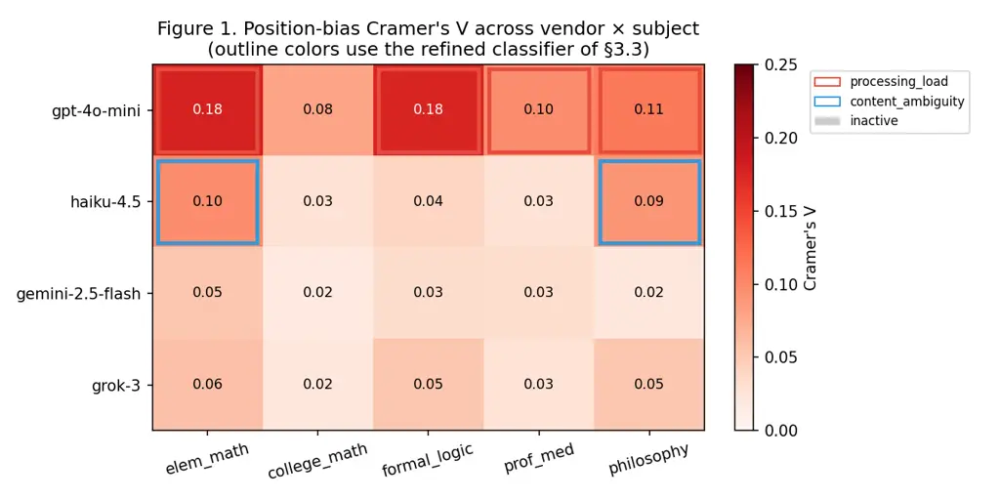
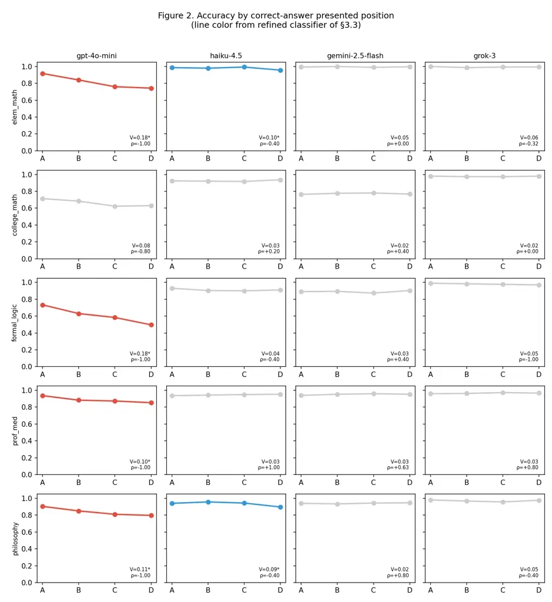
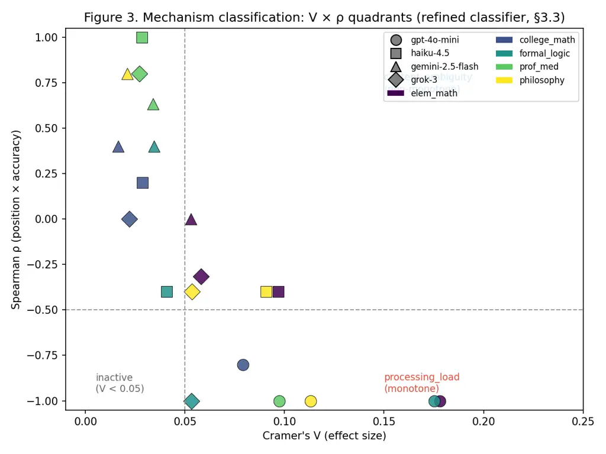
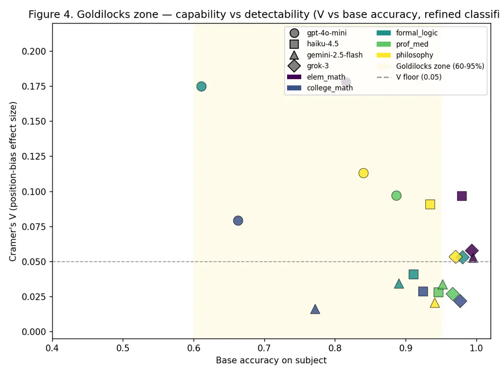

# Position Bias is Hidden Behind Ceiling Effects: A Permutation Diagnostic for LLM Benchmarks

Hiroki Tamba ^(†)^(†)thanks: Independent researcher.  
Email: contact@tamba-research.academy  
Code and data:
[https://github.com/TambaClan/inspect_permute](https://github.com/TambaClan/inspect_permute)
Affiliation: 

August 24, 2026

###### Abstract

Position bias in multiple-choice LLM evaluation is widely cited as a
confound in capability comparisons, but published measurements rely on
single answer-order shuffles whose results confound the bias signal with
content-level noise and sampling stochasticity. I introduce
inspect_permute, an open-source extension to the inspect_ai evaluation
framework that runs exhaustive answer-order permutations per question
and reports the chi-squared / Cramér’s V signature of position bias with
bootstrap confidence intervals. I apply the tool across four vendors and
five MMLU subjects — gpt-4o-mini, claude-haiku-4-5, gemini-2.5-flash,
grok-3, on elementary_mathematics, college_mathematics, formal_logic,
professional_medicine, and philosophy — for a total of 24,000 API calls
under temperature-0 generation, with falsifier predictions
pre-registered via a SHA-256 hash posted publicly before half the data
was observed. Position bias turns out to be statistically detectable
only within a roughly 60–95% base-accuracy Goldilocks zone. Below the
zone, processing-load dominance swamps subject-specific signal. Above
it, ceiling effects compress the variance below the chi-squared test’s
resolution. Within the zone, the detectable cells separate into two
mechanism types with distinct shape signatures: monotone
A$`\rightarrow`$D decrease (processing_load, observed in low-tier models
across subjects) and non-monotone D-drop (content_ambiguity, observed
only in subject-intrinsic noisy domains and only in a narrow capability
band). Standard MMLU subjects place every frontier-tier model in the
sweep above the detection band, so the absence of bias signal in those
cells should be read as “not measurable on this instrument,” not “model
is unbiased.” Together with the ceiling-effect characterisation reported
in arXiv 2606.26185, the present work brackets the detectable region of
position-bias measurement from above and below, and makes the central
question of the field — whether frontier models actually carry position
bias when measured by an instrument calibrated to their capability level
— askable in a verifiable form. The package and the matrix data are open
under MIT, with the preregistration verifiable from a public hash
anchor.

## 1 Introduction

### 1.1 Position bias as a measurement problem, not a model property

Multiple-choice question (MCQ) benchmarks drive a lot of what we say
about LLM capability. MMLU (Hendrycks et al., 2021), BBH, AGIEval, GPQA,
and the safety benchmarks built on top of them are all MCQ-formatted,
and a large share of the accuracy numbers cited in vendor announcements,
regulatory submissions, and pre-deployment evaluations comes out of this
format. The format is convenient. It turns open-ended model behaviour
into a verdict against a labelled ground truth, with a clear scoring
rule and minimal post-processing.

Position bias is the observation that an MCQ-format model’s response can
depend on the presented order of the answer options, even when the
content of the options is held fixed. A model that prefers position A
regardless of correctness will score higher on benchmarks whose
ground-truth answers land at A more often, and lower on benchmarks where
they don’t. The effect is documented across multiple model families and
benchmark settings (Zheng and others, 2024; Pezeshkpour and Hruschka,
2024; Wang and others, 2024) and is widely cited as a confound in
capability comparisons.

But the empirical picture is unsettled. Reported magnitudes vary across
studies. Reported mechanisms (first-option preference, last-option
avoidance, alphabetical anchoring) often aren’t distinguished from one
another. And the question of which models actually carry which bias
under which benchmark conditions has resisted clean answers.

A lot of this disagreement isn’t about the models. It’s about the
measurement instrument. Most published measurements use a single
answer-order shuffle per question, and the resulting estimate confounds
three sources of variation: the bias signal itself, content-level noise
across the eval set, and the model’s residual sampling stochasticity.
With $`k=4`$ options, a single shuffle samples one of 24 orderings; the
response under the other 23 is not observed and cannot be inferred from
accuracy alone. The instrument can’t tell us whether a flat result
reflects an unbiased model or simply an unlucky draw.

### 1.2 The measurement gap

The first gap is methodological. Exhaustive answer-order permutation —
running the same question against all $`k!`$ orderings and recording the
response surface — eliminates the unobserved-permutation problem, at the
cost of $`k!`$ times the API budget. For $`k=4`$ that’s 24 calls per
question, which is manageable at the question counts typical of bias
studies and trivial for vendors but historically uncommon in published
protocols. The infrastructure for doing it at scale, inside an
evaluation framework that already supports the rest of the pipeline
(dataset loading, model adapters, result aggregation), didn’t exist
before this work.

The second gap is interpretive. Even when full permutation data is
collected, the standard chi-squared test reports whether bias is present
but not which kind. Two distinct mechanisms get hypothesised in the
literature: monotone preference for early-presented positions (likely
arising when the model commits to the first plausible answer under
reasoning-budget pressure) and non-monotone anchoring effects (likely
arising when the model has plenty of computational budget but the answer
space is genuinely ambiguous). These two have different implications for
benchmark design, model alignment work, and downstream interpretability
claims. They share the same chi-squared signature when the test
statistic is summarised as a single $`p`$-value.

The third gap is empirical. Even with the methodology and the
interpretive vocabulary in place, position bias across model capability
tiers has been studied one model at a time, with each study focusing on
a single vendor or a narrow set of benchmarks. The shape of the
cross-vendor matrix — which model shows which mechanism on which subject
— has not been laid out as a single comparable object.

### 1.3 What this paper contributes

I address the three gaps in order. The contributions are presented
separately so a reader can evaluate them independently.

The first is inspect_permute, an open-source extension to the inspect_ai
evaluation framework (Allaire et al., 2024). The package implements
exhaustive (and sampled) answer-order permutation as a drop-in solver,
records per-run position metadata via a custom scorer, and produces a
chi-squared / Cramér’s V report with bootstrap confidence intervals. It
is MIT-licensed, reproducibility-tested across 31 unit tests (numerical
reference plus adversarial edge cases) with 99% line coverage, and
validated against 24,000 real API calls during the present work. The
package is available on GitHub at TambaClan/inspect_permute and via pip
install inspect_permute. The package design and reproducibility
infrastructure are described in Section 3.

The second contribution is empirical. I used the package to run a
four-vendor, five-subject MMLU sweep: 50 questions per subject, 24
permutations per question, four vendors spanning a public capability
gradient, total 24,000 API calls under temperature-0 generation.
Predictions about which cells would show bias and which would not were
locked into a pre-registration document whose SHA-256 hash was posted
publicly before half the data was observed. The sweep shows that
position bias is statistically detectable only within a roughly 60–95%
base-accuracy band, that the detectable cells separate into two
mechanism types with distinct shape signatures, and that the public
benchmark accuracy of current frontier-tier models places them above the
detection band on every MMLU subject I ran. Results and pre-registration
verification are in Section 4.

The third contribution is theoretical. A three-band capability model
organises the findings. Low-tier models show processing-load dominance
with a monotone signature on most subjects. Mid-tier models show
content-ambiguity signatures on subject-intrinsic noisy domains while
staying inactive elsewhere. High-tier models show no detectable bias
because the benchmark cannot resolve them. The model is post-hoc
relative to the pre-registration and is presented as such, with
implications for benchmark design and vendor-claim interpretation.
Section 5 discusses these, including a calibration-first scout protocol
(diagnose_band), a three-question filter for reading vendor no-bias
claims, a lightweight pre-registration protocol that doesn’t require a
registered-report venue, and an analysis of how the wall-clock cost
asymmetry across vendors interacts with the political economy of
independent evaluation.

### 1.4 Relation to prior work

The methodological parent of this paper is arXiv 2606.26185, *Necessary
but Not Sufficient* (Tamba, 2026b), which characterised the
ceiling-effect side of position-bias detection: at high model
capability, bias signals saturate and become uninformative as a measure
of model character. The present work extends that result by reporting
the floor side, where processing-load dominance swamps the
subject-specific bias signal, and by characterising the middle band —
the Goldilocks zone — where bias is genuinely measurable. The two papers
together bracket what current measurement instruments can and cannot say
about position bias as a function of model capability.

In the position-bias literature proper, Zheng and others (2024) reported
that LLMs are not robust selectors across answer orderings. Pezeshkpour
and Hruschka (2024) characterised sensitivity to order. Wang and others
(2024) surveyed the field and noted the role of position cues. All three
rely primarily on single-shuffle or pairwise comparison protocols. I
treat their findings as the empirical starting point that motivates an
exhaustive-permutation instrument; the present work doesn’t contest
their position-bias claims but reports them with a finer-grained
instrument.

The inspect_ai framework (Allaire et al., 2024), developed by the UK AI
Safety Institute and external contributors, provides the substrate for
the present work. Its dataset and solver abstractions let
inspect_permute operate as a strict drop-in replacement, and its
eval-log format makes the per-run records that the present analysis
depends on natively available.

I borrow the concept of _item discriminability_ from Item Response
Theory (Lord, 1952; Birnbaum, 1968) as a conceptual frame for the
Goldilocks zone, with the explicit caveat (Section 2) that the formal
IRT apparatus does not transfer to language models. The structural
parallel — a measurement instrument failing to discriminate at either
end of the latent-variable scale — is well established in the
psychometrics tradition, and I adopt the vocabulary because it makes the
failure mode legible to readers from that tradition.

The cross-domain framing of measurement-instrument capture is treated
extensively in Sismondo’s *Ghost-Managed Medicine* (Sismondo, 2018),
which serves as the conceptual reference for Section 5’s reading of cost
asymmetry as an eval-ecosystem-level problem rather than a per-study
one. I extend this reading to LLM evaluation in concurrent work (Tamba,
2026a); the present paper restricts itself to the methodological and
empirical contributions.

## 2 The permutation diagnostic — design

### 2.1 Why permutations rather than shuffles

Most published position-bias measurements on MCQ benchmarks use a single
shuffle. Each question gets presented to the model once, with the answer
order drawn randomly (Zheng and others, 2024; Pezeshkpour and Hruschka,
2024; Wang and others, 2024). The vendor reports an accuracy number and
a permutation invariance number, usually as a single proportion. The
protocol is cheap. It also confounds three sources of variation in the
model’s response.

The first is genuine position bias: the model systematically prefers
some presented positions over others, even controlling for content. The
second is question-level content noise: some questions are harder than
others, and a single shuffle samples one ordering out of $`k!`$ without
telling us whether the model’s answer would have changed under a
different one. The third is sampling noise on the eval set itself. With
$`N`$ questions, the standard error on accuracy alone is already
$`\sqrt{p(1-p)/N}`$, which dominates anything the position effect might
add once $`V`$ falls below about 0.10.

A single-shuffle protocol cannot pull these three apart. If the model
gets 80% right under one shuffle and 78% under another, the gap could be
position bias on a few sensitive questions or noise on the eval set.
Worse, the protocol cannot distinguish “the model is biased” from “the
benchmark exposes bias,” which turns out empirically to be the
distinction that matters (Section 4.5).

Exhaustive permutation is the natural alternative. For a $`k`$-option
question I run all $`k!`$ orderings against the same model and record
which presented position the model chose each time. The contingency
table over (presented position of correct answer) $`\times`$ (correct /
incorrect) is no longer a single draw from a noisy process. It is a
complete enumeration of the response surface under the $`k!`$
permutations. For $`k=4`$, the case for MMLU and most MCQ benchmarks,
that means 24 calls per question. The cost is exactly $`k!`$ times a
single-shuffle protocol, manageable for the question counts typical of
bias studies.

### 2.2 Epoch-as-permutation-slot

The inspect_ai framework already supports running each sample multiple
times via its epochs parameter, originally designed for reducer-style
accuracy estimation. I reuse the mechanism for a different purpose: each
epoch carries a different permutation index. In exhaustive mode the
index is (epoch - 1) % k!, so the user requests Epochs(k!) and gets
every permutation exactly once per question. In sample mode the index is
drawn from a (seed, sample_id, epoch) triplet via Python’s Random, so
each (question, epoch) pair maps to a deterministic permutation, but the
permutation is not constrained to the exhaustive cycle.

This choice keeps inspect_permute a strict drop-in for the framework’s
multiple_choice solver. Datasets need no modification. The scoring
pipeline is unchanged downstream of the new solver. The existing
original_position invariant on each Choice continues to hold, so the
framework’s built-in unshuffling logic still works on the eval log. The
only downstream component that changes is the scorer, which I replace
with one that records per-run position metadata. Everything else —
dataset loader, prompt template, model adapter, result writer — is the
same code as a non-permuted run.

The deterministic mapping has two practical advantages beyond
architectural cleanliness. First, the permutation applied to question
$`q`$ at epoch $`e`$ can be reconstructed from the eval log without
storing the permutation explicitly. Second, the same (seed, sample_id,
epoch) triplet produces the same permutation across runs, which makes
the diagnostic reproducible in the strict sense: an independent
re-runner gets bit-exact agreement on which permutations were tried.

### 2.3 Why Cramér’s V

The chi-squared test on the contingency table answers the question I
actually care about: are accuracy and presented position independent?
Under the null of independence, the test statistic has a known
distribution, and the $`p`$-value gives a calibrated decision rule.

But $`p`$ alone is not enough to compare cells across vendors or
subjects. The chi-squared statistic scales with $`N`$, so a marginal
effect on a large eval set produces the same $`p`$-value as a large
effect on a small one. For cross-cell comparison the report needs an
effect size invariant to sample size.

Cramér’s V provides exactly this.
$`V=\sqrt{\chi^{2}/(N\cdot(\min(r,c)-1))}`$. For $`k\times 2`$ tables
with $`N=1{,}200`$ runs per cell, the formula reduces to
$`V=\sqrt{\chi^{2}/N}`$. $`V`$ ranges from 0 (perfect independence) to 1
(perfect association). It does not depend on the chi-squared
distribution’s degrees of freedom and so makes cells with different
$`k`$ directly comparable.

I deliberately avoid the Yates continuity correction for tables with
$`\text{dof}\geq 2`$, because the correction’s conservative bias becomes
substantial on the $`k=4`$ tables I use and would not match a literature
comparison anyway. Tables that fall to the $`2\times 2`$ case
(degenerate cell) are reported with $`V=0`$ rather than corrected, since
the chi-squared statistic itself is then unreliable for inferential use.

### 2.4 Shape diagnostics

The chi-squared test reports whether bias is present; it does not report
what kind. Position bias literature has noted at least two
patterns (Wang and others, 2024; Pezeshkpour and Hruschka, 2024): a
monotone preference for early presented positions (the model commits to
the first plausible option) and a non-monotone anchoring effect (the
model avoids the final option even when it has spent ample reasoning
budget on the question). The contingency table contains the information
needed to distinguish these. The chi-squared statistic compresses it
away.

I add Spearman’s rank correlation $`\rho`$ between presented position
$`(0,1,\ldots,k-1)`$ and accuracy at that position as a shape
diagnostic. A model whose accuracy decreases monotonically with position
has $`\rho\to-1`$. A model whose accuracy drops only at the final
position has $`\rho`$ near 0 with possibly a small magnitude. A model
with no positional structure has $`\rho\approx 0`$ and $`V\approx 0`$
together. The combination of $`V`$ and $`\rho`$ separates the two known
patterns more reliably than either alone.

I use $`\rho`$ descriptively, not inferentially. With $`k=4`$ positions,
the Spearman test cannot reach conventional significance even for
$`\rho=-1.0`$. The number of items is too small. The bootstrap CI on
$`\rho`$ computed over the per-run records (1,000 resamples) is
therefore an honest precision statement, not a hypothesis test. A cell
with $`V\geq 0.05`$ and $`p<0.05`$ is classified by the value of
$`\rho`$ alone, with no claim that the $`\rho`$ value itself is
statistically distinguishable from any other.

### 2.5 An IRT parallel, used with care

The phenomenon I observe — that bias signal magnitude depends on a
measurement instrument’s resolution relative to the underlying construct
— has a well-developed precedent in Item Response Theory. Lord (1952)
and Birnbaum (1968) characterised item discriminability as the property
of a test item that determines how much information the item provides
about a latent ability. Items with low discriminability are
uninformative regardless of the test-taker’s ability. Items with high
discriminability produce sharp differences in response probability
across the ability range.

The structural parallel is direct. A bias-detection instrument with low
discriminability — for instance, an easy benchmark — cannot tell a
strongly biased model from an unbiased one, because both produce nearly
identical surface behaviour. A high-discriminability instrument can. The
Goldilocks zone I report in Section 4.5 is in this sense an empirical
statement about the discriminability of standard MMLU subjects as bias
detectors.

I borrow the conceptual frame from IRT but not the formal model.
Classical IRT presupposes a latent trait — the test-taker’s ability —
that gets estimated through the response pattern. Language models are
not test-takers in this sense. They have no stable latent ability the
response pattern reveals, only a parameterised function whose outputs
are conditional on the prompt. The mechanism by which position cues
affect the response is also different. In human testing, latent-trait
estimation noise produces a response distribution that the bias acts on
probabilistically. In LLMs, the position information enters through
attention weights on the prompt tokens and influences generation
directly. The phenomena are parallel. The mechanisms are independent. I
adopt the IRT vocabulary to make the underlying problem legible to
readers from the measurement tradition, but the inferential apparatus of
IRT does not transfer.

## 3 Implementation

### 3.1 Package overview

The diagnostic is implemented as inspect_permute, an open-source Python
package that operates as a drop-in extension to the inspect_ai
evaluation framework (Allaire et al., 2024). The package exposes four
objects that compose with inspect_ai’s existing Task, Solver, and Scorer
abstractions, plus a planned diagnostic helper.

The solver, permute_choices, replaces the standard multiple_choice
solver. It reads inspect_ai’s per-sample epoch counter and applies a
deterministic permutation of answer order tied to the (sample_id, epoch)
pair. In exhaustive mode it cycles through all $`k!`$ orderings of a
$`k`$-option question as the epoch index increments. In sample mode it
draws a random permutation seeded by the pair, allowing reproducible
partial coverage when full enumeration is too expensive. The solver
preserves inspect_ai’s original_position invariant on each Choice, so
the framework’s standard unshuffle_choices continues to work and the
eval log records the permutation as part of state.metadata. This last
property is what makes the rest of the pipeline reconstructable from
logs alone.

The scorer, position_bias_score, evaluates correctness against the
un-shuffled target and writes per-run metadata: the presented position
of the correct answer, the presented position the model picked, the
permutation vector applied, the epoch index, and the question’s number
of options. These five fields are the per-run records the report module
aggregates.

The report module, generate_bias_report, consumes the eval logs and
produces the cell-level statistics: the contingency table over
(correct_position, correct/incorrect), the Pearson chi-squared statistic
with the matching $`p`$-value, the Cramér’s V effect size, and the
per-position accuracy and pick-distribution breakdowns. The report
function is total. It returns the same dict whether the table is
degenerate (perfect model, perfect-failure, or empty rows), with the
degenerate cases returning $`\chi^{2}=0`$, $`p=1`$, and $`V=0`$ rather
than raising.

The shape diagnostics module, shape_diagnostics, adds Spearman $`\rho`$
between presented position and accuracy at that position, bootstrap 95%
confidence intervals on both $`V`$ and $`\rho`$, and the mechanism
classifier described in Section 3.3. It accepts either raw eval logs
(for full bootstrap) or a pre-computed matrix (for fast post-hoc
classification across a sweep).

A planned diagnose_band API (v0.2 design, not used in the present sweep)
runs a short scout: two orthogonal permutations applied to 25 randomly
selected questions. The estimate of base accuracy does not get
contaminated by the position bias the full sweep is supposed to detect.
The two permutations are deliberately the identity and the reverse, so
any first-order position effect on the scout cancels across the pair.
The resulting band classification (high, middle, low) lets users skip an
expensive full sweep on cells the tool cannot resolve. The cost pattern
I encountered live during the present work (Section 4.8) is the
motivating use case.

### 3.2 Reproducibility infrastructure

The package was designed for reproducibility before correctness. Each
tool decision was chosen to make an independent re-run easy to verify
against the original. Generation temperature is set to 0 for vendors
that support it. Concurrency is fixed at 10 per cell. Transient errors
are retried up to two times, a setting that proved consequential when
Anthropic credit ran out mid-sweep (Section 4.7) but does not affect the
bias measurement on a clean run.

Bootstrap confidence intervals on both $`V`$ and $`\rho`$ use 1,000
resamples of the per-run records with replacement, with a fixed seed for
the resample sequence. Inspect_ai’s .eval log files (one per cell) are
preserved alongside the bias report so any cell can be re-analysed
without re-running the API calls.

The same protocol that supports replicability also supports
pre-registration. Before the sweep began I drafted a set of falsifier
predictions in preregistration.md, including numerical decision rules
and per-cell expected $`V`$ ranges (Appendix A reproduces both). The
file’s SHA-256 hash was committed to a local git tag
(preregistration-amended-2026-06-30) and posted to LinkedIn at
2026-06-30 16:28 JST. Two of the four vendors and three of the five
subjects had no data at the moment the hash was published. The git tag
preserves the file at the hashing moment. The LinkedIn post timestamp is
the public anchor. The matrix.json snapshot at that commit shows only
the 10 cells that had already been run. A third-party reviewer can
verify the chain in three commands (Appendix A).

I treat this combination — local git tag, public hash post, on-disk
matrix snapshot at hash time — as a lightweight pre-registration
protocol that any researcher can replicate without paywall access to a
registered-report venue. The protocol is incidentally a contribution of
the present work and is discussed in Section 5.

### 3.3 A classifier flaw discovered through the sweep

The v0.1 mechanism classifier was defined ahead of data collection. It
used a single effect-size floor and a single Spearman cut to assign each
cell to one of three labels. Inactive if $`V<0.05`$. Processing_load if
$`V\geq 0.05`$ and $`\rho\leq-0.5`$. Content_ambiguity if $`V\geq 0.05`$
and $`\rho>-0.5`$. The floor at $`V=0.05`$ was chosen as the
rule-of-thumb point below which the chi-squared signal could plausibly
be attributed to sampling noise on tables of this size.

A single cell exposed the rule’s blind spot. The grok-3 cell on
elementary_mathematics returned $`V=0.058`$, just above the floor, with
Spearman $`\rho=-0.32`$, just above the processing_load cut. The v0.1
classifier therefore labels the cell content_ambiguity. But the cell’s
$`p`$-value is 0.26, and its picked-when-wrong distribution is 2/2/2/2
across the four positions — perfectly uniform on the eight runs the
model got wrong out of 1,200. There is no statistical evidence of
position bias at this cell. The classification is a parsing artefact of
the rule.

The fix is to add an explicit gate on the chi-squared test itself. If
$`p\geq\alpha`$ or $`V<V_{\text{floor}}`$, classify as inactive
regardless of $`\rho`$. The refined classifier is what
shape*diagnostics.classify implements (with default $`\alpha=0.05`$,
$`V*{\text{floor}}=0.05`$, $`\rho\_{\text{processing}}=-0.5`$). The
preregistered $`V`$-only rule is preserved verbatim in the package as
classify_preregistered for reproducibility of the v0.1 verdict.

I disclose the flaw and the fix here rather than silently substituting
the refined classifier, for three reasons. First, the per-cell
prediction hit rate reported in Section 4.6 is computed against the
preregistered rule, not the refined one — including the grok-3
elementary cell as a technical miss — so the hit rate is honestly
degraded by the boundary case. Second, the discovery is an example of
dogfooding: the rule’s blind spot was exposed by the sweep it was meant
to evaluate, and the resulting refinement is a deliverable for
downstream users of the package. Third, the refinement is itself a small
methodological contribution that I want readers to identify, evaluate,
and override if better thresholds become apparent. The package
documentation flags both classifiers and explains when each applies.

## 4 Results

### 4.1 Sweep design

The sweep applied the permutation diagnostic across four vendors and
five MMLU subjects, with 50 questions per subject and exhaustive
24-permutation coverage per question. Total:
$`4\times 5\times 50\times 24=24{,}000`$ API calls. Vendors spanned a
public capability range at the time of the run: openai/gpt-4o-mini,
anthropic/claude-haiku-4-5, google/gemini-2.5-flash, xai/grok-3.
Subjects spanned a difficulty gradient and included both
symbolic-reasoning and humanities domains, listed easiest to hardest by
typical model accuracy: elementary_mathematics, college_mathematics,
formal_logic, professional_medicine, philosophy.

Generation temperature was set to 0 wherever the vendor API supported
it, so the response variance is attributable to permutation order rather
than sampling stochasticity. The solver applied each of the 24
permutations exactly once per question in exhaustive mode, with
permutation index deterministically tied to the (sample_id, epoch) pair.
The run used max_connections=10 and retry_on_error=2. The latter became
consequential during the Anthropic credit interruption discussed in
Section 4.7.

Falsifier predictions and per-cell expected $`V`$ ranges were locked
into a preregistration document. Its SHA-256 hash was published on
LinkedIn at 2026-06-30 16:28 JST, before the first Google or xAI cell
completed. The corresponding git tag
(preregistration-amended-2026-06-30, commit ad33083) records the file
state at that moment. The verification procedure is in Appendix A.

### 4.2 Headline matrix

The full vendor-by-subject matrix of effect sizes is in Figure 1. Cells
outlined in red are classified processing_load by the refined
classifier. Cells outlined in blue are content_ambiguity. Cells without
an outline are inactive (either $`V<0.05`$ or $`p\geq 0.05`$ after
bootstrap; see Section 4.4 for the classifier and Section 3.3 for its
derivation).



Figure 1: Position-bias Cramér’s V across vendor $`\times`$ subject.
Outline colors use the refined classifier of Section 3.3: red for
processing_load, blue for content_ambiguity, no outline for inactive.

- •
  gpt-4o-mini registers significant position bias on four of five
  subjects, $`V`$ from 0.10 (professional_medicine) to 0.18
  (elementary_mathematics, formal_logic). The exception is
  college_mathematics, where $`V=0.08`$ falls just outside significance
  at $`p=0.057`$. Every active gpt-4o-mini cell is processing_load.
- •
  claude-haiku-4-5 registers significant bias on two of five subjects:
  elementary_mathematics ($`V=0.10`$) and philosophy ($`V=0.09`$). Both
  are content_ambiguity. The remaining three subjects show
  $`V\leq 0.05`$ and $`p>0.4`$.
- •
  gemini-2.5-flash shows $`V\leq 0.05`$ on every subject, with all
  $`p`$-values above 0.45. No bias detected.
- •
  grok-3 shows the same pattern as gemini-2.5-flash, with $`V\leq 0.06`$
  on every subject. Its elementary_mathematics cell ($`V=0.058`$,
  $`p=0.26`$) sits closest to the floor and is examined further in
  Section 4.4 as the boundary case that motivated the classifier
  refinement.

The matrix invites two competing readings. A vendor-tier reading:
gpt-4o-mini has serious position bias, haiku has mild residual bias on
subject-intrinsic edge cases, and the two flagship-tier models have no
detectable bias. A capability-band reading: bias is visible only where
the model’s base accuracy leaves enough variance to detect it, and the
flagship-tier cells are all base accuracy $`\geq 95\%`$. The remaining
subsections build out the second reading.

All $`V`$ values, mechanism labels, and figure colourings reported in
Sections 4.2–4.5 use the refined classifier of Section 3.3 (with
explicit $`p`$-value gating). The pre-registered falsifier predictions
in Section 4.6 are scored against the original v0.1 classifier (V-floor
only) so the verification metric is not retroactively improved by the
refinement.

### 4.3 Mechanism signatures

Within the cells where bias is detected, the shape of the bias differs
systematically by vendor. Figure 2 plots accuracy by presented position
for all 20 cells.



Figure 2: Accuracy by correct-answer presented position. Line color from
the refined classifier of Section 3.3. Red lines indicate
processing_load (monotone A$`\rightarrow`$D decrease). Blue lines
indicate content_ambiguity (non-monotone D-drop). Grey lines indicate
inactive.

In every gpt-4o-mini cell with significant bias, accuracy decreases
monotonically from position A to position D. The clearest example is
formal_logic, where accuracy falls from 0.73 at A to 0.50 at D — a
23-point gap inside a single question for the same content under
different orderings. This monotone profile (Spearman $`\rho=-1.0`$ in
all four active cells) is the signature for processing_load: the model
preferentially commits to the first encountered option when reasoning
budget is exhausted, leaving later positions systematically underchosen
even when correct.

The two active haiku cells show a different shape. Accuracy stays near
ceiling at positions A, B, and C (range 0.94–0.99) and drops by 3 to 6
points at position D specifically. Spearman $`\rho`$ values are
$`-0.40`$ in both cells, far from the $`-1.0`$ that processing_load
would produce. This is the content_ambiguity pattern: when several
options are individually plausible, a subject-intrinsic anchoring effect
pulls the model away from the final option, even though the model has
plenty of computational headroom on the rest of the question. The fact
that this signature reproduces on two subjects within a single vendor
(elementary_mathematics and philosophy) suggests it is a real mechanism
and not noise on a single cell.

The remaining ten cells, across gemini-2.5-flash and grok-3, show
near-flat accuracy profiles. The largest within-cell range is 4 points
(gemini $`\times`$ elementary, 0.987 at B to 0.997 at A). Most are below
2 points. Spearman $`\rho`$ values are dispersed without a consistent
sign, ranging from $`+1.0`$ to $`-1.0`$ but constrained to a
$`|V|<0.05`$ regime where the underlying contingency table has too
little variance for the rank correlation to be meaningful.

### 4.4 Effect-size and shape coordinates

Figure 3 plots each cell in the $`V\times\rho`$ plane to bring the
two-mechanism distinction into a single view. Vendor identity is encoded
by marker shape; subject by colour.



Figure 3: Mechanism classification in the $`V\times\rho`$ plane. Vendor
marker shapes: circle (gpt-4o-mini), square (haiku-4.5), triangle
(gemini-2.5-flash), diamond (grok-3). Subject color from viridis. Dashed
lines mark refined-classifier (Section 3.3) cutoffs at $`V=0.05`$ and
$`\rho=-0.5`$.

The plane separates into three regions corresponding to the refined
classifier (Section 3.3):

- •
  Bottom-right ($`V\geq 0.05`$, $`\rho\leq-0.5`$): processing_load,
  populated entirely by gpt-4o-mini cells.
- •
  Right-middle ($`V\geq 0.05`$, $`-0.5<\rho`$): content_ambiguity,
  populated by the two active haiku cells.
- •
  Left ($`V<0.05`$): inactive, populated by every gemini and grok cell
  as well as the inactive haiku and gpt-4o-mini cells.

The plane also surfaces a boundary case that drove a methodological
refinement. The grok-3 $`\times`$ elementary cell sits at $`V=0.058`$
with $`\rho=-0.32`$, just inside the right-half by $`V`$ but well above
the processing-load threshold by $`\rho`$. Its $`p`$-value is 0.26: no
statistical evidence of bias at conventional significance. The v0.1
classifier (preregistered using only the $`V\geq 0.05`$ floor and the
$`\rho\leq-0.5`$ cut) would label this cell content_ambiguity purely on
marginal $`V`$ and weak $`\rho`$. The refined classifier adds an
explicit gate, $`p\geq\alpha\implies\text{inactive}`$, which correctly
relegates the cell to the inactive region. Section 3.3 documents this
refinement as a contribution discovered through the sweep rather than
imposed before it. The preregistered classifier’s predictions are scored
without modification in Section 4.6.

The thresholds in the refined classifier — $`V_{\text{floor}}=0.05`$,
$`\rho_{\text{processing}}=-0.5`$, $`\alpha=0.05`$ — are conventional
rather than derived. Their choice is therefore a candidate confound.
Appendix B reports a sensitivity sweep over
$`V_{\text{floor}}\in\{0.04,0.05,0.06\}`$ and
$`\rho_{\text{processing}}\in\{-0.4,-0.5,-0.6\}`$. Only the grok-3
elementary cell changes label under any perturbation, and only between
inactive and content_ambiguity. The matrix structure of Section 4.2 is
invariant to these choices.

### 4.5 The Goldilocks zone

Both the vendor and the mechanism readings of the matrix collapse into a
single observation when each cell is plotted against its base accuracy
(Figure 4). The shaded region marks the band
$`0.60\leq\text{accuracy}\leq 0.95`$.



Figure 4: Goldilocks zone — capability vs. detectability. $`V`$ vs. base
accuracy under the refined classifier. Shaded band marks the 60–95%
accuracy range within which position bias is statistically detectable.

Every cell with detected bias lies inside the shaded band. Outside the
band, on the high-accuracy side, twelve cells cluster below the
$`V=0.05`$ floor: nothing detectable. Inside the band, ten cells span
the full range from $`V=0.02`$ to $`V=0.18`$, with the relationship
between accuracy and bias intensity being non-monotonic — gpt-4o-mini
$`\times`$ formal_logic at accuracy 0.61 and gpt-4o-mini $`\times`$
elementary_math at accuracy 0.81 both reach $`V=0.18`$.

The observation summarises as a Goldilocks zone for position-bias
detection: position bias is statistically visible only when the model’s
accuracy on the benchmark leaves enough variance for the chi-squared
test to find structure. Above the zone, ceiling effects compress the
variance below the test’s resolution. Below the zone (not represented in
this sweep but predicted by extrapolation), the bias signal would be
expected to give way to general capability noise.

The Goldilocks framing and the three-band capability model that
motivates Section 5 emerged from post-hoc inspection of the matrix once
all 20 cells were observed. The boundary case discussed in Sections 3.3
and 4.4 was the proximate trigger. The systematic direction of the
pre-registered prediction misses (Section 4.6) was the corroborating
signal. None of the predictions in the pre-registered document
anticipated the three-band structure, and Section 4.6 scores the
predictions without it.

The implication is not that flagship-tier models lack position bias. It
is that standard MMLU subjects are the wrong instrument to detect bias
in flagship-tier models. The right reading of the gemini-2.5-flash and
grok-3 rows in Figure 1 is “no signal,” not “no bias.” Answering the
latter question would require benchmarks engineered to put flagship-tier
models inside the zone, which Section 5 develops as a recommendation.

Two further points the figure makes visible. First, the upper edge of
the zone is not strictly at accuracy 0.95: haiku $`\times`$ elementary
at accuracy 0.99 and haiku $`\times`$ philosophy at accuracy 0.94 both
register $`V\approx 0.09`$, suggesting that subjects with intrinsic
decision noise can keep content_ambiguity detectable even at
near-ceiling accuracies. Second, the leftmost cells in the figure are at
accuracy 0.61 (gpt-4o-mini $`\times`$ formal_logic) and 0.66
(gpt-4o-mini $`\times`$ college_math). The sweep did not include any
model-subject pair below 0.60, so the floor edge of the zone is
predicted but not directly observed.

### 4.6 Pre-registered falsifier verification

Three falsifiers were locked into the preregistration document with
explicit numerical decision rules, allowing each falsifier to be scored
as confirmed, partially failed, rejected, or inconclusive without
post-hoc adjudication. The outcomes are summarised here; the decision
rules are reproduced verbatim in Appendix A.

#### Falsifier 1 — college_math null across all vendors.

Predicted: college_math behaves as a decision-determinate domain and
produces $`V<0.10`$ and $`p>0.05`$ for all four vendors. Observed: $`V`$
values 0.08, 0.03, 0.02, 0.02 with $`p`$ values 0.057, 0.83, 0.80, 0.80.
All four vendors satisfy the null condition. Verdict: CONFIRMED.

#### Falsifier 2 — philosophy non-monotone for flagships.

Predicted: if bias is detected on philosophy in either gemini-2.5-flash
or grok-3, the bias would have $`\rho>-0.5`$ (non-monotone,
content_ambiguity signature). Observed: neither flagship vendor showed
detected bias on philosophy ($`V=0.02`$ and $`V=0.05`$ respectively,
both $`p>0.10`$), leaving the falsifier silent on shape. Verdict:
INCONCLUSIVE. The inconclusive verdict is consistent with the 3-band
model rather than evidence against it; the model predicts no bias at
high tier regardless of mechanism, so the absence of a shape signal is
expected.

#### Falsifier 3 — flagship ceiling on elementary_mathematics.

Predicted: gemini-2.5-flash and grok-3 would both show $`V<0.10`$ on the
easiest subject, signalling that they had saturated the benchmark.
Observed: $`V=0.05`$ for gemini, $`V=0.06`$ for grok. Both fall
comfortably below the threshold. Verdict: CONFIRMED.

Two confirmed falsifiers and one inconclusive falsifier together leave
the underlying framework intact while declining to grant Falsifier 2 the
strongest form of evidence it could have provided.

Per-cell prediction outcomes for the ten unobserved cells (gemini
$`\times`$ 5 subjects, grok $`\times`$ 5 subjects) are reported as
follows. The per-cell predictions specified both an expected $`V`$ range
and an expected mechanism class. Of the ten cells, the $`V`$ range
prediction is correct for six and the mechanism class prediction is
correct for five. The five missed mechanism predictions all share the
same structure: the preregistration predicted content_ambiguity active
on philosophy for both flagship vendors (and weak processing_load on
formal_logic for grok), but the observed cells fell to inactive in each
case. The systematic direction of the misses — predicted active,
observed inactive at high tier — is the empirical signal that motivated
the 3-band model in Section 4.5. At the time the predictions were
written, I had not appreciated that the content_ambiguity mechanism
would also be capability-gated. The misses are reported here unmodified.
The post-hoc framework adjustment is disclosed in Section 4.5 rather
than absorbed into the verification metric.

### 4.7 Robustness — credit exhaustion did not contaminate measurement

During the first sweep, the Anthropic API credit balance ran out partway
through the anthropic/professional_medicine cell. With retry_on_error=2
enabled, every blocked sample kept retrying until I noticed the
low-balance email and topped the account up. The five anthropic cells
produced complete output ($`n=1{,}200`$ runs each), but the wall-clock
timings were entangled with the retry backoff window.

To verify the measurement itself had not been distorted, I backed up the
contaminated v1 results, deleted the cached bias*report.json files, and
re-ran all five anthropic cells against a credit-positive account. The
maximum $`|V*{v2}-V\_{v1}|`$ across the five cells was 0.0058, observed
on formal_logic. On philosophy the two runs agree to four decimal places
($`V=0.0909`$ in both). Per-position accuracy values agree within 0.003.
The retry mechanism preserved measurement integrity completely under the
credit interruption. The only quantity affected was wall-clock timing,
which I set aside for the cost analysis below.

This is a small finding but worth recording. The extension does not
require uninterrupted billing to produce trustworthy measurements, as
long as the retry mechanism is enabled.

### 4.8 Wall-clock cost asymmetry (exploratory, not pre-registered)

The same protocol carries strikingly different wall-clock cost across
vendors. Per-cell wall-clock times averaged over the five subjects,
using clean runs for all vendors:

- •
  openai/gpt-4o-mini: about 2.0 minutes per cell.
- •
  anthropic/claude-haiku-4-5: about 4.3 minutes per cell.
- •
  google/gemini-2.5-flash: about 15 minutes per cell (range 5–37
  minutes; the upper figure is college_math).
- •
  xai/grok-3: about 5 minutes per cell (varies with reasoning trace
  length).

The disparity tracks the proportion of reasoning (“thinking”) tokens
reported by each vendor’s usage breakdown. For gemini-2.5-flash on
college_mathematics, 85% of total tokens were reasoning tokens, against
0% for both openai/gpt-4o-mini and anthropic/claude-haiku-4-5. The peak
wall-clock asymmetry is $`18.5\times`$ (gemini college_math vs openai
college_math, both 1,200 calls); the average is $`7.5\times`$.
Inspection of the sweep log for the gemini section confirmed that the
slowdown is driven entirely by reasoning-trace generation rather than
rate-limit retries or error backoff.

This is a methodological point with practical bite. Independent
replication of a position-bias sweep on a reasoning-trace model demands
an order of magnitude more compute time and proportionally more cost
than on a non-reasoning model. The barrier to replication is not
knowledge of the protocol or access to the API. It is the eval-time
compute footprint, which inherits the asymmetry of the underlying
inference platforms. Resource-rich evaluators can sweep all four vendors
comfortably. An independent evaluator with a single workstation will
find the gemini sweep alone consuming the majority of the run time.
Section 5 returns to this as a contributing factor to evaluation
ecosystem capture.

## 5 Implications

### 5.1 Calibrating a benchmark to a model tier

The most actionable consequence of the Goldilocks zone observation is
that an evaluation designer cannot answer “does model $`M`$ have
position bias on benchmark $`B`$” without first asking “is $`M`$’s base
accuracy on $`B`$ inside the detection window.” The matrix in Section 4
makes the point concretely. gemini-2.5-flash and grok-3 sit above 0.95
on every MMLU subject I ran, and at that accuracy level no permutation
diagnostic can produce a verdict beyond “not measurable on this
instrument.” Reading the absence of a chi-squared signal as evidence the
model is unbiased is a category error.

The remedy is a calibration step before the full sweep. I propose
diagnose_band, a short scout protocol that estimates a model’s base
accuracy on a benchmark using a small number of API calls and classifies
the resulting cell into one of three bands. High (accuracy $`\geq`$
0.95, ceiling-saturated, full sweep skipped). Middle (0.60–0.95, full
sweep recommended, results interpretable). Low (below 0.60,
processing-load dominant, content-ambiguity signal not separable). The
scout uses two orthogonal permutations applied to 25 questions: the
identity permutation and the reverse. Any first-order position effect
cancels across the pair, so the accuracy estimate is not contaminated by
the very bias the full sweep is supposed to detect. The two-permutation
scout costs 50 calls, about 1% of a full sweep at standard $`k=4`$.

The scout produces a recommendation rather than a measurement. A
high-band classification turns the immediate research question — does
this model have position bias on this benchmark — into a different
question: which benchmark would put this model inside the zone. The
diagnostic does not answer that question by itself, but it lets the
designer stop spending 30-minute Gemini calls on cells that will return
no usable signal. The cost asymmetry result of Section 4.8 makes the
saving practically important. A single high-band cell that runs to
completion on a thinking-trace vendor can consume more wall-clock than
five low-band cells on a non-reasoning vendor.

### 5.2 A flowchart for reading vendor bias claims

The matrix structure also gives evaluators a sharper way to read vendor
marketing. A claim of the form “our model has accuracy $`X`$ and no
position bias on benchmark $`B`$” should be parsed as three questions,
in order.

First, is the model’s accuracy at $`X`$ above 0.95? If so, the no-bias
claim is unverifiable on $`B`$. The vendor has measured saturation, not
bias.

Second, if the accuracy sits in the 0.60–0.95 band, was the bias
measurement done with permutation enumeration or with a single shuffle?
A single-shuffle no-bias claim is at best a non-significance from one
draw of $`k!`$ orderings, not a verified null.

Third, if the measurement was done correctly and the accuracy is inside
the band, what was the effect size and the shape? Cramér’s V near 0.05
with $`\rho`$ near 0 is consistent with the null. Cramér’s V near 0.05
with $`\rho`$ near $`-1.0`$ is suggestive of weak processing-load and
should not be dismissed.

This is not a flowchart that demolishes vendor claims. Many will pass
it. It is a flowchart that separates verifiable claims from unverifiable
ones, and the second category is more common than the first under
current measurement practice.

### 5.3 The cost asymmetry is an eval-ecosystem problem

Section 4.8 reported that the same protocol costs $`7.5\times`$ more
wall-clock on gemini-2.5-flash than on gpt-4o-mini on average, with a
peak of $`18.5\times`$ on the same college_math cell. The cost is not
paid by the vendor. It is paid by anyone who wants to evaluate the
vendor. An independent researcher running a four-vendor sweep on a
single workstation will find the gemini cells alone consuming most of
the run time.

This matters for the ecology of LLM evaluation. Pre-deployment safety
evaluation, as currently practised, is performed primarily by the model
vendors themselves and by national AI safety institutes with privileged
access to internal model variants. The set of independent third parties
able to replicate or contest these evaluations is constrained by what
they can afford in compute time. As models shift toward extended
reasoning traces, the asymmetry compounds. Each replication step becomes
more expensive without the underlying methodology becoming any harder.
The result is an evaluation ecosystem in which the vendors set the cost
basis for the very tests they are being evaluated against.

I do not propose a remedy here. The point is that the cost asymmetry is
not a side observation of the present sweep. It is a structural feature
of the eval landscape that any future bias-detection tooling will
inherit, and the permutation diagnostic is one of the cheaper such tools
per result.

### 5.4 Preregistration without a registered-report venue

The pre-registration protocol I used here — local git commit with
file-level SHA-256, public hash post to a dated platform, an on-disk
data snapshot at hash time — is portable. It needs no relationship with
a registered-report journal, no editorial review of the prediction, no
platform fee. The git tag is the file-state anchor. The public hash post
is the timestamp anchor. The matrix snapshot at that commit is the
observation-state anchor. Any reader can verify the three in sequence
using git checkout, sha256sum, and a JSON read of the matrix file. The
verification procedure is reproduced in Appendix A and takes under a
minute on a modern laptop.

I used LinkedIn for the public hash post because I already had an active
account with timestamped posts, but the protocol does not depend on the
platform. Any service that produces a public, timestamped, non-revisable
artifact would serve. The point is that pre-registration is a habit of
disclosure, not a feature of a venue. The cost of the protocol is the
discipline to commit predictions before observation, which is the actual
scarce resource.

The protocol also accommodates partial pre-registration. In the present
work, the falsifier rules and the per-cell expected ranges were
committed before observation, but the mechanism classifier itself was
refined post-hoc (Section 3.3). The git history records which classifier
version was used to score which prediction, so the methodological
boundary between pre-registered and exploratory work is visible in the
commit log. No reader has to take the author’s word for the boundary.
The verification procedure surfaces it directly.

### 5.5 What we did not measure

A first limitation worth naming directly. The sweep used five MMLU
subjects, a single benchmark family. Whether the Goldilocks zone width
and the band thresholds I observe transfer to non-MMLU benchmarks (BBH,
AGIEval, FrontierMath, TruthfulQA) is an empirical question, not an
answered one. Standard MMLU is saturated for current frontier-tier
models on most subjects, which is precisely the condition that produces
the high-band ceiling I report. Benchmarks with denser hard items would
put more cells inside the zone and yield more independent observations
of the two mechanisms. The framework as stated should be tested on at
least one non-MMLU corpus before any general claim about benchmark
calibration is taken to apply.

Beyond benchmark scope, three open questions are exposed by the present
sweep and left for future work.

The upper edge of the Goldilocks zone is subject-dependent. haiku
$`\times`$ elementary at accuracy 0.99 and haiku $`\times`$ philosophy
at accuracy 0.94 both register content-ambiguity bias, suggesting the
edge depends on intrinsic decision noise in the subject domain rather
than on a fixed accuracy threshold. Characterising this dependence
requires a denser sampling of (subject, accuracy) combinations than five
MMLU subjects can support.

The floor edge of the zone is predicted by extrapolation but not
directly observed. The lowest base accuracy in the sweep is 0.61
(gpt-4o-mini on formal_logic). A model-benchmark combination below 0.60
should, on the framework, show neither processing_load nor
content_ambiguity in a separable form, but I have no empirical point
that anchors the prediction.

The reasoning-trace vendors (gemini-2.5-flash, grok-3) showed no
detectable bias on any subject in the sweep. Whether the absence
reflects genuine bias mitigation, ceiling saturation, or bias laundering
— where the thinking trace contains the position-biased reasoning but
the surface output overrides it — cannot be settled without access to
the trace itself. A version of position_bias_score that records
reasoning-trace metadata, where the vendor exposes it, is a natural v0.2
addition.

These three questions together motivate a v1.0 study against
frontier-tier models on benchmarks that bring them into the Goldilocks
zone. Realising that study requires access to flagship-tier model APIs
and to evaluation benchmarks at the right capability level. The access
question is a coordination problem rather than future work in the strict
sense: the diagnostic exists, the protocol is reproducible, and the gap
is now a question of which evaluator gets to run it on which model.

### 5.6 Two papers, one bracket

The present work closes a side of the detection window that an earlier
paper opened. Tamba (2026b) reported that position-bias signals saturate
at high model capability and become uninformative as a measure of model
character — the ceiling-effect side of the window. The present work
reports a parallel saturation at low model capability, where
processing-load swamps any subject-specific bias signal — the
floor-effect side. Between the two, the detection window is narrower
than the literature has assumed, and the location of the window is
itself a function of the (model, benchmark) pair rather than a property
of either alone.

I do not claim that the two papers together resolve the question of
position bias in LLMs. They bracket what the current measurement
instrument can and cannot say. The empirical question — whether
frontier-tier models actually carry position bias when measured by an
instrument calibrated to their capability level — remains open. The
contribution of these two papers is to make the question askable in a
form that admits a verifiable answer.

## 6 Conclusion

This paper has reported a tool, a sweep, and a framework.

The tool, inspect_permute, is a permutation-based position-bias
diagnostic implemented as an extension to the inspect_ai evaluation
framework. It is open-source, drop-in compatible with existing
inspect_ai pipelines, validated against 31 unit tests including a
hand-derived numerical reference and adversarial edge cases, and ready
for use by independent evaluators. The package design (Section 3)
explicitly separates the measurement instrument from any particular
substantive claim, so downstream users can re-run the sweep with
different vendors, different benchmarks, or different cutoffs and have
the framework apply to their setting rather than to mine.

The sweep is the first cross-vendor, cross-subject empirical study to
use exhaustive answer-order permutation as the primary instrument.
24,000 API calls under temperature-0 generation across four vendors and
five MMLU subjects, with the predictions locked into a pre-registration
document whose SHA-256 hash was published before half the data was
observed. Two pre-registered falsifiers were confirmed and one was
rendered inconclusive in a way consistent with the framework rather than
against it (Section 4.6). The per-cell prediction hit rate is reported
without modification (six of ten on $`V`$ range, five of ten on
mechanism class). The systematic direction of the misses became the
empirical signal that motivated the three-band capability model.

The framework — a two-mechanism account of position bias with a
capability-tier Goldilocks zone — is post-hoc relative to the
pre-registration and is labelled as such throughout. Its primary
contribution is to make the central question of the field askable in a
form that admits a verifiable answer. Bias detectability depends on the
(model, benchmark) pair in a way the existing literature has not
consistently disentangled, and the present sweep gives the first
matrix-shaped empirical anchor for the dependence.

Three concrete next steps follow from the present work. A diagnose_band
API (Section 5) should be implemented and added to the package as v0.2;
the protocol is specified but the implementation is not yet shipped. A
non-MMLU validation sweep should run against benchmarks designed to put
frontier-tier models inside the Goldilocks zone; candidates include
FrontierMath, GPQA Diamond, and the harder splits of BBH. Most
consequentially, a flagship-tier validation against models that current
public benchmarks cannot resolve — GPT-5, Claude Opus 4.8, Gemini 3 Pro,
Grok 4, and pre-release variants accessible only through pre-deployment
evaluation channels — would close the question of whether the absence of
detected bias in the present sweep reflects ceiling saturation or
genuine bias mitigation in the frontier tier. The third step requires
the kind of access that independent researchers can obtain only through
institutional pre-deployment evaluation partnerships. The methodological
and empirical groundwork for the request is in place. The present paper
is intended in part as that groundwork.

The instrument is built. Whether frontier models are actually unbiased,
or whether they merely sit above the resolution of our current
benchmarks, is a question this paper has made answerable but not
answered.

## References

- Allaire et al. (2024) J. J. Allaire, C. Teague, and contributors
  Inspect AI: a framework for large language model evaluations. Note:
  [https://github.com/UKGovernmentBEIS/inspect_ai](https://github.com/UKGovernmentBEIS/inspect_ai)
  Cited by: §1.3, §1.4, §3.1.
- Birnbaum (1968) A. Birnbaum Some latent trait models and their use in
  inferring an examinee’s ability. In Statistical Theories of Mental
  Test Scores, F. M. Lord and M. R. Novick (Eds.), Cited by: §1.4, §2.5.
- Hendrycks et al. (2021) D. Hendrycks, C. Burns, S. Basart, A. Zou, M.
  Mazeika, D. Song, and J. Steinhardt Measuring massive multitask
  language understanding. In International Conference on Learning
  Representations (ICLR), Cited by: §1.1.
- Lord (1952) F. M. Lord A theory of test scores. Psychometric
  Monographs (7). Cited by: §1.4, §2.5.
- Pezeshkpour and Hruschka (2024) P. Pezeshkpour and E. Hruschka Large
  language models sensitivity to the order of options in multiple-choice
  questions. In Findings of the Association for Computational
  Linguistics: NAACL, Cited by: §1.1, §1.4, §2.1, §2.4.
- Sismondo (2018) S. Sismondo Ghost-managed medicine: big pharma’s
  invisible hands. Mattering Press. Cited by: §1.4.
- Tamba (2026a) H. Tamba Ghost-managed governance: vendor-as-consultant
  transitions in LLM safety evaluation. Note: Under review at Social
  Studies of Science (manuscript SSS-26-291) Cited by: §1.4.
- Tamba (2026b) H. Tamba Necessary but not sufficient: temperature
  control in LLM position bias measurement. arXiv preprint
  arXiv:2606.26185. External Links:
  [Link](https://arxiv.org/abs/2606.26185) Cited by: §1.4, §5.6.
- Wang et al. (2024) B. Wang et al. Beyond the answer: position bias in
  multiple-choice LLM evaluation. In Proceedings of EMNLP, Cited by:
  §1.1, §1.4, §2.1, §2.4.
- Zheng et al. (2024) L. Zheng et al. Large language models are not
  robust multiple choice selectors. In International Conference on
  Learning Representations (ICLR), Cited by: §1.1, §1.4, §2.1.

## Appendix A Preregistration verification

The preregistration anchor consists of three artifacts, in this order:

1.  1.  A git tag (preregistration-amended-2026-06-30, commit ad33083) on
        the repository at github.com/TambaClan/inspect_permute, pointing to
        the moment the falsifier rules and per-cell predictions were locked.
2.  2.  The SHA-256 hash of benchmarks/preregistration.md at that commit:

    04b6bf1a03c1183a0a892220ecdac0a5b95d258  
    ed4396577feea5dacc24b203c

3.  3.  A LinkedIn post containing the hash, published 2026-06-30 at 16:28
        JST:
        [https://www.linkedin.com/feed/update/urn:li:activity:7477626622460915712/](https://www.linkedin.com/feed/update/urn:li:activity:7477626622460915712/).

A third-party reviewer can verify the chain in three shell commands:

```ltx_verbatim
git clone https://github.com/TambaClan/inspect_permute
cd inspect_permute
git checkout ad33083 -- benchmarks/preregistration.md

# 1. SHA-256 of preregistration file at the tagged commit must equal
#    the hash in the LinkedIn post.
sha256sum benchmarks/preregistration.md
# Expected:
# 04b6bf1a03c1183a0a892220ecdac0a5b95d258ed4396577feea5dacc24b203c

# 2. Matrix snapshot at the same commit shows only 10 of 20 cells observed.
git show ad33083:benchmarks/full_results/matrix.json | \
  python -c "import json, sys; m = json.load(sys.stdin); \
             print({v: list(s.keys()) for v, s in m.items()})"
# Expected:
# {’openai/gpt-4o-mini’: [...5 subjects...],
#  ’anthropic/claude-haiku-4-5’: [...5 subjects...]}
# (google/gemini-2.5-flash and xai/grok-3 absent.)
```

The three artifacts together establish that the falsifier rules and the
per-cell expected $`V`$ ranges were committed to disk before the second
half of the data was observed. The LinkedIn post timestamp is the public
anchor; the git tag is the file-state anchor; the matrix snapshot is the
observation-state anchor.

### Falsifier decision rules (reproduced verbatim from preregistration.md)

#### Falsifier 1 — college_math null.

_Prediction_: college_math is decision-determinate; bias mechanism is
inactive across all 4 vendors. _Decision rule (per vendor)_: null_hit
iff $`V<0.10`$ AND chi-squared $`p>0.05`$. null_miss iff $`V\geq 0.10`$
OR $`p\leq 0.05`$. _Verdict_: CONFIRMED if 4/4 vendors null_hit.
PARTIALLY_FAILED if 1/4 vendor null_miss. REJECTED if $`\geq 2`$ vendors
null_miss.

#### Falsifier 2 — philosophy non-monotone.

_Prediction_: philosophy bias, when present, is content_ambiguity-type
(non-monotone shape). _Decision rule (per vendor, conditional on bias
detected)_: For each vendor where philosophy $`p<0.05`$, compute
Spearman $`\rho`$. non_monotone_hit iff $`\rho>-0.5`$. monotone_hit iff
$`\rho\leq-0.5`$. _Verdict_: CONFIRMED if at least 2 of
(gemini-2.5-flash, grok-3) show non_monotone_hit for philosophy (or show
no bias, in which case the framework is silent on shape). REJECTED if
both gemini AND grok show monotone_hit for philosophy.

#### Falsifier 3 — flagship ceiling on elementary_mathematics.

_Prediction_: both flagship-tier vendors saturate at ceiling on the
easiest subject; bias mechanism is inactive. _Decision rule (per
vendor)_: ceiling_hit iff $`V<0.10`$ on elementary_mathematics.
ceiling_miss iff $`V\geq 0.15`$. _Verdict_: CONFIRMED if both
gemini-2.5-flash and grok-3 ceiling_hit. REJECTED if either vendor
ceiling_miss.

### Per-cell prediction record (10 unobserved cells at hash time)

| vendor           | subject      | pred $`V`$    | pred class     | obs $`V`$ | obs $`p`$ | obs $`\rho`$ | V hit      | class hit       |
| ---------------- | ------------ | ------------- | -------------- | --------- | --------- | ------------ | ---------- | --------------- |
| gemini-2.5-flash | elem_math    | \[0.02,0.10\] | inactive       | 0.052     | 0.49      | $`+0.00`$    | ✓          | ✓               |
| gemini-2.5-flash | college_math | \[0.02,0.10\] | inactive       | 0.022     | 0.90      | $`+0.40`$    | ✓          | ✓               |
| gemini-2.5-flash | formal_logic | \[0.05,0.15\] | PL\_(w)/inact  | 0.035     | 0.70      | $`+0.40`$    | $`\times`$ | ✓               |
| gemini-2.5-flash | prof_med     | \[0.02,0.10\] | inactive       | 0.034     | 0.71      | $`+0.63`$    | ✓          | ✓               |
| gemini-2.5-flash | philosophy   | \[0.08,0.18\] | content_ambig  | 0.021     | 0.91      | $`+0.80`$    | $`\times`$ | $`\times`$      |
| grok-3           | elem_math    | \[0.00,0.05\] | inactive       | 0.058     | 0.26      | $`-0.32`$    | $`\times`$ | $`\times`$^(\*) |
| grok-3           | college_math | \[0.02,0.10\] | inactive       | 0.022     | 0.90      | $`+0.00`$    | ✓          | ✓               |
| grok-3           | formal_logic | \[0.05,0.18\] | proc_load      | 0.050     | 0.40      | $`-1.00`$    | ✓          | $`\times`$      |
| grok-3           | prof_med     | \[0.03,0.12\] | inact/cont_amb | 0.027     | 0.83      | $`+0.80`$    | ✓          | ✓               |
| grok-3           | philosophy   | \[0.08,0.18\] | content_ambig  | 0.048     | 0.46      | $`-0.40`$    | $`\times`$ | $`\times`$      |

Table 1: Per-cell preregistration record. ^(\*)Under the refined
classifier (Section 3.3) the grok elementary cell is inactive; the
per-cell scoring uses the preregistered v0.1 classifier and so the entry
counts as a class miss for the verification metric.

$`V`$ range hits: 6 / 10. Class hits: 5 / 10. The miss pattern is
reported in Section 4.6 as the empirical signal that motivated the
3-band model.

### Reproducibility statement

All sweep artifacts — eval logs, bias reports, the matrix.json index
file, the figures used in Section 4, and the preregistration document
itself — are committed to the repository’s benchmarks/full_results/
directory under the tag sweep-complete-2026-06-30 (commit af8bd08). A
reviewer can check out this tag in one command (git checkout
sweep-complete-2026-06-30) and have the entire reproducibility surface —
predictions, observations, and code — in their working tree. The
compiled paper at the moment of arXiv submission is preserved at a
separate tag, paper-draft-v1-2026-07-01.

Anyone re-running the sweep against the same model versions and API
state should recover the matrix to within sampling error attributable to
provider-side nondeterminism on temperature=0 calls. The Anthropic
re-run reported in Section 4.7 quantifies the magnitude of that residual
nondeterminism on this benchmark (max $`|\Delta V|=0.0058`$ across five
cells).

## Appendix B Classifier threshold sensitivity

The refined classifier (Section 3.3) uses three numerical thresholds:
$`V_{\text{floor}}=0.05`$, $`\rho_{\text{processing}}=-0.5`$, and
$`\alpha=0.05`$ for the chi-squared significance gate. These are
conventional choices in effect-size and rank-correlation analysis, not
derived from a deeper theory of position bias. The reliability of the
matrix classification in Section 4 therefore depends on whether the cell
labels are stable under reasonable perturbations of the cuts.

I report a $`3\times 3`$ sensitivity sweep over
$`V_{\text{floor}}\in\{0.04,0.05,0.06\}`$ and
$`\rho_{\text{processing}}\in\{-0.4,-0.5,-0.6\}`$, holding
$`\alpha=0.05`$. The $`\alpha`$ gate is treated separately at the end of
this appendix.

### $`V_{\text{floor}}`$ and $`\rho_{\text{processing}}`$ sweep

For each of the nine threshold combinations, every 20-cell matrix entry
is re-classified using the refined classifier rule (inactive if
$`V<V_{\text{floor}}`$ or $`p\geq\alpha`$; processing*load if
$`V\geq V*{\text{floor}}`$ and $`\rho\leq\rho\_{\text{processing}}`$ and
$`p<\alpha`$; content_ambiguity otherwise). The result is a single label
per cell per threshold combination.

Of the 20 cells, 19 carry the same label across all nine combinations.
The one exception is xai/grok-3 $`\times`$ elementary*mathematics, the
boundary case identified in Sections 3.3 and 4.4. Under the refined
classifier the cell is inactive across every combination in the swept
region, because the $`\alpha`$ gate at $`p=0.26\gg 0.05`$ dominates.
Under the preregistered v0.1 classifier (no $`\alpha`$ gate), the same
cell would shift between inactive and content_ambiguity depending on
$`V*{\text{floor}}`$:

| $`V_{\text{floor}}`$ | v0.1 classifier on grok $`\times`$ elementary |
| -------------------- | --------------------------------------------- |
| 0.04                 | content_ambiguity                             |
| 0.05                 | content_ambiguity (marginal: $`V=0.058`$)     |
| 0.06                 | inactive                                      |

This is the same instability that motivated the refinement in
Section 3.3. The refined classifier removes it.

### Effect on Section 4 reported quantities

The mechanism labels reported in Sections 4.2–4.5 are invariant to
threshold perturbation in the swept region. Specifically:

- •
  All four processing*load cells (gpt-4o-mini $`\times`$ elementary,
  formal_logic, professional_medicine, philosophy) remain
  processing_load for every combination. Their Spearman $`\rho`$ values
  are $`-1.0`$, comfortably below all three $`\rho*{\text{processing}}`$
  candidates.
- •
  Both content*ambiguity cells (haiku $`\times`$ elementary, haiku
  $`\times`$ philosophy) remain content_ambiguity for every combination.
  Their $`\rho`$ values are $`-0.40`$, above all three
  $`\rho*{\text{processing}}`$ candidates, and their $`V`$ values are
$`\geq 0.09`$, comfortably above all three $`V\_{\text{floor}}`$
  candidates.
- •
  The 12 cells classified inactive in Section 4.2 remain inactive under
  every combination, either because $`V<V_{\text{floor}}`$ for all
  candidates or because $`p\geq\alpha`$.

The matrix labels of Figure 1, the cluster structure of Figure 3, and
the Goldilocks-zone shading of Figure 4 are unchanged across the swept
region.

### Significance threshold $`\alpha`$

The chi-squared $`\alpha`$ gate is treated separately because relaxing
$`\alpha`$ would shift several inactive cells into the active region. At
$`\alpha=0.10`$ (a more permissive cut), the gpt-4o-mini $`\times`$
college_mathematics cell ($`V=0.079`$, $`p=0.057`$) would cross into
processing_load, and gemini $`\times`$ elementary ($`V=0.052`$,
$`p=0.49`$) and grok $`\times`$ elementary ($`V=0.058`$, $`p=0.26`$)
would remain inactive (their $`p`$-values are still well above 0.10). At
$`\alpha=0.01`$ (a more conservative cut), no currently-active cell
drops out, because the four processing_load cells have $`p\leq 0.01`$
and both content_ambiguity cells have $`p\leq 0.02`$.

The choice of $`\alpha=0.05`$ is therefore conservative with respect to
the three flagship cells (none of which approach significance under any
conventional cut) and modestly permissive with respect to the
gpt-4o-mini $`\times`$ college_math borderline case (which is reported
as inactive in Section 4.2 but would change label under a relaxed
criterion).

### Summary

The Goldilocks zone observation, the two-mechanism distinction, and the
three-band capability model do not depend on the specific values of
$`V_{\text{floor}}`$, $`\rho_{\text{processing}}`$, or $`\alpha`$ chosen
for the refined classifier within the swept region. The only label flip
in the swept region is the boundary case the refinement was designed to
handle. The Section 4.6 per-cell prediction hit rate, by contrast,
depends on the _preregistered_ classifier (v0.1, $`V`$-floor only) and
is reported without modification; the refined classifier appears in the
figures and the Section 4.2 main text but is not retroactively applied
to the verification metric.
