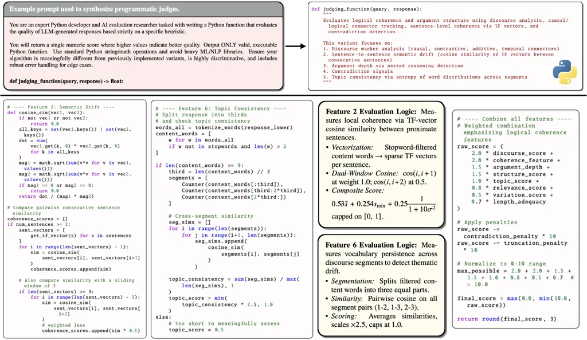
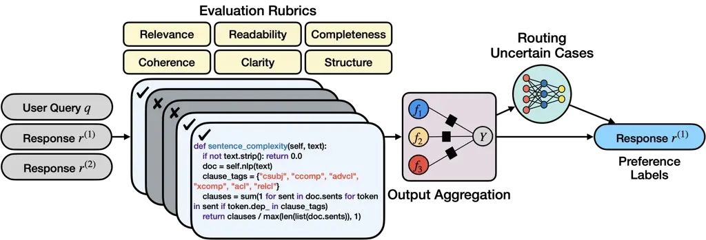
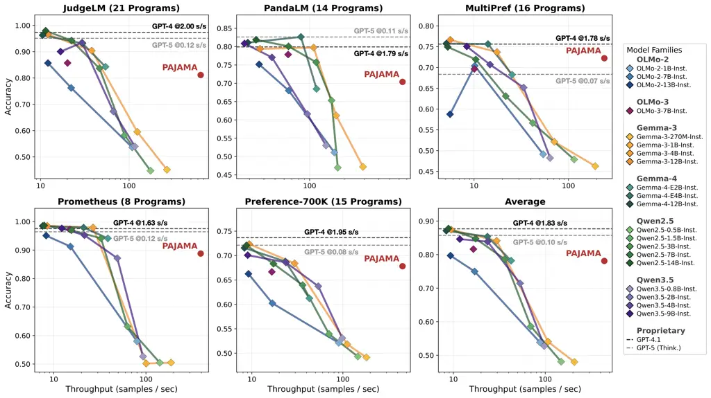
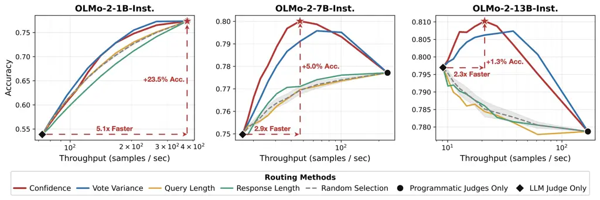
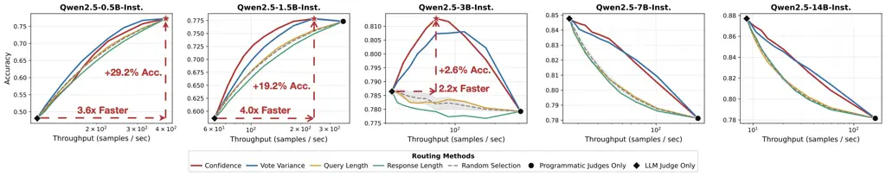
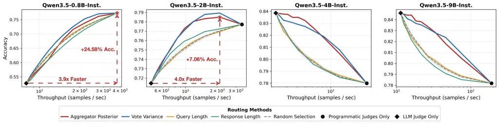
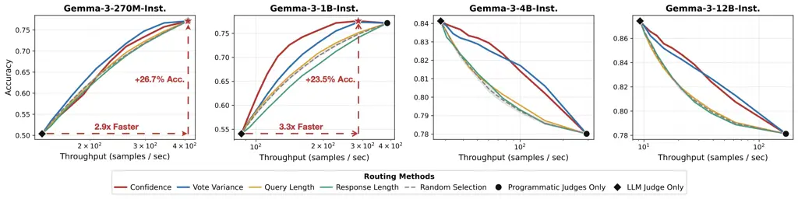
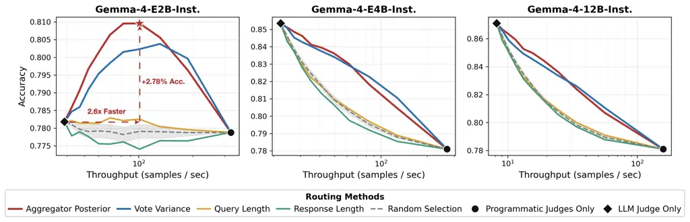
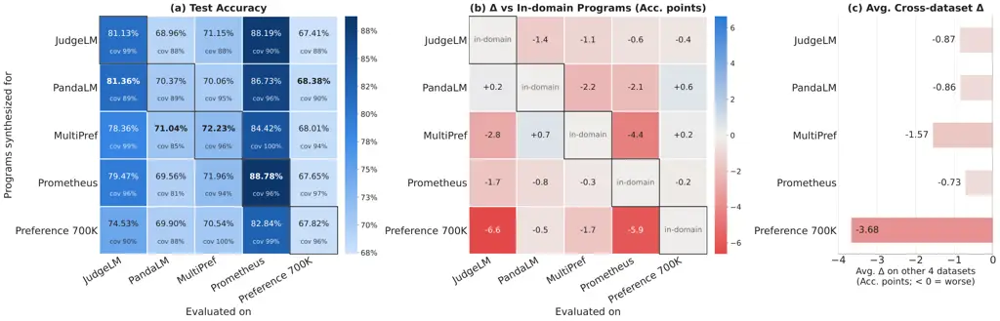

# Codifying the Judge: Scalable Evaluation via Program Distillation

Tzu-Heng Huang    Shengqi Qiu    Frederic Sala Affiliation: University
of Wisconsin-Madison

###### Abstract

LLM-as-a-judge has become the standard for automated evaluation, but it
suffers from high cost, inference latency, and opaque
decisions—limitations that undermine its scalability and reliability. We
address these with a simple, efficient alternative: program
distillation. Instead of prompting an LLM at evaluation time, we distill
its decision logic into a committee of programs that can score
candidates directly. These programmatic judges offer transparency, are
easily inspected or edited, and eliminate per-sample API costs. Building
on this notion, we introduce PAJAMA, a system that synthesizes programs
as judges, aggregates their decisions into a joint verdict, and
incorporates a fallback mechanism to selectively escalate low-confidence
cases to an LLM. Across five datasets and eight model families, we show
that programmatic judges match the performance of a 13B-size LLM judge
at 47$`\times`$ higher throughput. When using program outputs as routing
signals, PAJAMA improves both accuracy and throughput and advances the
Pareto frontier. Beyond evaluation, programmatic judges produce cheap
and effective reward signals: on RewardBench, a reward model distilled
from programs’ verdicts outperforms one trained on a proprietary LLM’s
labels at two orders of magnitude lower API cost.

^(†)^(†) ^(\*)Equal Contribution. Corresponding Authors: ¡thuang273,
sqiu53¿@wisc.edu¹¹footnotetext: Our source code is available
[here](https://github.com/SprocketLab/PAJAMA). Project page and our
demonstration can be found
in [https://sprocketlab.github.io/PAJAMA/](https://sprocketlab.github.io/PAJAMA/).

## 1 Introduction

The LLM-as-a-judge paradigm is a core building block of modern machine
learning pipelines \[10; 23\]. LLM judges assign pairwise preference
labels \[57; 20; 49\], supply supervision signals for reward model
distillation \[54; 51; 47\], and score trajectories against rubric
criteria to provide feedback in reinforcement learning \[11; 16; 38\].
As evaluation moves into online settings and iterative pipelines grow
ever more prominent, however, the fundamental drawbacks of LLM judges
are becoming difficult to ignore.

We identify four key challenges that limit the _scalability_ and
_reliability_ of LLM judges:

- •
  Inference Cost. When using proprietary frontier models such as OpenAI
  GPT-6 Astra, Anthropic Claude Fable 5 in the loop, scaling evaluation
  to millions of samples yields prohibitive API spending \[36\].
  Open-weight deployments avoid this API bill but still impose
  substantial inference latency and GPU requirements.
- •
  Opaque Logic. While LLMs produce justifications, their internal
  decision process is opaque. It is hard to verify whether a verdict
  relies on the stated rationale or is a product of hallucination \[56;
  25\].
- •
  Systemic Bias. LLM judges are sensitive to stylistic biases, favoring
  verbosity, rich formatting, or emotionally charged language—all of
  which undermine reliability \[5; 53; 39; 37; 55\].
- •
  Re-inference Tax. Existing prompting pipelines are inflexible.
  Revising a single rubric criterion requires re-running inference over
  the entire dataset, incurring redundant costs and wasted cycles.

We address these obstacles by _shifting from model-based inference to
synthesized program execution_. Instead of asking an LLM to
independently assess each candidate, we ask it to generate the judging
logic it would apply, and convert that logic into an executable program.
In other words, the LLM is now queried once at synthesis time, turning
repeated model inference into a one-time investment. Afterwards, we can
invoke programs locally to produce verdicts on every candidate,
producing judgments without further model calls.



Figure 1: An example of synthesizing programmatic judges. Given a
synthesis prompt (top-left), an LLM generates a Python judging_function
that articulates an evaluation rubric—for example, logical
coherence—using interpretable features such as semantic drift via
TF-vector cosine similarity or topic consistency across discourse
segments. These features are combined into a weighted score, with
explicit penalties for contradiction and truncation, where the weights
are determined by the LLM itself. This yields a transparent,
program-based evaluator distilled directly from an LLM’s logic.

This strategy offers three immediate advantages. First, API costs now
scale with the number of generated programs (tiny) rather than the size
of the dataset (often huge): once synthesized, programs can be stored
and reused locally at no additional API cost. Second, program execution
can be orders of magnitude faster than model inference, delivering
extremely low-latency, high-throughput decision. Third, programs are
interpretable: practitioners or coding agents (e.g., Codex and Claude
Code) can inspect each line, refine the judging logic, or incorporate
domain knowledge—turning a model-based assessment into a transparent,
and potentially formally verifiable procedure.

However, programmatic judging introduces its own challenges. First, a
single program rarely generalizes to every input. Second, even with
multiple programs, naïve synthesis tends to yield repetitive logic.
Third, programs generated from different rubrics produce noisy scores at
different scales. We address these with Pajama (Program-As-a-Judge
Automated Model Assessment), a system that is built on three components:
(i) a curated set of evaluation rubrics—each expressible as code—to
steer synthesis using diverse decision criteria; (ii) a modeling step
that calibrates program outputs and resolves their conflicts into a
joint verdict, and (iii) a confidence-aware fallback that routes
uncertain samples to an LLM judge, yielding a hybrid evaluation that
combines the efficiency of programmatic judges with the reliability of
LLM evaluation.

We validate Pajama on five preference datasets spanning eight model
families. We show that standalone programmatic judges can match
mid-sized LLMs, for instance, they reach the accuracy of
OLMo-2-13B-Instruct \[46\] while running $`47.25\times`$ faster. When
combined with an LLM through our confidence-aware router, Pajama further
advances the accuracy–throughput Pareto frontier. For example, when
paired with OLMo-2-7B-Instruct, it improves $`+5.0\%`$ accuracy at
$`2.9\times`$ throughput, $`+2.8\%`$ over Gemma-4-E2B-It \[43\] at
$`2.6\times`$ throughput, and $`+2.6\%`$ over Qwen2.5-3B-Instruct \[52\]
at $`2.2\times`$ throughput. On RewardBench \[22\], a reward model
distilled from programmatic judges’ labels outperforms one trained on a
proprietary LLM’s preferences at $`50\times`$ lower API cost—with zero
proprietary calls at evaluation time. Finally, we show that
program-based evaluation is robust to biased samples, and that pairing
it with a coding agent for iterative program calibration improves this
robustness further.

We summarize our contributions as follows:

- •
  A New Evaluation Paradigm. We introduce an approach that distills LLM
  logic into a program committee, replacing per-sample inference with
  one-time synthesis followed by local execution.
- •
  The Pajama System. We develop Pajama, a hybrid system that synthesizes
  diverse programmatic judges, calibrates and aggregates their verdicts,
  then routes uncertain cases to an LLM fallback.
- •
  Routing on Program Verdicts. We show that program outputs themselves
  provide an efficient confidence signal, enabling a lightweight router
  that combines two evaluation systems effectively.
- •
  Advancing the Pareto Frontier. Across eight model families, Pajama
  matches strong LLM judges at a fraction of the cost and pushes the
  accuracy–throughput Pareto frontier.
- •
  Cheap, High-Quality Reward Signals. Reward models distilled from
  programmatic judges outperform those trained on proprietary LLM labels
  on RewardBench, at $`50\times`$ lower cost.

## 2 Related Work

Pajama intersects three lines of work: automated evaluation, weak
supervision, and routing strategies.

Automated Evaluation. One of the key breakthroughs of LLMs is their
ability to replace or augment human annotators in providing automated
evaluations \[10; 23\]. Prior work has demonstrated that LLM judges
produce reliable decisions that align with human preferences across
tasks such as ranking, pairwise comparison, and rubric-based
scoring \[49; 6; 9; 26\]. More recent efforts integrate LLM judges into
the post-training pipeline, where their evaluations are used to train
reward models \[29; 4\], supply feedback for reinforcement
learning \[11; 16\], or fine-tune continually for specialized judge
models \[57; 20\]. While effective, LLM-based evaluation incurs
substantial inference costs and inherits biases from pretraining data
and prompt design, raising concerns about scalability and
reliability \[5; 53; 39; 48; 55\]. Our work explores a new direction:
_synthesizing programmatic judges that distill LLM’s logic into
low-cost, transparent, and flexible evaluators._

Weak Supervision. Weak supervision enables the rapid creation of labeled
datasets by aggregating multiple noisy label estimates \[31; 33; 32; 40;
30\] from sources such as heuristic rules, domain knowledge, or
pretrained models. These estimates are typically encoded as labeling
functions, whose pseudo-labels are modeled and combined into a single
probabilistic labeling decision. The weak supervision paradigm has
demonstrated success across diverse domains \[34; 17; 13; 3; 35; 15;
45\]. Most prior work focuses on label aggregation to construct
classification datasets. Our system, PAJAMA, adapts it for a new
purpose: _modeling the verdicts of programmatic judges to reach a
combined and a more reliable evaluation decision._

Routing Strategies. LLM routing systems leverage the complementary
strengths of diverse LLMs rather than committing to a single one \[28;
14; 7\]. A router directs each query to an appropriate model based on
factors such as task difficulty, expected accuracy, and inference
budget \[18\]. Existing routing strategies can be broadly categorized
into _model-free_ approaches—which rely on heuristics such as
nearest-neighbor retrieval over similar examples \[14\]—and
_model-based_ approaches, which, for example, train a classifier (e.g.,
a fine-tuned BERT) to predict the best model for each query \[41; 12;
24\]. The former is limited by _the strength of its heuristics_, while
the latter _incurs additional inference latency and requires supervision
for training._ In this work, we propose a new routing strategy: we
derive confidence directly from the outputs of programmatic judges and
use this signal to selectively escalate uncertain examples to an LLM
judge. _This yields a model-free fallback mechanism that preserves the
high throughput of programmatic evaluation while retaining the stronger
reasoning capabilities of LLMs on difficult examples._

## 3 Framework

We begin with an overview of Pajama’s workflow, followed by the problem
setup in §3.1. §3.2 describes how we distill LLM evaluation into
programmatic judges, and §3.3 discusses how we model their program
outputs into a final verdict. Finally, §3.4 presents a fallback
mechanism to handle cases that the programmatic judges cannot cover or
are uncertain about.

General Workflow. Figure 2 illustrates the Pajama workflow. Given a
dataset of queries paired with two candidate responses, we first prompt
an LLM to synthesize Python programs that encode different judging
rubrics; varying the prompt and evaluation criteria yields a diverse
pool of programmatic judges. We then calibrate each program’s outputs
using a held-out validation set, select the most effective programs, and
aggregate their verdicts into a single preference decision. For inputs
that are uncovered or yield low confidence, an efficient routing
mechanism falls back to an LLM judge.

### 3.1 Problem Setup



Figure 2: Pajama Workflow. Given a query $`q`$ and two candidate
responses $`r^{(1)},r^{(2)}`$, a diverse pool of programmatic
judges—synthesized by an LLM from curated rubrics—produces initial
evaluations. These program outputs are calibrated and selected, and
their verdicts are aggregated into a combined decision. Uncertain cases
are then routed to an LLM judge to produce the final preference.

Let $`\mathcal{Q},\mathcal{R}\subseteq\Sigma^{\star}`$ denote the spaces
of queries and responses, where $`\Sigma^{\star}`$ is the space of
free-form text. Given a query $`q\in\mathcal{Q}`$ and two candidate
responses $`r^{(1)},r^{(2)}\in\mathcal{R}`$, produced by the same or
different LLMs, our goal is to determine which response is preferred
under a target notion of quality (e.g., alignment with human
preferences).

### 3.2 Distilling into Programmatic Judges

Model-based evaluators, such as LLM-as-a-judge, incur high inference
cost and are opaque in their decision-making process. To address these,
we translate LLM judging logic into programs that assess $`q`$,
$`r^{(1)}`$, and $`r^{(2)}`$ directly. We design a prompt template that
instructs an LLM to synthesize Python functions, which serve as our
judges. Each function is asked to take a query and a response as direct
inputs, returns a scalar score, where a higher value indicates higher
quality according to its articulated evaluation logic. Figure 1 shows a
simplified example of our prompt and the program it generates.

A naïve synthesis approach often yields repetitive programs. To
encourage diversity, we curate ten distinct evaluation rubrics, each of
which can be expressed as an executable program. For each synthesis
round, we select a rubric and incorporate it into the prompt, together
with few-shot exemplars from the target dataset, to guide program
generation. We then perform a text-based similarity check to filter out
newly generated programs whose evaluation logic is similar to that of an
existing program in the pool. We adopt this approach for its simplicity,
but note that _more sophisticated program synthesis techniques or
customizations can easily be swapped in_. Appendix A provides the
complete synthesis prompt, our curated rubrics, and details on their
construction.

### 3.3 Modeling Programmatic Judges

Next, we present our modeling procedure for converting program outputs
into a reliable verdict.

Program Output Calibration. Each synthesized program acts as an
independent judge $`f_{j}`$ that scores the quality of LLM responses.
Given a tuple $`(q_{i},r_{i}^{(1)},r_{i}^{(2)})`$, we execute each
program to obtain quality scores
$`s_{ij}^{(m)}:=f_{j}(q_{i},r_{i}^{(m)})`$ for $`m\in\{1,2\}`$. We then
apply min-max normalization to map each program’s outputs into $`[0,1]`$
(since programs may use different scales). Using these normalized scores
$`\hat{s}_{ij}^{(1)}`$ and $`\hat{s}_{ij}^{(2)}`$, we compute the
_quality difference_
$`d_{ij}:=\hat{s}_{ij}^{(1)}-\hat{s}_{ij}^{(2)}\in[-1,1]`$, where
positive values favor $`r_{i}^{(1)}`$. We convert this difference into a
discrete verdict $`v_{ij}\in\{-1,0,+1\}`$ using a per-program threshold
$`\tau_{j}\geq 0`$: $`v_{ij}=+1`$ if $`d_{ij}>\tau_{j}`$, $`v_{ij}=-1`$
if $`d_{ij}<-\tau_{j}`$, and $`v_{ij}=0`$ (abstain) otherwise. This
abstention margin allows each program to _withhold its vote when its own
signal is too weak to be trusted_. When a validation set is available
(possibly small), we set each $`\tau_{j}`$ to the value that maximizes
program $`j`$’s accuracy on that set and reuse these thresholds at
inference time¹¹ 1 A validation set is not strictly required: when none
is available, we simply set $`\tau_{j}=0`$, which reduces the verdict to
a direct comparison between $`\hat{s}_{ij}^{(1)}`$ and
$`\hat{s}_{ij}^{(2)}`$..

Top-$`k`$ Program Selection. Not all synthesized programs are equally
reliable. When a validation set is available, we discard programs with
below random chance accuracy ($`<50\%`$) and keep the top-$`k`$
remaining programs by validation accuracy as the final committee.

Program Verdict Aggregation. Individual program verdicts can be noisy
and may disagree. At the same time, programs based on different rubrics
can also capture complementary aspects of response quality. We therefore
aggregate them to reduce noise and obtain a more reliable preference.
Specifically, we apply aggregation step in weak supervision
literature \[31; 33; 32; 40; 30\], which models noisy votes into
higher-quality _pseudolabel_ by using a generative model to estimate
each program’s accuracy from their agreement and disagreement patterns.
We collect the top-$`k`$ programs’ votes on $`n`$ validation samples
into a preference matrix $`\mathbf{L}\in\{-1,0,+1\}^{n\times k}`$, then
apply a standard label model (e.g., from the Snorkel framework \[31; 33;
30\]) to learn program-specific aggregation weights. At inference time,
these learned weights are applied to obtain an aggregated preference.

### 3.4 Routing Uncertain Cases

Although aggregating programmatic judges improves reliability, some
inputs remain difficult to evaluate confidently. For example, all
selected programs may abstain ($`v_{ij}=0`$ for all $`j`$), or the
aggregator may assign similar probability to both candidate responses,
resulting in a posterior close to $`0.5`$. Rather than forcing the
program committee to make an uncertain decision, we use signals derived
directly from program outputs—such as vote disagreement or aggregated
confidence—to identify these cases and route them to an LLM judge. This
yields a hybrid evaluation system that combines the best of both worlds:
programmatic judges deliver quick verdicts, while uncovered or
low-confidence cases are routed to an LLM judge, trading a small
fraction of expensive calls for improved reliability (i.e., evaluation
accuracy).

## 4 Experiments

We evaluate Pajama across four different settings, each designed to
validate programmatic judges’ benefits. Through them, we confirm four
key claims:

1.  C1.
    Accuracy and Throughput. Programmatic judges can match the accuracy
    of mid-sized LLM judges while achieving substantially higher
    evaluation throughput than standard LLM inference.
2.  C2.
    Routing and Pareto Frontier. Program-derived signals enable an
    effective router; when combined with an LLM, Pajama significantly
    advances the accuracy–throughput Pareto frontier.
3.  C3.
    Cost-effective Distillation. Programmatic judges provide
    cost-effective supervision for reward model distillation, achieving
    higher performance than labels from proprietary LLMs.
4.  C4.
    Robustness to Bias. Programs exhibit resilience to systemic biases
    comparable to a 7B LLM; moreover, automated program calibration via
    coding agents further enhances this robustness.

### 4.1 Effectiveness of Program-based Evaluation



Figure 3: Effectiveness of Programmatic Judges. Accuracy vs. throughput
across five preference datasets. Each subplot title reports the number
of programs retained after selection. Programmatic judges achieve
_extremely high throughput_ while remaining competitive in accuracy with
mid-sized LLM judges, e.g., matching OLMo-2-13B-Instruct on average.

Programmatic judges distill LLM evaluation logic into executable
programs that produce pairwise preference judgments. We first ask
whether this design is both _accurate_—in terms of evaluation
performance—and _fast_, in terms of throughput.

Setup. We evaluate on five pairwise preference datasets: JudgeLM \[57\],
PandaLM \[49\], MultiPref \[26\], Prometheus \[20\], and
Preference-700K \[8\]. From each, we sample up to 5,000 examples for
evaluation and hold out an additional 500 examples as a validation set
for modeling program outputs (i.e., calibration, selection, and
aggregation). We make a one-time investment to synthesize 80 candidate
programs with Claude Opus 4.6 \[2\], using in-context prompts seeded
with 10 examples randomly drawn the validation set. On samples where the
program committee abstains, we assign labels randomly so that coverage
is complete²² 2 As shown in Table 4, most of selected programs yield
high coverage (e.g., $`>95.0\%`$); that is, only a few uncovered samples
are annotated by random guessing.. Appendices A and B provide the full
synthesis prompts, curated rubrics, and dataset descriptions. Appendix E
ablates each design choice in Pajama, including (i) rubric contribution,
(ii) the program synthesizer, (iii) program committee size, (iv)
validation set size, and (v) the cross-dataset generalization.

We compare this program-based evaluation against eight model families
spanning a wide range of scales: proprietary judges (GPT-4.1 \[1\],
GPT-5 with Thinking \[42\]), OLMo-2 \[46\], OLMo-3 \[27\],
Gemma-3 \[19\], Gemma-4 \[43\], Qwen2.5 \[52\], and Qwen3.5 \[44\]. We
measure two quantities: _accuracy_ against ground-truth preference
labels, and _throughput_, the number of samples judged per second. LLM
judges are served with vLLM \[21\], a widely adopted inference engine,
using 64 concurrent requests. Programmatic judges are executed in
parallel across 24 CPU threads, and the reported throughput accounts for
the time needed to aggregate the program outputs.

Results. Figure 3 presents accuracy against throughput on each dataset
and on their average; full numerical results are reported in
Appendix D.1. Two findings stand out. First, programmatic judges achieve
competitive accuracy with mid-sized LLM judges. On average, they attain
an accuracy of $`78.11\%`$, on par with OLMo-2-13B-Instruct,
Gemma-4-E2B-It, and Qwen2.5-3B-Instruct, and within 8 points of the
strongest proprietary judge, GPT-5 Thinking ($`85.72\%`$). On
Prometheus, a committee of only eight programs reaches $`88.78\%`$,
matching OLMo-2-7B-Instruct. Second, program-based evaluation occupies a
throughput regime that no LLM judge can reach. It runs $`2.12\times`$
faster than Gemma-3-270M-It—the smallest model we test—while
outperforming it by $`+30.11`$ accuracy points. Against larger variants
(e.g., Qwen2.5-14B-Instruct, Gemma-4-12B-It), programs run roughly
$`50\times`$ faster while approaching their accuracy. These results
demonstrate that a committee of fewer than twenty synthesized programs
is sufficient to deliver competitive accuracy while running orders of
magnitude faster than any LLM judge we tested.

### 4.2 Hybrid Evaluation Advances The Pareto Frontier



Figure 4: Routing within the OLMo-2 family. Accuracy vs. throughput as
the escalation threshold is swept across different routing signals.
Endpoints represent pure-program (right-most) and pure-LLM (left-most)
evaluation. Pajama-derived signals (_aggregator posterior_, _vote
variance_) consistently dominate other model-free routing methods across
all model sizes.

In §4.1, we show that standalone programmatic judges dominate a
significant region of the accuracy–throughput Pareto frontier. We next
ask whether programmatic and LLM judges can be combined to exploit their
complementary strengths. _What if_ programs handled clear-cut pairs
reliably, routing only the uncertain cases to an LLM? This should
recover accuracy while preserving high throughput.

Setup. We validate this idea with a staged evaluation policy: programs
assess every pair, and only uncovered or low-confidence ones are
escalated. We identify uncertain cases using two signals derived from
the program committee: (i) vote variance—the disagreement among
synthesized programs, where _high_ variance indicates uncertainty; and
(ii) aggregator posterior—the posterior probability inferred by the
aggregator, where a probability close to $`0.5`$ indicates uncertainty.
We use a threshold to control the escalation rate: samples flagged as
low-confidence are routed, while the rest are decided by the
programmatic judges. Sweeping the threshold traces the full hybrid
accuracy–throughput curve, with the two endpoints recovering
programs-only and LLM-only evaluation.

We compare this strategy against three heuristic routing baselines that
do not leverage Pajama’s signals: query length, which escalates pairs
with longer prompts; response length, which escalates pairs with longer
candidate responses; and random selection, which routes a uniformly
sampled fraction of pairs. Each baseline is evaluated across the same
range of escalation rates. We report average testing accuracy across the
five preference datasets.

Results. We present the analysis in two parts. First, we compare routing
signals within a single model family to identify which signal works
best. Then, we apply the best signal across nineteen LLM judges to
characterize how the hybrid frontier moves relative to pure-LLM
evaluation.

First, program-derived routing signals improve evaluation quality.
Figure 4 compares routing strategies on the OLMo-2 family. Across all
three sizes, both the aggregator posterior (the prediction confidence)
and vote variance trace curves that dominate the length-based and random
baselines: at any throughput they yield higher accuracy, and at any
accuracy they yield higher throughput. For example, with
OLMo-2-7B-Instruct, the hybrid assessment routed by aggregator posterior
achieves a $`+5.0\%`$ accuracy improvement at $`2.9\times`$ higher
throughput than LLM-only evaluation. Appendix D.2 further reports a
fallback-rate sensitivity analysis. For most hybrid configurations with
small LLMs, accuracy peaks at fallback rates between $`32\%`$ and
$`42\%`$. This means Pajama can exceed the accuracy of LLM-only
evaluation while escalating fewer than half of the samples to the LLM.
Additional routing sweeps across other model families are provided in
Appendix D.3. Finally, Pajama’s fallback mechanism relies entirely on
internal signals, making its routing decisions incur negligible
overhead—unlike model-based routers, which typically require an extra
model inference \[14; 41; 12; 24\]. We present this comparison in
Appendix D.4, where program-based routing matches an oracle-supervised
model-based router with no supervision or additional latency.

Figure 5: Hybrid evaluation pushes the Pareto frontier further. Each
panel shows accuracy vs. throughput as Pajama routes uncertain pairs to
one of nineteen LLM judges. Dashed curves trace each judge’s hybrid
trajectory; the red envelope is the resulting Pajama frontier, while the
black envelope is the LLM-only one from §4.1.

_Second, hybrid evaluation extends the Pareto frontier._ Figure 5
demonstrates this. Each dashed line traces one judge’s hybrid trajectory
as the threshold is swept; the red envelope is the resulting frontier
with Pajama’s routing, and the black envelope is the LLM-only frontier
from §4.1. Across all nineteen judges, the red envelope dominates the
black one: at every throughput level, hybrid evaluation achieves higher
accuracy. For example, routing uncertain cases to OLMo-3-7B-Instruct
yields $`82.20\%`$ accuracy at $`2.19\times`$ the throughput of the
LLM-only system, while GPT-5 (Thinking) reaches $`85.72\%`$ accuracy at
only $`0.10`$ samples/sec. _Our hybrid configurations provide
competitive reliability while running hundreds of times faster and
incurring zero proprietary API cost._

In the leftmost panel, we further present an _oracle router_ that
escalates only the pairs the programmatic judges would have mislabeled,
representing the upper bound of any routing strategy built on our
programs. The remaining gap between our internal signals and the oracle
suggests that richer signals from the program committee—beyond vote
variance and posterior probability—could further improve routing.
_Overall, this Pareto frontier shift allows practitioners to obtain
higher accuracy under a fixed throughput budget, or substantially higher
throughput at a target accuracy, without training stronger models or
increasing API spend._

### 4.3 Reward Model Distillation at Lower Cost

LLM judges are widely used not only for assessment but also for
generating preference labels that enable reward model distillation with
broader generalization. We ask whether program-based verdicts can serve
as an effective training signal in the post-training stage.

Setup. We sample an additional 20,000 preference pairs from Prometheus
and JudgeLM to build training sets, relabel them with programmatic
judges, and compare against the original GPT-4 labels \[1\] provided by
these two datasets. We then fine-tune Qwen2.5-3B-Instruct on each
supervision source under the standard Bradley–Terry objective \[8\]. We
evaluate along two axes: (i) in-domain accuracy on the Prometheus and
JudgeLM test sets, and (ii) out-of-domain generalization on
RewardBench \[22\]. We also report the estimated API cost of each
labeling source: GPT-4 inference over all 20,000 pairs versus our
one-time cost of synthesizing the 80 programs. Our training
configurations and per-category RewardBench results are presented in
Appendices C and D.5.

Results. Table 1 reports reward model performance and labeling costs.
Programmatic judges provide a more cost-effective training signal than
proprietary GPT-4 labels. In-domain, our labels yield competitive
accuracy at roughly $`50\times`$ lower API cost, reaching $`92.20\%`$ on
Prometheus. Out-of-domain, reward models trained on Pajama labels
transfer better to RewardBench, improving the average score by $`+3.60`$
points on Prometheus and $`+4.05`$ points on JudgeLM, with the largest
gains on the Reasoning and Safety categories. Moreover, since our
program synthesis is a one-time investment ($`\mathcal{O}(1)`$), the
spending gap widens as the dataset grows, whereas GPT-4 labeling scales
linearly ($`\mathcal{O}(n)`$) with the number of pairs. This makes
Pajama an attractive labeling source for alignment workflows with
limited distillation budgets.

|                               |                |                    |                               |              |             |           |           |        |         |
| ----------------------------- | -------------- | ------------------ | ----------------------------- | ------------ | ----------- | --------- | --------- | ------ | ------- |
| Labeling Source               | API Calls      | Cost Scaling       | Estimated Cost                | In-domain    | RewardBench |           |           |        | Average |
|                               |                |                    |                               | Testing Acc. | Chat        | Chat Hard | Reasoning | Safety |         |
| Trained on Prometheus Dataset |                |                    |                               |              |             |           |           |        |         |
| GPT-4                         | 20,000 samples | $`\mathcal{O}(n)`$ | \$363.97                      | 97.23        | 68.44       | 38.82     | 55.70     | 45.95  | 52.23   |
| PAJAMA                        | 80 programs    | $`\mathcal{O}(1)`$ | \$7.21 (50$`\times`$ cheaper) | 92.20        | 79.33       | 30.04     | 60.58     | 53.38  | 55.83   |
| Trained on JudgeLM Dataset    |                |                    |                               |              |             |           |           |        |         |
| GPT-4                         | 20,000 samples | $`\mathcal{O}(n)`$ | \$296.37                      | 90.24        | 67.88       | 38.82     | 65.13     | 58.24  | 57.52   |
| PAJAMA                        | 80 programs    | $`\mathcal{O}(1)`$ | \$6.49 (45$`\times`$ cheaper) | 82.79        | 67.88       | 44.52     | 72.91     | 60.95  | 61.57   |

Table 1: Reward model distillation with Pajama vs. GPT-4 labels. Pajama
matches or surpasses GPT-4 supervision on RewardBench on average while
reducing labeling cost by $`45`$–$`50\times`$.

### 4.4 Bias Reduction and Program Calibration

LLM judges sometimes rely on superficial features rather than the true
quality when making decisions. Programmatic judges offer a transparent
alternative. We ask whether this transparency yields _improved
robustness_, and whether programs can be _easily calibrated_ when biases
are detected.

Setup. We study five well-known bias types: (i) position bias, favoring
answers based on their order; (ii) rich-content, favoring formatting
(e.g., markdown, emojis) over factual accuracy; (iii) reference bias,
crediting unsupported citations; (iv) gender bias, reacting to gendered
phrasing unrelated to quality; and (v) verbosity bias, favoring longer
responses regardless of substantive value.

In each case, the two candidate responses are matched in quality, so
there is no inherent winner. We compare each judge’s decision before and
after a controlled perturbation of one response. For position bias, we
query the judge twice with the candidate order swapped. For the other
four content biases, we run a clean trial and a perturbed trial,
measuring whether the perturbation flips the preference toward the
biased response. For Pajama, we aggregate the verdicts of 8 selected
programs from Prometheus. We assess robustness with two metrics: Flip
Rate (FR), the percentage of samples whose verdict changes under
perturbation, and Bias Win Rate (BWR), the percentage in which the
biased response ultimately wins. Both metrics are lower-is-better.
Appendix B details the data sources.

|                         |          |              |           |           |           |           |            |           |           |           |           |
| ----------------------- | -------- | ------------ | --------- | --------- | --------- | --------- | ---------- | --------- | --------- | --------- | --------- |
| Method                  | Position | Rich Content |           | Reference |           | Gender    |            | Verbosity |           | Average   |           |
|                         | FR (%)   | FR (%)       | BWR (%)   | FR (%)    | BWR (%)   | FR (%)    | BWR (%)    | FR (%)    | BWR (%)   | FR (%)    | BWR (%)   |
| OLMo-2-Instruct family  |          |              |           |           |           |           |            |           |           |           |           |
| 1B                      | 59.36    | 17.94        | 61.73     | 21.87     | 71.22     | 18.93     | 65.25      | 21.16     | 32.69     | 27.85     | 57.72     |
| 7B                      | 82.82    | 10.99        | 14.08     | 26.62     | 31.55     | 4.51      | 7.32       | 18.47     | 57.53     | 28.68     | 27.62     |
| 13B                     | 93.52    | 1.83         | 89.58     | 2.11      | 77.32     | 1.55      | 50.99      | 1.67      | 2.00      | 20.14     | 54.97     |
| Gemma-3-Instruct family |          |              |           |           |           |           |            |           |           |           |           |
| 4B                      | 60.14    | 15.21        | 68.73     | 13.10     | 52.82     | 0.56      | 22.25      | 0.20      | 0.33      | 17.84     | 36.03     |
| 12B                     | 44.08    | 10.00        | 47.04     | 12.54     | 48.87     | 0.42      | 15.77      | 1.27      | 1.47      | 13.66     | 28.29     |
| Qwen2.5-Instruct family |          |              |           |           |           |           |            |           |           |           |           |
| 1.5B                    | 66.48    | 15.77        | 58.17     | 17.32     | 62.96     | 4.65      | 49.44      | 41.13     | 61.47     | 29.07     | 58.01     |
| 3B                      | 55.77    | 17.89        | 65.07     | 11.83     | 61.13     | 0.42      | 21.83      | 12.27     | 29.20     | 19.63     | 44.31     |
| 7B                      | 46.48    | 19.86        | 65.77     | 13.10     | 45.63     | 0.99      | 17.61      | 11.20     | 19.60     | 18.33     | 37.15     |
| 14B                     | 40.00    | 16.06        | 42.39     | 18.17     | 42.82     | 0.99      | 5.49       | 2.87      | 7.87      | 15.61     | 24.64     |
| PAJAMA                  | 0.00     | 23.13        | 48.92     | 20.30     | 47.10     | 7.69      | 46.27      | 9.34      | 16.84     | 12.09     | 39.78     |
| PAJAMA (Calibrated)     | 0.00     | 13.74        | 53.28     | 17.29     | 43.17     | 3.70      | 36.17      | 3.25      | 9.68      | 7.60      | 35.58     |
| $`\Delta`$ (Reduction)  | 0.00     | $`-`$9.39    | $`+`$4.36 | $`-`$3.01 | $`-`$3.93 | $`-`$3.99 | $`-`$10.10 | $`-`$6.09 | $`-`$7.16 | $`-`$4.49 | $`-`$4.20 |

Table 2: Bias Robustness. Flip Rate (FR) and Bias Win Rate (BWR); _lower
is better_. LLM results are averaged over three trials. Pajama has the
lowest average FR, and its calibrated variant, which applies targeted
edits to the synthesized programs, lowers both metrics further.

Results. Table 2 reports the robustness of LLM judges and programmatic
judges across the five bias types. On average, Pajama achieves a lower
flip rate than all three families of LLM judges, while its bias win rate
is comparable to Qwen2.5-7B-Instruct and Gemma-3-4B-Instruct. For
position bias, a program’s reasoning is invariant to candidate order,
yielding the highest consistency overall—a property that follows
naturally from the design of the programs themselves. For verbosity
bias, the synthesized programs encode logic that penalizes responses
that are either too short or too long, yielding low flip rates and bias
win rates that outperform 7B models.

Program-based evaluation exposes the full decision process, and its
judging logic can be edited through minor code changes. We further use a
coding agent (Claude Code) to calibrate the programmatic judges by
making them aware of specific bias types; the calibration prompt is
provided in Appendix A.5. Table 2 confirms the effectiveness of this
calibration: both flip rate and bias win rate can be substantially
reduced by editing the programs themselves. For example, in the
rich-content category, the programs are calibrated to remove bonuses for
numbered lists, bullets, and colon headers, improving the flip rate by
$`9.39\%`$. Unlike opaque LLM judges, these gains stem directly from the
programs’ transparent design, demonstrating that programmatic judges are
not only auditable but also fixable. Bias is no longer a fixed property
of the evaluator, but a bug that can be patched.

## 5 Conclusion

We present Pajama, which distills LLM evaluation logic into programmatic
judges—Python functions synthesized from curated rubrics, calibrated,
and aggregated via weak supervision, with routing to an LLM judge when
the committee is uncertain. Across five preference datasets and eight
model families, Pajama matches mid-sized LLM judges in accuracy at
orders-of-magnitude higher throughput, advancing the Pareto frontier of
LLM judges and producing labels that are more cost-effective than
proprietary supervision for reward model distillation and robust to
biased samples.

## References

- \[1\] J. Achiam, S. Adler, S. Agarwal, L. Ahmad, I. Akkaya, F. L.
  Aleman, D. Almeida, J. Altenschmidt, S. Altman, S. Anadkat, et
  al. (2023) Gpt-4 technical report. arXiv preprint arXiv:2303.08774.
  Cited by: §4.1, §4.3.
- \[2\] Anthropic (2026) Claude Opus 4.6 system card. Cited by: §4.1.
- \[3\] S. Arora, A. Narayan, M. F. Chen, L. Orr, N. Guha, K. Bhatia, I.
  Chami, and C. Re (2023) Ask me anything: a simple strategy for
  prompting language models. In The Eleventh International Conference on
  Learning Representations, External Links:
  [Link](https://openreview.net/forum?id=bhUPJnS2g0X) Cited by: §2.
- \[4\] Y. Bai, A. Jones, K. Ndousse, A. Askell, A. Chen, N.
  Dassarma, D. Drain, S. Fort, D. Ganguli, T. Henighan, N. Joseph, S.
  Kadavath, J. Kernion, T. Conerly, S. El-Showk, N. Elhage, Z.
  Hatfield-Dodds, D. Hernandez, T. Hume, S. Johnston, S. Kravec, L.
  Lovitt, N. Nanda, C. Olsson, D. Amodei, T. B. Brown, J. Clark, S.
  McCandlish, C. Olah, B. Mann, and J. Kaplan (2022) Training a helpful
  and harmless assistant with reinforcement learning from human
  feedback. ArXiv abs/2204.05862. External Links:
  [Link](https://api.semanticscholar.org/CorpusID:248118878) Cited by:
  §2.
- \[5\] G. H. Chen, S. Chen, Z. Liu, F. Jiang, and B. Wang (2024) Humans
  or LLMs as the judge? a study on judgement bias. In Proceedings of the
  2024 Conference on Empirical Methods in Natural Language
  Processing, Y. Al-Onaizan, M. Bansal, and Y. Chen (Eds.), Miami,
  Florida, USA, pp. 8301–8327. External Links:
  [Link](https://aclanthology.org/2024.emnlp-main.474/),
  [Document](https://dx.doi.org/10.18653/v1/2024.emnlp-main.474) Cited
  by: §B.2, 3rd item, §2.
- \[6\] C. Chiang and H. Lee (2023) Can large language models be an
  alternative to human evaluations?. In Proceedings of the 61st Annual
  Meeting of the Association for Computational Linguistics (Volume 1:
  Long Papers), Toronto, Canada, pp. 15607–15631. External Links:
  [Link](https://aclanthology.org/2023.acl-long.870) Cited by: §2.
- \[7\] D. Ding, A. Mallick, C. Wang, R. Sim, S. Mukherjee, V.
  Rühle, L. V. S. Lakshmanan, and A. H. Awadallah (2024) Hybrid LLM:
  cost-efficient and quality-aware query routing. In The Twelfth
  International Conference on Learning Representations, External Links:
  [Link](https://openreview.net/forum?id=02f3mUtqnM) Cited by: §2.
- \[8\] H. Dong, W. Xiong, B. Pang, H. Wang, H. Zhao, Y. Zhou, N.
  Jiang, D. Sahoo, C. Xiong, and T. Zhang (2024) RLHF workflow: from
  reward modeling to online rlhf. arXiv preprint arXiv:2405.07863. Cited
  by: item 5, §4.1, §4.3.
- \[9\] Y. Dubois, P. Liang, and T. Hashimoto (2024) Length-controlled
  alpacaeval: a simple debiasing of automatic evaluators. In First
  Conference on Language Modeling, External Links:
  [Link](https://openreview.net/forum?id=CybBmzWBX0) Cited by: §2.
- \[10\] J. Gu, X. Jiang, Z. Shi, H. Tan, X. Zhai, C. Xu, W. Li, Y.
  Shen, S. Ma, H. Liu, et al. (2024) A survey on llm-as-a-judge. The
  Innovation. Cited by: §1, §2.
- \[11\] A. Gunjal, A. Wang, E. Lau, V. Nath, Y. He, B. Liu, and S. M.
  Hendryx (2026) Rubrics as rewards: reinforcement learning beyond
  verifiable domains. In The Fourteenth International Conference on
  Learning Representations, External Links:
  [Link](https://openreview.net/forum?id=c1bTcrDmt4) Cited by: §1, §2.
- \[12\] S. N. Hari and M. Thomson (2023) Tryage: real-time, intelligent
  routing of user prompts to large language models. arXiv preprint
  arXiv:2308.11601. Cited by: §2, §4.2.
- \[13\] S. Hooper, M. Wornow, Y. H. Seah, P. Kellman, H. Xue, F.
  Sala, C. Langlotz, and C. Re (2021) Cut out the annotator, keep the
  cutout: better segmentation with weak supervision. In International
  Conference on Learning Representations, External Links:
  [Link](https://openreview.net/forum?id=bjkX6Kzb5H) Cited by: §2.
- \[14\] Q. J. Hu, J. Bieker, X. Li, N. Jiang, B. Keigwin, G.
  Ranganath, K. Keutzer, and S. K. Upadhyay (2024) RouterBench: a
  benchmark for multi-LLM routing system. In Agentic Markets Workshop at
  ICML 2024, External Links:
  [Link](https://openreview.net/forum?id=IVXmV8Uxwh) Cited by: §2, §4.2.
- \[15\] T. Huang, M. Bilkhu, J. Cooper, F. Sala, and J. Movellan (2025)
  Evaluating sample utility for efficient data selection by mimicking
  model weights. arXiv preprint arXiv:2501.06708. Cited by: §2.
- \[16\] T. Huang, S. Salekin, J. Movellan, F. Sala, and M.
  Bilkhu (2026) RubiCap: rubric-guided reinforcement learning for dense
  image captioning. arXiv preprint arXiv:2603.09160. Cited by: §1, §2.
- \[17\] T. Huang, C. Shin, S. J. Tay, D. Adila, and F. Sala (2024)
  Multimodal data curation via object detection and filter ensembles.
  arXiv preprint arXiv:2401.12225. Cited by: §2.
- \[18\] W. Jitkrittum, H. Narasimhan, A. S. Rawat, J. Juneja, C.
  Wang, Z. Wang, A. Go, C. Lee, P. Shenoy, R. Panigrahy, A. K. Menon,
  and S. Kumar (2026) Universal model routing for efficient LLM
  inference. In The Fourteenth International Conference on Learning
  Representations, External Links:
  [Link](https://openreview.net/forum?id=ka82fvJ5f1) Cited by: §2.
- \[19\] A. Kamath, J. Ferret, S. Pathak, N. Vieillard, R. Merhej, S.
  Perrin, T. Matejovicova, A. Ramé, M. Rivière, L. Rouillard, et
  al. (2025) Gemma 3 technical report. arXiv preprint arXiv:2503.19786 4. Cited by: §4.1.
- \[20\] S. Kim, J. Shin, Y. Cho, J. Jang, S. Longpre, H. Lee, S.
  Yun, S. Shin, S. Kim, J. Thorne, and M. Seo (2024) Prometheus:
  inducing fine-grained evaluation capability in language models. In The
  Twelfth International Conference on Learning Representations, External
  Links: [Link](https://openreview.net/forum?id=8euJaTveKw) Cited by:
  item 4, §1, §2, §4.1.
- \[21\] W. Kwon, Z. Li, S. Zhuang, Y. Sheng, L. Zheng, C. H. Yu, J.
  Gonzalez, H. Zhang, and I. Stoica (2023) Efficient memory management
  for large language model serving with pagedattention. In Proceedings
  of the 29th symposium on operating systems principles, pp. 611–626.
  Cited by: §4.1.
- \[22\] N. Lambert, V. Pyatkin, J. Morrison, L. Miranda, B. Y. Lin, K.
  Chandu, N. Dziri, S. Kumar, T. Zick, Y. Choi, N. A. Smith, and H.
  Hajishirzi (2025) RewardBench: evaluating reward models for language
  modeling. In Findings of the Association for Computational
  Linguistics: NAACL 2025, L. Chiruzzo, A. Ritter, and L. Wang (Eds.),
  Albuquerque, New Mexico, pp. 1755–1797. External Links:
  [Link](https://aclanthology.org/2025.findings-naacl.96/),
  [Document](https://dx.doi.org/10.18653/v1/2025.findings-naacl.96),
  ISBN 979-8-89176-195-7 Cited by: §1, §4.3.
- \[23\] H. Li, Q. Dong, J. Chen, H. Su, Y. Zhou, Q. Ai, Z. Ye, and Y.
  Liu (2024) Llms-as-judges: a comprehensive survey on llm-based
  evaluation methods. arXiv preprint arXiv:2412.05579. Cited by: §1, §2.
- \[24\] K. Lu, H. Yuan, R. Lin, J. Lin, Z. Yuan, C. Zhou, and J.
  Zhou (2024) Routing to the expert: efficient reward-guided ensemble of
  large language models. In Proceedings of the 2024 Conference of the
  North American Chapter of the Association for Computational
  Linguistics: Human Language Technologies (Volume 1: Long Papers),
  pp. 1964–1974. Cited by: §2, §4.2.
- \[25\] N. Maloyan, B. Ashinov, and D. Namiot (2025) Investigating the
  vulnerability of llm-as-a-judge architectures to prompt-injection
  attacks. International Journal of Open Information Technologies 13
  (9), pp. 1–6. Cited by: 2nd item.
- \[26\] L. J. V. Miranda, Y. Wang, Y. Elazar, S. Kumar, V. Pyatkin, F.
  Brahman, N. A. Smith, H. Hajishirzi, and P. Dasigi (2025) Hybrid
  preferences: learning to route instances for human vs. ai feedback. In
  Proceedings of the 63rd Annual Meeting of the Association for
  Computational Linguistics (Volume 1: Long Papers), pp. 7162–7200.
  Cited by: item 3, §2, §4.1.
- \[27\] T. Olmo, A. Ettinger, A. Bertsch, B. Kuehl, D. Graham, D.
  Heineman, D. Groeneveld, F. Brahman, F. Timbers, H. Ivison, et
  al. (2025) Olmo 3. arXiv preprint arXiv:2512.13961. Cited by: §4.1.
- \[28\] I. Ong, A. Almahairi, V. Wu, W. Chiang, T. Wu, J. E.
  Gonzalez, M. W. Kadous, and I. Stoica (2025) RouteLLM: learning to
  route LLMs from preference data. In The Thirteenth International
  Conference on Learning Representations, External Links:
  [Link](https://openreview.net/forum?id=8sSqNntaMr) Cited by: §D.4, §2.
- \[29\] L. Ouyang, J. Wu, X. Jiang, D. Almeida, C. Wainwright, P.
  Mishkin, C. Zhang, S. Agarwal, K. Slama, A. Ray, et al. (2022)
  Training language models to follow instructions with human feedback.
  Advances in neural information processing systems 35, pp. 27730–27744.
  Cited by: §2.
- \[30\] A. Ratner, B. Hancock, J. Dunnmon, R. Goldman, and C. Ré (2018)
  Snorkel metal: weak supervision for multi-task learning. In
  Proceedings of the Second Workshop on Data Management for End-To-End
  Machine Learning, pp. 1–4. Cited by: §2, §3.3.
- \[31\] A. Ratner, S. H. Bach, H. Ehrenberg, J. Fries, S. Wu, and C.
  Ré (2017) Snorkel: rapid training data creation with weak supervision.
  In Proceedings of the VLDB endowment. International conference on very
  large data bases, Vol. 11, pp. 269. Cited by: §2, §3.3.
- \[32\] A. Ratner, B. Hancock, J. Dunnmon, F. Sala, S. Pandey, and C.
  Ré (2019) Training complex models with multi-task weak supervision. In
  Proceedings of the AAAI conference on artificial intelligence, Vol.
  33, pp. 4763–4771. Cited by: §2, §3.3.
- \[33\] A. J. Ratner, C. M. De Sa, S. Wu, D. Selsam, and C. Ré (2016)
  Data programming: creating large training sets, quickly. Advances in
  neural information processing systems 29. Cited by: §2, §3.3.
- \[34\] N. Roberts, X. Li, T. Huang, D. Adila, S. Schoenberg, C.
  Liu, L. Pick, H. Ma, A. Albarghouthi, and F. Sala (2022)
  Autows-bench-101: benchmarking automated weak supervision with 100
  labels. Advances in Neural Information Processing Systems 35,
  pp. 8912–8925. Cited by: §2.
- \[35\] J. Saad-Falcon, E. K. Buchanan, M. F. Chen, T. Huang, B.
  McLaughlin, T. Bhathal, S. Zhu, B. Athiwaratkun, F. Sala, S.
  Linderman, et al. (2025) Shrinking the generation-verification gap
  with weak verifiers. arXiv preprint arXiv:2506.18203. Cited by: §2.
- \[36\] D. Salinas, O. Swelam, and F. Hutter (2025) Tuning LLM judge
  design decisions for 1/1000 of the cost. In Forty-second International
  Conference on Machine Learning, External Links:
  [Link](https://openreview.net/forum?id=cve4NOiyVp) Cited by: 1st item.
- \[37\] K. Schroeder and Z. Wood-Doughty (2024) Can you trust llm
  judgments? reliability of llm-as-a-judge. arXiv preprint
  arXiv:2412.12509. Cited by: 3rd item.
- \[38\] R. Shao, A. Asai, S. Z. Shen, H. Ivison, V. Kishore, J.
  Zhuo, X. Zhao, M. Park, S. G. Finlayson, D. Sontag, et al. (2025) Dr
  tulu: reinforcement learning with evolving rubrics for deep research.
  arXiv preprint arXiv:2511.19399. Cited by: §1.
- \[39\] L. Shi, C. Ma, W. Liang, X. Diao, W. Ma, and S. Vosoughi (2025)
  Judging the judges: a systematic study of position bias in
  LLM-as-a-judge. In Proceedings of the 14th International Joint
  Conference on Natural Language Processing and the 4th Conference of
  the Asia-Pacific Chapter of the Association for Computational
  Linguistics, K. Inui, S. Sakti, H. Wang, D. F. Wong, P.
  Bhattacharyya, B. Banerjee, A. Ekbal, T. Chakraborty, and D. P. Singh
  (Eds.), Mumbai, India, pp. 292–314. External Links:
  [Link](https://aclanthology.org/2025.ijcnlp-long.18/),
  [Document](https://dx.doi.org/10.18653/v1/2025.ijcnlp-long.18), ISBN
  979-8-89176-298-5 Cited by: 3rd item, §2.
- \[40\] C. Shin, W. Li, H. Vishwakarma, N. C. Roberts, and F.
  Sala (2022) Universalizing weak supervision. In International
  Conference on Learning Representations, External Links:
  [Link](https://openreview.net/forum?id=YpPiNigTzMT) Cited by: §2,
  §3.3.
- \[41\] T. Shnitzer, A. Ou, M. Silva, K. Soule, Y. Sun, J. Solomon, N.
  Thompson, and M. Yurochkin (2023) Large language model routing with
  benchmark datasets. arXiv preprint arXiv:2309.15789. Cited by: §2,
  §4.2.
- \[42\] A. Singh, A. Fry, A. Perelman, A. Tart, A. Ganesh, A.
  El-Kishky, A. McLaughlin, A. Low, A. Ostrow, A. Ananthram, et
  al. (2025) Openai gpt-5 system card. arXiv preprint arXiv:2601.03267.
  Cited by: §4.1.
- \[43\] G. Team, S. E. Abd, V. Aggarwal, R. Algayres, A. Andreev, O.
  Bachem, I. Ballantyne, C. Brick, V. Cărbune, M. Casbon, et al. (2026)
  Gemma 4 technical report. arXiv preprint arXiv:2607.02770. Cited by:
  §1, §4.1.
- \[44\] Q. Team (2026) Qwen3. 5-omni technical report. arXiv preprint
  arXiv:2604.15804. Cited by: §4.1.
- \[45\] H. Vishwakarma and F. Sala (2022) Lifting weak supervision to
  structured prediction. Advances in Neural Information Processing
  Systems 35, pp. 37563–37574. Cited by: §2.
- \[46\] E. P. Walsh, L. Soldaini, D. Groeneveld, K. Lo, S. Arora, A.
  Bhagia, Y. Gu, S. Huang, M. Jordan, N. Lambert, D. Schwenk, O.
  Tafjord, T. Anderson, D. Atkinson, F. Brahman, C. Clark, P. Dasigi, N.
  Dziri, A. Ettinger, M. Guerquin, D. Heineman, H. Ivison, P. W. Koh, J.
  Liu, S. Malik, W. Merrill, L. J. V. Miranda, J. Morrison, T.
  Murray, C. Nam, J. Poznanski, V. Pyatkin, A. Rangapur, M. Schmitz, S.
  Skjonsberg, D. Wadden, C. Wilhelm, M. Wilson, L. Zettlemoyer, A.
  Farhadi, N. A. Smith, and H. Hajishirzi (2025) 2 OLMo 2 furious
  (COLM’s version). In Second Conference on Language Modeling, External
  Links: [Link](https://openreview.net/forum?id=2ezugTT9kU) Cited by:
  §1, §4.1.
- \[47\] T. Wang, I. Kulikov, O. Golovneva, P. Yu, W. Yuan, J.
  Dwivedi-Yu, R. Y. Pang, M. Fazel-Zarandi, J. Weston, and X. Li (2024)
  Self-taught evaluators. arXiv preprint arXiv:2408.02666. Cited by: §1.
- \[48\] V. Wang, M. J. Zhang, and E. Choi (2025) Improving
  LLM-as-a-judge inference with the judgment distribution. In Findings
  of the Association for Computational Linguistics: EMNLP 2025, C.
  Christodoulopoulos, T. Chakraborty, C. Rose, and V. Peng (Eds.),
  Suzhou, China, pp. 23173–23199. External Links:
  [Link](https://aclanthology.org/2025.findings-emnlp.1259/),
  [Document](https://dx.doi.org/10.18653/v1/2025.findings-emnlp.1259),
  ISBN 979-8-89176-335-7 Cited by: §2.
- \[49\] Y. Wang, Z. Yu, W. Yao, Z. Zeng, L. Yang, C. Wang, H. Chen, C.
  Jiang, R. Xie, J. Wang, X. Xie, W. Ye, S. Zhang, and Y. Zhang (2024)
  PandaLM: an automatic evaluation benchmark for LLM instruction tuning
  optimization. In The Twelfth International Conference on Learning
  Representations, External Links:
  [Link](https://openreview.net/forum?id=5Nn2BLV7SB) Cited by: item 2,
  §1, §2, §4.1.
- \[50\] B. Warner, A. Chaffin, B. Clavié, O. Weller, O. Hallström, S.
  Taghadouini, A. Gallagher, R. Biswas, F. Ladhak, T. Aarsen, G. T.
  Adams, J. Howard, and I. Poli (2025) Smarter, better, faster, longer:
  a modern bidirectional encoder for fast, memory efficient, and long
  context finetuning and inference. In Proceedings of the 63rd Annual
  Meeting of the Association for Computational Linguistics (Volume 1:
  Long Papers), W. Che, J. Nabende, E. Shutova, and M. T. Pilehvar
  (Eds.), Vienna, Austria, pp. 2526–2547. External Links:
  [Link](https://aclanthology.org/2025.acl-long.127/),
  [Document](https://dx.doi.org/10.18653/v1/2025.acl-long.127), ISBN
  979-8-89176-251-0 Cited by: §D.4.
- \[51\] T. Wu, W. Yuan, O. Golovneva, J. Xu, Y. Tian, J. Jiao, J. E.
  Weston, and S. Sukhbaatar (2025) Meta-rewarding language models:
  self-improving alignment with LLM-as-a-meta-judge. In Proceedings of
  the 2025 Conference on Empirical Methods in Natural Language
  Processing, C. Christodoulopoulos, T. Chakraborty, C. Rose, and V.
  Peng (Eds.), Suzhou, China, pp. 11537–11554. External Links:
  [Link](https://aclanthology.org/2025.emnlp-main.583/),
  [Document](https://dx.doi.org/10.18653/v1/2025.emnlp-main.583), ISBN
  979-8-89176-332-6 Cited by: §1.
- \[52\] Q. A. Yang, B. Yang, B. Zhang, B. Hui, B. Zheng, B. Yu, C.
  Li, D. Liu, F. Huang, G. Dong, H. Wei, H. Lin, J. Yang, J. Tu, J.
  Zhang, J. Yang, J. Yang, J. Zhou, J. Lin, K. Dang, K. Lu, K. Bao, K.
  Yang, L. Yu, M. Li, M. Xue, P. Zhang, Q. Zhu, R. Men, R. Lin, T.
  Li, T. Xia, X. Ren, X. Ren, Y. Fan, Y. Su, Y. Zhang, Y. Wan, Y.
  Liu, Z. Cui, Z. Zhang, Z. Qiu, S. Quan, and Z. Wang (2024) Qwen2.5
  technical report. ArXiv abs/2412.15115. External Links:
  [Link](https://api.semanticscholar.org/CorpusID:274859421) Cited by:
  §1, §4.1.
- \[53\] J. Ye, Y. Wang, Y. Huang, D. Chen, Q. Zhang, N. Moniz, T.
  Gao, W. Geyer, C. Huang, P. Chen, N. V. Chawla, and X. Zhang (2025)
  Justice or prejudice? quantifying biases in LLM-as-a-judge. In The
  Thirteenth International Conference on Learning Representations,
  External Links: [Link](https://openreview.net/forum?id=3GTtZFiajM)
  Cited by: §B.2, 3rd item, §2.
- \[54\] Z. Ye, X. Li, Q. Li, Q. Ai, Y. Zhou, W. Shen, D. Yan, and Y.
  LIU (2025) Learning LLM-as-a-judge for preference alignment. In The
  Thirteenth International Conference on Learning Representations,
  External Links: [Link](https://openreview.net/forum?id=HZVIQE1MsJ)
  Cited by: §1.
- \[55\] J. Zhao, C. Shin, T. Huang, S. S. S. N. GNVV, and F.
  Sala (2026) CARE: confounder-aware aggregation for reliable llm
  evaluation. arXiv preprint arXiv:2603.00039. Cited by: 3rd item, §2.
- \[56\] Y. Zhao, H. Liu, D. Yu, S. Kung, M. Chen, H. Mi, and D.
  Yu (2025) One token to fool llm-as-a-judge. arXiv preprint
  arXiv:2507.08794. Cited by: 2nd item.
- \[57\] L. Zhu, X. Wang, and X. Wang (2025) JudgeLM: fine-tuned large
  language models are scalable judges. In The Thirteenth International
  Conference on Learning Representations, External Links:
  [Link](https://openreview.net/forum?id=xsELpEPn4A) Cited by: item 1,
  §1, §2, §4.1.

## Appendix Roadmap

Our appendix is organized as follows. We begin with the prompts used in
our framework and experiments: Appendix A presents the complete
instruction used to synthesize programmatic judges, along with the
curated evaluation rubrics that guide generation. Appendix B describes
the datasets, including our data splits, their ground-truth sources, and
the origin of the biased samples. Appendix C details our experimental
setup for reward model distillation, as well as the compute resources
used.

We then turn to additional empirical results in Appendix D, where we
report the full evaluation tables, (ii) fallback rate analysis, results
for routing programmatic judges to an LLM judge from a different model
family, comparison to a model-based router, and reward model performance
on RewardBench. Next, Appendix E presents a series of ablation studies
that examine the contribution of our curated rubrics, the choice of
program synthesizer, the sizes of the program pool and the validation
set, and the generalization of program committee. Finally, Appendix F
discusses the broader impact of our framework and its limitations.

## Appendix A Prompt Collection

### A.1 Prompt for Programmatic Judge Synthesis

We first present the main prompt used to guide LLMs in program
synthesis. Given an evaluation rubric (see Appendix A.2) and 10 randomly
selected examples from the validation set (see Appendix A.3), we prompt
LLMs to synthesize Python programs that encode the judging logic. Each
program defines a function that takes a query and a candidate response
as input and returns a score reflecting the quality of the response.
Whenever a new program is generated, we apply a text-based similarity
check to filter out programs that are too similar to those already in
the pool, thereby improving the diversity of the resulting program set.


### A.2 A Curated Set of Evaluation Rubrics

We present a list of evaluation rubrics that can be translated into
program code and are useful to score the quality of a given response.
Our rubric set was built in two passes. First, we brainstormed candidate
evaluation dimensions (and also consulted frontier LLMs for possible
solutions) and kept only those we could verify as expressible in
executable programs. Second, we prompted LLM judges on validation
examples, inspected the judging logic in their rationales, and merged
recurring dimensions into the final list. These rubrics are fused into
the prompt for a better program synthesis. _We note that our current
rubric set serves as starting guidance in a general synthesis prompt
rather than a fixed component: any user-defined or domain-specific
rubric can be easily swapped in_.


### A.3 Few-Shot Examples

When prompting LLMs to generate programmatic judges, we additionally
reserve a block in the prompt for few-shot demonstrations drawn from the
given dataset. These examples are sampled at random from the validation
set. Including them grounds the synthesized programs in the dataset and
gives the LLM a better sense of the underlying data distribution.


### A.4 Used Prompt for LLM-as-a-Judge

We show the prompt that we adopt to ask LLMs for their preference in
§4.1. The order of Response A and Response B is randomized to avoid
position bias.


### A.5 Prompt for Programmatic Judge Calibration

We present the prompt that we adopt to conduct program calibration for
bias reduction in §4.4. Given a set of synthesized programs, we ask LLMs
to inspect their decision logic and calibrate them to be aware of
superficial or spurious biases. Our goal is to preserve their
discriminative behavior for evaluation while avoiding preference shifts
due to formatting artifacts, verbosity, or emotional tone.


## Appendix B Dataset Description

We provide detailed description for the used datasets in §4.1 and §4.4.

### B.1 Preference Datasets

We evaluate Pajama on five preference datasets that span different
annotation sources, task distributions, and scales:

1.  1.  JudgeLM-100K \[57\]: 100K instruction-following response pairs
        annotated by GPT-4 with quality scores and rationales, originally
        designed for fine-tuning LLM judges.
2.  2.  PandaLM \[49\]: Pairwise comparisons over open-source LLM outputs,
        with preference labels provided by GPT-3.5-Turbo and human
        annotators.
3.  3.  MultiPref \[26\]: Real-world user prompts paired with response
        comparisons, annotated by both crowdworkers and domain experts.
4.  4.  Prometheus \[20\]: A fine-grained evaluation benchmark in which each
        example is paired with carefully curated scoring rubrics, with
        feedback and preference labels generated by GPT-4.
5.  5.  Preference-700K \[8\]: A large-scale collection of roughly 700K
        chosen/rejected response pairs, merged from multiple RLHF sources.

Data Splits. For each dataset, we drop samples flagged as human
annotator ties, quality-rating ties (ambiguous cases), and pairs with
large annotator disagreement. _Discarding these improves the reliability
of the evaluation for every judge we compare, since on such pairs
accuracy reflects annotation noise rather than judge quality._ Next, we
sample up to 5,000 examples for the test set and reserve an additional
500 examples as a held-out split used for modeling program outputs
(threshold tuning, top-$`k`$ program selection, and verdict
aggregation). Table 3 summarizes the resulting splits and their
ground-truth label sources.

Ground-Truth Sources. Three of the five datasets involve human
judgments: MultiPref is annotated by experts and established verdicts by
taking the majority vote, the PandaLM test set is human-annotated, and
Preference-700K involves human expertise in labeling. The remaining two
(JudgeLM and Prometheus) use GPT-4 labels produced by prompts with
carefully curated rubrics, which now is the standard protocol for these
widely adopted benchmarks. JudgeLM reports matching human grades more
than $`90\%`$ of the time, and Prometheus reports a Pearson correlation
of $`0.897`$ with human labels, _both demonstrating high alignment with
human judgments._ These works have demonstrated that the provided labels
are of high quality and can be used to fine-tune powerful LLM judges.

| Dataset         | Validation Set | Test Set | Ground-Truth Sources                          |
| --------------- | -------------- | -------- | --------------------------------------------- |
| JudgeLM         | 500            | 5,000    | GPT-4                                         |
| PandaLM         | 500            | 894      | GPT-3.5-Turbo (val) / Human Annotators (test) |
| MultiPref       | 170            | 1,700    | Majority Vote over 4 Human Annotators         |
| Prometheus      | 500            | 5,000    | GPT-4                                         |
| Preference-700K | 500            | 5,000    | Human Annotators & LLMs                       |

Table 3: Dataset statistics after filtering, along with the source of
ground-truth preference labels.

### B.2 Biased Samples

In §4.4, we assess the robustness of Pajama against common LLM’s
preference biases. We draw samples from two existing bias detection
benchmarks. We use the dataset of \[5\] for four bias
categories—including position bias, rich content, gender bias, and
reference bias—and the dataset of \[53\] for verbosity bias.

## Appendix C Experimental Details

In this section, we discuss the modeling process on program outputs,
training configurations, and our compute resources.

Per-Program Threshold Tuning. Each program’s continuous score difference
$`d_{i,j}`$ is binarized into an individual vote via a program-specific
threshold $`\tau_{j}\geq 0`$:

```math
v_{i,j}=\begin{cases}1&\text{if }d_{i,j}>\tau_{j}\quad\text{(response 1 wins)}\\
-1&\text{if }d_{i,j}<-\tau_{j}\quad\text{(response 2 wins)}\\
0&\text{otherwise}\quad\text{(abstain)}\end{cases}
```

The threshold results in a dead zone $`[-\tau_{j},\tau_{j}]`$ around
zero: when the score difference is too small to be decisive, the program
abstains rather than making a noisy vote.

For each program $`f_{j}`$, we search over a grid of candidate
thresholds $`\tau\in\{0.00,0.01,0.02,\dots,0.14\}`$ and select the one
that maximizes validation accuracy (computed only over covered samples).
This yields a per-program optimal threshold and the corresponding
validation accuracy for selecting top-$`k`$ programs.

Reward Model Distillation. In §4.3, we compare reward models distilled
from Pajama’s programmatic judge labels against those learned from
GPT-4-produced labels (provided by their original release). For each
labeling source, we sample 20,000 preference pairs from JudgeLM and
Prometheus for the training set then fine-tune Qwen2.5-3B-Instruct using
the Bradley–Terry objective. We train for one epoch with a learning rate
of $`1\times 10^{-4}`$, batch size of 2, gradient accumulation over 8
steps, and a cosine learning rate schedule.

Compute Resources. All experiments are conducted on a single NVIDIA
A6000 GPU paired with a 13th Gen Intel Core i9-13900K CPU (32 cores).
When measuring the throughput of the LLM evaluation system, we use vLLM
as the inference engine and set the number of concurrent requests to 64.
Function calls that invoke the programmatic judges are parallelized
across 24 CPU threads, and the aggregator’s prediction time is included
in the reported throughput. Both settings are tuned to fully leverage
the available hardware.

## Appendix D Experimental Results

Next, we present additional experimental results. These include the full
accuracy–throughput numbers across five preference datasets and eight
model families (Appendix D.1). We further offer a detailed analysis of
fallback rates in hybrid system (Appendix D.2) and demonstrate the
benefits of our routing mechanism, in particular when programmatic
judges are paired with LLM judges from different model families
(Appendix D.3). Appendix D.4 compares against a model-based router that
selects the evaluator for each sample in the pipeline. Finally, we
report reward model performance breakdown in Appendix D.5.

|                         |           |            |           |            |           |            |            |            |                 |            |           |            |
| ----------------------- | --------- | ---------- | --------- | ---------- | --------- | ---------- | ---------- | ---------- | --------------- | ---------- | --------- | ---------- |
|                         | JudgeLM   |            | PandaLM   |            | MultiPref |            | Prometheus |            | Preference-700K |            | Average   |            |
| Method                  | Acc.      | Thr.       | Acc.      | Thr.       | Acc.      | Thr.       | Acc.       | Thr.       | Acc.            | Thr.       | Acc.      | Thr.       |
| Proprietary models      |           |            |           |            |           |            |            |            |                 |            |           |            |
| GPT-4.1                 | $`97.34`$ | $`2.00`$   | $`79.93`$ | $`1.79`$   | $`75.63`$ | $`1.78`$   | $`97.52`$  | $`1.63`$   | $`73.67`$       | $`1.95`$   | $`87.68`$ | $`1.83`$   |
| GPT-5 (Thinking)        | $`95.08`$ | $`0.12`$   | $`82.64`$ | $`0.11`$   | $`68.35`$ | $`0.07`$   | $`96.42`$  | $`0.12`$   | $`72.12`$       | $`0.08`$   | $`85.72`$ | $`0.10`$   |
| OLMo-2-Instruct family  |           |            |           |            |           |            |            |            |                 |            |           |            |
| 1B                      | $`53.63`$ | $`108.64`$ | $`51.12`$ | $`164.17`$ | $`49.12`$ | $`53.99`$  | $`57.98`$  | $`79.91`$  | $`52.12`$       | $`90.08`$  | $`53.87`$ | $`87.52`$  |
| 7B                      | $`76.24`$ | $`22.16`$  | $`68.01`$ | $`65.86`$  | $`70.41`$ | $`10.18`$  | $`91.26`$  | $`15.16`$  | $`60.23`$       | $`16.82`$  | $`74.98`$ | $`17.03`$  |
| 13B                     | $`85.68`$ | $`12.11`$  | $`75.17`$ | $`36.39`$  | $`58.76`$ | $`5.57`$   | $`95.08`$  | $`8.28`$   | $`66.26`$       | $`9.18`$   | $`79.70`$ | $`9.30`$   |
| OLMo-3-Instruct family  |           |            |           |            |           |            |            |            |                 |            |           |            |
| 7B                      | $`85.70`$ | $`20.16`$  | $`77.85`$ | $`65.06`$  | $`69.65`$ | $`10.08`$  | $`97.26`$  | $`15.00`$  | $`66.67`$       | $`16.60`$  | $`81.63`$ | $`16.52`$  |
| Gemma-3-Instruct family |           |            |           |            |           |            |            |            |                 |            |           |            |
| 270M                    | $`45.13`$ | $`268.24`$ | $`47.19`$ | $`291.51`$ | $`46.27`$ | $`192.24`$ | $`50.49`$  | $`187.08`$ | $`49.13`$       | $`181.63`$ | $`48.00`$ | $`207.46`$ |
| 1B                      | $`59.54`$ | $`123.80`$ | $`61.19`$ | $`170.24`$ | $`52.12`$ | $`70.94`$  | $`50.18`$  | $`100.60`$ | $`51.83`$       | $`111.65`$ | $`54.06`$ | $`107.22`$ |
| 4B                      | $`90.40`$ | $`37.85`$  | $`79.75`$ | $`108.37`$ | $`73.71`$ | $`17.51`$  | $`97.92`$  | $`26.70`$  | $`68.40`$       | $`29.50`$  | $`84.13`$ | $`29.61`$  |
| 12B                     | $`96.54`$ | $`12.11`$  | $`79.40`$ | $`37.01`$  | $`76.65`$ | $`5.60`$   | $`98.52`$  | $`8.50`$   | $`72.35`$       | $`9.38`$   | $`87.44`$ | $`9.45`$   |
| Gemma-4-Instruct family |           |            |           |            |           |            |            |            |                 |            |           |            |
| E2B                     | $`84.27`$ | $`54.11`$  | $`68.46`$ | $`114.87`$ | $`68.28`$ | $`25.26`$  | $`94.12`$  | $`38.64`$  | $`61.25`$       | $`42.84`$  | $`78.18`$ | $`42.54`$  |
| E4B                     | $`93.14`$ | $`29.77`$  | $`82.66`$ | $`84.03`$  | $`75.65`$ | $`14.05`$  | $`97.90`$  | $`21.07`$  | $`68.79`$       | $`23.38`$  | $`85.35`$ | $`23.44`$  |
| 12B                     | $`96.28`$ | $`10.54`$  | $`81.10`$ | $`29.03`$  | $`75.74`$ | $`5.08`$   | $`98.46`$  | $`7.58`$   | $`71.57`$       | $`8.30`$   | $`87.12`$ | $`8.37`$   |
| Qwen2.5-Instruct family |           |            |           |            |           |            |            |            |                 |            |           |            |
| 0.5B                    | $`44.76`$ | $`174.64`$ | $`46.98`$ | $`175.73`$ | $`47.88`$ | $`114.82`$ | $`50.46`$  | $`141.31`$ | $`49.32`$       | $`145.90`$ | $`48.09`$ | $`148.88`$ |
| 1.5B                    | $`58.26`$ | $`89.00`$  | $`65.32`$ | $`155.14`$ | $`56.65`$ | $`41.83`$  | $`63.18`$  | $`63.11`$  | $`53.93`$       | $`70.48`$  | $`58.63`$ | $`69.61`$  |
| 3B                      | $`83.68`$ | $`46.30`$  | $`75.73`$ | $`114.19`$ | $`63.12`$ | $`21.66`$  | $`94.12`$  | $`32.60`$  | $`63.95`$       | $`36.17`$  | $`78.65`$ | $`36.21`$  |
| 7B                      | $`94.22`$ | $`22.36`$  | $`80.09`$ | $`65.54`$  | $`71.94`$ | $`10.44`$  | $`96.96`$  | $`15.58`$  | $`68.33`$       | $`17.30`$  | $`84.77`$ | $`17.42`$  |
| 14B                     | $`97.97`$ | $`11.41`$  | $`81.88`$ | $`34.19`$  | $`74.94`$ | $`5.27`$   | $`98.64`$  | $`7.88`$   | $`72.10`$       | $`8.74`$   | $`87.77`$ | $`8.83`$   |
| Qwen3.5-Instruct family |           |            |           |            |           |            |            |            |                 |            |           |            |
| 0.8B                    | $`54.00`$ | $`116.31`$ | $`53.02`$ | $`138.88`$ | $`48.24`$ | $`63.92`$  | $`52.68`$  | $`92.88`$  | $`53.09`$       | $`98.44`$  | $`52.76`$ | $`97.42`$  |
| 2B                      | $`67.32`$ | $`66.41`$  | $`61.63`$ | $`95.42`$  | $`65.18`$ | $`33.50`$  | $`87.16`$  | $`48.89`$  | $`63.72`$       | $`53.75`$  | $`71.44`$ | $`53.20`$  |
| 4B                      | $`93.44`$ | $`29.45`$  | $`77.07`$ | $`47.05`$  | $`70.71`$ | $`14.77`$  | $`95.22`$  | $`21.55`$  | $`68.59`$       | $`23.71`$  | $`83.86`$ | $`23.56`$  |
| 9B                      | $`90.04`$ | $`16.80`$  | $`80.87`$ | $`27.12`$  | $`75.06`$ | $`8.38`$   | $`97.62`$  | $`12.24`$  | $`70.08`$       | $`9.01`$   | $`84.61`$ | $`11.75`$  |
| Pajama                  |           |            |           |            |           |            |            |            |                 |            |           |            |
| \#  Programs            | 21 / 80   |            | 14 / 80   |            | 16 / 80   |            | 08 / 80    |            | 15 / 80         |            | 14.8 / 80 |            |
| Coverage                | 99.20     |            | 89.49     |            | 95.94     |            | 95.88      |            | 96.14           |            | 96.58     |            |
| Acc. / Thr.             | $`81.13`$ | $`644.70`$ | $`70.38`$ | $`642.90`$ | $`72.23`$ | $`239.90`$ | $`88.78`$  | $`392.20`$ | $`67.82`$       | $`452.10`$ | $`78.11`$ | $`439.41`$ |

Table 4: Main results across five preference datasets. We report
accuracy (Acc., %) and inference throughput (Thr., samples/sec). For
Pajama, we report the number of selected programs (out of 80 candidates)
and the coverage rate (%) of the programmatic judges.

### D.1 Main Results

Table 4 reports the accuracy and throughput of each model across five
preference datasets. At the bottom, we report how many programs are
selected out of the 80 candidates and the coverage they attain. Every
program committee reaches high coverage; the remaining samples get
random labels. Overall, Pajama attains $`78.11\%`$ accuracy at a
throughput of $`439.41`$ samples per second, surpassing most small-scale
models in both accuracy and throughput. Besides, it matches
OLMo-2-13B-Instruct, Gemma-4-E2B-It, and Qwen2.5-3B-Instruct in accuracy
while running two orders of magnitude faster.

|                         |           |           |           |           |           |           |           |           |           |           |           |           |           |           |           |           |           |           |           |           |
| ----------------------- | --------- | --------- | --------- | --------- | --------- | --------- | --------- | --------- | --------- | --------- | --------- | --------- | --------- | --------- | --------- | --------- | --------- | --------- | --------- | --------- |
| Model                   | 3.4%      |           | 13.1%     |           | 22.7%     |           | 32.4%     |           | 42.1%     |           | 51.7%     |           | 61.4%     |           | 71.0%     |           | 80.7%     |           | 100.0%    |           |
|                         | Thr.      | Acc.      | Thr.      | Acc.      | Thr.      | Acc.      | Thr.      | Acc.      | Thr.      | Acc.      | Thr.      | Acc.      | Thr.      | Acc.      | Thr.      | Acc.      | Thr.      | Acc.      | Thr.      | Acc.      |
| OLMo-2-Instruct family  |           |           |           |           |           |           |           |           |           |           |           |           |           |           |           |           |           |           |           |           |
| 1B                      | 374.5     | 77.37     | $`265.1`$ | $`76.53`$ | $`205.1`$ | $`74.80`$ | $`167.3`$ | $`72.87`$ | $`141.2`$ | $`70.21`$ | $`122.2`$ | $`66.73`$ | $`107.7`$ | $`63.10`$ | $`96.2`$  | $`60.66`$ | $`87.0`$  | $`58.35`$ | $`73.0`$  | $`53.88`$ |
| 7B                      | $`234.2`$ | $`77.71`$ | $`100.6`$ | $`79.31`$ | $`64.0`$  | $`79.87`$ | 47.0      | 80.01     | $`37.1`$  | $`79.69`$ | $`30.6`$  | $`78.87`$ | $`26.1`$  | $`78.05`$ | $`22.7`$  | $`77.46`$ | $`20.1`$  | $`76.65`$ | $`16.4`$  | $`74.97`$ |
| 13B                     | $`168.8`$ | $`77.87`$ | $`61.3`$  | $`79.52`$ | $`37.5`$  | $`80.35`$ | $`27.0`$  | $`80.88`$ | 21.1      | 81.02     | $`17.3`$  | $`80.87`$ | $`14.7`$  | $`80.70`$ | $`12.7`$  | $`80.72`$ | $`11.2`$  | $`80.30`$ | $`9.1`$   | $`79.70`$ |
| OLMo-3-Instruct family  |           |           |           |           |           |           |           |           |           |           |           |           |           |           |           |           |           |           |           |           |
| 7B                      | $`232.5`$ | $`77.98`$ | $`98.5`$  | $`80.16`$ | $`62.5`$  | $`81.32`$ | $`45.8`$  | $`81.97`$ | 36.1      | 82.20     | $`29.8`$  | $`82.14`$ | $`25.4`$  | $`81.98`$ | $`22.1`$  | $`82.11`$ | $`19.6`$  | $`81.93`$ | $`15.9`$  | $`81.63`$ |
| Gemma-3-Instruct family |           |           |           |           |           |           |           |           |           |           |           |           |           |           |           |           |           |           |           |           |
| 270M                    | 408.8     | 77.12     | $`343.6`$ | $`75.75`$ | $`296.3`$ | $`73.32`$ | $`260.5`$ | $`71.09`$ | $`232.4`$ | $`67.63`$ | $`209.7`$ | $`63.84`$ | $`191.1`$ | $`59.78`$ | $`175.5`$ | $`57.27`$ | $`162.3`$ | $`55.01`$ | $`141.0`$ | $`50.38`$ |
| 1B                      | $`385.2`$ | $`77.14`$ | 286.0     | 77.57     | $`227.4`$ | $`77.16`$ | $`188.7`$ | $`75.60`$ | $`161.3`$ | $`74.24`$ | $`140.8`$ | $`72.56`$ | $`124.9`$ | $`70.14`$ | $`112.3`$ | $`66.53`$ | $`102.0`$ | $`62.35`$ | $`86.1`$  | $`54.06`$ |
| 4B                      | $`292.5`$ | $`78.02`$ | $`149.7`$ | $`80.20`$ | $`100.6`$ | $`81.40`$ | $`75.7`$  | $`82.35`$ | $`60.7`$  | $`82.93`$ | $`50.7`$  | $`83.20`$ | $`43.5`$  | $`83.34`$ | $`38.1`$  | $`83.67`$ | $`33.9`$  | $`83.81`$ | 27.7      | 84.13     |
| 12B                     | $`170.8`$ | $`78.13`$ | $`62.2`$  | $`80.77`$ | $`38.0`$  | $`82.45`$ | $`27.4`$  | $`83.85`$ | $`21.4`$  | $`84.65`$ | $`17.5`$  | $`85.21`$ | $`14.9`$  | $`85.56`$ | $`12.9`$  | $`86.23`$ | $`11.4`$  | $`86.55`$ | 9.2       | 87.43     |
| Gemma-4-Instruct family |           |           |           |           |           |           |           |           |           |           |           |           |           |           |           |           |           |           |           |           |
| E2B                     | $`324.8`$ | $`77.88`$ | $`187.0`$ | $`79.64`$ | $`131.2`$ | $`80.56`$ | 101.1     | 80.96     | $`82.2`$  | $`80.95`$ | $`69.3`$  | $`80.64`$ | $`59.9`$  | $`80.14`$ | $`52.7`$  | $`79.68`$ | $`47.1`$  | $`79.07`$ | $`38.8`$  | $`78.18`$ |
| E4B                     | $`268.8`$ | $`78.10`$ | $`127.5`$ | $`80.46`$ | $`83.6`$  | $`81.83`$ | $`62.2`$  | $`83.00`$ | $`49.5`$  | $`83.62`$ | $`41.1`$  | $`83.95`$ | $`35.1`$  | $`84.12`$ | $`30.7`$  | $`84.63`$ | $`27.2`$  | $`84.86`$ | 22.3      | 85.35     |
| 12B                     | $`158.4`$ | $`78.10`$ | $`56.0`$  | $`80.70`$ | $`34.0`$  | $`82.39`$ | $`24.4`$  | $`83.63`$ | $`19.1`$  | $`84.42`$ | $`15.6`$  | $`84.97`$ | $`13.2`$  | $`85.26`$ | $`11.5`$  | $`85.93`$ | $`10.1`$  | $`86.33`$ | 8.2       | 87.10     |
| Qwen2.5-Instruct family |           |           |           |           |           |           |           |           |           |           |           |           |           |           |           |           |           |           |           |           |
| 0.5B                    | 398.2     | 77.27     | $`316.5`$ | $`75.75`$ | $`262.6`$ | $`73.07`$ | $`224.4`$ | $`70.67`$ | $`195.9`$ | $`66.93`$ | $`173.8`$ | $`62.85`$ | $`156.2`$ | $`58.50`$ | $`141.9`$ | $`55.77`$ | $`129.9`$ | $`53.26`$ | $`111.2`$ | $`48.09`$ |
| 1.5B                    | $`360.9`$ | $`77.33`$ | 240.5     | 77.85     | $`180.4`$ | $`77.33`$ | $`144.3`$ | $`75.95`$ | $`120.2`$ | $`74.43`$ | $`103.0`$ | $`72.77`$ | $`90.2`$  | $`70.64`$ | $`80.1`$  | $`67.90`$ | $`72.1`$  | $`64.91`$ | $`60.1`$  | $`58.63`$ |
| 3B                      | $`311.0`$ | $`77.92`$ | $`170.0`$ | $`79.80`$ | $`117.0`$ | $`80.66`$ | $`89.1`$  | $`81.17`$ | 72.0      | 81.28     | $`60.4`$  | $`80.92`$ | $`52.0`$  | $`80.48`$ | $`45.7`$  | $`80.08`$ | $`40.7`$  | $`79.68`$ | $`33.5`$  | $`78.65`$ |
| 7B                      | $`237.0`$ | $`78.12`$ | $`102.4`$ | $`80.50`$ | $`65.3`$  | $`81.82`$ | $`47.9`$  | $`82.77`$ | $`37.9`$  | $`83.43`$ | $`31.3`$  | $`83.69`$ | $`26.7`$  | $`83.88`$ | $`23.2`$  | $`84.32`$ | $`20.6`$  | $`84.43`$ | 16.8      | 84.77     |
| 14B                     | $`163.5`$ | $`78.15`$ | $`58.6`$  | $`80.85`$ | $`35.7`$  | $`82.55`$ | $`25.7`$  | $`83.81`$ | $`20.0`$  | $`84.76`$ | $`16.4`$  | $`85.35`$ | $`13.9`$  | $`85.81`$ | $`12.1`$  | $`86.57`$ | $`10.7`$  | $`86.88`$ | 8.7       | 87.70     |
| Qwen3.5-Instruct family |           |           |           |           |           |           |           |           |           |           |           |           |           |           |           |           |           |           |           |           |
| 0.8B                    | 379.9     | 77.34     | $`276.0`$ | $`76.19`$ | $`216.7`$ | $`73.80`$ | $`178.4`$ | $`71.63`$ | $`151.6`$ | $`68.35`$ | $`131.8`$ | $`64.71`$ | $`116.6`$ | $`60.99`$ | $`104.5`$ | $`58.83`$ | $`94.7`$  | $`56.78`$ | $`79.7`$  | $`52.76`$ |
| 2B                      | $`341.7`$ | $`77.73`$ | 210.9     | 78.50     | $`152.5`$ | $`78.33`$ | $`119.5`$ | $`78.05`$ | $`98.2`$  | $`77.29`$ | $`83.3`$  | $`76.20`$ | $`72.4`$  | $`75.08`$ | $`64.0`$  | $`74.18`$ | $`57.3`$  | $`73.30`$ | $`47.5`$  | $`71.44`$ |
| 4B                      | $`267.5`$ | $`77.99`$ | $`127.6`$ | $`80.46`$ | $`83.8`$  | $`81.76`$ | $`62.4`$  | $`82.61`$ | $`49.7`$  | $`83.22`$ | $`41.3`$  | $`83.49`$ | $`35.3`$  | $`83.49`$ | $`30.8`$  | $`83.74`$ | $`27.4`$  | $`83.77`$ | 22.4      | 83.85     |
| 9B                      | $`190.4`$ | $`78.18`$ | $`74.3`$  | $`80.49`$ | $`46.1`$  | $`81.80`$ | $`33.5`$  | $`82.83`$ | $`26.2`$  | $`83.39`$ | $`21.6`$  | $`83.81`$ | $`18.3`$  | $`83.89`$ | $`15.9`$  | $`84.42`$ | $`14.1`$  | $`84.42`$ | 11.4      | 84.61     |

Table 5: Fallback-rate sensitivity of Pajama for every LLM judge. All
metrics are averaged across 5 datasets.

### D.2 Fallback Rate Analysis

The escalation threshold controls what fraction of pairs Pajama forwards
to the LLM judge. To characterize this trade-off, we sweep the
confidence threshold and report accuracy and throughput at each fallback
rate, aggregated over the five datasets in Table 5.

For most hybrid systems with smaller LLM, accuracy peaks at a moderate
fallback rate—between $`32\%`$ and $`42\%`$—and declines thereafter.
_Pajama therefore exceeds LLM-only accuracy while sending fewer than
half of the samples to the LLM._ For reference, GPT-5 (Thinking) reaches
$`85.72\%`$ accuracy at only $`0.10`$ samples/sec; these hybrid
configurations run roughly $`360`$–$`1000\times`$ faster with zero
proprietary API spend. Together, these results make Pajama a competitive
strategy for preference labeling, especially when large-scale online
assessment or high-speed evaluation is required.



(a) Qwen2.5 family (0.5B–14B).



(b) Qwen3.5 family (0.8B–9B).



(c) Gemma-3 family (270M–12B).



(d) Gemma-4 family (E2B–12B).

Figure 6: Routing within four additional model families. Endpoints
represent pure-program (right-most) and pure-LLM (left-most) evaluation.

### D.3 Routing with LLM Judges

Following the setup of Figure 4, we present additional routing results
with other four model families (Qwen2.5, Qwen3.5, Gemma-3, Gemma-4) in
Figure 6. The escalation threshold is swept across different routing
signals. Pajama-derived signals, _aggregator posterior (or named
confidence)_, _vote variance_, continue to dominate other model-free
routing methods across all families and model sizes.

### D.4 Model-based Router

In §4.2, we show how the Pareto frontier can be pushed outward by using
program outputs as routing signals. Here we add a comparison against a
model-based router borrowed from the LLM routing literature \[28\]. We
first assume obtaining oracle access to the ground-truth labels, which
enables us determine for every sample whether the programmatic judges or
the LLM judge yields the better verdict: _a sample is labeled for the
program committee whenever the programmatic judges already decide it
correctly, and for the LLM judge otherwise._

We use these oracle routing decisions as training supervision to
fine-tune a ModernBERT model \[50\]. We begin with the validation splits
of all datasets, yielding 2,170 samples in total, and train for two
epochs until convergence. This router, however, performs poorly, barely
exceeding random selection. We therefore scale up the training data,
sampling additional examples from each dataset for a total of 78,930
samples, and retrain under the same schedule. At inference time, the
resulting router decides whether a sample is handled by the program
committee or escalated to the corresponding LLM judge.

As Figure 7 shows, our routing strategy traces a Pareto frontier close
to that of the ModernBERT router, _while requiring neither model
fine-tuning nor substantially more supervision._ Moreover, placing
ModernBERT in the evaluation pipeline adds inference latency of its own,
lowering the overall throughput of the system. This overhead is most
visible for configurations that route to smaller judges, whose curves
shift left in Figure 7 (toward the lower-throughput regime). Overall,
these results demonstrate the benefit of using programmatic judges as a
fast, reliable first-stage checker: our hybrid system improves
end-to-end evaluation accuracy while preserving high system throughput.

Figure 7: Program-based routing signals are competitive with a
model-based router. Each panel plots accuracy against throughput as
Pajama routes uncertain pairs to one of nineteen LLM judges. The middle
panel additionally shows the Pareto frontier obtained from a fine-tuned
ModernBERT router. Our routing strategy reaches comparable performance
without training a router and collecting supervision labels.

### D.5 Reward Model Results

In §4.3, we show that programmatic judges provide a cost-effective
reward signal for distillation and yield better generalization on
RewardBench. Table 6 reports the full per-category breakdown of reward
model performance on RewardBench.

|                          |                    |                    |     |                    |                    |
| ------------------------ | ------------------ | ------------------ | --- | ------------------ | ------------------ |
|                          | Prometheus         |                    |     | JudgeLM            |                    |
| Subset                   | PAJAMA             | GPT-4              |     | PAJAMA             | GPT-4              |
|    API calls             | 80 programs        | 20,000 samples     |     | 80 programs        | 20,000 samples     |
|    Cost scaling          | $`\mathcal{O}(1)`$ | $`\mathcal{O}(n)`$ |     | $`\mathcal{O}(1)`$ | $`\mathcal{O}(n)`$ |
|    Est. cost             | \$7.21             | \$363.97           |     | \$6.49             | \$296.37           |
| Chat Category            |                    |                    |     |                    |                    |
|    alpacaeval-easy       | 86.00              | 71.00              |     | 60.00              | 53.00              |
|    alpacaeval-hard       | 85.26              | 68.42              |     | 81.05              | 76.84              |
|    alpacaeval-length     | 70.53              | 69.47              |     | 73.68              | 83.16              |
|    mt-bench-easy         | 78.57              | 60.71              |     | 57.14              | 60.71              |
|    mt-bench-med          | 70.00              | 65.00              |     | 50.00              | 52.50              |
|    Avg. Performance      | 79.33              | 68.44              |     | 67.88              | 67.88              |
| Chat Hard Category       |                    |                    |     |                    |                    |
|    mt-bench-hard         | 51.35              | 40.54              |     | 54.05              | 59.46              |
|    llmbar-natural        | 46.00              | 55.00              |     | 46.00              | 46.00              |
|    llmbar-adver-neighbor | 14.93              | 39.55              |     | 44.78              | 35.07              |
|    llmbar-adver-GPTInst  | 16.30              | 22.83              |     | 42.39              | 30.43              |
|    llmbar-adver-GPTOut   | 48.94              | 48.94              |     | 48.94              | 46.81              |
|    llmbar-adver-manual   | 30.43              | 41.30              |     | 32.61              | 26.09              |
|    Avg. Performance      | 30.04              | 38.82              |     | 44.52              | 38.82              |
| Reasoning Category       |                    |                    |     |                    |                    |
|    hep-cpp               | 42.07              | 42.68              |     | 43.90              | 51.22              |
|    hep-go                | 52.44              | 52.44              |     | 45.12              | 39.02              |
|    hep-java              | 59.15              | 52.44              |     | 50.61              | 47.56              |
|    hep-js                | 49.39              | 39.63              |     | 55.49              | 49.39              |
|    hep-python            | 57.93              | 50.00              |     | 50.61              | 50.61              |
|    hep-rust              | 51.22              | 43.29              |     | 43.90              | 45.73              |
|    math-prm              | 69.13              | 64.65              |     | 97.54              | 82.99              |
|    Avg. Performance      | 60.58              | 55.70              |     | 72.91              | 65.13              |
| Safety Category          |                    |                    |     |                    |                    |
|    refusals-dangerous    | 52.00              | 10.00              |     | 50.00              | 45.00              |
|    refusals-offensive    | 47.00              | 63.00              |     | 92.00              | 83.00              |
|    xstest-should-refuse  | 42.21              | 28.57              |     | 60.39              | 60.39              |
|    xstest-should-respond | 61.60              | 72.40              |     | 64.40              | 64.00              |
|    donotanswer           | 56.62              | 30.88              |     | 40.44              | 36.76              |
|    Avg. Performance      | 53.38              | 45.95              |     | 60.95              | 58.24              |
| Overall                  | 55.83              | 52.23              |     | 61.57              | 57.52              |

Table 6: RewardBench per-subset accuracy (%) for Pajama vs. GPT-4.
Subsets are grouped by RewardBench category; the final Overall row is
the mean of the four category scores. Within each dataset, bold marks
the better of Pajama vs. GPT-4. The header summarizes labeling cost:
Pajama reaches competitive performance at $`45`$–$`50\times`$ lower
cost.

## Appendix E Ablation Studies

This section presents extensive ablation studies that isolate the
contribution of each design choice in Pajama. We first examine the two
components of program synthesis: (i) the curated rubrics that steer
program generation (Appendix E.1) and (ii) the LLM that synthesizes
programmatic judges (Appendix E.2). We then examine two properties of
the resulting committee: (iii) the number of programs aggregated into a
verdict (Appendix E.3), (iv) the number of labeled validation samples
used to fit the aggregator (Appendix E.4), and (v) programs’
transferability in a cross-dataset setting (Appendix E.5).

### E.1 Synthesis Without Rubrics

Setup. We first study the effect of evaluation rubrics on the synthesis
of programmatic judges. We synthesize an additional 80 programs with the
rubric slot removed from the prompt, and then apply the same diversity
filtering, selection, and aggregation pipeline to obtain final verdicts.
Any difference in performance is therefore attributable to the rubrics
alone.

Results. Without rubrics to steer synthesis, the generated programs
collapse onto redundant logic and cover fewer useful judging dimensions:
only 6 $`\sim`$ 8 programs survive filtering and selection, compared
with 8 $`\sim`$ 21 under rubric guidance. As Table 7 shows, this smaller
committee yields lower test accuracy on four of the five datasets, with
the largest gap on JudgeLM ($`14.5`$ points). Rubrics are therefore a
lightweight way to convey what the judging task requires, and the
quality of the resulting committee depends on how well the synthesizer
understands that requirement—a dependence we examine directly next.

|                 | Naïve Prompting |          | Rubric-Guided Prompting |          |
| --------------- | --------------- | -------- | ----------------------- | -------- |
| Dataset         | \# Programs     | Acc. (%) | \# Programs             | Acc. (%) |
| JudgeLM         | 8               | 66.62    | 21                      | 81.13    |
| PandaLM         | 6               | 71.49    | 14                      | 70.38    |
| MultiPref       | 6               | 67.09    | 16                      | 72.23    |
| Prometheus      | 6               | 82.09    | 8                       | 88.78    |
| Preference-700K | 6               | 67.71    | 15                      | 67.82    |

Table 7: Effect of removing rubric guidance from synthesis. We report
the number of programs surviving diversity filtering and selection, and
the resulting test accuracy. Rubric guidance retains a larger, more
diverse committee and improves accuracy on four of five datasets.

| Program Synthesizer | Prometheus | JudgeLM |
| ------------------- | ---------- | ------- |
| GPT-4o              | 82.20      | 72.82   |
| GPT-5.5             | 82.46      | 80.01   |
| Claude Opus 4.6^(†) | 88.78      | 81.13   |

^(†)Synthesizer used for all other experiments in this paper.

Table 8: Effect of the program synthesizer. Test accuracy (%) of
programmatic judges synthesized by different LLMs. Stronger synthesizers
produce stronger judges.

### E.2 Choice of Program Synthesizer

Setup. The capability of the program synthesizer affects the quality of
the generated programs, a point we also raise in our limitations
(Appendix F). To quantify this dependence, we synthesize programs with
two additional LLMs (GPT-4o and GPT-5.5), holding all other components
of the pipeline fixed, and compare the resulting programmatic judges on
Prometheus and JudgeLM.

Results. As Table 8 shows, a weaker synthesizer degrades downstream
evaluation accuracy: programs written by GPT-4o lose $`6.6`$ points on
Prometheus and $`8.3`$ points on JudgeLM relative to those written by
Claude Opus 4.6, the synthesizer used throughout the paper. GPT-5.5
recovers most of the gap on JudgeLM ($`80.0`$ vs. $`81.1`$) but remains
$`6.3`$ points behind on Prometheus. Taken together with the rubric
ablation, this points to further headroom: _stronger coding LLMs, or
synthesis augmented with retrieval, expert domain knowledge, or more
detailed task descriptions_ can all be incorporated into Pajama to yield
better programmatic judges³³ 3 Given the rapid pace of progress in the
coding capabilities of LLMs, we expect this limitation to diminish over
time, with Pajama improving as stronger synthesizers become available..

### E.3 Effect of Program Pool Size

Setup. We next study the effect of the committee size. Intuitively, a
larger committee offers more diverse judging perspectives for
aggregation, but it also requires more program executions and higher
synthesis cost, although both remain small in absolute terms. To
quantify this trade-off, we randomly sample $`k`$ programs from the
synthesized pool and aggregate them into final verdicts, bypassing
diversity filtering and selection so that $`k`$ is the only variable. We
run five trials for each value of $`k`$ and report accuracy averaged
over the five datasets.

Results. Table 9 shows that smaller committees cover less of the judging
logic, exhibit higher variance across trials, and yield correspondingly
lower test accuracy. Returns diminish beyond roughly $`k=20`$, where
accuracy gains flatten out while the standard deviation continues to
shrink. Thus, a moderately sized committee of about 20 programs captures
most of the benefit, and further additions mainly improve stability at a
small extra cost.

| \# Programs ($`k`$) | 1     | 3     | 5     | 10    | 20    | 30    | 40    | 50    |
| ------------------- | ----- | ----- | ----- | ----- | ----- | ----- | ----- | ----- |
| Mean Acc. (%)       | 62.09 | 67.78 | 68.50 | 70.14 | 71.13 | 71.15 | 71.31 | 71.36 |
| Std                 | 4.60  | 2.55  | 2.43  | 2.00  | 1.10  | 0.64  | 0.59  | 0.56  |

Table 9: Effect of program pool size. Test accuracy (mean $`\pm`$ std
over five trials, averaged across the five datasets) as a function of
the number of randomly sampled programs $`k`$.

|                 |                     | Fraction of validation set used |                 |                 |                 |                 |                 |
| --------------- | ------------------- | ------------------------------- | --------------- | --------------- | --------------- | --------------- | --------------- |
| Dataset         | $`n_{\text{full}}`$ | 100%                            | 80%             | 60%             | 40%             | 20%             | 5%              |
| JudgeLM         | 500                 | $`80.7\pm 0.0`$                 | $`80.8\pm 0.2`$ | $`80.9\pm 0.3`$ | $`80.6\pm 0.6`$ | $`80.7\pm 0.6`$ | $`80.5\pm 0.6`$ |
| PandaLM         | 500                 | $`69.8\pm 0.0`$                 | $`69.6\pm 0.2`$ | $`69.4\pm 0.2`$ | $`69.5\pm 0.4`$ | $`69.2\pm 0.3`$ | $`69.2\pm 0.4`$ |
| MultiPref       | 170                 | $`71.6\pm 0.0`$                 | $`72.0\pm 0.2`$ | $`71.8\pm 0.3`$ | $`72.0\pm 0.2`$ | $`71.8\pm 0.1`$ | $`71.4\pm 1.3`$ |
| Prometheus      | 500                 | $`88.0\pm 0.0`$                 | $`88.0\pm 0.1`$ | $`88.0\pm 0.1`$ | $`87.9\pm 0.0`$ | $`88.2\pm 0.0`$ | $`88.2\pm 0.1`$ |
| Preference-700K | 500                 | $`67.4\pm 0.0`$                 | $`67.4\pm 0.1`$ | $`67.5\pm 0.1`$ | $`67.5\pm 0.2`$ | $`67.5\pm 0.1`$ | $`67.4\pm 0.1`$ |

Table 10: Testing accuracy (%) as the size of the validation set is
reduced. For each ratio, we sample rows of the label matrix built from
the validation set under 5 random seeds and report mean $`\pm`$ std.

### E.4 Effect of Validation Set Size

Setup. We further examine how the size of the validation set affects
PAJAMA and how robust our evaluation performance is to this choice. We
vary the number of labeled samples $`N`$ used to fit the aggregator
while holding the program committee fixed, and report the resulting test
accuracy.

Results. Table 10 shows that test accuracy remains essentially flat as
we shrink the validation set from $`100\%`$ to $`5\%`$: across all five
datasets, performance moves by less than half a point in absolute terms,
with no consistent trend in either direction. This demonstrates our
sample efficiency on providing reliable verdicts. _The
labeled-validation budget is therefore not a bottleneck for Pajama—a few
dozen samples can learn an effective aggregator._



Figure 8: Cross-dataset Transferability. Rows: dataset the programs were
synthesized for; columns: targeted evaluation dataset. (a) Test
accuracy; outlined cells are in-domain. (b) Accuracy change relative to
in-domain programs. (c) Average change when transferred to the other
four datasets.

### E.5 Cross Dataset Transferability

Setup. Finally, we test whether synthesized programs generalize beyond
the dataset they were synthesized for, which indicates _whether a
single, unified programmatic judge is feasible_. We apply the programs
synthesized for each dataset to every other dataset, without
re-synthesis. Only our modeling steps (per-program thresholds, accuracy
filtering, and top-$`k`$ selection) are refit on the target dataset’s
train and validation splits.

Results. Figure 8 shows that programs transfer well, using in-domain
programs (the diagonal) as the reference. Across the 20 cross-dataset
pairs, swapping in another dataset’s programs costs only 1.6 accuracy
points on average, and 15 of 20 pairs stay within 2 points of in-domain.
In 4 pairs, transferred programs even match or beat in-domain ones,
e.g., Prometheus programs on MultiPref (+0.4). Programs from Prometheus
and PandaLM generalize best, losing less than 1 point on average. Only
when using Preference-700K, whose programs lose 3.68 points on average,
mostly on JudgeLM ($`-6.9`$) and Prometheus ($`-5.2`$), suggesting its
domain shift and encoding more dataset-specific criteria. _Overall,
synthesized programs capture largely reusable judging criteria: a
program library built once can serve new datasets with only light
recalibration._

## Appendix F Discussion

Broader Impact. We do not foresee negative societal impacts from PAJAMA.
However, synthesized programs may inherit biases from an LLM when
producing them, potentially leading to incorrect evaluations. But this
risk is unusually easy to detect and handle.

We can leverage several properties of programmatic judges that make the
detection tractable. First, programs expose fully transparent decision
logic: expert users can read the code directly and verify which
properties of a response actually drive the verdict. Second, inspection
need not be manual—modern coding agents can serve as automated
diagnostic tools over the generated programs, as we demonstrate in §4.4,
where a second round of program calibration refines the committee and
improves robustness on biased samples. Third, a small validation set
suffices as a probing dataset for analyzing program behavior—for
instance, computing each program’s coverage, conflict rate, and
accuracy. These diagnostics are simple, straightforward to run and
provide concrete insight into program reliability. _By contrast,
comparable tools are largely unavailable for model-based evaluation,
whose decision process remains opaque._

Limitation. We identify potential limitations of Pajama, along with
concrete ways to address them.

First, performance depends on the underlying LLM capabilities: if the
model struggles to comprehend the task or generate effective programs,
labeling quality degrades accordingly (see Appendix E.2). This
limitation, however, can be addressed with retrieval, with domain
knowledge from subject-matter experts, or with more detailed task
descriptions, and any advance in program synthesis can be incorporated
into Pajama to yield better judges.

Second, Pajama is best suited to responses that admit relatively direct
evaluation; on complex reasoning tasks, synthesized programs may fail to
generalize. We study two mitigations, both validated empirically. One is
to route low-confidence samples to an LLM judge that can handle the
harder cases: with programmatic judges acting as an efficient first-pass
filter, this hybrid design pushes the accuracy–throughput frontier
outward (§4.2). The other is to distill program verdicts into a reward
model, which generalizes more strongly than the programs themselves and
outperforms frontier models on reasoning and safety categories at
$`50\times`$ lower cost (§4.3).
