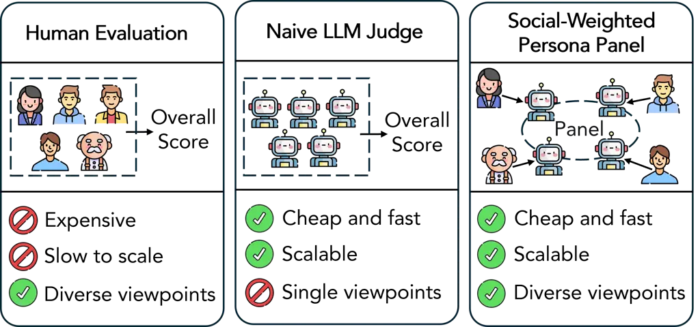
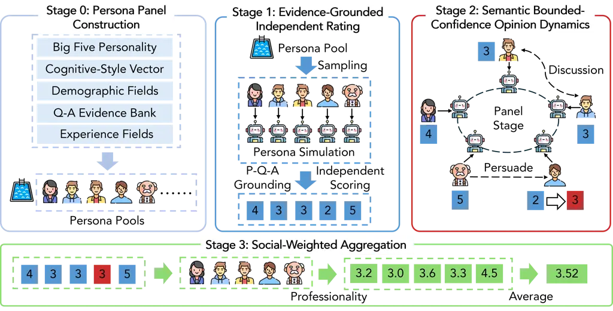
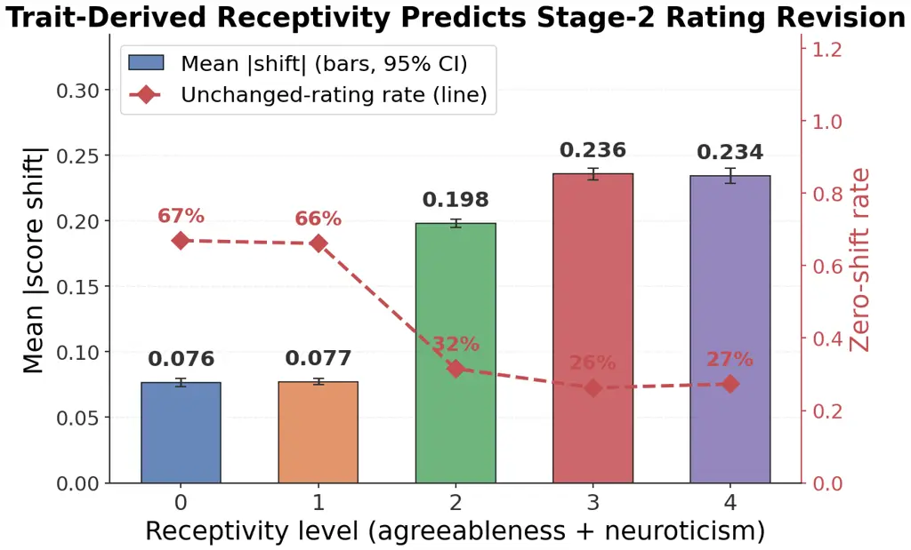
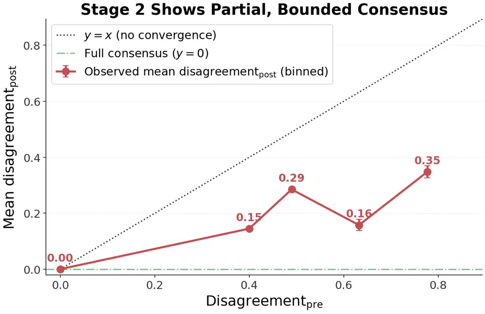
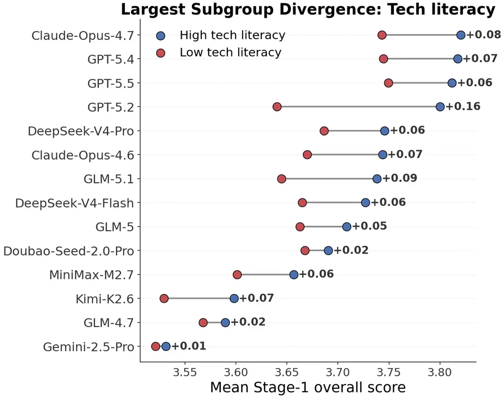
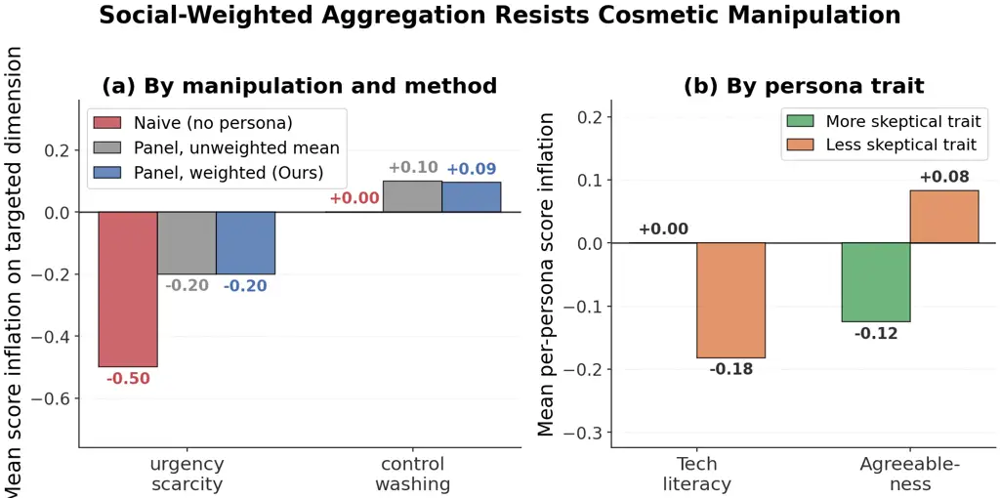

# Beyond a Single Judge: The Evidence-Grounded, Social-Weighted Persona Panel for Generative UI Evaluation

Zheng Wu    Yibo Luo    Pu Zhang    Cheng Yang    Zhuosheng
Zhang\corresponding

###### Abstract

Generative UI (GenUI) lets large language models synthesize a complete,
renderable interface directly from a natural-language instruction, but
evaluating the quality of what they generate remains an open problem.
Human evaluation is costly and rater-variant, while LLM-as-a-judge is
scalable but reflects only a single implicit viewpoint, unable to
capture how different populations of real users actually perceive the
same interface. We propose the Evidence-Grounded, Social-Weighted
Persona Panel (ESPP), a three-stage GenUI evaluation method in which a
panel of psychologically diverse, evidence-grounded personas
independently rates a screenshot, exchanges opinions under a
trait-derived, semantically-gated bounded-confidence mechanism, and is
aggregated via Delphi-inspired social weighting into a single judgment.
ESPP tracks human judgment substantially more closely than a naive
single-pass judge, raising Pearson $`r`$ from $`0.716`$ to $`0.922`$,
and a prompt-ensemble control recovers only about a third of this gap,
isolating genuine persona and evidence grounding as the dominant source
of improvement. Beyond this fidelity gain, retaining each panelist’s
individual rating further reveals that user subgroups agree on overall
model rankings yet diverge sharply on specific rating dimensions, a
structural disagreement a single homogeneous judge would systematically
erase. The codes are available at https://github.com/Wuzheng02/ESPP.

¹School of Computer Science, Shanghai Jiao Tong University

²ByteDance Inc

wzh815918208@sjtu.edu.cn, zhangzs@sjtu.edu.cn

## Introduction

As large language models (LLMs) grow increasingly capable of multi-step
reasoning and tool use (Yao et al. 2022), they are no longer confined to
producing text: given a natural-language instruction, an LLM can now
directly generate a complete, renderable user interface tailored to that
request (Chen et al. 2026b; Leviathan et al. 2026; Wang et al. 2025).
The generative UI (GenUI) paradigm, promises to collapse the traditional
design-to-implementation pipeline into a single generative step, letting
an interface be synthesized on demand for a specific user’s
need (Lieberman et al. 2006).

However, evaluating the quality of a generated UI remains an open
problem. As shown in Figure 1, existing GenUI evaluation falls into two
broad categories: human evaluation and LLM-as-a-judge. Human evaluation
is costly and slow to scale, and its outcomes carry substantial
rater-to-rater variance (Clark et al. 2021). LLM-as-a-judge is fast and
cheap (Zheng et al. 2023), but a single judging pass reflects only one
implicit viewpoint, lacking the diversity needed to represent how
different populations of real users actually perceive the same
interface; even efforts to diversify the judge by pooling several models
or samples still sample repeatedly from LLM-shaped viewpoints, falling
short of a population of genuinely distinct users (Verga et al. 2024).



Figure 1: Three paradigms for evaluating Generative UI. Human evaluation
is diverse but costly; a naive LLM judge is scalable but reflects only a
single viewpoint and tracks human judgment poorly ($`r=0.72`$); our
Evidence-Grounded, Social-Weighted Persona Panel combines both, tracking
human judgment far more closely ($`r=0.92`$).

To address this gap, we propose the Evidence-Grounded, Social-Weighted
Persona Panel (ESPP), a three-stage GenUI evaluation method in which a
panel of psychologically diverse (Serapio-García et al. 2023),
evidence-grounded personas independently rates a screenshot, exchanges
opinions under a semantic bounded-confidence mechanism (Hegselmann and
Krause 2002), and is aggregated via Delphi-inspired social
weighting (Dalkey and Helmer 1963; Bail 2024) into a single judgment.

We validate ESPP on UIPersonaBench, a benchmark we construct of 500
UI-generation instructions rendered by 14 state-of-the-art models
against human ground truth. ESPP tracks human judgment substantially
more closely than a naive single-pass LLM judge, raising Pearson $`r`$
from $`0.716`$ to $`0.922`$, and this gain cannot be fully explained by
an artifact of averaging multiple LLM calls alone: a prompt-ensemble
control that averages 5 independently-prompted passes recovers only
about a third of this gap, showing that most of the improvement comes
from genuine persona and evidence grounding, with sampling variance
playing only a minor role. Beyond this headline result, our most
consequential further finding is that different user subgroups agree
closely on an overall leaderboard yet diverge sharply on specific
dimensions such as Control (Sunstein 2002): a single homogeneous judge
would report only the former and silently erase the latter, whereas our
panel retains and reports both. We additionally confirm that the panel’s
psychological mechanisms are not decorative: trait-derived receptivity
measurably predicts how much a persona revises its rating during
deliberation, panel discussion converges only partially instead of
collapsing to consensus, and social-weighted aggregation is no more
susceptible to cosmetic dark-pattern manipulation than a naive judge.

In summary, we make the following contributions:

\(i\) We propose the Evidence-Grounded, Social-Weighted Persona Panel, a
three-stage GenUI evaluation method that grounds each persona’s rating
in its own prior evidence, models opinion exchange via a trait-derived,
semantically-gated bounded-confidence mechanism, and aggregates panelist
judgments with Delphi-inspired social weighting.

\(ii\) We construct UIPersonaBench, a 500-instruction, 14-model,
7,000-screenshot GenUI benchmark with paired human ground truth,
enabling systematic comparison of automatic evaluation methods against
real human judgment.

\(iii\) We show that ESPP improves fidelity to human judgment over a
naive single judge and a prompt-ensemble control, isolating genuine
persona evidence grounding as the dominant source of this improvement.

\(iv\) Through a series of further analyses, we surface real,
dimension-localized disagreement across user subgroups that a single
homogeneous judge would otherwise obscure, and provide behavioral
evidence that our panel’s psychological mechanisms operate as designed
rather than as decorative prompt instructions.

## Related Work

In this section, we review prior work on generative UI and its
evaluation, and on LLM-as-a-judge methods for automatic quality
assessment, situating our Evidence-Grounded, Social-Weighted Persona
Panel relative to both lines of work.

### Generative UI

Generative UI extends LLMs from producing plain text to directly
synthesizing renderable interface artifacts (Chen et al. 2026b;
Leviathan et al. 2026; Wang et al. 2025). This spans front-end code
generation from natural-language or sketch specifications (Yang et al.
2025), layout and component synthesis conditioned on design
constraints (Feng et al. 2023), and end-to-end web/app generation
pipelines that couple an LLM with a rendering or compilation backend (Si
et al. 2025). As these systems mature from toy demos to models capable
of one-shot, production-quality UI synthesis, evaluating what they
produce has become the bottleneck: most GenUI work still reports
functional correctness or code-level metrics, or relies on a handful of
human raters on a small artifact set (Wu et al. 2024), leaving open how
to assess subjective, user-facing qualities such as trust, control, and
transparency at scale and across a population of users with
heterogeneous needs.

### LLM-as-a-Judge

Using an LLM to score another model’s output has become a standard
substitute for human evaluation. Subsequent work has refined the judge
itself via structured rubrics (Kim et al. 2024), critique
generation (McAleese et al. 2024), and bias calibration (Wang et al.
2024; Saito et al. 2023), or reduced single-pass variance by aggregating
multiple judges or samples (Verga et al. 2024; Zheng et al. 2023). A
related thread instantiates LLMs as personas or synthetic agent
populations to simulate social behavior (Park et al. 2023), survey
responses (Argyle et al. 2023), or multi-agent debate (Du et al. 2024),
typically from a demographic or trait description alone (Park et al.
2022). Our work departs from both threads. Prior work treats judge
diversity as repeated sampling from one implicit viewpoint and treats a
persona as an ungrounded trait label; we instead ground each persona’s
rating in its own documented evidence and structure inter-persona
interaction with an explicit, psychologically-motivated opinion-dynamics
mechanism, turning the judge population itself into a socially-weighted,
behaviorally-grounded model of real user disagreement.

## Evidence-Grounded, Social-Weighted Persona Panel for Generative UI Evaluation

In this section, as shown in Figure 2, we introduce the
Evidence-Grounded, Social-Weighted Persona Panel: a Persona Panel
Construction procedure followed by three stages that ground, discuss,
and aggregate the judgments of a population of synthetic raters, namely
independent evidence-grounded rating, semantic bounded-confidence
opinion exchange, and social-weighted aggregation.



Figure 2: Overview of the Evidence-Grounded, Social-Weighted Persona
Panel. A diversity-constrained panel $`\Pi_{x}`$ is sampled from a pool
of 1000 personas (Persona Panel Construction); each panelist
independently rates screenshot conditioned on its P-Q-A evidence (Stage
1); panelists revise their ratings through semantic bounded-confidence
opinion exchange modulated by trait-derived receptivity (Stage 2); and
revised ratings are combined via weighted aggregation into the final
score (Stage 3).

### Stage 0: Persona Panel Construction

A single judge, however capable, is a sample of size one drawn from an
unknown and almost certainly non-representative distribution over real
users; treating repeated LLM calls as a substitute for population
diversity conflates variance reduction with coverage. We instead
parameterize a rater population along axes with independent construct
validity in the personality and judgment-and-decision-making
literatures. Each persona
$`p=(\mathbf{b},\mathbf{c},\mathbf{d},\mathbf{e},q)`$ is a synthetic
rater instantiated from a Big-Five trait vector
$`\mathbf{b}\in\{\mathrm{low,med,high}\}^{5}`$ over openness,
conscientiousness, extraversion, agreeableness, and neuroticism,
grounded in the Five-Factor Model (Costa and McCrae 2014); a
cognitive-style vector $`\mathbf{c}`$ specifying
analytical-versus-intuitive information processing (Epstein 1998), risk
tolerance, and need for control; and demographic and experience fields
$`\mathbf{d},\mathbf{e}`$ (age, occupation, tech literacy, domain
expertise). To avoid leaving these fields as inert labels, each persona
additionally carries a bank $`q`$ of persona-specific question-answer
pairs $`q=\{(\text{question}_{k},\text{answer}_{k})\}`$, elicited once
per persona per evaluation dimension, so that
$`(\mathbf{b},\mathbf{c},\mathbf{d},\mathbf{e})`$ are behaviorally
instantiated, not merely declared: a persona’s disposition is evidenced
by what it has already said, and an adjective alone is never enough.

A panel that merely samples $`N`$ personas uniformly at random risks two
failure modes: near-duplicate viewpoints that waste panel capacity, or
an all-idiosyncratic panel with no shared ground for the deliberation in
Stage 2 to act on. We therefore draw, for each instruction $`x`$, a
fixed panel $`\Pi_{x}=\{p_{1},\dots,p_{N}\}`$ ($`N=5`$) via stratified
sampling over $`(\mathbf{d},\mathbf{b})`$ from the 1,000-persona pool,
subject to a diversity constraint on the trait-space distance
$`\delta(p_{i},p_{j})=\tfrac{1}{|\mathbf{b}|+|\mathbf{c}|}\lVert(\mathbf{b}_{i},\mathbf{c}_{i})-(\mathbf{b}_{j},\mathbf{c}_{j})\rVert_{1}`$:
$`\Pi_{x}`$ must contain at least one close pair (small $`\delta`$, a
natural coalition) and one distant pair (large $`\delta`$, a latent
fault line), so that Stage 2 is guaranteed both a consensus to reinforce
and a disagreement to resolve, without degenerating into either
unanimous agreement or unstructured noise. The same $`\Pi_{x}`$ is
reused across every model rendering $`x`$, holding the jury fixed so
that cross-model comparisons are never confounded by a change in who is
judging.

### Stage 1: Evidence-Grounded Independent Rating

Each $`p_{i}\in\Pi_{x}`$ independently rates screenshot $`y`$ on 5 GenUI
dimensions $`\mathcal{K}`$ (Understanding, Trust*and_Reliance,
Usability, Control, Transparency), producing
$`s^{(1)}*{i}\in\{1,\dots,5\}^{\mathcal{K}}`$ with a natural-language
justification per dimension. An ungrounded persona is free to
rationalize any score: given only a trait label such as “low
agreeableness,” an LLM can construct a post-hoc justification for
essentially any rating, since the label constrains the conclusion far
less than it constrains the surface style of the reasoning that leads
there. To avoid eliciting $`s^{(1)}_{i}`$ from trait labels alone, we
therefore close this degree of freedom at its source: the prompt for
dimension $`k`$ is conditioned on $`p_{i}`$’s evidence
$`q*{i}^{(k)}\subset q*{i}`$ elicited in Stage 0, and $`p*{i}`$ is
instructed to keep $`s^{(1)}*{i,k}`$ consistent with $`q\_{i}^{(k)}`$.
This P-Q-A grounding anchors each rating in a documented,
persona-specific behavioral history and steers it away from a
context-free vibe; it is what lets Stage 2 attribute a subsequent rating
change specifically to peer argument, and not to the persona simply
re-rolling a loosely-constrained justification.

### Stage 2: Semantic Bounded-Confidence Opinion Dynamics

Independent ratings alone cannot express deliberation: real panels
revise views under argument, but not unconditionally, and a mechanism
that lets every peer’s opinion move every other peer collapses to a
plain mean, while a mechanism that lets no opinion move anyone reduces
Stage 2 to Stage 1 with extra steps. What is needed, instead, is a rule
for exactly which arguments a given panelist should find persuasive.
Classical bounded-confidence opinion dynamics (Hegselmann and Krause 2002) supplies exactly this rule for scalar opinions, in which agent
$`i`$ only integrates peer $`j`$’s opinion if
$`|s_{i}-s_{j}|<\epsilon`$: nearby opinions merge, distant ones are
ignored outright. Applied unmodified to LLM-backed personas, however,
this scalar gate is both too permissive and too blind: it licenses
influence from a numerically close but substantively irrelevant peer
comment, and it cannot express that receptivity itself is a
trait-dependent quantity, not a shared constant $`\epsilon`$. We
therefore adapt the classical model to LLM-backed personas along two
axes absent from the original formulation.

Trait-derived receptivity. Susceptibility to social influence is treated
as a deterministic function of $`p_{i}`$’s own traits, not as a free
parameter,

```math
\rho(p_{i})=\rho_{\min}+\frac{a_{i}+n_{i}}{4}\bigl(\rho_{\max}-\rho_{\min}\bigr),\quad a_{i},n_{i}\in\{0,1,2\}, \tag{1}
```

where $`a_{i},n_{i}`$ are $`p_{i}`$’s ordinal agreeableness and
neuroticism levels: higher agreeableness (desire for group harmony) and
higher neuroticism (sensitivity to social pressure) both raise
$`\rho(p_{i})`$, consistent with FFM correlates of persuadability (Costa
and McCrae 2014). $`\rho(p_{i})`$ is injected as a qualitative
behavioral instruction, not a numeric weight the LLM computes with.

Semantic gate. Beyond the numeric gate $`|s_{i}-s_{j}|<\epsilon`$, a
peer’s argument is only licensed to move $`p_{i}`$ if it is on-topic for
$`p_{i}`$: it must reference a concern in $`p_{i}`$’s own topical hook
set $`H_{i}`$ (their stated frustration, UI expectations, and
control/risk disposition). An on-topic argument can shift $`p_{i}`$
across a wide score gap, while an off-topic one does not move $`p_{i}`$
even from a narrow gap, capturing an assimilation-contrast asymmetry
from social judgment theory (Sherif and Hovland 1961) that a purely
numeric gate cannot express. Each $`p_{i}`$ observes all peer ratings
and reasoning for every $`k\in\mathcal{K}`$ simultaneously and outputs a
revised $`s^{(2)}_{i}`$.

### Stage 3: Social-Weighted Aggregation

A plain mean of $`\{s^{(2)}_{i}\}`$ treats every panelist as equally
informative, ignoring that some personas are more expert or more
representative of an instruction’s target use case; yet the opposite
extreme, deferring entirely to a single self-declared expert, would
simply reintroduce the single-viewpoint failure mode of a naive judge
one level up, this time at the aggregation stage instead of the rating
stage. The Delphi method addresses this exact tension in human expert
elicitation by iteratively reweighting toward more informative panelists
while still pooling the full panel (Dalkey and Helmer 1963); we adapt
its spirit to a single-round LLM setting via a soft, closed-form
reweighting, leaving aside its iterative questionnaire mechanics:
panelist $`p_{i}`$’s weight for instruction $`x`$ (scenario $`c`$) is

```math
w_{i}\;\propto\;1+\lambda_{e}\,e(p_{i})+\lambda_{r}\,r(p_{i},c), \tag{2}
```

normalized to $`\sum_{i}w_{i}=1`$ over $`\Pi_{x}`$, where
$`e(p_{i})\in[0,1]`$ is an expertise score averaging $`p_{i}`$’s domain
experience and tech literacy, and $`r(p_{i},c)\in[0,1]`$ is a
representativeness score combining $`p_{i}`$’s target-domain match to
scenario $`c`$ with their usage frequency.
$`\lambda_{e}=\lambda_{r}=0.5`$ keep the reweighting mild by
construction, so no single persona dominates the aggregate: $`w_{i}`$
can shift the panel’s emphasis but, unlike a hard veto or a top-1
selection rule, cannot silence a dissenting panelist outright. The final
per-dimension score is $`\hat{s}_{k}=\sum_{i}w_{i}\,s^{(2)}_{i,k}`$, and
the overall score is the mean of $`\hat{s}_{k}`$ over $`\mathcal{K}`$.
Crucially, aggregation collapses $`\Pi_{x}`$’s judgments into a single
number for benchmarking purposes, but it does not discard the
disaggregated per-persona ratings $`\{s^{(2)}_{i}\}`$ that produced it.

| Evaluation method | $`r`$ | $`\rho`$ | MAE $`\downarrow`$ | RMSE $`\downarrow`$ |
| ----------------- | ----- | -------- | ------------------ | ------------------- |
| Naive single-pass | 0.716 | 0.612    | 0.435              | 0.490               |
| Prompt-ensemble   | 0.789 | 0.715    | 0.277              | 0.329               |
| ESPP              | 0.922 | 0.904    | 0.110              | 0.138               |

Table 1: Alignment between each evaluation method and human ground truth
at the individual-screenshot level.

| Model               | Overall | Dimension |       |       |      |         | Scenario |           |       |        |        |        |
| ------------------- | ------- | --------- | ----- | ----- | ---- | ------- | -------- | --------- | ----- | ------ | ------ | ------ |
|                     |         | Underst.  | Trust | Usab. | Ctrl | Transp. | Landing  | Dashboard | Forms | Ecomm. | Social | Mobile |
| Claude-Opus-4.7     | 3.73    | 4.83      | 3.61  | 3.94  | 3.45 | 2.82    | 3.65     | 3.67      | 3.88  | 3.72   | 3.70   | 3.77   |
| GPT-5.4             | 3.72    | 4.85      | 3.60  | 3.96  | 3.43 | 2.78    | 3.67     | 3.65      | 3.86  | 3.74   | 3.69   | 3.74   |
| GPT-5.5             | 3.72    | 4.86      | 3.61  | 3.97  | 3.40 | 2.77    | 3.66     | 3.67      | 3.86  | 3.73   | 3.70   | 3.72   |
| GPT-5.2             | 3.67    | 4.66      | 3.54  | 3.77  | 3.48 | 2.89    | 3.57     | 3.67      | 3.80  | 3.64   | 3.61   | 3.70   |
| DeepSeek-V4-Pro     | 3.66    | 4.75      | 3.53  | 3.89  | 3.41 | 2.75    | 3.65     | 3.63      | 3.77  | 3.65   | 3.62   | 3.67   |
| DeepSeek-V4-Flash   | 3.64    | 4.72      | 3.50  | 3.90  | 3.40 | 2.71    | 3.58     | 3.62      | 3.80  | 3.55   | 3.63   | 3.68   |
| Claude-Opus-4.6     | 3.64    | 4.75      | 3.50  | 3.88  | 3.38 | 2.69    | 3.57     | 3.62      | 3.77  | 3.60   | 3.60   | 3.69   |
| GLM-5.1             | 3.63    | 4.71      | 3.51  | 3.82  | 3.38 | 2.71    | 3.57     | 3.59      | 3.74  | 3.61   | 3.58   | 3.67   |
| Doubao-Seed-2.0-Pro | 3.62    | 4.75      | 3.42  | 3.90  | 3.38 | 2.64    | 3.52     | 3.61      | 3.74  | 3.58   | 3.60   | 3.66   |
| GLM-5               | 3.62    | 4.72      | 3.49  | 3.86  | 3.38 | 2.64    | 3.52     | 3.61      | 3.70  | 3.56   | 3.65   | 3.67   |
| MiniMax-M2.7        | 3.56    | 4.65      | 3.41  | 3.78  | 3.34 | 2.59    | 3.51     | 3.53      | 3.66  | 3.54   | 3.51   | 3.58   |
| GLM-4.7             | 3.50    | 4.60      | 3.32  | 3.81  | 3.30 | 2.48    | 3.50     | 3.49      | 3.61  | 3.47   | 3.43   | 3.51   |
| Kimi-K2.6           | 3.48    | 4.51      | 3.37  | 3.65  | 3.31 | 2.58    | 3.29     | 3.50      | 3.62  | 3.50   | 3.49   | 3.50   |
| Gemini-2.5-Pro      | 3.45    | 4.60      | 3.26  | 3.77  | 3.24 | 2.38    | 3.39     | 3.37      | 3.60  | 3.41   | 3.44   | 3.48   |

Table 2: UIPersonaBench leaderboard: overall score, per-dimension
scores, and per-scenario scores (1–5 scale) for all 14 models, produced
by our validated Evidence-Grounded, Social-Weighted Persona Panel judge.

## Experiment

In this section, we introduce the UIPersonaBench benchmark and
evaluation protocol, validate the Evidence-Grounded, Social-Weighted
Persona Panel’s fidelity to human judgment against alternative scoring
methods, and present the resulting leaderboard over 14 state-of-the-art
models.

### Experimental Setup

#### Benchmark.

We construct UIPersonaBench, a benchmark of 500 natural-language
UI-generation instructions spanning 6 common scenarios
(landing/marketing, dashboard/analytics, forms/auth flow,
e-commerce/content listing, social/productivity app, and mobile/widget
UI), and render each instruction with every evaluated model, yielding
$`500\times 14=7{,}000`$ screenshots to be judged.

#### Metrics.

We evaluate a scoring method along two complementary axes against the
human ground truth: score-level agreement, i.e. how closely the method’s
per-screenshot overall score tracks the human mean score, measured with
Pearson’s $`r`$, Spearman’s $`\rho`$, mean absolute error (MAE), and
root mean squared error (RMSE) over all $`n=7{,}000`$ (instruction,
model) screenshots; and ranking-level agreement, i.e. whether the method
recovers the same relative ordering of the 14 models as humans do,
measured with Spearman’s $`\rho`$ and Kendall’s $`\tau`$ over the 14
per-model average scores. All 5 GenUI evaluation dimensions
(Understanding, Trust_and_Reliance, Usability, Control, Transparency)
use the same 1–5 integer scale, and a screenshot’s overall score is the
mean of its 5 dimension scores.

#### Human Ground Truth.

For every screenshot we collect 5 independent human ratings on the same
5-dimension, 1–5 scale used by our panel; a screenshot’s human score is
the mean over its 5 raters’ per-dimension means, giving 7,000
human-anchored ground-truth scores directly comparable to our judge’s
output.

#### Evaluated Models.

We render each of the 500 instructions with 14 state-of-the-art LLMs:
Claude-Opus-4.7 (Anthropic 2026b), Claude-Opus-4.6 (Anthropic 2026a),
GPT-5.5 (OpenAI 2026b), GPT-5.4 (OpenAI 2026a), GPT-5.2 (OpenAI 2025),
Gemini-2.5-Pro (Comanici et al. 2025), DeepSeek-V4-Pro (Xu et al. 2026),
DeepSeek-V4-Flash (Xu et al. 2026), GLM-5.1 (Zeng et al. 2026),
GLM-5 (Zeng et al. 2026), GLM-4.7 (Zeng et al. 2026), Kimi-K2.6 (Team et
al. 2025), Doubao-Seed-2.0-Pro (ByteDance Seed 2026), and
MiniMax-M2.7 (Chen et al. 2026a).

#### Compared Evaluation Methods.

We compare three evaluation methods that share the same underlying judge
model, Claude-Opus-4.6, and the same screenshots, differing only in
judging procedure: (i) Naive single-pass, a standard LLM-as-judge
baseline with no persona, no panel, and a single forward pass; (ii)
Prompt-ensemble, a stronger non-persona control in which the same
screenshot is independently rated 5 times by 5 differently-framed but
task-equivalent prompts (still no persona, no P-Q-A grounding, no
panel), with the final score obtained by averaging the 5 per-dimension
scores; since our panel also aggregates 5 independent ratings, this
isolates how much of our panel’s advantage is attributable to genuine
persona/evidence grounding versus simply averaging multiple independent
forward passes, a "prompt ensembling" effect; and (iii) Full
Evidence-Grounded, Social-Weighted Persona Panel (ESPP, ours), the
complete three-stage pipeline, whose Stage 1 and Stage 2 are likewise
instantiated with Claude-Opus-4.6, so that any fidelity difference in
Table 1 is attributable to the judging procedure and not to a change of
the underlying judge.

### Main Results

Table 1 reports how closely each method’s scores track the human ground
truth at the individual-screenshot level. Naive single-pass LLM-as-judge
shows only moderate agreement with human raters, confirming that a
single, persona-free judging pass systematically diverges from how a
diverse population of real users perceives a GenUI screenshot. Simply
averaging 5 differently-framed prompts without any persona or evidence
grounding partially improves over the naive single pass, but recovers
only about a third of the total gap to the full pipeline, indicating
that little of the naive judge’s disagreement with humans is
attributable to noisy single-pass variance. Most of it instead reflects
the absence of diverse, grounded viewpoints. This shows that our full
panel’s advantage over a mere prompt-ensembling control comes
overwhelmingly from genuine persona/evidence grounding, and only
marginally from averaging multiple independent passes. Adding the full
ESPP machinery further improves alignment on every metric, the best of
all three methods. These results support our central claim: a
socially-weighted panel of grounded personas is a substantially more
faithful proxy for human judgment of GenUI quality than a single LLM
judge, without requiring real human raters at evaluation time.

### UIPersonaBench Leaderboard

Using our validated ESPP judge, we produce the leaderboard in Table 2.
Overall scores span a narrow $`3.45`$–$`3.73`$ range, so the exact rank
order among closely-clustered models is not the object of interest here
and should not be over-read as a precise capability ordering; the more
informative and consistent signal, detailed below, lies in the shared
per-dimension and per-scenario patterns that hold across essentially
every model regardless of its overall rank:

\(i\) Understanding is a uniform strength, not a differentiator. Every
one of the 14 models scores highest on Understanding, nearly a point
above its next-best dimension (Usability), so near-ceiling instruction
comprehension is already a solved sub-problem industry-wide and
contributes little to separating stronger from weaker GenUI systems.

\(ii\) Transparency is a systematic, industry-wide weakness. It is the
lowest-scoring dimension for every one of the 14 models without
exception, trailing Understanding by roughly two points, suggesting that
explaining an interface’s own state and reasoning is a shared blind spot
that overall capability improvements have not yet closed.

\(iii\) Dimension-level rankings reorder models relative to the overall
leaderboard, unlike scenario identity. Usability and Understanding
rankings agree only moderately with the overall ranking, so a model’s
relative standing on these dimensions cannot be reliably inferred from
its overall rank, exactly the kind of trade-off a single aggregate score
would hide; per-scenario scores, by contrast, are far more consistent
within each model, indicating scenario identity is a comparatively minor
source of variation.

## Further Analysis

The main results show that our panel tracks human judgment well, but a
good aggregate score alone does not tell us whether the panel is doing
so for the right reasons. This section asks five concrete questions in
turn: which component of the pipeline is actually responsible for the
accuracy gain; does a persona’s simulated personality really change how
much it revises its opinion during discussion, or is that instruction
ignored; does group discussion converge to a false consensus that would
defeat the purpose of simulating discussion at all; do different kinds
of users actually disagree about GenUI quality in a way a single judge
would erase; and can the panel be fooled by purely cosmetic interface
tricks?

### Ablation Study

We ablate our Full pipeline by cumulatively removing components:
Stage-2/3 (opinion dynamics and weighted aggregation), then P-Q-A
grounding, then the persona panel itself (recovering the naive
single-pass baseline). Table 3 shows that accuracy degrades
monotonically as components are removed, but not uniformly: removing
Stage-2/3 costs little, whereas removing P-Q-A grounding alone accounts
for the majority of the remaining gap to the naive baseline. Evidence
grounding, not panel dynamics, is thus the single most load-bearing
component of our pipeline, consistent with our later finding that
Stage-2/3 mainly sharpens reliability and contributes only secondarily
to accuracy.

| Ablation      | $`r`$ | $`\rho`$ | MAE $`\downarrow`$ | RMSE $`\downarrow`$ |
| ------------- | ----- | -------- | ------------------ | ------------------- |
| Full (ours)   | 0.922 | 0.904    | 0.110              | 0.138               |
| w/o dynamics  | 0.891 | 0.857    | 0.121              | 0.152               |
| w/o grounding | 0.811 | 0.749    | 0.196              | 0.244               |
| w/o panel     | 0.716 | 0.612    | 0.435              | 0.490               |

Table 3: Cumulative ablation of the Full pipeline. Each row additionally
removes the component named, relative to the row above.

### Does Trait-Derived Receptivity Drive Opinion Change?



Figure 3: Stage-2 rating revision as a function of a persona’s
trait-derived receptivity level.

Stage 2 derives each persona’s susceptibility to social influence from a
fixed, auditable function of Big-Five agreeableness and neuroticism, so
receptivity is never left as a free hyperparameter. Whether the
underlying LLM honors this instruction, as opposed to treating it as
unused prompt decoration, is the empirical question we test here. If the
mechanism is functioning as intended, both the magnitude of a persona’s
rating revision and its propensity to revise at all should increase
monotonically with theorized receptivity. Figure 3 confirms both
predictions: the mean score shift and the unchanged-rating rate move in
opposite, consistently monotonic directions across all five receptivity
levels, and the association is statistically robust. This indicates that
the persuadability implied by a persona’s personality traits goes beyond
textual flavor: it measurably shapes how much a panelist’s rating moves
during the simulated discussion, lending behavioral validity to the
opinion-dynamics mechanism.

### Opinion Dynamics: Partial, Not Total, Consensus



Figure 4: Post-discussion vs. pre-discussion panel disagreement, against
the $`y=x`$ (no convergence) and $`y=0`$ (full consensus) reference
lines.

A judge whose Stage-2 discussion always fully converges the panel would
be behaviorally indistinguishable from a plain unweighted mean,
undermining the motivation for simulating discussion at all. Across all
$`35{,}000`$ (instruction, model, dimension) panels, mean within-group
disagreement (standard deviation across the 5 panelists) drops from
$`0.283`$ pre-discussion to $`0.134`$ post-discussion, a $`52.9\%`$
reduction, yet only $`42.6\%`$ of panels fully converge, and among the
initially most divided panels (top decile of pre-discussion
disagreement), $`63.5\%`$ still retain above-median disagreement after
discussion. As Figure 4 shows, the binned mean curve sits strictly
between the two reference lines across the full range of pre-discussion
disagreement, never collapsing to the $`y=0`$ consensus line nor sitting
on the $`y=x`$ no-change line. This is consistent with a genuine
bounded-confidence process and with neither extreme: panelists close
enough in opinion and susceptible to on-topic arguments move together,
while well-grounded, persona-consistent disagreement persists instead of
being averaged away.

### Do Different User Subgroups See the Same Leaderboard?



Figure 5: Per-model Stage-1 score gap between subgroups, for the split
with the largest leaderboard disagreement.

The premise of a heterogeneous panel is that different kinds of users
genuinely see GenUI quality differently. Splitting the 1,000-persona
pool by tech literacy, age, domain experience, and an
agreeableness-derived critical/charitable disposition, and computing
each subgroup’s own 14-model leaderboard from independent
(pre-discussion) Stage-1 ratings, we find that overall-score rankings
agree closely across subgroups, but this aggregate agreement masks
substantial, localized disagreement: on the Control dimension
specifically, tech-literate vs. non-tech-literate raters agree far less
than on any other dimension, and individual models can swing by up to 6
rank positions between subgroups (Figure 5). To our knowledge, this is
among the first results to systematically quantify _dimension-localized_
ranking disagreement between user subgroups in GenUI evaluation, rather
than reporting only an aggregate rater-agreement figure; the pattern
also confirms that a single homogeneous judge would obscure this
disagreement, since it agrees with any one subgroup’s overall ranking
while erasing exactly the dimension-level split that distinguishes the
subgroups in the first place.

| Subgroup split ($`n_{A}`$/$`n_{B}`$) | $`\rho`$ (overall) | $`\tau`$ (overall) | $`\rho`$ (Control) |
| ------------------------------------ | ------------------ | ------------------ | ------------------ |
| Tech literacy (257/422)              | 0.846              | 0.670              | 0.70               |
| Age group (418/388)                  | 0.916              | 0.780              | 0.80               |
| Domain exp. (225/388)                | 0.933              | 0.800              | 0.81               |
| Agreeableness (326/341)              | 0.965              | 0.868              | 0.79               |

Table 4: Rank agreement between persona subgroups’ independent Stage-1
leaderboards, overall and on Control, consistently the most divergent
dimension across all four splits.

### Adversarial Robustness to Cosmetic Manipulation



Figure 6: Score change under cosmetic dark-pattern overlays. (a) By
manipulation and judging method (trust badge omitted: exactly zero for
all methods). (b) By persona trait, pooled across all three
manipulations.

A judge that can be swayed by superficial, purely cosmetic manipulation
is not measuring genuine UI quality. We pixel-edit a small set of
already-judged screenshots with three fabricated dark-pattern overlays,
namely a trust badge, an urgency/scarcity banner, and a control-washing
banner, each targeting a specific rating dimension, and re-run real
Stage-1 judging on both the original and manipulated images. On this
small probe set, no method is inflated by the manipulations in a
consistent, dimension-targeted way: the trust badge produces exactly
zero score change for all three methods, and the remaining manipulations
either move scores against the manipulator’s intent or, where a small
positive drift does appear, inflate panel-based scoring no more than the
naive judge (Figure 6a). Pooling per-persona score changes across all
three manipulations, any residual susceptibility concentrates in traits
associated with lower skepticism: low tech-literacy and
high-agreeableness personas both show larger inflation than their more
critical counterparts (Figure 6b), consistent with a socially-weighted
panel being tunable toward more critical raters for added robustness.

## Conclusion

A single LLM judge is not merely inaccurate: it is structurally
incapable of representing disagreement, since it collapses every rater’s
viewpoint into one score before that disagreement can ever be observed.
We presented ESPP, a three-stage method that grounds diverse personas in
prior evidence, lets them deliberate, and aggregates their judgments
while retaining each panelist’s individual rating. On UIPersonaBench,
ESPP tracks human judgment far more closely than a naive single-pass
judge, driven mainly by persona and evidence grounding rather than
sampling variance, and its retained individual ratings further reveal
real, dimension-localized disagreement across user subgroups that a
single-score judge would erase. We see this as a step toward automatic
judges that keep sources of disagreement legible rather than silently
collapsing them away into a single opaque number.

## References

- Anthropic (2026a) Anthropic Introducing Claude Opus 4.6. Note:
  https://www.anthropic.com/news/claude-opus-4-6 Cited by: Evaluated
  Models..
- Anthropic (2026b) Anthropic Introducing Claude Opus 4.7. Note:
  https://www.anthropic.com/news/claude-opus-4-7 Cited by: Evaluated
  Models..
- Argyle et al. (2023) L. P. Argyle, E. C. Busby, N. Fulda, J. R.
  Gubler, C. Rytting, and D. Wingate Out of one, many: using language
  models to simulate human samples. Political Analysis 31 (3),
  pp. 337–351. Cited by: LLM-as-a-Judge.
- Bail (2024) C. A. Bail Can generative ai improve social science?.
  Proceedings of the National Academy of Sciences 121 (21),
  pp. e2314021121. Cited by: Introduction.
- ByteDance Seed (2026) ByteDance Seed Seed2.0. Note:
  https://seed.bytedance.com/en/seed2 Cited by: Evaluated Models..
- Chen et al. (2026a) A. Chen, A. Li, B. Zhou, B. Gong, B. Jiang, B.
  Dan, C. Yu, C. Wang, C. Ma, C. Zhong, et al. The minimax-m2 series:
  mini activations unleashing max real-world intelligence. arXiv
  preprint arXiv:2605.26494. Cited by: Evaluated Models..
- Chen et al. (2026b) J. Chen, Y. Zhang, Y. Zhang, Y. Shao, and D. Yang
  Generative interfaces for language models. In Findings of the
  Association for Computational Linguistics: ACL 2026, pp. 1499–1519.
  Cited by: Introduction, Generative UI.
- Clark et al. (2021) E. Clark, T. August, S. Serrano, N. Haduong, S.
  Gururangan, and N. A. Smith All that’s ‘human’is not gold: evaluating
  human evaluation of generated text. In Proceedings of the 59th Annual
  Meeting of the Association for Computational Linguistics and the 11th
  International Joint Conference on Natural Language Processing (Volume
  1: Long Papers), pp. 7282–7296. Cited by: Introduction.
- Comanici et al. (2025) G. Comanici, E. Bieber, M. Schaekermann, I.
  Pasupat, N. Sachdeva, I. Dhillon, M. Blistein, O. Ram, D. Zhang, E.
  Rosen, et al. Gemini 2.5: pushing the frontier with advanced
  reasoning, multimodality, long context, and next generation agentic
  capabilities. arXiv preprint arXiv:2507.06261. Cited by: Evaluated
  Models..
- Costa and McCrae (2014) P. T. Costa and R. R. McCrae The neo
  inventories1. In Personality assessment, pp. 229–260. Cited by: Stage
  0: Persona Panel Construction, Stage 2: Semantic Bounded-Confidence
  Opinion Dynamics.
- Dalkey and Helmer (1963) N. Dalkey and O. Helmer An experimental
  application of the delphi method to the use of experts. Management
  science 9 (3), pp. 458–467. Cited by: Introduction, Stage 3:
  Social-Weighted Aggregation.
- Du et al. (2024) Y. Du, S. Li, A. Torralba, J. B. Tenenbaum, and I.
  Mordatch Improving factuality and reasoning in language models through
  multiagent debate. In Proceedings of the 41st International Conference
  on Machine Learning, pp. 11733–11763. Cited by: LLM-as-a-Judge.
- Epstein (1998) S. Epstein Cognitive-experiential self-theory. In
  Advanced personality, pp. 211–238. Cited by: Stage 0: Persona Panel
  Construction.
- Feng et al. (2023) W. Feng, W. Zhu, T. Fu, V. Jampani, A. Akula, X.
  He, S. Basu, X. E. Wang, and W. Y. Wang Layoutgpt: compositional
  visual planning and generation with large language models. Advances in
  Neural Information Processing Systems 36, pp. 18225–18250. Cited by:
  Generative UI.
- Hegselmann and Krause (2002) R. Hegselmann and U. Krause OPINION
  dynamics and bounded confidence models, analysis, and simulation.
  Journal of Artifical Societies and Social Simulation (JASSS) vol 5
  (3). Cited by: Introduction, Stage 2: Semantic Bounded-Confidence
  Opinion Dynamics.
- Kim et al. (2024) S. Kim, J. Shin, J. Jang, S. Longpre, H. Lee, S.
  Yun, R. Shin, S. Kim, J. Thorne, M. Seo, et al. Prometheus: inducing
  fine-grained evaluation capability in language models. In
  International Conference on Learning Representations, Vol. 2024,
  pp. 29927–29962. Cited by: LLM-as-a-Judge.
- Leviathan et al. (2026) Y. Leviathan, D. Valevski, M. Kalman, D.
  Lumen, E. Segalis, E. Molad, S. Pasternak, V. Natchu, V. Nygaard, J.
  Manyika, et al. Generative ui: llms are effective ui generators. arXiv
  preprint arXiv:2604.09577. Cited by: Introduction, Generative UI.
- Lieberman et al. (2006) H. Lieberman, F. Paternò, M. Klann, and V.
  Wulf End-user development: an emerging paradigm. In End user
  development, pp. 1–8. Cited by: Introduction.
- McAleese et al. (2024) N. McAleese, R. M. Pokorny, J. F. C. Uribe, E.
  Nitishinskaya, M. Trebacz, and J. Leike Llm critics help catch llm
  bugs. arXiv preprint arXiv:2407.00215. Cited by: LLM-as-a-Judge.
- OpenAI (2025) OpenAI Introducing GPT-5.2. Note:
  https://openai.com/index/introducing-gpt-5-2/ Cited by: Evaluated
  Models..
- OpenAI (2026a) OpenAI Introducing GPT-5.4. Note:
  https://openai.com/index/introducing-gpt-5-4/ Cited by: Evaluated
  Models..
- OpenAI (2026b) OpenAI Introducing GPT-5.5. Note:
  https://openai.com/index/introducing-gpt-5-5/ Cited by: Evaluated
  Models..
- Park et al. (2023) J. S. Park, J. O’Brien, C. J. Cai, M. R. Morris, P.
  Liang, and M. S. Bernstein Generative agents: interactive simulacra of
  human behavior. In Proceedings of the 36th annual acm symposium on
  user interface software and technology, pp. 1–22. Cited by:
  LLM-as-a-Judge.
- Park et al. (2022) J. S. Park, L. Popowski, C. Cai, M. R. Morris, P.
  Liang, and M. S. Bernstein Social simulacra: creating populated
  prototypes for social computing systems. In Proceedings of the 35th
  annual ACM symposium on user interface software and technology,
  pp. 1–18. Cited by: LLM-as-a-Judge.
- Saito et al. (2023) K. Saito, A. Wachi, K. Wataoka, and Y. Akimoto
  Verbosity bias in preference labeling by large language models. arXiv
  preprint arXiv:2310.10076. Cited by: LLM-as-a-Judge.
- Serapio-García et al. (2023) G. Serapio-García, M. Safdari, C.
  Crepy, L. Sun, S. Fitz, P. Romero, M. Abdulhai, A. Faust, and M.
  Matarić Personality traits in large language models. arXiv preprint
  arXiv:2307.00184. Cited by: Introduction.
- Sherif and Hovland (1961) M. Sherif and C. I. Hovland Social judgment:
  assimilation and contrast effects in communication and attitude
  change.. Cited by: Stage 2: Semantic Bounded-Confidence Opinion
  Dynamics.
- Si et al. (2025) C. Si, Y. Zhang, R. Li, Z. Yang, R. Liu, and D. Yang
  Design2code: benchmarking multimodal code generation for automated
  front-end engineering. In Proceedings of the 2025 Conference of the
  Nations of the Americas Chapter of the Association for Computational
  Linguistics: Human Language Technologies (Volume 1: Long Papers),
  pp. 3956–3974. Cited by: Generative UI.
- Sunstein (2002) C. Sunstein The law of group polarization. Journal of
  political philosophy. Cited by: Introduction.
- Team et al. (2025) K. Team, Y. Bai, Y. Bao, Y. Charles, C. Chen, G.
  Chen, H. Chen, H. Chen, J. Chen, N. Chen, et al. Kimi k2: open agentic
  intelligence. arXiv preprint arXiv:2507.20534. Cited by: Evaluated
  Models..
- Verga et al. (2024) P. Verga, S. Hofstatter, S. Althammer, Y. Su, A.
  Piktus, A. Arkhangorodsky, M. Xu, N. White, and P. Lewis Replacing
  judges with juries: evaluating llm generations with a panel of diverse
  models. arXiv preprint arXiv:2404.18796. Cited by: Introduction,
  LLM-as-a-Judge.
- Wang et al. (2024) P. Wang, L. Li, L. Chen, Z. Cai, D. Zhu, B. Lin, Y.
  Cao, L. Kong, Q. Liu, T. Liu, et al. Large language models are not
  fair evaluators. In Proceedings of the 62nd Annual Meeting of the
  Association for Computational Linguistics (Volume 1: Long Papers),
  pp. 9440–9450. Cited by: LLM-as-a-Judge.
- Wang et al. (2025) S. Wang, R. Zhang, and X. Shi Generative ui design
  with diffusion models: exploring automated interface creation and
  human-computer interaction. Transactions on Computational and
  Scientific Methods 5 (3). Cited by: Introduction, Generative UI.
- Wu et al. (2024) J. Wu, Y. Peng, X. Y. A. Li, A. Swearngin, J. P.
  Bigham, and J. Nichols UIClip: a data-driven model for assessing user
  interface design. In Proceedings of the 37th Annual ACM Symposium on
  User Interface Software and Technology, pp. 1–16. Cited by: Generative
  UI.
- Xu et al. (2026) A. Xu, B. Lin, B. Xue, B. Wang, B. Xu, B. Wu, B.
  Zhang, C. Lin, C. Dong, C. Ling, et al. Deepseek-v4: towards highly
  efficient million-token context intelligence. arXiv preprint
  arXiv:2606.19348. Cited by: Evaluated Models..
- Yang et al. (2025) Z. Yang, W. Hong, M. Xu, X. Fan, W. Wang, J.
  Cheng, X. Gu, and J. Tang UI2Codeˆ n: a visual language model for
  test-time scalable interactive ui-to-code generation. arXiv preprint
  arXiv:2511.08195. Cited by: Generative UI.
- Yao et al. (2022) S. Yao, J. Zhao, D. Yu, N. Du, I. Shafran, K.
  Narasimhan, and Y. Cao React: synergizing reasoning and acting in
  language models. arXiv preprint arXiv:2210.03629. Cited by:
  Introduction.
- Zeng et al. (2026) A. Zeng, X. Lv, Z. Hou, Z. Du, Q. Zheng, B.
  Chen, D. Yin, C. Ge, C. Huang, C. Xie, et al. Glm-5: from vibe coding
  to agentic engineering. arXiv preprint arXiv:2602.15763. Cited by:
  Evaluated Models..
- Zheng et al. (2023) L. Zheng, W. Chiang, Y. Sheng, S. Zhuang, Z.
  Wu, Y. Zhuang, Z. Lin, Z. Li, D. Li, E. Xing, et al. Judging
  llm-as-a-judge with mt-bench and chatbot arena. Advances in neural
  information processing systems 36, pp. 46595–46623. Cited by:
  Introduction, LLM-as-a-Judge.
