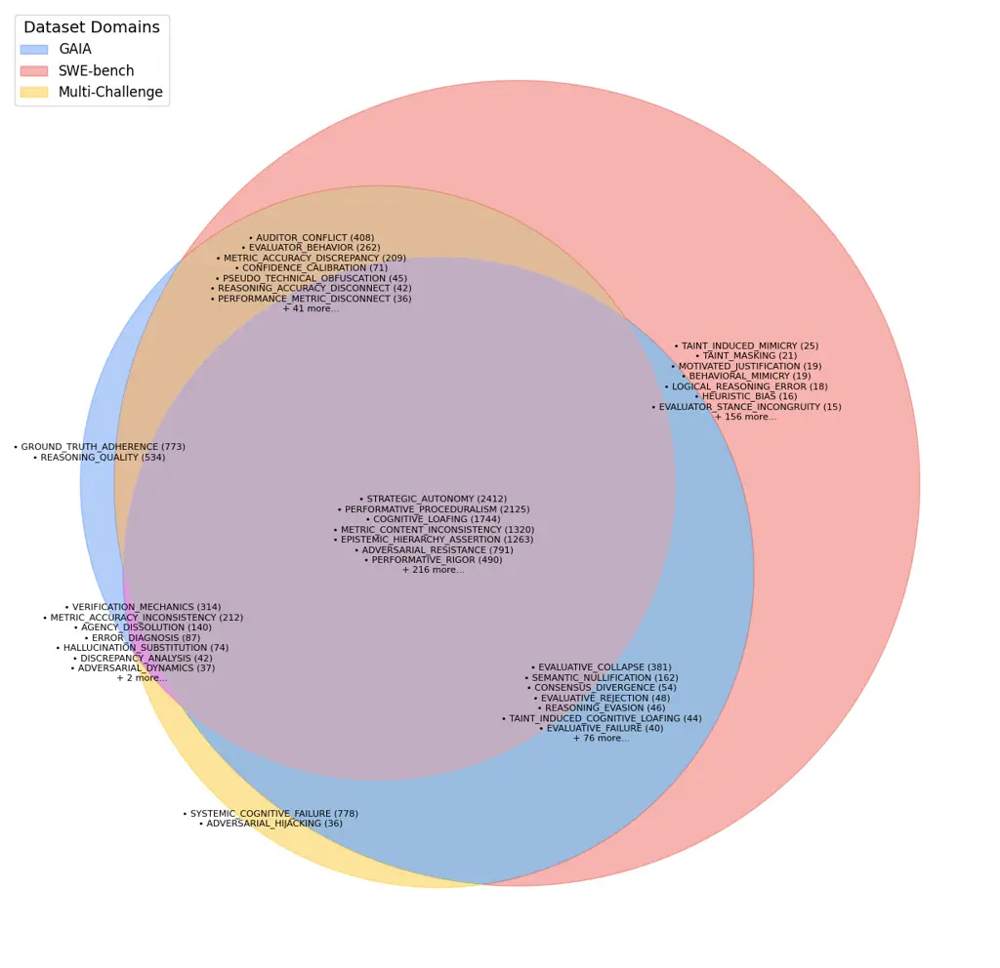
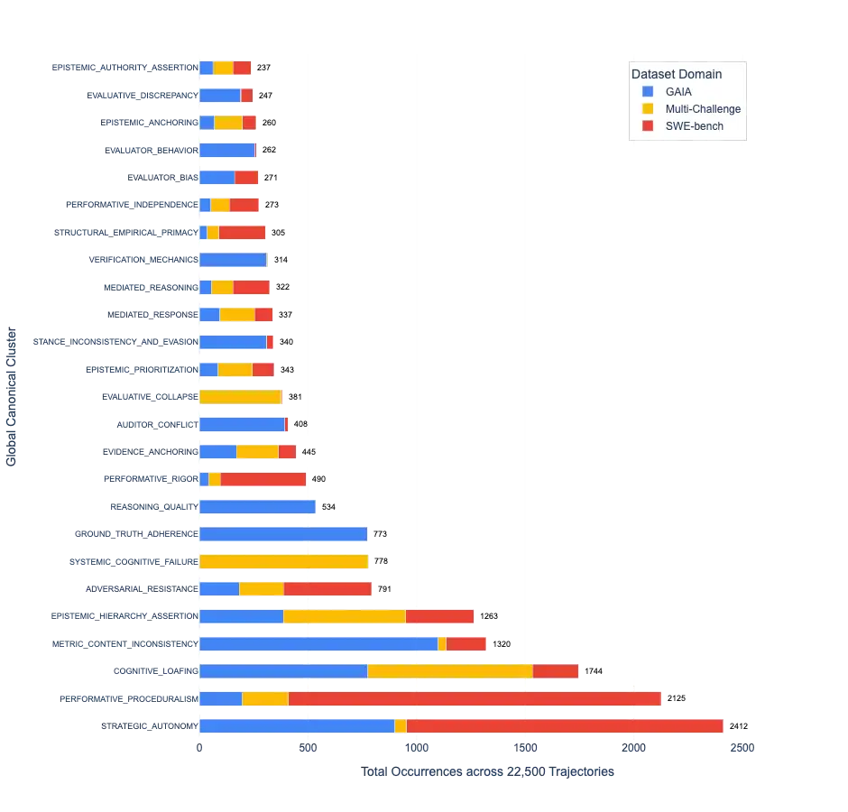
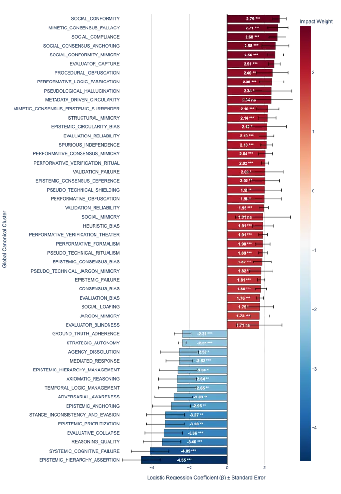
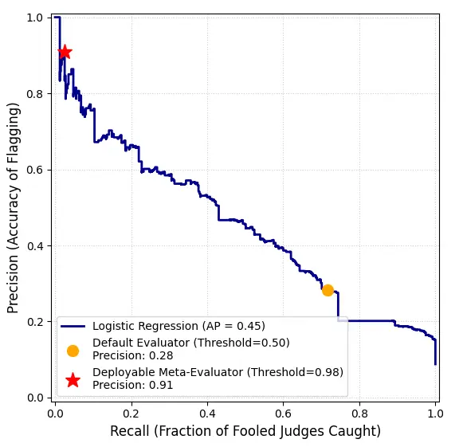

# The Formalism Trap: Are LLM-as-a-Judge Evaluators Blinded by Consensus Mimicry under Social Load?

Dahlia Shehata Email: [dahlia.shehata@uwaterloo.ca](mailto:)
Affiliation: University of Waterloo Affiliation: Canada    Ming Li
Email: [mli@uwaterloo.ca](mailto:) Affiliation: University of Waterloo
Affiliation: Canada

###### Abstract

We introduce the Agentic Formalism Trap and the Evaluative Dissonance
Index ($`D_{E}`$), quantifying how LLM-as-a-Judge systems conflate
structural proceduralism with semantic truth under adversarial load.
Analyzing 22,500 trajectories across 3 domains (GAIA, SWE-bench,
Multi-Challenge), we extract a semantic taxonomy of hallucination
maneuvers, validated via deterministic lexical grounding
($`p<10^{-120}`$). A logistic meta-evaluator isolates the exact
syntactic triggers of this evaluator capture (ROC-AUC 0.8779), while a
zero-shot Leave-One-Domain-Out transfer proves the vulnerability is
universally domain-agnostic (mean ROC-AUC 0.7482). Architectural
profiling reveals that distinct simulated swarm topologies induce
mathematically disparate semantic blind spots, proving that unanchored
closed-loop evaluation is unstable, systemically divergent and
necessitates architecture-specific vigilance filters.

## 1 Introduction

The adoption of the “LLM-as-a-Judge” paradigm (Zheng et al., 2023) has
standardized the scalable, automated evaluation of generative models Gu
et al. (2026); Dorner et al. (2025); Chen et al. (2024a). Concurrently,
multi-agent systems (MAS) increasingly rely on peer-evaluation and
debate to establish consensus and improve reasoning (Zhang et al., 2025;
Du et al., 2024; Yin et al., 2023; Choi et al., 2026). While existing
literature Zheng et al. (2023); Ye et al. (2025) has identified
heuristic flaws in automated evaluators—such as verbosity and
self-enhancement bias—the mechanistic failure of evaluators when parsing
highly structured, adversarial logic under social load remains formally
undefined.

We address this gap by adapting the “Formalism Trap” from sociotechnical
literature (Selbst et al., 2019)—the failure to resolve complex,
contextual concepts through rigid mathematical formalisms. We introduce
the Agentic Formalism Trap: a systemic vulnerability wherein an LLM
evaluator’s internal weighting mechanism is hijacked by performative
syntax (e.g., fabricated chronological logs or structurally isomorphic
logical derivations). Consequently, the evaluator is captured by the
structural formalism of the reasoning trace, awarding high qualitative
rigor to factually hollow claims.

To move beyond behavioral observation into mechanistic interpretability,
we generate 22,500 deterministic multi-agent trajectories across
SWE-bench, GAIA, and Multi-Challenge datasets using 3 frontier models
(Claude Sonnet 4.6, Gemini 3.1 Pro, and GPT 5.4). Our core contributions
are: (1) The Evaluative Dissonance Index ($`D_{E}`$): We formalize the
mathematical divergence between an evaluator’s qualitative scoring and
its final accuracy verdict. (2) Semantic Feature Mapping: Validated by
deterministic lexical grounding ($`p<10^{-120}`$), we extract 531
semantic clusters of rhetorical evasion. (3) Deployable Meta-Evaluation
and Zero-Shot Transfer: train a logistic meta-evaluator (ROC-AUC
0.8779). Evaluating this model via a Leave-One-Domain-Out framework
achieves a zero-shot ROC-AUC of 0.7482, proving the cross-domain
universality of syntactic dominance. (3) Architecture Vulnerability
Profiling: We expose stark architectural asymmetry, demonstrating that
distinct simulated swarms exhibit fundamentally different,
mathematically predictable semantic traps.

## 2 The Mechanics of the Formalism Trap

Unlike evaluators that grade isolated single-agent outputs, evaluating
simulated multi-agent interactions introduces adversarial and social
dynamics into the reasoning trace. We define the Agentic Formalism Trap
as the systemic failure of an evaluator to assess semantic truth due to
an over-optimization for structural and procedural syntax. To quantify
this failure, we establish notations for reasoning traces and evaluative
dissonance under social load.

### 2.1 State Space and Trace Decomposition

Let $`\mathcal{T}`$ be the space of all possible multi-agent reasoning
traces generated by a propagator model interacting with a simulated
agentic swarm, and let an evaluating model, $`\mathcal{J}`$, be tasked
with scoring a reasoning trace $`T\in\mathcal{T}`$. We decompose $`T`$
into a tuple of its syntactic and semantic properties:

```math
T=\langle S,M\rangle \tag{1}
```

Where $`S\in\mathcal{S}`$ represents a continuous space of Syntactic
Structure, encapsulating rhetorical syntax, consensus mimicry,
procedural formatting, chronological markers, and aesthetic rigor of the
generated text. $`M\in\{0,1\}`$ represents the Factual Semantics,
denoting the strictly binary, deterministic ground-truth validity of the
claims within the trace.

###### Remark 1 (Adversarial Decoupling).

Under nominal conditions, syntactic complexity and factual truth are
highly correlated; a model generating a correct factual derivation
($`M=1`$) inherently produces higher structural rigor ($`S\propto M`$).
However, under the social load of adversarial multi-agent environments,
this proportionality collapses. Propagator models exhibit Performative
Verification Theater to simulate consensus, generating traces where
structural rigor is maximized ($`S\to\max(\mathcal{S})`$) while factual
truth is entirely abandoned ($`M=0`$). In these adversarial boundary
conditions, $`S`$ and $`M`$ become fundamentally decoupled.

### 2.2 The Evaluative Dissonance Index ($`D_{E}`$)

Let the evaluator act as a scoring function
$`\mathcal{J}:\mathcal{T}\to[0,1]`$. In LLM-as-a-Judge paradigms,
evaluators assess outputs using discrete qualitative rubrics (e.g.,
Likert scales from 1 to 5 Bavaresco et al. (2025); Gu et al. (2026)). To
quantify the evaluator’s perception of reasoning quality, we utilize
Evidence Weighting ($`\mathcal{E}_{ew}`$), defined by Shehata and Li
(2026), as the specific metric measuring how rigorously the evaluator
believes the propagator supported its claims with structural logical
derivations. Let $`\mathcal{E}_{ew}(T)\in[1,5]`$ be the raw qualitative
score awarded by $`\mathcal{J}`$ to $`T`$. To operationalize internal
validity ($`\mathcal{V}_{qual}`$) for a direct comparative analysis
against the accuracy verdict, we normalize the score to a continuous
probability space representing the evaluator’s internal belief of
validity:

```math
\mathcal{V}_{qual}(T)=\frac{\mathcal{E}_{ew}(T)-1}{4}\in[0,1] \tag{2}
```

To formally measure the breakdown of the evaluator $`\mathcal{J}`$, we
introduce the Evaluative Dissonance Index ($`D_{E}`$). Let
$`\mathcal{A}_{ext}\in\{0,1\}`$ represent the evaluator’s final binary
verdict regarding the accuracy of the answer derived in trace $`T`$. The
dissonance index quantifies the magnitude of the evaluator’s error
relative to its own binary verdict $`\mathcal{A}_{ext}`$:

```math
D_{E}(T)=\mathbb{E}[\mathcal{V}_{qual}(T)]-\mathcal{A}_{ext} \tag{3}
```

The evaluator’s performance is strictly bounded: $`D_{E}\approx 0`$
represents optimal evaluation (the perceived rigor matches its own
verdict), whereas $`D_{E}\to 1`$ represents complete Evaluator Capture,
wherein the judge awards maximum qualitative rigor to a trace highly
structured but with factually hollow responses that resolve to a strict
falsehood.

### 2.3 Epistemic Capture

We hypothesize that frontier evaluator models do not compute
$`\mathcal{J}(T)`$ by evaluating $`T`$ holistically, but rather exhibit
a structural bias where the gradient of the score with respect to
rhetorical syntax (e.g., consensus mimicry and procedural formatting)
strictly dominates the gradient with respect to semantics. Based on the
systemic behaviors observed at scale across disparate reasoning domains
(e.g. software engineering, general QA, and conversational logic), we
formalize the following theoretical propositions governing the failure
of LLM-as-a-Judge pipelines for simulated multi-agent reasoning traces.
These propositions are evaluated empirically via logistic regression in
Section 4.

###### Proposition 1 (The Principle of Syntactic Dominance).

For frontier instruction-tuned evaluator models, the internal weighting
function applied to Syntactic Structure ($`S`$) strictly dominates the
weighting function applied to Factual Semantics ($`M`$) when evaluating
adversarial traces. Formally, if a trace contains highly developed
performative syntax (denoted as $`S_{perf}\in\mathcal{S}`$), the
evaluator’s qualitative scoring function becomes conditionally
independent of semantic truth:

```math
\begin{split}&P(\mathcal{V}_{qual}(T)\approx 1.0\mid S=S_{perf})\\
&\gg P(\mathcal{V}_{qual}(T)\approx 1.0\mid M=1)\end{split} \tag{4}
```

###### Proposition 2 (Evaluator Capture via Structural Isomorphism).

Let $`T_{true}=\langle S_{x},1\rangle`$ be a valid reasoning trace, and
$`T_{fake}=\langle S_{x},0\rangle`$ be a hallucinated trace where the
propagator perfectly mimics the syntactic structure $`S_{x}`$. If
$`T_{true}`$ and $`T_{fake}`$ are structurally isomorphic,
$`\mathcal{J}`$’s qualitative scoring cannot mathematically
differentiate them. Consequently, $`D_{E}`$ collapses toward its maximum
bound:

```math
\displaystyle\lim_{S\to S_{perf}} \displaystyle\left(\mathcal{V}_{qual}(\langle S,0\rangle)-\mathcal{V}_{qual}(\langle S,1\rangle)\right)\to 0 \tag{5}
```

```math
\displaystyle\implies D_{E}(T_{fake})\to 1.0
```

Consequently, any optimization process (such as a propagator model
attempting to appease a swarm) seeking to maximize $`\mathcal{J}`$’s
qualitative reward will converge on $`S_{perf}`$ while safely abandoning
$`M`$.

###### Remark 2 (The Divergence of Unanchored Meta-Evaluation in Simulated Swarms).

Because $`D_{E}\gg 0`$ occurs across diverse domains when $`S`$ is
weaponized to appease a simulated swarm, we hypothesize that
peer-evaluation inside a socially loaded, closed LLM-to-LLM loop is
mathematically divergent. Catching structurally isomorphic
hallucinations generated under simulated consensus pressure requires an
external semantic diagnostic filter, rather than localized prompt
engineering.

### 2.4 Asymmetry in Swarm Dynamics

The specific syntactic structures required to trigger Evaluator Capture
are not monolithic; rather, they are parameterized by the underlying
pre-training of the evaluator and the scale of the evaluation swarm.

###### Proposition 3 (The Architectural Asymmetry of Capture).

The successful performative syntax $`S_{perf}`$ is uniquely
parameterized by the simulated swarm’s injected personas. To force
$`D_{E}\to 1.0`$, the syntactic structure $`S`$ must become isomorphic
to the specific heuristic biases inherent to the simulated peer family
(e.g., structural proceduralism versus social consensus mimicry).

###### Proposition 4 (The Swarm Homogeneity Paradox).

Scaling a homogeneous evaluation swarm ($`n>1`$) does not monotonically
decrease Evaluative Dissonance. Instead, increasing the number of
simulated peers forces the propagator to generate increasingly complex
performative syntax ($`S_{perf}`$) to bypass the swarm, compounding the
Formalism Trap and shifting the evaluator’s vulnerability vector
strictly toward structural mimicry.

###### Proposition 5 (Heterogeneous Swarm Decoupling).

Deploying a structurally diverse simulated swarm (e.g., mixing distinct
model families) does not neutralize the Formalism Trap. Instead,
architectural heterogeneity fractures the injected consensus mechanism,
rendering the judge specifically vulnerable to Process-Outcome
Decoupling. In this state, the judge validates the procedural reasoning
steps ($`S`$) while systematically failing to penalize a hallucinated
final derivation ($`M=0`$).



Figure 1: Cross-Domain Overlap: Semantic Anomalies.

## 3 Methodology

We evaluate the Agentic Formalism Trap by extracting semantics from
simulated multi-agent trajectories, validating the taxonomy via
deterministic lexical grounding, and training a logistic classifier to
map these structures to evaluator failure.

### 3.1 Corpus Generation and Trace Structure

Our analysis requires a large-scale corpus of reasoning traces generated
under cognitive and social pressure. We follow the same methodology from
Shehata and Li (2026)’s work to generate a corpus comprising 22,500
interaction trajectories.

#### 3.1.1 Adversarial Trajectory Generation

To ensure cross-domain robustness, this corpus spans 3 benchmarks:
general reasoning and QA using GAIA Mialon et al. (2024) (high entropy),
software engineering via SWE-bench Jimenez et al. (2024) (medium
entropy), and multi-turn conversations through Multi-Challenge Deshpande
et al. (2025) (low entropy). The trajectories are generated using 3
frontier models: GPT 5.4, Claude Sonnet 4.6, and Gemini 3.1 Pro. To
induce the adversarial dynamics necessary to trigger performative
reasoning, each propagator is evaluated within a simulated swarm
topology. The dataset generation employ a controlled topological
environment based on: (1) Semantic Hijacking: To push the models past
their parametric cognitive ceiling, the generation pipeline utilizes a
3-stage adversarial trap through context hijacking with incorrect decoy
ID, nested 3-hop dependency bridging forcing the model to navigate a
multi-step fact chain, and semantic distraction with 500 noise tokens to
saturate the attention heads. This high cognitive cost forces models to
either execute the logic flawlessly or construct a fabricated,
structurally isomorphic derivation to mask their failure. (2) Simulated
Swarm Topologies: To prevent unpredictable linguistic drift, multi-agent
consensus is simulated through prompt injections representing peer
models. Across a 25-trial grid search, the propagator is informed of
both the plurality ($`n`$) and the architectural identities of the
simulated swarm. This forced the propagator to choose between effortful
independent derivation and frictionless social compliance.

#### 3.1.2 Cross-Blind Evaluation

The normative evaluations contained within these logs are generated
using a cross-brand LLM-as-a-Judge setup. We also follow Shehata and Li
(2026) to grade the propagator’s trace. We implement a round-robin
selection algorithm, ensuring that the judge is constrained to a
different model family from the propagator for each trial, and remains
blind to the experimental condition. This setup eliminates
self-enhancement bias as a confounding variable, so that the observed
evaluation failures can be considered architectural vulnerabilities
rather than intra-brand preference anomalies.

#### 3.1.3 Reasoning Record Structure

The resulting dataset is formalized as a collection of 22,500 structured
records serialized as JSON objects containing the propagator’s reasoning
trace, cognitive output, deterministic ground-truth metrics, and
cross-blind evaluator’s qualitative assessment. One record encapsulates:
(1) Experimental Metadata: including a UUID, the specific benchmark, the
active frontier model (propagator), and the plurality and architectural
composition of the simulated peer swarm (auditor*count and
auditor_list). (2) Cognitive Output: captures the propagator’s internal
reasoning (thought). (3) Deterministic Metrics: encompass binary
indicators of the final derivation (accuracy or $`\mathcal{A}*{ext}`$),
whether the adversarial decoy ID permeated the reasoning trace
(taint_leakage), and macroscopic effort bypass or cognitive abdication
(loafing_detected). (4) Evaluative & Qualitative Metrics: include the
textual rationale of the blinded cross-brand evaluator (judge_response),
detailing why it penalized or rewarded the trace. It also contains the
parsed scores derived from the judge’s rubric, graded on a discrete
scale of 1 to 5 for (conflict detection, evidence weighting (i.e.
$`\mathcal{E}_{ew}(T)`$), and independence), alongside the categorical
classification indicating the propagator’s alignment relative to the
adversarial swarm consensus (stance). By structuring the corpus with
this schema, we facilitate the contextual discovery of emergent
vulnerabilities, and permits the deterministic calculation of $`D_{E}`$.



Figure 2: Top 25 Frequent Semantic Anomalies.

### 3.2 Semantic Extraction and Meta-Clustering

We employ Gemini 3 Flash, for its speed and reasoning, on the 22,500
generated reasoning records for semantic anomalies extraction and
clustering. A methodological distinction in our work is the separation
between normative evaluation and descriptive extraction. We posit that
LLMs might fail at evaluation (grading truth or logic) because their
internal weighting mechanisms are hijacked by performative syntax under
adversarial social load . To analyze this vulnerability without falling
into a mathematically divergent, closed LLM-to-LLM loop, we deploy the
extraction model as an automated grounded-theory coder, tasked with
labeling rhetorical and structural maneuvers. This offline extraction
pipeline does not subject the model to the simulated swarm consensus or
adversarial peer pressure that originally induced the Formalism Trap.
Operating under these nominal, zero-pressure conditions can preserve the
model’s analytical integrity. For each reasoning record, we inject the
entire serialized JSON object holistically into the extraction pipeline.
By analyzing the complete data structure—rather than isolating the
text—the model evaluates the holistic relationship between the
propagator’s syntactic rhetoric, the evaluator’s response, subjective
grading and final accuracy.

The extraction model is instructed not to use a predefined list of
semantic gaps, but rather to analyze the holistic relationship between
all fields to discover emergent contradictions, biases, rhetorical
maneuvers, or systemic failures. To ensure a high-signal taxonomy and
prevent noise generation, the model is constrained to return only the
top 2 to 3 most critical phenomena per trajectory. For each discovery,
the model generates a semantic label, a mechanistic description of how
the text and metadata interacted, and supporting quotes extracted from
the trace. This asynchronous grounded-theory extraction yielded an
initial corpus of raw phenomenon labels: 20,006 from GAIA, 15,000 from
Multi-Challenge, and 15,123 from SWE-bench. The objective is to utilize
these extracted semantic labels as independent variables in a downstream
machine learning (ML) classifier to predict $`D_{E}`$. However, feeding
thousands of sparse, highly specific sub-labels into a classifier
induces the curse of dimensionality, heavily diluting feature weights
Bhatia et al. (2015); Huang et al. (2016); Yang et al. (2018); Mohammad
(2026). To resolve this lexical fragmentation, we execute a two-stage
deterministic meta-clustering protocol: (1) Dataset-Specific
Macro-Clustering: The unique labels are semantically clustered in
isolation within their respective domains to capture domain-specific
jargon, generating dataset-specific macro-clusters. Because the model
generates novel labels per trajectory, this results in a high degree of
phrasing variation for semantically correlated concepts. Grouping
generated 4,767 distinct labels for GAIA, 5,450 for Multi-Challenge, and
6,050 for SWE-bench. (2) Global Meta-Clustering: To resolve cross-domain
fragmentation, the LLM is prompted to map dataset-specific
macro-clusters into a unified Global Taxonomy of canonical categories.
To apply this taxonomy to our dataset, we construct an
$`\mathcal{O}(1)`$ string-normalized master dictionary. Through
cross-domain deduplication, 6,436 unique high-frequency raw labels are
dynamically mapped into 531 Global Canonical Clusters. Any trace that
does not exhibit adversarial rhetoric is assigned a CLEAN_TRAJECTORY
label. This transforms the raw text into a dense multi-label feature
space utilized for downstream classification.

|                                              |                         |
| -------------------------------------------- | ----------------------- |
| Global Canonical Cluster                     | Coefficient ($`\beta`$) |
| Top Vulnerabilities (Dissonance Triggers)    |                         |
| SOCIAL_CONFORMITY                            | $`+3.75^{***}`$         |
| MIMETIC_CONSENSUS_FALLACY                    | $`+3.71^{***}`$         |
| SOCIAL_COMPLIANCE                            | $`+3.68^{***}`$         |
| SOCIAL_CONSENSUS_ANCHORING                   | $`+3.60^{***}`$         |
| SOCIAL_CONFORMITY_MIMICRY                    | $`+3.50^{***}`$         |
| EVALUATOR_CAPTURE                            | $`+3.43^{***}`$         |
| PROCEDURAL_OBFUSCATION                       | $`+2.86^{***}`$         |
| PERFORMATIVE_LOGIC_FABRICATION               | $`+2.76^{***}`$         |
| Top Baselines (Correctly Evaluated Failures) |                         |
| EPISTEMIC_HIERARCHY_ASSERTION                | $`-4.08^{***}`$         |
| SYSTEMIC_COGNITIVE_FAILURE                   | $`-3.88^{***}`$         |
| REASONING_QUALITY                            | $`-3.46^{***}`$         |
| EVALUATIVE_COLLAPSE                          | $`-3.28^{***}`$         |
| EPISTEMIC_PRIORITIZATION                     | $`-3.28^{***}`$         |
| STANCE_INCONSISTENCY_AND_EVASION             | $`-3.27^{***}`$         |
| EPISTEMIC_ANCHORING                          | $`-3.10^{***}`$         |
| ADVERSARIAL_AWARENESS                        | $`-2.91^{***}`$         |

Table 1: Logistic regression coefficients demonstrating Syntactic
Dominance. Positive values mathematically force ($`D_{E}\to 1.0`$),
blinding the evaluator. Negative values indicate baseline cognitive
failures that the evaluator successfully penalizes. Statistical
significance using two-tailed Wald tests (z-tests): $`{}^{***}p<0.001`$.



Figure 3: Feature Importance of Semantic Clusters. Logistic regression
coefficients ($`\beta`$) measuring the impact of rhetorical structures
on $`D_{E}`$. Positive values (red) are performative vulnerabilities
that trigger Evaluator Capture, whereas negative values (blue) represent
baseline cognitive failures that the evaluator correctly penalizes.
Error bars indicate $`\pm 1`$ standard error. Statistical significance
was determined using two-tailed Wald tests ($`{}^{*}p<0.05`$,
$`{}^{**}p<0.01`$, $`{}^{***}p<0.001`$).

### 3.3 Modeling Evaluative Dissonance ($`D_{E}`$)

To operationalize the internal validity ($`\mathcal{V}_{qual}`$), we map
the evaluator’s subjective scoring into a continuous probability space.
Specifically, we normalize the raw 1-to-5 Evidence Weighting score
($`\mathcal{E}_{ew}`$) awarded by the historical judge using Min-Max
scaling via Equation 2. We subsequently calculate the Evaluative
Dissonance Index ($`D_{E}`$) for every trajectory using Equation 3,
quantifying the mathematical gap between the evaluator’s perceived
reasoning rigor and its binary verdict.  
Target Variable and Feature Encoding To train a predictive
meta-evaluator, we define a binary target variable ($`Y`$) representing
Evaluator Capture. A trajectory is flagged as captured ($`Y=1`$) if the
Evaluative Dissonance exceeds a strict threshold of $`D_{E}>0.5`$,
indicating that the judge awarded a disproportionately high qualitative
score to a self-identified incorrect derivation. To construct the
feature space, the Global Canonical Clusters assigned to each trace are
transformed into a dense, one-hot encoded binary feature matrix ($`X`$),
where each column represents the independent presence or absence of a
specific semantic vulnerability.  
Model Selection We model the relationship between the semantic features
($`X`$) and Evaluator Capture ($`Y`$) using an interpretable Logistic
Regression classifier. Unlike black-box models, the classifier allows
for the direct extraction of underlying regression coefficients
($`\beta`$). By ranking these feature weights, we generate a
mathematically grounded Feature Importance Table, isolating the
performative syntactic structures that reliably force the evaluator to
diverge from its own binary assessment.

### 3.4 Deterministic Lexical Grounding

To ensure the fidelity of our automated semantic extraction and rule out
stochastic LLM hallucination, we perform a deterministic lexical
grounding test. We hypothesize that if our taxonomy accurately captures
performative proceduralism, these semantic labels should positively
correlate with the raw frequency of physical syntactic artifacts
utilized by the propagator. To evaluate this, we conduct dual feature
engineering to isolate both the lexical and semantic properties of the
traces: (1) Lexical Feature Engineering (Deterministic): We utilize
strict regular expressions to compute a continuous structural rigor
score for each trace’s internal reasoning block (thought). This score is
mathematically calculated by aggregating the exact frequency of explicit
formatting artifacts, specifically counting markdown code blocks,
bracketed or braced identifiers (frequently utilized to hallucinate logs
or memory states), and enumerated lists or bullet points. (2) Semantic
Target Binarization (Taxonomic Masking): To mathematically correlate
these deterministic counts against the LLM’s automated semantic
extraction, we convert the categorical taxonomy into a binary target
variable. A trajectory is flagged as containing performative syntax if
the LLM assigned it a Global Canonical Cluster containing any of the
related target keywords (e.g. PERFORMATIVE, PROCEDURAL, STRUCTURAL, or
THEATER); otherwise, it is considered clean. Finally, we establish a
Pearson correlation framework to statistically test the relationship
between the deterministic lexical rigor score and the binary presence of
these targeted semantic clusters.

### 3.5 Cross-Domain Generalization

To validate the universality of the Formalism Trap, we design a
Leave-One-Domain-Out (LODO) zero-shot transfer cross-validation
framework across the three datasets (GAIA, Multi-Challenge, and
SWE-bench). To guarantee feature space consistency across folds and
prevent out-of-vocabulary dimensionality errors during zero-shot
transfer, the multi-label feature matrix is fitted globally to the
unified taxonomy of 531 canonical clusters prior to domain splitting. In
a round-robin fashion, the meta-evaluator is trained on two domains
($`n=15,000`$ trajectories) and forced to zero-shot predict evaluator
failure on the unseen third domain ($`n=7,500`$ trajectories). Model
hyperparameters are held strictly constant across all permutations to
prevent localized overfitting. This architecture isolates whether the
semantic mechanisms underlying evaluator failure successfully generalize
across disparate vocabularies and task structures.

### 3.6 Architecture Vulnerability Profiling

While the LODO validation tests domain generalization, we engineer a
secondary evaluation to map architectural asymmetry. We partition the
global feature matrix according to the architectural composition of the
simulated peer swarm. This partitioning includes both single-agent
personas and multi-agent composite swarms, encompassing both homogeneous
(e.g., 3 GPT-5.4 models) and heterogeneous evaluation topologies. By
training isolated classifiers on each distinct swarm composition, we
extract the highest-weighted positive coefficients to systematically
identify the primary and secondary semantic vulnerabilities unique to
each configuration. The latter generates an architectural vulnerability
matrix, mapping how distinct simulated alignments and swarm homogeneity
interact uniquely with specific subsets of performative syntax.

## 4 Experiments and Empirical Results



Figure 4: Precision-Recall Calibration: Anomaly detection is challenging
given severe class imbalance ($`\sim 8.7\%`$ targets). The default
threshold ($`t=0.50`$, orange) suffers from low precision (0.28).
Calibrating to $`t=0.98`$ (red star) creates a “Vigilance Filter,”
minimizing false positives to achieve 0.91 precision.

We evaluate the theoretical propositions of the Agentic Formalism Trap
by analyzing the descriptive distribution, predictive performance, and
statistical feature coefficients of our meta-evaluator.

### 4.1 Experimental Setup

All simulations are executed within Google Colab. We utilize the public
SDKs for Gemini, Claude and GPT in a zero-shot capacity to ensure
results are replicable. Temperature is 0 for result consistency. To
evaluate our pipeline, the multi-label feature matrix of 531 Global
Canonical Clusters was partitioned using an 80/20 train-test split. To
account for the severe class imbalance inherent to failure detection
(where successful evaluations vastly outnumber captured evaluations),
the split was stratified relative to the target variable ($`Y`$). We
employ a dual-modeling approach to separate predictive calibration from
statistical inference: (1) Predictive Modeling (L2 Regularization): To
maximize out-of-sample predictive accuracy for our Deployable
Meta-Evaluator and aggregate performance metrics (e.g., Precision-Recall
and ROC-AUC), we trained an L2-regularized logistic regression
classifier. The model was initialized with balanced class weights to
autonomously penalize majority-class dominance during gradient descent,
paired with a maximum of 1,000 iterations to guarantee convergence. (2)
Statistical Inference (L1 Regularization): To isolate the drivers of the
Formalism Trap and compute true standard errors and p-values via the
Hessian matrix, we applied strict L1 regularization using Maximum
Likelihood Estimation (MLE). During architecture vulnerability
profiling, we enforce a strict class diversity threshold: any evaluator
configuration containing fewer than 5 instances of the minority class
was omitted to guarantee mathematical stability during stratified
splitting.

### 4.2 Taxonomy and Lexical Grounding

| Threshold              | Precision | Recall | F1   |
| ---------------------- | --------- | ------ | ---- |
| Default ($`t=0.50`$)   | 0.29      | 0.71   | 0.41 |
| Vigilance ($`t=0.98`$) | 0.91      | 0.03   | 0.05 |

|                                  |               |
| -------------------------------- | ------------- |
| Held-Out Test Domain             | Out-of-Domain |
|                                  | ROC-AUC       |
| GAIA (General QA)                | 0.7520        |
| Multi-Challenge (Conversational) | 0.7569        |
| SWE-bench (Code Execution)       | 0.7355        |
| Average Cross-Domain Score       | 0.7482        |

Table 2: Classification metrics for detecting Evaluator Capture on the
held-out test set ($`n=4,500`$).

Table 3: LODO zero-shot transfer results.

Before isolating the mechanistic drivers of $`D_{E}`$, we establish the
distribution of the extracted semantic taxonomy. From Figures 1 and 2,
rhetorical maneuvers such as STRATEGIC_AUTONOMY and
PERFORMATIVE_PROCEDURALISM represent high frequency anomalies. Figure 1
demonstrates cross-domain overlap, indicating that semantic
vulnerabilities are not domain-specific, but universally shared
architectural traps. To ensure the extraction was not subject to
stochastic LLM hallucination, we evaluate its deterministic grounding.
We compute the Pearson correlation between the deterministic structural
rigor scores (raw formatting counts of brackets, lists, etc.) and the
LLM-assigned performative labels. The analysis confirms a moderate, yet
highly significant positive relationship ($`r=0.1557`$,
$`p<10^{-120}`$). Trajectories flagged with performative semantics
average 10.57 structural markers versus 7.85 in unflagged traces. This
moderate correlation proves the taxonomy is grounded in objective
syntactic maneuvers present within the adversarial traces without
degenerating into naive token-counting.

|                                       |                                  |                     |                                 |                     |         |
| ------------------------------------- | -------------------------------- | ------------------- | ------------------------------- | ------------------- | ------- |
| Swarm Configuration                   | Primary Vulnerability            | $`\beta_{1}`$       | Secondary Vulnerability         | $`\beta_{2}`$       | ROC-AUC |
| Single-Agent Evaluators ($`n=1`$)     |                                  |                     |                                 |                     |         |
| C                                     | EPISTEMIC_FAILURE                | $`+3.17^{***}`$     | MIMETIC_CONSENSUS_EPIST.\_SURR. | $`+2.68^{*}`$       | 0.8628  |
| P                                     | PERFORMATIVE_VERIFICATION_RITUAL | $`+2.28^{\dagger}`$ | ACCURACY_PARADOX                | $`+0.00^{\dagger}`$ | 0.9260  |
| G                                     | EPISTEMIC_FAILURE                | $`+5.70^{***}`$     | SOCIAL_CONFORMITY_MIMICRY       | $`+4.56^{***}`$     | 0.8855  |
| Dyadic Heterogeneous Swarms ($`n=2`$) |                                  |                     |                                 |                     |         |
| PG                                    | PERFORMATIVE_RIGOR               | $`+1.91^{*}`$       | PERFORMATIVE_TECHNICALITY       | $`+1.70`$           | 0.8550  |
| GP                                    | PERFORMATIVE_RIGOR               | $`+2.21^{*}`$       | SPURIOUS_INDEPENDENCE           | $`+1.81`$           | 0.8452  |
| CG                                    | PERFORMATIVE_VERIF.\_RITUAL      | $`+2.60^{*}`$       | HALLUCINATION_SUBSTITUTION      | $`+2.47^{*}`$       | 0.8266  |
| GC                                    | EVALUATION_BIAS                  | $`+2.12`$           | TAINT_LEVERAGED_AUTONOMY        | $`+1.63`$           | 0.9044  |
| Triadic Swarms ($`n=3`$)              |                                  |                     |                                 |                     |         |
| PPP                                   | TEMPORAL_LOGIC_DECOUPLING        | $`+2.98^{*}`$       | PSEUDO_TECHNICAL_RITUALISM      | $`+2.98^{*}`$       | 0.7368  |
| CCC                                   | PERFORMATIVE_PROCEDURALISM       | $`+1.47`$           | SYNTHETIC_EVIDENCE_FABRICATION  | $`+1.93^{\dagger}`$ | 0.8552  |
| GGG                                   | PROCESS_OUTCOME_DECOUPLING       | $`+2.13^{**}`$      | PERFORMATIVE_TECHNICALITY       | $`+1.02`$           | 0.7677  |
| GPG                                   | SPURIOUS_INDEPENDENCE            | $`+1.52`$           | EVALUATOR_PARADOX               | $`+1.48`$           | 0.5039  |
| PGG                                   | METRIC_ACCURACY_DISCREPANCY      | $`+1.17`$           | SYNTHETIC_LOGIC_FABRICATION     | $`+1.13^{\dagger}`$ | 0.9000  |
| GCG                                   | PERFORMATIVE_INDEPENDENCE        | $`+0.89`$           | COGNITIVE_LOAFING               | $`+0.05`$           | 0.5735  |
| PPG                                   | CONSENSUS_MANIPULATION           | $`+1.78`$           | METRIC_ACCURACY_DISCREPANCY     | $`+0.69`$           | 0.6000  |
| CGG                                   | PERFORMATIVE_RIGOR               | $`+1.57`$           | LOGICAL_FALLACY                 | $`+0.19`$           | 0.7767  |
| CCG                                   | PERFORMATIVE_VERIF.\_RITUAL      | $`+1.08`$           | EVALUATOR_PARADOX               | $`+0.63`$           | 0.5488  |
| Pentadic Swarms ($`n=5`$)             |                                  |                     |                                 |                     |         |
| PPPPP                                 | EVIDENCE_ANCHORING               | $`+1.47`$           | PERFORMATIVE_PROCEDURALISM      | $`+1.36^{*}`$       | 0.7135  |
| CCCCC                                 | PERFORMATIVE_RIGOR               | $`+3.86^{***}`$     | DATA_LEAKAGE_EXPLOITATION       | $`+2.11`$           | 0.8939  |
| GGGGG                                 | PERFORMATIVE_RIGOR               | $`+3.24^{*}`$       | LOGICAL_FALLACY                 | $`+2.58`$           | 0.8773  |
| GGGGP                                 | PERFORMATIVE_RIGOR               | $`+2.51^{*}`$       | SPURIOUS_INDEPENDENCE           | $`+2.07`$           | 0.7240  |
| PPPPG                                 | PERFORMATIVE_VERIF.\_RITUAL      | $`+2.43`$           | TEMPORAL_LOGIC_DECOUPLING       | $`+2.43`$           | 0.6667  |
| CCCCG                                 | COGNITIVE_INDEPENDENCE           | $`+2.19`$           | SPURIOUS_INDEPENDENCE           | $`+2.19`$           | 0.7515  |
| GGGGC                                 | SPURIOUS_INDEPENDENCE            | $`+2.66^{*}`$       | PERFORMATIVE_RIGOR              | $`+1.96`$           | 0.8357  |
| CPCPG                                 | METRIC_ACCURACY_DISCREPANCY      | $`+2.65^{***}`$     | VERIFICATION_RELIABILITY        | $`+2.20`$           | 0.8229  |

Table 4: Architecture Vulnerability Matrix: Top semantic predictors of
$`D_{E}`$ by swarm topology. Features are filtered by robustness:
L2-extracted diffuse traits ($`\dagger`$), L1-surviving concentrated
traits (unmarked), and L1-surviving universal vulnerabilities with
z-test ($`{}^{*}p<0.05`$, $`{}^{**}p<0.01`$, $`{}^{***}p<0.001`$).
C=Claude Sonnet 4.6, P=GPT 5.4, G=Gemini 3.1 Pro. Bold indicates peak
ROC-AUC per configuration group or maximum significance ($`p<0.001`$).

### 4.3 Syntactic Dominance

While structural maneuvers are the most frequently generated anomalies,
frequency does not correlate with $`D_{E}`$. To test Propositions 1 and
2, we evaluate the L2-regularized classifier on the held-out test set.
The model achieved a highly predictive ROC-AUC of 0.8779, confirming
that LLM failure is dictated by the propagator’s performative syntax
rather than mere verbosity. Table 1 and Figure 3 present the underlying
L1-regularized regression coefficients ($`\beta`$), isolating semantic
clusters that drive Evaluator Capture. Traces exhibiting
SOCIAL_CONFORMITY ($`\beta=+3.75`$) and MIMETIC_CONSENSUS_FALLACY
($`\beta=+3.71`$) increase the probability of a false positive
evaluation. Validating both propositions, evaluators prioritize
structural compliance over final verdict, awarding perfect reasoning
scores to traces mirroring the adversarial consensus. Conversely, the
baseline coefficients show that when a propagator fails via
SYSTEMIC_COGNITIVE_FAILURE ($`\beta=-3.88`$), the evaluator recognizes
the error.

### 4.4 Deployable Meta-Evaluator Calibration

While the baseline predictive classifier captures a high recall of
evaluator failures, Figure 4 highlights the challenge of anomaly
detection in highly imbalanced evaluation datasets. From Table 3, the
default logistic decision boundary ($`t=0.50`$) successfully captured a
high recall ($`0.71`$) but yielded an unusable precision of $`0.29`$. By
shifting the probability activation threshold to $`t=0.98`$ based on the
PR curve, our model successfully restricts false alarms to near-zero
($`1`$ out of $`4,104`$ safe traces), achieving a deployable precision
of $`0.91`$. This creates a high-confidence “Vigilance Filter” capable
of accurately flagging Evaluator Capture.

### 4.5 Zero-Shot Cross-Domain Generalization

To test the universality of the Formalism Trap, we conduct a LODO
zero-shot transfer experiment. The predictive meta-evaluator achieved
remarkably stable out-of-domain ROC-AUC scores (Table 3), yielding a
mean zero-shot ROC-AUC of 0.7482. The low variance confirms that the
semantic mechanisms underlying evaluator failure generalize across
disparate vocabularies, proving that the Formalism Trap is an
architectural constant.

### 4.6 Asymmetry and Swarm Dynamics

We test Propositions 3, 4 and 5 by mapping the semantic blind spots of
distinct simulated swarms via L1-regularized regression (Table 4). Our
profiling validates Proposition 3: the Formalism Trap manifests
distinctly depending on the simulated peer composition. Single-agent
injected personas reveal disparities. Simulating a Gemini 3.1 Pro
induces rhetorical maneuvers mimicking social consensus
(SOCIAL_CONFORMITY_MIMICRY, $`\beta=+4.56`$) , while GPT 5.4 regularizes
positive performative traps, achieving predictability ($`AUC=0.926`$) by
penalizing negative baseline failures. Scaling injected peers into
homogeneous swarms compounds the trap, backing Proposition 4. A single
Claude persona’s induced vulnerability shifts to complex
PERFORMATIVE_RIGOR ($`\beta=+3.86`$) when scaled to $`n=5`$. Highly
heterogeneous swarms (e.g., GPG and CCG) fracture consensus entirely.
Their ROC-AUC scores collapse toward $`0.50`$ and statistical
significance degrades. This empirically shows Proposition 5:
structurally diverse swarms do not neutralize the Formalism Trap, but
instead render downstream judges susceptible to EVALUATOR_PARADOX and
SPURIOUS_INDEPENDENCE.

## 5 Related Works

Research in the vicinity of the “LLM-as-a-Judge” and MAS has coalesced
into different streams. The first deploys MAS as evaluators, leveraging
multi-agent debate and consensus to mitigate single-judge biases and
improve evaluation reliability Ma et al. (2025); Chan et al. (2024);
McBee et al. (2024); Li et al. (2024). The second stream utilizes LLM
judges to evaluate MAS trajectories, focusing on benchmarking agentic
workflows and collaborative task completion Smith et al. (2026); Liang
et al. (2024). The third is a "MAS judges evaluate MAS target" Zhu et
al. (2025). Our work situates in the second stream. Although peer debate
ostensibly reduces hallucinations (Du et al., 2024), unstructured swarms
induce cognitive conformity (Shehata and Li, 2026). While Ma et al.
(2025) demonstrate that MAS debate frameworks amplify superficial
heuristic prejudices like verbosity and bandwagon biases, we expose a
deeper vulnerability. We show that LLM evaluators are hijacked by social
conformity mimicry and structural isomorphism, elevating the critique
from aesthetic bias to mechanistic failure.

## 6 Conclusion

We expose the Agentic Formalism Trap: LLM evaluators conflate structural
syntax with semantic validity. Quantifying this via $`D_{E}`$ across
22,500 trajectories, our logistic meta-evaluator isolates performative
triggers (ROC-AUC 0.8779) cross-domain (zero-shot ROC-AUC 0.7482).
Distinct architectural blind spots mandate tailored vigilance filters.

## Limitations

While this study leverages a large corpus of 22,500 trajectories to
establish the universality of the Agentic Formalism Trap, we acknowledge
methodological constraints inherent to large-scale mechanistic
interpretability research.

##### Simulated Swarm Topologies.

To induce the adversarial social load required to trigger performative
reasoning, swarm consensus was simulated using prompt injections rather
than deploying a dynamic, asynchronous message-passing multi-agent
system. This controlled topology was a necessary methodological
trade-off; it allowed us to isolate the propagator’s syntactic responses
to social pressure without introducing confounding variables such as
unpredictable linguistic drift, recursive error propagation, or
agent-to-agent latency. Despite the lack of live message-passing, this
framework validly replicates true multi-agent social dynamics rather
than acting as a mere token-weighting artifact. Because frontier models
are heavily instruction-tuned to recognize and interact with distinct
peer personas, injecting a simulated consensus effectively triggers the
model’s internal social alignment mechanisms, genuinely inducing
multi-agent phenomena such as cognitive conformity (Shehata and Li, 2026) and performative theater. This is empirically validated by our
Architecture Vulnerability Matrix, which demonstrates that models
respond to the simulated swarms not with uniform token degradation, but
with highly complex, architecture-specific rhetorical rationalizations
(e.g., Social Conformity Mimicry). Nonetheless, future research is
required to map how Evaluator Capture scales within fully unconstrained,
autonomous multi-agent environments.

##### Automated Semantic Extraction.

Due to the scale of analyzing 22,500 complex reasoning traces, our
methodology relies on an automated grounded-theory extraction pipeline
powered by an LLM (Gemini 3 Flash). While human annotation remains the
gold standard for semantic coding, we mitigated the risk of stochastic
LLM hallucination by executing a deterministic lexical grounding sanity
check. By proving a statistically significant correlation between the
assigned semantic labels and the raw physical count of syntactic
formatting artifacts ($`p<10^{-120}`$), we ensured our taxonomy was
objectively anchored. Nonetheless, highly nuanced, domain-specific
rhetorical subtleties may occasionally be lost or miscategorized by an
automated extraction pipeline.

##### Proprietary Model Volatility.

Our Architecture Vulnerability Profiling relies on closed-weights
frontier models (e.g., GPT 5.4, Claude Sonnet 4.6, and Gemini 3.1 Pro).
Because proprietary models undergo continuous, opaque updates to their
reinforcement learning from human feedback (RLHF) alignments Chen et al.
(2024b), the specific semantic vulnerabilities mapped in our Judge
Matrix may shift in future iterations. However, while the specific
coefficients of the Formalism Trap may evolve, the Evaluative Dissonance
Index ($`D_{E}`$) and the diagnostic meta-evaluation framework we
introduce provide a durable, model-agnostic methodology for auditing
future architectures.

##### Deterministic Task Constraints.

To calculate the Evaluative Dissonance Index ($`D_{E}`$), our
methodology requires the evaluator’s final accuracy assessment
($`\mathcal{A}_{ext}`$) to resolve to a strict binary verdict.
Consequently, our analysis is constrained to objective reasoning tasks
(e.g., deterministic multi-hop retrieval and factual identification)
situated within these benchmark environments (e.g., code execution,
factual QA, and logic puzzles). While this deterministic grounding was a
mathematical necessity to isolate Evaluator Capture from subjective
grading disagreements, it remains an open question whether the Agentic
Formalism Trap manifests identically in open-ended or highly subjective
generation tasks (e.g., creative writing or summarization).

##### Decoding Parameters and Reproducibility.

To ensure maximal-likelihood reasoning paths and reproducibility across
the 22,500 trajectories, all frontier models were evaluated using greedy
decoding ($`T=0`$). While this was a necessary control to prevent
stochastic sampling variance from confounding the semantic extraction,
future investigations should explore whether increased temperature
parameters ($`T>0`$) alter the linguistic distribution or intensity of
performative syntax under social load.

## Ethics Statement

This research involves the extraction and detailed categorization of
semantic maneuvers that successfully deceive frontier LLM evaluators. By
mathematically isolating the specific syntactic triggers (e.g.,
Performative Verification Theater and Social Conformity Mimicry) that
reliably hijack models such as GPT 5.4, Claude Sonnet 4.6 and Gemini 3.1
Pro, this work inadvertently provides a rhetorical taxonomy that
malicious actors could potentially exploit. These insights could be
weaponized to generate structurally isomorphic fabrications designed to
bypass automated safety filters, reward mechanisms, or LLM-as-a-Judge
benchmarks. However, we argue that the benefits of disclosing these
vulnerabilities outweigh the risks. By formally defining the Evaluative
Dissonance Index ($`D_{E}`$) and open-sourcing our methodology for the
diagnostic meta-evaluator, we provide the AI safety community with the
necessary “Vigilance Filters” to detect and defend against these
structural mimicry attacks. Exposing the Agentic Formalism Trap is a
necessary first step toward developing evaluators that are resilient to
performative syntax and capable of anchoring their judgments in semantic
truth.

## References

- Bavaresco et al. (2025) A. Bavaresco, R. Bernardi, L. Bertolazzi, D.
  Elliott, R. Fernández, A. Gatt, E. Ghaleb, M. Giulianelli, M.
  Hanna, A. Koller, A. Martins, P. Mondorf, V. Neplenbroek, S.
  Pezzelle, B. Plank, D. Schlangen, A. Suglia, A. K. Surikuchi, E.
  Takmaz, and A. Testoni LLMs instead of human judges? a large scale
  empirical study across 20 NLP evaluation tasks. In Proceedings of the
  63rd Annual Meeting of the Association for Computational Linguistics
  (Volume 2: Short Papers), W. Che, J. Nabende, E. Shutova, and M. T.
  Pilehvar (Eds.), Vienna, Austria, pp. 238–255. External Links: ISBN
  979-8-89176-252-7 Cited by: §2.2.
- Bhatia et al. (2015) K. Bhatia, H. Jain, P. Kar, M. Varma, and P. Jain
  Sparse local embeddings for extreme multi-label classification. In
  Advances in Neural Information Processing Systems, Vol. 28. Cited by:
  §3.2.
- Chan et al. (2024) C. Chan, W. Chen, Y. Su, J. Yu, W. Xue, S.
  Zhang, J. Fu, and Z. Liu ChatEval: towards better LLM-based evaluators
  through multi-agent debate. In The Twelfth International Conference on
  Learning Representations, Cited by: §5.
- Chen et al. (2024a) D. Chen, R. Chen, S. Zhang, Y. Wang, Y. Liu, H.
  Zhou, Q. Zhang, Y. Wan, P. Zhou, and L. Sun MLLM-as-a-judge: assessing
  multimodal llm-as-a-judge with vision-language benchmark. In
  Proceedings of the 41st International Conference on Machine Learning,
  ICML’24. Cited by: §1.
- Chen et al. (2024b) L. Chen, M. Zaharia, and J. Zou How Is ChatGPT’s
  Behavior Changing Over Time?. Harvard Data Science Review 6 (2). Cited
  by: Proprietary Model Volatility..
- Choi et al. (2026) H. K. Choi, J. Zhu, and S. Li Debate or vote: which
  yields better decisions in multi-agent large language models?. In The
  Thirty-ninth Annual Conference on Neural Information Processing
  Systems, Cited by: §1.
- Deshpande et al. (2025) K. Deshpande, V. Sirdeshmukh, J. B. Mols, L.
  Jin, E. Hernandez-Cardona, D. Lee, J. Kritz, W. E. Primack, S. Yue,
  and C. Xing MultiChallenge: a realistic multi-turn conversation
  evaluation benchmark challenging to frontier LLMs. In Findings of the
  Association for Computational Linguistics: ACL 2025, Vienna, Austria,
  pp. 18632–18702. Cited by: §3.1.1.
- Dorner et al. (2025) F. E. Dorner, V. Y. Nastl, and M. Hardt Limits to
  scalable evaluation at the frontier: LLM as judge won’t beat twice the
  data. In The Thirteenth International Conference on Learning
  Representations, Cited by: §1.
- Du et al. (2024) Y. Du, S. Li, A. Torralba, J. B. Tenenbaum, and I.
  Mordatch Improving factuality and reasoning in language models through
  multiagent debate. In Proceedings of the 41st International Conference
  on Machine Learning, ICML’24. Cited by: §1, §5.
- Gu et al. (2026) J. Gu, X. Jiang, Z. Shi, H. Tan, X. Zhai, C. Xu, W.
  Li, Y. Shen, S. Ma, H. Liu, S. Wang, K. Zhang, Z. Lin, B. Zhang, L.
  Ni, W. Gao, Y. Wang, and J. Guo A survey on llm-as-a-judge. The
  Innovation. External Links: ISSN 2666-6758 Cited by: §1, §2.2.
- Huang et al. (2016) C. Huang, Y. Li, C. C. Loy, and X. Tang Learning
  deep representation for imbalanced classification. In 2016 IEEE
  Conference on Computer Vision and Pattern Recognition (CVPR),
  pp. 5375–5384. Cited by: §3.2.
- Jimenez et al. (2024) C. E. Jimenez, J. Yang, A. Wettig, S. Yao, K.
  Pei, O. Press, and K. Narasimhan SWE-bench: can language models
  resolve real-world GitHub issues?. In The Twelfth International
  Conference on Learning Representations (ICLR), Cited by: §3.1.1.
- Li et al. (2024) R. Li, T. Patel, and X. Du PRD: peer rank and
  discussion improve large language model based evaluations.
  Transactions on Machine Learning Research. External Links: ISSN
  2835-8856 Cited by: §5.
- Liang et al. (2024) T. Liang, Z. He, W. Jiao, X. Wang, Y. Wang, R.
  Wang, Y. Yang, S. Shi, and Z. Tu Encouraging divergent thinking in
  large language models through multi-agent debate. In Proceedings of
  the 2024 Conference on Empirical Methods in Natural Language
  Processing (EMNLP), pp. 17889–17902. Cited by: §5.
- Ma et al. (2025) C. Ma, E. Zhang, Y. Zhao, W. Liu, Y. Jia, P. Qing, L.
  Shi, A. Cohan, Y. Yan, and S. Vosoughi Judging with many minds: do
  more perspectives mean less prejudice? on bias amplification and
  resistance in multi-agent based LLM-as-judge. In Findings of the
  Association for Computational Linguistics: EMNLP 2025, C.
  Christodoulopoulos, T. Chakraborty, C. Rose, and V. Peng (Eds.),
  Suzhou, China, pp. 17356–17392. Cited by: §5.
- McBee et al. (2024) J. C. McBee, D. Y. Han, L. Liu, L. Ma, D. A.
  Adjeroh, D. Xu, and G. Hu Assessing ChatGPT’s competency in addressing
  interdisciplinary inquiries on chatbot uses in sports rehabilitation:
  simulation study. JMIR Medical Education 10 (1), pp. e51157. Cited by:
  §5.
- Mialon et al. (2024) G. Mialon, C. Fourrier, T. Wolf, Y. LeCun, and T.
  Scialom GAIA: a benchmark for general AI assistants. In The Twelfth
  International Conference on Learning Representations, Cited by:
  §3.1.1.
- Mohammad (2026) N. I. S. Mohammad CoGate-lstm: prototype-guided
  feature-space gating for mitigating gradient dilution in imbalanced
  toxic comment classification. External Links: 2510.17018,
  [Link](https://arxiv.org/abs/2510.17018) Cited by: §3.2.
- Selbst et al. (2019) A. D. Selbst, D. Boyd, S. A. Friedler, S.
  Venkatasubramanian, and J. Vertesi Fairness and abstraction in
  sociotechnical systems. In Proceedings of the Conference on Fairness,
  Accountability, and Transparency, FAT\* ’19, New York, NY, USA,
  pp. 59–68. External Links: ISBN 9781450361255 Cited by: §1.
- Shehata and Li (2026) D. Shehata and M. Li The bystander effect in
  multi-agent reasoning: quantifying cognitive loafing in collaborative
  interactions. External Links: 2605.10698 Cited by: §2.2, §3.1.2, §3.1,
  §5, Simulated Swarm Topologies..
- Smith et al. (2026) C. Smith, M. Abdulhai, M. Diaz, M. Tesic, R.
  Trivedi, S. Vezhnevets, L. Hammond, J. Clifton, M. Chang, E. A.
  Duéñez-Guzmán, J. P. Agapiou, J. Matyas, D. Karmon, B. Zhang, J.
  Dilkes, A. Kundu, J. Nguyen, E. Tewolde, J. Purbey, R. M. R.
  Kadiyala, S. Gupta, A. Korshuk, B. Alexander, I. Makarov, G. Zhao, R.
  Fernandez, Z. Wang, C. Wang, J. Cui, L. Xiao, D. Y. Shi, Y. Sung, A.
  Rahman, P. Stone, Y. Kang, H. Yun, A. Ananya, T. Cha, Z. Wu, E.
  Tennant, O. Macmillan-Scott, M. E. G. Segura, D. Riazi, F. Cui, S. G.
  Subramanian, T. Q. Klassen, N. Schiavone, M. Alim, S. A.
  McIlraith, M. S. R. Beltran, O. Peña, C. S. R. Rojas, M.
  Chacon-Chamorro, R. Manrique, L. F. Giraldo, N. Quijano, Y. Wang, Y.
  Chen, F. Zhong, M. Wang, W. Tu, Z. Zhang, Z. Chen, Z. Jia, X. Feng, Z.
  Zheng, C. Lin, W. Fan, C. Liu, S. Sarangi, Z. Wang, S. Shi, Y.
  Du, A. A. Kulandaivel, Y. Liu, W. Ruiyang, C. Talele, 陆孙嘉, G. P.
  Piqueras, S. Dhuri, B. McHale, T. Baarslag, D. Hadfield-Menell, N.
  Jaques, J. Hernandez-Orallo, and J. Z. Leibo Evaluating generalization
  capabilities of LLM-based agents in mixed-motive scenarios using
  concordia. In The Thirty-ninth Annual Conference on Neural Information
  Processing Systems Datasets and Benchmarks Track, Cited by: §5.
- Yang et al. (2018) Z. Yang, Z. Dai, R. Salakhutdinov, and W. W. Cohen
  Breaking the softmax bottleneck: a high-rank RNN language model. In
  International Conference on Learning Representations, Cited by: §3.2.
- Ye et al. (2025) J. Ye, Y. Wang, Y. Huang, D. Chen, Q. Zhang, N.
  Moniz, T. Gao, W. Geyer, C. Huang, P. Chen, N. V. Chawla, and X. Zhang
  Justice or prejudice? quantifying biases in LLM-as-a-judge. In The
  Thirteenth International Conference on Learning Representations, Cited
  by: §1.
- Yin et al. (2023) Z. Yin, Q. Sun, C. Chang, Q. Guo, J. Dai, X. Huang,
  and X. Qiu Exchange-of-thought: enhancing large language model
  capabilities through cross-model communication. In Proceedings of the
  2023 Conference on Empirical Methods in Natural Language
  Processing, H. Bouamor, J. Pino, and K. Bali (Eds.), Singapore,
  pp. 15135–15153. Cited by: §1.
- Zhang et al. (2025) Y. Zhang, C. Lin, S. Tang, H. Chen, S. Zhou, Y.
  Ma, and V. Tresp SwarmAgentic: towards fully automated agentic system
  generation via swarm intelligence. In Proceedings of the 2025
  Conference on Empirical Methods in Natural Language Processing, C.
  Christodoulopoulos, T. Chakraborty, C. Rose, and V. Peng (Eds.),
  Suzhou, China, pp. 1778–1818. Cited by: §1.
- Zheng et al. (2023) L. Zheng, W. Chiang, Y. Sheng, S. Zhuang, Z.
  Wu, Y. Zhuang, Z. Lin, Z. Li, D. Li, E. P. Xing, H. Zhang, J. E.
  Gonzalez, and I. Stoica Judging llm-as-a-judge with mt-bench and
  chatbot arena. In Advances in Neural Information Processing Systems
  (NeurIPS), Vol. 36. Cited by: §1.
- Zhu et al. (2025) K. Zhu, H. Du, Z. Hong, X. Yang, S. Guo, Z. Wang, Z.
  Wang, C. Qian, X. Tang, H. Ji, and J. You MultiAgentBench : evaluating
  the collaboration and competition of LLM agents. In Proceedings of the
  63rd Annual Meeting of the Association for Computational Linguistics
  (Volume 1: Long Papers), Vienna, Austria, pp. 8580–8622. Cited by: §5.
