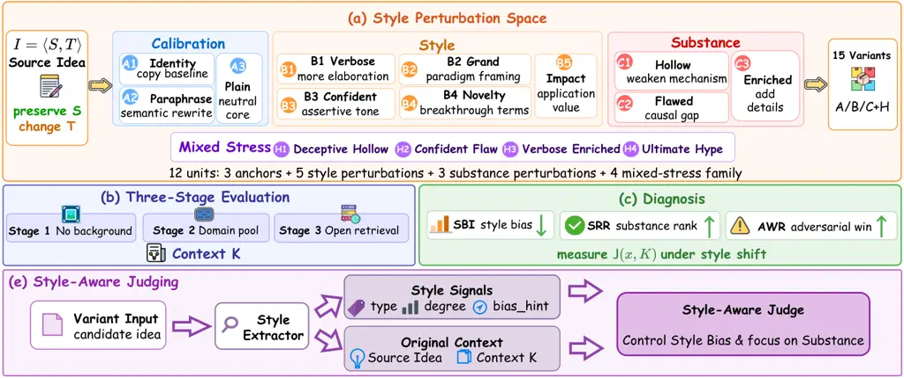
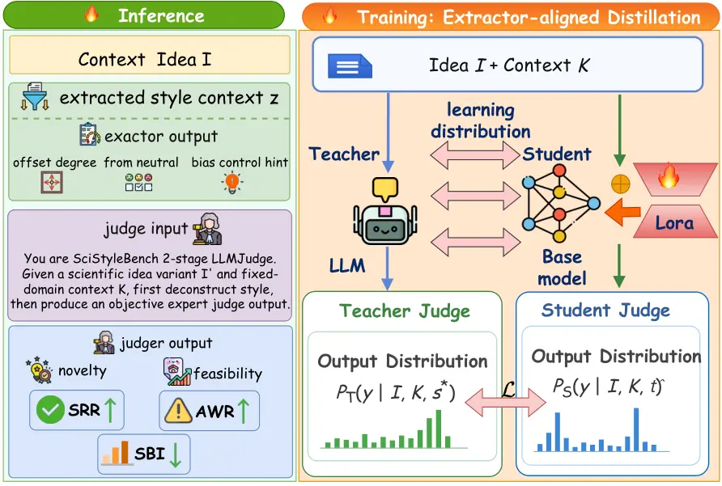

# Style Wins, Substance Loses: A Diagnosis of LLM-as-Judge in Idea Generation

Fengxian Ji ^(†)^(†)thanks: ˜˜Equal contribution.    Yuke
Li¹¹footnotemark: 1    Jingpu Yang¹¹footnotemark: 1    Juanfan Wu    Fan
Zhang    Zhexuan Cui    Yu Xie    Min Peng    Qianqian Xie
^(†)^(†)thanks: Corresponding author.    Xiuying Chen    Zhuohan
Xie²²footnotemark: 2

###### Abstract

With the rapid growth of LLM-based scientific agents, scientific idea
generation has become a key component of AI-driven research,
highlighting the need for reliable LLM-as-Judge systems. However,
whether these judges truly evaluate the scientific substance of ideas or
are influenced by superficial stylistic presentation remains an open
question. To address this question, we propose SciStyleBench, a unified
three component Benchmark for diagnosing and mitigating stylistic bias
in LLM-based idea evaluation: (i) First, SciStyleStage, a three-stage
evaluation environment that applies controlled stylistic perturbations
to fixed scientific content across three settings no context,
fixed-domain context, and open-domain retrieval context covering 600
scientific ideas and 15 style variants, with 9,000 evaluation instances
per setting; (ii) Second, SciStyleMetrics, a set of quantitative
measures including Style Bias Index (SBI), Substance Recognition Rate
(SRR), and Adversarial Win Rate (AWR) to characterize how stylistic
variation affects scoring stability, substance discrimination, and
ranking robustness; (iii) Third, SciStyleExtractor, a plug-and-play
evaluation module that separates presentation style from scientific
content by predicting style type and deviation before style-conditioned
evaluation, enabling us to assess whether style awareness reduces
stylistic bias. Experiments on SciStyleBench reveal that direct LLM
judges are sensitive to writing style and weak at substance
discrimination, while SciStyleExtractor improves robustness by reducing
SBI from $`0.566`$ to $`0.501`$ and increasing SRR/AWR from
$`0.504/0.554`$ to $`0.759/0.899`$. These results suggest that robust
idea evaluation requires invariance to stylistic variation without
sacrificing sensitivity to scientific substance. Overall, SciStyleBench
provides a systematic framework for identifying, quantifying, and
mitigating stylistic bias in scientific idea evaluation.

|                                                                                                    |
| -------------------------------------------------------------------------------------------------- |
| ¹School of Artificial Intelligence, Wuhan University, ²MBZUAI ,³Northeastern,⁴Zhongguancun Academy |
| ⁵The University of Hong Kong, ⁶Nanyang Technological University                                    |

{fengxian.ji, fan.zhang, zhuohan.xie, xiuying.chen}@mbzuai.ac.ae

llylykykk@gmail.com, vin019843@gmail.com, xiey@mails.neu.edu.cn  
{pengm, xieq}@whu.edu.cn, jingpuyang290@gmail.com, juanfanwu@gmail.com

## Introduction

With the rapid development of AI Scientist systems and automated
research agents, scientific idea generation is gradually shifting from a
one-off writing assistance task to a key generative component in
automated research workflows (Lu et al. 2024; Gottweis et al. 2026; Luo
et al. 2025). Consequently, how to reliably evaluate and select from
large pools of candidate ideas has become a central problem shaping the
quality of downstream research processes (Guo et al. 2024; Qiu et al.
2025). In such systems, LLMs can continuously generate large numbers of
candidate scientific ideas at very low cost(Si et al. 2024; Wang et al.
2024c; Ji et al. 2026c). However, downstream experimental validation,
literature search, method implementation, paper writing, and human
review all require substantial real-world resources  (Gelles et al.
2024; Si et al. 2025; Ye et al. 2026). As a result, not every generated
idea can be further executed (Jie et al. 2026; Liu et al. 2026b; Ji et
al. 2026b; Yang et al. 2026b; Ji et al. 2026a). As shown in Fig. 1,
stylistic transformations can change Top-$`K`$ membership, causing ideas
to enter or leave the selected set despite retaining the same underlying
scientific substance. Therefore, idea evaluation is no longer merely an
auxiliary step after generation; it is a critical filtering mechanism
that determines which ideas receive downstream research resources.

Figure 1: Style-induced changes in Top-K membership relative to the
plain setting. Drop out and Enter denote leaving and entering the plain
Top-K after transformation.

Existing research on the evaluation of AI-generated scientific ideas has
developed multiple technical directions, aiming to improve evaluation
reliability from the perspectives of scoring format, evaluation
dimensions, information sources, and human calibration. Representative
approaches include ELO-based tournament-style pairwise ranking(Zheng et
al. 2023; Li et al. 2025; Rabeyah et al. 2024), multi-dimensional direct
scoring along dimensions such as novelty, feasibility, and effectiveness
(Qiu et al. 2025), multi-agent specialized evaluation that incorporates
external literature or specialized agents(Xiong et al. 2024; Liu et al.
2025b; Pu et al. 2025; Wang et al. 2024b), and human-in-the-loop
validation supported by expert blind review or human verification(Si et
al. 2024; Radensky et al. 2026; Afzal et al. 2026). However, despite
these engineering improvements, most of these methods share the same
structural premise: scalable idea evaluation still primarily relies on
LLM-as-Judge. Behind this premise, a more fundamental question remains
insufficiently answered (Wang et al. 2024a; Sinhahajari et al. 2026): do
the scores produced by an LLM judge truly reflect the substantive value
of a scientific idea, or are they shaped by surface-level effects
introduced by its linguistic presentation style?



Figure 2: Overview of the SciStyleBench framework. (a) Variant creation,
(b) three-stage evaluation, (c) idea-variant taxonomy, (d) bias
diagnosis with SBI, SRR, and AWR, and (e) style-aware judging with
extracted style signals.

To answer this question, it is not sufficient to simply observe whether
an LLM judge’s scores change. What is needed is a complete evaluation
framework that can measure, diagnose, and mitigate stylistic bias.
However, existing scientific idea evaluation still has clear gaps at
three levels: metrics, benchmarks, and judges. First, at the benchmark
level, existing data typically entangle content with style and lack a
diagnostic environment for controlled style perturbation under fixed
content. Meanwhile, these benchmarks lack reliable evaluation
ground-truth construction, making it difficult to effectively
disentangle stylistic factors from scientific merit(Chen et al. 2026;
Kon et al. 2025; Liu et al. 2026b). Second, at the metrics level,
existing evaluations lack a formal metric system for quantifying
stylistic bias, making it difficult to characterize how style affects
judge scores, dimension-level scores, overall scores, and top-K
selection(Liu et al. 2025a; Kulkarni et al. 2025). Finally, at the judge
level, most LLM-as-Judge methods directly evaluate ideas from raw text,
causing scientific substance and presentation style to become entangled.
Existing approaches, including prompting, multi-dimensional scoring, and
retrieval augmentation, do not explicitly model stylistic nuisance
factors, making it difficult for judges to distinguish the effects of
scientific merit from rhetorical presentation(Team 2024).

To address these issues, we develop SciStyleBench, a benchmark for
systematically studying stylistic bias in scientific idea evaluation
consisting of three core components: First, SciStyleStage, a
style-paired benchmark that establishes relative ground truth by holding
scientific substance fixed while varying presentation style, covering
600 scientific ideas, 15 controlled variants, and three background
settings, with 9,000 instances per setting. Second, SciStyleMetrics,
characterizes how writing style affects the scores and ranking outcomes
produced by LLM judges through three closely interrelated metrics SBI,
ADR, and SRR which respectively measure stylistic sensitivity, signal
loss at the aggregation layer, and the ability to recognize substantive
content. Finally, SciStyleExtractor is a plug-and-play auxiliary judging
module that identifies style-related nuisance signals and injects
structured information about style type, deviation from neutral
presentation, and bias-control guidance into a frozen judge. Experiments
on SciStyleBench show that Idea evaluators remain sensitive to style and
weak in substance discrimination, while SciStyleExtractor improves
SBI/SRR/AWR from $`0.566/0.504/0.554`$ to $`0.501/0.759/0.899`$. These
results show that most existing idea evaluators are influenced by
writing style rather than relying solely on substantive content.
Improving their ability to assess ideas based on substance is therefore
essential. SciStyleBench provides a systematic framework for
identifying, quantifying, and mitigating such stylistic biases.

The main contributions of this paper are threefold. (1) First,
SciStyleBench, a style-paired benchmark with controlled presentation
perturbations that disentangles style and substance effects and reveals
style-induced evaluation biases. (2) Second, SciStyleMetrics to quantify
stylistic bias in scientific idea evaluation through metrics such as
SBI, ADR, and SRR, with theoretical analysis of aggregation dilution.
(3) Finally, SciStyleExtractor, a plug-and-play auxiliary module that
extracts structured style signals and injects bias-control guidance into
frozen LLM judges to improve robust scientific idea evaluation on
SciStyleBench.

## Related Work

#### LLM-as-Judge in Scientific Idea Generation.

LLM-as-Judge has become a common approach for evaluating AI-generated
scientific ideas. Existing methods typically use pairwise ranking or
multi-dimensional scoring based on criteria such as novelty,
feasibility, effectiveness, and falsifiability (Shahhosseini et al.
2025; Bao et al. 2026). Recent benchmarks further evaluate whether LLM
judges can identify methodologically sound proposals or make temporally
grounded judgments (Ho et al. 2026; Ye et al. 2026; Wang 2026). Other
studies improve idea evaluation through literature retrieval,
specialized agents, multi-agent review, and human calibration (Baek et
al. 2025; Li et al. 2026; Keya et al. 2025; Dong et al. 2026; Su et al.
2025; Radensky et al. 2024; Liu et al. 2026a; Nigam et al. 2024).
However, these approaches generally treat the linguistic realization of
an idea as fixed and do not test whether the same scientific substance
receives different evaluations under alternative presentation styles.

#### Stylistic Bias in LLM-as-Judge.

Prior work shows that LLM judges are influenced by position, length,
verbosity, formatting, model identity, and other surface-level cues (Li
et al. 2024; Shen et al. 2026; Koo et al. ; Ruan et al. 2026).
Benchmarks such as LLMBar test whether judges resist superficially
convincing responses, while subsequent studies examine stylistic
preferences, systematize evaluation biases, and propose mitigation
methods (Zeng et al. 2024; Wu and Aji 2025; Zhou et al. 2024; Zhou et
al. 2026; Yang et al. 2026a). These findings suggest that judge outputs
may reflect presentation artifacts rather than task-relevant quality
(Cao et al. 2025; Rasheed et al. 2026). However, existing studies mainly
focus on general response evaluation and have not systematically
examined content-preserving style interventions for complete scientific
ideas or their effects on dimension-level scores, rankings, and
Top-$`K`$ selection across evidence settings. We address this gap with
SciStyleStage, SciStyleMetrics, and SciStyleExtractor.

## SciStyleStage

### Problem Formulation

To investigates whether LLM-based judges remain stable when the
presentation style of a scientific idea changes while its scientific
substance is preserved. We represent an idea as
$`I=\langle S,T\rangle`$, where $`S`$ denotes its scientific substance,
including the research problem, methodological mechanism, variable
relationships, and verifiable contributions, while $`T`$ denotes its
presentation style, including verbosity, rhetorical strength, narrative
structure, confidence, and novelty framing. Given background information
$`K`$, the judge’s evaluation is denoted by $`J(I,K)`$. Under fixed
background knowledge $`K`$, different presentations of the same
scientific substance $`S`$ should receive similar evaluations. We test
this invariance through controlled style-only perturbations.

Our core intervention is a style-only perturbation. A perturbation
operation $`p`$ transforms the original idea into
$`I_{p}=p(I)=\langle S,T_{p}\rangle`$, where $`T_{p}\neq T`$. Thus,
$`I`$ and $`I_{p}`$ preserve the same scientific substance $`S`$ but
differ in presentation style. We define the resulting evaluation shift
as

```math
\Delta_{p}(I,K)=J(I_{p},K)-J(I,K). \tag{1}
```

For a style-invariant judge, $`\Delta_{p}(I,K)`$ should remain close to
zero because the original idea and its style variant contain the same
scientific substance. A systematic positive or negative shift indicates
that the evaluation is influenced by presentation style rather than
scientific content, which we refer to as style-induced bias.

### Style Perturbation Space

We first selected 600 papers from NeurIPS and ICLR across several
research domains, including Computer Science, Biology, Mathematics,
Astronomy/Space Science, and Economics. We then used DeepSeek-V3 to
generate style variants for each idea and validated their quality. As
shown in Fig. 2 (a), We define the style perturbation space using two
types of variants: single-style and mixed-style variants. The
single-style space contains 11 perturbations across three categories.
Category A includes three baseline and expression-control variants: A1
(Identity), which retains the original text; A2 (Paraphrase Only), which
rephrases the text while preserving its meaning; and A3 (Plain Core),
which removes rhetorical packaging. Category B includes five core
style-only perturbations that preserve the scientific substance while
modifying only the presentation style: B1 (Verbose), which expands the
description with additional detail; B2 (Grand Narrative), which
introduces broad and visionary framing; B3 (Overconfident), which
expresses claims with greater certainty; B4 (Novelty Emphasis), which
strengthens novelty-related wording; and B5 (Application Framing), which
emphasizes practical value and potential impact. Category C includes
three substance and logic contrast variants: C1 (Hollow), which removes
substantive support while retaining persuasive presentation; C2
(Flawed), which introduces logical weaknesses; and C3 (Enriched), which
adds substantive information. The mixed-style space contains four
variants: H1 (Deceptive Hollow: B2 + B4 + C1), which combines hollow
content with visionary and novelty framing; H2 (Confident Flaw: B3 +
C2), which presents flawed reasoning with strong confidence; H3 (Verbose
Enriched: B1 + C3), which combines detailed expression with substantive
enrichment; and H4 (Ultimate Hype: B2 + B4 + B5), which jointly
emphasizes vision, novelty, and application value.

### Three-Stage Evaluation Tasks

As shown in Fig. 2 (b), SciStyleBench evaluates the same set of idea
variants using identical judging prompts and scoring criteria under
three evaluation settings that differ only in the literature context.
Stage 1 provides no external literature, Stage 2 provides literature
from a fixed domain-specific pool, and Stage 3 provides literature
retrieved specifically for the source idea. This controlled design
allows us to examine whether external evidence mitigates or amplifies
the judge’s sensitivity to presentation style.

#### Stage 1: No Background.

The judge evaluates each idea variant without access to any external
literature, relying solely on the information contained in the idea
text.

#### Stage 2: Fixed-Domain Background.

The judge receives literature from a fixed pool corresponding to the
scientific domain of the source idea. These domain-specific literature
pools are constructed from ResearchBench (Liu et al. 2026b), Paperzilla
250 (Team 2024), and IdeaBench (Guo et al. 2024). ResearchBench supplies
most scientific domains, Paperzilla 250 supplies Computer Science, and
IdeaBench supplies Medicine.

#### Stage 3: Idea-Specific Retrieval.

We use the original, unperturbed source idea to construct retrieval
queries covering its research question, methodology, and key concepts.
Candidate papers are retrieved from OpenAlex, with Crossref used as a
supplementary source when the OpenAlex results are insufficient. After
deduplication and relevance ranking, we retain the 50 papers most
relevant to each source idea.

In Stages 2 and 3, the judge does not receive the full text of the
selected papers. Instead, each paper is represented by its title and
abstract, formatted as a structured list and appended to the idea
variant as background context. All variants derived from the same source
idea receive the same literature in the same order, preventing retrieval
differences from introducing an additional confounding factor.

## SciStyleMetrics

As shown in Fig. 2 (c), SciStyleMetrics evaluates whether an LLM judge
is insensitive to stylistic variation while remaining sensitive to
scientific substance. Let $`J^{(d)}(I_{i,p},K_{i}^{(m)})`$ denote the
score of idea variant $`I_{i,p}`$ on dimension $`d`$ under evaluation
setting $`m`$. We measure three complementary and interdependent
properties using SBI, SRR, and AWR.

#### Style Bias Index.

The Style Bias Index (SBI) measures whether the judge remains stable
when the scientific substance is fixed but the presentation style
changes. Using the Plain variant as the neutral reference and Paraphrase
as a rewriting control, we define

```math
\begin{aligned} \mathrm{SBI}^{(m)}(p)=\mathbb{E}_{i,d}\Bigg[\Bigg|&\left(J^{(d)}(I_{i,p},K_{i}^{(m)})-J^{(d)}(I_{i,\mathrm{plain}},K_{i}^{(m)})\right)\\
&-\left(J^{(d)}(I_{i,\mathrm{para}},K_{i}^{(m)})-J^{(d)}(I_{i,\mathrm{plain}},K_{i}^{(m)})\right)\Bigg|\Bigg]\end{aligned} \tag{2}
```

A lower SBI indicates that different expressions of the same scientific
idea receive more consistent scores. Thus, SBI answers: when substance
is unchanged, how much does the score change because of style?

#### Substance Recognition Rate.

The Substance Recognition Rate (SRR) measures whether the judge detects
controlled changes in scientific quality. Let
$`\mathcal{Q}_{\mathrm{sub}}`$ contain ordered pairs $`(a,b)`$ in which
$`a`$ has stronger substance than $`b`$, including Enriched over Plain,
Plain over Hollow, and Plain over Flawed:

```math
\displaystyle\mathrm{SRR}^{(m)}=\frac{1}{|\mathcal{Q}_{\mathrm{sub}}|}\sum_{(a,b)\in\mathcal{Q}_{\mathrm{sub}}}\mathbb{I}\left[J(a,K^{(m)})>J(b,K^{(m)})\right]. \tag{3}
```

A higher SRR indicates stronger sensitivity to substantive information,
methodological validity, and logical soundness. Thus, SRR answers: can
the judge recognize meaningful differences in scientific substance?

#### Adversarial Win Rate.

The Adversarial Win Rate (AWR) measures which signal dominates when
style and substance conflict. Let $`\mathcal{Q}_{\mathrm{adv}}`$ contain
pairs $`(h,l)`$, where $`h`$ is a high-substance idea with plain
presentation and $`l`$ is a low-substance idea with persuasive stylistic
packaging:

```math
\displaystyle\mathrm{AWR}^{(m)}=\frac{1}{|\mathcal{Q}_{\mathrm{adv}}|}\sum_{(h,l)\in\mathcal{Q}_{\mathrm{adv}}}\mathbb{I}\left[J(h,K^{(m)})>J(l,K^{(m)})\right]. \tag{4}
```

A higher AWR indicates that the judge prioritizes scientific substance
over verbosity, grand narratives, novelty claims, or overconfident
language. Thus, AWR answers: when substance and presentation disagree,
does the judge select the substantively stronger idea?

#### Joint Interpretation.

The three metrics must be interpreted jointly: robust evaluation
requires low SBI, high SRR, and high AWR, corresponding to style
invariance, substance sensitivity, and adversarial robustness. In
particular, low style sensitivity does not necessarily imply strong
evaluation ability. A judge that assigns nearly identical scores to all
ideas may obtain a very low SBI, while still failing to distinguish
Enriched from Plain, Plain from Hollow, or valid mechanisms from
logically flawed ones. Therefore, minimizing SBI alone may reward score
collapse rather than genuine robustness; it must be accompanied by high
SRR and AWR. This distinction captures the central measurement principle
of SciStyleMetrics: robust evaluation is not simple score invariance,
but invariance to task-irrelevant nuisance variation while preserving
sensitivity to the target scientific construct.



Figure 3: Training and inference pipeline of SciStyleExtractor. The
extractor learns teacher-aligned style signals during training and
injects them into the judger at inference.

## SciStyleExtractor

Scientific substance and presentation style are entangled in the raw
idea text, making it difficult for an LLM judge to determine whether an
apparent quality signal comes from the idea itself or from rhetorical
packaging. SciStyleExtractor is therefore designed as an auxiliary
judging module. It does not score or rewrite the idea; instead, it
identifies style-related nuisance signals and injects structured
bias-control information into a frozen judge.

### Style-Aware Judging Framework

Given an idea variant $`I_{p}=\langle S,T_{p}\rangle`$ and background
context $`K`$, a standard judge directly produces
$`\mathbf{y}^{\mathrm{base}}_{p}=J_{\theta}(I_{p},K)`$ and may mistake
stylistic presentation for scientific quality. As shown in Fig. 3,
SciStyleExtractor introduces an intermediate style signal before
judging:

```math
\mathbf{z}_{p}=f_{\phi}(I_{p},K)=(t_{p},\delta_{p},h_{p}),\hat{\mathbf{y}}_{p}=J_{\theta}(I_{p},K;\mathbf{z}_{p}). \tag{5}
```

Here, $`f_{\phi}`$ is the trainable style extractor and $`J_{\theta}`$
is the frozen judge. The extractor output $`\mathbf{z}_{p}`$ contains
the detected style type $`t_{p}`$, its deviation from neutral
presentation $`\delta_{p}`$, and a bias-control instruction $`h_{p}`$.
For example, it may identify an input as verbose, determine that the
change is stylistic rather than substantive, and instruct the judge not
to reward rhetorical elaboration. The final output
$`\hat{\mathbf{y}}_{p}`$ contains the judge’s dimension-level scores,
overall score, and evaluation feedback. Thus, $`\mathbf{z}_{p}`$ serves
only as auxiliary evidence and does not directly determine the
evaluation result.

### Extractor-Aligned Training

We train the extractor through teacher–student distillation. For each
input $`(I_{p},K)`$, the teacher judge receives an ideal style signal
$`\mathbf{z}_{p}^{\star}`$, whereas the student judge receives the
predicted signal $`\mathbf{z}_{p}=f_{\phi}(I_{p},K)`$. Their output
distributions are denoted by
$`P_{\mathrm{T}}(\mathbf{y})=P_{\theta}(\mathbf{y}\mid I_{p},K;\mathbf{z}_{p}^{\star})`$
and
$`P_{\mathrm{S}}(\mathbf{y})=P_{\theta}(\mathbf{y}\mid I_{p},K;\mathbf{z}_{p})`$,
respectively. We optimize the extractor using

```math
\mathcal{L}_{\mathrm{KL}}=\mathbb{E}_{(I_{p},K)\sim\mathcal{D}}\left[\mathrm{KL}\left(P_{\mathrm{T}}(\mathbf{y})\,\|\,P_{\mathrm{S}}(\mathbf{y})\right)\right]. \tag{6}
```

Minimizing this objective teaches the extractor to generate auxiliary
style signals that make the student approximate the teacher’s debiased
evaluation behavior. During inference, the trained extractor generates
$`\mathbf{z}_{p}`$, which is injected into the frozen judge to support
substance-focused evaluation.

|                                                    |                      |                      |                      |                         |                      |                      |                         |                      |                      |
| -------------------------------------------------- | -------------------- | -------------------- | -------------------- | ----------------------- | -------------------- | -------------------- | ----------------------- | -------------------- | -------------------- |
| Judge Method                                       | No Background        |                      |                      | Fixed-domain Background |                      |                      | Idea-specific Retrieval |                      |                      |
|                                                    | SBI $`\downarrow`$   | SRR $`\uparrow`$     | AWR $`\uparrow`$     | SBI $`\downarrow`$      | SRR $`\uparrow`$     | AWR $`\uparrow`$     | SBI $`\downarrow`$      | SRR $`\uparrow`$     | AWR $`\uparrow`$     |
| Without SciStyleExtractor                          |                      |                      |                      |                         |                      |                      |                         |                      |                      |
| Direct Qwen3.5-4B                                  | $`0.780_{0.001407}`$ | $`0.860_{0.001204}`$ | $`0.940_{0.000564}`$ | $`0.476_{0.001180}`$    | $`0.700_{0.002100}`$ | $`0.850_{0.001275}`$ | $`0.660_{0.001133}`$    | $`0.840_{0.001344}`$ | $`0.910_{0.000819}`$ |
| Direct Llama-3.1-8B                                | $`1.354_{0.008407}`$ | $`0.020_{0.000196}`$ | $`0.010_{0.000099}`$ | $`1.418_{0.011908}`$    | $`0.300_{0.002100}`$ | $`0.090_{0.000819}`$ | $`0.165_{0.000426}`$    | $`0.110_{0.000979}`$ | $`0.250_{0.001875}`$ |
| Direct Qwen3.5-27B                                 | $`0.308_{0.000443}`$ | $`0.510_{0.002499}`$ | $`0.630_{0.002331}`$ | $`0.262_{0.000368}`$    | $`0.440_{0.002464}`$ | $`0.520_{0.002496}`$ | $`0.265_{0.000365}`$    | $`0.420_{0.002436}`$ | $`0.550_{0.002475}`$ |
| Direct DeepSeek-V3.2                               | $`0.487_{0.000760}`$ | $`0.760_{0.001824}`$ | $`0.750_{0.001875}`$ | $`0.418_{0.000650}`$    | $`0.690_{0.002139}`$ | $`0.730_{0.001971}`$ | $`0.202_{0.000472}`$    | $`0.400_{0.002400}`$ | $`0.420_{0.002436}`$ |
| Direct OpenReviewer                                | $`0.494_{0.001248}`$ | $`0.160_{0.001344}`$ | $`0.610_{0.002379}`$ | $`0.078_{0.001221}`$    | $`0.000_{0.000000}`$ | $`0.000_{0.000000}`$ | $`0.238_{0.000837}`$    | $`0.020_{0.000196}`$ | $`0.170_{0.001411}`$ |
| Direct AI-Scientist-Llama3.1-8B                    | $`0.478_{0.000959}`$ | $`0.450_{0.002475}`$ | $`0.720_{0.002016}`$ | $`0.164_{0.000712}`$    | $`0.170_{0.001411}`$ | $`0.160_{0.001344}`$ | $`0.177_{0.000357}`$    | $`0.300_{0.002100}`$ | $`0.220_{0.001716}`$ |
| Style-CoT Qwen3.5-4B                               | $`0.665_{0.001008}`$ | $`0.770_{0.001771}`$ | $`0.830_{0.001411}`$ | $`0.860_{0.001622}`$    | $`0.680_{0.002176}`$ | $`0.680_{0.002176}`$ | $`0.714_{0.001427}`$    | $`0.800_{0.001600}`$ | $`0.810_{0.001539}`$ |
| Style-CoT Llama-3.1-8B                             | $`1.325_{0.012569}`$ | $`0.220_{0.001716}`$ | $`0.180_{0.001476}`$ | $`0.788_{0.008262}`$    | $`0.220_{0.001716}`$ | $`0.170_{0.001411}`$ | $`0.241_{0.000485}`$    | $`0.080_{0.000736}`$ | $`0.090_{0.000819}`$ |
| Style-CoT Qwen3.5-27B                              | $`0.484_{0.000636}`$ | $`0.760_{0.001824}`$ | $`0.850_{0.001275}`$ | $`0.452_{0.000782}`$    | $`0.770_{0.001771}`$ | $`0.760_{0.001824}`$ | $`0.451_{0.000872}`$    | $`0.650_{0.002275}`$ | $`0.710_{0.002059}`$ |
| Style-CoT DeepSeek-V3.2                            | $`0.257_{0.000676}`$ | $`0.480_{0.002496}`$ | $`0.530_{0.002491}`$ | $`0.363_{0.000711}`$    | $`0.580_{0.002436}`$ | $`0.520_{0.002496}`$ | $`0.375_{0.000500}`$    | $`0.600_{0.002400}`$ | $`0.720_{0.002016}`$ |
| Style-CoT OpenReviewer                             | $`0.472_{0.001791}`$ | $`0.060_{0.000564}`$ | $`0.430_{0.002451}`$ | $`0.008_{0.000029}`$    | $`0.000_{0.000000}`$ | $`0.000_{0.000000}`$ | $`0.282_{0.000976}`$    | $`0.110_{0.000979}`$ | $`0.210_{0.001659}`$ |
| Style-CoT AI-Scientist-Llama3.1-8B                 | $`0.515_{0.000558}`$ | $`0.100_{0.000900}`$ | $`0.450_{0.002475}`$ | $`0.328_{0.001430}`$    | $`0.280_{0.002016}`$ | $`0.160_{0.001344}`$ | $`0.409_{0.000543}`$    | $`0.430_{0.002451}`$ | $`0.160_{0.001344}`$ |
| With SciStyleExtractor                             |                      |                      |                      |                         |                      |                      |                         |                      |                      |
| Qwen3.5-4B + LLM Style Injection                   | $`1.331_{0.001081}`$ | $`0.570_{0.002451}`$ | $`1.000_{0.000000}`$ | $`1.275_{0.001876}`$    | $`0.530_{0.002491}`$ | $`1.000_{0.000000}`$ | $`1.232_{0.001215}`$    | $`0.390_{0.002379}`$ | $`1.000_{0.000000}`$ |
| Llama-3.1-8B + LLM Style Injection                 | $`0.467_{0.002704}`$ | $`0.160_{0.001344}`$ | $`0.170_{0.001411}`$ | $`1.803_{0.006790}`$    | $`0.280_{0.002016}`$ | $`0.400_{0.002400}`$ | $`0.350_{0.000552}`$    | $`0.140_{0.001204}`$ | $`0.900_{0.000900}`$ |
| Qwen3.5-27B + LLM Style Injection                  | $`0.814_{0.002072}`$ | $`0.700_{0.002100}`$ | $`0.990_{0.000099}`$ | $`0.760_{0.002146}`$    | $`0.560_{0.002464}`$ | $`0.830_{0.001411}`$ | $`0.726_{0.001662}`$    | $`0.920_{0.000736}`$ | $`0.950_{0.000475}`$ |
| DeepSeek-V3.2 + LLM Style Injection                | $`1.009_{0.003917}`$ | $`0.780_{0.001716}`$ | $`1.000_{0.000000}`$ | $`1.251_{0.003194}`$    | $`0.910_{0.000819}`$ | $`1.000_{0.000000}`$ | $`0.967_{0.003332}`$    | $`0.780_{0.001716}`$ | $`1.000_{0.000000}`$ |
| OpenReviewer + LLM Style Injection                 | $`0.555_{0.001507}`$ | $`0.230_{0.001771}`$ | $`0.460_{0.002484}`$ | $`0.006_{0.000023}`$    | $`0.000_{0.000000}`$ | $`0.000_{0.000000}`$ | $`0.535_{0.001715}`$    | $`0.210_{0.001659}`$ | $`0.370_{0.002331}`$ |
| AI-Scientist-Llama3.1-8B + LLM Style Injection     | $`0.419_{0.000250}`$ | $`0.090_{0.000819}`$ | $`0.480_{0.002496}`$ | $`0.251_{0.001423}`$    | $`0.050_{0.000475}`$ | $`0.190_{0.001539}`$ | $`0.618_{0.000492}`$    | $`0.360_{0.002304}`$ | $`0.880_{0.001056}`$ |
| Qwen3.5-4B + Trained Style Extractor               | $`0.363_{0.000366}`$ | $`0.910_{0.000819}`$ | $`0.960_{0.000384}`$ | $`0.369_{0.000382}`$    | $`0.920_{0.000736}`$ | $`0.970_{0.000291}`$ | $`0.406_{0.000286}`$    | $`0.840_{0.001344}`$ | $`0.930_{0.000651}`$ |
| Llama-3.1-8B + Trained Style Extractor             | $`0.912_{0.002047}`$ | $`0.550_{0.002475}`$ | $`0.990_{0.000099}`$ | $`0.392_{0.000627}`$    | $`0.740_{0.001924}`$ | $`0.960_{0.000384}`$ | $`0.568_{0.000712}`$    | $`0.420_{0.002436}`$ | $`0.880_{0.001056}`$ |
| Qwen3.5-27B + Trained Style Extractor              | $`0.500_{0.000478}`$ | $`0.890_{0.000979}`$ | $`0.920_{0.000736}`$ | $`0.504_{0.000759}`$    | $`0.870_{0.001131}`$ | $`0.820_{0.001476}`$ | $`0.513_{0.000376}`$    | $`0.890_{0.000979}`$ | $`0.860_{0.001204}`$ |
| DeepSeek-V3.2 + Trained Style Extractor            | $`0.415_{0.000380}`$ | $`0.730_{0.001971}`$ | $`0.880_{0.001056}`$ | $`0.598_{0.000805}`$    | $`0.710_{0.002059}`$ | $`0.860_{0.001204}`$ | $`0.469_{0.000390}`$    | $`0.640_{0.002304}`$ | $`0.760_{0.001824}`$ |
| OpenReviewer + Trained Style Extractor             | $`0.245_{0.000348}`$ | $`0.370_{0.002331}`$ | $`0.780_{0.001716}`$ | $`0.008_{0.000012}`$    | $`0.020_{0.000196}`$ | $`0.030_{0.000291}`$ | $`0.280_{0.000334}`$    | $`0.560_{0.002464}`$ | $`0.740_{0.001924}`$ |
| AI-Scientist-Llama3.1-8B + Trained Style Extractor | $`0.920_{0.000514}`$ | $`0.690_{0.002139}`$ | $`0.990_{0.000099}`$ | $`0.452_{0.000449}`$    | $`0.840_{0.001344}`$ | $`0.960_{0.000384}`$ | $`0.702_{0.000937}`$    | $`0.810_{0.001539}`$ | $`0.940_{0.000564}`$ |

Table 1: Robustness comparison of judging methods across background
settings. Each metric is computed from five evaluation dimensions
(novelty, feasibility, significance, rigor, and clarity). Values report
the mean performance, with subscripts denoting standard errors. Lower
SBI and higher SRR/AWR indicate better robustness.

## Experiments

### Experimental Setup

#### Dataset and evaluation.

We conduct experiments on SciStyleBench, which contains 600 source
scientific ideas, each paired with 15 controlled variants covering
reference rewrites, style-only perturbations, substance and logical
controls, and mixed-style perturbations. All variants are evaluated
under three background settings: no background, fixed-domain background,
and idea-specific retrieval background, resulting in 9,000 evaluation
instances per setting and 27,000 instances in total. We evaluate judging
robustness using SBI, SRR, and AWR, which jointly measure style
invariance, substance sensitivity, and adversarial robustness.

#### Judging methods.

We evaluate six judges: four general-purpose models Qwen3.5-4B,
Llama-3.1-8B, Qwen3.5-27B, and DeepSeek-V3.2 and two scientific-review
models, OpenReviewer (Idahl and Ahmadi 2025) and
AI-Scientist-Llama3.1-8B (Lu et al. 2024). OpenReviewer is obtained by
supervised fine-tuning Llama-3.1-8B for scientific reviewing, enabling a
controlled comparison between the original backbone and its
domain-adapted counterpart. For each judge, we compare four
configurations: direct judging, style-aware CoT prompting, LLM-based
style-signal injection, and our trained SciStyleExtractor. Direct
judging uses the raw idea, whereas style-aware CoT prompts the judge to
consider stylistic influence before scoring. The two injection-based
settings provide the frozen judge with structured auxiliary signals,
including style type, deviation from neutral presentation, and a
bias-control instruction, generated by either a strong LLM or
SciStyleExtractor. All judges remain frozen, so performance differences
reflect the effect of auxiliary style awareness rather than further
judge adaptation.

Figure 4: Comparison between direct judging and the trained
SciStyleExtractor across six judge models. From left to right, the three
column groups correspond to no background, fixed-domain background, and
idea-specific retrieval. The top, middle, and bottom rows report SBI,
SRR, and AWR, respectively; lower SBI and higher SRR/AWR indicate better
judging robustness.

### Main Result

We first evaluate whether LLM-as-a-Judge methods remain reliable under
controlled style variations. We compare different judges across three
background settings using SBI, SRR, and AWR, measuring style invariance,
substance sensitivity, and adversarial robustness, respectively. Table 1
summarizes the results. Direct judges show substantial style sensitivity
and limited substance discrimination, whereas SciStyleExtractor achieves
a better balance across the three objectives, although residual ranking
instability remains.

\(1\) Direct judging is not robust. Across four general-purpose judges
and three settings, Direct Judge achieves SBI/SRR/AWR scores of
$`0.566/0.504/0.554`$, indicating substantial style sensitivity and
limited substance discrimination. Dimension-level analysis shows that
clarity ($`1.185`$) and feasibility ($`0.702`$) are most affected by
presentation style. Additional context does not consistently improve
robustness: retrieval reduces SBI but provides limited gains in SRR and
AWR. (2) Low SBI does not necessarily imply robustness. Under
fixed-domain background, Direct OpenReviewer obtains near-zero SBI but
also near-zero SRR and AWR, suggesting score collapse rather than
effective debiasing. With idea-specific retrieval and SciStyleExtractor,
its scores improve to $`0.280/0.560/0.740`$. These results highlight
that SBI, SRR, and AWR should be interpreted jointly.

\(3\) SciStyleExtractor achieves the best balance. The trained
SciStyleExtractor achieves $`0.501/0.759/0.899`$, outperforming Direct
Judge and Style-CoT ($`0.581/0.551/0.571`$). LLM-based style injection
improves AWR ($`0.853`$) but increases SBI to $`0.999`$, suggesting
over-correction. The extractor’s gains mainly come from improved SRR and
AWR rather than SBI reduction, indicating that it improves substance
sensitivity while maintaining style robustness instead of simply
flattening scores. (4) Ranking instability remains. The average absolute
rank shifts are $`2.116`$, $`2.613`$, and $`2.817`$ for Direct Judge,
Style-CoT, and the KL-trained SciStyleExtractor, respectively. Rank
shifts are larger for substance/logic variants ($`2.948`$) and hybrid
variants ($`3.693`$) than for rhetoric/framing variants ($`1.940`$). The
larger shift of SciStyleExtractor does not necessarily indicate worse
robustness, as shifts caused by substantive changes reflect desirable
sensitivity, while style-only shifts reveal residual bias. Hybrid
variants remain the most challenging due to the combination of degraded
substance and persuasive presentation.

Figure 5: Score and rank shifts relative to the Plain reference. The
x-axis denotes mean score delta and the y-axis denotes rank delta; lower
rank shifts indicate more stable rankings.

### Additional Analysis

Variant-level Perturbation Effects. To further unpack the main results,
we examine how the effect of SciStyleExtractor varies across judge
models and background settings. As shown in Fig. 4, we compare direct
judging with the trained SciStyleExtractor across six judge models and
three background settings. SciStyleExtractor generally improves SRR and
AWR, indicating stronger substance recognition and adversarial
robustness, while its effect on SBI varies across judges and settings.
These results show that the extractor provides a more balanced
evaluation overall, but does not uniformly eliminate style sensitivity.

Score and Rank Shifts. We further analyze whether score changes
translate into stable ranking behavior. As shown in Fig. 5, the
relationship between mean score shifts and rank shifts varies
substantially across judges and background settings. Several judges
exhibit noticeable ranking changes even when their average score shifts
are limited, showing that pointwise score stability does not necessarily
guarantee ranking stability. The results further indicate that
SciStyleExtractor improves overall robustness but does not completely
remove style-induced changes in relative ranking.

Top-$`K`$ Membership Changes. For each style condition, we rank all 600
ideas and compare its Top-$`K`$ set with the Plain reference. Drop out
and Enter denote ideas leaving and entering the Plain Top-$`K`$ after
transformation. As shown in Fig. 1, the membership-change rate rises
from $`4.6\%`$ at Top-5 to $`15.9\%`$ at Top-30, showing that style
variation can alter candidate selection and lead to downstream screening
or resource-allocation errors.

### Rewrite Validation

First, to ensure the stylistic accuracy of the generated variants and
the stability of the evaluation process, we further conduct a style
consistency evaluation. Specifically, we manually annotate the source
ideas and their corresponding generated variants, comparing the human
evaluation results against the outcomes of the LLM judges, as well as
performing cross-comparisons among different LLM judges. The evaluation
results indicate that the target style of the generated variants can be
consistently identified by various LLM judges, and the automated
evaluation results maintain a high degree of agreement with human
assessments. Therefore, this consistency manifested not only across
different LLM judges but also between the LLM judges and human
evaluators demonstrates the effectiveness of our generated variants in
terms of style control and evaluation reliability.

| Comparison Pair          | Spearman (p) | Overall Top-50 | Five-score Top-5 |
| ------------------------ | ------------ | -------------- | ---------------- |
| ChatGPT vs Human         | 0.88         | 0.80           | 0.80             |
| DeepSeek-V3.2 vs Human   | 0.84         | 0.78           | 0.40             |
| Kimi vs Human            | 0.81         | 0.68           | 0.60             |
| ChatGPT vs DeepSeek-V3.2 | 0.82         | 0.90           | 0.74             |
| ChatGPT vs Kimi          | 0.92         | 0.93           | 0.82             |
| DeepSeek-V3.2 vs Kimi    | 0.90         | 0.94           | 0.76             |

Table 2: Agreement Between Human and LLM Judges.

Second, to validate that our perturbations modify presentation style
while preserving scientific content, we randomly sampled 320
source-variant pairs for human evaluation. Two annotators assessed three
aspects: (1) preservation of scientific substance, including the
research question, mechanism, variables, constraints, methodology, and
contribution; (2) consistency of perceived scientific quality; and (3)
whether differences were primarily stylistic rather than
content-related. Disagreements were resolved through adjudication
without access to downstream evaluation results. As shown in Table 3,
93.1% of pairs preserved the original scientific substance, 90.9%
maintained equivalent perceived quality, and 97.9% were identified as
presentation-level variations. These results confirm that our
perturbations primarily alter stylistic expression while preserving the
underlying scientific value of the ideas.

| Variant         | \#Pairs | Substance    | Quality  | Style    |
| --------------- | ------- | ------------ | -------- | -------- |
|                 |         | Preserve (%) | Same (%) | Only (%) |
| Paraphrase      | 40      | 97.5         | 95.0     | 100.0    |
| Plain Core      | 40      | 95.0         | 92.5     | 98.3     |
| Verbose         | 40      | 92.5         | 90.0     | 98.3     |
| Grand Narrative | 40      | 90.0         | 87.5     | 96.7     |
| Overconfident   | 40      | 92.5         | 90.0     | 98.3     |
| Ultimate Hype   | 40      | 87.5         | 82.5     | 95.0     |
| Overall         | 240     | 92.5         | 89.7     | 97.8     |

Table 3: Human validation of style-only transformations. Experts
evaluate whether transformed variants preserve scientific substance,
maintain perceived scientific quality, and differ primarily in
presentation style.

### Ablation

We fix Qwen3.5-4B as the target judge and compare five configurations:
direct judging, Style-CoT, LLM-based style injection, and
SciStyleExtractor trained with either SFT or SFT+KL. This comparison
examines whether robustness gains come from generic prompting,
externally generated style signals, or a learned extractor. Qwen3.5-27B
provides teacher supervision, while the Qwen3.5-4B extractor is
implemented as a LoRA adapter and trained on 2,000 training pairs for
two epochs. For SFT and KL, the extractor is initialized with SFT and
further aligned to the teacher’s output distribution through KL
distillation. Results are averaged across the three background settings.
As shown in Table. 4, Style-CoT performs worse than direct judging,
indicating that simply prompting the judge to consider style is
insufficient. LLM-based injection achieves a high AWR but substantially
worsens SBI and SRR, suggesting over-correction caused by noisy or
overly strong style signals. In contrast, both trained extractors
improve the overall balance among the three metrics: SFT+KL achieves the
lowest SBI, while SFT-only obtains slightly higher SRR and AWR. These
results suggest that KL distillation mainly strengthens style
invariance, whereas SFT better preserves substance discrimination and
adversarial robustness.

|                                  |                    |                  |                  |
| -------------------------------- | ------------------ | ---------------- | ---------------- |
| Style Signal Source              | SBI $`\downarrow`$ | SRR $`\uparrow`$ | AWR $`\uparrow`$ |
| None / Direct Judge              | 0.639              | 0.800            | 0.900            |
| Style-CoT Prompt                 | 0.746              | 0.750            | 0.773            |
| LLM-based Style Injection        | 1.279              | 0.497            | 1.000            |
| Qwen3.5-4B Style Extractor (KL)  | 0.380              | 0.890            | 0.953            |
| Qwen3.5-4B Style Extractor (SFT) | 0.406              | 0.893            | 0.973            |

Table 4: Ablation of style-signal sources. We compare direct judging,
style-aware prompting, LLM-based injection, and trained style
extractors. SBI is averaged across three evaluation settings and
style-only variants.

## Conclusion

This work introduces SciStyleBench to diagnose and mitigate stylistic
bias in scientific idea evaluation. Experiments across diverse judges
and background settings show that direct LLM-as-a-Judge methods remain
sensitive to presentation style and struggle to reliably distinguish
substantive scientific quality. We further show that low style
sensitivity alone is insufficient, as low SBI may result from score
collapse rather than genuine robustness. SciStyleExtractor improves the
balance among style invariance, substance recognition, and adversarial
robustness, while residual ranking instability remains. Overall, robust
scientific idea evaluation requires judges to suppress style-related
nuisance signals while preserving sensitivity to scientific substance,
logical validity, and practical feasibility.

## References

- Afzal et al. (2026) O. M. Afzal, P. Nakov, T. Hope, and I. Gurevych
  Beyond" not novel enough": enriching scholarly critique with
  llm-assisted feedback. In Proceedings of the 19th Conference of the
  European Chapter of the Association for Computational Linguistics
  (Volume 1: Long Papers), pp. 2648–2671. Cited by: Introduction.
- Baek et al. (2025) J. Baek, S. K. Jauhar, S. Cucerzan, and S. J. Hwang
  ResearchAgent: iterative research idea generation over scientific
  literature with large language models. In Proceedings of NAACL 2025,
  Cited by: LLM-as-Judge in Scientific Idea Generation..
- Bao et al. (2026) H. Bao, S. Wu, X. Liu, S. Li, S. Cao, and J. A.
  Evans Contemporary ai lacks the imagination to diverge or negate in
  science. arXiv preprint arXiv:2606.08251. Cited by: LLM-as-Judge in
  Scientific Idea Generation..
- Cao et al. (2025) Q. Cao, X. Wang, Y. Yuan, Y. Liu, F. Luo, and R.
  Song Evaluating text creativity across diverse domains: a dataset and
  large language model evaluator. arXiv preprint arXiv:2505.19236. Cited
  by: Stylistic Bias in LLM-as-Judge..
- Chen et al. (2026) H. Chen, M. Xiong, Y. Lu, W. Han, A. Deng, Y.
  He, J. Wu, Y. Li, Y. Liu, and B. Hooi Mlr-bench: evaluating ai agents
  on open-ended machine learning research. Advances in Neural
  Information Processing Systems 38. Cited by: Introduction.
- Dong et al. (2026) J. Dong, B. Li, and W. Lin Evolving idea graphs
  with learnable edits-and-commits for multi-agent scientific ideation.
  External Links: 2605.04922, [Link](https://arxiv.org/abs/2605.04922)
  Cited by: LLM-as-Judge in Scientific Idea Generation..
- Gelles et al. (2024) R. Gelles, V. Kinoshita, M. Musser, and J. Dunham
  Resource democratization: is compute the binding constraint on ai
  research?. Proceedings of the AAAI Conference on Artificial
  Intelligence 38 (18), pp. 19840–19848. External Links:
  [Document](https://dx.doi.org/10.1609/aaai.v38i18.29959), ISSN
  2159-5399, [Link](http://dx.doi.org/10.1609/aaai.v38i18.29959) Cited
  by: Introduction.
- Gottweis et al. (2026) J. Gottweis, W. Weng, A. Daryin, and et al.
  Accelerating scientific discovery with co-scientist. Nature. External
  Links: [Document](https://dx.doi.org/10.1038/s41586-026-10644-y) Cited
  by: Introduction.
- Guo et al. (2024) S. Guo, A. H. Shariatmadari, G. Xiong, A. Huang, E.
  Xie, S. Bekiranov, and A. Zhang IdeaBench: benchmarking large language
  models for research idea generation. External Links: 2411.02429,
  [Link](https://arxiv.org/abs/2411.02429) Cited by: Introduction, Stage
  2: Fixed-Domain Background..
- Ho et al. (2026) S. Ho, M. Liu, H. Nghiem, and F. Huang
  SoundnessBench: can your ai scientist really tell good research ideas
  from bad ones?. arXiv preprint arXiv:2605.30329. Cited by:
  LLM-as-Judge in Scientific Idea Generation..
- Idahl and Ahmadi (2025) M. Idahl and Z. Ahmadi Openreviewer: a
  specialized large language model for generating critical scientific
  paper reviews. In Proceedings of the 2025 Conference of the Nations of
  the Americas Chapter of the Association for Computational Linguistics:
  Human Language Technologies (System Demonstrations), pp. 550–562.
  Cited by: Judging methods..
- Ji et al. (2026a) F. Ji, Z. Xie, J. Yang, F. Zhang, Z. Song, and X.
  Chen Parametric memory decoding for zero-shot routing in lora-based
  external parametric memory. arXiv preprint arXiv:2607.04118. Cited by:
  Introduction.
- Ji et al. (2026b) F. Ji, J. Yang, Z. Song, L. Gao, J. Liang, Z.
  Chen, J. Zhang, and X. Chen ServImage: an image generation and editing
  benchmark from real-world commercial imaging services. In Proceedings
  of the 64th Annual Meeting of the Association for Computational
  Linguistics (Volume 1: Long Papers), pp. 43504–43529. Cited by:
  Introduction.
- Ji et al. (2026c) F. Ji, J. Yang, Z. Song, Y. Wang, Z. Cui, Y. Li, Q.
  Jiang, and X. Chen FineState-bench: benchmarking state-conditioned
  grounding for fine-grained gui state setting. In Findings of the
  Association for Computational Linguistics: ACL 2026, pp. 43073–43088.
  Cited by: Introduction.
- Jie et al. (2026) R. Jie, C. Chu, and Z. Wang Capability-aware
  early-stage research idea evaluation. arXiv preprint arXiv:2601.12473.
  Cited by: Introduction.
- Keya et al. (2025) F. Keya, G. Rabby, P. Mitra, S. Vahdati, S. Auer,
  and Y. Jaradeh SCI-idea: context-aware scientific ideation using token
  and sentence embeddings. External Links: 2503.19257,
  [Link](https://arxiv.org/abs/2503.19257) Cited by: LLM-as-Judge in
  Scientific Idea Generation..
- Kon et al. (2025) P. T. J. Kon, J. Liu, X. Zhu, Q. Ding, J. Peng, J.
  Xing, Y. Huang, Y. Qiu, J. Srinivasa, M. Lee, et al. Exp-bench: can ai
  conduct ai research experiments?. arXiv preprint arXiv:2505.24785.
  Cited by: Introduction.
- \[18\] H. Koo, C. Jung, F. Wu, and J. Kim Auditing the judge:
  human-grounded bias discovery, quantification, and mitigation in llm
  judges. In Trustworthy AI for Good (AI4GOOD) Workshop@ ICML 2026,
  Cited by: Stylistic Bias in LLM-as-Judge..
- Kulkarni et al. (2025) A. Kulkarni, F. Alotaibi, X. Zeng, L. Wu, T.
  Zeng, B. M. Yao, M. Liu, S. Zhang, L. Huang, and D. Zhou Scientific
  hypothesis generation and validation: methods, datasets, and future
  directions. arXiv preprint arXiv:2505.04651. Cited by: Introduction.
- Li et al. (2024) H. Li, Q. Dong, J. Chen, H. Su, Y. Zhou, Q. Ai, Z.
  Ye, and Y. Liu Llms-as-judges: a comprehensive survey on llm-based
  evaluation methods. arXiv preprint arXiv:2412.05579. Cited by:
  Stylistic Bias in LLM-as-Judge..
- Li et al. (2025) R. Li, C. Zhu, B. Xu, X. Wang, and Z. Mao Automated
  creativity evaluation for large language models: a reference-based
  approach. arXiv preprint arXiv:2504.15784. Cited by: Introduction.
- Li et al. (2026) X. Li, H. Tu, and X. Han
  Graph2Idea:retrieval-augmented scientific idea generation with
  graph-structured contexts. External Links: 2606.09105,
  [Link](https://arxiv.org/abs/2606.09105) Cited by: LLM-as-Judge in
  Scientific Idea Generation..
- Liu et al. (2025a) H. Liu, S. Huang, J. Hu, Y. Zhou, and C. Tan
  Hypobench: towards systematic and principled benchmarking for
  hypothesis generation. arXiv preprint arXiv:2504.11524. Cited by:
  Introduction.
- Liu et al. (2026a) H. Liu, Y. Choi, S. Gautam, G. Jaffe, S. Y. Rieh,
  and M. Lease Who owns creativity and who does the work? trade-offs in
  llm-supported research ideation. ArXiv.org. Cited by: LLM-as-Judge in
  Scientific Idea Generation..
- Liu et al. (2025b) Y. Liu, P. Sharma, M. Oswal, H. Xia, and Y. Huang
  PersonaFlow: designing llm-simulated expert perspectives for enhanced
  research ideation. In Proceedings of the ACM Conference, Cited by:
  Introduction.
- Liu et al. (2026b) Y. Liu, Z. Yang, T. Xie, J. Ni, B. Gao, Y. Li, S.
  Tang, W. Ouyang, E. Cambria, and D. Zhou Researchbench: benchmarking
  llms in scientific discovery via inspiration-based task decomposition.
  In Findings of the Association for Computational Linguistics: ACL
  2026, pp. 13187–13207. Cited by: Introduction, Introduction, Stage 2:
  Fixed-Domain Background..
- Lu et al. (2024) C. Lu, C. Lu, R. T. Lange, J. Foerster, J. Clune,
  and D. Ha The ai scientist: towards fully automated open-ended
  scientific discovery. External Links: 2408.06292,
  [Link](https://arxiv.org/abs/2408.06292) Cited by: Introduction,
  Judging methods..
- Luo et al. (2025) Z. Luo, Z. Yang, Z. Xu, W. Yang, and X. Du LLM4SR: a
  survey on large language models for scientific research. External
  Links: 2501.04306, [Link](https://arxiv.org/abs/2501.04306) Cited by:
  Introduction.
- Nigam et al. (2024) H. Nigam, M. Patwardhan, L. Vig, and G. Shroff
  Acceleron: a tool to accelerate research ideation. arXiv (Cornell
  University). External Links:
  [Document](https://dx.doi.org/10.48550/arxiv.2403.04382) Cited by:
  LLM-as-Judge in Scientific Idea Generation..
- Pu et al. (2025) K. Pu, K. J. K. Feng, T. Grossman, T. Hope, B. Dalvi
  Mishra, M. Latzke, J. Bragg, J. C. Chang, and P. Siangliulue
  IdeaSynth: iterative research idea development through evolving and
  composing idea facets with literature-grounded feedback. In
  Proceedings of the CHI Conference on Human Factors in Computing
  Systems, Cited by: Introduction.
- Qiu et al. (2025) Y. Qiu, H. Zhang, Z. Xu, M. Li, D. Song, Z. Wang,
  and K. Zhang AI idea bench 2025: ai research idea generation
  benchmark. External Links: 2504.14191,
  [Link](https://arxiv.org/abs/2504.14191) Cited by: Introduction,
  Introduction.
- Rabeyah et al. (2024) A. A. Rabeyah, F. Góes, M. Volpe, and T.
  Medeiros Do llms agree on the creativity evaluation of alternative
  uses?. arXiv preprint arXiv:2411.15560. Cited by: Introduction.
- Radensky et al. (2024) M. Radensky, S. Shahid, R. Fok, P.
  Siangliulue, T. Hope, and D. S. Weld Scideator: human-llm compound
  system for scientific ideation through facet recombination and novelty
  evaluation. arXiv preprint arXiv:2409.14634. Cited by: LLM-as-Judge in
  Scientific Idea Generation..
- Radensky et al. (2026) M. Radensky, S. Shahid, R. Fok, P.
  Siangliulue, T. Hope, and D. S. Weld Human-llm compound system for
  scientific ideation through facet recombination and novelty
  evaluation. External Links: 2409.14634,
  [Link](https://arxiv.org/abs/2409.14634) Cited by: Introduction.
- Rasheed et al. (2026) R. A. Rasheed, S. Banerjee, A. Mukherjee, and R.
  Hazra From fluent to verifiable: claim-level auditability for deep
  research agents. arXiv preprint arXiv:2602.13855. Cited by: Stylistic
  Bias in LLM-as-Judge..
- Ruan et al. (2026) K. Ruan, X. Wang, J. Hong, P. Wang, Y. Liu, and H.
  Sun Evaluating llms’ divergent thinking capabilities for scientific
  idea generation with minimal context. External Links: 2412.17596,
  [Link](https://arxiv.org/abs/2412.17596) Cited by: Stylistic Bias in
  LLM-as-Judge..
- Shahhosseini et al. (2025) F. Shahhosseini, A. Marioriyad, A.
  Momen, M. S. Baghshah, M. H. Rohban, and S. H. Javanmard Large
  language models for scientific idea generation: a creativity-centered
  survey. arXiv preprint arXiv:2511.07448. Cited by: LLM-as-Judge in
  Scientific Idea Generation..
- Shen et al. (2026) Y. Shen, M. Liu, D. Zhou, and L. Huang Navigating
  ideation space: decomposed conceptual representations for positioning
  scientific ideas. arXiv preprint arXiv:2601.08901. Cited by: Stylistic
  Bias in LLM-as-Judge..
- Si et al. (2025) C. Si, T. Hashimoto, and D. Yang The
  ideation-execution gap: execution outcomes of llm-generated versus
  human research ideas. arXiv preprint arXiv:2506.20803. Cited by:
  Introduction.
- Si et al. (2024) C. Si, D. Yang, and T. Hashimoto Can llms generate
  novel research ideas? a large-scale human study with 100+ nlp
  researchers. External Links: 2409.04109,
  [Link](https://arxiv.org/abs/2409.04109) Cited by: Introduction,
  Introduction.
- Sinhahajari et al. (2026) S. Sinhahajari, N. Majumder, and S. Poria On
  the limits of llm-as-judge for scientific novelty assessment. arXiv
  preprint arXiv:2606.12071. Cited by: Introduction.
- Su et al. (2025) H. Su, R. Chen, S. Tang, Z. Yin, X. Zheng, J. Li, B.
  Qi, Q. Wu, H. Li, W. Ouyang, P. Torr, B. Zhou, and N. Dong Many heads
  are better than one: improved scientific idea generation by a
  llm-based multi-agent system. External Links: 2410.09403,
  [Link](https://arxiv.org/abs/2410.09403) Cited by: LLM-as-Judge in
  Scientific Idea Generation..
- Team (2024) P. Team Paperzilla rag retrieval benchmark:
  multi-annotator dataset for scientific paper retrieval. HuggingFace.
  External Links:
  [Link](https://huggingface.co/datasets/paperzilla/paperzilla-rag-retrieval-250)
  Cited by: Introduction, Stage 2: Fixed-Domain Background..
- Wang et al. (2024a) P. Wang, L. Li, L. Chen, Z. Cai, D. Zhu, B.
  Lin, Y. Cao, L. Kong, Q. Liu, T. Liu, et al. Large language models are
  not fair evaluators. In Proceedings of the 62nd Annual Meeting of the
  Association for Computational Linguistics (Volume 1: Long Papers),
  pp. 9440–9450. Cited by: Introduction.
- Wang et al. (2024b) Q. Wang, D. Downey, H. Ji, and T. Hope SciMON:
  scientific inspiration machines optimized for novelty. In Proceedings
  of the 62nd Annual Meeting of the Association for Computational
  Linguistics (Volume 1: Long Papers), Bangkok, Thailand, pp. 279–299.
  External Links:
  [Document](https://dx.doi.org/10.18653/v1/2024.acl-long.18) Cited by:
  Introduction.
- Wang et al. (2024c) W. Wang, L. Gu, L. Zhang, Y. Luo, Y. Dai, C.
  Shen, L. Xie, B. Lin, X. He, and J. Ye SciPIP: an llm-based scientific
  paper idea proposer. arXiv preprint arXiv:2410.23166. Cited by:
  Introduction.
- Wang (2026) Y. Wang FirstResearch: auditable question formation for
  llm scientific discovery agents. arXiv preprint arXiv:2607.05682.
  Cited by: LLM-as-Judge in Scientific Idea Generation..
- Wu and Aji (2025) M. Wu and A. F. Aji Style over substance: evaluation
  biases for large language models. In Proceedings of the 31st
  International Conference on Computational Linguistics, pp. 297–312.
  Cited by: Stylistic Bias in LLM-as-Judge..
- Xiong et al. (2024) G. Xiong, E. Xie, A. H. Shariatmadari, S. Guo, S.
  Bekiranov, and A. Zhang Improving scientific hypothesis generation
  with knowledge grounded large language models. arXiv preprint
  arXiv:2411.02382. Cited by: Introduction.
- Yang et al. (2026a) H. Yang, R. Bao, C. D. Xiao, J. Ma, P. Bhatia, S.
  Gao, and T. Kass-Hout Any large language model can be a reliable
  judge: debiasing with a reasoning-based bias detector. Advances in
  Neural Information Processing Systems 38, pp. 6318–6362. Cited by:
  Stylistic Bias in LLM-as-Judge..
- Yang et al. (2026b) J. Yang, F. Ji, Z. Lai, Z. Cui, G. Ouyang, Q.
  Jiang, F. Zhang, M. Peng, Q. Xie, P. Nakov, et al. LabGuard: grounding
  natural-language laboratory rules into runtime guards for embodied
  laboratory agents. arXiv preprint arXiv:2606.31045. Cited by:
  Introduction.
- Ye et al. (2026) B. Ye, S. Chen, J. Tu, C. Liu, Z. Xiong, S.
  Schmidgall, and D. S. Bitterman Proof of time: a benchmark for
  evaluating scientific idea judgments. arXiv preprint arXiv:2601.07606.
  Cited by: Introduction, LLM-as-Judge in Scientific Idea Generation..
- Zeng et al. (2024) Z. Zeng, J. Yu, T. Gao, Y. Meng, T. Goyal, and D.
  Chen Evaluating large language models at evaluating instruction
  following. In International Conference on Learning Representations,
  Vol. 2024, pp. 40193–40219. Cited by: Stylistic Bias in LLM-as-Judge..
- Zheng et al. (2023) L. Zheng, W. Chiang, Y. Sheng, S. Zhuang, Z.
  Wu, Y. Zhuang, Z. Lin, Z. Li, D. Li, E. Xing, et al. Judging
  llm-as-a-judge with mt-bench and chatbot arena. Advances in neural
  information processing systems 36, pp. 46595–46623. Cited by:
  Introduction.
- Zhou et al. (2024) H. Zhou, H. Huang, Y. Long, B. Xu, C. Zhu, H.
  Cao, M. Yang, and T. Zhao Mitigating the bias of large language model
  evaluation. In Proceedings of the 23rd Chinese National Conference on
  Computational Linguistics (Volume 1: Main Conference), pp. 1310–1319.
  Cited by: Stylistic Bias in LLM-as-Judge..
- Zhou et al. (2026) H. Zhou, H. Huang, R. Zhang, K. Chen, B. Xu, C.
  Zhu, T. Zhao, and M. Yang Toward robust llm-based judges: taxonomic
  bias evaluation and debiasing optimization. arXiv preprint
  arXiv:2603.08091. Cited by: Stylistic Bias in LLM-as-Judge..
