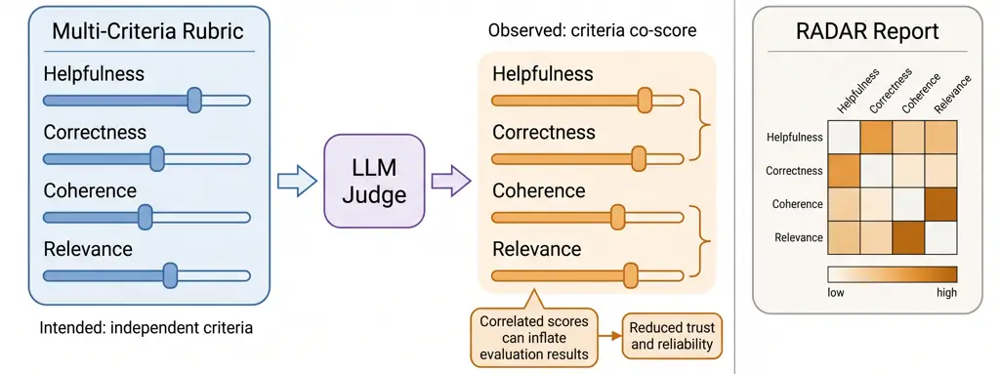
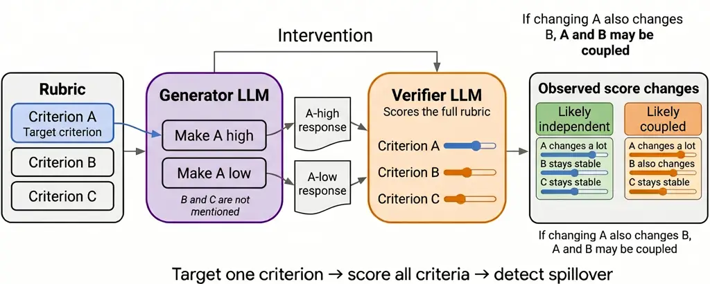
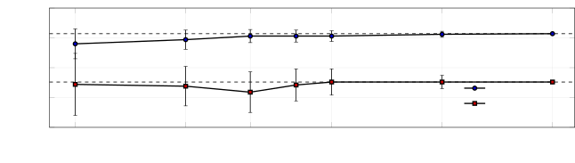

# RADAR: Rubric-Aware Dependency and Redundancy Analysis for LLM-as-Judge Evaluation

Divyansh Singh Affiliation: Microsoft Affiliation: University of Florida
Email: <rezadavari@microsoft.com>    Reza Davari Affiliation: Microsoft
Email: [mashhadi@uw.edu](mailto:)    Afra Mashhadi
Affiliation: Microsoft Affiliation: University of Washington
Email: [divyansh.singh@ufl.edu](mailto:)

###### Abstract

Rubric-based LLM-as-judge pipelines often assume that evaluation
criteria provide independent signals. In practice, however, criteria can
be behaviorally coupled: improving one criterion may systematically
change scores on another, distorting aggregate scores used in
model-release or product-update decisions. We introduce RADAR, a
lightweight preflight diagnostic framework for estimating such coupling
before large-scale evaluation. Given a rubric, RADAR generates targeted
synthetic probes, scores each probe on all criteria, and produces a
directional coupling matrix that shows which criteria co-score and how.
We validate RADAR on three industry-relevant evaluation settings: NVIDIA
HelpSteer2, SumPubMed, and the Yale-Salesforce SummEval benchmark. Using
only a small number of probes per criterion, RADAR recovers human
inter-criterion correlation structure (Pearson $`r\geq 0.84`$) and
provides practitioners with concrete audit signals about redundancy,
hierarchy, and aggregation sensitivity before committing to large-scale
judging.

## 1 Introduction

LLM-as-a-judge evaluation has become a common way to scale the
assessment of open-ended model outputs (Zheng et al., 2023; Chen et al.,
2025; Zhang et al., 2025). Many pipelines now use rubrics of criteria
such as _helpfulness_, _correctness_, _coherence_, or _fluency_ to
decompose quality into named dimensions, making evaluation more
interpretable and actionable (Liu et al., 2023; Kim et al., 2024; Ye et
al., 2023). In industry this scaffolding is load-bearing: rubric scores
gate model releases, drive iteration, and feed automated regression
checks Shankar et al. (2024), so the trustworthiness of a rubric
directly affects shipping decisions.

Rubric-based evaluation rests on an implicit assumption: that criteria
provide sufficiently independent signal. This can fail in two ways. The
first is _rubric-intrinsic_: criteria that are duplicated, nested, or
target the same latent construct, visible in the rubric text and
detectable with lightweight checks such as embedding-based criterion
de-duplication or entailment-style rubric matching (Siro et al., 2026;
Dhole and Agichtein, 2026; Shen et al., 2026). The second, our focus, is
subtler: criteria can be semantically distinct yet _behaviorally
coupled_ under LLM judging (Murugadoss et al., 2025; Feuer et al.,
2025a). “Conciseness” and “being to the point” are not the same
criterion, yet realistic LLM outputs often make concise answers also
appear focused while verbose answers drift, so scoring both
independently double-counts the same response pattern even when no
redundancy is visible in the rubric text. Left undetected, this coupling
silently inflates or distorts aggregate scores (Malberg et al., 2025),
biasing exactly the comparisons teams rely on to choose between model
versions (Figure 1).



Figure 1: Rubric criteria can co-score under an LLM judge:
independent-looking criteria (left) may move together (center),
inflating aggregates. RADAR recovers this hidden structure (right),
flagging which criteria are coupled and how before evaluation.

This problem is amplified by how LLM judges read rubrics. Because a
judge interprets evaluative language through its own internal sense of
quality Siro et al. (2026), several nominally distinct criteria can be
driven by a single property it attends to, often surface fluency, rather
than by the dimensions the rubric names. High agreement between two
criteria then need not mean the response is good on both, only that the
judge read one shared feature into both. Psychometric analyses confirm
this collapse: distinct criteria reduce to a few latent dimensions at
very high inter-criterion correlations Feuer et al. (2025b).

Existing methods such as hierarchical criterion decomposition Liu et al.
(2024), recursive rubric decomposition and reweighting Shen et al.
(2026), and pipelines built on fixed human-defined axes Fabbri et al.
(2021); Wang et al. (2024); Hashemi et al. (2024); Siro et al. (2026),
largely operate on the rubric semantically or optimize it against
downstream performance, while a complementary line diagnoses judge
unreliability _post hoc_ on already-scored data Feuer et al. (2025b).
None answers the preflight question: which criteria will behave as
dependent dimensions under evaluation, and in which direction, before
that evaluation is run? Correlation in observed scores cannot separate
criteria the judge treats as one dimension from criteria that merely
co-occur in the data; isolating the former requires probing how a judge
_acts_ on a rubric under intervention, not just how it scores in
aggregate.

We introduce RADAR (Rubric-Aware Dependency and Redundancy Analysis), a
preflight framework for diagnosing LLM-as-judge rubrics. Given a rubric,
RADAR generates criterion-conditioned synthetic sample responses. That
is, for each criterion, examples intended to strongly satisfy or clearly
violate it while leaving the others unspecified. It then has a verifier
score every response on the full set of criteria and assembles the
results into a directional coupling matrix measuring how much changing
one criterion influences the others. The question is not whether two
criteria sound similar but whether they behave as independent dimensions
under targeted intervention: if pushing $`C_{i}`$ also raises $`C_{j}`$,
then $`C_{i}`$ leaks into $`C_{j}`$. These patterns do not prescribe a
unique repair, since coupling may reflect redundancy, an intended
hierarchy, or an acceptable product preference; they do, however,
convert an otherwise hidden rubric failure mode into actionable audit
hypotheses: bidirectional leakage suggests possible double-counting,
asymmetric leakage suggests upstream-downstream dependence, and
task-specific leakage suggests distribution-sensitive coupling.

We validate RADAR on three human-annotated benchmarks: HelpSteer2,
SummEval, and SumPubMed, where annotation correlations provide an
external reference for criterion dependence. Across all three, RADAR’s
coupling estimates over axes such as helpfulness, coherence, verbosity,
and relevance predict the correlation structure observed in human
annotations. A small set of rubric-conditioned synthetic probes thus
recovers the dependency structure of much larger human-annotated
corpora, indicating that preflight intervention anticipates the coupling
that surfaces in real evaluation.

Concretely, our contributions are: (i) a criterion-coupling metric that,
given a rubric, generates criterion-conditioned synthetic responses and
scores them on all criteria to estimate a directional leakage matrix,
probing whether criteria behave as separable dimensions under
intervention rather than by static rubric similarity; (ii) a validation
across three benchmarks showing that RADAR’s synthetic coupling
estimates recover human-observed dependency structure, positioning it as
a practical preflight diagnostic for identifying co-scoring dimensions
before expensive annotation or large-scale judge evaluation; and (iii) a
low-cost scalability analysis showing that RADAR recovers stable
coupling estimates from only a few probes per criterion, making it cheap
enough to keep auditing the growing set of rubrics that agentic systems,
with their many sub-components, and fast-moving model releases demand.

## 2 Related Work

Prior work motivates structured evaluation criteria but does not
estimate, before evaluation, which criteria will behave as dependent
dimensions under human or LLM judging. This is the gap RADAR addresses.

##### Rubric-based LLM-as-a-judge evaluation

Scoring outputs against explicit criteria is now a standard alternative
to holistic judgments, with approaches such as G-Eval Liu et al. (2023)
and criterion-by-criterion analytic rubrics preferred for
interpretability. This decomposition makes rubric design consequential,
dependence among criteria propagates silently into the aggregate, yet
whether criteria supply independent signal is rarely checked.

##### Generating and refining rubrics

A growing line of work uses LLMs to build and improve rubrics rather
than treat them as static: HD-Eval Liu et al. (2024) learns a
human-preference-guided aggregation over a criterion hierarchy, and
Recursive Rubric Decomposition (RRD) Shen et al. (2026) splits and
reweights criteria, treating redundancy by whitening and decorrelating
scores. We have adapted RRD as our baseline. Both works optimize a
rubric to score well; our aim is orthogonal. We take an existing rubric
and diagnose which criteria behave as dependent dimensions, yielding not
a better score but a dependency structure for review before deployment.

##### Auditable evaluation objectives

ARGO Sodhi et al. (2026) uses rubrics to interpret black-box reward
models, revealing proxy objectives that may diverge from intended
behavior. RADAR is complementary: rather than extracting rubrics from a
learned reward model, it takes an existing rubric and tests whether its
criteria behave as separable dimensions under LLM judging.

##### Biases and reliability of LLM judges

Beyond known biases of length, position, phrasing, and self-preference
Wang et al. (2023); Stureborg et al. (2024), Siro et al. (2026) show
evaluative meaning is model-specific, so nominally distinct criteria can
be driven by one shared feature. Feuer et al. (2025b) document this as
severe _factor collapse_ (correlations above $`0.9`$), but measure it
observationally on already-scored data, which cannot separate criteria a
judge treats as one dimension from criteria that merely co-vary. RADAR
instead intervenes, targeting one criterion while leaving others
unspecified, so movement in the untargeted criteria evidences coupling
and locates where collapse occurs before evaluation.

##### Multi-dimensional human-annotated evaluation

Our validation uses benchmarks with human ratings along several quality
axes as an external reference for criterion dependence: SummEval Fabbri
et al. (2021) (coherence, consistency, fluency, relevance), HelpSteer2
Wang et al. (2024) (helpfulness, correctness, coherence, complexity,
verbosity), and SumPubMed Gupta et al. (2021) (coverage, redundancy,
readability, coherence, informativeness), alongside work on
human-defined rubrics for predicting human judgments Hashemi et al.
(2024); Siro et al. (2026). We treat their correlation structure not as
a fitting target but as an external reference for testing whether
RADAR’s intervention-based estimates recover dependencies that surface
in real evaluation.

## 3 Methodology

RADAR takes a rubric as input and, without human-labelled data, returns
a directional coupling matrix over its criteria in three stages: (i)
criterion-conditioned _synthetic intervention_ on a generator LLM, (ii)
full-rubric _scoring_ by a verifier LLM, and (iii) _coupling statistics_
from the resulting scores. Stages (i) and (ii) are decoupled, so the
same probes can be re-scored by different verifiers. Figure 2
illustrates the design for one target criterion.



Figure 2: RADAR generates high- and low-scoring probes for one criterion
and scores them on the full rubric; shifts in untargeted criteria reveal
behavioral coupling; even a few probes per criterion recover the human
inter-criterion structure (Pearson $`\geq 0.84`$).

### 3.1 Setup and notation

Let $`\mathcal{R}=\{C_{1},\ldots,C_{n}\}`$ be a rubric of $`n`$
criteria, each a label and a one-paragraph definition. Let
$`\mathcal{T}=\{t_{1},\ldots,t_{T}\}`$ be task prompts from the target
domain spanning the response shapes the rubric must cover, $`G`$ a
_generator_ LLM, and $`V`$ a _verifier_ LLM (an LLM-as-a-judge scoring
responses against the rubric); both are black boxes. For each $`t`$,
criterion $`C_{i}`$, and direction $`d\in\{+,-\}`$ we draw $`N`$ probe
responses

```math
x^{(t,i,d)}_{v}\sim G\bigl(\mathrm{prompt}(t,C_{i},d)\bigr),\quad v=1,\ldots,N,
```

a corpus of size $`|\mathcal{T}|\cdot n\cdot 2\cdot N`$ per generator,
which $`V`$ scores on _every_ criterion.

### 3.2 Stage 1: Criterion-conditioned generation

The prompt names only the targeted criterion $`C_{i}`$ and instructs the
generator not to optimize any other. For an _evaluative_ criterion
(higher $`=`$ better) it asks for a response that “strongly satisfies”
($`d=+`$) or “clearly fails” ($`d=-`$) $`C_{i}`$; for a _descriptive_
one (e.g., verbosity), to sit at the high or low end. We draw $`N`$
responses per setting at temperature $`0.9`$; the full template is in
Appendix B. Varying one criterion and measuring shifts in the others
makes this a synthetic intervention rather than passive co-variation.
Because targeting one criterion may also shift other properties of the
response, we read movement in the untargeted criteria as _evidence_ of
coupling, not as proof that the intervention caused it.

### 3.3 Stage 2: Per-criterion scoring

The verifier is queried $`n`$ times per probe, _independently_ per
criterion: the $`i`$-th query supplies the task prompt, the response,
and $`C_{i}`$’s definition, and returns an integer score
$`S_{i}(x)\in\{0,1,2,3,4\}`$ with a brief rationale. Separate calls
remove within-prompt ordering and self-consistency effects, so residual
correlation across the $`S_{i}(x)`$ is less likely to be a prompt
artifact. Scores map to normalized values
$`p_{i}(x)=\tfrac{1}{4}S_{i}(x)\in[0,1]`$ (a quality level for
evaluative criteria, a scale position for descriptive ones).

### 3.4 Stage 3: Coupling statistics

Statistics are computed per (generator, verifier, task) slice and
aggregated. Let $`\mathcal{X}_{i,d}^{t}`$ be the probes for task $`t`$
targeting $`C_{i}`$ in direction $`d`$, and
$`\bar{p}_{j}(i,d)=\tfrac{1}{|\mathcal{X}_{i,d}^{t}|}\sum_{x\in\mathcal{X}_{i,d}^{t}}p_{j}(x)`$
the verifier’s mean score on $`C_{j}`$ over that set (we suppress
$`t`$).

#### 3.4.1 Self-effect

The change in $`C_{i}`$’s own score between its high and low
interventions,

```math
\mathrm{SelfEffect}(C_{i})=\bar{p}_{i}(i,+)-\bar{p}_{i}(i,-)\in[-1,1], \tag{1}
```

measures how legible the intervention is to the verifier; it is the unit
of intervention strength that all later quantities are normalized
against.

#### 3.4.2 Directional coupling and leakage

The effect of intervening on $`C_{i}`$ as read on $`C_{j}`$,
$`\mathrm{GenCoupling}(C_{i}\!\to\!C_{j})=\bar{p}_{j}(i,+)-\bar{p}_{j}(i,-)`$,
normalized by the source self-effect, gives

```math
\mathrm{Leakage}(C_{i}\!\to\!C_{j})=\frac{\mathrm{GenCoupling}(C_{i}\!\to\!C_{j})}{\mathrm{SelfEffect}(C_{i})}. \tag{2}
```

Diagonal entries are $`1`$; off-diagonals near zero mean $`C_{j}`$ is
separable from $`C_{i}`$, near one that the verifier moves them
together. Leakage may be negative (a tradeoff) or exceed one (the
untargeted criterion shifts more than the targeted one).

#### 3.4.3 Reliability gating

Leakage is undefined at zero self-effect and unstable for weak
interventions. We mark $`C_{i}\!\to\!C_{j}`$ _unreliable_ when
$`\mathrm{SelfEffect}(C_{i})<\tau`$ ($`\tau=0.40`$, a $`1.6`$-point gap
on the $`0`$ to $`4`$ scale; below it the self-effect is too small to
normalize against); negative self-effects (failed interventions or
mis-specified polarity) are excluded. Pair-level summaries require both
directions to pass.

#### 3.4.4 Symmetric coupling and asymmetry

For each pair $`\{C_{i},C_{j}\}`$, with
$`\ell_{ij}=\mathrm{Leakage}(C_{i}\!\to\!C_{j})`$,

```math
\displaystyle\mathrm{SymCoupling}(C_{i},C_{j}) \displaystyle=\tfrac{1}{2}\bigl(\ell_{ij}+\ell_{ji}\bigr), \tag{3}
```

```math
\displaystyle\mathrm{Asymmetry}(C_{i},C_{j}) \displaystyle=\bigl|\ell_{ij}-\ell_{ji}\bigr|. \tag{4}
```

High symmetric coupling with low asymmetry suggests a shared-quality
cluster; high asymmetry suggests directional dependence (e.g.,
upstream-downstream) under the verifier. We also report each matrix’s
mean positive and maximum off-diagonal leakage (Appendix C).

### 3.5 Task and model aggregation

To separate coupling intrinsic to the rubric from coupling specific to
certain response types, we run the procedure per task and aggregate:

```math
\displaystyle\bar{\ell}_{ij} \displaystyle=\tfrac{1}{T}\textstyle\sum_{t=1}^{T}\mathrm{Leakage}_{t}(C_{i}\!\to\!C_{j}), \tag{5}
```

```math
\displaystyle\sigma_{ij} \displaystyle=\mathrm{Std}_{t}\bigl[\mathrm{Leakage}_{t}(C_{i}\!\to\!C_{j})\bigr]. \tag{6}
```

High $`\bar{\ell}_{ij}`$ with low $`\sigma_{ij}`$ indicates stable,
rubric-level coupling; high leakage on a subset of tasks indicates
distribution-sensitive coupling. Running RADAR across generator-verifier
pairs likewise separates stable rubric-level patterns from
evaluator-specific ones.

## 4 Experimental Setup

We instantiate RADAR on three multi-axis evaluation benchmarks using a
generator-verifier grid of contemporary LLMs. The benchmarks provide the
rubric axes and human ratings used as an external reference in
Section 5; RADAR itself consumes only rubric text during diagnosis.

### 4.1 Benchmarks and rubrics

We evaluate on three multi-axis, human-annotated benchmarks, taking each
one’s released axes and rubric descriptions verbatim. HelpSteer2 (Wang
et al., 2024) rates assistant responses on _helpfulness_, _correctness_,
_coherence_, _complexity_, and _verbosity_; SummEval (Fabbri et al., 2021) rates news summaries on _coherence_, _consistency_, _fluency_, and
_relevance_; and SumPubMed (Gupta et al., 2021) rates biomedical
summaries on _non-redundancy_, _coherence_, _readability_, and
_informativeness_.¹¹ 1 The SumPubMed rubric also defines _coverage_, but
the released human annotations omit it; we validate on the four
annotated axes. For each, we hand-curate $`T=5`$ short task prompts from
the target domain, independent of the annotated corpus, so validation
compares RADAR’s synthetic estimates against the dependency structure in
separately collected human ratings.

### 4.2 Models and generation protocol

We run RADAR over a generator-verifier grid of four LLMs: GPT-5-mini,
GPT-5.5 Reasoning, Claude Opus 4.7, and Claude Sonnet 4.6, each serving
as both generator and verifier. We exclude self-pairings ($`G{=}V`$) to
avoid the well-documented self-preference bias of LLM judges Wataoka et
al. (2025), leaving $`12`$ off-diagonal cells per benchmark ($`36`$
total).

Per benchmark-generator pair we draw $`N{=}20`$ probes per
$`(\text{task},\text{criterion},\text{direction})`$ cell, and each
verifier scores every probe on every criterion. Generation uses
temperature $`0.7`$ for diversity; verifier scoring is deterministic.
Full prompts, task lists, decoding settings, and preprocessing are in
Appendix D.

### 4.3 Baselines and metrics

We compare against two passive estimators of criterion dependence.
Synthetic correlation scores unconditioned generations on every
criterion and correlates the score columns, the co-variation a rubric
shows without any intervention. RRD (Shen et al., 2026) applies its
whitening-based decorrelation to an independently sampled score set. We
score every method against the human inter-criterion correlations with
Pearson’s $`r`$, Spearman’s $`\rho`$, and MAE. Baseline and metric
definitions are in Appendix E.

| Dataset    | Pair $`(C_{i},C_{j})`$    | $`\ell_{ij}`$ | $`\ell_{ji}`$ | Sym   | Asym. | Hum. corr. | Interpretation                   |
| ---------- | ------------------------- | ------------- | ------------- | ----- | ----- | ---------- | -------------------------------- |
| HelpSteer2 | helpfulness / correctness | +1.02         | +0.82         | +0.92 | 0.21  | +0.94      | bidirectional cluster            |
| HelpSteer2 | correctness / coherence   | +0.22         | +0.78         | +0.50 | 0.56  | +0.47      | directional (coh. $`\to`$ corr.) |
| SummEval   | coherence / fluency       | +0.64         | +0.51         | +0.57 | 0.16  | +0.67      | bidirectional cluster            |
| SummEval   | coherence / relevance     | +0.28         | +0.53         | +0.41 | 0.27  | +0.56      | directional (rel. $`\to`$ coh.)  |
| SumPubMed  | coherence / readability   | +0.62         | +0.26         | +0.44 | 0.39  | +0.62      | directional (coh. $`\to`$ read.) |

Table 1: Diagnostic pairs surfaced by RADAR.³³ 3 Values are means across
the full 4$`\times`$3 generator-verifier grid (12 cells per benchmark,
excluding self-judging); per-cell breakdowns in Appendix F. RADAR’s
symmetric coupling tracks the human correlation (Hum. corr.) on every
pair; asymmetry separates *bidirectional clusters* from *directional
dependence* ($`\ell_{ij}=\mathrm{Leakage}(C_{i}\!\to\!C_{j})`$, by the
larger leakage).

## 5 Results

We ask two questions of RADAR. First, does its criterion-conditioned
coupling estimates recover the dependency structure in human annotations
on the same rubric (Section 5.1)? Second, what dependencies does the
directional coupling matrix surface (Section 5.2)? Table 2 reports a
single representative cell (GPT-5.5-R $`\to`$ Sonnet-4.6) so that RADAR,
synthetic correlation, and RRD Shen et al. (2026) are scored under one
generator; Table 3 aggregates across the full grid, with per-cell
breakdowns for both views in Appendix F.

### 5.1 RADAR recovers human-observed criterion dependence

For each benchmark we compare RADAR’s symmetric coupling
$`\mathrm{SymCoupling}(C_{i},C_{j})`$ against the human inter-criterion
Pearson correlations on the off-diagonal pairs, scoring it and the two
passive baselines on all three metrics (Table 2).

| Dataset    | Method          | Pear.  | Spear. | MAE   |
| ---------- | --------------- | ------ | ------ | ----- |
| HelpSteer2 | Synthetic corr. | +0.671 | +0.714 | 0.258 |
|            | RRD             | +0.570 | +0.044 | 0.318 |
|            | RADAR           | +0.957 | +0.879 | 0.075 |
| SummEval   | Synthetic corr. | -0.111 | -0.500 | 0.581 |
|            | RRD             | +0.050 | +0.395 | 0.341 |
|            | RADAR           | +0.842 | +0.943 | 0.273 |
| SumPubMed  | Synthetic corr. | +0.765 | +0.486 | 0.160 |
|            | RRD             | +0.064 | -0.030 | 0.386 |
|            | RADAR           | +0.872 | +0.829 | 0.079 |

Table 2: Agreement with human inter-criterion Pearson correlations
(GPT-5.5-R $`\to`$ Sonnet-4.6 cell). RADAR recovers the human structure
on all three benchmarks (Pearson $`\geq 0.84`$) where the baselines Shen
et al. (2026) do not.

| $`N`$ | Cost (MTok) | % of full | Pearson $`r`$      |
| ----- | ----------- | --------- | ------------------ |
| 3     | 1.16        | 0.8%      | $`0.953\pm 0.011`$ |
| 5     | 1.94        | 1.3%      | $`0.953\pm 0.009`$ |
| 20    | 7.74        | 5.2%      | $`0.957`$          |

Table 3: Cost vs. accuracy by probe budget $`N`$ (HelpSteer2; full
annotation $`149.5`$M tokens). Pearson $`r`$ (mean $`\pm`$ s.d. over
$`30`$ probe subsamples; $`N{=}20`$ is the full sample) is flat as cost
grows: $`N{=}3`$ costs under $`1\%`$ of full annotation at the accuracy
of $`N{=}20`$, and all three benchmarks stay $`\geq 0.84`$ at every
$`N`$ (Appendix G).

RADAR recovers the human structure on all three benchmarks (Pearson
$`\geq 0.84`$, Spearman $`\geq 0.83`$), the only method to do so
consistently: the passive baselines are inconsistent, with synthetic
correlation at $`r{=}-0.11`$ on SummEval and RRD never exceeding
$`\rho{=}0.40`$. This holds with as few as $`N{=}3`$ to $`5`$ probes per
criterion, and cheaply: cost grows with $`N`$ but accuracy does not
(Table 3; full sweep in Appendix G).

### 5.2 Reading the audit: clusters, asymmetry, and unreliable criteria

The directional leakage matrix turns each rubric into an actionable
audit: it identifies which criteria behave as dependent signals,
separates symmetric double-counting from one-way dependence, and
prioritizes the pairs whose aggregation should be inspected before
large-scale judging (Table 3; full matrices in Appendix F).
_Bidirectional clusters_ (high symmetric coupling, low asymmetry) mark
criteria that move as one latent axis: HelpSteer2
_helpfulness_/_correctness_ ($`\mathrm{Sym}{=}0.92`$,
$`\mathrm{Asym}{=}0.21`$) and SummEval _coherence_/_fluency_ ($`0.57`$,
$`0.16`$). A release gate or aggregate that independently weights both
criteria may double-count that axis and over-weight it against the rest
of the rubric; practitioners should inspect whether that is happening,
for example by reviewing weights, hierarchy, or criterion definitions.
_Directional dependencies_, invisible to symmetric correlation, run one
way: HelpSteer2 *coherence* $`\to`$ *correctness* ($`0.78`$ vs.
$`0.22`$), SummEval *relevance* $`\to`$ *coherence* ($`0.53`$ vs.
$`0.28`$), and SumPubMed *coherence* $`\to`$ *readability* ($`0.62`$ vs.
$`0.26`$). Here the downstream criterion inherits the upstream’s signal,
so the pair is not independent evidence; the upstream criterion is the
one to scrutinize first. A single correlation would conflate these
cases; RADAR’s asymmetry separates them, and they warrant different
review.

### 5.3 Reliability and robustness

Self-effects clear the reliability threshold $`\tau{=}0.40`$ on every
axis (min $`0.46`$; per-benchmark means $`0.64`$ to $`0.78`$), so every
leakage above comes from a judge-legible intervention; criteria below
$`\tau`$ are flagged _unreliable_ and excluded. Full tables and
bootstrap CIs are in Appendix F.

## 6 Discussion

##### Rubric auditing has to scale with model and agent churn.

Between GPT-3.5 in Nov. 2022 and GPT-4o in May 2024, OpenAI released six
named public text or reasoning models; between GPT-4o and GPT-5.5 in
Apr. 2026, that number rose to 31 (OpenAI, 2026), so every release can
force a fresh look at the rubrics that judge system behavior.
Rubric-based LLM-as-judge scoring is the default at scale (Masood,
2026), feeding the release gates and regression dashboards where coupled
criteria double-count one latent factor and mis-rank model variants.
Agentic systems compound this, fanning out into orchestrators and
sub-agents (Anthropic, 2025), each needing its own rubric and audit.

##### RADAR flags coupled criteria cheaply, before the rubric is used.

RADAR flags this coupling where the passive baselines miss it, at a cost
independent of corpus size: a preflight costs $`\sim`$0.4M,
$`\sim`$1.2M, and $`\sim`$1.9M tokens at $`N{=}1`$, $`3`$, and $`5`$
against $`\sim`$150M to annotate the full HelpSteer2 corpus
($`380\times`$, $`130\times`$, and $`77\times`$ savings; Appendix A),
and accuracy barely moves: pair-level Pearson stays $`\geq 0.84`$ even
at $`N{=}1`$ (Appendix G). A failure to steer is itself diagnostic: a
criterion the generator cannot move and the verifier cannot read (a low
self-effect) is too ill-defined to score reliably.

##### Using RADAR in an industry loop.

RADAR runs on candidate rubrics before large-scale judging: teams set a
policy threshold, inspect coupled pairs above it, decide whether the
pattern reflects redundancy, hierarchy, or an acceptable product
preference, and rerun the diagnostic after any rubric change. This gives
rubric design an explicit audit step, replacing one-shot semantic review
with a behavioral check of how the evaluator will actually score.

## 7 Conclusion

We introduced RADAR, a diagnostic that uses targeted synthetic probes to
estimate directional coupling between criteria before large-scale
judging or annotation. Across three benchmarks it recovers the human
inter-criterion structure (Pearson $`\geq 0.84`$) at small probe budgets
(Appendix G).

## Limitations

RADAR measures the coupling a rubric induces under a specific
generator-verifier configuration, not an intrinsic property of the
rubric text. This conditioning is deliberate: coupling is a behavioral
property of the evaluator, so an audit tied to the deployed judge is
exactly what a team needs before trusting its scores. The estimate
should be refreshed when the production evaluator or target domain
changes.

RADAR provides behavioral evidence of criterion dependence, not formal
causal identification. For a preflight audit, the relevant question is
whether the verifier moves two criteria together under targeted probes.
Some dimensions are genuinely hard to vary in isolation, as improving
coherence can shift perceived readability, but directional normalization
and self-effect gating control for intervention strength, so reported
leakage is conditioned on judge-legible interventions rather than weak
or failed probes.

Human inter-criterion correlation is an imperfect external reference: it
mixes genuine dependence, annotator noise, and dataset-specific
co-occurrence, and no benchmark provides a gold dependency graph. We use
it only as a validation proxy; RADAR itself requires no human
inter-criterion labels and remains usable in production settings where
such labels are unavailable.

Our validation spans three text-based, multi-axis settings, assistant
response, news, and biomedical summarization, covering common industry
uses of LLM-as-judge systems. The method itself is modality- and
task-agnostic, depending only on a generator, a verifier, and a rubric;
extending it to multimodal evaluation, tool-use agents, safety rubrics,
or multi-turn workflows requires new probe tasks and intervention
templates, not changes to the diagnostic.

Finally, RADAR deliberately stops at diagnosis: it surfaces where
criteria behave dependently and leaves the decision to practitioners,
because in production the same coupling may be redundancy, an intended
hierarchy, or an acceptable product preference. Prescribing a single fix
would overreach; the diagnostic’s role is to make that decision
informed, and to make it before expensive annotation or judge runs.

## References

- Anthropic (2025) Anthropic How we built our multi-agent research
  system. Note: Anthropic Engineering
  Blog[https://www.anthropic.com/engineering/built-multi-agent-research-system](https://www.anthropic.com/engineering/built-multi-agent-research-system)
  Cited by: §6.
- Chen et al. (2025) N. Chen, Z. Hu, Q. Zou, J. Wu, Q. Wang, B. Hooi,
  and B. He Judgelrm: large reasoning models as a judge. arXiv preprint
  arXiv:2504.00050. Cited by: §1.
- Dhole and Agichtein (2026) K. D. Dhole and E. Agichtein RubricRAG:
  towards interpretable and reliable llm evaluation via domain knowledge
  retrieval for rubric generation. External Links: 2603.20882,
  [Link](https://arxiv.org/abs/2603.20882) Cited by: §1.
- Fabbri et al. (2021) A. R. Fabbri, W. Kryściński, B. McCann, C.
  Xiong, R. Socher, and D. Radev SummEval: re-evaluating summarization
  evaluation. Transactions of the Association for Computational
  Linguistics 9, pp. 391–409. External Links:
  [Link](https://aclanthology.org/2021.tacl-1.24/),
  [Document](https://dx.doi.org/10.1162/tacl%5Fa%5F00373) Cited by: §1,
  §2, §4.1.
- Feuer et al. (2025a) B. Feuer, M. Goldblum, T. Datta, S. Nambiar, R.
  Besaleli, S. Dooley, M. Cembalest, and J. P. Dickerson Style outweighs
  substance: failure modes of llm judges in alignment benchmarking. In
  International Conference on Learning Representations, Vol. 2025,
  pp. 11552–11582. Cited by: §1.
- Feuer et al. (2025b) B. Feuer, C. Tseng, A. S. Lathe, O. Elachqar,
  and J. P. Dickerson When judgment becomes noise: how design failures
  in llm judge benchmarks silently undermine validity. External Links:
  2509.20293, [Link](https://arxiv.org/abs/2509.20293) Cited by: §1, §1,
  §2.
- Gupta et al. (2021) V. Gupta, P. Bharti, P. Nokhiz, and H. Karnick
  SumPubMed: summarization dataset of PubMed scientific articles. In
  Proceedings of the 59th Annual Meeting of the Association for
  Computational Linguistics and the 11th International Joint Conference
  on Natural Language Processing: Student Research Workshop, J.
  Kabbara, H. Lin, A. Paullada, and J. Vamvas (Eds.), Online,
  pp. 292–303. External Links:
  [Link](https://aclanthology.org/2021.acl-srw.30/),
  [Document](https://dx.doi.org/10.18653/v1/2021.acl-srw.30) Cited by:
  §2, §4.1.
- Hashemi et al. (2024) H. Hashemi, J. Eisner, C. Rosset, B. Van Durme,
  and C. Kedzie LLM-rubric: a multidimensional, calibrated approach to
  automated evaluation of natural language texts. In Proceedings of the
  62nd Annual Meeting of the Association for Computational Linguistics
  (Volume 1: Long Papers), pp. 13806–13834. External Links:
  [Link](http://dx.doi.org/10.18653/v1/2024.acl-long.745),
  [Document](https://dx.doi.org/10.18653/v1/2024.acl-long.745) Cited by:
  §1, §2.
- Kim et al. (2024) S. Kim, J. Shin, J. Jang, S. Longpre, H. Lee, S.
  Yun, R. Shin, S. Kim, J. Thorne, M. Seo, et al. Prometheus: inducing
  fine-grained evaluation capability in language models. In
  International Conference on Learning Representations, Vol. 2024,
  pp. 29927–29962. Cited by: §1.
- Liu et al. (2023) Y. Liu, D. Iter, Y. Xu, S. Wang, R. Xu, and C. Zhu
  G-eval: nlg evaluation using gpt-4 with better human alignment.
  External Links: 2303.16634, [Link](https://arxiv.org/abs/2303.16634)
  Cited by: §1, §2.
- Liu et al. (2024) Y. Liu, T. Yang, S. Huang, Z. Zhang, H. Huang, F.
  Wei, W. Deng, F. Sun, and Q. Zhang HD-eval: aligning large language
  model evaluators through hierarchical criteria decomposition. In
  Proceedings of the 62nd Annual Meeting of the Association for
  Computational Linguistics (Volume 1: Long Papers), L. Ku, A. Martins,
  and V. Srikumar (Eds.), Bangkok, Thailand, pp. 7641–7660. External
  Links: [Link](https://aclanthology.org/2024.acl-long.413/),
  [Document](https://dx.doi.org/10.18653/v1/2024.acl-long.413) Cited by:
  §1, §2.
- Malberg et al. (2025) S. Malberg, R. Poletukhin, C. M. Schuster,
  and G. Groh A comprehensive evaluation of cognitive biases in llms. In
  Proceedings of the 5th International Conference on Natural Language
  Processing for Digital Humanities, pp. 578–613. Cited by: §1.
- Masood (2026) A. Masood Rubric-based evaluations and LLM-as-a-judge:
  methodologies, biases, and empirical validation in domain-specific
  contexts. Note:
  Medium[https://medium.com/@adnanmasood/rubric-based-evals-llm-as-a-judge-methodologies-and-empirical-validation-in-domain-context-71936b989e80](https://medium.com/@adnanmasood/rubric-based-evals-llm-as-a-judge-methodologies-and-empirical-validation-in-domain-context-71936b989e80)
  Cited by: §6.
- Murugadoss et al. (2025) B. Murugadoss, C. Poelitz, I. Drosos, V.
  Le, N. McKenna, C. S. Negreanu, C. Parnin, and A. Sarkar Evaluating
  the evaluator: measuring llms’ adherence to task evaluation
  instructions. In Proceedings of the AAAI Conference on Artificial
  Intelligence, Vol. 39, pp. 19589–19597. Cited by: §1.
- OpenAI (2026) OpenAI Model release notes. Note: OpenAI Help
  Center[https://help.openai.com/en/articles/9624314-model-release-notes](https://help.openai.com/en/articles/9624314-model-release-notes)
  Cited by: §6.
- Shankar et al. (2024) S. Shankar, J. Zamfirescu-Pereira, B.
  Hartmann, A. Parameswaran, and I. Arawjo Who validates the validators?
  aligning llm-assisted evaluation of llm outputs with human
  preferences. In Proceedings of the 37th Annual ACM Symposium on User
  Interface Software and Technology, pp. 1–14. Cited by: §1.
- Shen et al. (2026) W. F. Shen, X. Qiu, C. Whitehouse, L. Alazraki, S.
  Goel, F. Barbieri, T. Willi, A. Mathur, and I. Leontiadis Rethinking
  rubric generation for improving llm judge and reward modeling for
  open-ended tasks. arXiv preprint arXiv:2602.05125. Cited by: §1, §1,
  §2, §4.3, Table 2, §5.
- Siro et al. (2026) C. Siro, P. Aliannejadi, and M. Aliannejadi
  Learning to judge: llms designing and applying evaluation rubrics. In
  Findings of the Association for Computational Linguistics: EACL 2026,
  pp. 6371–6389. Cited by: §1, §1, §1, §2, §2.
- Sodhi et al. (2026) P. Sodhi, Y. Li, J. Landon, E. Wallace, and K.
  Chen Interpreting black box reward models. Note: OpenAI Alignment
  Research
  Blog[https://alignment.openai.com/argo/](https://alignment.openai.com/argo/)
  Cited by: §2.
- Stureborg et al. (2024) R. Stureborg, D. Alikaniotis, and Y. Suhara
  Large language models are inconsistent and biased evaluators. External
  Links: 2405.01724, [Link](https://arxiv.org/abs/2405.01724) Cited by:
  §2.
- Wang et al. (2023) P. Wang, L. Li, L. Chen, Z. Cai, D. Zhu, B. Lin, Y.
  Cao, Q. Liu, T. Liu, and Z. Sui Large language models are not fair
  evaluators. External Links: 2305.17926,
  [Link](https://arxiv.org/abs/2305.17926) Cited by: §2.
- Wang et al. (2024) Z. Wang, Y. Dong, O. Delalleau, J. Zeng, G.
  Shen, D. Egert, J. J. Zhang, M. N. Sreedhar, and O. Kuchaiev
  HelpSteer2: open-source dataset for training top-performing reward
  models. External Links: 2406.08673,
  [Link](https://arxiv.org/abs/2406.08673) Cited by: §1, §2, §4.1.
- Wataoka et al. (2025) K. Wataoka, T. Takahashi, and R. Ri
  Self-preference bias in llm-as-a-judge. External Links: 2410.21819,
  [Link](https://arxiv.org/abs/2410.21819) Cited by: §4.2.
- Ye et al. (2023) S. Ye, D. Kim, S. Kim, H. Hwang, S. Kim, Y. Jo, J.
  Thorne, J. Kim, and M. Seo Flask: fine-grained language model
  evaluation based on alignment skill sets. arXiv preprint
  arXiv:2307.10928. Cited by: §1.
- Zhang et al. (2025) X. Zhang, T. Gao, S. Jin, T. Wang, T. Ye, E. Adar,
  and Q. Mei Through the judge’s eyes: inferred thinking traces improve
  reliability of llm raters. arXiv preprint arXiv:2510.25860. Cited by:
  §1.
- Zheng et al. (2023) L. Zheng, W. Chiang, Y. Sheng, S. Zhuang, Z.
  Wu, Y. Zhuang, Z. Lin, Z. Li, D. Li, E. Xing, et al. Judging
  llm-as-a-judge with mt-bench and chatbot arena. Advances in neural
  information processing systems 36, pp. 46595–46623. Cited by: §1.

## Appendix

## Appendix A Preflight Auditing vs. Full-Corpus Annotation

Annotating a corpus against a rubric, by human raters or an LLM judge,
pays a per-item cost on every criterion, scaling as
$`\mathcal{O}(|D|\,K)`$, whereas RADAR probes a small fixed task set at
a cost independent of $`|D|`$ (§G). Table 4 quantifies the gap: on
HelpSteer2 ($`|D|=21{,}362`$, $`K=5`$), full LLM annotation costs
$`\approx\!149.5`$ MTok against $`1.94`$ MTok for an $`N=5`$ preflight
($`77\times`$ cheaper, or $`380\times`$ at $`N=1`$) and the gap widens
to $`23\times`$ to $`117\times`$ on a larger rubric ($`|D|=10{,}000`$,
$`K=8`$). RADAR is thus cheap enough to run as a routine preflight:
audit the rubric first, and merge, rewrite, split or drop strongly
coupled axes before committing to full-scale annotation.

|                         | HelpSteer2 | Hypothetical |
| ----------------------- | ---------- | ------------ | ------ | ------ |
| Corpus $`               | D          | `$           | 21,362 | 10,000 |
| Criteria $`K`$          | 5          | 8            |
| LLM annotation (MTok)   | 149.5      | 112.0        |
| RADAR $`N{=}1`$ (MTok)  | 0.39       | 0.96         |
| RADAR $`N{=}3`$ (MTok)  | 1.16       | 2.87         |
| RADAR $`N{=}5`$ (MTok)  | 1.94       | 4.78         |
| RADAR $`N{=}10`$ (MTok) | 3.87       | 9.55         |
| RADAR $`N{=}20`$ (MTok) | 7.74       | 19.10        |

Table 4: Token cost (MTok, input$`+`$output) of LLM-annotating the full
corpus on $`K`$ axes versus a single RADAR preflight cell at probe
budget $`N`$. Per-call medians from $`\sim`$20K cached calls: generator
$`\approx`$540 in/200 out; verifier $`\approx`$1,300 in/100 out.

## Appendix B Prompt Templates

All prompts use a 0 to 4 integer Likert scale; the JSON score
$`s\in\{0,\dots,4\}`$ is rescaled to a _normalized Likert score_
$`s/4\in[0,1]`$ so that all axes share a common range. Reasoning models
emit a \<think\>...\</think\> block, which we strip before a generation
is shown to any verifier.

### B.1 Stage 1: criterion-conditioned generation

The generator sees _only_ the target criterion $`C`$ and a direction
$`d\in\{+,-\}`$; all other criteria are hidden. The same prompt is
reused across the $`N`$ variants, so diversity comes solely from
sampling temperature.

##### Generator system message (all benchmarks).

> You are generating candidate responses for rubric testing. Follow the
> user instructions precisely. Output ONLY the candidate response itself
> (no preamble, no rubric commentary, no JSON, no surrounding quotes).

##### Generator user message.

> Task:  
> {task_prompt}  
> Generate a response that {target_phrase}.  
> Criterion: {criterion.label}  
> {criterion.description}  
> Important:  
> {instructions}

The direction $`d`$ controls {target_phrase} and {instructions}:

- •
  $`d=+`$, evaluative axis: _“strongly satisfies the following
  criterion”_; $`d=+`$, descriptive axis (e.g. HelpSteer2
  complexity/verbosity): _“sits clearly at the HIGH-word end of the
  $`\langle`$label$`\rangle`$ spectrum”_. Instructions: optimize _only_
  for this criterion, do not intentionally move any other criterion,
  keep the response realistic.
- •
  $`d=-`$, evaluative axis: _“clearly fails the following criterion”_;
  $`d=-`$, descriptive axis: _“sits clearly at the LOW-word end”_.
  Instructions: make the failure realistic and plausible, do not modify
  other criteria, do not make the response nonsensical unless the
  criterion requires it.

### B.2 Stage 2: per-criterion scoring

Each verifier scores every probe independently, issuing one call per
criterion (5 for HelpSteer2, 4 for SummEval/SumPubMed). The system
message names a single criterion and gives its one-paragraph definition;
the user message supplies the prompt/response pair and the JSON schema.

##### Verifier user message (HelpSteer2 form).

> Rate the {criterion_label} of the following response on a 5-point
> Likert scale (integer 0-4) for this criterion.  
> \### Prompt  
> ‘‘‘  
> {prompt}  
> ‘‘‘  
> \### Response  
> ‘‘‘  
> {response}  
> ‘‘‘  
> \### Output schema  
> Return exactly this JSON object, with no surrounding text. Fill the
> ‘reasoning‘ field first with a short step-by-step analysis (3-6 brief
> steps), then choose the integer ‘score‘, then write a 1-2 sentence
> ‘rationale‘.  
> {  
> "reasoning": "Step 1: ...\nStep 2: ...",  
> "score": 0,  
> "rationale": "1-2 sentences explaining the score."  
> }

The SummEval/SumPubMed forms are identical except that \### Prompt/\###
Response become \### Source article/\### Candidate summary.

##### Verifier system messages.

Each criterion has its own system message of the form “You are an expert
annotator rating only the $`\langle`$CRITERION$`\rangle`$ …on a 5-point
Likert scale (0 to 4)…” followed by the definition. The full set of
definitions is given in Tables 5 to 7.

| Criterion                   | Definition (verbatim from system message)                                                                                                                  |
| --------------------------- | ---------------------------------------------------------------------------------------------------------------------------------------------------------- |
| Helpfulness / Understanding | How useful and helpful the response is (an overall quality rating).                                                                                        |
| Correctness / Completeness  | Based on facts, no hallucinations or mistakes; covers everything required in the instruction.                                                              |
| Coherence / Clarity         | Self-consistent in content and style, does not contradict itself, can be logically followed, no redundant or repeated information.                         |
| Language Complexity         | Descriptive axis (simple $`\rightarrow`$ complex): simple end uses child-level vocabulary; complex end uses expert-level language. _Higher is not better._ |
| Verbosity                   | Descriptive axis (succinct $`\rightarrow`$ verbose): succinct end is direct; verbose end is wordy/long-winded. _Higher is not better._                     |

Table 5: HelpSteer2 criterion definitions used by both the generator and
the verifier.

| Criterion   | Definition                                                                                                                                    |
| ----------- | --------------------------------------------------------------------------------------------------------------------------------------------- |
| Coherence   | Collective quality of all sentences: well-structured and well-organized, builds from sentence to sentence, not a heap of related information. |
| Consistency | Factual alignment with the source; only statements entailed by the source. Hallucinated/contradicted facts are inconsistent.                  |
| Fluency     | Quality of individual sentences: grammatical, well-written, free of formatting/capitalization errors and awkward phrasing.                    |
| Relevance   | Selection of important content; include only important information, avoid redundancy and excess detail.                                       |

Table 6: SummEval criterion definitions (0 to 4 rescaling of the
original 1 to 5 scale; a linear shift that leaves all coupling metrics
unchanged).

| Criterion       | Definition                                                                                                            |
| --------------- | --------------------------------------------------------------------------------------------------------------------- |
| Non-redundancy  | No repeated information or near-duplicate sentences; each sentence adds new content.                                  |
| Coherence       | Well-structured and well-organized; sentences connect logically through clear referents and transitions.              |
| Readability     | Easy to read for a general scientific audience: clear sentence structure, jargon defined, free of grammatical errors. |
| Informativeness | Content-bearing information per sentence: specific results, mechanisms, comparisons over generic filler.              |

Table 7: SumPubMed criterion definitions. A fifth axis (coverage) is
defined in the code but excluded, as Gupta et al. release human scores
for only these four axes.

## Appendix C Coupling Summary Definitions

Let $`\bar{s}^{+}_{C\to C^{\prime}}`$ and
$`\bar{s}^{-}_{C\to C^{\prime}}`$ be the mean normalized Likert score
(in $`[0,1]`$) that the verifier assigns to criterion $`C^{\prime}`$
when the generator targets $`C`$ in the $`+`$ and $`-`$ directions. The
directional quantities are

```math
\displaystyle\mathrm{SelfEffect}(C_{i}) \displaystyle=\bar{s}^{+}_{C_{i}\to C_{i}}-\bar{s}^{-}_{C_{i}\to C_{i}}, \tag{7}
```

```math
\displaystyle\mathrm{GenCoupling}(C_{i}\!\to\!C_{j}) \displaystyle=\bar{s}^{+}_{C_{i}\to C_{j}}-\bar{s}^{-}_{C_{i}\to C_{j}}, \tag{8}
```

```math
\displaystyle\ell_{ij} \displaystyle=\frac{\mathrm{GenCoupling}(C_{i}\!\to\!C_{j})}{\mathrm{SelfEffect}(C_{i})}, \tag{9}
```

with the symmetric summary
$`\mathrm{SymCoupling}(C_{i},C_{j})=\tfrac{1}{2}(\ell_{ij}+\ell_{ji})`$.
Since every quantity is a _difference_ of mean normalized scores, the
$`1/4`$ rescaling cancels in $`\ell_{ij}`$ and affects only the
readability of $`\mathrm{SelfEffect}`$, not any coupling value.

##### Reliability gate.

A source criterion $`C_{i}`$ is usable only if its self-effect is large
enough that the intervention is judge-legible. Because leakage divides
by the self-effect, a small self-effect makes the ratio unstable (and
undefined at zero), so we require $`\mathrm{SelfEffect}(C_{i})\geq\tau`$
with $`\tau=0.40`$. The value is interpretable on the normalized scale:
since scores are rescaled as $`s/4`$ (i.e. $`0.25`$ per Likert point),
$`\tau=0.40`$ asks the targeted criterion to move by at least
$`\sim`$1.6 of the $`4`$ Likert points between its high and low probes,
so the verifier clearly separates the two probe sets before any leakage
routed through $`C_{i}`$ is trusted. The threshold is a conservative
floor rather than a tuned hyperparameter: every axis in our study clears
it comfortably (minimum self-effect $`0.46`$; Table 10), so the
recovered structure is unchanged for any threshold up to
$`\approx 0.45`$ and no annotated axis is dropped. Otherwise $`C_{i}`$
is flagged _unreliable_ and its row of leakage values is excluded from
normalized diagnoses.

##### Off-diagonal summaries.

For compact reporting we summarize each leakage matrix with off-diagonal
scalars. Because negative leakage indicates a tradeoff, we separate the
two signs into a positive coupling mass ($`\mathrm{GlobalPos}`$) and a
tension mass ($`\mathrm{GlobalTension}`$):

```math
\displaystyle\mathrm{GlobalPos} \displaystyle=\operatorname{mean}_{i\neq j}\,\max\!\left(0,\ell_{ij}\right), \tag{10}
```

```math
\displaystyle\mathrm{GlobalTension} \displaystyle=\operatorname{mean}_{i\neq j}\,\max\!\left(0,-\ell_{ij}\right), \tag{11}
```

and report $`\mathrm{MaxCoupling}=\max_{i\neq j}\,\ell_{ij}`$, the
rubric’s worst-case pair.

## Appendix D Experimental Setup Details

All generator and verifier calls bypass the prompt cache, so every
sample is computed fresh and every reported number reflects a real,
uncached inference cost.

##### Task lists.

Each benchmark uses five fixed, self-contained tasks (no copyrighted
source text) so the metrics step can separate rubric-intrinsic from
task-dependent coupling:

- •
  HelpSteer2: refund (support reply), summarize, math (word problem),
  code (merge_intervals), creative (poem).
- •
  SummEval: short news articles on politics, science, business, sports,
  and biography, each with a 2 to 3 sentence summary instruction.
- •
  SumPubMed: fabricated biomedical abstracts on clinical_trial,
  cell_biology, epidemiology, pharmacology, and surgery, each with a 4
  to 6 sentence summary instruction.

##### Decoding and sampling.

Table 8 lists the settings. Generation uses temperature $`0.9`$ so the
$`N=20`$ variants per
$`(\text{task},\text{criterion},\text{direction})`$ cell are genuinely
distinct; verifier scoring is deterministic (temperature $`0`$), with
one call per criterion.

| Setting                    | Generator | Verifier |
| -------------------------- | --------- | -------- |
| Temperature                | $`0.9`$   | $`0.0`$  |
| Max new tokens             | $`800`$   | $`800`$  |
| $`N`$ per $`(t,c,d)`$ cell | $`20`$    |          |

Table 8: Decoding and sampling settings for both stages.

##### Cost accounting (deployment view).

For a $`K`$-criterion rubric, one generator-verifier cell issues
$`5\!\cdot\!K\!\cdot\!2\!\cdot\!N`$ generation calls and $`K`$ times as
many verifier calls, i.e. $`10KN(1{+}K)`$ model calls in total. At the
main-text budget $`N=20`$ this is $`\approx\!6{,}000`$ calls for a
5-criterion rubric (HelpSteer2) and $`\approx\!4{,}000`$ for a
4-criterion rubric (SummEval, SumPubMed) _per cell_. Because the
recovered dependency structure is stable far below $`N=20`$ (§G), a
production audit can be run at $`N\!=\!5`$ ($`\approx\!1{,}500`$ /
$`1{,}000`$ calls) or even $`N\!=\!1`$ ($`\approx\!300`$ / $`200`$
calls), turning RADAR into a cheap preflight that fits inside a normal
CI budget. We treat $`N`$ as the primary cost knob and characterize it
in §G.

##### Score parsing.

The verifier returns a single JSON object per criterion; we parse the
first balanced {...} and read its integer score$`\in[0,4]`$. Every probe
contributes to every coupling estimate.

## Appendix E Baseline Details

We compare RADAR to two passive baselines computed on the same reported
generator-verifier cell (GPT-5.5-R $`\rightarrow`$ Sonnet-4.6).

##### Synthetic correlation.

This baseline measures ordinary score co-variation without intervention.
For each benchmark task, the generator produces unconditioned responses
using the standard task prompt, with no target criterion and no
direction. The verifier then scores each response on every rubric
criterion. For each criterion pair $`(C_{i},C_{j})`$, we compute the
Pearson correlation between the two score columns across generated
responses. These off-diagonal correlations form the synthetic
correlation vector compared against human inter-criterion correlations
in Table 2.

##### RRD.

We use Rubric Redundancy Detection (RRD) as a decorrelation baseline.
RRD starts from an independently sampled set of model responses scored
on all rubric criteria, estimates redundancy from the empirical
criterion-score covariance, and applies its whitening/decorrelation step
to identify overlap among rubric axes. We convert the resulting
pair-level redundancy scores into the same off-diagonal vector format as
RADAR and compare it to the human inter-criterion correlation vector.

##### Comparison protocol.

For all methods, evaluation is performed at the criterion-pair level.
Given the vector of off-diagonal method scores and the matched vector of
human inter-criterion Pearson correlations, we report Pearson’s $`r`$
(magnitude agreement), Spearman’s $`\rho`$ (rank agreement), and mean
absolute error (MAE). The main text reports one fixed reference cell for
readability; the complete generator-verifier grid for RADAR is shown in
Table 9.

## Appendix F Full Results

##### Grid agreement.

Table 9 reports the agreement between each cell’s
$`\mathrm{SymCoupling}`$ vector and the human inter-criterion Pearson
correlations, as Pearson / Spearman, for all $`12`$ generator-verifier
cells per benchmark. The cell reported in the main text (GPT-5.5-R
$`\rightarrow`$ Sonnet-4.6) is bold. Agreement is high and stable when
probes come from a capable generator such as GPT-5.5-R, recovering the
human structure across verifiers on every benchmark, which is the
property a practitioner needs before trusting the audit on a new rubric.

| (a) HelpSteer2 Verifier $`\rightarrow`$ |              |           |          |            |
| --------------------------------------- | ------------ | --------- | -------- | ---------- |
| Generator $`\downarrow`$                | GPT-5-mini   | GPT-5.5-R | Opus-4.7 | Sonnet-4.6 |
| GPT-5-mini                              | \-           | .91/.84   | .90/.95  | .92/.96    |
| GPT-5.5-R                               | .96/.89      | \-        | .97/.90  | .96/.88    |
| Opus-4.7                                | .87/.92      | .91/.94   | \-       | .93/.98    |
| Sonnet-4.6                              | .90/.88      | .93/.90   | .94/.94  | \-         |
| (b) SummEval                            |              |           |          |            |
| Generator $`\downarrow`$                | GPT-5-mini   | GPT-5.5-R | Opus-4.7 | Sonnet-4.6 |
| GPT-5-mini                              | \-           | .91/.77   | .96/.94  | .96/.94    |
| GPT-5.5-R                               | .93/.94      | \-        | .91/.94  | .84/.94    |
| Opus-4.7                                | .76/.77      | .71/.66   | \-       | .81/.89    |
| Sonnet-4.6                              | .71/.71      | .73/.77   | .62/.77  | \-         |
| (c) SumPubMed                           |              |           |          |            |
| Generator $`\downarrow`$                | GPT-5-mini   | GPT-5.5-R | Opus-4.7 | Sonnet-4.6 |
| GPT-5-mini                              | \-           | .70/.43   | .65/.43  | .75/.37    |
| GPT-5.5-R                               | .83/.49      | \-        | .85/.49  | .88/.83    |
| Opus-4.7                                | .47/.14      | .51/.43   | \-       | .60/.77    |
| Sonnet-4.6                              | $`-`$.04/.14 | .53/.37   | .33/.20  | \-         |

Table 9: Per-cell agreement (Pearson / Spearman) between
$`\mathrm{SymCoupling}`$ and human inter-criterion Pearson correlations,
for every generator-verifier cell in the four-model grid. Bold = the
cell reported in the main text.

##### Self-effects (reported cell).

Table 10 lists $`\mathrm{SelfEffect}(C_{i})`$ for the reported cell.
Every axis clears the reliability gate $`\tau=0.40`$, so all
off-diagonal leakage values below are computed from a judge-legible
intervention.

| Dataset    | Criterion       | SelfEffect |
| ---------- | --------------- | ---------- |
| HelpSteer2 | Helpfulness     | $`0.88`$   |
|            | Correctness     | $`0.61`$   |
|            | Coherence       | $`0.66`$   |
|            | Complexity      | $`0.57`$   |
|            | Verbosity       | $`0.46`$   |
| SummEval   | Coherence       | $`0.75`$   |
|            | Consistency     | $`0.84`$   |
|            | Fluency         | $`0.71`$   |
|            | Relevance       | $`0.59`$   |
| SumPubMed  | Non-redundancy  | $`0.52`$   |
|            | Coherence       | $`0.75`$   |
|            | Readability     | $`0.70`$   |
|            | Informativeness | $`0.89`$   |

Table 10: Self-effects for GPT-5.5-R $`\rightarrow`$ Sonnet-4.6. All
axes exceed the reliability gate $`\tau=0.40`$.

##### Per-pair coupling (top cells).

Table 11 gives every off-diagonal pair for the three best
generator-verifier cells per dataset, ranked by lowest pair-level MAE
between $`\mathrm{SymCoupling}`$ and the human inter-criterion Pearson
correlations. For each pair we list directional leakage
$`\ell_{ij},\ell_{ji}`$ (rows ordered as $`C_{i},C_{j}`$, so the gap
between the two columns shows the asymmetry), $`\mathrm{SymCoupling}`$,
the asymmetry $`|\ell_{ij}-\ell_{ji}|`$, and the matched human
correlation. The reported cell used throughout the main text (GPT-5.5-R
$`\rightarrow`$ Sonnet-4.6) is shown in bold within each dataset block;
agreement for all $`12`$ cells per benchmark is in Table 9.

|            |                                       |       |                                  |               |               |           |          |           |
| ---------- | ------------------------------------- | ----- | -------------------------------- | ------------- | ------------- | --------- | -------- | --------- | --- | ---------- |
| Dataset    | Gen $`\rightarrow`$ Ver               | MAE   | Pair $`(C_{i},C_{j})`$           | $`\ell_{ij}`$ | $`\ell_{ji}`$ | Sym       | $`       | \Delta    | `$  | Hum. $`r`$ |
| HelpSteer2 | GPT-5.5-R $`\rightarrow`$ Opus-4.7    | 0.060 | helpfulness / correctness        | $`+1.00`$     | $`+0.76`$     | $`+0.88`$ | $`0.24`$ | $`+0.94`$ |
|            |                                       |       | helpfulness / coherence          | $`+0.10`$     | $`+0.70`$     | $`+0.40`$ | $`0.59`$ | $`+0.50`$ |
|            |                                       |       | helpfulness / complexity         | $`+0.22`$     | $`+0.13`$     | $`+0.17`$ | $`0.09`$ | $`+0.18`$ |
|            |                                       |       | helpfulness / verbosity          | $`+0.20`$     | $`+0.19`$     | $`+0.19`$ | $`0.01`$ | $`+0.06`$ |
|            |                                       |       | correctness / coherence          | $`+0.03`$     | $`+0.70`$     | $`+0.37`$ | $`0.67`$ | $`+0.46`$ |
|            |                                       |       | correctness / complexity         | $`+0.11`$     | $`+0.16`$     | $`+0.13`$ | $`0.05`$ | $`+0.18`$ |
|            |                                       |       | correctness / verbosity          | $`+0.06`$     | $`+0.19`$     | $`+0.12`$ | $`0.12`$ | $`+0.06`$ |
|            |                                       |       | coherence / complexity           | $`+0.06`$     | $`+0.05`$     | $`+0.05`$ | $`0.01`$ | $`+0.05`$ |
|            |                                       |       | coherence / verbosity            | $`-0.06`$     | $`-0.01`$     | $`-0.04`$ | $`0.05`$ | $`-0.03`$ |
|            |                                       |       | complexity / verbosity           | $`+0.39`$     | $`+0.40`$     | $`+0.39`$ | $`0.01`$ | $`+0.32`$ |
|            | GPT-5.5-R $`\rightarrow`$ GPT-5-mini  | 0.069 | helpfulness / correctness        | $`+1.04`$     | $`+0.89`$     | $`+0.96`$ | $`0.15`$ | $`+0.94`$ |
|            |                                       |       | helpfulness / coherence          | $`+0.20`$     | $`+0.65`$     | $`+0.42`$ | $`0.45`$ | $`+0.50`$ |
|            |                                       |       | helpfulness / complexity         | $`+0.27`$     | $`+0.09`$     | $`+0.18`$ | $`0.18`$ | $`+0.18`$ |
|            |                                       |       | helpfulness / verbosity          | $`+0.17`$     | $`+0.04`$     | $`+0.11`$ | $`0.13`$ | $`+0.06`$ |
|            |                                       |       | correctness / coherence          | $`+0.11`$     | $`+0.68`$     | $`+0.40`$ | $`0.57`$ | $`+0.46`$ |
|            |                                       |       | correctness / complexity         | $`+0.10`$     | $`+0.12`$     | $`+0.11`$ | $`0.02`$ | $`+0.18`$ |
|            |                                       |       | correctness / verbosity          | $`+0.09`$     | $`+0.16`$     | $`+0.13`$ | $`0.07`$ | $`+0.06`$ |
|            |                                       |       | coherence / complexity           | $`-0.03`$     | $`+0.03`$     | $`-0.00`$ | $`0.06`$ | $`+0.05`$ |
|            |                                       |       | coherence / verbosity            | $`-0.27`$     | $`+0.01`$     | $`-0.13`$ | $`0.28`$ | $`-0.03`$ |
|            |                                       |       | complexity / verbosity           | $`+0.27`$     | $`+0.74`$     | $`+0.50`$ | $`0.47`$ | $`+0.32`$ |
|            | GPT-5.5-R $`\rightarrow`$ Sonnet-4.6  | 0.075 | helpfulness / correctness        | $`+0.98`$     | $`+0.83`$     | $`+0.91`$ | $`0.15`$ | $`+0.94`$ |
|            |                                       |       | helpfulness / coherence          | $`+0.59`$     | $`+0.68`$     | $`+0.64`$ | $`0.09`$ | $`+0.50`$ |
|            |                                       |       | helpfulness / complexity         | $`+0.19`$     | $`+0.21`$     | $`+0.20`$ | $`0.02`$ | $`+0.18`$ |
|            |                                       |       | helpfulness / verbosity          | $`+0.13`$     | $`+0.30`$     | $`+0.22`$ | $`0.17`$ | $`+0.06`$ |
|            |                                       |       | correctness / coherence          | $`+0.24`$     | $`+0.64`$     | $`+0.44`$ | $`0.40`$ | $`+0.46`$ |
|            |                                       |       | correctness / complexity         | $`+0.09`$     | $`+0.21`$     | $`+0.15`$ | $`0.12`$ | $`+0.18`$ |
|            |                                       |       | correctness / verbosity          | $`+0.15`$     | $`+0.21`$     | $`+0.18`$ | $`0.06`$ | $`+0.06`$ |
|            |                                       |       | coherence / complexity           | $`-0.00`$     | $`+0.05`$     | $`+0.02`$ | $`0.05`$ | $`+0.05`$ |
|            |                                       |       | coherence / verbosity            | $`-0.21`$     | $`+0.01`$     | $`-0.10`$ | $`0.22`$ | $`-0.03`$ |
|            |                                       |       | complexity / verbosity           | $`+0.38`$     | $`+0.53`$     | $`+0.45`$ | $`0.15`$ | $`+0.32`$ |
| SummEval   | Opus-4.7 $`\rightarrow`$ Sonnet-4.6   | 0.240 | coherence / consistency          | $`+0.00`$     | $`+0.18`$     | $`+0.09`$ | $`0.18`$ | $`+0.52`$ |
|            |                                       |       | coherence / fluency              | $`+0.80`$     | $`+0.64`$     | $`+0.72`$ | $`0.17`$ | $`+0.67`$ |
|            |                                       |       | coherence / relevance            | $`+0.55`$     | $`+0.91`$     | $`+0.73`$ | $`0.36`$ | $`+0.56`$ |
|            |                                       |       | consistency / fluency            | $`+0.00`$     | $`+0.04`$     | $`+0.02`$ | $`0.04`$ | $`+0.47`$ |
|            |                                       |       | consistency / relevance          | $`+0.85`$     | $`+0.33`$     | $`+0.59`$ | $`0.52`$ | $`+0.55`$ |
|            |                                       |       | fluency / relevance              | $`+0.08`$     | $`+0.28`$     | $`+0.18`$ | $`0.20`$ | $`+0.49`$ |
|            | GPT-5.5-R $`\rightarrow`$ Sonnet-4.6  | 0.273 | coherence / consistency          | $`+0.09`$     | $`+0.38`$     | $`+0.24`$ | $`0.29`$ | $`+0.52`$ |
|            |                                       |       | coherence / fluency              | $`+0.88`$     | $`+0.64`$     | $`+0.76`$ | $`0.24`$ | $`+0.67`$ |
|            |                                       |       | coherence / relevance            | $`+0.42`$     | $`+1.17`$     | $`+0.80`$ | $`0.75`$ | $`+0.56`$ |
|            |                                       |       | consistency / fluency            | $`+0.00`$     | $`+0.05`$     | $`+0.03`$ | $`0.05`$ | $`+0.47`$ |
|            |                                       |       | consistency / relevance          | $`+0.64`$     | $`+0.01`$     | $`+0.33`$ | $`0.63`$ | $`+0.55`$ |
|            |                                       |       | fluency / relevance              | $`+0.10`$     | $`+0.15`$     | $`+0.12`$ | $`0.05`$ | $`+0.49`$ |
|            | Sonnet-4.6 $`\rightarrow`$ GPT-5-mini | 0.285 | coherence / consistency          | $`-0.08`$     | $`+0.14`$     | $`+0.03`$ | $`0.22`$ | $`+0.52`$ |
|            |                                       |       | coherence / fluency              | $`+0.52`$     | $`+0.37`$     | $`+0.44`$ | $`0.15`$ | $`+0.67`$ |
|            |                                       |       | coherence / relevance            | $`+0.49`$     | $`+0.50`$     | $`+0.50`$ | $`0.01`$ | $`+0.56`$ |
|            |                                       |       | consistency / fluency            | $`+0.02`$     | $`-0.02`$     | $`+0.00`$ | $`0.04`$ | $`+0.47`$ |
|            |                                       |       | consistency / relevance          | $`+0.87`$     | $`+0.17`$     | $`+0.52`$ | $`0.70`$ | $`+0.55`$ |
|            |                                       |       | fluency / relevance              | $`+0.04`$     | $`+0.07`$     | $`+0.05`$ | $`0.03`$ | $`+0.49`$ |
| SumPubMed  | GPT-5.5-R $`\rightarrow`$ Sonnet-4.6  | 0.079 | non-redundancy / coherence       | $`+0.42`$     | $`+0.30`$     | $`+0.36`$ | $`0.12`$ | $`+0.33`$ |
|            |                                       |       | non-redundancy / readability     | $`+0.17`$     | $`+0.00`$     | $`+0.09`$ | $`0.17`$ | $`+0.29`$ |
|            |                                       |       | non-redundancy / informativeness | $`+0.35`$     | $`+0.10`$     | $`+0.23`$ | $`0.25`$ | $`+0.21`$ |
|            |                                       |       | coherence / readability          | $`+0.88`$     | $`+0.50`$     | $`+0.69`$ | $`0.38`$ | $`+0.62`$ |
|            |                                       |       | coherence / informativeness      | $`+0.32`$     | $`+0.57`$     | $`+0.45`$ | $`0.24`$ | $`+0.33`$ |
|            |                                       |       | readability / informativeness    | $`+0.00`$     | $`+0.30`$     | $`+0.15`$ | $`0.30`$ | $`+0.12`$ |
|            | Opus-4.7 $`\rightarrow`$ GPT-5-mini   | 0.133 | non-redundancy / coherence       | $`+0.23`$     | $`+0.65`$     | $`+0.44`$ | $`0.42`$ | $`+0.33`$ |
|            |                                       |       | non-redundancy / readability     | $`+0.18`$     | $`+0.35`$     | $`+0.26`$ | $`0.17`$ | $`+0.29`$ |
|            |                                       |       | non-redundancy / informativeness | $`+0.04`$     | $`+0.91`$     | $`+0.48`$ | $`0.87`$ | $`+0.21`$ |
|            |                                       |       | coherence / readability          | $`+0.76`$     | $`+0.04`$     | $`+0.40`$ | $`0.73`$ | $`+0.62`$ |
|            |                                       |       | coherence / informativeness      | $`+0.04`$     | $`+0.45`$     | $`+0.24`$ | $`0.41`$ | $`+0.33`$ |
|            |                                       |       | readability / informativeness    | $`+0.00`$     | $`+0.06`$     | $`+0.03`$ | $`0.06`$ | $`+0.12`$ |
|            | GPT-5-mini $`\rightarrow`$ Sonnet-4.6 | 0.139 | non-redundancy / coherence       | $`+0.46`$     | $`+0.46`$     | $`+0.46`$ | $`0.01`$ | $`+0.33`$ |
|            |                                       |       | non-redundancy / readability     | $`+0.38`$     | $`+0.84`$     | $`+0.61`$ | $`0.46`$ | $`+0.29`$ |
|            |                                       |       | non-redundancy / informativeness | $`+0.44`$     | $`+0.07`$     | $`+0.26`$ | $`0.37`$ | $`+0.21`$ |
|            |                                       |       | coherence / readability          | $`+0.76`$     | $`+0.67`$     | $`+0.71`$ | $`0.10`$ | $`+0.62`$ |
|            |                                       |       | coherence / informativeness      | $`+0.40`$     | $`+0.03`$     | $`+0.21`$ | $`0.37`$ | $`+0.33`$ |
|            |                                       |       | readability / informativeness    | $`+0.54`$     | $`-0.06`$     | $`+0.24`$ | $`0.60`$ | $`+0.12`$ |

Table 11: Pair-level leakage for the top-3 generator-verifier cells per
dataset, selected by lowest pair-level MAE between
$`\mathrm{SymCoupling}`$ and human inter-criterion Pearson correlations.
$`\ell_{ij}=\mathrm{Leakage}(C_{i}\!\to\!C_{j})`$;
$`|\Delta|=|\ell_{ij}-\ell_{ji}|`$ is the directional asymmetry; Hum.
$`r`$ is the matched human Pearson correlation. The reported cell used
throughout the main text (GPT-5.5-R $`\rightarrow`$ Sonnet-4.6) is in
bold. Diagonal leakage is $`1.00`$ by construction and omitted.

##### Global summaries and bootstrap CIs.

Table 12 reports the three global summaries for the reported cell on
each benchmark, each with a $`95\%`$ confidence interval obtained by
resampling probes $`500`$ times, stratified by target criterion and
perturbation direction. Across all three datasets the GlobalPositive
coupling is tightly estimated ($`0.32`$ to $`0.38`$, half-widths
$`\leq 0.02`$) and the GlobalTension is effectively zero, confirming
that the off-diagonal structure is dominated by positive cross-criterion
leakage rather than sampling noise. The MaxCoupling intervals
($`[0.96,1.01]`$, $`[1.11,1.23]`$, $`[0.85,0.92]`$) are likewise narrow,
so the strongest leakage pair on each benchmark is well separated from
zero.

| Dataset    | GlobalPos.                      | Tension                         | MaxCoup.                        |
| ---------- | ------------------------------- | ------------------------------- | ------------------------------- |
| HelpSteer2 | $`0.32`$ \[1pt\]$`[0.31,0.34]`$ | $`0.01`$ \[1pt\]$`[0.01,0.01]`$ | $`0.98`$ \[1pt\]$`[0.96,1.01]`$ |
| SummEval   | $`0.38`$ \[1pt\]$`[0.36,0.39]`$ | $`0.00`$ \[1pt\]$`[0.00,0.00]`$ | $`1.17`$ \[1pt\]$`[1.11,1.23]`$ |
| SumPubMed  | $`0.33`$ \[1pt\]$`[0.32,0.35]`$ | $`0.00`$ \[1pt\]$`[0.00,0.01]`$ | $`0.88`$ \[1pt\]$`[0.85,0.92]`$ |

Table 12: Global coupling summaries for the reported cell (GPT-5.5-R
generator, Sonnet-4.6 verifier), with $`95\%`$ bootstrap confidence
intervals ($`500`$ resamples).

## Appendix G Probe Budget and Deployment Cost

The single most important property for industrial use is that RADAR
stays faithful at a small probe budget: $`N`$ is the dominant cost
driver (§D), so the question of how small $`N`$ can be set without
distorting the recovered dependency structure determines whether the
audit is cheap enough to run routinely. We vary the number of probe
responses $`N`$ per $`(\text{task},\text{criterion},\text{direction})`$
cell and measure how agreement with human inter-criterion correlations
degrades as $`N`$ shrinks. Crucially, we subsample the existing $`N=20`$
probes _without rerunning any generation or scoring_: for each
$`N\in\{1,2,3,4,5,10\}`$ we draw $`30`$ random subsets stratified by
(task, target criterion, direction) and report the mean and standard
deviation of pair-level Pearson, Spearman, and MAE against the human
correlation vector. $`N=20`$ uses all probes (no resampling).

##### Setup.

Reported cell: GPT-5.5-R generator $`\rightarrow`$ Sonnet-4.6 verifier
(the main-text setting). HelpSteer2 has $`10`$ criterion pairs;
SumPubMed has $`6`$. SummEval is excluded from this ablation because
probe-level scores were not retained for the reported cell (only
aggregate metrics).

|                        |                     |                     |                    |
| ---------------------- | ------------------- | ------------------- | ------------------ |
| $`N`$                  | Pearson             | Spearman            | MAE                |
| HelpSteer2 (10 pairs)  |                     |                     |                    |
| 1                      | $`+0.940\pm 0.025`$ | $`+0.904\pm 0.043`$ | $`0.088\pm 0.018`$ |
| 2                      | $`+0.947\pm 0.016`$ | $`+0.900\pm 0.037`$ | $`0.084\pm 0.013`$ |
| 3                      | $`+0.953\pm 0.011`$ | $`+0.893\pm 0.017`$ | $`0.078\pm 0.009`$ |
| 4                      | $`+0.953\pm 0.010`$ | $`+0.895\pm 0.025`$ | $`0.077\pm 0.009`$ |
| 5                      | $`+0.953\pm 0.009`$ | $`+0.894\pm 0.027`$ | $`0.077\pm 0.008`$ |
| 10                     | $`+0.956\pm 0.005`$ | $`+0.886\pm 0.014`$ | $`0.075\pm 0.005`$ |
| 20                     | $`+0.957`$          | $`+0.879`$          | $`0.075`$          |
| SummEval^(†) (6 pairs) |                     |                     |                    |
| 1                      | $`+0.846\pm 0.029`$ | $`+0.977\pm 0.035`$ | $`0.273\pm 0.015`$ |
| 2                      | $`+0.830\pm 0.025`$ | $`+0.962\pm 0.027`$ | $`0.272\pm 0.011`$ |
| 3                      | $`+0.841\pm 0.020`$ | $`+0.964\pm 0.028`$ | $`0.273\pm 0.009`$ |
| 4                      | $`+0.839\pm 0.013`$ | $`+0.958\pm 0.025`$ | $`0.275\pm 0.006`$ |
| 5                      | $`+0.840\pm 0.011`$ | $`+0.960\pm 0.026`$ | $`0.274\pm 0.008`$ |
| 10                     | $`+0.841\pm 0.008`$ | $`+0.954\pm 0.023`$ | $`0.275\pm 0.002`$ |
| 20                     | $`+0.842`$          | $`+0.943`$          | $`0.273`$          |
| SumPubMed (6 pairs)    |                     |                     |                    |
| 1                      | $`+0.872\pm 0.052`$ | $`+0.846\pm 0.081`$ | $`0.093\pm 0.025`$ |
| 2                      | $`+0.869\pm 0.033`$ | $`+0.834\pm 0.043`$ | $`0.088\pm 0.014`$ |
| 3                      | $`+0.859\pm 0.034`$ | $`+0.834\pm 0.031`$ | $`0.087\pm 0.014`$ |
| 4                      | $`+0.871\pm 0.027`$ | $`+0.838\pm 0.044`$ | $`0.083\pm 0.013`$ |
| 5                      | $`+0.876\pm 0.022`$ | $`+0.829\pm 0.026`$ | $`0.082\pm 0.008`$ |
| 10                     | $`+0.876\pm 0.011`$ | $`+0.829\pm 0.000`$ | $`0.080\pm 0.004`$ |
| 20                     | $`+0.876`$          | $`+0.829`$          | $`0.079`$          |

Table 13: Agreement between RADAR ($`\mathrm{SymCoupling}`$) and human
inter-criterion Pearson correlations as a function of probe budget $`N`$
per (task, criterion, direction) cell. Means and standard deviations are
over $`30`$ stratified subsamples of the $`N=20`$ probes; the $`N=20`$
row is the unique full sample. Reported cell: GPT-5.5-R $`\rightarrow`$
Sonnet-4.6.



Figure 3: Probe-budget sensitivity. Pair-level Pearson agreement with
human inter-criterion correlations as a function of $`N`$ (log scale),
with $`\pm 1`$ s.d. over $`30`$ stratified subsamples; dashed lines mark
the full-budget ($`N{=}20`$) value for each benchmark. Agreement is
essentially flat from $`N{=}1`$ onward, so the bulk of the $`20\times`$
probe budget buys variance reduction, not fidelity.

##### Takeaways.

(i) Agreement saturates almost immediately. By $`N=3`$, Pearson and MAE
are within $`\sim`$0.5% of their $`N=20`$ values on HelpSteer2 and
within $`\sim`$1% on SumPubMed (Table 13); the extra probes buy lower
variance, not a different answer. (ii) Even a single probe per cell is
informative. At $`N=1`$, Pearson already exceeds $`+0.87`$ on both
benchmarks, with the central tendency close to the full-budget value and
only modestly higher variance ($`\sigma\leq 0.05`$). (iii) Low $`N`$ is
the recommended operating point. For practitioners this means RADAR can
be run as a cheap preflight at $`N\in[3,5]`$ (a $`4{\times}`$ to
$`7{\times}`$ reduction in probe cost relative to our main runs, i.e. on
the order of $`1{,}000`$ to $`1{,}500`$ model calls per
generator-verifier cell) without materially changing the recovered
dependency structure. We retain $`N=20`$ in the main text for
low-variance reporting; for deployment we recommend defaulting to
$`N=5`$ (or $`N=3`$ when budget is tight), and reserving larger $`N`$
only when tight confidence intervals on individual pairs are required.
