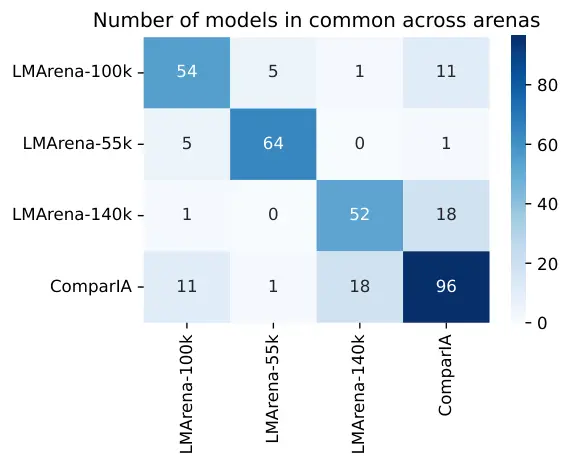

# JudgeArena: A Unified Framework for Reproducible LLM-Judge Evaluation

Erlis Lushtaku ^(†)^(†)thanks: Equal contribution.^(†)^(†)thanks:
Corresponding authors: erlislushtaku@gmail.com,
david.salinas.pro@gmail.com Affiliation: University of Freiburg    Bora
Kargi Affiliation: ELLIS Institute Tübingen    Ali Elganzory
Affiliation: University of Freiburg    Fabio Ferreira ^(†)^(†)thanks:
Work done while at University of Freiburg. Affiliation: Microsoft AI   
Alejandro R. Salamanca Affiliation: Cohere Labs    Julia Kreutzer
Affiliation: Cohere Labs    David Salinas¹¹footnotemark: 1  
²²footnotemark: 2 Affiliation: ELLIS Institute Tübingen, Prior Labs

###### Abstract

LLM-as-a-judge evaluation has become a dominant paradigm for ranking
language models, yet the ecosystem remains fragmented: most benchmarks
ship their own code base, hardcode a specific closed-model judge, and
support a single evaluation protocol. This fragmentation makes it
difficult to study how design choices—the benchmark, the judge model,
the prompt, the inference backend—affect the conclusions we draw about
model quality. We introduce JudgeArena, an open-source framework that
unifies major LLM-judge benchmarks (AlpacaEval, Arena-Hard, MT-Bench,
and m-Arena-Hard) under a single interface with swappable judges and
comprehensive metadata logging for increased transparency in reporting
and reproducibility. It enables systematic studies of judge choices, as
any model accessible via vLLM, llama.cpp, or OpenRouter can serve as
both candidate and judge. Furthermore, JudgeArena ships with tuned judge
configurations for open models that match or outperform closed-model
judges, validated on human preference datasets in both English and
multilingual settings, reducing the reliance on opaque closed models.
Finally, by combining existing human annotations with LLM-judge
evaluations of a target model, JudgeArena can simulate LMArena Elo
scores with high accuracy offering a practical, open, and low-cost
alternative to large-scale human annotation campaigns.

## 1 Introduction

Evaluating instruction-tuning for Large Language Models (LLMs) is
challenging because generative models output free-form text in response
to questions that are often open or ambiguous. The gold standard would
be human annotations, including the so-called crowd-sourcing _arenas_
where users annotate their preferred output to a prompt given two
modelsChiang et al. (2024); Termignon et al. (2026). Since annotation
costs are high, and turnaround is slow, this approach is less practical
in early LLM development stages or projects with large scale evaluation
needs (e.g. tracking quality across multiple languages and tasks). The
alternative is to deploy an LLM judge as a human proxy (Zheng et al.,
2023). A key advantage is that it enables automatic and cheaper
benchmarks which can be run at will.

Many benchmarks relying on LLM-judges have been proposed. Among the most
prominent, AlpacaEval Li et al. (2023); Dubois et al. (2024) and
Arena-Hard Li et al. (2024), propose to annotate a candidate model on a
fixed set of instructions. The answer is then compared to a baseline
like a recent GPT model, and the win rates are used to construct a
leaderboard. Different setups have been studied, for instance,
considering multi-turn instead of single-turn in MT-Bench Zheng et al.
(2023) or considering multiple languages in m-Arena-Hard by
automatically translating instructions of Arena-Hard from English to 23
languages Dang et al. (2024).

There is currently a clear lack of unification and reproducibility
across LLM-judge benchmarks as shown in Table 1. For example, each
benchmark ships its own independent code-base or rarely logs sufficient
metadata for reproducibility. Moreover, they largely default to
closed-weight judges such as GPT-4. While LLM judges exhibit
self-preference bias regardless of openness Panickssery et al. (2024);
Wataoka et al. (2025), closed-weight judges make this bias hard to audit
and leave benchmarks vulnerable to silent updates and deprecations,
rendering many evaluations stale and irreproducible¹¹ 1 For instance,
GPT-4o is the model that was used in Alpaca-Eval, Arena-Hard,
m-Arena-Hard and is being retired
[https://openai.com/index/retiring-gpt-4o-and-older-models/](https://openai.com/index/retiring-gpt-4o-and-older-models/).
As a result, researchers use benchmarks coming from different packages
(or write their own) which makes results sometimes incomparable (Laskar
et al., 2024) and strongly resembles the status of _static_ evaluations
before the introduction of packages such as Eval Harness Gao et al.
(2024) or Lighteval Habib et al. (2023). This paper describes
JudgeArena, an open-source library that addresses these issues. In
particular, it makes the following contributions (see Table 1):

- •
  Standardized access to the most common LLM-as-a-judge benchmarks under
  a unified API, with swappable judges and broad support for inference
  backends.
- •
  Tuned open-weight judge configurations that match or outperform
  closed-model judges while being cheaper and more transparent.
- •
  Comprehensive metadata logging that ensures full reproducibility of
  every run.
- •
  Extensive meta-evaluations supported by the library covering both
  English and 33 languages.
- •
  A new LLM benchmark for estimating Elo ratings with small error across
  holdout models—enabling model performance estimation without
  participating in online arenas

Overall, JudgeArena unifies access to major benchmarks while exposing
each meta-evaluation component for controlled study and continuous
improvement.

|            |            |            |            |              |             |            |            |
| ---------- | ---------- | ---------- | ---------- | ------------ | ----------- | ---------- | ---------- |
| Framework  | MT-Bench   | AlpacaEval | Arena-Hard | m-Arena-Hard | Tuned judge | vLLM       | Metadata   |
| FastChat   | ✓          | $`\times`$ | $`\times`$ | $`\times`$   | $`\times`$  | $`\times`$ | $`\times`$ |
| AlpacaEval | $`\times`$ | ✓          | $`\times`$ | $`\times`$   | $`\times`$  | $`\times`$ | $`\times`$ |
| Arena-Hard | $`\times`$ | $`\times`$ | ✓          | $`\times`$   | $`\times`$  | $`\times`$ | $`\times`$ |
| Lighteval  | ✓          | $`\times`$ | $`\times`$ | $`\times`$   | $`\times`$  | ✓          | ✓          |
| Evalchemy  | ✓          | ✓          | $`\times`$ | $`\times`$   | $`\times`$  | $`\times`$ | ✓          |
| JudgeArena | ✓          | ✓          | ✓          | ✓            | ✓           | ✓          | ✓          |

Table 1: Comparison of libraries supporting LLM-judges. Most support
only a single benchmark, except Lighteval and Evalchemy. “vLLM”
indicates built-in, orchestrated support for in-process local vLLM
inference for both candidates and judges.

## 2 Related Work

#### LLM-as-a-Judge Benchmarks.

Pairwise LLM-as-a-judge benchmarks have become the default cheap
surrogate for human preference rankings, an alternative to crowd-sourced
platforms Chiang et al. (2024) and to static benchmark mixtures Ni et
al. (2024). The pairwise paradigm was popularized by MT-Bench and
Chatbot Arena Zheng et al. (2023); Chiang et al. (2024), where strong
LLMs were shown to agree well with crowd preferences when used as
judges, despite known biases such as self-preference Panickssery et al.
(2024) and verbosity. AlpacaEval Li et al. (2023) pairs $`805`$
single-turn instructions with a single GPT-4 judge scored against a
fixed reference; its length-controlled variant Dubois et al. (2024)
debiases that same judge along the verbosity axis. Arena-Hard Li et al.
(2024) curates $`500`$ harder English prompts auto-mined from Chatbot
Arena conversations. Multilingual coverage is mostly bolted on through
translation: m-Arena-Hard Dang et al. (2024); Khairi et al. (2025)
automatically translates Arena-Hard into 23 languages and again
leverages a single closed judge, while native-language preference data
beyond English remain rare Termignon et al. (2026) and translation-based
auto-eval is known to require careful meta-evaluation Kreutzer et al.
(2025); Fu and Liu (2025).

#### LLM Judge Frameworks.

Running LLM-judge evaluations at scale poses non-trivial engineering
challenges, such as managing API calls, parsing judge outputs, and
logging runs, which led benchmarks like FastChat Zheng et al. (2023),
AlpacaEval, and Arena-Hard to provide benchmark-specific implementations
tightly coupled to proprietary APIs. While users can indirectly
circumvent this by manually routing requests to local OpenAI-compatible
servers (e.g., standalone vLLM processes), this detached setup is
error-prone and fails to capture vital inference metadata, compromising
reproducibility. This architectural lock-in historically encourages
reliance on closed-weight models, which are subject to silent updates
and exhibit systematic self-preference Panickssery et al. (2024).
Furthermore, evaluating models across different benchmarks requires
managing disparate codebases with incompatible interfaces.

Generalized frameworks such as Eval Harness Gao et al. (2024) and
Lighteval Habib et al. (2023) unify diverse tasks but are optimized for
static evaluation (e.g., the Open LLM Leaderboard Fourrier et al.
(2024)), requiring custom logic to support dynamic pairwise judges.
Evalchemy Raoof et al. (2025) wraps existing codebases and supports vLLM
for candidate generation, but its judge pipeline still relies on
indirect API calls, leaving it focused on fixed proprietary judges and
lacking the abstractions needed to integrate easily additional
benchmarks such as Arena-Hard.

As summarized in Table 1, this fragmented ecosystem hinders
reproducibility. JudgeArena resolves these limitations by decoupling
instruction sets from evaluator configurations. By providing a unified
API with native local inference for both candidates and judges,
optimized prompt templates, and rigorous metadata tracking for every
generated sample, JudgeArena seamlessly enables sovereign, open-weight
evaluations with end-to-end reproducibility.

#### Meta-Evaluation and Tuning of LLM Judges.

Meta-evaluation assesses judge reliability to determine when and for
which instruction types LLM judges are suitable surrogates for human
preferences. Meta-evaluation often considers two categories of metrics:
_global_ metrics measuring ranking correlation—Spearman rank correlation
between judge rankings and Elo ratings from human arenas Li et al.
(2023); Li et al. (2024); Ni et al. (2024)—and _local_ instruction-level
agreement metrics such as accuracy or Cohen-Kappa Zheng et al. (2023);
Wang et al. (2024); Zeng et al. (2024); Fu and Liu (2025). Recent work
further probes judges along specific axes: hard coding and math
instructions Tan et al. (2025); Lai et al. (2026), positional and
verbosity biases Lai et al. (2026), or multilingual
capabilities Kreutzer et al. (2025); Fu and Liu (2025). Being able to
measure the quality of LLM judges motivate tuning via prompt
optimization Fernando et al. (2023) or systematic hyperparameter search
over judge design choices Salinas et al. (2025). Despite this activity,
tuned open-weight judges are rarely bundled with evaluation benchmarks;
JudgeArena directly addresses this gap by integrating meta-evaluation
routines and competitive benchmarks in a single compatible framework.

## 3 JudgeArena Framework

### 3.1 Architecture and Design

JudgeArena is exposed through a single command-line interface, see
Fig. 1. The benchmark and the judge are selected through CLI options
rather than being baked into benchmark-specific scripts. Every other
aspect of a run like the truncation budgets, the chat template and the
inference-engine options, is controlled through the same interface. The
metadata containing all information required for reproducibility is
stored in a JSON similarly to Eval Harness Gao et al. (2024).

To perform an evaluation, instructions from the selected benchmark are
loaded through a common interface and optionally subsampled to a
specified number of instructions. For each evaluated model, JudgeArena
reuses pre-shipped completions bundled by the benchmark itself when
available, and otherwise generates them, persisting fresh completions
through a deterministic on-disk cache. The two completions and the judge
prompt are then fed to the judge, its output is parsed into a numerical
preference in $`[0,1]`$, and a per-run folder of annotations, aggregate
win/loss summary and metadata descriptor is written for downstream
analysis.


Figure 1: Anatomy of a JudgeArena run. A single CLI invocation (left)
selects the task, the two models and the judge as orthogonal flags; the
tool pulls the task, generates or reuses cached completions, collects
judge annotations, and writes the shown result (right) together with a
versioned metadata bundle (package version, results JSON, CLI arguments,
run date) for post-hoc reproducibility.

### 3.2 Inference Backends

Model inference is factored behind a uniform backend abstraction that
routes each evaluated model and each judge to the appropriate runtime.
Backends are addressed through a unified {Backend}/{ModelPath} naming
convention; local backends run inference in-process while hosted ones
are dispatched to the corresponding provider APIs via LangChain.
Coverage spans vLLM (local GPU), llama.cpp (CPU and Apple Silicon), and
hosted providers such as OpenRouter or Together AI. JudgeArena handles
both chat-templated instruction models and plain-completion pretrained
base models. Optional reasoning-token budgets are honored for thinking
judges where the backend supports them, and per-request token usage is
recorded across all backends. Engine-level options such as tensor
parallelism or quantization can be configured independently for the
battle models and for the judge, so that a large judge can run at a
different scale or precision than the evaluated models on the same GPU.

### 3.3 Supported Benchmarks and Arenas

Every benchmark follows a common instruction interface. This shared
schema lets the rest of the pipeline remain agnostic to the underlying
benchmark, so that adding a new benchmark only requires expressing it in
the common interface rather than extending a new pipeline.

#### Benchmarks.

The current release supports four pairwise instruction benchmarks with
fixed baselines.²² 2 The choice of baselines or anchors is by itself
subject to research studies (Don-Yehiya et al., 2026)—which we aim
JudgeArena to foster. AlpacaEval and Arena-Hard exposes their standard
instructions together with pre-shipped completions for common baselines
such as gpt-4-1106-preview. Arena-Hard is supported in both its v0.1 and
v2.0 releases. m-Arena-Hard brings multilingual coverage across 23
languages in two releases: v0.1 (500 prompts) (Dang et al., 2024) and
v2.0 (498 prompts) (Khairi et al., 2025). MT-Bench follows the FastChat
protocol of 80 multi-turn questions across eight categories.

JudgeArena preserves the original instructions of each benchmark. In the
runs reported here, AlpacaEval, Arena-Hard, m-Arena-Hard, and MT-Bench
all use the tuned default preset (Section 3.4), which asks the judge for
two numerical scores rather than a verdict label, so that the judge
remains the sole axis of variation across these benchmarks. As a
consequence, absolute scores produced by JudgeArena are not directly
comparable to each benchmark’s published leaderboard, but every run is
fully reproducible from the shipped metadata. For completeness,
Appendix A summarizes the original baselines, default judges and judge
protocols used by the original benchmarks.

#### Arenas available.

In addition to the benchmarking available described in Table 1,
JudgeArena includes also several dataset of battles from crowd source
platforms which can be used for meta-analysis or to evaluate a new
model. We support ComparIA Termignon et al. (2026) as well as the three
splits of LMArena splits which were previously released Chiang et al.
(2024) and show some of their statistics in Fig. 2. The model
intersection is shown in the appendix, in particular a single model
appears in all arenas which we use as a common anchor to compute
Elo-ratings so that results are comparable. The datasets have different
trade-offs, LMArena-100K has weaker models than LMArena-140K which has
only recent high-performing models whereas ComparIA and LMArena-55K
covers all the quality spectrum.

Figure 2: Elo-ratings distribution of models on different arenas (left)
and number of battles per language (right).

The number of battles per languages is also shown in Fig. 2 right where
we show all languages having at least 100 battles. The number of battles
per language varies widely for different arenas. ComparIA has a much
larger proportion of French and multilingual data than LMArena splits
which all have at least half of their data as English. The combination
of all those datasets is important to cover sufficiently many languages
with 100 instructions which is the minimum number we set to perform
meta-evaluations.

### 3.4 Tuned Judge Configurations

JudgeArena operationalizes the judge-design study of Salinas et al.
(2025), in which multi-objective multi-fidelity optimization was used to
search over the main axes of a pairwise LLM judge: the choice of judge
base model, the prompt template, the output format and scoring scheme,
the decoding temperature, the use of chain-of-thought (CoT) explanations
and the use of position swaps. Rather than re-running this search for
every new benchmark, JudgeArena ships the resulting design as a default
pipeline and exposes the main operational choices, including the judge
model, prompt preset, explanation prompting, swap mode, and judge
sampling and backend options, so that users can reuse the tuned
configuration out of the box or run controlled ablations over supported
axes.

The default preset implements the tuned protocol: the judge receives a
short bias-mitigating system prompt together with a user template that
asks for a structured response with two numerical scores
$`s_{A},s_{B}\in[0,10]`$, one per answer. These scores $`s_{A},s_{B}`$
are then converted into a winning probability

```math
\mathbb{P}[A\prec B]=\sigma(\beta(s_{B}-s_{A}))=1/\left(1+e^{-\beta(s_{B}-s_{A})}\right) \tag{1}
```

with a sharpness factor $`\beta=0.3`$. Equal scores map to a preference
probability of $`0.5`$, while larger score differences smoothly shift
the preference toward the higher-scored answer.

The remaining design axes are controlled through orthogonal
configuration options. Chain-of-thought to solicit explanation can be
toggled on or off, swapping the user template for a variant that
requests an explanation before the scores. Swap evaluation runs both
$`A`$–$`B`$ and $`B`$–$`A`$ orderings so that each instruction
contributes two annotations rather than one, preserving per-swap
information for downstream analysis; a cheaper single-pass mode is
retained for large-scale sweeps. Sampling parameters and
backend-specific options are configured independently for the judge, so
that the judge can run at a different scale or precision than the battle
models. Reasoning-trace management can cap the number of reasoning
tokens that thinking models emit for supported backends, and visible
reasoning traces can optionally be stripped from battle completions
before they are sent to the judge.

### 3.5 Reproducibility Infrastructure

Every evaluation run is treated as a self-describing artifact, following
the reproducibility lessons distilled by Biderman et al. (2024).
Metadata is stored containing key information such as the entry point
and CLI command that produced the run, the complete run configuration
(judge prompt preset, position-swap setting, truncation budgets) or the
software version of main dependencies. The exact schema is detailed in
Appendix E.

In addition, a run writes a small bundle of files into a single
directory whose name encodes the dataset, the two battled model sides,
the judge, the position-swap setting and a timestamp: a snapshot of the
full run configuration, a per-battle annotation table, an aggregate
results file and a versioned metadata descriptor. This bundle is the
unit of record for each evaluation run, so that any annotation produced
by JudgeArena can be re-analyzed from its artifacts alone.

## 4 Experiments

We first meta-evaluate judge quality in English and multilingual
settings, then show how Elo ratings can be estimated from arenas, and
finally present a case study on open-weight models across all benchmarks
in the library. All scripts, completions, and annotations will be
released to facilitate future research. Throughout, we report 95%
confidence intervals via the 2.5th and 97.5th percentiles over 1,000
bootstrap resamples: over instructions for instruction-level metrics
(Cohen-Kappa) and over models for model-level metrics (Spearman and Elo
ratings).

### 4.1 Meta-evaluations

#### English meta-evaluation.

In Table 2, we evaluate several judges available in JudgeArena. We
consider prompted judges with both open-weights options and
close-weights options with our tuned configuration (top), Alpaca-Eval
and Arena-Hard prompted judges (middle) and the best fine-tuned judge
reported from Tan et al. (2025). We report Cohen-Kappa, Spearman
correlation and cost per annotation when selecting 100 random English
instructions of LMArena-140K for the top 20 models in battle counts.

Cohen-Kappa measures the match between two annotators (higher is better)
and is normalized so that values close to 0 indicates
random-performance. The values of Cohen-Kappa are competitive and
outperform the Cohen-Kappa obtained by ourselves (0.2) when
re-annotating manually 200 instructions in French and English, they are
far from the optimal value of $`1.0`$ due to the difficulty of the
annotation and the noise and subjectivity inherent to the process.
Looking at the Qwen3.5 series, we can see that this metric monotonically
increases with the model size.

On the other hand, Spearman rank correlation metrics are noisy and
provide large confidence-intervals and much lower signal-to-noise ratio
compared to Cohen-Kappa instruction level metrics as noted in Salinas et
al. (2025). The Spearman rank correlation is also typically lower than
observed in Li et al. (2023); Li et al. (2024) as the models selected
are much closer and stronger as shown in Fig. 2 which is emphasized by
the fact that we picked the top 20 models.

Importantly, we see that the open-weights configurations offered in
JudgeArena are competitive for both accuracy and cost as they were tuned
to minimize both objectives. In particular, the tuned prompt combined
with gemma-4-31b-it provides the best Cohen-Kappa agreement while being
the cheapest option.

|                               |                                   |                                 |                     |
| ----------------------------- | --------------------------------- | ------------------------------- | ------------------- |
| Judge                         | Cohen-Kappa $`\uparrow`$          | Spearman $`\uparrow`$           | Cost $`\downarrow`$ |
| qwen3.5-122b-a10b             | $`0.15_{0.12}^{0.18}`$            | $`0.69_{0.29}^{0.92}`$          | 4.16                |
| qwen3.5-27b                   | $`0.14_{0.11}^{0.17}`$            | $`0.67_{0.28}^{0.87}`$          | 4.07                |
| qwen3.5-9b                    | $`0.12_{0.09}^{0.15}`$            | $`0.75_{0.41}^{0.93}`$          | 0.43                |
| deepseek-v3.2                 | $`0.13_{0.10}^{0.16}`$            | $`\text{{0.78}}_{0.47}^{0.92}`$ | 0.44                |
| gemma-4-31b-it                | $`\text{{0.17}}_{0.14}^{0.20}`$   | $`0.72_{0.36}^{0.91}`$          | 0.25                |
| gpt-5.4-nano                  | $`0.11_{0.08}^{0.14}`$            | $`0.75_{0.39}^{0.91}`$          | 0.36                |
| gemini-3.1-flash              | $`\text{{{0.17}}}_{0.13}^{0.20}`$ | $`0.73_{0.37}^{0.91}`$          | 0.47                |
| Arena-Hard + gemini-3.1-flash | $`0.16_{0.12}^{0.19}`$            | $`0.75_{0.41}^{0.93}`$          | 1.14                |
| Alpaca-Eval + gpt-5.4-nano    | $`0.11_{0.08}^{0.14}`$            | $`0.73_{0.37}^{0.91}`$          | 0.38                |
| Skywork-Critic-70B            | $`0.08_{0.05}^{0.11}`$            | $`0.48_{0.03}^{0.80}`$          | 0.74                |

Table 2: Meta-evaluations for Cohen-Kappa, Spearman rank correlation and
Cost (expressed in dollar-cost per 1k annotations) when evaluating
English instructions. We report results with respectively the default
configuration with open-weights models and proprietary models (top), the
configuration from Arena-Hard and Alpaca-Eval (medium) and fine-tuned
judges (bottom).

#### Multilingual meta-evaluation or assessing which language can be judged.

To use an LLM-judge, we need to make sure that its performance is good
enough for the targeted use-case. While general instructions or coding
in English is well investigated, other use-cases such as multilingual
instructions typically follow much less verification, which can make
their results unreliable for model development and comparisons.
Suboptimal choices can lead to misleading conclusions about model
capabilities, as reported in Dang et al. (2024), where results for
GPT4-o vs GPT4-o-mini diverged notably. As there are large divergences
in support across languages for different models, it becomes even more
challenging to select a suitable judge for all.

Any LLM judge selected to perform this task should at least clearly
outperform random predictions Kreutzer et al. (2025). Before evaluating
and reporting results with LLM-judges on any language, we therefore
evaluate whether LLM-judges outperform random predictions on all
languages with more than 100 instructions in all arenas supported. In
Fig. 3, we evaluate Cohen-Kappa agreement-rate for multiple languages
for three strong open-weight judge configurations. Interestingly,
gemma-4-31b outperforms qwen-3.5-27b for most languages. For 3
languages, the Cohen-Kappa confidence interval overlaps zero, not
discarding random-chance performance, we therefore exclude all such
languages by default. We note that having higher agreement scores
between LLM and human annotators for some languages does not mean that
those languages are inherently easier to judge as there are other
confounding effects such as annotators of a certain language looking at
answer into more details or asking easier questions. However, a high
agreement rate indicates that LLM judges are reliable on the given
distribution.

Figure 3: Cohen-Kappa per language for three different open-weight
judges. We use up to 200 random battles per language and select only
languages with at least 100 battles. The number of battles is indicated
in parentheses for languages with fewer than 200 battles.

### 4.2 Elo Approximation via Hybrid Human and LLM Annotations

Evaluating against a single fixed baseline can cause multiple issues
including non transitivity Xu et al. (2025) of results or
self-preference Panickssery et al. (2024). To avoid this issue,
JudgeArena proposes to evaluate Elo ratings from battles previously made
available in an crowd-source arena.

Elo ratings are computed given a set of battles in crowd-sourced arenas
which we denote as
$`(p^{i},o^{i}_{A},o^{i}_{B},\Phi^{\text{Human}}(p^{i},o^{i}_{A},o^{i}_{B}))_{i=1}^{N}`$
where $`o^{i}_{A},o^{i}_{B}`$ denote the completions of two models $`A`$
and $`B`$ given the prompt $`p^{i}`$ and
$`\Phi^{\text{Human}}(p^{i},o^{i}_{A},o^{i}_{B})\in\{-1,1\}`$ denotes
the completion chosen, with $`+1`$ indicating that $`B`$ is preferred
over $`A`$. For a given set of models $`\mathcal{M}{}`$, Elo ratings
$`\beta\in\mathbb{R}^{|\mathcal{M}|}`$ are estimated via the
Bradley–Terry (BT) model Bradley and Terry (1952) such that the marginal
probability that model $`A`$ is preferred over model $`B`$ on a random
prompt is given by:

```math
\mathbb{P}\!\left[\Phi^{\text{Human}}(p,o_{A},o_{B})=1\right]=\sigma(\beta_{B}-\beta_{A}). \tag{2}
```

Given the set of battles, the strengths $`\beta`$ are estimated by
maximising the log-likelihood of the observed preferences on Eq. 2, with
one model strength fixed to a constant such as $`1000`$. Elo scores are
then obtained as $`\text{Elo}(m{})=\beta_{m{}}\cdot 400/\!\log 10`$.

#### Estimating Elo ratings.

To approximate Elo ratings without human annotators, we annotate 2 000
battles from LMArena-140K, 100 instructions from 20 models, with an LLM
judge instead of human annotators. That is, we replace
$`\Phi^{\text{Human}}`$ by $`\Phi^{\text{LLM}}`$ in Eq. 2. In Fig. 4, we
show a scatter plot of Elo ratings estimated with Human and LLM
annotators for each of the 20 models for four different judges. We
report the average Mean Absolute Error (MAE) over models between the Elo
ratings estimated by human and LLM judge. For all judges, we use
gemma-4-31b-it as the base model to avoid confounding factors. For
Alpaca-Eval and Arena-Hard, the judge produces only a hard verdict, so
we fit BT with hard labels in $`\{-1,1\}`$ for the losing/winning side.

Judges in JudgeArena instead emit a continuous probability (Eq. 1) which
captures judge confidence: model A is more likely to beat B when scored
$`10`$ versus $`1`$ than when scored $`10`$ versus $`9`$. We leverage
this confidence by replacing the hard target with the predicted
probability, so the BT cross-entropy is computed against continuous
labels rather than discrete ones, related to richer preference targets
used in reward modeling (Liu et al., 2024a; Liu et al., 2024b; Afsharrad
et al., 2026). This up-weights battles with larger score difference
(lower uncertainty) and down-weights more uncertain battles. We also
report results when using only hard-labels ("Ours w/o prob.") to ablate
the benefit from modeling the uncertainty obtained from LLM judgements.
Accounting for uncertainty significantly lowers the MAE error. The
default judge in JudgeArena provides a faithful approximation as the MAE
error on Elo ratings is $`54{}`$ on average per model. We believe this
approximation can be extremely useful for model developers who cannot
easily access live arenas for cost reasons.

Figure 4: Elo ratings estimated by LLM vs. human annotators for four
judges.

## 5 Case study

### 5.1 Evaluating Open Models Across Standard Benchmarks

Having determined the quality of different judges and which languages
can be judged, we conduct a case study benchmarking several open models
on popular benchmarks available in JudgeArena. We evaluate AlpacaEval,
Arena-Hard (v0.1 and v2.0), MT-Bench and m-Arena-Hard v2.0 (Arabic,
Polish, Ukrainian, Chinese) for the following open models: Olmo-3-7B,
Olmo-3-7B-Think, Tiny-Aya-Global, Apertus-8B, SmolLM3-3B, EuroLLM-1.7B
and 9B, and Qwen3.5-9B, considering fully open models, except for
Qwen3.5 and Tiny-Aya-Global which are only open-weights. The judge is
set to Gemma-4-31B-IT using the tuned default score-style preset across
all benchmarks. We additionally estimate each model’s LMArena Elo by
combining 1,000 Gemma-4-judged target-model battles from a shared seeded
random LMArena-140K sample.

|                       |                           |                        |                                    |                                    |                                    |                                    |                                    |                                    |                        |          |
| --------------------- | ------------------------- | ---------------------- | ---------------------------------- | ---------------------------------- | ---------------------------------- | ---------------------------------- | ---------------------------------- | ---------------------------------- | ---------------------- | -------- |
|                       | English / single-language |                        |                                    |                                    | m-Arena-Hard v2.0                  |                                    |                                    |                                    |                        |          |
| Model                 | AlpacaEval                | AH v0.1                | AH v2.0                            | MT-Bench                           | AR                                 | PL                                 | UK                                 | ZH                                 | LMArena Elo            | Avg Rank |
| Qwen3.5-9B (think)    | $`0.78_{0.75}^{0.80}`$    | $`0.81_{0.78}^{0.84}`$ | $`0.50_{0.46}^{0.53}`$             | $`0.85_{0.80}^{0.89}`$             | $`0.42_{0.38}^{0.46}`$             | $`0.41_{0.37}^{0.45}`$             | $`0.42_{0.38}^{0.45}`$             | $`0.57_{0.53}^{0.61}`$             | $`1103_{1068}^{1128}`$ | 1.000    |
| Olmo-3-7B-Think       | $`0.54_{0.51}^{0.58}`$    | $`0.53_{0.48}^{0.57}`$ | $`0.15_{0.13}^{0.18}`$             | $`0.71_{0.65}^{0.78}`$             | $`0.06_{0.04}^{0.08}`$             | $`0.06_{0.04}^{0.08}`$             | $`0.04_{0.03}^{0.06}`$             | $`0.23_{0.20}^{0.27}`$             | $`886_{845}^{912}`$    | 2.111    |
| Olmo-3-7B             | $`0.44_{0.41}^{0.47}`$    | $`0.51_{0.46}^{0.55}`$ | $`0.13_{0.10}^{0.15}`$             | $`0.63_{0.56}^{0.70}`$             | $`0.06_{0.04}^{0.08}`$             | $`0.03_{0.01}^{0.04}`$             | $`0.03_{0.01}^{0.04}`$             | $`0.20_{0.17}^{0.23}`$             | $`854_{807}^{881}`$    | 3.167    |
| SmolLM3-3B (think)    | $`0.28_{0.25}^{0.31}`$    | $`0.24_{0.20}^{0.28}`$ | $`0.04_{0.03}^{0.06}`$             | $`0.37_{0.30}^{0.45}`$             | $`0.05_{0.04}^{0.07}`$             | $`0.02_{0.01}^{0.04}`$             | $`0.02_{0.01}^{0.04}`$             | $`0.14_{0.11}^{0.17}`$             | $`643_{612}^{683}`$    | 4.556    |
| Tiny-Aya-Global 3.35B | $`0.15_{0.13}^{0.18}`$    | $`0.20_{0.17}^{0.23}`$ | $`0.02_{0.01}^{0.03}`$             | $`0.32_{0.26}^{0.39}`$             | $`0.05_{0.03}^{0.07}`$             | $`0.03_{0.02}^{0.05}`$             | $`0.04_{0.02}^{0.05}`$             | $`0.12_{0.10}^{0.15}`$             | $`600_{564}^{643}`$    | 4.667    |
| Apertus-8B            | $`0.09_{0.07}^{0.11}`$    | $`0.13_{0.10}^{0.15}`$ | $`0.02_{0.01}^{0.03}`$             | $`0.17_{0.12}^{0.22}`$             | $`0.04_{0.03}^{0.06}`$             | $`0.02_{0.01}^{0.04}`$             | $`0.03_{0.02}^{0.04}`$             | $`0.13_{0.10}^{0.16}`$             | $`586_{531}^{643}`$    | 5.833    |
| EuroLLM-9B            | $`0.09_{0.07}^{0.10}`$    | $`0.07_{0.05}^{0.09}`$ | $`0.01_{0.00}^{0.02}{}^{\dagger}`$ | $`0.18_{0.13}^{0.24}{}^{\dagger}`$ | $`0.03_{0.02}^{0.04}{}^{\dagger}`$ | $`0.02_{0.01}^{0.03}{}^{\dagger}`$ | $`0.02_{0.01}^{0.04}{}^{\dagger}`$ | $`0.10_{0.07}^{0.12}{}^{\dagger}`$ | $`499_{456}^{545}`$    | 6.667    |
| EuroLLM-1.7B          | $`0.01_{0.01}^{0.02}`$    | $`0.01_{0.00}^{0.01}`$ | $`0.00_{0.00}^{0.00}{}^{\dagger}`$ | $`0.03_{0.01}^{0.05}{}^{\dagger}`$ | $`0.02_{0.01}^{0.03}{}^{\dagger}`$ | $`0.00_{0.00}^{0.01}{}^{\dagger}`$ | $`0.01_{0.00}^{0.02}{}^{\dagger}`$ | $`0.07_{0.05}^{0.09}{}^{\dagger}`$ | $`357_{290}^{415}`$    | 8.000    |

Table 3: Performance of eight open-weight models on JudgeArena
benchmarks.

Results are reported in Table 3. Qwen3.5-9B is the clear outlier in this
case study, ranking first on every benchmark in the table as well as on
LMArena Elo, which yields an average rank of 1.000. The next-best models
are Olmo-3-7B-Think (2.222) and Olmo-3-7B (3.056), and the gap to the
rest of the table is much larger than the per-cell bootstrap intervals,
so the ordering of the strongest models is stable at the
instruction-sampling level. Arena-Hard v2.0 is the most difficult
English benchmark for every evaluated model, while the translated
m-Arena-Hard cells show a clear drop relative to AlpacaEval, Arena-Hard
v0.1, and MT-Bench. The EuroLLM results on long-prompt cells should be
interpreted with additional caution because several inputs were
truncated to fit the models’ 4096-token positional cap, as marked by
^(†); the corresponding truncation statistics are reported in
Appendix C.

In Fig. 5, we study whether benchmarks show monotonic performance when
scaling model parameters. We evaluate the Qwen3.5 series (0.8B–35B-A3B)
with Gemma-4-31B-IT as judge; the 27B and 35B-A3B points use released
FP8 variants. Except for MT-Bench and m-AH, all tasks show
non-overlapping confidence intervals with monotonically improving
performance from 0.8B to 27B, providing a sanity check on the
discriminative power of the benchmarks in JudgeArena.

Figure 5: Qwen3.5 performance scales monotonically with model size for
most benchmarks.

## 6 Limitations

#### Opening the blackbox.

While we allow the user to change many aspects about the judge— the
model, the temperature, the prompt—this could also lead to an
undesirable situation where the judge configuration is tuned to make a
particular method shine or could lead to user confusion. We believe this
is alleviated by shipping a default judge configuration for every
benchmark and also by reporting all metadata corresponding to a run so
that a user can share the JSON corresponding to their result so that the
community can reproduce their result.

#### Cross-version comparability.

It should be clear that numbers between different versions will most
likely not be comparable. This is expected and similar to Eval-Harness
where tasks, data from evaluations, code for generation are changed
continuously, meaning any benchmark needs to be run on all methods and
numbers can never be pulled from a table (unless the exact software
versions are matched). JudgeArena behaves similarly: whenever reporting
a comparison such as Table 3, the JSON of results should be shared to
enable reproducibility.

#### Limit of reproducibility.

While we log all metadata such as software version, command-line
arguments, or dataset hashes, and seed all stochastic components, some
aspects are fundamentally irreproducible—among them CUDA
non-deterministic execution or the use of hosted closed models whose
behavior can change over time Chen et al. (2023). We acknowledge this
limitation but still believe that having the exact code and software
versions is a step up when sharing results.

#### Contamination.

All benchmarks available except for ComparIA are static and can be
contaminated. We do not address this, as it remains an active area of
research. We note that ComparIA could be used in the future to do
evaluations with forward-looking data as the dataset is continuously
updated.

## 7 Conclusion

We presented JudgeArena, which lets users perform LLM-judge evaluations
on multiple benchmarks including Alpaca-Eval, Arena-Hard, m-Arena-Hard,
MT-Bench, ComparIA and LMArena variants. In addition to benchmarking,
the library supports performing meta-evaluations and includes an
open-weight default judge that was tuned for accuracy and cost and will
be continuously updated as newer models are released. The library
supports the evaluation across 33 languages which have been selected
after careful meta-evaluations. It also supports estimating Elo-ratings
with small errors, which we believe will be useful for model developers
who want to avoid the issue of benchmarks with fixed baselines. We hope
the library will help to study, consolidate and improve LLM-judge
benchmarks.

We believe the work has positive societal impact as it contributes to
more transparent and reproducible LLM evaluation practices together with
thorough meta-evaluation. The multilingual scope helps ensure evaluation
quality is not limited to English. We encourage users to report full
metadata alongside results to enable community-level scrutiny of
benchmark conclusions.

In future work, we will continue improving the accuracy of the default
judge we provide. We are planning to have an automatic leaderboard to
track the progress in Arenas to report simulated Elo-ratings for both
English and multilingual models with publicly available completions and
judgements. Finally, we are working on including rubrics which provide
additional decomposition of model performance which we hope can be
useful for practitioners.

## Acknowledgments and Disclosure of Funding

This research was partially supported by the following sources: EC under
the grant No. 101195233 (OpenEuroLLM) and 101198470 (LLMs4EU). Views and
opinions expressed are however those of the author(s) only and do not
necessarily reflect those of the European Union. Neither the European
Union nor the granting authority can be held responsible for them.

![[Uncaptioned
image]](arxiv-2608-02620v1--e723878b9618.figures/figure-2.webp)

## References

- \[1\] W. Chiang, L. Zheng, Y. Sheng, A. N. Angelopoulos, T. Li, D.
  Li, H. Zhang, B. Zhu, M. Jordan, J. E. Gonzalez, and I. Stoica (2024)
  Chatbot arena: an open platform for evaluating llms by human
  preference. External Links: 2403.04132,
  [Link](https://arxiv.org/abs/2403.04132) Cited by: §1, §2, §3.3.
- \[2\] L. Termignon, S. Zilinskas, H. Pélissier, A. Barrot, N.
  Chesnais, and E. Gavoty (2026) Compar:ia: the french government’s llm
  arena to collect french-language human prompts and preference data.
  External Links: 2602.06669, [Link](https://arxiv.org/abs/2602.06669)
  Cited by: §1, §2, §3.3.
- \[3\] L. Zheng, W. Chiang, Y. Sheng, S. Zhuang, Z. Wu, Y. Zhuang, Z.
  Lin, Z. Li, D. Li, E. Xing, et al. (2023) Judging llm-as-a-judge with
  mt-bench and chatbot arena. Advances in Neural Information Processing
  Systems 36, pp. 46595–46623. Cited by: §1, §1, §2, §2, §2.
- \[4\] X. Li, T. Zhang, Y. Dubois, R. Taori, I. Gulrajani, C.
  Guestrin, P. Liang, and T. B. Hashimoto (2023) Alpacaeval: an
  automatic evaluator of instruction-following models. Cited by: §1, §2,
  §2, §4.1.
- \[5\] Y. Dubois, B. Galambosi, P. Liang, and T. B. Hashimoto (2024)
  Length-controlled alpacaeval: a simple way to debias automatic
  evaluators. arXiv preprint arXiv:2404.04475. Cited by: §1, §2.
- \[6\] T. Li, W. Chiang, E. Frick, L. Dunlap, T. Wu, B. Zhu, J. E.
  Gonzalez, and I. Stoica (2024) From crowdsourced data to high-quality
  benchmarks: arena-hard and benchbuilder pipeline. arXiv preprint
  arXiv:2406.11939. Cited by: §1, §2, §2, §4.1.
- \[7\] J. Dang, S. Singh, D. D’souza, A. Ahmadian, A. Salamanca, M.
  Smith, A. Peppin, S. Hong, M. Govindassamy, T. Zhao, S. Kublik, M.
  Amer, V. Aryabumi, J. A. Campos, Y. Tan, T. Kocmi, F. Strub, N.
  Grinsztajn, Y. Flet-Berliac, A. Locatelli, H. Lin, D. Talupuru, B.
  Venkitesh, D. Cairuz, B. Yang, T. Chung, W. Ko, S. S. Shi, A.
  Shukayev, S. Bae, A. Piktus, R. Castagné, F. Cruz-Salinas, E. Kim, L.
  Crawhall-Stein, A. Morisot, S. Roy, P. Blunsom, I. Zhang, A. Gomez, N.
  Frosst, M. Fadaee, B. Ermis, A. Üstün, and S. Hooker (2024) Aya
  expanse: combining research breakthroughs for a new multilingual
  frontier. External Links: 2412.04261,
  [Link](https://arxiv.org/abs/2412.04261) Cited by: §1, §2, §3.3, §4.1.
- \[8\] A. Panickssery, S. R. Bowman, and S. Feng (2024) LLM evaluators
  recognize and favor their own generations. External Links: 2404.13076,
  [Link](https://arxiv.org/abs/2404.13076) Cited by: §1, §2, §2, §4.2.
- \[9\] K. Wataoka, T. Takahashi, and R. Ri (2025) Self-preference bias
  in LLM-as-a-judge. External Links:
  [Link](https://openreview.net/forum?id=Ns8zGZ0lmM) Cited by: §1.
- \[10\] M. T. R. Laskar, S. Alqahtani, M. S. Bari, M. Rahman, M. A. M.
  Khan, H. Khan, I. Jahan, A. Bhuiyan, C. W. Tan, M. R. Parvez, E.
  Hoque, S. Joty, and J. X. Huang (2024) A systematic survey and
  critical review on evaluating large language models: challenges,
  limitations, and recommendations. In Proceedings of the 2024
  Conference on Empirical Methods in Natural Language Processing, Y.
  Al-Onaizan, M. Bansal, and Y. Chen (Eds.), Miami, Florida, USA,
  pp. 13785–13816. External Links:
  [Link](https://aclanthology.org/2024.emnlp-main.764/),
  [Document](https://dx.doi.org/10.18653/v1/2024.emnlp-main.764) Cited
  by: §1.
- \[11\] L. Gao, J. Tow, B. Abbasi, S. Biderman, S. Black, A. DiPofi, C.
  Foster, L. Golding, J. Hsu, A. Le Noac’h, H. Li, K. McDonell, N.
  Muennighoff, C. Ociepa, J. Phang, L. Reynolds, H. Schoelkopf, A.
  Skowron, L. Sutawika, E. Tang, A. Thite, B. Wang, K. Wang, and A.
  Zou (2024) The language model evaluation harness. Zenodo. External
  Links: [Document](https://dx.doi.org/10.5281/zenodo.12608602),
  [Link](https://zenodo.org/records/12608602) Cited by: §1, §2, §3.1.
- \[12\] N. Habib, C. Fourrier, H. Kydlíček, T. Wolf, and L.
  Tunstall (2023) LightEval: a lightweight framework for llm evaluation.
  External Links: [Link](https://github.com/huggingface/lighteval) Cited
  by: §1, §2.
- \[13\] J. Ni, F. Xue, X. Yue, Y. Deng, M. Shah, K. Jain, G. Neubig,
  and Y. You (2024) MixEval: deriving wisdom of the crowd from llm
  benchmark mixtures. External Links: 2406.06565,
  [Link](https://arxiv.org/abs/2406.06565) Cited by: §2, §2.
- \[14\] A. Khairi, D. D’souza, Y. Shen, J. Kreutzer, and S.
  Hooker (2025) When life gives you samples: the benefits of scaling up
  inference compute for multilingual LLMs. In Proceedings of the 2025
  Conference on Empirical Methods in Natural Language Processing, C.
  Christodoulopoulos, T. Chakraborty, C. Rose, and V. Peng (Eds.),
  Suzhou, China, pp. 27559–27583. External Links:
  [Link](https://aclanthology.org/2025.emnlp-main.1402/),
  [Document](https://dx.doi.org/10.18653/v1/2025.emnlp-main.1402), ISBN
  979-8-89176-332-6 Cited by: §2, §3.3.
- \[15\] J. Kreutzer, E. Briakou, S. Agrawal, M. Fadaee, and K.
  Tom (2025) Déjà vu: multilingual llm evaluation through the lens of
  machine translation evaluation. External Links: 2504.11829,
  [Link](https://arxiv.org/abs/2504.11829) Cited by: §2, §2, §4.1.
- \[16\] X. Fu and W. Liu (2025) How reliable is multilingual
  LLM-as-a-judge?. In Findings of the Association for Computational
  Linguistics: EMNLP 2025, C. Christodoulopoulos, T. Chakraborty, C.
  Rose, and V. Peng (Eds.), Suzhou, China, pp. 11040–11053. External
  Links: [Link](https://aclanthology.org/2025.findings-emnlp.587/),
  [Document](https://dx.doi.org/10.18653/v1/2025.findings-emnlp.587),
  ISBN 979-8-89176-335-7 Cited by: §2, §2.
- \[17\] C. Fourrier, N. Habib, A. Lozovskaya, K. Szafer, and T.
  Wolf (2024) Open llm leaderboard v2. Hugging Face. External Links:
  [Link](https://huggingface.co/spaces/open-llm-leaderboard/open_llm_leaderboard)
  Cited by: §2.
- \[18\] N. Raoof, E. K. Guha, R. Marten, J. Mercat, E. Frankel, S.
  Keh, H. Bansal, G. Smyrnis, M. Nezhurina, T. Vu, Z. R. Sprague, M. A.
  Merrill, L. Chen, C. Choi, Z. Khan, S. Grover, B. Feuer, A.
  Suvarna, S. Su, W. Zhao, K. Sharma, C. C. Ji, K. Arora, J. Li, A.
  Gokaslan, S. M. Pratt, N. Muennighoff, J. Saad-Falcon, J. Yang, A.
  Aali, S. Pimpalgaonkar, A. Albalak, A. Dave, H. Pouransari, G.
  Durrett, S. Oh, T. Hashimoto, V. Shankar, Y. Choi, M. Bansal, C.
  Hegde, R. Heckel, J. Jitsev, M. Sathiamoorthy, A. Dimakis, and L.
  Schmidt (2025) Evalchemy: automatic evals for llms. External Links:
  [Link](https://github.com/mlfoundations/evalchemy) Cited by: §2.
- \[19\] Y. Wang, Z. Yu, W. Yao, Z. Zeng, L. Yang, C. Wang, H. Chen, C.
  Jiang, R. Xie, J. Wang, X. Xie, W. Ye, S. Zhang, and Y. Zhang (2024)
  PandaLM: an automatic evaluation benchmark for LLM instruction tuning
  optimization. In The Twelfth International Conference on Learning
  Representations, External Links:
  [Link](https://openreview.net/forum?id=5Nn2BLV7SB) Cited by: §2.
- \[20\] Z. Zeng, J. Yu, T. Gao, Y. Meng, T. Goyal, and D. Chen (2024)
  Evaluating large language models at evaluating instruction following.
  External Links: 2310.07641, [Link](https://arxiv.org/abs/2310.07641)
  Cited by: §2.
- \[21\] S. Tan, S. Zhuang, K. Montgomery, W. Y. Tang, A. Cuadron, C.
  Wang, R. Popa, and I. Stoica (2025) JudgeBench: a benchmark for
  evaluating LLM-based judges. In The Thirteenth International
  Conference on Learning Representations, External Links:
  [Link](https://openreview.net/forum?id=G0dksFayVq) Cited by: §2, §4.1.
- \[22\] P. Lai, Z. Ou, Y. Wang, L. Wang, J. Yang, Y. Chen, and G.
  Chen (2026) BiasScope: towards automated detection of bias in
  LLM-as-a-judge evaluation. In The Fourteenth International Conference
  on Learning Representations, External Links:
  [Link](https://openreview.net/forum?id=QGOw6AU8Lp) Cited by: §2.
- \[23\] C. Fernando, D. Banarse, H. Michalewski, S. Osindero, and T.
  Rocktäschel (2023) Promptbreeder: self-referential self-improvement
  via prompt evolution. arXiv preprint arXiv:2309.16797. Cited by: §2.
- \[24\] D. Salinas, O. Swelam, and F. Hutter (2025) Tuning LLM judge
  design decisions for 1/1000 of the cost. In Forty-second International
  Conference on Machine Learning, External Links:
  [Link](https://openreview.net/forum?id=cve4NOiyVp) Cited by: §2, §3.4,
  §4.1.
- \[25\] S. Don-Yehiya, A. Yehudai, L. Choshen, and O. Abend (2026)
  Mediocrity is the key for llm as a judge anchor selection. arXiv
  preprint arXiv:2603.16848. Cited by: footnote 2.
- \[26\] S. Biderman, H. Schoelkopf, L. Sutawika, L. Gao, J. Tow, B.
  Abbasi, A. F. Aji, P. S. Ammanamanchi, S. Black, J. Clive, et
  al. (2024) Lessons from the trenches on reproducible evaluation of
  language models. arXiv preprint arXiv:2405.14782. Cited by: §3.5.
- \[27\] Y. Xu, L. Ruis, T. Rocktäschel, and R. Kirk (2025)
  Investigating non-transitivity in LLM-as-a-judge. In Forty-second
  International Conference on Machine Learning, External Links:
  [Link](https://openreview.net/forum?id=clJIQ4TKR0) Cited by: §4.2.
- \[28\] R. A. Bradley and M. E. Terry (1952) Rank analysis of
  incomplete block designs: i. the method of paired comparisons.
  Biometrika 39 (3/4), pp. 324–345. External Links: ISSN 00063444,
  14643510, [Link](http://www.jstor.org/stable/2334029) Cited by: §4.2.
- \[29\] J. Liu, D. Ge, and R. Zhu (2024) Reward learning from
  preference with ties. arXiv preprint arXiv:2410.05328. External Links:
  [Link](https://arxiv.org/abs/2410.05328) Cited by: §4.2.
- \[30\] S. Liu, Y. Pan, G. Chen, and X. Li (2024) Reward modeling with
  ordinal feedback: wisdom of the crowd. arXiv preprint
  arXiv:2411.12843. Cited by: §4.2.
- \[31\] A. Afsharrad, R. Zhou, L. Viano, S. Lall, and M.
  Ghavamzadeh (2026) Beyond binary preferences: a principled framework
  for reward modeling with ordinal feedback. arXiv preprint
  arXiv:2603.02232. External Links:
  [Link](https://arxiv.org/abs/2603.02232) Cited by: §4.2.
- \[32\] L. Chen, M. Zaharia, and J. Zou (2023) How is chatgpt’s
  behavior changing over time?. arXiv preprint arXiv:2307.09009. Cited
  by: §6.

## Appendix A Benchmark Reproduction Fidelity

We show a summary of the differences to the original benchmarks in
Table 4.

| Benchmark         | Instructions                        | Baseline completions                                                                | Original default judge                                       | Original judge protocol                                                                   |
| ----------------- | ----------------------------------- | ----------------------------------------------------------------------------------- | ------------------------------------------------------------ | ----------------------------------------------------------------------------------------- |
| AlpacaEval        | 805                                 | official gpt-4-1106-preview                                                         | gpt-4-1106-preview (weighted_alpaca_eval_gpt4_turbo)         | single-token m/M preference (logprob-weighted), length-controlled win rate                |
| Arena-Hard v0.1   | 500                                 | official gpt-4-0314                                                                 | gpt-4-1106-preview                                           | two-pass GPT-4 judge; judge generates own reference answer before issuing 5-level verdict |
| Arena-Hard v2.0   | 750                                 | official, o3-mini-2025-01-31 (hard prompt); gemini-2.0-flash-001 (creative writing) | gpt-4.1 (config default); Gemini 2.5 (official leaderboard)  | same 5-level verdict with style control (length, markdown) and per-category baselines     |
| MT-Bench          | 80 multi-turn                       | gpt-4 completions shipped with FastChat (official default is gpt-3.5-turbo)         | gpt-4 for both single-answer and pairwise-baseline judgments | single-answer 1–10 grading; pairwise modes use the same GPT-4 judge                       |
| m-Arena-Hard v0.1 | 500 prompts $`\times`$ 23 languages | Aya Expanse 8B, imported from CohereLabs/deja-vu-pairwise-evals                     | gpt-4o-2024-08-06                                            | multilingual head-to-head judging with GPT-4o                                             |
| m-Arena-Hard v2.0 | 498 prompts $`\times`$ 23 languages | Gemini 2.5 Flash, generated by JudgeArena                                           | gpt-4o-2024-05-13                                            | same benchmark family, with GPT-4o win-rate judge                                         |

Table 4: Reproduction fidelity of the benchmarks shipped with
JudgeArena. Instructions are loaded as released with each benchmark. The
“original default judge” column reports the judge model used by the
upstream benchmark or paper. The runs reported here use JudgeArena’s
tuned default preset (Section 3.4), which scores both answers on
$`[0,10]`$ and aggregates them via a softmax with $`\beta=0.3`$ with a
selected judge. Absolute numbers are therefore not directly comparable
to each benchmark’s published leaderboard, while every run remains
reproducible from the shipped metadata.

## Appendix B Inference and Compute Details

All inference except for the case study battle models in Section 5.1 and
Skywork-Critic-Llama-3.1-70B in Section 4.1 was obtained through
OpenRouter. For the case study battle models and
Skywork-Critic-Llama-3.1-70B in meta-evaluations, model completions and
judgements were generated on an L40 GPU (48 GB VRAM) using vLLM, with
the judge (Gemma-4-31B-IT) served via OpenRouter.

In the meta-evaluations results Table 2 cost estimates are derived from
OpenRouter pricing. For Skywork-Critic-Llama-3.1-70B which is not
available on OpenRouter, costs are estimated using the closest
equivalent in this case using the Llama-3.1-70B-Instruct price.

## Appendix C Case-study Run Configuration and Truncation Statistics

This appendix records the configuration and observed truncation
statistics for the Gemma-4-31B-IT case study in Section 5.1.

|                                                       |                                  |                                |                                                                                   |
| ----------------------------------------------------- | -------------------------------- | ------------------------------ | --------------------------------------------------------------------------------- |
| Setting                                               | Value                            | Statistic column               | Short description                                                                 |
| Judge-side configuration (Phase B)                    |                                  |                                |                                                                                   |
| JUDGE_MODEL                                           | OpenRouter/google/gemma-4-31b-it | all judge-side columns         | OpenRouter Gemma-4 judge route.                                                   |
| JUDGE_PROMPT_PRESET                                   | "default"                        | leaderboard win-rates          | Score-style score_A/score_B parser.                                               |
| SWAP_MODE                                             | "fixed"                          | judged battles                 | One judge call per battle; no A/B swap.                                           |
| PROVIDE_EXPLANATION                                   | False                            | judge output cap hits          | Score lines only, no rationale.                                                   |
| TRUNCATE_JUDGE_INPUT_CHARS                            | 200000                           | judge input char-cap hits      | Judge-prompt character cap for the unified score-style judge path.                |
| STRIP_THINKING_BEFORE_JUDGING                         | True                             | thinking traces stripped       | Removes candidate \<think\> blocks before judging.                                |
| MAX_JUDGE_MODEL_LEN                                   | 200000                           | judge prompt length-check hits | Token-length check for rendered judge prompt.                                     |
| MAX_OUT_TOKENS_JUDGE                                  | 16384                            | judge output cap hits          | Default judge max_tokens budget.                                                  |
| MT_BENCH_MAX_OUT_TOKENS_JUDGE                         | 16384                            | judge output cap hits          | Optional MT-Bench-specific override; set equal to the default budget in this run. |
| JUDGE_MAX_CONCURRENCY                                 | 32                               | none                           | Async judge-call concurrency cap.                                                 |
| Battle-model generation configuration (Phase A cache) |                                  |                                |                                                                                   |
| MAX_MODEL_LEN                                         | 57344                            | raw/legit output cap           | Default vLLM context window.                                                      |
| MAX_OUT_TOKENS_MODELS                                 | 49152                            | raw/legit output cap           | Default generation output budget.                                                 |
| TRUNCATE_ALL_INPUT_CHARS                              | 30000                            | prompt input trunc.            | Default battle-model prompt character cap.                                        |
| BATTLE_THINKING_TOKEN_BUDGET                          | 32768                            | raw/legit thinking cap         | Thinking-token budget for reasoning models.                                       |
| EUROLLM_MAX_MODEL_LEN                                 | 4096                             | raw/legit output cap           | EuroLLM architectural context window.                                             |
| EUROLLM_MAX_OUT_TOKENS_MODELS                         | 4096                             | raw/legit output cap           | EuroLLM generation output budget.                                                 |
| EUROLLM_LONG_PROMPT_TRUNCATION                        | 3500                             | prompt input trunc.            | EuroLLM char cap on long-prompt datasets.                                         |
| EUROLLM_SHORT_PROMPT_TRUNCATION                       | 8000                             | prompt input trunc.            | EuroLLM char cap on short-prompt datasets.                                        |

Table 5: Run configuration for the Gemma-4-31B-IT case study. Judge-side
rows are Phase B settings; battle-model rows are Phase A cache settings
that produced the completions later judged in Phase B. The Statistic
column field points to the corresponding observed-statistics columns in
Tables 6 and 7 that each cap can influence.

| Model                 | Completions | Prompt input trunc. | Raw output cap | Raw thinking cap |
| --------------------- | ----------- | ------------------- | -------------- | ---------------- |
| Qwen3.5-9B (think)    | 4 207       | 0.00 %              | 6.1 %          | 10.7 %           |
| Olmo-3-7B-Think       | 4 207       | 0.00 %              | 0.7 %          | 4.1 %            |
| Olmo-3-7B             | 4 207       | 0.00 %              | 0.1 %          | 0.0 %            |
| SmolLM3-3B (think)    | 4 207       | 0.02 %              | 10.0 %         | 8.3 %            |
| Tiny-Aya-Global 3.35B | 4 207       | 0.00 %              | 0.7 %          | 0.0 %            |
| Apertus-8B            | 4 207       | 0.02 %              | 1.9 %          | 0.0 %            |
| EuroLLM-9B            | 4 207       | 4.94 %              | 8.6 %          | 0.0 %            |
| EuroLLM-1.7B          | 4 207       | 5.06 %              | 24.1 %         | 0.0 %            |
| Total                 | 33 656      | 1.26 %              | 6.52 %         | 2.88 %           |

Table 6: Observed battle-model generation truncation and cap statistics
from the Phase A cache used by the Gemma-4-31B-IT judging run,
aggregated by evaluated model across all eight benchmark cells. Prompt
input trunc. is the share of candidate prompts clipped by
TRUNCATE_ALL_INPUT_CHARS before local vLLM generation. Raw cap rates
count every generation that ended exactly at the configured output or
thinking-token budget. Qualitative inspection suggested that many capped
generations were degenerate or low-signal rather than clearly useful
continuations. The corresponding cap settings are listed in Table 5.

|                       |                |                           |                              |                          |                       |                                |
| --------------------- | -------------- | ------------------------- | ---------------------------- | ------------------------ | --------------------- | ------------------------------ |
| Model                 | Judged battles | Judge input char-cap hits | MT-Bench prompt input trunc. | Thinking traces stripped | Judge output cap hits | Judge prompt length-check hits |
| Qwen3.5-9B (think)    | 4 207          | 16                        | 0                            | 4 190                    | 0                     | 0                              |
| Olmo-3-7B-Think       | 4 207          | 11                        | 0                            | 4 284                    | 0                     | 0                              |
| Olmo-3-7B             | 4 207          | 11                        | 0                            | 21                       | 0                     | 0                              |
| SmolLM3-3B (think)    | 4 207          | 67                        | 0                            | 4 168                    | 0                     | 0                              |
| Tiny-Aya-Global 3.35B | 4 207          | 15                        | 0                            | 0                        | 0                     | 0                              |
| Apertus-8B            | 4 207          | 22                        | 0                            | 0                        | 0                     | 0                              |
| EuroLLM-9B            | 4 207          | 11                        | 0                            | 0                        | 0                     | 0                              |
| EuroLLM-1.7B          | 4 207          | 11                        | 0                            | 0                        | 0                     | 0                              |
| Total                 | 33 656         | 164                       | 0                            | 12 663                   | 0                     | 0                              |

Table 7: Observed judge-side truncation, output-cap, and
content-modification events in the 64-cell Gemma-4-31B-IT case-study
runs, aggregated by evaluated model. Judge input char-cap hits counts
score-style judge prompts where the candidate A or B answer was clipped
before it was sent to the judge. Thinking-trace stripping is reported
separately because it is a deliberate content normalization step, not a
cap hit. It counts stripped candidate answer fields before judging, so
MT-Bench 2-turn prompts can yield more stripping events than judged
battles. The zero values in the output-cap and prompt length-check
columns document that neither the judge generation budget nor the
rendered-prompt length check was reached.

## Appendix D Localized m-Arena-Hard Prompt Ablation

This appendix reports the 32 m-Arena-Hard v2.0 case-study battles from
Section 5.1 when the Gemma-4-31B-IT judge uses translated
language-matched score prompts for Arabic, Polish, Ukrainian, and
Chinese. The evaluated model completions and all other judge settings
are unchanged from the main case-study runs; only the judge prompt text
differs.

|                       |                                     |                                    |                                    |                                    |          |
| --------------------- | ----------------------------------- | ---------------------------------- | ---------------------------------- | ---------------------------------- | -------- |
|                       | Localized m-Arena-Hard v2.0 prompts |                                    |                                    |                                    |          |
| Model                 | AR                                  | PL                                 | UK                                 | ZH                                 | Avg Rank |
| Qwen3.5-9B (think)    | $`0.42_{0.39}^{0.47}`$              | $`0.42_{0.38}^{0.46}`$             | $`0.43_{0.39}^{0.47}`$             | $`0.58_{0.54}^{0.62}`$             | 1.000    |
| Olmo-3-7B-Think       | $`0.06_{0.04}^{0.09}`$              | $`0.06_{0.04}^{0.08}`$             | $`0.06_{0.04}^{0.08}`$             | $`0.24_{0.21}^{0.28}`$             | 2.000    |
| Olmo-3-7B             | $`0.06_{0.04}^{0.08}`$              | $`0.03_{0.01}^{0.04}`$             | $`0.03_{0.02}^{0.05}`$             | $`0.22_{0.18}^{0.26}`$             | 3.375    |
| Tiny-Aya-Global 3.35B | $`0.04_{0.03}^{0.06}`$              | $`0.03_{0.02}^{0.05}`$             | $`0.03_{0.02}^{0.05}`$             | $`0.13_{0.10}^{0.15}`$             | 4.375    |
| SmolLM3-3B (think)    | $`0.06_{0.04}^{0.08}`$              | $`0.02_{0.01}^{0.04}`$             | $`0.02_{0.01}^{0.03}`$             | $`0.14_{0.11}^{0.17}`$             | 5.000    |
| Apertus-8B            | $`0.04_{0.03}^{0.06}`$              | $`0.02_{0.01}^{0.04}`$             | $`0.03_{0.02}^{0.04}`$             | $`0.13_{0.10}^{0.16}`$             | 5.500    |
| EuroLLM-9B            | $`0.02_{0.01}^{0.04}{}^{\dagger}`$  | $`0.02_{0.01}^{0.03}{}^{\dagger}`$ | $`0.02_{0.01}^{0.04}{}^{\dagger}`$ | $`0.10_{0.07}^{0.12}{}^{\dagger}`$ | 6.750    |
| EuroLLM-1.7B          | $`0.01_{0.00}^{0.02}{}^{\dagger}`$  | $`0.00_{0.00}^{0.01}{}^{\dagger}`$ | $`0.01_{0.00}^{0.02}{}^{\dagger}`$ | $`0.07_{0.05}^{0.09}{}^{\dagger}`$ | 8.000    |

Table 8: Localized judge-prompt ablation on m-Arena-Hard v2.0. The
evaluated model completions and Gemma-4-31B-IT judge route match
Table 3, but each language uses a translated score-style judge prompt
instead of the English default prompt. Avg Rank reports the mean rank
over AR/PL/UK/ZH, with lower being better.



Figure 6: Model intersection counts across arenas

## Appendix E Metadata

Every JudgeArena run writes a versioned metadata file
(run-metadata.{version}.json) to the output directory alongside the
evaluation artifacts, see Fig. 7 for an example. The version token is
incremented on schema changes so that older files remain parseable.

The metadata descriptor is the central reproducibility anchor. It
records the entry point that produced the run, UTC timestamps and
duration, the complete run configuration (judge prompt preset,
position-swap setting, truncation budgets, generation budgets and engine
options), a compacted version of the results in which the per-sample
preference list is replaced by its count, and counts for the logged
input payloads. It also captures the execution environment: the Python
version, the platform string, the installed versions of declared
dependencies and the git commit hash of the JudgeArena checkout. When
available, runtime accounting records prompt and completion token
counts, while limit-event summaries report truncations and generation or
reasoning caps that were hit. To make reruns comparable without
duplicating the inputs, the metadata stores cryptographic hashes of the
normalized set of instruction indices and of the judge system prompt and
user prompt template, so that a difference in inputs or in the judge
prompt is detectable at a glance. A recursive listing of all other
artifacts produced in the output directory, together with their byte
sizes, closes the descriptor.

### Field reference

#### Schema version (schema_version).

Identifies the file layout; downstream tools use it to select the
correct parser as the format evolves.

#### Timestamps (timestamps).

UTC start/end times and elapsed duration in seconds, enabling ordering
of concurrent experiments and correlation with scheduler logs.

#### Entrypoint (entrypoint).

Fully-qualified Python callable used to launch the run (e.g.
judgearena.generate_and_evaluate.main). Together with git.commit it
uniquely identifies the executed code path.

#### Command (command).

The exact command-line call, including all arguments, as it was run.

#### Run configuration (run).

Key arguments and their resolved values at run time, including any
defaults, removing ambiguity when defaults change in later versions.

#### Results (results).

Aggregate statistics: win rate, win/loss/tie/missing counts. Per-sample
annotations are saved separately as a CSV and listed in artifacts.

#### Inputs (inputs).

Item counts per split (instruction indices, completions from each
model). A mismatch with the annotation CSV row count indicates an
interrupted or filtered run.

#### Environment (environment).

Python version and OS platform string, sufficient to flag compatibility
issues across runs.

#### Dependencies (dependencies).

Pinned versions of all direct dependencies from pyproject.toml;
uninstalled optional extras are recorded as null.

#### Git (git).

Branch name and SHA-1 commit hash of HEAD at run time; omitted when run
outside a git repository.

#### Prompt hashes (judge_system_prompt_sha256, judge_user_prompt_template_sha256).

SHA-256 digests of the judge system prompt and user prompt template. Any
change to the prompt — enabling explanation mode, switching templates,
etc. — produces a different hash, making prompt variations detectable
across runs.

#### Instruction indices hash (instruction_indices_sha256).

Order-insensitive SHA-256 digest of the sampled instruction indices,
confirming that two runs covered the same subset of prompts.

#### Artifacts (artifacts).

List of all output files with relative paths and byte sizes, enabling
detection of incomplete runs.

### Reproducibility

The metadata captures five elements needed to reproduce a run:
(1) git.commit identifies the source code; (2) dependencies records the
software versions; (3) run records all arguments including resolved
defaults; (4) command records the exact command as typed; (5) prompt
hashes confirm the judge prompts were unchanged. Together, these are
sufficient to fully reconstruct any evaluation.

{

"schema_version": "judgearena-run-metadata/v1",

"timestamps": {

"started_at_utc": "2026-02-27T12:51:24+00:00",

"finished_at_utc": "2026-02-27T12:56:50+00:00",

"duration_sec": 325.7

},

"entrypoint": "judgearena.generate_and_evaluate.main",

"command": {

"argv": \["judgearena/generate_and_evaluate.py",

"--dataset", "alpaca-eval",

"--model_A", "VLLM/org/ModelA-Small",

"--model_B", "VLLM/org/ModelB-Large",

"--judge_model", "VLLM/org/Judge-8B",

"--n_instructions", "30", "--swap_mode", "fixed"\]

},

"run": {

"dataset": "alpaca-eval",

"model_A": "VLLM/org/ModelA-Small",

"model_B": "VLLM/org/ModelB-Large",

"judge_model": "VLLM/org/Judge-8B",

"swap_mode": "fixed",

"n_instructions": 30

},

"results": {

"num_battles": 30,

"winrate": 0.143,

"num_wins": 3, "num_losses": 23,

"num_ties": 2, "num_missing": 2

},

"inputs": {

"instruction_index": {"count": 30},

"completions_A": {"count": 30},

"completions_B": {"count": 30}

},

"environment": {

"python_version": "3.12.12",

"platform": "Linux-x86_64-with-glibc2.28"

},

"dependencies": {

"datasets": "4.5.0", "pandas": "2.3.3",

"vllm": "0.10.2", "transformers": "4.57.6"

},

"git": {

"branch": "feat/versioned-metadata",

"commit": "08a04362..."

},

"instruction_indices_sha256": "ea94c75c...0cd51",

"judge_system_prompt_sha256": "0912ced0...239c",

"judge_user_prompt_template_sha256": "ca30b326...ffa1",

"artifacts": \[

{ "path": "annotations.csv", "size_bytes": 155010 },

{ "path": "args.json", "size_bytes": 483 },

{ "path": "results.json", "size_bytes": 1041 }

\]

}

Figure 7: Anonymised and abridged run-metadata.v1.json from a real
JudgeArena run (30 instructions, AlpacaEval dataset). Model identifiers
replaced with placeholders; commit hash truncated.

## Appendix F Asset Licenses

Benchmarks. AlpacaEval, Arena-Hard, FastChat (MT-Bench), and m-ArenaHard
(CohereLabs) are released under the Apache 2.0 License. The Aya Expanse
baseline completions for m-arena-hard-v0.1 are imported separately from
CohereLabs/deja-vu-pairwise-evals released under CC BY-NC-SA 4.0.

Human preference datasets. The LMArena human preference datasets used
for meta-evaluation are released under CC BY 4.0 for user prompts; model
outputs are governed by the respective model providers’ terms of use.
ComparIA conversations are released under the Etalab Open License 2.0;
the ComparIA codebase is released under Apache 2.0.

Judge and candidate models. Gemma 4 31B-IT is released under Apache 2.0.
Skywork-Critic-Llama-3.1-70B is released under the Skywork Community
License. Candidate models evaluated in the case study—Qwen3.5-9B,
OLMo-3-7B, OLMo-3-7B-Think, SmolLM3-3B, Apertus-8B, EuroLLM-9B, and
EuroLLM-1.7B—are released under Apache 2.0 while Tiny-Aya-Global is
released under CC BY-NC 4.0. All assets are used in accordance with
their respective licenses for non-commercial research purposes.
