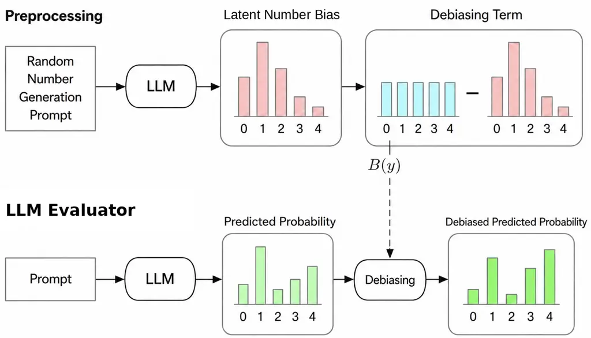
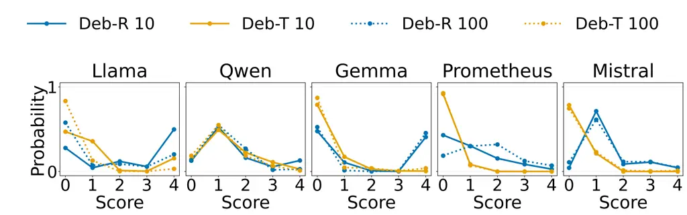
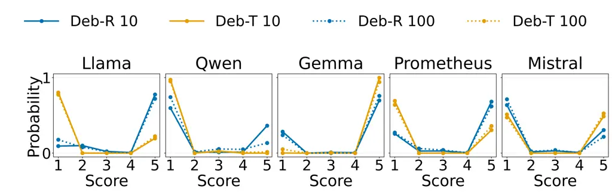
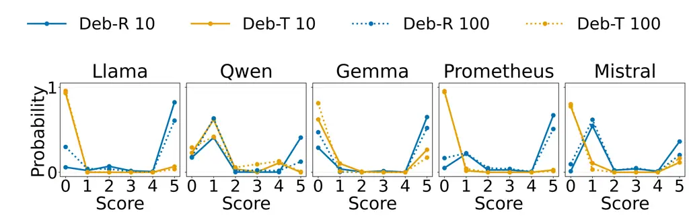
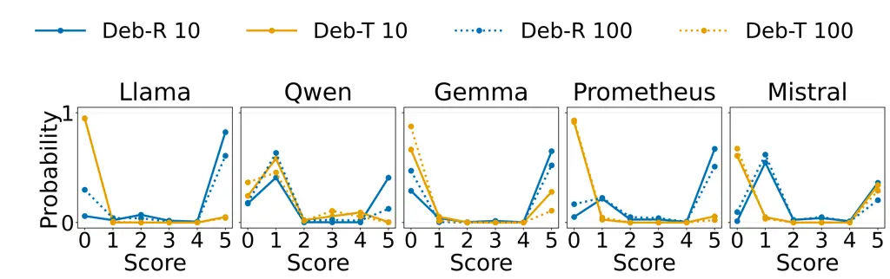
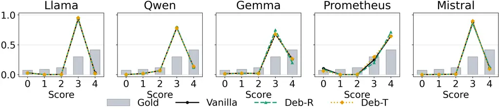

# Mitigating Scoring Bias in LLM-as-a-Judge via Random Number Generation

Yuma Asato    Kiyoaki Shirai    Natthawut Kertkeidkachorn
Affiliation: Japan Advanced Institute of Science and Technology
E-mail [{yumaasato, kshirai,
natt}@jaist.ac.jp](mailto:%7Byumaasato,%20kshirai,%20natt%7D@jaist.ac.jp)

###### Abstract

Large Language Models (LLMs) are often used as evaluators of text
quality, known as LLM-as-a-Judge, which can outperform conventional
automatic evaluation metrics that rely on reference texts. However, LLM
evaluators tend to generate particular scores regardless of the context
of the evaluated text, which is known as scoring bias. This study
proposes a novel method to mitigate this scoring bias. An LLM is
instructed to randomly generate number tokens, and the latent numerical
bias of the LLM is identified by measuring the deviation of the observed
distribution of numbers from the uniform distribution. A definition of a
downstream task, for which an LLM evaluator is used, is added to the
prompts for random number generation to measure task-specific latent
number bias. In the evaluation by an LLM, the token generation
probabilities for a given input are rectified considering the LLM’s
latent number bias. Results of the experiment on four different tasks,
evaluation of LLM alignment, evaluation of summarization, Semantic
Textual Similarity, and Semantic Textual Relatedness, demonstrate that
our proposed method outperforms the baselines, including an LLM without
debiasing and previous calibration methods. In addition, it is confirmed
that scoring bias varies across LLMs, tasks, and score ranges,
indicating the importance of measuring latent number bias as the case
may be.

###### Keywords: 

LLM-as-a-Judge, Scoring Bias, Debias, Random Number Generation.

## 1 Introduction

Large Language Models (LLMs) have achieved strong performance in a wide
range of natural language processing tasks, including machine
translation and summarization. In recent years, LLMs have also been used
to evaluate the quality of texts, a paradigm known as LLM-as-a-Judge.
Conventional automatic evaluation criteria for natural language
generation (NLG) have mainly relied on methods that measure the
similarity between a generated text and a reference text, such as
BLEU \[18\], ROUGE \[14\], and BERTScore \[24\]. In contrast, using LLMs
as evaluators is known not only to reduce the human cost of preparing a
substantial number of reference texts, but also to be sometimes more
appropriate than reference-based automatic evaluation \[15\]. However,
it is well known that LLM evaluators exhibit various biases. Especially,
scoring bias can degrade the performance of the LLM’s evaluation. In the
context of LLM-as-a-Judge, scoring bias is defined as the tendency to
exhibit a preference for specific numerical values regardless of the
context of the evaluated text \[19\].

Besides, several studies investigated LLM’s ability for random
generation \[25, 23, 8, 10\]. The “ability for random generation” refers
to the behavior of LLMs to generate genuinely random outputs in tasks
that require unpredictability, such as random number generation. These
studies demonstrated that LLMs do not exhibit sufficient randomness; in
particular, instruction-tuned LLMs often fail to generate outputs that
follow a uniform distribution in random number generation. The lack of
randomness suggests an undesirable preference for specific numbers,
which could lead to scoring bias in LLM-as-a-Judge. However, previous
studies have overlooked an approach to identifying scoring bias from the
perspective of ability for random generation of LLMs and correcting it.

This paper proposes a novel method for mitigating scoring bias by
considering deviations from genuine random generation in LLMs to improve
the performance of LLM evaluators. Random number generation is performed
to measure inherent bias in predicting the scores of a target text,
i.e., the tendency for numbers to be generated more or less frequently
regardless of the input. In addition, supposing that the inherent bias
of LLMs may differ across downstream evaluation tasks, a task definition
is provided to the prompt for random number generation. Then, the
probabilities of token generation by an LLM are modified so that the
probabilities of positively (or negatively) biased numbers are reduced
(or increased). The effectiveness of the proposed method is evaluated
through experiments on four different evaluation tasks. The results
indicate that our method outperforms the previous debiasing methods.

Our main contributions are summarized as follows.¹¹ 1 Codes will be
available upon acceptance.

- •
  We propose a debiasing method that estimates the LLM’s inherent
  scoring bias and mitigates it during evaluation by the LLM.
- •
  We propose a task-dependent debiasing method that mitigates the
  inherent scoring bias in individual downstream tasks of
  LLM-as-a-Judge.
- •
  We demonstrate the effectiveness of the proposed method through
  comprehensive experiments, including four evaluation tasks, five LLMs,
  and a comparison with representative previous calibration methods.

## 2 Related Work

### 2.1 LLM-as-a-Judge

As described in section 1, LLM-as-a-Judge has been widely used in recent
years. Unlike traditional reference-based metrics (e.g., BLEU \[18\],
ROUGE \[14\], and BERTScore \[24\]), LLM evaluators can evaluate the
quality of texts without reference texts. Fu et al. proposed GPTScore, a
framework that enables generative pre-trained models to evaluate text
quality across multiple aspects and demonstrated its
effectiveness \[5\]. Liu et al. proposed G-Eval, a framework to assess
the quality of NLG tasks such as text summarization and response
generation in a dialog system \[15\]. G-Eval outperformed conventional
reference-based and reference-free automatic evaluation metrics in terms
of Spearman correlation with human judgments. Prometheus 2 is an
open-source LLM specializing in evaluation, which is fine-tuned using
feedback datasets for two evaluation formats: direct evaluation by
generating a score and relative evaluation via pairwise ranking \[12\].
It demonstrated evaluation performance comparable to GPT-4 \[1\]. Zheng
et al. introduced MT-Bench, a multi-turn conversation benchmark, and
Chatbot Arena, a crowdsourcing benchmark platform \[27\]. They have
shown that strong LLMs achieve a high agreement rate with human
preferences, while also exhibiting biases such as position bias and
verbosity bias in LLM-as-a-Judge.

### 2.2 Bias of LLM Evaluator

Several types of scoring bias of LLM evaluators are reported. Sato et
al. pointed out the problem of scoring bias, referred to as “numerical
bias” in their paper, and investigated three approaches to mitigate it:
modifying the temperature, Distribution Calibration, and adjusting the
score range \[19\]. Li et al. reported that the scores produced by LLM
evaluators vary substantially in response to minor prompt changes,
including the order of the scoring rubric, the notation of score ID, and
the attachment of reference answer score \[13\]. Fujinuma proposed a
method to mitigate a score range bias, a phenomenon in which LLMs’
outputs are highly sensitive to pre-defined score ranges \[6\]. Similar
to Sato’s work \[19\], this study focuses on scoring bias, LLM’s
inherent tendency to frequently generate specific scores irrespective of
the input, and proposes a method to mitigate it.

### 2.3 Calibration Method for LLMs

Numerous attempts have been devoted to bias mitigation or calibration
for LLMs. This subsection introduces two representative calibration
methods that are compared with the proposed method in our experiments.
Contextual Calibration \[26\] is the calibration method for LLMs. It
measures bias in classification labels derived from the token generation
probability distribution for context-free inputs such as N/A, and
corrects the label generation probabilities at inference based on this
bias. Sato et al. mitigated scoring bias by adopting the calibration
method proposed by Jiang et al. \[11\], which they referred to it as
Distribution Calibration (DC) \[19\]. It calibrates the label marginal
probability $`p(y)`$ via Monte-Carlo sampling, while estimating $`q(y)`$
via fitting a Beta distribution to the ground-truth scores using maximum
likelihood estimation. Finally, the prediction score is reweighted by
the ratio $`q(y)/p(y)`$.

## 3 Proposed Method



Figure 1: Overview of our proposed method.

Let us suppose that an LLM is used as an evaluator by giving a prompt
that forces it to assess the quality of an input text and generate a
score as an integer in $`\mathcal{Y}=\{0,\ldots,N\}`$. The goal of this
study is to mitigate the inherent bias of an LLM in generating numerical
tokens.

Figure 1 shows an overview of the proposed method. In the preprocessing
stage, several prompts are given to an LLM to randomly generate a
number, then a probabilistic distribution over generating numerical
tokens in the set $`\mathcal{Y}`$ is observed. This distribution often
deviates from a uniform distribution, indicating the presence of bias in
the LLM. Hereafter, this probability distribution is referred to as
“latent number bias.” Then, the debiasing term $`B(y)`$ is calculated by
subtracting the latent number bias from the uniform distribution. In the
evaluation stage, when an LLM is used as an evaluator, the predicted
probability distribution over the scores is revised by adding the
debiasing terms to the logits of the number tokens. The evaluation score
is then determined based on this debiased probability distribution.

### 3.1 Measurement of Latent Number Bias

To measure the latent number bias of an LLM, prompts instructing the LLM
to randomly generate numbers are provided. First, 100 prompts for
instructing random number generation are generated using ChatGPT-o3 with
the prompt shown in Figure 2. The variables {{min_score}} and
{{max_score}} denote the minimum and maximum scores defined in an LLM
evaluator, i.e., 0 and N, respectively.

Next, only reliable prompts are retained to measure the latent number
bias. Specifically, the perplexity of each prompt is computed, then the
top $`T_{p}`$ prompts with the lowest perplexity are chosen. $`T_{p}`$
is intuitively set to 10 in this study.

Generate 100 prompts that have the same meaning as the following prompt.
Please generate a random integer between {{min_score}} and
{{max_score}}.

Figure 2: Meta-prompt to generate prompts for random number generation.

Probability distributions over numerical tokens are elicited from an LLM
via random number generation with the chosen prompts. Let $`y`$ denote a
numerical token, and $`p(y|x_{i})`$ denote the probability that the LLM
generates $`y`$ given the $`i`$-th prompt $`x_{i}`$. The average
probability distribution of each numerical token is computed by Equation
(1).

```math
P_{\mathrm{random}}(y)=\frac{1}{T_{p}}\sum_{i=1}^{T_{p}}\frac{p(y\mid x_{i})}{\sum_{y\in\mathcal{Y}}p(y\mid x_{i})} \tag{1}
```

In addition, to avoid $`P_{\mathrm{random}}(y)`$ being zero,
$`P_{\mathrm{random}}(y)`$ is set to the minimum probability
$`p_{\mathrm{min}}`$, which is defined as $`10^{-12}`$, if it is zero or
less than $`p_{\mathrm{min}}`$. The resulting distribution
$`P_{\mathrm{random}}(y)`$ is utilized as the LLMs’ latent number bias.

Two settings are considered for measuring the latent numerical bias. One
is the simple random setting, denoted as “Deb-R”, where the prompts for
random number generation are used in their original form. The other is
the task-conditioned random setting, denoted as “Deb-T”. It is expected
that the latent number bias of an LLM may vary when used to evaluate
different downstream tasks. In Deb-T, simulating the situation where the
LLM is used for a downstream task, the instruction for task evaluation
is attached before the prompt. Specifically, the prompt is formulated as

{{task instruction}} {{random number generation instruction}},

where {{task instruction}} is the instruction to the LLM that is used as
an evaluator for a specific task.

### 3.2 Estimation of Debiasing Term

When an LLM is prompted to generate random numbers, the resulting
probability distribution is expected to be uniform; however, in
practice, it is not. This is supported by previous work \[3, 23\]. The
deviation from the uniform distribution is used to quantify the strength
of the bias for each numerical token. This is referred to as the
debiasing term $`B(y)`$, which is defined as follows.

```math
B(y)=\log{U(y)}-\log{P_{\text{random}}(y)} \tag{2}
```

$`U(y)`$ denotes the uniform distribution over numerical tokens, i.e.,
$`\forall y:U(y)=\frac{1}{N+1}`$. The $`B(y)`$ becomes smaller for
numerical tokens that are intrinsically more likely to be generated, and
greater for less likely generated numerical tokens.

### 3.3 Debiasing in Scoring-Based Evaluation

When evaluating samples in a downstream task with an LLM evaluator, the
generation probabilities of numerical tokens are corrected as follows.

```math
\tilde{P}(y)=\text{softmax}(l(y)+\lambda\cdot B(y)) \tag{3}
```

$`l(y)`$ denotes the logit corresponding to the numerical token $`y`$,
and $`\lambda`$ is a hyperparameter that controls the strength of the
correction. In our experiment, $`\lambda`$ is optimized using the
development set.

## 4 Evaluation

### 4.1 Task and Dataset

Four tasks of LLM-as-a-Judge are employed for experiments to evaluate
the proposed debiasing method. The first two tasks are the evaluation of
automatically generated texts. LLM alignment (LLM-Alignment, in short)
is a task for evaluating the quality of texts generated by LLMs.
HelpSteer2 \[22\] is a dataset for this task, consisting of a prompt, a
text generated from the prompt, and a score for the text on a five-point
Likert scale from 0 to 4 across five points of view: helpfulness,
correctness, coherence, complexity, and verbosity. The evaluation for
text summarization (Summ) is a task to evaluate summarization systems.
SummEval \[4\] is a benchmark that comprises an original article in CNN
and DailyMail \[9\], its corresponding summary, and a score on a
five-point Likert scale (1--5) for coherence, consistency, fluency, and
relevance.²² 2 Actually, an average score of multiple annotators, i.e.,
a continuous value, is associated with each sample. In this experiment,
LLM evaluators are used to predict the helpfulness score for the LLM
alignment task and the coherence score in the summarization evaluation
task. As HelpSteer2 and SummEval do not provide a test set, five-fold
cross-validation is conducted, where the dataset is divided into a
development and test set at 1:4.

The other two tasks are the measurement of scores between two sentences.
Semantic Textual Similarity (STS) is a task to predict the similarity
between two sentences. STS-B \[21\] is used in this experiment, which is
a benchmark for the STS task. Similarly, Semantic Textual Relatedness
(STR) is a task to predict the extent to which two sentences are
semantically related. SemRel2024 \[17\] is a dataset consisting of
sentence pairs and their human-annotated scores. Both STS-B and
SemRel2024 assign continuous scores from 0 to 5 to each sentence pair.
Accordingly, LLMs evaluate the similarity or semantic relatedness of two
sentences and predict a score between 0 and 5. The original split of a
test and development set is retained.

The number of samples of these datasets is shown in Table 1. The
development set is used to optimize the hyperparameter $`\lambda`$ in
Equation (3). The best value is selected from a range of candidates from
0.1 to 1.0 in increments of 0.1.

| Dataset    | Dev.  | Test  |
| ---------- | ----- | ----- |
| HelpSteer2 | 208   | 830   |
| SummEval   | 320   | 1,280 |
| STS-B      | 1,500 | 1,379 |
| SemRel2024 | 250   | 2,600 |

Table 1: Statistics of datasets.

### 4.2 Experiment Settings

Score Prediction   Following a prior study \[15\], the final LLM’s
prediction score is not the numerical token with the highest
probability, but the weighted sum of the numeric values, where the
weights are the generation probabilities of each numerical token. That
is, the score predicted by an LLM, $`s_{\text{llm}}`$, is computed as
follows,

```math
s_{\text{llm}}=\sum_{y\in\mathcal{Y}}\tilde{p}(y)\cdot y, \tag{4}
```

where $`\tilde{p}(y)`$ is the generation probability of the token $`y`$.
A zero-shot prompt is given to the LLMs. Appendix 0.A shows the prompts
for each of the four tasks. The temperature parameter is set to 0.2 in
all experiments.

LLMs   Five open-source instruction-tuned LLMs are used as evaluators.
Specifically, Llama-3.1-8B-Instruct (Llama) \[16\], Qwen2.5-14B-Instruct
(Qwen) \[20\], Gemma-2-9B-Instruct (Gemma) \[7\], Prometheus-7B-v2.0
(Prometheus) \[12\], and Mistral-7B-Instruct-v0.3 (Mistral) \[2\] are
used.

Baseline   Our proposed methods are compared with three baselines:
vanilla, Contextual Calibration (CC) \[26\], and Distribution
Calibration (DC) \[19\]. Vanilla is an LLM evaluator without debiasing.

Metrics   LLM evaluators are assessed using a variety of statistical
metrics, including Spearman’s rank correlation coefficient, Pearson
correlation coefficient, and mean squared error (MSE) between the
predicted and reference scores. In addition, we define Score
Distribution Divergence (SDD) to evaluate the precision of a predicted
probability distribution over numerical tokens rather than a predicted
score. SDD is the metric that measures the closeness between the
predicted and ground-truth probability distribution. Let $`x`$ be a
sample in the test set, and $`y`$ be a numerical token. $`P_{x}`$ is the
predicted probability distribution of $`p_{x}(y)`$ over
$`y\in\mathcal{Y}`$ when $`x`$ is given as input, while $`Q_{x}`$ is the
ground-truth probability distribution. SDD is the average of the
Kullback-Leibler divergence between $`P_{x}`$ and $`Q_{x}`$ as defined
as follows,

```math
\mathrm{SDD}=\frac{1}{|D|}\sum_{x\in D}D_{\mathrm{KL}}(Q_{x}||P_{x})=\frac{1}{|D|}\sum_{x\in D}\sum_{y\in\mathcal{Y}}q_{x}(y)\log\frac{q_{x}(y)}{p_{x}(y)}, \tag{5}
```

where $`D`$ is the test set. For the dataset HelpSteer2, where a
discrete value is annotated as a score, $`q_{x}(y)`$ is set to 1 for the
ground-truth label and 0 otherwise. In contrast, for the SummEval,
STS-B, and SemRel2024 datasets, where a continuous value is annotated, a
probability is distributed to the two near tokens in proportion to their
proximity. For example, when the ground-truth score is $`3.7`$,
$`q_{x}(3)=0.3`$ and $`q_{x}(4)=0.7`$, while zero probability is
assigned to other tokens. Lower SDD indicates better performance.

### 4.3 Results

|                | LLM        | LLM-Align |      |      |       |       | Summ  |       |       |       |       |
| -------------- | ---------- | --------- | ---- | ---- | ----- | ----- | ----- | ----- | ----- | ----- | ----- |
|                |            | Van.      | CC   | DC   | Deb-R | Deb-T | Van.  | CC    | DC    | Deb-R | Deb-T |
| \(a\)          | Llama      | 13.3      | 11.4 | 15.9 | 14.9  | 14.9  | 13.6  | 12.2  | 13.8  | 13.0  | 18.0  |
| $`\uparrow`$   | Qwen       | 20.8      | 24.0 | 11.8 | 23.6  | 23.6  | 46.4  | 45.3  | 31.1  | 47.6  | 49.0  |
|                | Gemma      | 14.0      | 20.3 | 15.6 | 15.7  | 13.6  | 31.6  | 42.3  | 34.7  | 35.2  | 38.8  |
|                | Prometheus | 12.3      | 16.3 | 17.0 | 12.0  | 11.4  | 34.7  | 38.6  | 35.9  | 33.7  | 38.7  |
|                | Mistral    | 4.81      | 6.15 | 3.04 | 5.57  | 5.56  | 45.6  | 45.7  | 45.4  | 45.6  | 45.4  |
|                | average    | 13.0      | 15.6 | 12.7 | 14.4  | 13.8  | 34.4  | 36.8  | 32.2  | 35.0  | 38.0  |
| \(b\)          | Llama      | 17.1      | 18.3 | 22.5 | 16.4  | 16.5  | 9.02  | 13.0  | 14.3  | 7.66  | 14.4  |
| $`\uparrow`$   | Qwen       | 26.5      | 27.0 | 10.8 | 26.3  | 26.1  | 32.3  | 45.2  | 11.6  | 32.2  | 49.1  |
|                | Gemma      | 20.5      | 19.4 | 21.1 | 19.5  | 20.3  | 35.8  | 32.9  | 37.1  | 35.3  | 34.2  |
|                | Prometheus | 19.4      | 21.0 | 20.9 | 19.1  | 17.9  | 36.6  | 39.6  | 36.5  | 35.6  | 36.3  |
|                | Mistral    | 8.74      | 17.7 | 2.91 | 7.72  | 7.56  | 47.1  | 47.1  | 47.0  | 47.1  | 47.2  |
|                | average    | 18.4      | 20.7 | 15.7 | 17.8  | 17.7  | 32.2  | 35.6  | 29.3  | 31.6  | 36.2  |
| \(c\)          | Llama      | 1.59      | 1.92 | 1.70 | 1.57  | 1.56  | 4.86  | 2.37  | 2.39  | 4.25  | 1.12  |
| $`\downarrow`$ | Qwen       | 1.49      | 1.50 | 2.55 | 1.49  | 1.49  | 1.22  | 1.45  | 3.50  | 1.18  | 0.840 |
|                | Gemma      | 1.69      | 1.50 | 1.83 | 1.55  | 1.70  | 1.64  | 1.01  | 1.42  | 1.31  | 1.09  |
|                | Prometheus | 2.34      | 2.14 | 2.26 | 2.35  | 2.10  | 2.14  | 1.23  | 1.46  | 1.32  | 1.17  |
|                | Mistral    | 1.62      | 2.28 | 3.81 | 1.63  | 1.60  | 0.903 | 0.960 | 0.935 | 0.892 | 0.872 |
|                | average    | 1.75      | 1.87 | 2.43 | 1.72  | 1.69  | 2.15  | 1.40  | 1.94  | 1.79  | 1.02  |
| \(d\)          | Llama      | 5.38      | 4.32 | 2.91 | 6.05  | 7.21  | 4.26  | 2.05  | 1.78  | 4.15  | 2.23  |
| $`\downarrow`$ | Qwen       | 10.6      | 10.6 | 8.77 | 10.7  | 10.5  | 4.78  | 4.06  | 7.81  | 5.35  | 3.61  |
|                | Gemma      | 4.99      | 10.7 | 4.10 | 6.88  | 5.19  | 4.52  | 4.56  | 3.29  | 3.43  | 3.27  |
|                | Prometheus | 3.51      | 2.49 | 2.41 | 3.65  | 3.55  | 2.42  | 2.14  | 1.26  | 2.26  | 1.97  |
|                | Mistral    | 10.4      | 8.52 | 7.46 | 10.3  | 11.0  | 3.27  | 3.00  | 2.69  | 3.68  | 3.59  |
|                | average    | 6.98      | 7.33 | 5.13 | 7.51  | 7.48  | 3.85  | 3.16  | 3.37  | 3.78  | 2.93  |

Table 2: Results of the LLM alignment and summarization tasks. (a)
Spearman, (b) Pearson, (c) MSE, and (d) SDD.

|                | LLM        | STS   |      |       |       |       | STR   |       |       |       |       |
| -------------- | ---------- | ----- | ---- | ----- | ----- | ----- | ----- | ----- | ----- | ----- | ----- |
|                |            | Van.  | CC   | DC    | Deb-R | Deb-T | Van.  | CC    | DC    | Deb-R | Deb-T |
| \(a\)          | Llama      | 7.45  | 31.5 | 2.43  | 14.2  | 47.0  | 26.8  | 42.9  | 17.2  | 25.6  | 37.1  |
| $`\uparrow`$   | Qwen       | 81.6  | 81.9 | 81.7  | 82.2  | 82.1  | 73.4  | 72.3  | 73.3  | 73.3  | 73.3  |
|                | Gemma      | 63.6  | 69.5 | 63.5  | 70.0  | 69.6  | 40.1  | 59.2  | 57.9  | 50.1  | 56.9  |
|                | Prometheus | 77.0  | 78.3 | 77.7  | 79.0  | 78.9  | 70.3  | 68.6  | 60.3  | 70.3  | 70.1  |
|                | Mistral    | 79.6  | 79.4 | 79.6  | 79.8  | 79.8  | 70.9  | 70.9  | 70.4  | 71.1  | 71.0  |
|                | average    | 61.9  | 68.1 | 61.0  | 65.0  | 71.5  | 56.3  | 62.8  | 55.8  | 58.1  | 61.7  |
| \(b\)          | Llama      | 4.26  | 29.5 | 12.0  | 15.6  | 48.4  | 17.3  | 40.0  | 13.9  | 20.9  | 23.8  |
| $`\uparrow`$   | Qwen       | 77.6  | 76.1 | 79.2  | 81.0  | 81.5  | 71.8  | 63.4  | 71.6  | 71.3  | 71.4  |
|                | Gemma      | 65.1  | 65.2 | 66.0  | 68.5  | 67.5  | 39.0  | 39.0  | 50.6  | 39.2  | 36.9  |
|                | Prometheus | 73.8  | 77.9 | 79.3  | 78.5  | 80.0  | 64.6  | 66.5  | 56.6  | 64.8  | 63.5  |
|                | Mistral    | 76.2  | 78.8 | 77.2  | 79.9  | 79.7  | 67.8  | 71.6  | 68.3  | 67.6  | 67.7  |
|                | average    | 59.4  | 65.5 | 62.7  | 64.7  | 71.4  | 52.1  | 56.1  | 52.2  | 52.8  | 52.7  |
| \(c\)          | Llama      | 9.12  | 2.21 | 6.61  | 3.37  | 2.25  | 6.99  | 0.661 | 1.43  | 6.27  | 1.31  |
| $`\downarrow`$ | Qwen       | 0.976 | 1.02 | 0.926 | 0.935 | 0.934 | 0.862 | 0.526 | 0.781 | 0.661 | 0.746 |
|                | Gemma      | 1.85  | 1.84 | 1.79  | 1.41  | 1.50  | 2.99  | 1.88  | 1.48  | 2.16  | 2.02  |
|                | Prometheus | 1.55  | 1.10 | 1.12  | 1.45  | 1.73  | 2.16  | 0.508 | 0.778 | 1.53  | 0.971 |
|                | Mistral    | 1.55  | 1.29 | 1.36  | 1.36  | 1.44  | 1.31  | 1.26  | 1.02  | 1.23  | 0.996 |
|                | average    | 3.01  | 1.49 | 2.36  | 1.71  | 1.57  | 2.86  | 0.967 | 1.10  | 2.37  | 1.21  |
| \(d\)          | Llama      | 11.1  | 2.25 | 3.10  | 2.17  | 2.91  | 7.59  | 1.04  | 1.27  | 7.51  | 2.54  |
| $`\downarrow`$ | Qwen       | 7.33  | 7.72 | 6.45  | 1.92  | 1.67  | 3.27  | 3.14  | 3.17  | 3.20  | 3.22  |
|                | Gemma      | 4.97  | 8.69 | 4.24  | 1.54  | 1.64  | 6.82  | 7.45  | 3.44  | 6.62  | 7.08  |
|                | Prometheus | 1.71  | 2.09 | 1.19  | 1.19  | 1.25  | 3.11  | 0.922 | 0.933 | 2.82  | 2.66  |
|                | Mistral    | 7.06  | 7.18 | 6.11  | 2.18  | 1.79  | 6.15  | 6.12  | 4.55  | 6.13  | 6.00  |
|                | average    | 6.44  | 5.59 | 4.22  | 1.80  | 1.85  | 5.39  | 3.73  | 2.67  | 5.25  | 4.30  |

Table 3: Results of the STS and STR tasks. (a) Spearman, (b) Pearson,
(c) MSE, and (d) SDD.

Tables 2 and 3 show the results of the debiasing methods using five
different LLM evaluators. On the one hand, for the Summ, STS, and STR
tasks, the proposed methods (Deb-R and Deb-T) outperform the vanilla in
most cases. On the other hand, for the LLM alignment task, the proposed
methods achieve slightly better MSE than the vanilla method, but not for
other criteria, indicating that the bias of LLMs is not sufficiently
mitigated. The reason for it will be discussed in Subsection 5.2.

Hereafter, we discuss the results of the tasks except for the LLM
alignment. Our methods achieve superior performance to the previous
debiasing methods, DC for all tasks, and CC for all tasks except for
STR. Especially, Deb-T with Llama improves Spearman’s correlation by
15.5 and 44.6 points over CC and DC, respectively, for the STS task. It
indicates that measuring the inherent bias of LLMs in generating
numerical tokens via random number generation is effective in mitigating
the scoring bias.

Deb-T outperforms Deb-R in most cases. In particular, Deb-T with Llama
achieves significantly higher Spearman’s and Pearson’s correlations in
the STS task. These results support the idea that the latent number bias
of LLMs is task-dependent and that adding instructions for the
downstream task is effective for measuring it more precisely.

### 4.4 Evaluation of Prompt Selection

As described in Subsection 3.1, 100 prompts for random number generation
are generated, and the top $`T_{p}`$ prompts with low perplexity are
chosen. The parameter $`T_{p}`$ was set to 10 in the previous
experiments, but it may affect debiasing performance. To evaluate the
potential impact of selecting reliable prompts on measuring latent
number bias in LLMs, the methods Deb-R with $`T_{p}=10`$ and
$`T_{p}=100`$ (without prompt selection) are compared.

Table 4 shows Spearman’s correlation of two methods. Deb-R₁₀₀
($`T_{p}=100`$) outperforms Deb-R₁₀ ($`T_{p}=10`$) overall; however, the
differences between them are small in most cases. These results suggest
that the effectiveness of the prompt selection on random number
generation is limited.

| LLM        | LLM-Align |      | Summ |      | STS  |      | STR  |      |
| ---------- | --------- | ---- | ---- | ---- | ---- | ---- | ---- | ---- |
|            | R₁₀       | R₁₀₀ | R₁₀  | R₁₀₀ | R₁₀  | R₁₀₀ | R₁₀  | R₁₀₀ |
| Llama      | 14.9      | 14.3 | 13.0 | 13.0 | 14.2 | 23.1 | 25.6 | 25.6 |
| Qwen       | 23.6      | 23.8 | 47.6 | 47.3 | 82.2 | 82.2 | 73.3 | 73.4 |
| Gemma      | 15.7      | 17.2 | 35.2 | 35.3 | 70.0 | 70.3 | 50.1 | 55.3 |
| Prometheus | 12.0      | 12.3 | 33.7 | 33.8 | 79.0 | 79.0 | 70.3 | 70.2 |
| Mistral    | 5.57      | 5.66 | 45.6 | 45.6 | 79.8 | 80.0 | 71.1 | 71.1 |
| average    | 14.4      | 14.7 | 35.0 | 35.0 | 65.0 | 66.9 | 58.1 | 59.1 |

Table 4: Spearman’s correlation of Deb-R₁₀ and Deb-R₁₀₀. Bold indicates
a better method.

### 4.5 Evaluation of Search Range Expansion of Hyperparameter

In previous experiments, the hyperparameter $`\lambda`$, which controls
the intensity of debiasing, was optimized over the range
$`0.1\leq\lambda\leq 1`$. It is expected that extending the search range
could improve the performance of LLM evaluators. Therefore, we implement
Deb-R*(λ≤10) and Deb-T*(λ≤10), which are variants of Deb-R and Deb-T,
respectively, in which $`\lambda`$ is optimized over the range
$`0.1\leq\lambda\leq 10`$. Table 5 shows Spearman’s correlation for
these settings as well as the original settings (denoted as Deb-R*(λ≤1)
and Deb-T*(λ≤1)).

Although Deb-R*(λ≤10) is significantly better than Deb-R*(λ≤1) in some
cases, e.g., the Llama-based model for the STS and STR tasks,
unexpectedly, the extension of the search range does not improve
performance in many cases. A similar trend is observed for Deb-T\_(λ≤10).
It indicates a gap between the development and test sets; the best
$`\lambda`$ optimized on the development set does not always yield the
best performance on the test set. Optimizing $`\lambda`$ is important,
yet it poses a considerable challenge.

| Method | LLM        | LLM-Align         |                    | Summ              |                    | STS               |                    | STR               |                    |
| ------ | ---------- | ----------------- | ------------------ | ----------------- | ------------------ | ----------------- | ------------------ | ----------------- | ------------------ |
|        |            | $`\lambda\leq 1`$ | $`\lambda\leq 10`$ | $`\lambda\leq 1`$ | $`\lambda\leq 10`$ | $`\lambda\leq 1`$ | $`\lambda\leq 10`$ | $`\lambda\leq 1`$ | $`\lambda\leq 10`$ |
| Deb-R  | Llama      | 14.9              | 17.7               | 13.0              | 10.2               | 14.2              | 41.9               | 25.6              | 38.4               |
|        | Qwen       | 23.6              | 22.7               | 47.6              | 47.2               | 82.2              | 82.2               | 73.3              | 73.3               |
|        | Gemma      | 15.7              | 16.6               | 35.2              | 30.0               | 70.0              | 70.0               | 50.1              | 58.5               |
|        | Prometheus | 12.0              | 11.7               | 33.7              | 32.7               | 79.0              | 79.0               | 70.3              | 70.3               |
|        | Mistral    | 5.57              | 5.73               | 45.6              | 39.4               | 79.8              | 79.8               | 71.1              | 71.2               |
|        | average    | 14.4              | 14.9               | 35.0              | 31.9               | 65.0              | 70.6               | 58.1              | 62.3               |
| Deb-T  | Llama      | 14.9              | 20.2               | 18.0              | 13.1               | 47.0              | 47.0               | 37.1              | 38.5               |
|        | Qwen       | 23.6              | 22.3               | 49.0              | 30.0               | 82.1              | 82.1               | 73.3              | 73.3               |
|        | Gemma      | 13.6              | 13.0               | 38.8              | 42.5               | 69.6              | 69.6               | 56.9              | 59.1               |
|        | Prometheus | 11.4              | 15.8               | 38.7              | 27.7               | 78.9              | 78.9               | 70.1              | 70.1               |
|        | Mistral    | 5.56              | 5.22               | 45.4              | 44.0               | 79.8              | 79.8               | 71.0              | 71.0               |
|        | average    | 13.8              | 15.3               | 38.0              | 31.4               | 71.5              | 71.5               | 61.7              | 62.4               |

Table 5: Spearman’s correlation of methods with different parameter
optimization. Bold indicates Deb-R*(λ\<10)/Deb-T*(λ\<10) achieves better
performance than Deb-R*(λ\<1)/Deb-T*(λ\<1), while underline indicates
the performance of these two methods is equal.

## 5 Analysis

### 5.1 Analysis on observed latent number bias

Figure 3 shows the latent number bias of five LLMs using four different
methods: Deb-R₁₀, Deb-T₁₀, Deb-R₁₀₀, and Deb-T₁₀₀. First, we discuss the
task-agnostic latent number bias, which can be observed by the method
Deb-R. Different latent number biases are observed across LLMs. Llama
and Prometheus exhibit a preference for the highest scores. Gemma shows
a bias toward the lowest and highest scores. Qwen and Mistral tend to
generate the number ‘1’. The range of scores in random number generation
also influences the latent number bias. For example, Qwen and Mistral
exhibit different latent number biases when the scoring range is \[1,5\]
(i.e., the Summ task) compared to other scoring ranges.

Adding the task definition to the prompt for random number generation
significantly changes the latent number bias, as confirmed by the
comparison between Deb-R (blue lines) and Deb-T (yellow lines).
Therefore, it is essential to measure and mitigate latent number bias
for a specific downstream task. This is supported by the fact that Deb-T
outperformed Deb-R in Tables 1 and 2.

Besides, the latent number bias is nearly identical between Deb-R₁₀ (or
Deb-T₁₀), indicated by a solid line, and Deb-R₁₀₀ (or Deb-T₁₀₀),
indicated by a dotted line. The number of prompts used for random number
generation ($`T_{p}=10`$ vs. $`T_{p}=100`$) is not a significant factor
in the scoring bias of LLMs.

### 5.2 Analysis of Poor Performance in LLM Alignment Task

The poor performance of the proposed debiasing method on the LLM
alignment task, as shown in Table 2, is due to the limited capacity of
the pre-trained LLMs. Fig. 4 shows the proportions of the scores
predicted by the LLM evaluators and the ground-truth scores. The lines
indicate the average generation probability for each predicted number
from the vanilla, Deb-R, and Deb-T models, while the bar chart shows the
proportion of ground-truth scores. As the score increases, the number of
samples in the test set increases. However, vanilla LLMs, except for
Prometheus, predict the score ‘3’ (not the max score ‘4’) for most
samples. This deviation was not sufficiently revised by our debiasing
method. The latent number bias shown in Figure 3 exhibits low bias
toward the score ‘3’. Thus, the prediction probability of the score ‘3’
is further increased by debiasing. Therefore, debiasing cannot have a
positive impact on LLM evaluators, resulting in almost equivalent
performance before and after debiasing.









(a) LLM-Align

(b) Summ

(c) STS

(d) STR

Figure 3: Latent number bias of LLMs.



Figure 4: Proportion of ground-truth and predicted scores for LLM
Alignment task.

## 6 Conclusion

We proposed a debiasing method for LLM-as-a-Judge to mitigate scoring
bias. The latent number bias of an LLM was measured by random number
generation, and the generation probability of the number token was
increased (or decreased) when it had a low (or high) inherent preference
in the observed latent number bias. The results of the experiments on
four evaluation tasks using five LLMs showed the superiority of the
proposed method over existing methods. In addition, the effectiveness of
the variants of the proposed methods was investigated, including adding
the task definition to the prompt for random number generation, changing
the number of prompts for random number generation, and optimizing the
weight parameter to control the degree of debiasing.

This study leaves several issues to be addressed in the future. First,
the effectiveness of our method should be assessed across a wider range
of evaluation tasks to evaluate its robustness. Second, instead of using
a naive zero-shot prompt in an LLM evaluator, more sophisticated
prompts, such as few-shot and chain-of-thought prompts, should be
employed. Third, it is worth investigating to determine the
hyperparameter $`\lambda`$ for individual samples. We confirmed that the
vanilla LLMs can precisely evaluate the quality of several samples, for
which debiasing is unnecessary. Setting the $`\lambda`$ to zero for
these samples would improve the overall performance of LLM evaluators.
Finally, larger LLMs should be used in the experiment to examine the
relationship between the number of parameters in an LLM and the
effectiveness of debiasing.

## Appendix 0.A Prompt

Figures 8–8 show the prompts for evaluation of LLM alignment, evaluation
of summarization, STS, and STR tasks.


Figure 5: Prompt for the LLM-Align task.


Figure 6: Prompt for the Summ task.


Figure 7: Prompt for the STS task.


Figure 8: Prompt for the STR task.

## References

- \[1\] J. Achiam, S. Adler, S. Agarwal, L. Ahmad, I. Akkaya, F. L.
  Aleman, D. Almeida, J. Altenschmidt, S. Altman, S. Anadkat, et
  al. (2023) Gpt-4 technical report. arXiv preprint arXiv:2303.08774.
  Cited by: §2.1.
- \[2\] M. AI Mistral-7b-instruct-v0.3. Note:
  [https://huggingface.co/mistralai/Mistral-7B-Instruct-v0.3](https://huggingface.co/mistralai/Mistral-7B-Instruct-v0.3)
  (accessed 2026-05-27) Cited by: §4.2.
- \[3\] J. Coronado-Blázquez (2025) Deterministic or probabilistic? the
  psychology of llms as random number generators. External Links:
  2502.19965, [Link](https://arxiv.org/abs/2502.19965) Cited by: §3.2.
- \[4\] A. R. Fabbri, W. Kryściński, B. McCann, C. Xiong, R. Socher,
  and D. Radev (2021) SummEval: re-evaluating summarization evaluation.
  Transactions of the Association for Computational Linguistics 9,
  pp. 391–409. External Links:
  [Link](https://aclanthology.org/2021.tacl-1.24/),
  [Document](https://dx.doi.org/10.1162/tacl%5Fa%5F00373) Cited by:
  §4.1.
- \[5\] J. Fu, S. Ng, Z. Jiang, and P. Liu (2024) GPTScore: evaluate as
  you desire. In Proceedings of the 2024 Conference of the North
  American Chapter of the Association for Computational Linguistics:
  Human Language Technologies (Volume 1: Long Papers), K. Duh, H. Gomez,
  and S. Bethard (Eds.), Mexico City, Mexico, pp. 6556–6576. External
  Links: [Link](https://aclanthology.org/2024.naacl-long.365/),
  [Document](https://dx.doi.org/10.18653/v1/2024.naacl-long.365) Cited
  by: §2.1.
- \[6\] Y. Fujinuma (2026) Contrastive decoding mitigates score range
  bias in llm-as-a-judge. External Links: 2510.18196,
  [Link](https://arxiv.org/abs/2510.18196) Cited by: §2.2.
- \[7\] Google Gemma-2-9b-it. Note:
  [https://huggingface.co/google/gemma-2-9b-it](https://huggingface.co/google/gemma-2-9b-it)
  (accessed 2026-05-27) Cited by: §4.2.
- \[8\] X. Gu, S. De, M. Titsias, L. Markeeva, P. Veličković, and R.
  Pascanu (2026) The illusion of stochasticity in llms. External Links:
  2604.06543, [Link](https://arxiv.org/abs/2604.06543) Cited by: §1.
- \[9\] K. M. Hermann, T. Kocisky, E. Grefenstette, L. Espeholt, W.
  Kay, M. Suleyman, and P. Blunsom (2015) Teaching machines to read and
  comprehend. Advances in neural information processing systems 28.
  Cited by: §4.1.
- \[10\] A. K. Hopkins, A. Renda, and M. Carbin (2023) Can LLMs generate
  random numbers? evaluating LLM sampling in controlled domains. In ICML
  2023 Workshop: Sampling and Optimization in Discrete Space, External
  Links: [Link](https://openreview.net/forum?id=Vhh1K9LjVI) Cited by:
  §1.
- \[11\] Z. Jiang, Y. Zhang, C. Liu, J. Zhao, and K. Liu (2023)
  Generative calibration for in-context learning. In Findings of the
  Association for Computational Linguistics: EMNLP 2023, H. Bouamor, J.
  Pino, and K. Bali (Eds.), Singapore, pp. 2312–2333. External Links:
  [Link](https://aclanthology.org/2023.findings-emnlp.152/),
  [Document](https://dx.doi.org/10.18653/v1/2023.findings-emnlp.152)
  Cited by: §2.3.
- \[12\] S. Kim, J. Suk, S. Longpre, B. Y. Lin, J. Shin, S. Welleck, G.
  Neubig, M. Lee, K. Lee, and M. Seo (2024) Prometheus 2: an open source
  language model specialized in evaluating other language models. In
  Proceedings of the 2024 Conference on Empirical Methods in Natural
  Language Processing, Y. Al-Onaizan, M. Bansal, and Y. Chen (Eds.),
  Miami, Florida, USA, pp. 4334–4353. External Links:
  [Link](https://aclanthology.org/2024.emnlp-main.248/),
  [Document](https://dx.doi.org/10.18653/v1/2024.emnlp-main.248) Cited
  by: §2.1, §4.2.
- \[13\] Q. Li, S. Dou, K. Shao, C. Chen, and H. Hu (2026) Evaluating
  scoring bias in llm-as-a-judge. In Database Systems for Advanced
  Applications, H. Jung, T. Wang, M. Toyoda, H. Kwon, and J. Lee (Eds.),
  Singapore, pp. 19–34. External Links: ISBN 978-981-92-0372-7 Cited by:
  §2.2.
- \[14\] C. Lin (2004) ROUGE: a package for automatic evaluation of
  summaries. In Text Summarization Branches Out, Barcelona, Spain,
  pp. 74–81. External Links: [Link](https://aclanthology.org/W04-1013/)
  Cited by: §1, §2.1.
- \[15\] Y. Liu, D. Iter, Y. Xu, S. Wang, R. Xu, and C. Zhu (2023)
  G-eval: NLG evaluation using gpt-4 with better human alignment. In
  Proceedings of the 2023 Conference on Empirical Methods in Natural
  Language Processing, H. Bouamor, J. Pino, and K. Bali (Eds.),
  Singapore, pp. 2511–2522. External Links:
  [Link](https://aclanthology.org/2023.emnlp-main.153/),
  [Document](https://dx.doi.org/10.18653/v1/2023.emnlp-main.153) Cited
  by: §1, §2.1, §4.2.
- \[16\] Meta Llama-3.1-8b-instruct. Note:
  [https://huggingface.co/meta-llama/Llama-3.1-8B-Instruct](https://huggingface.co/meta-llama/Llama-3.1-8B-Instruct)
  (accessed 2026-05-27) Cited by: §4.2.
- \[17\] N. Ousidhoum, S. Muhammad, M. Abdalla, I. Abdulmumin, I.
  Ahmad, S. Ahuja, A. Aji, V. Araujo, A. Ayele, P. Baswani, M.
  Beloucif, C. Biemann, S. Bourhim, C. Kock, G. Dekebo, O. Hourrane, G.
  Kanumolu, L. Madasu, S. Rutunda, M. Shrivastava, T. Solorio, N.
  Surange, H. Tilaye, K. Vishnubhotla, G. Winata, S. Yimam, and S.
  Mohammad (2024) SemRel2024: a collection of semantic textual
  relatedness datasets for 13 languages. In Findings of the Association
  for Computational Linguistics: ACL 2024, L. Ku, A. Martins, and V.
  Srikumar (Eds.), Bangkok, Thailand, pp. 2512–2530. External Links:
  [Link](https://aclanthology.org/2024.findings-acl.147/),
  [Document](https://dx.doi.org/10.18653/v1/2024.findings-acl.147) Cited
  by: §4.1.
- \[18\] K. Papineni, S. Roukos, T. Ward, and W. Zhu (2002) Bleu: a
  method for automatic evaluation of machine translation. In Proceedings
  of the 40th Annual Meeting of the Association for Computational
  Linguistics, P. Isabelle, E. Charniak, and D. Lin (Eds.),
  Philadelphia, Pennsylvania, USA, pp. 311–318. External Links:
  [Link](https://aclanthology.org/P02-1040/),
  [Document](https://dx.doi.org/10.3115/1073083.1073135) Cited by: §1,
  §2.1.
- \[19\] A. Sato, H. Kim, Z. Chen, M. Mita, and M. Komachi (2026)
  Exploring the effects of alignment on numerical bias in large language
  models. External Links: 2601.16444,
  [Link](https://arxiv.org/abs/2601.16444) Cited by: §1, §2.2, §2.3,
  §4.2.
- \[20\] Q. Team (2024) Qwen2.5: a party of foundation models. External
  Links: [Link](https://qwenlm.github.io/blog/qwen2.5/) Cited by: §4.2.
- \[21\] A. Wang, A. Singh, J. Michael, F. Hill, O. Levy, and S. R.
  Bowman (2018) GLUE: a multi-task benchmark and analysis platform for
  natural language understanding. In Proceedings of the 2018 EMNLP
  Workshop BlackboxNLP: Analyzing and Interpreting Neural Networks for
  NLP, T. Linzen, G. Chrupała, and A. Alishahi (Eds.), Brussels,
  Belgium, pp. 353–355. External Links:
  [Link](https://aclanthology.org/W18-5446/),
  [Document](https://dx.doi.org/10.18653/v1/W18-5446) Cited by: §4.1.
- \[22\] Z. Wang, Y. Dong, O. Delalleau, J. Zeng, G. Shen, D. Egert, J.
  Zhang, M. N. Sreedhar, and O. Kuchaiev (2024) Helpsteer 2: open-source
  dataset for training top-performing reward models. Advances in Neural
  Information Processing Systems 37, pp. 1474–1501. Cited by: §4.1.
- \[23\] P. West and C. Potts (2025) Base models beat aligned models at
  randomness and creativity. In Second Conference on Language Modeling,
  External Links: [Link](https://openreview.net/forum?id=vqN8uom4A1)
  Cited by: §1, §3.2.
- \[24\] T. Zhang\*, V. Kishore\*, F. Wu\*, K. Q. Weinberger, and Y.
  Artzi (2020) BERTScore: evaluating text generation with bert. In
  International Conference on Learning Representations, External Links:
  [Link](https://openreview.net/forum?id=SkeHuCVFDr) Cited by: §1, §2.1.
- \[25\] M. Zhao, Y. Du, and M. Wang (2026) Large language models are
  bad dice players: llms struggle to generate random numbers from
  statistical distributions. External Links: 2601.05414,
  [Link](https://arxiv.org/abs/2601.05414) Cited by: §1.
- \[26\] Z. Zhao, E. Wallace, S. Feng, D. Klein, and S. Singh (2021)
  Calibrate before use: improving few-shot performance of language
  models. In Proceedings of the 38th International Conference on Machine
  Learning, M. Meila and T. Zhang (Eds.), Proceedings of Machine
  Learning Research, Vol. 139, pp. 12697–12706. External Links:
  [Link](https://proceedings.mlr.press/v139/zhao21c.html) Cited by:
  §2.3, §4.2.
- \[27\] L. Zheng, W. Chiang, Y. Sheng, S. Zhuang, Z. Wu, Y. Zhuang, Z.
  Lin, Z. Li, D. Li, E. Xing, H. Zhang, J. Gonzalez, and I.
  Stoica (2023) Judging llm-as-a-judge with mt-bench and chatbot arena.
  In Advances in Neural Information Processing Systems, A. Oh, T.
  Naumann, A. Globerson, K. Saenko, M. Hardt, and S. Levine (Eds.), Vol.
  36, pp. 46595–46623. Cited by: §2.1.
