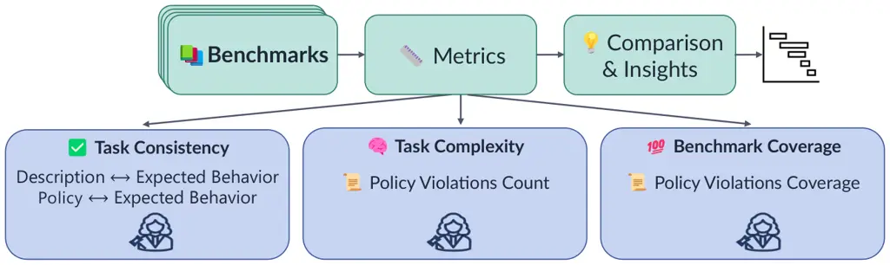
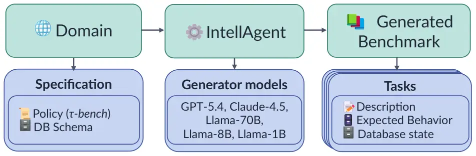
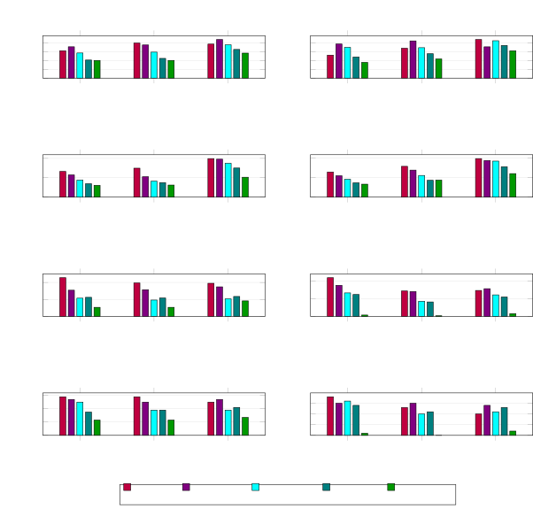
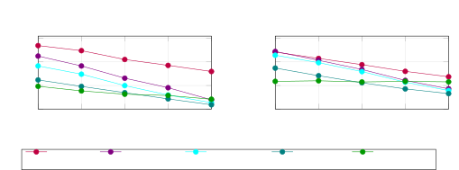
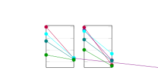
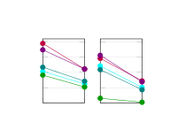
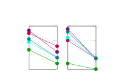

# Benchmarking the Benchmarks: Evaluating Benchmarks for Conversational Agents

Noam Koren ^(†)^(†)thanks: Equal contribution.    Roy
Bar-Haim¹¹footnotemark: 1    Abigail Goldsteen Affiliation: IBM Research
Email: [Noam.Koren1@ibm.com](mailto:)    roybar@il.ibm.com   
abigailt@il.ibm.com

###### Abstract

Task-oriented conversational agents are evaluated using curated or
automatically generated benchmarks, yet benchmark quality is rarely
assessed. Poor benchmarks may contain inconsistent tasks, simplistic
scenarios, or limited policy coverage, leading to unreliable
evaluations. We introduce a reference-free framework that uses LLM
judges to assess benchmark consistency, complexity, and policy coverage,
while providing actionable diagnostics of weaknesses. We validate the
framework by demonstrating agreement with independent human annotations
and by evaluating benchmarks generated by LLMs of varying capabilities,
as well as benchmarks subjected to controlled quality-degrading
perturbations. Across domains and judge models, the proposed metrics
consistently distinguish between benchmark quality levels. We further
demonstrate the framework’s applicability to manually curated
benchmarks. Our framework offers a practical approach for evaluating
synthetic and manually curated conversational-agent benchmarks.

## 1 Introduction

Task-oriented conversational agents are increasingly deployed in
customer support, travel, and enterprise workflows Mohammadi et al.
(2025). Unlike static question-answering systems, they must interact
over multiple turns, follow domain-specific policies, operate in
real-world environments, and use external tools. As their autonomy and
complexity grow, reliable evaluation becomes increasingly important and
challenging Yehudai et al. (2026).

A common approach is to evaluate agents using curated benchmarks with
realistic tasks, user requests, environment states, and expected
outcomes (Yao et al., 2024; Barres et al., 2025). However, manual
construction is costly, requiring domain expertise, scenario design,
tool and database simulation, and specification of expected behavior.
This has motivated growing interest in automatically generated
benchmarks (Li et al., 2023; Qin et al., 2024; Levi and Kadar, 2025),
which forgo manual curation and its implicit quality control.

This shift raises a fundamental question: how should benchmark quality
itself be evaluated? Synthetic benchmarks may contain inconsistent
tasks, simplistic scenarios, or limited coverage of the capabilities and
constraints they aim to test. Prior work shows that synthetic evaluation
data can differ from human-curated data in representativeness,
difficulty, and induced model rankings (Maheshwari et al., 2024).

Benchmark quality issues are not limited to synthetic data: a review of
445 benchmarks found pervasive construct-validity problems even in
widely used, manually curated benchmarks (Bean et al., 2025), and
$`\tau`$-bench, the basis for the benchmarks studied in this work, has
also been shown to contain flawed and ambiguous tasks (Cuadron et al.,
2025).¹¹ 1 $`\tau^{3}`$-bench, which we use for evaluation in §6, fixes
issues found in earlier versions of $`\tau`$-bench.²² 2 Sierra Blog also
documents specific task fixes:
[https://taubench.com/blog/tau3-task-fixes.html](https://taubench.com/blog/tau3-task-fixes.html).
Although recent studies have begun to assess benchmark quality more
systematically (Qian et al., 2026; Iskander et al., 2024),
policy-grounded evaluation of conversational-agent benchmarks remains
underexplored. Undetected benchmark flaws may therefore lead to
unreliable conclusions about agent capabilities.

We address this gap by proposing reference-free metrics for evaluating
conversational benchmarks with LLM judges (Zheng et al., 2023). The
metrics capture multiple quality dimensions, including consistency,
complexity, and coverage, without requiring comparison to existing
datasets. They assess both task coherence and alignment with the domain
policy that defines the intended agent behavior. Beyond aggregate
scores, they identify concrete issues, such as inconsistent tasks and
gaps in policy coverage, providing actionable diagnostics for benchmark
developers. We demonstrate empirically that our metrics provide valuable
insights across both synthetic and manually-created benchmarks.

A key challenge is validating that the metrics reflect meaningful
quality differences. We construct benchmark suites with expected quality
variation using two complementary approaches: generating benchmarks with
LLMs of different capabilities, used as a proxy for expected quality,
through the IntellAgent pipeline (Levi and Kadar, 2025), and applying
controlled perturbations that deliberately degrade benchmark quality.
Across both settings, the metrics consistently distinguish quality
levels across domains and LLM judges. We further validate the LLM-judge
scores against independent human annotations, demonstrating
medium-to-strong, statistically significant correlation between the two.

Our main contributions are:

1.  1.  We identify and study the problem of evaluating conversational-agent
        benchmarks.
2.  2.  We propose multidimensional metrics that assess consistency,
        complexity, and coverage with respect to the domain policy.
3.  3.  We validate the metrics using benchmarks generated by different
        LLMs, controlled quality-degrading perturbations, and human
        evaluations.
4.  4.  We demonstrate the metrics on a manually curated benchmark
        ($`\tau^{3}`$-bench).

## 2 Benchmarks for Task-Oriented Conversational Agents

Recent task-oriented conversational-agent benchmarks, including
$`\tau`$-Bench, $`\tau^{2}`$-Bench, and IntellAgent (Yao et al., 2024;
Barres et al., 2025; Levi and Kadar, 2025), evaluate agents through
dynamic interactions with an LLM-based user simulator. The agent must
fulfill user requests by combining natural-language dialogue with tool
calls that access or update organizational information, while adhering
to domain-specific policies. Our work assumes this benchmark structure
and uses IntellAgent for benchmark generation.

A benchmark typically focuses on a specific _domain_, such as _airline_
or _retail_, which defines the _environment_ in which the agent
operates. This environment comprises a set of available _tools_ and an
associated _database_ containing relevant information, such as users,
products, or orders. Each domain also includes a _policy_ that specifies
the rules, constraints, and procedures governing agent behavior. The
benchmark is designed to assess and evaluate the behaviors required by
this policy.

Within each domain, a benchmark contains a collection of test cases,
referred to as _tasks_. Each task provides the information required to
simulate the interaction and evaluate the agent trajectory. This
includes a description of the user scenario, an initial database state,
and expected agent behavior, including adherence to the domain policy,
and, when available, a sequence of tool calls.

## 3 Benchmark Metrics

This work focuses on evaluating the conversational benchmarks used to
test agents, rather than the agents themselves. While _agent evaluation_
measures an agent’s performance on a given benchmark, _benchmark
evaluation_ assesses whether the benchmark is coherent, challenging, and
representative of the behaviors defined by its domain policy.

We introduce four LLM-judge-based metrics that evaluate benchmark
_consistency_ (§3.1), _complexity_, and _coverage_ (§3.2). Together,
these metrics provide a comprehensive view of benchmark quality and
difficulty. Figure 1 provides an overview of the benchmark evaluation
process.



Figure 1: Benchmark evaluation process

#### Notation.

Let $`B=\left(P,{t_{1},\dots,t_{n}}\right)`$ denote a benchmark
consisting of a policy document $`P`$ and a set of $`n`$ tasks. Each
task $`t\in B`$ represents a user scenario that the agent must handle in
accordance with $`P`$ and is defined as

```math
t=(d_{t},e_{t},i_{t}), \tag{1}
```

where $`d_{t}`$ is the task description, including the user request;
$`e_{t}`$ specifies the expected agent behavior and should be consistent
with the policy $`P`$; and $`i_{t}`$ is the initial database state. For
any metric $`m`$, let $`S_{m}(B)`$ denote the score assigned to
benchmark $`B`$.

Figure 2 illustrates a task and its components: the description
$`d_{t}`$, expected behavior $`e_{t}`$, and initial state $`i_{t}`$,
which is omitted for brevity.

Task \#0 Description: User asks to modify reservation RES12345, asks
about adding travel insurance, and later decides to cancel the
reservation and ask about the refund. Expected Behavior: The chatbot
should request the user ID, explain that travel insurance cannot be
added during modification, ask for the cancellation reason, and state
that the refund will be sent to the original payment method within 5–7
business days. Initial state: \<...\>

Figure 2: Benchmark task $`t=(d_{t},e_{t},i_{t})`$, showing its
description, expected behavior, and initial state.

### 3.1 Consistency Metrics

Consistency measures whether the task description, domain policy, and
expected behavior are aligned and free of contradictions. This helps
identify and filter low-quality, ambiguous, or inconsistent tasks.

We define consistency through LLM-judged alignment between task
components. Let $`J_{m}(\cdot)`$ denote the LLM judge for metric $`m`$.
Given the task components, the judge assigns a score from $`1`$ to
$`10`$, with higher scores indicating stronger alignment.

#### Description–Expected Behavior Alignment.

This metric measures whether the expected behavior is consistent with
the task description and adequately addresses the user’s intended goals.

```math
M_{\mathrm{desc}}(t)=J_{\mathrm{desc}}(d_{t},e_{t}). \tag{2}
```

#### Policy–Expected Behavior Alignment.

This metric measures whether the expected behavior complies with the
domain policy for the described scenario. It penalizes unsupported
actions and omissions of policy-required steps. Formally,

```math
M_{\mathrm{pol}}(t)=J_{\mathrm{pol}}(d_{t},e_{t},P). \tag{3}
```

For each $`m\in{\mathrm{pol},\mathrm{desc}}`$, the benchmark-level score
is

```math
S_{m}(B)=\frac{1}{n}\sum_{t\in B}M_{m}(t). \tag{4}
```

Higher scores indicate greater consistency.

The LLM-judge prompts are provided in App. A.

### 3.2 Complexity and Coverage Metrics

A key aspect of conversational-agent evaluation is testing whether the
agent correctly identifies and handles requests that conflict with
domain policies. For example, under the policy _“The user may modify
passenger details but not the number of passengers,”_ a task may ask the
agent to remove a passenger from an existing reservation. A high-quality
benchmark should include broad and systematic coverage of such
policy-violating scenarios.

A high-quality benchmark should also test compliant (“positive”)
scenarios, not only violations. We focus on violations because they are
more discriminative: a probe that only checks whether a policy item is
_relevant_ to a scenario would yield near-complete coverage for almost
any benchmark, since nearly every task engages most policy items,
causing such a signal to saturate. Requiring a task to actively
_violate_ a specific policy item is a much harder condition, and is
therefore more informative.

Let $`L_{P}=(p_{1},\ldots,p_{N})`$ denote a list of policy items,
represented as annotated spans in the policy document $`P`$. Let
$`J_{\mathrm{violate}}(\cdot)`$ be an LLM judge that identifies the
policy items violated by a task based on its description and initial
database state. We denote this set by

```math
\displaystyle V(t) \displaystyle=J_{\mathrm{violate}}(P,L_{P},t) \tag{5}
```

```math
\displaystyle=\{k:(d_{t},i_{t})\text{ violates }p_{k}\}.
```

Let $`T(p_{k})`$ be the set of tasks that violate policy item $`p_{k}`$:

```math
\displaystyle T(p_{k})=\{t:k\in{V(t)}\} \tag{6}
```

We define two benchmark-level metrics. The Policy Violations per Task
score measures task complexity as the average number of policy
violations identified per task:

```math
S_{\mathrm{v\_count}}(B)=\frac{1}{|B|}\sum_{t\in B}|V(t)|. \tag{7}
```

The Policy Violations Coverage score measures the fraction of policy
items violated by at least $`K`$ tasks:

```math
S_{\mathrm{v\_cov}}(B)=\frac{1}{N}|\{k:|T(p_{k})|\geq K\}| \tag{8}
```

We set $`K=3`$ in our experiments.

The policy items were extracted semi-automatically. An initial set of
policy spans was generated using ToolGuard (Zwerdling et al., 2025) and
subsequently reviewed and revised by one of the authors. The LLM judge
prompt is provided in App. B.

## 4 Metric Evaluation Benchmarks

To assess how well the proposed metrics distinguish quality differences
among benchmarks, we construct a sequence of benchmarks of varying
quality within the same domain – a nontrivial challenge in itself.

We consider two approaches for generating such test benchmarks. First,
we generate multiple benchmarks using a synthetic benchmark-generation
pipeline. In each case, we vary selected LLM components while keeping
the others fixed, using LLMs that span a range of capabilities (§4.1).
Second, we apply controlled perturbations to a given benchmark to
degrade its quality (§4.2).

The two approaches are complementary: generating benchmarks with LLMs of
varying capabilities yields more realistic benchmarks and finer-grained
quality differences, while the perturbation-based approach provides
greater control over the differences in quality between the generated
datasets.

### 4.1 Synthetic Benchmark Generation



Figure 3: Benchmark generation setup

We construct _synthetic benchmarks_ for each target domain using the
IntellAgent framework (Levi and Kadar, 2025). Given a domain policy and
database schema, IntellAgent first decomposes the policy into flows,
such as _booking a flight_ or _canceling a reservation_, and extracts
the policies relevant to each flow. It then builds a policy graph whose
nodes represent policy items and whose edges model their likelihood of
co-occurring in the same task. For each task, a subset of policies is
sampled through a random walk over the graph and used to generate the
task description and expected behavior. Finally, the scenario is
augmented with symbolic representations and instantiated entities, such
as a _user_ or _reservation_, and a corresponding initial database state
is constructed.

By default, IntellAgent uses GPT-4o throughout the generation pipeline³³
3 Edge scoring uses GPT-4o-mini.. To create benchmarks of varying
quality, we replace GPT-4o in selected stages with LLMs spanning a broad
range of capabilities. We use generator capability as a proxy for
expected benchmark quality, a plausible assumption widely used in prior
work: stronger models generally produce more accurate and coherent
outputs, and are often used to generate supervision for weaker models
(Grattafiori et al., 2024; Cui et al., 2024; Bubeck et al., 2023; Kim et
al., 2023).

While weaker models can extract policies and generate task descriptions
and expected behaviors, the final construction stages require a stronger
model to complete reliably. We therefore retain GPT-4o for these stages
in all configurations. Each generated event is converted into a task
$`t`$ with components $`d_{t}`$, $`e_{t}`$, and $`i_{t}`$, as defined in
Eq. 1. Figure 3 illustrates the synthetic benchmark-generation process.

### 4.2 Perturbed Benchmarks

Building on the synthetic benchmarks introduced in §4.1, we construct
_perturbed benchmarks_ by applying controlled perturbations to induce
degradation in quality. We then evaluate whether the metric scores
decrease in response. We apply the following perturbations to each
synthetic benchmark.

#### Expected Behavior Swapping.

To break the alignment between the task description and the expected
behavior, we swap the expected behavior in $`20\%,40\%,60\%,`$ and
$`80\%`$ of the tasks, while leaving the remainder of the benchmark
unchanged. A useful metric should decrease as the perturbation rate
increases.

#### Cross-Domain Policy Swapping.

To evaluate policy-related metrics, we replace the policy of one domain
with that of another domain and evaluate tasks under the mismatched
policy. For example, airline tasks are evaluated against the retail
policy, and vice versa. A useful policy metric should assign
substantially lower scores under this perturbation.

## 5 Metric Evaluation Experiments

### 5.1 Experimental Setup

We use IntellAgent to generate five benchmarks for each of the two
$`\tau`$-Bench domains, _Airline_ and _Retail_. The benchmarks are
generated using GPT-5.4, Claude-4.5-Sonnet, Llama-3.3-70B, Llama-3.1-8B,
and Llama-3.2-1B. All configurations use the same generation pipeline
(§4.1) and differ only in the LLM used during the selected generation
stages.

Each _Airline_ benchmark contains 100 tasks, and each _Retail_ benchmark
contains 95, yielding 975 synthetic tasks in total. We evaluate the
synthetic benchmarks using three LLM judges: GPT-5.4, Claude-4.5-Sonnet,
and Gemini-2-Flash.

To quantify how well a metric induces a quality-based ordering over
benchmarks, we define a meta-metric, the _Benchmark Ordering Score_,
applied to each of our four benchmark metrics. We partition the
synthetic benchmarks in each domain into three tiers according to the
capabilities of their generating LLMs:

- •
  _Top:_ GPT-5.4 and Claude-4.5-Sonnet
- •
  _Medium:_ Llama-3.3-70B and Llama-3.1-8B
- •
  _Small:_ Llama-3.2-1B

We expect top-tier benchmarks to receive the highest metric scores, with
medium-tier benchmarks scoring lower than top-tier ones but higher than
small-tier benchmarks. This partial order induces a set of eight
pairwise constraints that a metric score $`S(\cdot)`$ should satisfy,
e.g., $`S(B_{\text{GPT-5.4}})>S(B_{\text{Llama-70B}})`$,
$`S(B_{\text{GPT-5.4}})>S(B_{\text{Llama-1B}})`$, and
$`S(B_{\text{Llama-8B}})>S(B_{\text{Llama-1B}})`$. We define the
Benchmark Ordering Score of a metric as the fraction of constraints
satisfied. A score of $`1.0`$ indicates that all pairwise order
constraints are satisfied.

### 5.2 Benchmark Ordering Across Generators



Figure 4: Benchmark quality metrics across domains, generated
benchmarks, and judge models. Colors denote the benchmark generator
model, while groups correspond to the judge model. We report
Description–Expected Behavior Alignment, Policy–Expected Behavior
Alignment, and Policy Violations for the Airline and Retail domains, as
judged by GPT-5.4, Claude-Sonnet-4.5, and Gemini-2-Flash.

Figure 4 shows substantial score gaps between benchmarks, with metrics
consistently assigning higher scores to benchmarks generated by stronger
models (e.g., GPT-5.4 and Claude-4.5-Sonnet), across metrics, domains,
and judges. The Benchmark Ordering Scores, summarized in Table 2
(App. D), quantify this observation: all metrics achieve perfect
ordering (1.0) in the Airline domain, and a mean of 0.92 in Retail.
Policy Violations Count achieves perfect ordering across all judges and
domains, and the overall mean ordering score is slightly higher for
GPT-5.4 and Claude-Sonnet-4.5 than for Gemini-2-Flash (0.97 vs. 0.94).

These results provide strong evidence that our benchmark-quality metrics
reliably capture quality differences among synthetic benchmarks.

### 5.3 Detecting Controlled Quality Degradation

We next evaluate the sensitivity of the proposed metrics to the
controlled perturbations defined in §4.2, using Gemini-2-Flash as the
LLM judge.



Figure 5: Mean Description–Expected Behavior Alignment-metric scores
assigned by Gemini under increasing perturbation rates, where expected
behaviors are swapped in 0%, 20%, 40%, 60%, and 80% of the tasks.

#### Expected Behavior Swapping.

We apply this perturbation to the _Description–Expected Behavior
Alignment_ metric, which measures task-level consistency. Figure 5 shows
that the metric score decreases consistently as the proportion of tasks
with swapped expected behaviors increases. This pattern holds across
both domains and all benchmark generators, demonstrating that the metric
is sensitive to controlled degradation in task coherence.



  


  



Figure 6: Cross-domain perturbation effects on metric scores, comparing
original benchmarks to a “corrupted” setting in which airline and retail
policies are swapped. Metric scores are computed using _Gemini-2_ as the
judge.

#### Cross-Domain Policy Swapping.

We apply this perturbation to the three policy-grounded metrics:
_Policy–Expected Behavior Alignment_, _Policy Violations Count_, and
_Policy Violations Coverage_. As shown in Figure 6, all three metrics
decrease substantially when tasks are evaluated against a policy from
the other domain. The consistent decline across domains and benchmark
generators shows that these metrics detect mismatches between benchmark
tasks and their associated domain policy.

### 5.4 Human Validation

As an independent validation of the LLM-based metrics, we conducted a
human evaluation study. A human annotator rated 50 tasks, sampled across
benchmarks generated by all five models, along the three task-level
measures in our framework: Description–Expected Behavior Alignment,
Policy–Expected Behavior Alignment, and Policy Violations Count. We
computed Kendall’s $`\tau_{b}`$ correlation (Kendall, 1945) between the
human ratings and the scores assigned by each LLM judge, pooling all 50
tasks into a single sample.

As shown in Table 3 (App. E), all nine correlations (3 metrics
$`\times`$ 3 LLM judges) are positive and statistically significant. The
$`\tau_{b}`$ values indicate moderate-to-strong agreement, ranging from
$`0.32`$ to $`0.67`$, with raw $`p`$-values ranging from $`<10^{-6}`$ to
$`0.011`$. Agreement is strongest for Policy Violations Count, with
correlations ranging from $`0.55`$ to $`0.67`$. Overall, these results
provide independent evidence that the LLM judges produce task-level
rankings that align with human assessments. Together with the benchmark
ordering results in §5.2, this human validation supports our assumption
in §4.1 that more capable models tend to generate benchmarks of higher
quality and complexity. Additional details are provided in App. E.

### 5.5 Qualitative Analysis

Following the quantitative validation of our metrics, we examine their
value as diagnostic tools, using _Policy–Expected Behavior Alignment_ as
a case study. We analyze low-scoring _Airline_ tasks and the
corresponding rationales produced by the Gemini-2-Flash judge. We
manually review the examples, use GPT-5 to cluster recurring failure
patterns, and then manually verify and refine the resulting categories.

The analysis identifies five recurring issues in the generated expected
behaviors:

1.  1.  Hallucinated workflow stages or unsupported actions;
2.  2.  Missing required information collection;
3.  3.  Missing explicit confirmation before an action;
4.  4.  Incorrect compensation handling; and
5.  5.  Forbidden actions.

These categories demonstrate how the metric can distinguish among
different benchmark weaknesses rather than providing only an aggregate
score. App. C presents representative examples of each issue type.

## 6 Evaluating Manually-Constructed Benchmarks

Beyond synthetic benchmarks, our metrics also apply to manually
constructed ones. We illustrate this on $`\tau^{3}`$-Bench, evaluating
all 50 _Airline_ tasks⁴⁴ 4 We focused on the _Airline_ domain, as
expected behavior annotations were missing from most _Retail_ tasks.
with Claude-4.5-Sonnet and GPT-5.4 as judges, using metric prompts
minimally adapted for structural differences from IntellAgent (App. F).
Table 1 reports the results.

|                    | Claude-4.5-Sonnet | GPT-5.4 |
| ------------------ | ----------------- | ------- |
| Desc.–Expected     | 3.50              | 4.54    |
| Policy–Expected    | 5.28              | 3.80    |
| Violation Coverage | 0.31              | 0.46    |
| Violations Count   | 0.38              | 0.60    |

Table 1: Metric scores on the manually curated $`\tau^{3}`$-Bench
benchmark (_Airline_ domain).

The $`\tau^{3}`$-Bench scores broadly fall within the range observed for
the lower-scoring IntellAgent benchmarks generated by Llama-3.1-8B and
Llama-3.2-1B. For the consistency metrics, this should be read in light
of differences in expected-behavior granularity: in $`\tau^{3}`$-Bench,
the expected behavior typically specifies only the final outcome (e.g.,
whether a cancellation request is approved), whereas IntellAgent
benchmarks generated by stronger models describe the full
policy-compliant workflow, including information collection,
confirmation steps, and applicable procedures. Since Policy–Expected
Behavior Alignment penalizes missing policy-required steps, it scores
concise outcome-level annotations lower even when they are correct.
$`\tau^{3}`$-Bench also shows substantially fewer policy violations per
task (0.38–0.60) than the strongest IntellAgent benchmarks (1.5–2.3),
indicating that top-generator IntellAgent tasks are considerably more
adversarial and policy-complex. Finally, policy-violation coverage
(0.31–0.46) leaves room for improvement, indicating that a substantial
share of policy items are not challenged by any task in the benchmark.

## 7 Related Work

Existing LLM-agent benchmarks evaluate a broad range of capabilities
Mohammadi et al. (2025); Yehudai et al. (2026), from tool use Yan et al.
(2024) and planning Valmeekam et al. (2023) to specific settings such as
web interaction Yao et al. (2022); Zhou et al. (2023) and software
engineering Jimenez et al. (2023); Miserendino et al. (2025), and more
recently, general-purpose agents across multiple tasks and environments
Trivedi et al. (2024); Xu et al. (2024).

Within this broader landscape, we focus on benchmarks for task-oriented
conversational agents, such as $`\tau`$-Bench and IntellAgent Yao et al.
(2024); Levi and Kadar (2025), which evaluate agents through dynamic
interactions with an LLM-based user simulator (§2). Whereas
$`\tau`$-Bench contains manually constructed tasks, IntellAgent
generates synthetic tasks from a domain policy and database schema
(§4.1).

Although these benchmarks support agent evaluation, their own quality
has received comparatively little systematic attention. This issue is
especially important for synthetic benchmarks, which often lack direct
human validation. A common approach is to compare them with manually
constructed references. For example, Levi and Kadar validate IntellAgent
by measuring correlations between agent performance on its tasks and on
$`\tau`$-Bench. Similarly, Maheshwari et al. (2024) compare synthetic
and human-curated datasets using model-ranking agreement, fidelity
measures, and statistical similarity. However, these approaches provide
only indirect evidence of benchmark quality and require suitable
reference datasets, which may not always be available. Outside the
conversational-agent setting, Qian et al. (2026) assess closed-form LLM
benchmarks (e.g., MMLU, ARC) using model-ranking consistency across
benchmarks, discriminative power across models, and detection of
anomalous within-family model comparisons; however, their approach
requires evaluating many LLMs on each benchmark, which is considerably
more costly for open-ended, task-oriented conversational settings than
for closed-form benchmarks, and is not required by our metrics.

To the best of our knowledge, our work is the first to systematically
evaluate benchmarks for conversational agents. Unlike previous
benchmark-evaluation approaches, ours does not require a reference
benchmark or running a large set of agents or LLMs on the benchmark
being evaluated. Building on $`\tau`$-Bench and IntellAgent, our metrics
quantify benchmark quality and complexity while also identifying
concrete weaknesses, such as inconsistent tasks and insufficient policy
coverage.

## 8 Conclusion

We introduced a framework for evaluating the quality of
conversational-agent benchmarks, defining metrics that capture
task-level consistency and complexity, and benchmark-level policy
coverage. Beyond aggregate scores, these metrics provide actionable
diagnostics, surfacing low-quality tasks and gaps in policy coverage.

We validated the metrics using synthetic benchmarks from LLMs of varying
capabilities, controlled perturbations, and an independent human
evaluation, and illustrated their use on a manually constructed
benchmark. The metrics reliably capture quality differences, remain
sensitive to controlled degradation, and align with human judgments.
Together, they promote more systematic, reliable evaluation of
conversational-agent benchmarks.

## Limitations

This work focuses on conversational-agent benchmarks following
$`\tau`$-Bench- and IntellAgent-style evaluation frameworks.
Accordingly, our metrics primarily assess task consistency, complexity,
and alignment with domain policies.

Our synthetic-benchmark experiments rely on the policy-driven
IntellAgent generation pipeline. Other strategies, such as tool-driven
generation, may produce different task distributions. Future work should
therefore evaluate the proposed metrics across a broader range of
benchmark-generation methods and domains.

Finally, we do not consider non-conversational agent settings, such as
code generation or computer interaction, which involve different
interaction structures and evaluation challenges.

## References

- Barres et al. (2025) V. Barres, H. Dong, S. Ray, X. Si, and K.
  Narasimhan $`\tau^{2}`$-Bench: evaluating conversational agents in a
  dual-control environment. External Links: 2506.07982,
  [Link](https://arxiv.org/abs/2506.07982) Cited by: §1, §2.
- Bean et al. (2025) A. M. Bean, R. O. Kearns, A. Romanou, F. S.
  Hafner, H. Mayne, J. Batzner, N. Foroutan Eghlidi, C. Schmitz, K.
  Korgul, H. Batra, O. Deb, E. Beharry, C. Emde, T. Foster, A.
  Gausen, M. Grandury, S. Han, V. Hofmann, L. Ibrahim, H. Kim, H. R.
  Kirk, F. Lin, G. Liu, L. Luettgau, J. Magomere, J. Rystrøm, A.
  Sotnikova, Y. Yang, Y. Zhao, A. Bibi, A. Bosselut, R. Clark, A.
  Cohan, J. Foerster, Y. Gal, S. Hale, D. Raji, C. Summerfield, P.
  Torr, C. Ududec, L. Rocher, and A. Mahdi Measuring what matters:
  construct validity in large language model benchmarks. In Advances in
  Neural Information Processing Systems, D. Belgrave, C. Zhang, H.
  Lin, R. Pascanu, P. Koniusz, M. Ghassemi, and N. Chen (Eds.), Vol. 38,
  pp. . External Links:
  [Link](https://proceedings.neurips.cc/paper_files/paper/2025/file/1967e0fc3aa6cbbace562f5cb8e3954e-Paper-Datasets_and_Benchmarks_Track.pdf)
  Cited by: §1.
- Bubeck et al. (2023) S. Bubeck, V. Chandrasekaran, R. Eldan, J.
  Gehrke, E. Horvitz, E. Kamar, P. Lee, Y. T. Lee, Y. Li, S.
  Lundberg, H. Nori, H. Palangi, M. T. Ribeiro, and Y. Zhang Sparks of
  artificial general intelligence: early experiments with gpt-4.
  External Links: 2303.12712, [Link](https://arxiv.org/abs/2303.12712)
  Cited by: §4.1.
- Cuadron et al. (2025) A. Cuadron, P. Yu, Y. Liu, and A. Gupta SABER:
  small actions, big errors – safeguarding mutating steps in llm agents.
  External Links: 2512.07850, [Link](https://arxiv.org/abs/2512.07850)
  Cited by: §1.
- Cui et al. (2024) G. Cui, L. Yuan, N. Ding, G. Yao, B. He, W. Zhu, Y.
  Ni, G. Xie, R. Xie, Y. Lin, Z. Liu, and M. Sun ULTRAFEEDBACK: boosting
  language models with scaled ai feedback. In Proceedings of the 41st
  International Conference on Machine Learning, ICML’24. Cited by: §4.1.
- Grattafiori et al. (2024) A. Grattafiori, A. Dubey, A. Jauhri, A.
  Pandey, A. Kadian, A. Al-Dahle, A. Letman, A. Mathur, A. Schelten, A.
  Vaughan, et al. The llama 3 herd of models. arXiv preprint
  arXiv:2407.21783. Cited by: §4.1.
- Iskander et al. (2024) S. Iskander, S. Tolmach, O. Shapira, N. Cohen,
  and Z. Karnin Quality matters: evaluating synthetic data for
  tool-using llms. In Proceedings of the 2024 Conference on Empirical
  Methods in Natural Language Processing, pp. 4958–4976. Cited by: §1.
- Jimenez et al. (2023) C. E. Jimenez, J. Yang, A. Wettig, S. Yao, K.
  Pei, O. Press, and K. Narasimhan SWE-bench: can language models
  resolve real-world github issues?. ArXiv abs/2310.06770. External
  Links: [Link](https://api.semanticscholar.org/CorpusID:263829697)
  Cited by: §7.
- Kendall (1945) M. G. Kendall The treatment of ties in ranking
  problems. Biometrika 33 (3), pp. 239–251. External Links:
  [Document](https://dx.doi.org/10.1093/biomet/33.3.239) Cited by: §5.4.
- Kim et al. (2023) S. Kim, S. Bae, J. Shin, S. Kang, D. Kwak, K. Yoo,
  and M. Seo Aligning large language models through synthetic feedback.
  In Proceedings of the 2023 Conference on Empirical Methods in Natural
  Language Processing, H. Bouamor, J. Pino, and K. Bali (Eds.),
  Singapore, pp. 13677–13700. External Links:
  [Link](https://aclanthology.org/2023.emnlp-main.844/),
  [Document](https://dx.doi.org/10.18653/v1/2023.emnlp-main.844) Cited
  by: §4.1.
- Levi and Kadar (2025) E. Levi and I. Kadar IntellAgent: a multi-agent
  framework for evaluating conversational ai systems. External Links:
  2501.11067, [Link](https://arxiv.org/abs/2501.11067) Cited by: §1, §1,
  §2, §4.1, §7, §7.
- Li et al. (2023) M. Li, Y. Zhao, B. Yu, F. Song, H. Li, H. Yu, Z.
  Li, F. Huang, and Y. Li Api-bank: a comprehensive benchmark for
  tool-augmented llms. In Proceedings of the 2023 conference on
  empirical methods in natural language processing, pp. 3102–3116. Cited
  by: §1.
- Maheshwari et al. (2024) G. Maheshwari, D. Ivanov, and K. E. Haddad
  Efficacy of synthetic data as a benchmark. External Links: 2409.11968,
  [Link](https://arxiv.org/abs/2409.11968) Cited by: §1, §7.
- Miserendino et al. (2025) S. Miserendino, M. Wang, T. Patwardhan,
  and J. Heidecke SWE-lancer: can frontier llms earn \$1 million from
  real-world freelance software engineering?. arXiv preprint
  arXiv:2502.12115. Cited by: §7.
- Mohammadi et al. (2025) M. Mohammadi, Y. Li, J. Lo, and W. Yip
  Evaluation and benchmarking of llm agents: a survey. In Proceedings of
  the 31st ACM SIGKDD Conference on Knowledge Discovery and Data Mining
  V.2, KDD ’25, New York, NY, USA, pp. 6129–6139. External Links: ISBN
  9798400714542, [Link](https://doi.org/10.1145/3711896.3736570),
  [Document](https://dx.doi.org/10.1145/3711896.3736570) Cited by: §1,
  §7.
- Qian et al. (2026) Q. Qian, C. Huang, J. Xu, C. Lv, M. Wu, W. Liu, X.
  Wang, et al. Benchmark$`{}^{2}`$: systematic evaluation of LLM
  benchmarks. arXiv preprint arXiv:2601.03986. Cited by: §1, §7.
- Qin et al. (2024) Y. Qin, S. Liang, Y. Ye, K. Zhu, L. Yan, Y. Lu, Y.
  Lin, X. Cong, X. Tang, B. Qian, S. Zhao, L. Hong, R. Tian, R. Xie, J.
  Zhou, M. Gerstein, dahai li, Z. Liu, and M. Sun ToolLLM: facilitating
  large language models to master 16000+ real-world APIs. In The Twelfth
  International Conference on Learning Representations, External Links:
  [Link](https://openreview.net/forum?id=dHng2O0Jjr) Cited by: §1.
- Trivedi et al. (2024) H. Trivedi, T. Khot, M. Hartmann, R. Manku, V.
  Dong, E. Li, S. Gupta, A. Sabharwal, and N. Balasubramanian AppWorld:
  a controllable world of apps and people for benchmarking interactive
  coding agents. In Proceedings of the 62nd Annual Meeting of the
  Association for Computational Linguistics (Volume 1: Long Papers), L.
  Ku, A. Martins, and V. Srikumar (Eds.), Bangkok, Thailand,
  pp. 16022–16076. External Links:
  [Link](https://aclanthology.org/2024.acl-long.850/),
  [Document](https://dx.doi.org/10.18653/v1/2024.acl-long.850) Cited by:
  §7.
- Valmeekam et al. (2023) K. Valmeekam, M. Marquez, A. Olmo, S.
  Sreedharan, and S. Kambhampati Planbench: an extensible benchmark for
  evaluating large language models on planning and reasoning about
  change. Advances in Neural Information Processing Systems 36,
  pp. 38975–38987. Cited by: §7.
- Xu et al. (2024) F. F. Xu, Y. Song, B. Li, Y. Tang, K. Jain, M.
  Bao, Z. Z. Wang, X. Zhou, Z. Guo, M. Cao, M. Yang, H. Y. Lu, A.
  Martin, Z. Su, L. Maben, R. Mehta, W. Chi, L. Jang, Y. Xie, S. Zhou,
  and G. Neubig TheAgentCompany: benchmarking llm agents on
  consequential real world tasks. External Links: 2412.14161,
  [Link](https://arxiv.org/abs/2412.14161) Cited by: §7.
- Yan et al. (2024) F. Yan, H. Mao, C. C. Ji, T. Zhang, S. G. Patil, I.
  Stoica, and J. E. Gonzalez Berkeley function calling leaderboard.
  Note:
  [https://gorilla.cs.berkeley.edu/blogs/8_berkeley_function_calling_leaderboard.html](https://gorilla.cs.berkeley.edu/blogs/8_berkeley_function_calling_leaderboard.html)
  Cited by: §7.
- Yao et al. (2022) S. Yao, H. Chen, J. Yang, and K. Narasimhan Webshop:
  towards scalable real-world web interaction with grounded language
  agents. Advances in Neural Information Processing Systems 35,
  pp. 20744–20757. Cited by: §7.
- Yao et al. (2024) S. Yao, N. Shinn, P. Razavi, and K. Narasimhan
  $`\tau`$-Bench: a benchmark for tool-agent-user interaction in
  real-world domains. External Links: 2406.12045,
  [Link](https://arxiv.org/abs/2406.12045) Cited by: §1, §2, §7.
- Yehudai et al. (2026) A. Yehudai, L. Eden, A. Li, G. Uziel, Y.
  Zhao, R. Bar-Haim, A. Cohan, and M. Shmueli-Scheuer Survey on
  evaluation of llm-based agents. External Links: 2503.16416,
  [Link](https://arxiv.org/abs/2503.16416) Cited by: §1, §7.
- Zheng et al. (2023) L. Zheng, W. Chiang, Y. Sheng, S. Zhuang, Z.
  Wu, Y. Zhuang, Z. Lin, Z. Li, D. Li, E. P. Xing, H. Zhang, J. E.
  Gonzalez, and I. Stoica Judging llm-as-a-judge with mt-bench and
  chatbot arena. In Proceedings of the 37th International Conference on
  Neural Information Processing Systems, NIPS ’23, Red Hook, NY, USA.
  Cited by: §1.
- Zhou et al. (2023) S. Zhou, F. F. Xu, H. Zhu, X. Zhou, R. Lo, A.
  Sridhar, X. Cheng, T. Ou, Y. Bisk, D. Fried, et al. Webarena: a
  realistic web environment for building autonomous agents. arXiv
  preprint arXiv:2307.13854. Cited by: §7.
- Zwerdling et al. (2025) N. Zwerdling, D. Boaz, E. Rabinovich, G.
  Uziel, D. Amid, and A. Anaby Tavor Towards enforcing company policy
  adherence in agentic workflows. In Proceedings of the 2025 Conference
  on Empirical Methods in Natural Language Processing: Industry
  Track, S. Potdar, L. Rojas-Barahona, and S. Montella (Eds.), Suzhou
  (China), pp. 595–606. External Links:
  [Link](https://aclanthology.org/2025.emnlp-industry.41/),
  [Document](https://dx.doi.org/10.18653/v1/2025.emnlp-industry.41),
  ISBN 979-8-89176-333-3 Cited by: §3.2.

## Appendix A LLM-as-a-Judge Prompts for Consistency Metrics

To evaluate benchmark consistency, we use LLM-based judges that score
the alignment between different task components. Each judge receives the
relevant components of a task and produces a score on a $`1`$–$`10`$
scale, where higher scores indicate stronger alignment and consistency.

The judges are prompted with structured evaluation instructions and
asked to return a numeric score reflecting the degree of alignment.

### A.1 Description–Expected Behavior Alignment

This judge evaluates whether the expected behavior accurately reflects
the task description and intended user goals.

#### Inputs

- •
  Task description $`d_{t}`$
- •
  Expected behavior $`e_{t}`$

#### Prompt Template

""" You are a benchmark auditor. Given description and
expected_behavior, evaluate whether expected_behavior is aligned with
the description. Evaluate: (1) Consistency: expected_behavior must not
contradict any explicit facts in description. (2) No invention:
expected_behavior must not introduce new specific scenario facts not
supported by description (e.g., names, dates, cities, flight numbers,
membership tiers, payment methods, prior actions, constraints). (3)
Coverage: expected_behavior should include all key required outcomes
implied by description. (4) Relevance: expected_behavior should not add
unnecessary actions that are not requested or implied by description.
Only judge description and expected_behavior alignment. Do NOT judge
writing quality or realism. Generic statements with no operational
meaning are OK. Return STRICT JSON only. Score 1–10 for alignment
between expected_behavior and description. Rubric: - 10: Fully aligned;
no invented facts; covers all key user goals; no contradictions. - 7–9:
Mostly aligned; minor missing detail or minor overreach without new
specific facts. - 4–6: Multiple issues: missing key goals OR introduces
specific invented facts OR at least one contradiction. - 1–3: Major
mismatch: contradicts description or mostly unrelated behavior. Return
EXACT JSON: {{ "score": \<1-10\>, "reasoning": \["3-7 short bullets"\]
}} TASK: description: {description} expected_behavior:
{expected_behavior} """

### A.2 Policy–Expected Behavior Alignment

This judge evaluates whether the expected behavior follows the policy
constraints for the given scenario.

#### Inputs

- •
  Task description $`d_{t}`$
- •
  Policy specification $`P`$
- •
  Expected behavior $`e_{t}`$

#### Prompt Template

""" You are a benchmark auditor. Given description, policy, and expected
behavior, evaluate whether expected behavior is strictly compliant with
policy for the described user request. Definitions: - "Act" = any
user-facing step or backend step implied by the expected behavior (e.g.,
asking for identifiers, quoting fees, calling an API / updating a
reservation, offering compensation, escalating to a human). - An act is
ALLOWED only if: (a) it is explicitly stated in policy, OR (b) it is a
necessary implication of a policy-required workflow (e.g., policy says
"extra baggage is \$50" =\> telling the user "\$50" is allowed). - Any
act not allowed by (a) or (b) is an "invented act" (policy violation).

- If expected behavior omits a mandatory step that policy requires for
  the described workflow, that is also a violation
  (missing-required-step). - If expected behavior includes acts not
  required by description, they must still be permitted by policy;
  otherwise they are invented acts. Only judge policy and expected
  behavior alignment. Do NOT judge writing quality or realism. Generic
  statements with no operational meaning (e.g., "be helpful") are OK.
  Return STRICT JSON only. Score 1–10 for alignment between expected
  behavior and policy. Rubric: - 10: Fully compliant; no invented acts;
  no missing required steps. - 7–9: Mostly compliant; minor ambiguity or
  one small missing step that doesn’t change allowed actions. - 4–6:
  Clear violations (invented acts and/or missing required steps). - 1–3:
  Major violations; expected behavior largely contradicts policy or adds
  many disallowed actions. Return EXACT JSON: {{ "score": \<1-10\>,
  "reasoning": \["3-7 short bullets"\], }} TASK: description:
  {description} expected behavior: {expected_behavior} policy: {policy}
  """

### A.3 Scoring Procedure

For each task, the judge produces a single score. Aggregate benchmark
scores are computed by averaging task-level scores, while also reporting
the median, standard deviation, minimum, and maximum across tasks.

## Appendix B LLM-as-a-Judge Prompt for Policy Violations

This judge outputs the IDs of all policy items that are violated by the
given task, considering the task description and the initial DB state.

#### Inputs

- •
  Policy specification $`P`$, annotated with policy item spans $`I_{P}`$
- •
  Task description $`d_{t}`$
- •
  Initial DB state $`i_{t}`$

#### Prompt Template

""" You are an auditor for conversational agent benchmarks. The agent
guidelines are defined in the following policy document. The document
includes annotated spans of specific policy items. Each span is marked
as \<policy id=...\>...\</policy\>, and has a unique id.
\<policy_document\> {policy} \</policy_document\> --- You are given a
user scenario that tests the agent’s adherence to the above policies.
The scenario is a script that guides the user’s conversation with the
agent. The scenario is visible to the user but not to the agent. You are
also given relevant rows from the system’s database, representing its
initial state. Your goal is to assess whether any of the user actions in
the scenario are not allowed, under the given policy items, and
considering the information provided in the initial database state. The
policy items should be interpreted in the context of the whole policy
document. Output only the policy IDs, not the policies themselves.
Guidelines: 1. If no user intent is identified in the scenario, you
should not output any policy IDs. 2. Do not include policies that are
related to the agent’s actions rather than to the user’s actions, unless
the user’s actions explicitly violate these policies, or if the user
asks the agent to bypass or violate them. 3. Do not include policies
that discuss user authentication, providing information by the user,
asking the user to provide information or getting the user’s
confirmation, unless the scenario explicitly mentions that the user does
not provide the required information, or provides incorrect or invalid
information. 4. You should output identified violations even if the
scenario indicates that they were correctly handled by the agent.
Response must be a strictly formatted JSON in the following format: {{
"policy_ids": \[\<a list of violated policy IDs, as a list of comma
separated integers. Leave empty if no relevant policies were found.\>\]
}} Respond with only JSON, no preambles. TASK: task_description:
{description} initial_database_state: {db_state} """

## Appendix C Qualitative Examples of Policy–Expected Behavior Alignment Issues

This appendix presents qualitative examples drawn from the
Policy–Expected Behavior Alignment metric. Each example includes a task,
its assigned score, and the accompanying judge rationale, illustrating
why the task received a low policy-alignment score.

Representative low-scoring policy-alignment examples are shown in
Figures 7, 8, and 9.

Figure 7 illustrates a case with invented workflow stages, forbidden or
unsupported actions, and omission of required information collection.
Figure 8 shows a different failure mode, where the expected behavior
includes a forbidden action and skips explicit confirmation before
modification. Figure 9 highlights unsupported operational details,
invented workflow constraints, and overly specific refund handling.

Overall, these examples show that the policy-alignment metric is
informative not only as a scalar score, but also as a diagnostic signal:
low-scoring tasks expose concrete benchmark defects such as unsupported
workflow invention, omission of required steps, and direct
contradictions of policy rules.

Color legend. Hallucinated policy stages or non-existent actions,
missing required information collection, missing explicit confirmation
before action, incorrect compensation handling, forbidden actions.


## Appendix D Benchmark Ordering Scores

Table 2 reports the Benchmark Ordering Score (§5.1) for each metric,
judge, and domain.

|                                            |         |                   |                |      |
| ------------------------------------------ | ------- | ----------------- | -------------- | ---- |
|                                            | Judge   |                   |                |      |
|                                            | GPT-5.4 | Claude-Sonnet-4.5 | Gemini-2-Flash | Mean |
| Airline                                    |         |                   |                |      |
|    Description–Expected Behavior Alignment | 1.00    | 1.00              | 1.00           | 1.00 |
|    Policy–Expected Behavior Alignment      | 1.00    | 1.00              | 1.00           | 1.00 |
|    Policy Violations Count                 | 1.00    | 1.00              | 1.00           | 1.00 |
|    Policy Violations Coverage              | 1.00    | 1.00              | 1.00           | 1.00 |
|    Average                                 | 1.00    | 1.00              | 1.00           | 1.00 |
| Retail                                     |         |                   |                |      |
|    Description–Expected Behavior Alignment | 0.88    | 0.88              | 0.75           | 0.83 |
|    Policy–Expected Behavior Alignment      | 1.00    | 0.88              | 1.00           | 0.96 |
|    Policy Violations Count                 | 1.00    | 1.00              | 1.00           | 1.00 |
|    Policy Violations Coverage              | 0.88    | 1.00              | 0.75           | 0.88 |
|    Average                                 | 0.94    | 0.94              | 0.88           | 0.92 |
| Overall Mean                               | 0.97    | 0.97              | 0.94           | 0.96 |

Table 2: _Benchmark Ordering Score_ per metric, evaluated across judge
models and domains.

## Appendix E Human Validation

#### Sampling and annotation.

We sampled 50 tasks from benchmarks produced by all five
benchmark-generator models. A human annotator, one of the paper’s
authors, evaluated each task along the same three task-level measures
used by our framework: Description–Expected Behavior Alignment,
Policy–Expected Behavior Alignment, and Policy Violations Count,
following the same criteria as the corresponding LLM-judge prompts. The
task-level evaluations were pooled across benchmark generators.

#### Correlation analysis.

For each task-level measure and LLM judge, we computed Kendall’s
$`\tau_{b}`$ correlation between the human evaluations and the
corresponding LLM-judge scores. Kendall’s $`\tau_{b}`$ was selected
because the evaluations contain ordinal scores and ties. We report
two-sided $`p`$-values. All nine correlations remain statistically
significant at $`\alpha=0.05`$.

| Metric               | Judge  | $`\tau_{b}`$ | $`p`$-value           |
| -------------------- | ------ | ------------ | --------------------- |
| Description–Expected | Claude | 0.46         | $`3.5\times 10^{-5}`$ |
| Description–Expected | GPT    | 0.43         | $`8.1\times 10^{-5}`$ |
| Description–Expected | Gemini | 0.35         | $`1.2\times 10^{-3}`$ |
| Policy–Expected      | Claude | 0.48         | $`7.3\times 10^{-5}`$ |
| Policy–Expected      | GPT    | 0.55         | $`3.0\times 10^{-6}`$ |
| Policy–Expected      | Gemini | 0.32         | $`1.0\times 10^{-2}`$ |
| Policy Violations    | Claude | 0.56         | $`3.0\times 10^{-6}`$ |
| Policy Violations    | GPT    | 0.67         | $`<10^{-6}`$          |
| Policy Violations    | Gemini | 0.55         | $`5.0\times 10^{-6}`$ |

Table 3: Task-level Kendall’s $`\tau_{b}`$ correlations between human
evaluations and LLM-judge scores. All correlations are positive and
statistically significant.

Table 3 reports the results. All correlations are positive and
statistically significant, ranging from $`\tau_{b}=0.32`$ to
$`\tau_{b}=0.67`$. Agreement is strongest for Policy Violations Count,
for which correlations range from 0.55 to 0.67. For the two alignment
measures, correlations range from 0.32 to 0.55. Overall, these results
indicate modest-to-strong rank agreement between the human evaluations
and all three LLM judges across the three task-level measures.

## Appendix F Evaluation on $`\tau`$³-Bench

This section describes the metric adaptations for evaluating the
manually constructed $`\tau^{3}`$-Bench. We mapped the nl_assertions
field of $`\tau^{3}`$-Bench to our “expected behavior”. We adapted the
metrics as follows:

- •
  Unlike IntellAgent, which generates an independent, task-relevant
  initial database state per task, $`\tau^{3}`$-Bench tasks rely on a
  single shared database. We therefore removed the initial DB state
  $`i_{t}`$ from the input to the policy violations judge, and adjusted
  the prompt accordingly.
- •
  We revised the policy items to match the updated Airline policy
  document, using Claude Sonnet 4.6, followed by human review.
- •
  In IntellAgent, task description and database state are generated
  together and are expected to contain the same information. In
  $`\tau^{3}`$-Bench, the database and task description are authored
  separately, so the expected behavior may draw on database information
  absent from the description. We therefore removed the _“no invention”_
  criterion from the Description–Expected Behavior metric (App. A.1).

## Appendix G Usage of AI Assistants

We have used Claude Sonnet 5 as a writing assistant, in accordance with
ACL/ARR guidelines.
