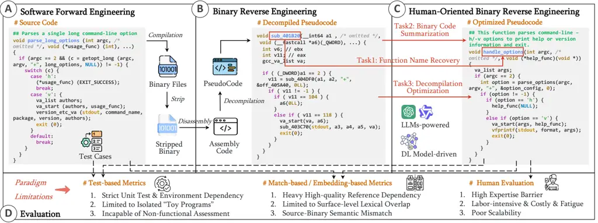

# Beyond Text Matching: Towards Reference-Free Evaluation for Human-Oriented Binary Reverse Engineering

Conference: Proceedings of the 41st IEEE/ACM International Conference on
Automated Software Engineering; October 12–16, 2026; Munich,
GermanyProceedings of the 41st IEEE/ACM International Conference on
Automated Software Engineering (ASE ’26), October 12–16, 2026, Munich,
GermanyDOI:
[10.1145/3832783.3834339](https://doi.org/10.1145/3832783.3834339)ISBN:
979-8-4007-2882-2/2026/10ase26main-p130-pCCS: General and reference
MetricsCCS: General and reference MeasurementCCS: Software and its
engineering Software reverse engineeringCCS: Computing methodologies
Artificial intelligence

Xiuwei Shang
[](https://orcid.org/0009-0009-6660-9947)
Note: Xiuwei Shang is also affiliated with Singapore Management
University, Singapore. email: <shangxw@mail.ustc.edu.cn> Affiliation:
University of Science and Technology of China, Hefei, China , Li Hu
[](https://orcid.org/0009-0001-7857-7454)
email: <pdxbshx@mail.ustc.edu.cn> Affiliation: University of Science and
Technology of China, Hefei, China , Xiao Jiang
[](https://orcid.org/0009-0002-6739-6102)
email: <jx_xiao@mail.ustc.edu.cn> Affiliation: University of Science and
Technology of China, Hefei, China , Jieke Shi
[](https://orcid.org/0000-0002-0799-5018)
Note: Jieke Shi and Shaoyin Cheng are the corresponding authors. email:
<jiekeshi@smu.edu.sg> Affiliation: Singapore Management University,
Singapore , Junda He
[](https://orcid.org/0000-0003-3370-8585)
email: <jundahe.2022@phdcs.smu.edu.sg> Affiliation: Singapore Management
University, Singapore , Zhou Yang
[](https://orcid.org/0000-0001-5938-1918)
email: <zy25@ualberta.ca> Affiliation: University of Alberta & Alberta
Machine Intelligence Institute, Edmonton, Canada , Shaoyin Cheng
[](https://orcid.org/0000-0002-3992-9509)
Note: Also affiliated with Anhui Province Key Laboratory of Digital
Security, Hefei, China. email: <sycheng@ustc.edu.cn> Affiliation:
University of Science and Technology of China, Hefei, China , Guoqiang
Chen
[](https://orcid.org/0000-0003-0651-6617)
email: <ch3nye@mail.ustc.edu.cn> Affiliation: University of Science and
Technology of China, Hefei, China , Weiming Zhang
[](https://orcid.org/0000-0001-5576-6108)
email: <zhangwm@ustc.edu.cn> Affiliation: University of Science and
Technology of China, Hefei, China and David Lo
[](https://orcid.org/0000-0002-4367-7201)
email: <davidlo@smu.edu.sg> Affiliation: Singapore Management
University, Singapore

Received 2026-06-18

###### Abstract.

Human-Oriented Binary Reverse Engineering (HOBRE) aims to transform
decompiled pseudocode into a more human-friendly representation, thereby
reducing the cognitive burden of reverse analysis and improving
efficiency. However, reliably evaluating HOBRE outputs remains a
fundamental challenge. On one hand, human evaluation is costly,
time-consuming, as well as difficult to scale. On the other hand,
existing automated metrics either rely on executable test cases and
runtime environments, which are often unavailable for real-world
binaries, or depend on high-quality source code references that are
typically inaccessible and fail to capture semantically equivalent but
lexically diverse outputs. Although the emerging LLM-as-a-Judge paradigm
is naturally well-suited to HOBRE evaluation, its effectiveness has not
yet been fully studied.

This paper presents the first systematic investigation of the
LLM-as-a-Judge paradigm for HOBRE, covering three representative tasks:
function name recovery, binary code summarization, and decompilation
optimization. We introduce BinJudgeBench, the first expert-annotated,
reference-free evaluation benchmark based on multi-dimensional human
judgment. Our empirical study reveals that LLM-as-a-Judge achieves an
average correlation of 63.20% with human judgment, significantly
outperforming traditional automated metrics at 35.04%. By analyzing the
impact of various judge configurations, including backbone LLMs,
prompting strategies, and decoding temperatures, on both correlation and
cost, we find that no “one-size-fits-all” configuration exists, as the
optimal setup varies across tasks and individual samples. To address
this, we propose BinJudge, which employs a lightweight routing mechanism
to adaptively select the optimal judge configuration for each specific
task and sample. BinJudge improves correlation with human experts by
4.5%-24.7% and reduces API cost to 0.06$`\times`$-0.84$`\times`$ of that
of static best configurations, providing a scalable, cost-effective, and
high-fidelity automated evaluation scheme for HOBRE.

###### Keywords:

Binary Reverse Engineering, Evaluation, LLM-as-a-Judge

^(†)^(†)cc-license: by

## 1. Introduction

Binary reverse engineering is the cornerstone of security-critical
scenarios such as malware analysis (Nguyen Hung et al., 2023), software
vulnerability detection (Lu et al., 2025), and patch analysis (Xu et
al., 2017), where reverse analysts often lack access to source code and
must confront obscure machine code directly. Modern decompilers (e.g.,
IDA Pro’s Hex-Rays (Hex-RaysSA, 2026)) have become the industry
standard, lifting low-level assembly into C-style pseudocode to lower
the barrier to analysis. Nevertheless, due to aggressive compiler
optimizations and symbol table stripping, the resulting pseudocode often
lacks essential semantic information, such as meaningful function names
and developer comments, and suffers from distorted code structures (Li
et al., 2025b; Zhou et al., 2025b), making reverse engineering still a
cognitively demanding and labor-intensive task (Shang et al., 2025b).

Driven by the advancements in neural machine translation and large
language models, Human-Oriented Binary Reverse Engineering (HOBRE) (Su
et al., 2024; Chen et al., 2022) has emerged. Researchers leverage deep
learning models to post-process decompiled pseudocode, aiming to elevate
it into human-readable content that resembles source code and bridge the
semantic gap between binary and high-level source code. Such efforts
include recovering meaningful function names (Jin et al., 2022),
generating natural language summaries (Xiong et al., 2023), and
reconstructing pseudocode to improve readability (Tan et al., 2024; Tan
et al., 2025), thereby significantly reducing the cognitive burden on
analysts and empowering downstream expert analysis tasks.



Figure 1. Background of Human-Oriented Binary Reverse Engineering
(HOBRE)

_Limitations of Existing Metrics._ However, effective evaluation of
these HOBRE tasks remains significant challenges. First, while _human
evaluation_ is regarded as the “gold standard” for verifying model
performance, it has obvious limitations in large-scale assessment. The
high barrier to entry in binary reverse engineering makes human auditing
not only expensive and time-consuming but also prone to consistency
issues, as analysts suffer from fatigue and diminished attention when
processing massive datasets. Second, several decompilation optimization
studies, exemplified by LLM4Decompile (Tan et al., 2024), employ
_test-based metrics_ such as re-executability rate (Armengol-Estapé et
al., 2022; Wong et al., 2023) to verify functional correctness. These
metrics, however, require comprehensive unit tests and execution
environments, limiting their application to single-function or
single-file “toy programs”. In practical reverse engineering scenarios,
complex binary projects often lack corresponding unit test cases, and
their environmental dependencies are extremely difficult to simulate,
making dynamic verification infeasible. Furthermore, such metrics are
unable to evaluate non-functional aspects like human readability
(Weyssow et al., ), nor can they be applied to tasks like function name
recovery or binary code summarization.

To achieve scalable evaluation for HOBRE tasks, several traditional
automated evaluation metrics have been considered. One type is
_match-based metrics_ such as BLEU (Papineni et al., 2002) and CodeBLEU
(Ren et al., 2020), which assess surface-level overlap between generated
content and references (i.e., ground truth). Another type is
_embedding-based metrics_, such as BERTScore (Zhang et al., 2019) and
CodeBERTScore (Zhou et al., 2023), which first encode both generated and
reference texts into embeddings and then measure their similarity.
However, these metrics also possess inherent limitations. First, they
rely on high-quality and accessible reference texts. In HOBRE tasks,
references are typically derived from explicit information in the source
code (e.g., function names and developer comments). Yet, in the most
pressing real-world scenarios beyond experimental environments, such as
malware analysis and vulnerability discovery in closed-source firmware,
source code is often unavailable, rendering evaluation methods based on
source-derived references ineffective. Even in open-source software,
only a small fraction of functions contain usable developer comments,
which vary significantly in quality and style, making them unreliable as
stable evaluation ground truth. Most importantly, after compilation
optimization and stripping, the source code exhibits a fundamental
semantic mismatch with its corresponding binary code; thus, forcibly
using source code content as ground truth for text matching lacks
justification. Furthermore, these metrics focus more on lexical
similarity than semantic similarity, whereas correct results often exist
in various forms that are semantically equivalent but phrased
differently.

_Potential of LLM-as-a-Judge in HOBRE Evaluation._ Recent advancements
in LLMs have fostered the rise of the _LLM-as-a-Judge_ (Li et al.,
2025a) paradigm, making it a scalable and cost-effective alternative to
human expert evaluation. By guiding LLMs to perform automated audits of
generated content based on predefined criteria, this paradigm has
demonstrated high human alignment in tasks like code generation (Yang et
al., 2025b) and program repair (Zhou et al., 2025a), showcasing its
significant promise within the software engineering community (He et
al., 2026).

Similarly, several key attributes make LLMs particularly suitable for
evaluating the HOBRE tasks. First, existing research indicates that LLMs
exhibit a certain level of binary program comprehension (Shang et al.,
2024; Shang et al., 2026) and human-like reasoning abilities (Guo et
al., 2025). Second, LLMs are typically trained through reinforcement
learning from human feedback (RLHF) (Kaufmann et al., 2024), aligning
closely with human judgment preferences (Weyssow et al., ) and naturally
fitting the objectives like "readability" and "usefulness" of HOBRE.
Most importantly, unlike metrics like BLEU that mechanically compare
text similarity, LLMs excel at handling "semantically equivalent but
diversely expressed" scenarios, while leveraging internal reasoning to
directly verify generated artifacts against the code’s inherent logic,
obviating the dependency on explicit reference text, which is critical
for "in-the-wild" binary reverse engineering where original source code
is inaccessible. Nevertheless, the evaluation reliability of
LLM-as-a-Judge in the specialized domain of binary reverse engineering,
and the degree of its consistency with human experts, has not yet been
systematically investigated.

_Benchmark and Empirical Study._ To this end, this paper proposes an
evaluation perspective that _goes beyond text matching_, systematically
investigating for the first time the applicability and capability
boundaries of LLM-as-a-Judge in HOBRE tasks, covering three of the most
representative tasks: function name recovery, binary code summarization,
and decompilation optimization.

To enable a reliable empirical study, we construct BinJudgeBench, which
is carefully annotated by three human experts in reverse engineering.
BinJudgeBench records human experts’ judgments across multiple quality
dimensions, providing a curated benchmark for reference-free evaluation.
Based on this, we systematically compare LLM-as-a-Judge with traditional
automated metrics in terms of their correlation with human expert
judgment, and further analyze how different judge configurations,
including backbone LLMs, prompting strategies, and decoding
temperatures, affect both correlation and cost. Our empirical results
reveal that LLM-as-a-Judge substantially outperforms traditional metrics
in approximating human judgment, achieving an average correlation of
63.20% compared to 35.04% for traditional metrics. Moreover, the optimal
judge configuration varies across tasks and individual samples,
indicating that no “one-size-fits-all” configuration exists.

_Proposed Approach._ Motivated by the empirical findings, we further
propose BinJudge, a lightweight routing mechanism designed for task- and
sample-aware adaptive configuration selection, which employs a
distribution-aligned training strategy, explicitly optimizing both
evaluation correlation and cost. By dynamically selecting the optimal
judge configuration for each sample, BinJudge improves the correlation
with human experts by 4.5%-24.7% while reducing API cost to only
0.06$`\times`$-0.84$`\times`$ of that of static configurations,
effectively narrowing the gap between the static best configurations and
oracle upper bound. This provides a scalable, cost-effective, and
high-fidelity automated evaluation solution for the HOBRE tasks.

Contributions. Our major contributions are as follows:

- •
  BinJudgeBench Benchmark: We release the first high-quality,
  expert-annotated dataset specifically designed for reference-free
  HOBRE evaluation. It contains 1,233 meticulously audited samples,
  providing a reliable ground-truth based on multi-dimensional human
  judgment.
- •
  Systematic Empirical Study: We conduct the first comprehensive study
  to explore the effectiveness of LLM-as-a-judge for HOBRE evaluation,
  analyzing its correlation with human experts across three core tasks.
- •
  BinJudge Router: We propose a lightweight adaptive routing mechanism
  that can dynamically select the optimal judge configuration for each
  individual sample, thereby improving correlation while reducing costs.

## 2. Background and Related Works

### 2.1. Human-Oriented Binary Reverse Engineering (HOBRE)

As illustrated in Figure 1, traditional binary reverse engineering
primarily focuses on “recovering program behavior from binaries,” and
its outputs are often intermediate results oriented toward machine
semantics, including disassembled instruction sequences, control-flow
graphs, data-flow relations, and C-like pseudocode produced by
decompilation (Sutherland et al., 2006). Although modern decompilers
have made substantial progress in recovering logical equivalence, these
outputs remain at a low semantic level. While they can also support
downstream tasks such as vulnerability detection and malware analysis, a
cognitive gap still exists for human analysts: on the one hand, compiler
optimizations can significantly alter the forms of control and data
structures (Xu et al., 2025b; Xu et al., 2025a); on the other hand,
symbol stripping removes critical semantic cues like function names,
variable names, and type information, making the analysis process
heavily reliant on expert experience and extensive manual reasoning.

To bridge the aforementioned gap, HOBRE shifts the perspective toward a
goal that is closer to “human readability and usability” (Su et al.,
2024; Chen et al., 2022): _taking decompiled pseudocode as the core
input, it performs semantic completion and expression optimization to
produce a more human-oriented representation that is closer to
source-level expression._ Therefore, in contrast to classical “Software
Forward Engineering” (source code $`\rightarrow`$ compilation
$`\rightarrow`$ binary), HOBRE can be regarded as a post-processing
paradigm that, building upon “Traditional Binary Reverse Engineering”
(binary $`\rightarrow`$ decompilation $`\rightarrow`$ decompiled
pseudocode), takes an additional step toward a more human-friendly
high-level representation.

### 2.2. Target Tasks

To comprehensively cover the research scope of HOBRE, this paper focuses
on the following three core tasks, which are representative and
complementary across semantic dimensions, spanning identifier-level
function name recovery, natural-language–level summarization, and
program-level decompilation optimization. Together, they cover two major
task paradigms, i.e., Code2NL and Code2Code, and encompass three typical
output forms, i.e., short-form text, long-form text, and structured
code.

#### 2.2.1. Function Name Recovery (FNR)

The goal of this task is to rename anonymous functions in stripped
binaries with descriptive names (e.g., sub_401B20 → handle_options in
Figure 1), which provide direct clues to the program’s intent. Early
research mainly relied on heuristic rules or similarity-based retrieval
(Ming et al., 2012; He et al., 2018). In recent years, deep learning
approaches (e.g., NFRE (Gao et al., 2021), SymLM (Jin et al., 2022), and
Llasm (Sha et al., 2025)) have become dominant, achieving notable
progress by learning mappings between assembly or pseudocode features
and source-level symbols. The evaluation challenge of this task lies in
the inherently highly diverse and style dependence of function naming,
as well as the prevalence of domain-specific abbreviations and acronyms,
both of which make hard string-matching metrics inadequate for fair
assessment.

|                                                                                                                                                                                                                                                                                                                                                                                                                                                                                                                                                                                                                                                                             |
| --------------------------------------------------------------------------------------------------------------------------------------------------------------------------------------------------------------------------------------------------------------------------------------------------------------------------------------------------------------------------------------------------------------------------------------------------------------------------------------------------------------------------------------------------------------------------------------------------------------------------------------------------------------------------- |
| For each instance, annotators are provided with the stripped decompiled pseudocode $`P_{f}`$ and the candidate output $`O_{f}`$ generated by the model for the \[Function Name Recovery\] \[Binary Code Summarization\] \[Decompilation Optimization\] task (i.e., \[Function Name\] \[Summary\] \[Optimized Pseudocode\]). The pseudocode’s project origin, corresponding source code $`S_{f}`$, and compilation settings are provided for reference, but the model’s identity remains anonymous. The annotator needs to assign a single overall score (1–5 Likert scale) for each instance, which jointly reflects the following three dimensions: Evaluation Dimensions: |
| 1. Semantic Correctness: To what extent does the output $`O_{f}`$ faithfully reflect the semantics and functional intent of the given pseudocode $`P_{f}`$?                                                                                                                                                                                                                                                                                                                                                                                                                                                                                                                 |
| 2. Reverse Analyst Utility: To what extent does the output $`O_{f}`$ reduce the cognitive load for the reverse engineer? Is it closer to a higher-level representation of the source code $`S_{f}`$?                                                                                                                                                                                                                                                                                                                                                                                                                                                                        |
| 3. \[Naming Distinctiveness & Naturalness: Is the output $`O_{f}`$ specific and natural, effectively distinguishing between similar functions, and adhering to common engineering naming conventions?\]                                                                                                                                                                                                                                                                                                                                                                                                                                                                     |
| \[Information Coverage & Density: Does the output $`O_{f}`$ cover the key operations while avoiding lengthy, line-by-line translation and providing high-level abstraction?\]                                                                                                                                                                                                                                                                                                                                                                                                                                                                                               |
| \[Idiomization & Faithfulness: Does the style and structure of the output $`O_{f}`$ conform to human programming habits while avoiding the addition of overly speculative semantics?\]                                                                                                                                                                                                                                                                                                                                                                                                                                                                                      |
| Scoring: Rate outputs on a scale of 1 to 5:                                                                                                                                                                                                                                                                                                                                                                                                                                                                                                                                                                                                                                 |
| $`\cdot`$5 (Excellent): Highly accurate and faithful, significantly reducing the reverse analysts’ cognitive burden, \[name is specific and natural, clearly distinguishing similar functions.\] \[summary covers key operations with high information density, avoiding verbose translation.\] \[optimized pseudocode is highly idiomatic and free of any groundless speculation.\]                                                                                                                                                                                                                                                                                        |
| $`\cdot`$4 (Good): Mostly correct and effectively reduces cognitive burden, with only minor, non-misleading deviations, \[name is correct but slightly generic, following basic naming conventions.\] \[summary covers nearly all key operations but is slightly wordy.\] \[optimized pseudocode follows most habits with very few groundless guesses.\]                                                                                                                                                                                                                                                                                                                    |
| $`\cdot`$3 (Acceptable): Partially correct but of limited value; helpful to the analyst but contains some deviations that could be misleading, \[name is basically correct but too broad, partially violating naming conventions.\]\[summary covers basic functions but is quite verbose.\]\[optimized pseudocode follows basic habits but contains some unsupported speculation.\]                                                                                                                                                                                                                                                                                         |
| $`\cdot`$2 (Poor): Contains obvious semantic errors and offers minimal help, with significant misleading information, \[name is weakly related and violates naming conventions.\]\[summary severely misses operations and contains meaningless descriptions.\]\[optimized pseudocode is generally non-idiomatic and increases auditing burden due to over-speculation.\]                                                                                                                                                                                                                                                                                                    |
| $`\cdot`$1 (Bad): Fundamentally incorrect, fails to support analysis, and severely misleads the analyst, \[name is entirely unrelated or uses random/meaningless characters.\]\[summary is irrelevant, consisting entirely of verbose and meaningless descriptions.\]\[optimized pseudocode is completely non-idiomatic and consists entirely of model hallucinations.\]                                                                                                                                                                                                                                                                                                    |

Table 1. Human Annotation Guideline (\[green\] \[yellow\] \[blue\]
represent task-specific information for Function Name Recovery, Binary
Code Summarization, and Decompilation Optimization tasks, respectively.)

#### 2.2.2. Binary Code Summarization (BCS)

This task aims to generate concise natural-language descriptions that
explain the functionality of a given function. With the advance of
multi-modal pretraining, models such as BinT5 (Al-Kaswan et al., 2023)
and HexT5 (Xiong et al., 2023) attempt to align binary features with
natural-language descriptions within a unified representation space.
Evaluation also remains challenging because summarization is a typical
open-ended generation problem in which a single function can be
described in many semantically equivalent ways, causing traditional
n-gram–based matching metrics to over-penalize reasonable rewriting. In
addition, these metrics cannot properly distinguish the importance of
informative keywords from non-informative tokens like stop words.
Furthermore, in real-world reverse engineering scenarios, it is often
difficult to obtain high-quality and reliable reference texts.

#### 2.2.3. Decompilation Optimization (DO)

Compared to the first two tasks, this task emphasizes the structural
quality and readability of the code itself. It aims to post-edit
decompiler (e.g., IDA Pro) outputs through transformations including
redundancy elimination, variable and type enhancement, and statement
restructuring, making the result closer to source code conventions and
style. Recent work, including LLM4Decompile (Tan et al., 2024),
SK²Decompile (Tan et al., 2025), and ReCopilot (Chen et al., 2025),
demonstrates the potential of LLMs for such Code2Code transformations,
improving the readability of decompiled artifacts. Although the
Re-executability Rate is commonly used for evaluation, it only reflects
functional correctness and cannot capture non-functional properties such
as readability. Moreover, real-world binaries often lack unit tests and
have hard-to-reproduce environments, which makes dynamic test-based
metrics ineffective in in-the-wild settings, while match-based metrics
still struggle with semantically equivalent but differently expressed
outputs.

### 2.3. LLM-as-a-Judge in SE

The widespread adoption of LLMs in software engineering has led to the
generation of a large volume of automated software artifacts, and the
difficulty of evaluating such massive outputs has in turn given rise to
the LLM-as-a-Judge paradigm (He et al., 2026; Zhou et al., 2025a). This
paradigm extends the role of LLMs from mere artifact generation to
artifact quality assessment, and it has been proven to achieve high
agreement with human experts across a variety of scenarios, including
requirements engineering (Ahmed et al., 2025; Lubos et al., 2024), code
generation (Yang et al., 2025b; Zhuo, 2024; Tong and Zhang, 2024;
Weyssow et al., ), and software maintenance (Kumar et al., 2024; Jiang
et al., 2026; Zeng et al., 2025), thus becoming a scalable and
cost-effective alternative to manual review, and, by virtue of its
ability to operate without reference texts and to perform deep semantic
understanding, it offers inherent advantages over traditional automated
metrics.

As discussed earlier, this paradigm is naturally suited for HOBRE
evaluation. However, there is still a lack of systematic empirical
studies, benchmark datasets, and task-specific judging models for the
HOBRE setting, and this critical gap motivates our research.

## 3. BinJudgeBench Benchmark

To systematically evaluate the effectiveness of LLM-as-a-Judge on the
HOBRE task and its alignment with human expert judgment, we construct
BinJudgeBench, the first HOBRE-oriented evaluation benchmark,
meticulously annotated by reverse engineering experts.

### 3.1. Datasets Collection and Preprocessing

To ensure both realism and diversity, we first select 51 representative
projects from the GNU (GNU Project, 2026) repository, which are widely
adopted in binary reverse engineering research (Shang et al., 2024; Zhu
et al., 2025; Shang et al., 2025a). We then compile these source
projects with GCC 8.2.0 compiler while preserving DWARF debugging
information, producing 24 distinct binary variants that span 6 target
architectures (ARM_32, ARM_64, X86, X64, MIPS_32, and MIPS_64) and 4
optimization levels (-O0, -O1, -O2, and -O3). For each compiled binary,
we retain both the original version with debugging information and its
corresponding stripped version, in which symbols and debug sections are
removed.

Subsequently, we employ IDA Pro (Hex-RaysSA, 2026) to decompile both the
original and stripped binaries, and extract function boundaries, names,
and corresponding pseudocode at the function level. While the stripped
binaries replace function names with placeholder addresses, the function
boundaries remain consistent, and we leverage this to align and merge
content extracted from the two versions.

To further obtain information from the source-code side, we use the
srcML (Collard et al., 2013) tool to parse the source code into XML
format and extract developer-written comments located above function
definitions and declarations. Based on the established function
boundaries and name mappings, we then align the source function body,
source function name, and developer comments with the stripped
pseudocode. Through this process, each function sample is organized into
a unified structured representation, including the stripped pseudocode,
original (symbol-preserving) pseudocode, source function body, source
function name, and available developer comments, etc. In total, we
obtain 346,596 function-level samples.

### 3.2. Response Generation

To evaluate the discriminative capability of LLM-as-a-Judge across
diverse HOBRE outputs with varying quality and styles, we select 8
representative models for each task to generate corresponding responses
for every sample. These models fall into three categories:

- •
  DL-based Binary-specific Models: For each task, we select two models,
  including SymLM (Jin et al., 2022) and HexT5 (Xiong et al., 2023) for
  function name recovery, BinT5 (Al-Kaswan et al., 2023) and CP-BCS (Ye
  et al., 2023) for binary code summarization, and LLM4Decompile (Tan et
  al., 2024) and SK²Decompile (Tan et al., 2025) for decompilation
  optimization. These models are specifically designed or trained for
  their corresponding tasks.
- •
  General-Purpose LLMs: This category covers the typical closed-source
  model GPT-4o (Achiam et al., 2023), the ultra-large-scale open-source
  model DeepSeek-V3.2 (685B) (Liu et al., 2025), as well as
  code-oriented lightweight models DeepSeek-Coder-V2-Lite-Instruct (16B)
  (Zhu et al., 2024), Qwen3-Coder-30B-A3B-Instruct (Yang et al., 2025a),
  and CodeLlama-34B-Instruct (Roziere et al., 2023).
- •
  Binary-Domain LLMs: Specifically ReCopilot (Chen et al., 2025), which
  is built upon general-purpose LLMs and undergo continued pre-training
  and instruction-tuning on binary-specific corpora to better adapt to
  binary reverse engineering tasks.

For each function sample, we input the stripped pseudocode into the
above models and generate task-specific outputs, including function
names, natural language summaries, or optimized pseudocode. Regarding
prompt templates, models in categories (1) and (3) follow their default
settings, while models in category (2) adopt the settings from (Shang et
al., 2024). It is worth emphasizing that this stage aims not to pursue
optimal generation quality, but rather to cover diverse model sources,
output qualities, and expressive styles. Ultimately, this process yields
a total of 2,772,768 ($`346,596\times 8`$) candidate responses for each
task.

### 3.3. Manual Annotation

#### 3.3.1. Sampling Strategy.

Given the prohibitively high cost of manual expert annotation, we design
a rigorous sampling strategy to ensure both statistical significance and
diversity of BinJudgeBench. First, targeting a 95% confidence level with
a 5% confidence interval, we randomly sample 385 samples from the pool
of 2,772,768 candidate responses. We then introduce an additional
coverage constraint requiring the samples to span diverse combinations
of "_generative model—target architecture—optimization level_" (totaling
$`8\times 6\times 4=192`$ triplets). Since the initial random samples
already cover 166 such combinations, we perform targeted supplementary
sampling for an additional 26 samples, ultimately forming a set of 411
samples per task for annotation.

#### 3.3.2. Multi-dimensional Evaluation Framework.

We employ a five-point multi-dimensional Likert scale to assess the
overall quality of candidate outputs, incorporating a two-tier
evaluation framework composed of shared and task-specific dimensions.
Specifically, (i) shared dimensions are applicable to all three HOBRE
tasks, aiming to ensure _Semantic Faithfulness_ (i.e., correctly
reflecting the functionality of the pseudocode) and _Analyst-centered
Utility_ (i.e., aligning with source-code-level representations to
reduce cognitive burden); and (ii) task-specific dimensions, i.e.,
_Naming Distinctiveness & Naturalness_ for function names, _Information
Coverage & Density_ for summaries, and _Idiomization & Faithfulness_ for
optimized pseudocode, are designed to capture the unique quality
characteristics of different output forms. Detailed definitions of each
dimension and the corresponding scoring criteria are provided in the
human annotation guideline shown in Table 1. Overall, this framework
comprehensively describes the quality implications of the HOBRE task.

#### 3.3.3. Human Annotation and Quality Assurance.

The three authors of this paper, each with over three years of
experience in binary reverse engineering, served as annotation experts.
Prior to the formal annotation, the three experts jointly annotate 10
samples for each task and discuss the scoring criteria based on the
annotation guideline in Table 1 to calibrate their judgments and ensure
a consistent understanding. Subsequently, the remaining samples are
annotated independently, with the entire process spanning approximately
two weeks per expert. Upon completion, we measure the inter-annotator
agreement among the three experts using ordinal Krippendorff’s Alpha.
The coefficients for the three tasks reach 0.7996, 0.7077, and 0.6619,
respectively, indicating a satisfactory level of agreement and
confirming the reliability of the initial annotations.

To further improve annotation quality and mitigate subjective bias, we
convene review meetings for samples with substantial disagreements
(i.e., where the range between the maximum and minimum scores among the
three experts is $`\geq 2`$, e.g., 3, 4, 5) to re-evaluate and establish
final scores. Across the three tasks, 73, 105, and 76 samples undergo
this review process, respectively. For samples with minor disagreements
(i.e., a score range \< 2), we directly use the mode of the three scores
as the final score (e.g., 4, 4, 5 → 4). The resulting expert scores are
treated as the "gold standard" in BinJudgeBench and are used to measure
the consistency of subsequent automated evaluation methods with human
judgment.

Figure 2. Distribution of human expert-annotated scores across three
HOBRE tasks in BinJudgeBench.

### 3.4. Dataset Analysis

Figure 2 illustrates the distribution of expert annotation scores in
BinJudgeBench. The results indicate that BinJudgeBench covers the full
score spectrum from low quality (score 1) to high quality (score 5),
demonstrating a well-defined gradient and discriminability. Among the
three tasks, function name recovery receives the lowest average score
(2.42), with the largest proportion of low-scoring samples; binary code
summarization exhibits the most balanced distribution and the highest
average score (2.81); while decompilation optimization obtains an
average score of 2.66 and exhibits a clear scarcity of high-scoring
samples. Overall, BinJudgeBench provides reasonable quality coverage and
sample diversity, serving as a reliable benchmark for subsequent
evaluation.

## 4. Empirical Study

Our empirical study investigates the following research questions to
explore the effectiveness of LLM-as-a-Judge on the HOBRE task:

- •
  RQ1: Can LLM-as-a-Judge better approximate human expert judgment in
  HOBRE tasks? We compare the performance of LLM-as-a-Judge against 12
  traditional match-based and embedding-based automated metrics,
  verifying its higher correlation with human expert judgment.
- •
  RQ2: How do different configurations of LLM-as-a-Judge affect
  evaluation correlation and cost? We analyze three primary factors: (1)
  diverse backbone LLMs; (2) prompting strategies, i.e., Zero-Shot
  Learning (ZSL), Few-Shot Learning (FSL), and Chain-of-Thought (CoT);
  and (3) decoding strategies, specifically varying temperature. We
  explore the correlation with human judgment and API cost overhead
  under each configuration.
- •
  RQ3: Does the optimal configuration of LLM-as-a-Judge vary across
  tasks or samples? We investigate whether a "one-size-fits-all"
  configuration exists, i.e., whether the optimal configuration, which
  ensures high correlation while minimizing cost, varies across
  different tasks or sample characteristics.

### 4.1. Experimental Setup

#### 4.1.1. Environments

Our experimental environment operates on an Ubuntu 22.04 server,
equipped with two 28-core Intel Xeon 6330 CPUs, 512GB RAM, 64TB storage,
and 8\*NVIDIA RTX A6000 GPUs, each with 48GB of VRAM. These GPUs run
NVIDIA driver version 525.116.03 along with CUDA version 12.0. All LLMs
used in this study are accessed via API calls through the OpenRouter
(OpenRouter, 2026) platform, while all other experiments are deployed
and trained locally on the above experimental environment.

|                                          |      |                                    |               |                |            |             |
| ---------------------------------------- | ---- | ---------------------------------- | ------------- | -------------- | ---------- | ----------- |
| Model                                    | Size | Model ID                           | Input¹ Tokens | Output¹ Tokens | Publisher  | Usage²      |
| Proprietary LLMs                         |      |                                    |               |                |            |             |
| GPT-4o (Achiam et al., 2023)             | \-   | GPT-4o-2024-11-20                  | \$2.50/M      | \$10/M         | OpenAI     | $`\bullet`$ |
| Claude-3.5 (Anthropic, 2024)             | \-   | Claude-3.5-Sonnet                  | \$6/M         | \$30/M         | Anthropic  | $`\circ`$   |
| Gemini-2.5 (Comanici et al., 2025)       | \-   | Gemini-2.5-Flash                   | \$0.30/M      | \$2.50/M       | Google     | $`\circ`$   |
| Open-Source General LLMs                 |      |                                    |               |                |            |             |
| DeepSeek-V3.2 (Liu et al., 2025)         | 685B | DeepSeek-V3.2                      | \$0.26/M      | \$0.38/M       | DeepSeek   | $`\bullet`$ |
| Mistral-Large-3 (Mistral AI Team, 2025b) | 675B | Mistral-Large-3-675B-Instruct-2512 | \$0.50/M      | \$1.50/M       | Mistral AI | $`\circ`$   |
| Llama-3.3 (Grattafiori et al., 2024)     | 70B  | Llama-3.3-70B-Instruct             | \$0.10/M      | \$0.32/M       | Meta AI    | $`\circ`$   |
| Phi-4 (Abdin et al., 2024)               | 14B  | Phi-4                              | \$0.065/M     | \$0.14/M       | Microsoft  | $`\circ`$   |
| Open-Source Code LLMs                    |      |                                    |               |                |            |             |
| Qwen3-Coder (Yang et al., 2025a)         | 30B  | Qwen3-Coder-30B-A3B-Instruct       | \$0.07/M      | \$0.27/M       | Qwen       | $`\bullet`$ |
| Codestral (Mistral AI Team, 2025a)       | \-   | Codestral-2508                     | \$0.30/M      | \$0.90/M       | Mistral AI | $`\circ`$   |

- 1
  Token prices (per million tokens) are sourced from OpenRouter
  (OpenRouter, 2026) as of March 22, 2026.
- 2
  "$`\bullet`$" indicates that the model was used in Response Generation
  (§3.2), "$`\circ`$" indicates it was not.

Table 2. The Detailed Information of LLMs Employed in the LLM-as-a-Judge
Evaluation.

#### 4.1.2. Baseline Metrics.

We select the following 2 categories, totaling 11 traditional automated
evaluation metrics, as baselines:

Match-based Metrics. These metrics assess quality by measuring the
surface-level overlap between generated text and references. BLEU
(Papineni et al., 2002) and Rouge-L (Lin, 2004) capture lexical
similarity based on $`n`$-gram overlaps and the longest common
subsequence, respectively. METEOR (Banerjee and Lavie, 2005) improves
upon basic $`n`$-gram matching by considering stemmed forms, synonym
matches, and word order, while ChrF++ (Popović, 2017) further assesses
similarity using character-level $`n`$-gram precision and recall.
CrystalBLEU (Eghbali and Pradel, 2022) filters out the most frequently
occurring $`n`$-grams before computing BLEU to better capture
substantive differences between generated content and reference.
CodeBLEU (Ren et al., 2020) enhances traditional $`n`$-gram matching by
incorporating structural features like abstract syntax trees and
data-flow dependencies. RUBY (Tran et al., 2019) evaluates similarity by
jointly considering lexical, syntactic, and semantic representations of
code. F1-score is also adopted in some function name recovery works (Gao
et al., 2021), which compute token-level F1-score by ignoring
non-alphabetical characters and being case-, order-, and
duplication-insensitive at the token level, and we follow their
practice.

Embedding-based Metrics. These metrics map the generated text and the
reference text into high-dimensional semantic spaces, measuring their
semantic proximity via vector similarity. SentenceBERT (Reimers and
Gurevych, 2019) employs the cosine similarity of sentence-level
embeddings to assess overall semantic similarity. MoverScore (Zhao et
al., 2019) represents text as sequences of token embeddings and measures
semantic divergence using Earth Mover’s Distance. BERTScore (Zhang et
al., 2019) computes token-level similarity using contextual
representations from a pre-trained BERT model, while CodeBERTScore (Zhou
et al., 2023) adapts BERTScore specifically for code-related tasks to
enhance its representation capabilities for programming languages.

|                                                |                              |               |               |                                 |               |               |                                 |               |               |       |
| ---------------------------------------------- | ---------------------------- | ------------- | ------------- | ------------------------------- | ------------- | ------------- | ------------------------------- | ------------- | ------------- | ----- |
| Metrics                                        | Function Name Recovery (FNR) |               |               | Binary Code Summarization (BCS) |               |               | Decompilation Optimization (DO) |               |               | Avg.  |
|                                                | $`\tau`$ (%)                 | $`r_{s}`$ (%) | $`r_{p}`$ (%) | $`\tau`$ (%)                    | $`r_{s}`$ (%) | $`r_{p}`$ (%) | $`\tau`$ (%)                    | $`r_{s}`$ (%) | $`r_{p}`$ (%) |       |
| Existing Match-based / Embedding-based Metrics |                              |               |               |                                 |               |               |                                 |               |               |       |
| F1-score                                       | 48.51                        | 54.65         | 60.15         | –                               | –             | –             | –                               | –             | –             | –     |
| BLEU                                           | 31.58                        | 40.18         | 50.69         | 26.89                           | 35.45         | 27.91         | 25.80                           | 33.01         | 33.50         | 33.89 |
| METEOR                                         | 49.97                        | 56.79         | 57.36         | 27.89                           | 36.45         | 34.25         | 24.67                           | 31.95         | 32.29         | 39.05 |
| ROUGE-L                                        | 48.29                        | 54.51         | 59.51         | 31.12                           | 40.03         | 38.73         | 28.63                           | 37.05         | 39.48         | 41.93 |
| ChrF++                                         | 47.55                        | 60.37         | 65.24         | 35.32                           | 46.88         | 46.64         | 29.24                           | 37.63         | 40.60         | 45.40 |
| CrystalBLEU                                    | 32.60                        | 42.19         | 53.12         | 19.80                           | 26.77         | 25.66         | 24.49                           | 31.30         | 29.55         | 33.06 |
| CodeBLEU                                       | 13.08                        | 14.49         | 8.65          | 12.49                           | 16.27         | 00.74         | 16.62                           | 22.02         | 23.29         | 14.18 |
| RUBY                                           | 24.28                        | 26.83         | 30.74         | 27.88                           | 36.02         | 31.73         | 16.78                           | 21.78         | 25.87         | 26.88 |
| SentenceBERT                                   | 43.86                        | 57.02         | 65.54         | 41.67                           | 54.17         | 56.66         | 28.10                           | 36.51         | 38.19         | 46.86 |
| MoverScore                                     | 31.43                        | 40.92         | 53.49         | 28.41                           | 38.14         | 38.01         | 11.92                           | 15.98         | 18.68         | 30.78 |
| BERTScore                                      | 36.03                        | 47.16         | 51.45         | 28.62                           | 38.18         | 36.95         | 22.21                           | 29.01         | 33.21         | 35.87 |
| CodeBERTScore                                  | 38.25                        | 49.15         | 51.32         | 25.26                           | 33.67         | 34.82         | 28.13                           | 36.40         | 40.14         | 37.46 |
| Average                                        | 37.12                        | 45.36         | 50.61         | 27.76                           | 36.55         | 33.83         | 23.55                           | 30.53         | 32.82         | 35.04 |
| LLM-as-a-Judge Paradigm                        |                              |               |               |                                 |               |               |                                 |               |               |       |
| Codestral-2508                                 | 55.28                        | 65.02         | 60.83         | 48.44                           | 58.40         | 57.63         | 40.38                           | 45.45         | 48.28         | 53.30 |
| Phi-4                                          | 48.64                        | 56.50         | 55.23         | 56.89                           | 65.40         | 65.77         | 41.68                           | 47.22         | 50.20         | 54.17 |
| Llama-3.3-70B                                  | 60.97                        | 70.04         | 64.42         | 61.27                           | 68.88         | 69.78         | 48.14                           | 52.82         | 52.47         | 60.97 |
| Qwen3-Coder-30B                                | 63.64                        | 72.85         | 70.01         | 65.68                           | 75.09         | 74.13         | 42.82                           | 47.83         | 48.78         | 62.32 |
| Mistral-Large-3                                | 59.28                        | 68.71         | 66.95         | 63.96                           | 72.71         | 73.02         | 53.95                           | 59.32         | 59.89         | 64.20 |
| GPT-4o                                         | 64.44                        | 73.86         | 69.57         | 65.94                           | 75.26         | 75.43         | 51.17                           | 57.55         | 57.38         | 65.62 |
| Claude-3.5-Sonnet                              | 67.04                        | 75.66         | 73.33         | 67.46                           | 76.44         | 76.98         | 54.70                           | 61.10         | 61.98         | 68.30 |
| Gemini-2.5-Flash                               | 69.02                        | 78.92         | 75.93         | 68.09                           | 77.45         | 77.90         | 52.76                           | 60.28         | 60.94         | 69.03 |
| DeepSeek-V3.2                                  | 66.17                        | 75.03         | 74.28         | 67.36                           | 76.58         | 76.68         | 62.11                           | 69.75         | 69.88         | 70.87 |
| Average                                        | 61.61                        | 70.73         | 67.84         | 62.79                           | 71.80         | 71.92         | 49.74                           | 55.70         | 56.65         | 63.20 |

Table 3. Correlation of traditional metrics and LLM-as-a-Judge with
human expert judgment across HOBRE tasks in BinJudgeBench. The highest
correlation is highlighted in bold and underlined, and the highest in
traditional metrics is underlined.

#### 4.1.3. Meta-Evaluation.

To measure the consistency between various automated evaluation metrics
(including both traditional baselines and the LLM-as-a-Judge paradigm)
and human expert judgment, we employ three statistical correlation
coefficients widely used in prior research (Zhuo, 2024; Wang et al.,
2025; Ouédraogo et al., 2025; Dong et al., 2025), i.e., _Kendall’s
$`\tau`$ coefficient_, _Spearman’s_ $`r_{s}`$, and _Pearson’s_
$`r_{p}`$, to quantify the association between automated scores and the
expert-annotated "gold standard" in BinJudgeBench. Specifically,
Kendall’s $`\tau`$ coefficient (Kendall, 1938) measures ordinal
associations between sample pairs, Spearman’s $`r_{s}`$ (Spearman, 1961)
assesses the monotonic correlation between their ranking orders, and
Pearson’s $`r_{p}`$ (Pearson, 1896) measures the linear correlation
between them. Considering that expert ratings are ordinal discrete
values (on a 1–5 scale), we prioritize Kendall’s $`\tau`$ and Spearman’s
$`r_{s}`$ as the primary reported metrics, while treating Pearson’s
$`r_{p}`$ as a supplementary reference. Taken together, these three
coefficients provide a meta-evaluation of automated evaluation metrics.

|                   |        |                              |               |               |                                 |               |               |                                 |               |               |               |
| ----------------- | ------ | ---------------------------- | ------------- | ------------- | ------------------------------- | ------------- | ------------- | ------------------------------- | ------------- | ------------- | ------------- |
| Models            | Prompt | Function Name Recovery (FNR) |               |               | Binary Code Summarization (BCS) |               |               | Decompilation Optimization (DO) |               |               | Average       |
|                   |        | T=0.1                        | T=0.5         | T=1.0         | T=0.1                           | T=0.5         | T=1.0         | T=0.1                           | T=0.5         | T=1.0         |               |
| Codestral-2508    | ZSL    | 45.44 / 0.100                | 46.61 / 0.100 | 44.71 / 0.100 | 53.15 / 0.106                   | 51.67 / 0.106 | 47.56 / 0.106 | 39.81 / 0.152                   | 41.63 / 0.152 | 29.29 / 0.152 | 44.43 / 0.119 |
|                   | FSL    | 31.70 / 0.322                | 30.28 / 0.322 | 29.22 / 0.322 | 49.35 / 0.238                   | 44.87 / 0.238 | 43.95 / 0.238 | 35.08 / 0.494                   | 32.32 / 0.494 | 34.97 / 0.494 | 36.86 / 0.351 |
|                   | CoT    | 55.28 / 0.235                | 51.12 / 0.237 | 56.98 / 0.237 | 48.44 / 0.218                   | 48.33 / 0.220 | 46.04 / 0.220 | 40.38 / 0.294                   | 38.11 / 0.292 | 36.29 / 0.293 | 46.77 / 0.250 |
| Phi-4             | ZSL    | 47.29 / 0.020                | 42.31 / 0.020 | 37.68 / 0.020 | 47.57 / 0.022                   | 48.14 / 0.022 | 48.22 / 0.022 | 30.47 / 0.031                   | 42.84 / 0.030 | 25.13 / 0.031 | 41.07 / 0.024 |
|                   | FSL    | 36.69 / 0.066                | 33.25 / 0.066 | 48.64 / 0.065 | 45.02 / 0.048                   | 42.85 / 0.048 | 56.89 / 0.048 | 36.67 / 0.101                   | 28.54 / 0.101 | 41.68 / 0.100 | 41.14 / 0.071 |
|                   | CoT    | 42.80 / 0.044                | 40.38 / 0.045 | 49.66 / 0.048 | 51.61 / 0.042                   | 50.33 / 0.043 | 54.74 / 0.045 | 35.56 / 0.056                   | 35.72 / 0.057 | 32.18 / 0.059 | 43.66 / 0.049 |
| Llama-3.3-70B     | ZSL    | 60.97 / 0.032                | 61.20 / 0.032 | 61.82 / 0.032 | 61.27 / 0.034                   | 60.30 / 0.034 | 62.36 / 0.034 | 48.14 / 0.048                   | 45.96 / 0.048 | 43.54 / 0.047 | 56.17 / 0.038 |
|                   | FSL    | 59.53 / 0.101                | 58.33 / 0.101 | 59.61 / 0.102 | 62.79 / 0.074                   | 61.50 / 0.074 | 61.53 / 0.075 | 47.80 / 0.155                   | 46.17 / 0.155 | 41.63 / 0.155 | 55.43 / 0.110 |
|                   | CoT    | 53.50 / 0.094                | 49.74 / 0.093 | 52.73 / 0.094 | 58.08 / 0.089                   | 59.79 / 0.090 | 57.01 / 0.090 | 46.05 / 0.109                   | 45.89 / 0.111 | 46.45 / 0.108 | 52.14 / 0.097 |
| Qwen3-Coder-30B   | ZSL    | 64.00 / 0.023                | 63.20 / 0.023 | 62.40 / 0.023 | 63.16 / 0.025                   | 63.07 / 0.025 | 63.47 / 0.025 | 38.06 / 0.035                   | 38.67 / 0.035 | 39.35 / 0.035 | 55.04 / 0.028 |
|                   | FSL    | 63.64 / 0.075                | 64.28 / 0.075 | 62.73 / 0.075 | 65.68 / 0.056                   | 64.33 / 0.056 | 66.96 / 0.056 | 42.82 / 0.115                   | 41.84 / 0.115 | 40.28 / 0.115 | 56.95 / 0.082 |
|                   | CoT    | 56.25 / 0.079                | 53.37 / 0.078 | 49.71 / 0.083 | 55.43 / 0.075                   | 54.00 / 0.076 | 55.29 / 0.081 | 43.68 / 0.100                   | 41.38 / 0.101 | 38.83 / 0.108 | 49.77 / 0.087 |
| Mistral-Large-3   | ZSL    | 63.40 / 0.167                | 64.09 / 0.167 | 63.11 / 0.167 | 58.25 / 0.177                   | 60.31 / 0.177 | 58.12 / 0.177 | 50.08 / 0.254                   | 51.95 / 0.254 | 51.23 / 0.254 | 57.84 / 0.199 |
|                   | FSL    | 59.98 / 0.537                | 59.28 / 0.537 | 59.72 / 0.537 | 64.23 / 0.396                   | 63.96 / 0.396 | 63.98 / 0.396 | 52.84 / 0.824                   | 53.95 / 0.824 | 52.80 / 0.824 | 58.97 / 0.586 |
|                   | CoT    | 53.98 / 0.570                | 53.77 / 0.570 | 54.93 / 0.570 | 61.02 / 0.488                   | 58.00 / 0.494 | 59.40 / 0.490 | 45.88 / 0.696                   | 49.53 / 0.695 | 45.92 / 0.683 | 53.60 / 0.584 |
| GPT-4o            | ZSL    | 65.53 / 0.796                | 65.78 / 0.796 | 65.08 / 0.796 | 60.48 / 0.845                   | 60.70 / 0.845 | 59.63 / 0.845 | 47.51 / 1.181                   | 46.32 / 1.181 | 46.04 / 1.181 | 57.45 / 0.941 |
|                   | FSL    | 64.44 / 2.533                | 64.29 / 2.533 | 63.33 / 2.533 | 65.94 / 1.856                   | 64.82 / 1.856 | 63.48 / 1.856 | 51.17 / 3.875                   | 50.19 / 3.875 | 47.96 / 3.875 | 59.51 / 2.754 |
|                   | CoT    | 65.95 / 3.075                | 64.64 / 3.112 | 61.76 / 3.267 | 58.11 / 2.909                   | 61.90 / 3.011 | 57.14 / 3.256 | 50.88 / 4.288                   | 51.58 / 4.148 | 50.64 / 4.281 | 58.07 / 3.483 |
| Claude-3.5-Sonnet | ZSL    | 70.31 / 2.333                | 69.11 / 2.333 | 66.93 / 2.332 | 60.23 / 2.465                   | 59.44 / 2.465 | 60.84 / 2.464 | 57.83 / 3.526                   | 56.59 / 3.525 | 53.55 / 3.525 | 61.65 / 2.774 |
|                   | FSL    | 67.04 / 7.606                | 57.39 / 7.616 | 55.21 / 7.636 | 67.46 / 5.516                   | 64.41 / 5.546 | 63.37 / 5.596 | 54.70 / 11.69                   | 52.13 / 11.70 | 48.74 / 11.71 | 58.94 / 8.290 |
|                   | CoT    | 61.17 / 6.095                | 56.77 / 6.091 | 55.73 / 6.071 | 56.08 / 5.730                   | 57.08 / 5.722 | 56.34 / 5.759 | 50.75 / 7.302                   | 45.95 / 7.220 | 42.07 / 7.057 | 53.55 / 6.339 |
| Gemini-2.5-Flash  | ZSL    | 66.56 / 0.110                | 66.61 / 0.110 | 68.31 / 0.110 | 66.36 / 0.116                   | 66.83 / 0.116 | 66.40 / 0.116 | 49.11 / 0.167                   | 50.15 / 0.167 | 51.94 / 0.167 | 61.36 / 0.131 |
|                   | FSL    | 69.02 / 0.355                | 68.20 / 0.355 | 65.81 / 0.355 | 68.09 / 0.261                   | 68.13 / 0.261 | 64.90 / 0.261 | 52.76 / 0.550                   | 51.88 / 0.550 | 48.50 / 0.550 | 61.92 / 0.389 |
|                   | CoT    | 57.23 / 1.181                | 56.12 / 1.252 | 56.98 / 1.313 | 60.77 / 1.436                   | 61.19 / 1.500 | 61.60 / 1.542 | 39.96 / 2.314                   | 38.76 / 2.369 | 33.77 / 2.663 | 51.82 / 1.730 |
| DeepSeek-V3.2     | ZSL    | 63.96 / 0.083                | 63.72 / 0.083 | 61.61 / 0.083 | 63.46 / 0.088                   | 63.52 / 0.088 | 61.38 / 0.088 | 53.51 / 0.125                   | 53.89 / 0.125 | 51.72 / 0.124 | 59.64 / 0.099 |
|                   | FSL    | 66.17 / 0.267                | 62.76 / 0.267 | 62.82 / 0.267 | 67.36 / 0.197                   | 68.18 / 0.197 | 61.00 / 0.197 | 62.11 / 0.411                   | 57.25 / 0.411 | 57.17 / 0.411 | 62.76 / 0.291 |
|                   | CoT    | 57.90 / 0.169                | 58.81 / 0.164 | 55.76 / 0.168 | 59.82 / 0.164                   | 63.38 / 0.165 | 62.39 / 0.170 | 53.49 / 0.219                   | 51.14 / 0.221 | 50.97 / 0.228 | 57.07 / 0.185 |
| Average           |        | 58.14 / 1.003                | 56.50 / 1.007 | 56.78 / 1.015 | 59.23 / 0.877                   | 58.93 / 0.884 | 58.67 / 0.898 | 46.56 / 1.449                   | 45.94 / 1.443 | 43.80 / 1.453 | 53.84 / 1.114 |

Table 4. Correlation of various LLM-as-a-Judge configurations (including
different LLMs, prompting strategies, and decoding temperatures) with
human expert judgment in BinJudgeBench. Each cell reports the "Kendall’s
$`\tau`$ coefficient (%) / API cost (\$)". For each LLMs, the highest
correlation within its $`3\times 3`$ sub-block is highlighted in bold
and underlined.

### 4.2. RQ1: Meta-Evaluation of LLM-as-a-Judge

Evaluation Setup. To comprehensively evaluate the effectiveness of the
LLM-as-a-Judge paradigm, we select 9 representative backbone LLMs, with
detailed information provided in Table 2. These models span three
categories—Proprietary, Open-Source General, and Open-Source Code—and
encompass a range of parameter scales. Notably, within each category, we
included one model that is previously used for response generation in
§3.2 (i.e., GPT-4o, DeepSeek-V3.2, and Qwen3-Coder), aiming to
investigate whether LLMs exhibit self-evaluation bias when judging HOBRE
tasks.

Subsequently, we adopt the human expert annotations in BinJudgeBench as
the "gold standard" and compute Kendall’s $`\tau`$, Spearman’s
$`r_{s}`$, and Pearson’s $`r_{p}`$ correlation coefficients for both 11
traditional automated metrics and the 9 backbone LLMs serving as judges.
Due to space constraints, Table 3 reports only the configuration (i.e.,
prompting strategy and decoding temperature) that achieves the highest
average correlation for each LLM across the three tasks. The impact of
different parameter configurations on evaluation consistency will be
discussed in detail in RQ2 (§4.3).

Superiority over Traditional Metrics. As illustrated in Table 3, the
LLM-as-a-Judge paradigm achieves an average correlation of 63.20% across
all three HOBRE tasks, substantially outperforming the average of
traditional metrics (35.04%). Taking the FNR task as an example, the
best-performing LLM, Gemini-2.5-Flash, reaches a Kendall’s $`\tau`$ of
69.02%, nearly 1.4 times that of the best traditional metric, METEOR
(49.97%). This indicates that LLMs can transcend surface-level lexical
matching to deeply comprehend functional semantics and expressive
intent, yielding judgments that closely align with human experts. While
certain match-based metrics show marginal utility in specific scenarios
(e.g., ChrF++ achieves 60.37% $`\tau`$ in FNR, surpassing the lower-tier
LLM Phi-4 at 56.50%), they consistently fail to compete with
high-parameter LLM evaluators. Among embedding-based metrics,
SentenceBERT slightly outperforms a few lightweight LLMs on FNR in terms
of Pearson’s $`r_{p}`$, yet remains below the median level of LLMs and
exhibits even weaker performance on the BCS and DO tasks.

Task-Specific Performance Variation. Considering task types, LLMs
perform best on the BCS task (average Kendall’s $`\tau`$ of 62.68%),
where the performance gap over traditional metrics is most pronounced (a
35.03% difference in $`\tau`$). This can be attributed to the nature of
code summarization as a typical open-ended generation task, which allows
for numerous semantically equivalent expressions. In such cases,
surface-level lexical overlap often decouples from actual semantic
similarity, rendering $`n`$-gram matching or static embedding-based
metrics ineffective. In contrast, the performance gap narrows slightly
in the DO task (average $`\tau`$ of 49.74% for LLMs, and 23.55% for
traditional metrics). This suggests that the structured nature of
Code2Code transformations allows traditional metrics to capture basic
syntactic correctness. However, the critical advantage of LLMs on DO
task lies in their ability to detect "superficially plausible but
logically flawed" refactorings, which involves a deep semantic
equivalence judgment that remains beyond the capability boundary of
traditional metrics.

Investigation of Self-Evaluation Bias. We further analyze whether
GPT-4o, DeepSeek-V3.2, and Qwen3-Coder, which serve as generators in our
response generation stage, exhibit any bias when acting as evaluators.
To investigate this, we partition the samples into $`S_{\text{self}}`$
(outputs generated by the LLM itself) and $`S_{\text{others}}`$ (outputs
generated by other LLMs) subsets, and calculate the correlation of the
LLM’s judgment with human experts for each subset. The results show that
$`\tau_{\text{self}}\approx\tau_{\text{others}}`$, with the difference
not reaching statistical significance, indicating that in the HOBRE
evaluation context, LLMs maintain an objective evaluation scale and do
not exhibit any preference toward their own generation style.

Investigation of Hard Samples and the "Fluency Trap". We define a "hard
sample" as one with substantial disagreement between human experts and
LLMs, i.e., $`|{}\text{HumanScore}-\text{avg. LLMScore}|{}\geq 2`$.
Across BinJudgeBench, 149 out of 1,233 samples (12.08%) fall into this
category (70/18/61 in FNR/BCS/DO). Task-stratified manual analysis on
100 hard samples reveals three primary difficulty patterns: (1) Lack of
semantic anchors (34%): pseudocode lacking residual semantic clues
(e.g., hard-coded strings or external API calls) forces LLM judges into
speculative scoring. (2) Lack of contextual information (14%): isolated
single-function snippets miss caller/callee relations, key global
variables, or struct fields required for reliable judgment. (3)
Rewarding fluent-but-unsupported outputs (12%): LLMs tend to over-score
syntactically fluent or conventional outputs even if semantically
unsupported. To further quantify this "Fluency Trap", we treat samples
with $`\text{HumanScore}\leq 2`$ as "semantically unsupported," and from
this set manually identify 100 seemingly fluent samples as a sub-pool.
In this fluent sub-pool, the proportion of LLM judge scores \>3 rises to
59.0% (compared to 46.7% in the overall unsupported pool), which mainly
comes from the FNR task, which tends to give medium scores (3–4) to
plausible-looking names; for BCS and DO, the bias is not obvious.
Overall, while LLM judges exhibit a slight bias toward fluency, its
impact remains within a controllable and acceptable margin.


|                      |        |       |                                                                        |                                                                        |                                                         |                                                                        |                                                                        |                                                         |                                                                        |                                                                        |                                                         |
| -------------------- | ------ | ----- | ---------------------------------------------------------------------- | ---------------------------------------------------------------------- | ------------------------------------------------------- | ---------------------------------------------------------------------- | ---------------------------------------------------------------------- | ------------------------------------------------------- | ---------------------------------------------------------------------- | ---------------------------------------------------------------------- | ------------------------------------------------------- |
| Configuration        |        |       | Function Name Recovery (FNR)                                           |                                                                        |                                                         | Binary Code Summarization (BCS)                                        |                                                                        |                                                         | Decompilation Optimization (DO)                                        |                                                                        |                                                         |
| Models               | Prompt | Temp. | $`\tau`$ (%)                                                           | $`r_{s}`$ (%)                                                          | Cost (\$)                                               | $`\tau`$ (%)                                                           | $`r_{s}`$ (%)                                                          | Cost (\$)                                               | $`\tau`$ (%)                                                           | $`r_{s}`$ (%)                                                          | Cost (\$)                                               |
| Random Configuration |        |       | $`54.08_{{\color[rgb]{0.4844,0.7344,0}(\downarrow 41.8\%)}}`$          | $`63.56_{{\color[rgb]{0.4844,0.7344,0}(\downarrow 33.3\%)}}`$          | $`1.080_{{\color[rgb]{1,0.3242,0.0781}(11.24\times)}}`$ | $`55.02_{{\color[rgb]{0.4844,0.7344,0}(\downarrow 44.1\%)}}`$          | $`64.76_{{\color[rgb]{0.4844,0.7344,0}(\downarrow 34.6\%)}}`$          | $`1.035_{{\color[rgb]{1,0.3242,0.0781}(15.30\times)}}`$ | $`39.67_{{\color[rgb]{0.4844,0.7344,0}(\downarrow 56.1\%)}}`$          | $`45.82_{{\color[rgb]{0.4844,0.7344,0}(\downarrow 50.4\%)}}`$          | $`1.389_{{\color[rgb]{1,0.3242,0.0781}(6.90\times)}}`$  |
| Static Configuration |        |       |                                                                        |                                                                        |                                                         |                                                                        |                                                                        |                                                         |                                                                        |                                                                        |                                                         |
| Claude-3.5-Sonnet    | ZSL    | 0.1   | $`\textbf{70.31}_{{\color[rgb]{0.4844,0.7344,0}(\downarrow 24.4\%)}}`$ | $`\textbf{79.26}_{{\color[rgb]{0.4844,0.7344,0}(\downarrow 16.9\%)}}`$ | $`2.333_{{\color[rgb]{1,0.3242,0.0781}(24.27\times)}}`$ | $`60.23_{{\color[rgb]{0.4844,0.7344,0}(\downarrow 38.8\%)}}`$          | $`69.47_{{\color[rgb]{0.4844,0.7344,0}(\downarrow 29.9\%)}}`$          | $`2.465_{{\color[rgb]{1,0.3242,0.0781}(36.46\times)}}`$ | $`57.83_{{\color[rgb]{0.4844,0.7344,0}(\downarrow 36.0\%)}}`$          | $`64.88_{{\color[rgb]{0.4844,0.7344,0}(\downarrow 29.8\%)}}`$          | $`3.526_{{\color[rgb]{1,0.3242,0.0781}(17.51\times)}}`$ |
| Gemini-2.5-Flash     | FSL    | 0.5   | $`68.20_{{\color[rgb]{0.4844,0.7344,0}(\downarrow 26.6\%)}}`$          | $`78.12_{{\color[rgb]{0.4844,0.7344,0}(\downarrow 18.1\%)}}`$          | $`0.355_{{\color[rgb]{1,0.3242,0.0781}(3.69\times)}}`$  | $`\textbf{68.13}_{{\color[rgb]{0.4844,0.7344,0}(\downarrow 30.7\%)}}`$ | $`\textbf{77.66}_{{\color[rgb]{0.4844,0.7344,0}(\downarrow 21.6\%)}}`$ | $`0.261_{{\color[rgb]{1,0.3242,0.0781}(3.86\times)}}`$  | $`51.88_{{\color[rgb]{0.4844,0.7344,0}(\downarrow 42.6\%)}}`$          | $`59.41_{{\color[rgb]{0.4844,0.7344,0}(\downarrow 35.7\%)}}`$          | $`0.550_{{\color[rgb]{1,0.3242,0.0781}(2.73\times)}}`$  |
| DeepSeek-V3.2        | FSL    | 0.1   | $`66.17_{{\color[rgb]{0.4844,0.7344,0}(\downarrow 28.8\%)}}`$          | $`75.03_{{\color[rgb]{0.4844,0.7344,0}(\downarrow 21.3\%)}}`$          | $`0.267_{{\color[rgb]{1,0.3242,0.0781}(2.78\times)}}`$  | $`67.36_{{\color[rgb]{0.4844,0.7344,0}(\downarrow 31.5\%)}}`$          | $`76.58_{{\color[rgb]{0.4844,0.7344,0}(\downarrow 22.7\%)}}`$          | $`0.197_{{\color[rgb]{1,0.3242,0.0781}(2.91\times)}}`$  | $`\textbf{62.11}_{{\color[rgb]{0.4844,0.7344,0}(\downarrow 31.3\%)}}`$ | $`\textbf{69.75}_{{\color[rgb]{0.4844,0.7344,0}(\downarrow 24.5\%)}}`$ | $`0.411_{{\color[rgb]{1,0.3242,0.0781}(2.04\times)}}`$  |
| Oracle Configuration |        |       | 92.95                                                                  | 95.33                                                                  | 0.096                                                   | 98.36                                                                  | 99.02                                                                  | 0.068                                                   | 90.41                                                                  | 92.38                                                                  | 0.201                                                   |

Table 5. Comparison of Correlation and Cost Across Different Judge
Configuration Selection Strategies
($`{\color[rgb]{0.4844,0.7344,0}\downarrow}`$ and
$`{\color[rgb]{1,0.3242,0.0781}\times}`$ represent the correlation gap
and cost ratio relative to the Oracle Configuration, respectively) (Due
to space constraints, we ignore $`r_{p}`$).

### 4.3. RQ2: Impact of Judge Configuration

Evaluation Setup. To investigate the impact of different configurations
(including backbone LLMs, prompting strategies, and decoding
temperatures) on the correlation and overhead of LLM-as-a-Judge, we
employ the 9 backbone LLMs listed in Table 2. Regarding prompting
strategies, Zero-Shot Learning (ZSL) provides the LLMs with task
descriptions, evaluation dimensions, scoring criteria, as well as the
stripped decompiled pseudocode and candidate outputs, while Few-Shot
Learning (FSL) builds upon this by providing one example for each score
level (1–5). Chain-of-Thought (CoT) requires the LLMs to provide a
step-by-step reasoning process before outputting the final score.
Decoding temperatures are set to 0.1, 0.5, and 1.0 following prior work
(Ouédraogo et al., 2025). Due to space constraints, we report only
Kendall’s $`\tau`$ and API costs in Table 4, as Spearman’s $`r_{s}`$ and
Pearson’s $`r_{p}`$ exhibit trends consistent with $`\tau`$.

Impact of Prompting Strategy. The impact of the prompt strategy on
correlation varies significantly across models of different scales. For
ultra-large-scale LLMs (e.g., GPT-4o, Gemini-2.5-Flash, DeepSeek-V3.2,
and Mistral-Large-3), FSL generally achieves the highest correlation.
For instance, Gemini-2.5-Flash reaches a Kendall’s $`\tau`$ of 69.02% in
the FNR task at T=0.1 under FSL, outperforming ZSL (66.56%) and CoT
(57.23%). This superiority stems from the ability of large LLMs to
rapidly extract evaluation patterns from few-shot examples. However, the
increased input tokens brought by FSL make its cost the highest, even
exceeding that of CoT. Conversely, for small- to medium-scale LLMs
(e.g., Codestral-2508 and Phi-4), FSL leads to a notable decline in
correlation. This may be attributed to capacity constraints, where LLMs
become "anchored" to specific patterns within the provided examples,
thereby hindering their generalization capabilities. In contrast, CoT
provides a substantial boost for these smaller LLMs, achieving peak
average $`\tau`$ values for Codestral-2508 (46.77%) and Phi-4 (43.66%).
This suggests that explicit reasoning helps compensate for the weaker
native reasoning capabilities of smaller LLMs. Interestingly, CoT often
leads to a reduction in correlation for ultra-large LLMs in most cases,
potentially because excessive reasoning induces hallucinations or
over-interpretation, thereby interfering with judgment.

Impact of Decoding Temperature. Lower temperatures (0.1 or 0.5)
generally yield higher correlation, particularly for ultra-large LLMs,
as they help maintain a consistent evaluation scale in complex semantic
judgments. For smaller LLMs, however, higher temperatures sometimes
achieve optimal correlation under certain configurations. For example,
Codestral-2508 and Phi-4 attain their highest correlation on the FNR
task using CoT at T=1.0. This suggests that moderate randomness may help
weaker LLMs escape local scoring traps and activate more diverse
reasoning paths. Furthermore, increased temperature only results in
slight cost growth under CoT due to higher variability in output length.

Pareto Differences between LLMs. Overall, correlation is positively
associated with the LLM scale, accompanied by a marked increase in cost.
However, within the ultra-large LLMs, substantial Pareto differences
exist regarding evaluation efficiency and economy. For example, on the
FNR task using ZSL and T=0.1 configurations, Gemini-2.5-Flash and
DeepSeek-V3.2 demonstrate extremely high cost-effectiveness.
Gemini-2.5-Flash achieves a 61.36% average correlation at a cost of only
\$0.131, whereas Claude-3.5-Sonnet requires \$2.774 (approximately 21
times higher) to reach a similar correlation of 61.65%. This finding
indicates that cost and performance are not strictly linearly coupled in
HOBRE evaluation.


|           |              |               |               |           |
| --------- | ------------ | ------------- | ------------- | --------- |
| Task-Task | Meta-Metrics |               |               |           |
|           | $`\tau`$ (%) | $`r_{s}`$ (%) | $`r_{p}`$ (%) | Cost (\$) |
| FNR - BCS | 61.39        | 61.49         | 60.59         | 94.83     |
| FNR - DO  | 55.38        | 56.28         | 61.18         | 95.98     |
| BCS - DO  | 52.56        | 55.95         | 59.20         | 93.74     |

Table 6. Cross-Task Kendall’s $`\tau`$ Correlation Analysis of
Correlation and Cost Rankings for Judge Configurations.

### 4.4. RQ3: Optimal Configuration Variability

Following the analysis of judge configurations in RQ2, this section
further investigates whether a "one-size-fits-all" configuration exists
that can consistently maintain high correlation and low cost across
different task types and input samples.

Task-level Configuration Variability. As previously discussed, for each
task, we construct 81 judge configurations by combining 9 backbone LLMs
$`\mathcal{M}`$, 3 prompting strategies $`\mathcal{P}`$, and 3 decoding
temperatures $`\mathcal{T}`$. A single configuration for task $`i`$ is
defined as:

```math
C_{i}(m,p,t)\rightarrow(\tau,r_{s},r_{p},\text{Cost})
```

where $`m\in\mathcal{M},p\in\mathcal{P},t\in\mathcal{T}`$. We calculate
the Kendall’s $`\tau`$ correlation of all configurations across the
three tasks in terms of the four metrics, and the results are shown in
Table 6.

The rank correlations for the three performance metrics
($`\tau,r_{s},r_{p}`$) across tasks are only at a moderate level. For
example, the Kendall’s $`\tau`$ between BCS and DO is only 52.56%. This
"rank flipping" phenomenon proves that a configuration performing
excellently in one task may fail to maintain its superiority in another,
reflecting inherent disparities in the capability requirements of
different HOBRE tasks. In contrast, the rank correlation for Cost across
tasks is extremely high, indicating that costs are minimally affected by
the task type. Therefore, when selecting configurations for different
tasks, one can prioritize task characteristics to predict evaluation
effectiveness, while treating cost as a relatively independent
dimension.

|                                |        |       |                                                                     |                                                                     |                                                        |                                                                     |                                                                     |                                                        |                                                                     |                                                                     |                                                        |
| ------------------------------ | ------ | ----- | ------------------------------------------------------------------- | ------------------------------------------------------------------- | ------------------------------------------------------ | ------------------------------------------------------------------- | ------------------------------------------------------------------- | ------------------------------------------------------ | ------------------------------------------------------------------- | ------------------------------------------------------------------- | ------------------------------------------------------ |
| Configuration                  |        |       | Function Name Recovery (FNR)                                        |                                                                     |                                                        | Binary Code Summarization (BCS)                                     |                                                                     |                                                        | Decompilation Optimization (DO)                                     |                                                                     |                                                        |
| Models                         | Prompt | Temp. | $`\tau`$ (%)                                                        | $`r_{s}`$ (%)                                                       | Cost (\$)                                              | $`\tau`$ (%)                                                        | $`r_{s}`$ (%)                                                       | Cost (\$)                                              | $`\tau`$ (%)                                                        | $`r_{s}`$ (%)                                                       | Cost (\$)                                              |
| Random Configuration           |        |       | $`54.40_{{\color[rgb]{1,0.3242,0.0781}(\uparrow 35.1\%)}}`$         | $`63.55_{{\color[rgb]{1,0.3242,0.0781}(\uparrow 30.2\%)}}`$         | $`0.216_{{\color[rgb]{0.4844,0.7344,0}(0.14\times)}}`$ | $`55.44_{{\color[rgb]{1,0.3242,0.0781}(\uparrow 30.7\%)}}`$         | $`65.09_{{\color[rgb]{1,0.3242,0.0781}(\uparrow 25.6\%)}}`$         | $`0.207_{{\color[rgb]{0.4844,0.7344,0}(0.15\times)}}`$ | $`38.20_{{\color[rgb]{1,0.3242,0.0781}(\uparrow 65.5\%)}}`$         | $`43.76_{{\color[rgb]{1,0.3242,0.0781}(\uparrow 62.2\%)}}`$         | $`0.278_{{\color[rgb]{0.4844,0.7344,0}(0.25\times)}}`$ |
| Static Configuration           |        |       |                                                                     |                                                                     |                                                        |                                                                     |                                                                     |                                                        |                                                                     |                                                                     |                                                        |
| Claude-3.5-Sonnet              | ZSL    | 0.1   | $`\textbf{70.33}_{{\color[rgb]{1,0.3242,0.0781}(\uparrow 4.5\%)}}`$ | $`\textbf{78.99}_{{\color[rgb]{1,0.3242,0.0781}(\uparrow 4.8\%)}}`$ | $`0.467_{{\color[rgb]{0.4844,0.7344,0}(0.07\times)}}`$ | $`60.17_{{\color[rgb]{1,0.3242,0.0781}(\uparrow 20.4\%)}}`$         | $`69.16_{{\color[rgb]{1,0.3242,0.0781}(\uparrow 18.2\%)}}`$         | $`0.493_{{\color[rgb]{0.4844,0.7344,0}(0.06\times)}}`$ | $`57.42_{{\color[rgb]{1,0.3242,0.0781}(\uparrow 10.1\%)}}`$         | $`64.16_{{\color[rgb]{1,0.3242,0.0781}(\uparrow 10.6\%)}}`$         | $`0.705_{{\color[rgb]{0.4844,0.7344,0}(0.10\times)}}`$ |
| Gemini-2.5-Flash               | FSL    | 0.5   | $`68.06_{{\color[rgb]{1,0.3242,0.0781}(\uparrow 8.0\%)}}`$          | $`77.79_{{\color[rgb]{1,0.3242,0.0781}(\uparrow 6.4\%)}}`$          | $`0.071_{{\color[rgb]{0.4844,0.7344,0}(0.44\times)}}`$ | $`\textbf{68.10}_{{\color[rgb]{1,0.3242,0.0781}(\uparrow 6.4\%)}}`$ | $`\textbf{77.61}_{{\color[rgb]{1,0.3242,0.0781}(\uparrow 5.3\%)}}`$ | $`0.052_{{\color[rgb]{0.4844,0.7344,0}(0.61\times)}}`$ | $`50.67_{{\color[rgb]{1,0.3242,0.0781}(\uparrow 24.7\%)}}`$         | $`57.88_{{\color[rgb]{1,0.3242,0.0781}(\uparrow 22.6\%)}}`$         | $`0.110_{{\color[rgb]{0.4844,0.7344,0}(0.63\times)}}`$ |
| DeepSeek-V3.2                  | FSL    | 0.1   | $`65.64_{{\color[rgb]{1,0.3242,0.0781}(\uparrow 12.0\%)}}`$         | $`74.41_{{\color[rgb]{1,0.3242,0.0781}(\uparrow 11.2\%)}}`$         | $`0.053_{{\color[rgb]{0.4844,0.7344,0}(0.58\times)}}`$ | $`66.62_{{\color[rgb]{1,0.3242,0.0781}(\uparrow 8.8\%)}}`$          | $`75.66_{{\color[rgb]{1,0.3242,0.0781}(\uparrow 8.1\%)}}`$          | $`0.039_{{\color[rgb]{0.4844,0.7344,0}(0.81\times)}}`$ | $`\textbf{59.75}_{{\color[rgb]{1,0.3242,0.0781}(\uparrow 5.8\%)}}`$ | $`\textbf{67.39}_{{\color[rgb]{1,0.3242,0.0781}(\uparrow 5.3\%)}}`$ | $`0.082_{{\color[rgb]{0.4844,0.7344,0}(0.84\times)}}`$ |
| Fine-tuned Judge Model         |        |       |                                                                     |                                                                     |                                                        |                                                                     |                                                                     |                                                        |                                                                     |                                                                     |                                                        |
| UniXcoder                      |        |       | $`53.89_{{\color[rgb]{1,0.3242,0.0781}(\uparrow 36.4\%)}}`$         | $`68.05_{{\color[rgb]{1,0.3242,0.0781}(\uparrow 21.6\%)}}`$         | -                                                      | $`45.22_{{\color[rgb]{1,0.3242,0.0781}(\uparrow 60.2\%)}}`$         | $`58.51_{{\color[rgb]{1,0.3242,0.0781}(\uparrow 39.7\%)}}`$         | -                                                      | $`38.70_{{\color[rgb]{1,0.3242,0.0781}(\uparrow 63.3\%)}}`$         | $`49.76_{{\color[rgb]{1,0.3242,0.0781}(\uparrow 42.6\%)}}`$         | -                                                      |
| Qwen2.5-Coder-7B               |        |       | $`69.27_{{\color[rgb]{1,0.3242,0.0781}(\uparrow 6.1\%)}}`$          | $`77.75_{{\color[rgb]{1,0.3242,0.0781}(\uparrow 6.4\%)}}`$          | -                                                      | $`64.11_{{\color[rgb]{1,0.3242,0.0781}(\uparrow 13.0\%)}}`$         | $`73.47_{{\color[rgb]{1,0.3242,0.0781}(\uparrow 11.3\%)}}`$         | -                                                      | $`51.36_{{\color[rgb]{1,0.3242,0.0781}(\uparrow 23.1\%)}}`$         | $`56.56_{{\color[rgb]{1,0.3242,0.0781}(\uparrow 25.5\%)}}`$         | -                                                      |
| BinJudge Routing Configuration |        |       | 73.51                                                               | 82.74                                                               | 0.031                                                  | 72.45                                                               | 81.75                                                               | 0.032                                                  | 63.21                                                               | 70.97                                                               | 0.069                                                  |
| Oracle Configuration           |        |       | $`92.72`$                                                           | $`95.08`$                                                           | $`0.019`$                                              | $`98.40`$                                                           | $`99.04`$                                                           | $`0.014`$                                              | $`90.29`$                                                           | $`92.18`$                                                           | $`0.040`$                                              |

Table 7. Correlation and Cost of BinJudge routing configuration compared
to other configuration strategies and fine-tuned judge model
($`{\color[rgb]{1,0.3242,0.0781}\uparrow}`$ represents the correlation
improvement and $`{\color[rgb]{0.4844,0.7344,0}\times}`$ represents the
cost ratio of BinJudge relative to each baseline) (All results are
averaged over 5-fold cross-validation in BinJudgeBench).

Sample-level Configuration Variability. To further verify whether the
optimal configuration varies across samples, we compare the performance
of three configuration selection strategies:

- •
  Random Configuration: A configuration is randomly selected from the 81
  groups for each sample.
- •
  Static Configuration: A single fixed configuration is used for all
  samples. We select the one with the highest overall correlation for
  each task as a representative.
- •
  Oracle Configuration: For each sample, we select the configuration
  that minimizes the squared error between its score and the human
  expert’s rating (if multiple configurations achieve the same error,
  the one with the lowest cost is chosen). This represents the upper
  bound of performance under an “ideal scenario”.

The results in Table 5 show that Random Configuration is significantly
worse than Static Configuration, indicating that improper selection
severely degrades evaluation quality. Moreover, Static Configuration is
far below Oracle Configuration, with a significant "Oracle Gap" existing
across all three tasks. This quantitatively proves that using a single
static configuration for all samples cannot reach the theoretical upper
bound of evaluation performance, as any single configuration faces a
clear "capability ceiling" when dealing with heterogeneous samples.


## 5. BinJudge Router

### 5.1. Adaptive Configuration Routing

Empirical results indicate that the optimal judge configuration
dynamically varies with task types and sample characteristics, revealing
a substantial Oracle Gap between the "single static best" configuration
and the theoretical upper bound. This underscores the high heterogeneity
of HOBRE evaluation tasks, where a one-size-fits-all configuration fails
to accommodate all tasks and samples. Motivated by this, we introduce
BinJudge, a lightweight routing mechanism designed for task- and
sample-aware adaptive configuration selection.

BinJudge takes the stripped pseudocode and the task type as input, and
dynamically routes the optimal judge configuration for each sample.
Specifically, it employs a pretrained UniXcoder-base encoder to encode
the input pseudocode, while freezing all parameters during training so
that it serves as a fixed feature extractor. Building upon this, a
learnable task embedding layer maps different task types into vector
representations, which are then concatenated with the code embeddings to
equip the model with cross-task awareness. After feature fusion, a
stacked multi-layer perceptron is used to predict the preference
distribution over all judge configurations.

During training, the optimization objective of BinJudge is to maximize
the sample-level utility function $`U`$, aiming to prioritize high
correlation while reducing cost. The utility function of configuration
$`c`$ on sample $`i`$ is defined as:

```math
\displaystyle\scriptsize U_{i,c} \displaystyle=-(\text{MSE}_{i,c}+\lambda\cdot\text{Cost}_{i,c})
```

```math
\displaystyle=-\left((S_{i,c}-h_{i})^{2}+\lambda\cdot\frac{\ln(1+10^{3}\cdot\text{Cost}_{i,c})}{\ln(1+10^{3}\cdot\max_{k\in\mathcal{C}_{valid}}\text{Cost}_{i,k}+\epsilon)}\right)
```

where $`S_{i,c}`$ denotes the score assigned by configuration $`c`$ to
sample $`i`$, $`h_{i}`$ denotes the corresponding human expert score,
and $`\text{Cost}_{i,c}`$ is the actual API expenditure. For the cost
term, we apply logarithmic scaling for normalization, and set
$`\lambda=0.1`$ to control the trade-off between correlation and cost.

We adopt distribution alignment for training, where the utility $`U`$ is
first transformed into a target probability distribution $`P_{target}`$
using a Softmax function with a temperature $`T=0.5`$. The model’s
output layer then yields a predicted distribution $`Q_{\theta}`$ via a
Log-Softmax operation. The training loss is defined as the KL divergence
between the target and the predicted distribution:

```math
\small\mathcal{L}=\text{KL}(P_{target}\parallel Q_{\theta})=\frac{1}{N}\sum_{i=1}^{N}\sum_{c\in\mathcal{C}}P_{target}(c|i)\log\frac{P_{target}(c|i)}{Q_{\theta}(c|i)}
```

This training strategy enables BinJudge not only to learn the top-ranked
configuration, but also to capture the relative utility ordering of all
81 configurations for a given sample, thereby substantially improving
robustness under limited training data.

During inference, for a new sample, BinJudge requires only a single
forward pass to obtain the predicted probability distribution over all
configurations, and selects the configuration with the highest
probability as the final judge configuration. Subsequently, we conduct
experiments to answer the following research question:

- •
  RQ4: Can BinJudge routing effectively improve correlation and maintain
  low cost? We explore the performance of BinJudge in terms of
  correlation and cost compared to static optimal configuration, random
  configuration, and oracle upper bound, as well as two supervised
  fine-tuning judge models.

### 5.2. RQ4: Effectiveness of Configuration Routing

Considering that human expert annotations are limited and that obtaining
additional annotations is costly, we evaluate the effectiveness of
BinJudge using five-fold cross-validation on the BinJudgeBench dataset.
Experimental results, as detailed in Table 7, demonstrate that BinJudge
consistently outperforms all Static Configurations across the three
HOBRE tasks. Specifically, our routing mechanism improves Kendall’s
$`\tau`$ by ranges of 4.5%–12.0%, 6.4%–20.4%, and 5.8%–24.7%,
respectively, effectively narrowing the oracle gap. Beyond superior
correlation with human experts, BinJudge exhibits remarkable economic
efficiency. The average API expenditure across all tasks is
significantly lower than that of the Random Configuration, representing
only 0.14$`\times`$, 0.15$`\times`$, and 0.25$`\times`$ of its cost,
respectively. When compared to the Static Configuration, BinJudge
maintains a cost ratio of only 0.07–0.58$`\times`$, 0.06–0.81$`\times`$,
and 0.10–0.84$`\times`$. Even relative to the Oracle Configuration, its
cost is only about 2–3 times higher. These results validate the
feasibility and practicality of learning-based configuration routing for
scalable and accurate HOBRE evaluation.

Meanwhile, we fine-tuned UniXcoder and a lightweight LLM,
Qwen2.5-Coder-7B (Hui et al., 2024), to directly predict scores using
the same five-fold cross-validation. Both significantly underperformed
BinJudge. This indicates that, under the same annotation budget, a
fine-tuned judge generalizes poorly, whereas BinJudge leverages
complementary prior knowledge from different LLMs and adapts to sample
variations via lightweight routing.


## 6. Discussion

### 6.1. Analysis of Evaluator Disagreements

We analyze the causes of disagreements across three dimensions:

LLM vs. Traditional Metrics. Discrepancies stem from two primary causes:
(1) low-quality or incomplete references reduce the reliability of
reference-based metrics; (2) traditional metrics underestimate outputs
that are semantically equivalent but lexically different from the
reference.

LLM vs. Human. As detailed in §4.2, our manual inspection reveals three
main patterns leading to LLM-Human disagreements (i.e.,
$`|{}\text{HumanScore}-\text{avg. LLMScore}|{}\geq 2`$): (1) lack of
semantic anchors, (2) lack of contextual information, and (3) rewarding
fluent-but-unsupported outputs.

Human vs. Human. We define this disagreement as samples with a score
range $`\geq 2`$ among the three annotators (253 out of 1233 samples;
73/105/75 for FNR/BCS/DO). Manual inspection shows this disagreement
mainly occurs on medium-quality outputs due to intrinsic subjectivity,
while annotators are generally consistent on clearly good or clearly
poor outputs, with no clear pattern tied to specific input features.
Compared with LLM-Human disagreement (149 out of 1233 samples; 70/18/61
for FNR/BCS/DO), the overlap is only 23 samples (12/6/5 for FNR/BCS/DO).
This low overlap indicates that the two are largely distinct phenomena.
We therefore do not claim LLM judges can fully replace humans, but that
they are a superior option to traditional metrics.

### 6.2. Threats to Validity

Internal Validity. The primary threat to internal validity relates to
the inherent subjectivity of human evaluation used to construct the
BinJudgeBench “gold standard”. Human assessments of “readability” and
“usefulness” can vary significantly among individuals. To mitigate this
threat, three experts from our author team (each with over three years
of binary reverse engineering experience) annotated the dataset using a
rigorous three-stage protocol: initial calibration, independent scoring,
and a consensus meeting for high-variance samples. To prevent potential
author bias, we further invited an independent industrial expert to
annotate a subset (50 samples per task); merging these independent
annotations with our original three-expert scores yields evaluation
trends that remain highly consistent with original overall trends.

External Validity. Threats to external validity primarily concern the
generalizability of our findings. To ensure a diverse and representative
dataset, BinJudgeBench encompasses 51 real-world GNU projects compiled
across 6 target architectures and 4 optimization levels. We also
evaluated responses generated by 8 distinct models, ranging from
binary-specific deep learning models to ultra-large-scale
general-purpose LLMs. This benchmark collectively spans multiple major
HOBRE tasks: function name recovery, binary code summarization, and
decompilation optimization.

Construct Validity. Threats to construct validity concern whether our
experimental design and evaluation metrics accurately capture the
phenomena under investigation. To measure the alignment between
automated approaches and human judgments, we adopted Kendall’s $`\tau`$
rank correlation coefficient, Spearman’s $`r_{s}`$ rank correlation
coefficient, and Pearson’s $`r_{p}`$ correlation coefficient. Following
established methodologies in recent software engineering literature
(Zhou et al., 2025a; Zeng et al., 2025), the rank-based metrics
($`\tau`$ and $`r_{s}`$) are particularly well-suited for evaluating our
ordinal Likert-scale data, while $`r_{p}`$ serves as a supplementary
measure of linear correlation.

## 7. Conclusion and Future Work

This paper presents the first systematic investigation into the
LLM-as-a-Judge paradigm for Human-Oriented Binary Reverse Engineering
(HOBRE) tasks. To overcome the inherent limitations of traditional
match-based and test-based metrics, we introduced BinJudgeBench, a
comprehensive, expert-annotated, reference-free evaluation benchmark.
Our extensive empirical study revealed that LLM evaluators significantly
outperform traditional metrics in approximating human judgment,
effectively capturing deep semantic equivalence rather than relying on
superficial lexical overlaps. Furthermore, recognizing that no single
judge configuration is optimal across all scenarios, we proposed
BinJudge, a lightweight, adaptive routing mechanism. By dynamically
selecting the most suitable LLM configuration for each individual
sample, BinJudge substantially improves evaluation correlation while
drastically reducing API costs. Overall, this work provides the binary
reverse engineering community with a scalable, high-fidelity, and
cost-effective framework for automated artifact evaluation.

## Data Availability Statement

To support the reproducibility and replicability of the research, we
release BinJudgeBench and BinJudge at
[https://doi.org/10.5281/zenodo.19247812](https://doi.org/10.5281/zenodo.19247812).
The released resources comprise all source code, datasets, and a subset
of experimental results.

###### Acknowledgements.

This research / project is supported by the National Key Research and
Development Program of China under Grant 2025QY2840, and the Natural
Science Foundation of China under Grant U20B2047, 62072421, 62002334,
62102386, and 62121002. This research / project is also supported by the
National Research Foundation, under its Investigatorship Grant
(NRF-NRFI08-2022-0002). Any opinions, findings and conclusions or
recommendations expressed in this material are those of the author(s)
and do not reflect the views of National Research Foundation, Singapore.

## References

- Abdin et al. (2024) M. Abdin, J. Aneja, H. Behl, S. Bubeck, R.
  Eldan, S. Gunasekar, M. Harrison, R. J. Hewett, M. Javaheripi, P.
  Kauffmann, et al. Phi-4 technical report. arXiv preprint
  arXiv:2412.08905. Cited by: Table 2.
- Achiam et al. (2023) J. Achiam, S. Adler, S. Agarwal, L. Ahmad, I.
  Akkaya, F. L. Aleman, D. Almeida, J. Altenschmidt, S. Altman, S.
  Anadkat, et al. Gpt-4 technical report. arXiv preprint
  arXiv:2303.08774. Cited by: 2nd item, Table 2.
- Ahmed et al. (2025) T. Ahmed, P. Devanbu, C. Treude, and M. Pradel Can
  llms replace manual annotation of software engineering artifacts?. In
  2025 IEEE/ACM 22nd International Conference on Mining Software
  Repositories (MSR), pp. 526–538. External Links:
  [Document](https://dx.doi.org/10.1109/msr66628.2025.00086) Cited by:
  §2.3.
- Al-Kaswan et al. (2023) A. Al-Kaswan, T. Ahmed, M. Izadi, A. A.
  Sawant, P. Devanbu, and A. van Deursen Extending source code
  pre-trained language models to summarise decompiled binaries. In 2023
  IEEE International Conference on Software Analysis, Evolution and
  Reengineering (SANER), pp. 260–271. External Links:
  [Document](https://dx.doi.org/10.1109/saner56733.2023.00033) Cited by:
  §2.2.2, 1st item.
- Anthropic (2024) Anthropic Claude 3.5 sonnet. Note: Accessed:
  2026-03-22 External Links:
  [Link](https://www.anthropic.com/news/claude-3-5-sonnet) Cited by:
  Table 2.
- Armengol-Estapé et al. (2022) J. Armengol-Estapé, J. Woodruff, A.
  Brauckmann, J. W. d. S. Magalhaes, and M. F. O’Boyle ExeBench: an
  ml-scale dataset of executable c functions. In Proceedings of the 6th
  ACM SIGPLAN International Symposium on Machine Programming, pp. 50–59.
  External Links: [Document](https://dx.doi.org/10.1145/3520312.3534867)
  Cited by: §1.
- Banerjee and Lavie (2005) S. Banerjee and A. Lavie METEOR: an
  automatic metric for mt evaluation with improved correlation with
  human judgments. In Proceedings of the acl workshop on intrinsic and
  extrinsic evaluation measures for machine translation and/or
  summarization, pp. 65–72. External Links:
  [Link](https://aclanthology.org/W05-0909/) Cited by: §4.1.2.
- Chen et al. (2025) G. Chen, H. Sun, D. Liu, Z. Wang, Q. Wang, B.
  Yin, L. Liu, and L. Ying ReCopilot: reverse engineering copilot in
  binary analysis. arXiv preprint arXiv:2505.16366. External Links:
  [Link](https://arxiv.org/html/2505.16366v1) Cited by: §2.2.3, 3rd
  item.
- Chen et al. (2022) Q. Chen, J. Lacomis, E. J. Schwartz, C. Le
  Goues, G. Neubig, and B. Vasilescu Augmenting decompiler output with
  learned variable names and types. In 31st USENIX Security Symposium
  (USENIX Security 22), pp. 4327–4343. External Links:
  [Link](https://www.usenix.org/conference/usenixsecurity22/presentation/chen-qibin)
  Cited by: §1, §2.1.
- Collard et al. (2013) M. L. Collard, M. J. Decker, and J. I. Maletic
  Srcml: an infrastructure for the exploration, analysis, and
  manipulation of source code: a tool demonstration. In 2013 IEEE
  International conference on software maintenance, pp. 516–519.
  External Links: [Document](https://dx.doi.org/10.1109/icsm.2013.85)
  Cited by: §3.1.
- Comanici et al. (2025) G. Comanici, E. Bieber, M. Schaekermann, I.
  Pasupat, N. Sachdeva, I. Dhillon, M. Blistein, O. Ram, D. Zhang, E.
  Rosen, et al. Gemini 2.5: pushing the frontier with advanced
  reasoning, multimodality, long context, and next generation agentic
  capabilities. arXiv preprint arXiv:2507.06261. External Links:
  [Link](https://arxiv.org/abs/2507.06261) Cited by: Table 2.
- Dong et al. (2025) Y. Dong, J. Ding, X. Jiang, G. Li, Z. Li, and Z.
  Jin Codescore: evaluating code generation by learning code execution.
  ACM Transactions on Software Engineering and Methodology 34 (3),
  pp. 1–22. External Links:
  [Document](https://dx.doi.org/10.1145/3695991) Cited by: §4.1.3.
- Eghbali and Pradel (2022) A. Eghbali and M. Pradel CrystalBLEU:
  precisely and efficiently measuring the similarity of code. In
  Proceedings of the 37th IEEE/ACM International Conference on Automated
  Software Engineering, pp. 1–12. External Links:
  [Document](https://dx.doi.org/10.1145/3551349.3556903) Cited by:
  §4.1.2.
- Gao et al. (2021) H. Gao, S. Cheng, Y. Xue, and W. Zhang A lightweight
  framework for function name reassignment based on large-scale stripped
  binaries. In Proceedings of the 30th ACM SIGSOFT International
  Symposium on Software Testing and Analysis, pp. 607–619. External
  Links: [Document](https://dx.doi.org/10.1145/3460319.3464804) Cited
  by: §2.2.1, §4.1.2.
- GNU Project (2026) GNU Project GNU ftp site. Note:
  [http://ftp.gnu.org/gnu](http://ftp.gnu.org/gnu)Accessed: 2026-03-22
  Cited by: §3.1.
- Grattafiori et al. (2024) A. Grattafiori, A. Dubey, A. Jauhri, A.
  Pandey, A. Kadian, A. Al-Dahle, A. Letman, A. Mathur, A. Schelten, A.
  Vaughan, et al. The llama 3 herd of models. arXiv preprint
  arXiv:2407.21783. External Links:
  [Link](https://arxiv.org/pdf/2407.21783v3) Cited by: Table 2.
- Guo et al. (2025) D. Guo, D. Yang, H. Zhang, J. Song, R. Zhang, R.
  Xu, Q. Zhu, S. Ma, P. Wang, X. Bi, et al. Deepseek-r1: incentivizing
  reasoning capability in llms via reinforcement learning. arXiv
  preprint arXiv:2501.12948. External Links:
  [Link](https://arxiv.org/abs/2501.12948) Cited by: §1.
- He et al. (2018) J. He, P. Ivanov, P. Tsankov, V. Raychev, and M.
  Vechev Debin: predicting debug information in stripped binaries. In
  Proceedings of the 2018 ACM SIGSAC Conference on Computer and
  Communications Security, pp. 1667–1680. External Links:
  [Document](https://dx.doi.org/10.1145/3243734.3243866) Cited by:
  §2.2.1.
- He et al. (2026) J. He, J. Shi, T. Y. Zhuo, C. Treude, J. Sun, Z.
  Xing, X. Du, and D. Lo LLM-as-a-judge for software engineering:
  literature review, vision, and the road ahead. ACM Transactions on
  Software Engineering and Methodology. External Links:
  [Document](https://dx.doi.org/10.1145/3797276) Cited by: §1, §2.3.
- Hex-RaysSA (2026) Hex-RaysSA "IDA pro". Note:
  [https://www.hex-rays.com/products/ida](https://www.hex-rays.com/products/ida)
  Cited by: §1, §3.1.
- Hui et al. (2024) B. Hui, J. Yang, Z. Cui, J. Yang, D. Liu, L.
  Zhang, T. Liu, J. Zhang, B. Yu, K. Lu, et al. Qwen2.5-coder technical
  report. arXiv preprint arXiv:2409.12186. Cited by: §5.2.
- Jiang et al. (2026) H. Jiang, Y. Chen, Y. Cao, H. Lee, and R. T. Tan
  Codejudgebench: benchmarking llm-as-a-judge for coding tasks. In
  Proceedings of the 64th Annual Meeting of the Association for
  Computational Linguistics (Volume 1: Long Papers), pp. 19416–19448.
  External Links:
  [Document](https://dx.doi.org/10.18653/v1/2026.acl-long.888) Cited by:
  §2.3.
- Jin et al. (2022) X. Jin, K. Pei, J. Y. Won, and Z. Lin Symlm:
  predicting function names in stripped binaries via context-sensitive
  execution-aware code embeddings. In Proceedings of the 2022 ACM SIGSAC
  Conference on Computer and Communications Security, pp. 1631–1645.
  External Links: [Document](https://dx.doi.org/10.1145/3548606.3560612)
  Cited by: §1, §2.2.1, 1st item.
- Kaufmann et al. (2024) T. Kaufmann, P. Weng, V. Bengs, and E.
  Hüllermeier A survey of reinforcement learning from human feedback.
  Transactions on Machine Learning Research. External Links:
  [Link](https://openreview.net/pdf?id=f7OkIurx4b) Cited by: §1.
- Kendall (1938) M. G. Kendall A new measure of rank correlation.
  Biometrika 30 (1-2), pp. 81–93. External Links:
  [Document](https://dx.doi.org/10.2307/2332226) Cited by: §4.1.3.
- Kumar et al. (2024) A. Kumar, S. Haiduc, P. P. Das, and P. P.
  Chakrabarti LLMs as evaluators: a novel approach to evaluate bug
  report summarization. arXiv preprint arXiv:2409.00630. External Links:
  [Link](https://arxiv.org/abs/2409.00630) Cited by: §2.3.
- Li et al. (2025a) D. Li, B. Jiang, L. Huang, A. Beigi, C. Zhao, Z.
  Tan, A. Bhattacharjee, Y. Jiang, C. Chen, T. Wu, et al. From
  generation to judgment: opportunities and challenges of
  llm-as-a-judge. In Proceedings of the 2025 Conference on Empirical
  Methods in Natural Language Processing, pp. 2757–2791. External Links:
  [Document](https://dx.doi.org/10.18653/v1/2025.emnlp-main.138) Cited
  by: §1.
- Li et al. (2025b) G. Li, X. Shang, S. Cheng, J. Zhang, L. Hu, X.
  Zhu, W. Zhang, and N. Yu PseudoFix: refactoring distorted structures
  in decompiled c pseudocode. In 2025 40th IEEE/ACM International
  Conference on Automated Software Engineering (ASE), pp. 841–853.
  External Links:
  [Document](https://dx.doi.org/10.1109/ase63991.2025.00075) Cited by:
  §1.
- Lin (2004) C. Lin Rouge: a package for automatic evaluation of
  summaries. In Text summarization branches out, pp. 74–81. External
  Links: [Link](https://aclanthology.org/W04-1013/) Cited by: §4.1.2.
- Liu et al. (2025) A. Liu, A. Mei, B. Lin, B. Xue, B. Wang, B. Xu, B.
  Wu, B. Zhang, C. Lin, C. Dong, et al. Deepseek-v3.2: pushing the
  frontier of open large language models. arXiv preprint
  arXiv:2512.02556. External Links:
  [Link](https://arxiv.org/abs/2512.02556) Cited by: 2nd item, Table 2.
- Lu et al. (2025) H. Lu, H. Peng, G. Nan, J. Cui, C. Wang, W. Jin, S.
  Wang, S. Pan, and X. Tao Malsight: exploring malicious source code and
  benign pseudocode for iterative binary malware summarization. IEEE
  Transactions on Information Forensics and Security. External Links:
  [Document](https://dx.doi.org/10.1109/tifs.2025.3583552) Cited by: §1.
- Lubos et al. (2024) S. Lubos, A. Felfernig, T. N. T. Tran, D.
  Garber, M. El Mansi, S. P. Erdeniz, and V. Le Leveraging llms for the
  quality assurance of software requirements. In 2024 IEEE 32nd
  International Requirements Engineering Conference (RE), pp. 389–397.
  External Links:
  [Document](https://dx.doi.org/10.1109/re59067.2024.00046) Cited by:
  §2.3.
- Ming et al. (2012) J. Ming, M. Pan, and D. Gao IBinHunt: binary
  hunting with inter-procedural control flow. In International
  Conference on Information Security and Cryptology, pp. 92–109.
  External Links:
  [Document](https://dx.doi.org/10.1007/978-3-642-37682-5%5F8) Cited by:
  §2.2.1.
- Mistral AI Team (2025a) Mistral AI Team Announcing codestral 25.08 and
  the complete mistral coding stack for enterprise. Note: Accessed:
  2026-03-22 External Links:
  [Link](https://mistral.ai/news/codestral-25-08) Cited by: Table 2.
- Mistral AI Team (2025b) Mistral AI Team Introducing mistral 3. Note:
  Accessed: 2026-03-22 External Links:
  [Link](https://mistral.ai/news/mistral-3) Cited by: Table 2.
- Nguyen Hung et al. (2023) T. Nguyen Hung, H. Nguyen Phuc, K. Tran
  Dinh, N. Le Tran Thanh, N. To Trong, K. Ngo Khanh, D. Phan The, and H.
  Pham Van Binary representation embedding and deep learning for binary
  code similarity detection in software security domain. In Proceedings
  of the 12th International Symposium on Information and Communication
  Technology, pp. 785–792. External Links:
  [Document](https://dx.doi.org/10.1145/3628797.3628996) Cited by: §1.
- OpenRouter (2026) OpenRouter The unified interface for llms. Note:
  Accessed: 2026-03-22 External Links: [Link](https://openrouter.ai/)
  Cited by: item 1, §4.1.1.
- Ouédraogo et al. (2025) W. C. Ouédraogo, Y. Li, X. Dang, P.
  Borsukiewicz, X. Zhou, A. Koyuncu, J. Klein, D. Lo, and T. F.
  Bissyandé Human-aligned code readability assessment with large
  language models. arXiv preprint arXiv:2510.16579. External Links:
  [Link](https://arxiv.org/abs/2510.16579) Cited by: §4.1.3, §4.3.
- Papineni et al. (2002) K. Papineni, S. Roukos, T. Ward, and W. Zhu
  Bleu: a method for automatic evaluation of machine translation. In
  Proceedings of the 40th annual meeting of the Association for
  Computational Linguistics, pp. 311–318. External Links:
  [Document](https://dx.doi.org/10.3115/1073083.1073135) Cited by: §1,
  §4.1.2.
- Pearson (1896) K. Pearson VII. mathematical contributions to the
  theory of evolution.—iii. regression, heredity, and panmixia.
  Philosophical Transactions of the Royal Society of London. Series A,
  containing papers of a mathematical or physical character (187),
  pp. 253–318. External Links:
  [Document](https://dx.doi.org/10.1098/rsta.1896.0007) Cited by:
  §4.1.3.
- Popović (2017) M. Popović ChrF++: words helping character n-grams. In
  Proceedings of the second conference on machine translation,
  pp. 612–618. External Links:
  [Document](https://dx.doi.org/10.18653/v1/w17-4770) Cited by: §4.1.2.
- Reimers and Gurevych (2019) N. Reimers and I. Gurevych Sentence-bert:
  sentence embeddings using siamese bert-networks. In Proceedings of the
  2019 conference on empirical methods in natural language processing
  and the 9th international joint conference on natural language
  processing (EMNLP-IJCNLP), pp. 3982–3992. External Links:
  [Document](https://dx.doi.org/10.18653/v1/d19-1410) Cited by: §4.1.2.
- Ren et al. (2020) S. Ren, D. Guo, S. Lu, L. Zhou, S. Liu, D. Tang, N.
  Sundaresan, M. Zhou, A. Blanco, and S. Ma Codebleu: a method for
  automatic evaluation of code synthesis. arXiv preprint
  arXiv:2009.10297. External Links:
  [Link](https://arxiv.org/abs/2009.10297) Cited by: §1, §4.1.2.
- Roziere et al. (2023) B. Roziere, J. Gehring, F. Gloeckle, S.
  Sootla, I. Gat, X. E. Tan, Y. Adi, J. Liu, R. Sauvestre, T. Remez, et
  al. Code llama: open foundation models for code. arXiv preprint
  arXiv:2308.12950. External Links:
  [Link](https://arxiv.org/abs/2308.12950) Cited by: 2nd item.
- Sha et al. (2025) Z. Sha, H. Wang, Z. Gao, H. Shu, B. Zhang, Z. Wang,
  and C. Zhang Llasm: naming functions in binaries by fusing
  encoder-only and decoder-only llms. ACM Transactions on Software
  Engineering and Methodology 34 (4), pp. 1–22. External Links:
  [Document](https://dx.doi.org/10.1145/3702988) Cited by: §2.2.1.
- Shang et al. (2025a) X. Shang, G. Chen, S. Cheng, S. Guo, Y. Zhang, W.
  Zhang, and N. Yu Foc: figure out the cryptographic functions in
  stripped binaries with llms. ACM Transactions on Software Engineering
  and Methodology 35 (1), pp. 1–38. External Links:
  [Document](https://dx.doi.org/10.1145/3731449) Cited by: §3.1.
- Shang et al. (2025b) X. Shang, G. Chen, S. Cheng, B. Wu, L. Hu, G.
  Li, W. Zhang, and N. Yu BinMetric: a comprehensive binary code
  analysis benchmark for large language models. In Proceedings of the
  Thirty-Fourth International Joint Conference on Artificial
  Intelligence, IJCAI-25, pp. 7715–7723. External Links:
  [Document](https://dx.doi.org/10.24963/ijcai.2025/858) Cited by: §1.
- Shang et al. (2024) X. Shang, S. Cheng, G. Chen, Y. Zhang, L. Hu, X.
  Yu, G. Li, W. Zhang, and N. Yu How far have we gone in binary code
  understanding using large language models. In 2024 IEEE International
  Conference on Software Maintenance and Evolution (ICSME), pp. 1–12.
  External Links:
  [Document](https://dx.doi.org/10.1109/icsme58944.2024.00012) Cited by:
  §1, §3.1, §3.2.
- Shang et al. (2026) X. Shang, Z. Fu, S. Cheng, G. Chen, G. Li, L.
  Hu, W. Zhang, and N. Yu An empirical study on the effectiveness of
  large language models for binary code understanding. Empirical
  Software Engineering 31 (1), pp. 1–38. External Links:
  [Document](https://dx.doi.org/10.1007/s10664-025-10748-5) Cited by:
  §1.
- Spearman (1961) C. Spearman The proof and measurement of association
  between two things.. External Links:
  [Document](https://dx.doi.org/10.1037/11491-005) Cited by: §4.1.3.
- Su et al. (2024) Z. Su, X. Xu, Z. Huang, K. Zhang, and X. Zhang Source
  code foundation models are transferable binary analysis knowledge
  bases. Advances in Neural Information Processing Systems 37,
  pp. 112624–112655. External Links:
  [Document](https://dx.doi.org/10.52202/079017-3578) Cited by: §1,
  §2.1.
- Sutherland et al. (2006) I. Sutherland, G. E. Kalb, A. Blyth, and G.
  Mulley An empirical examination of the reverse engineering process for
  binary files. Computers & Security 25 (3), pp. 221–228. External
  Links: [Document](https://dx.doi.org/10.1016/j.cose.2005.11.002) Cited
  by: §2.1.
- Tan et al. (2025) H. Tan, W. Li, X. Tian, S. Wang, J. Liu, J. Li,
  and Y. Zhang SK2Decompile: llm-based two-phase binary decompilation
  from skeleton to skin. arXiv preprint arXiv:2509.22114. External
  Links: [Link](https://arxiv.org/abs/2509.22114) Cited by: §1, §2.2.3,
  1st item.
- Tan et al. (2024) H. Tan, Q. Luo, J. Li, and Y. Zhang LLM4Decompile:
  decompiling binary code with large language models. In Proceedings of
  the 2024 Conference on Empirical Methods in Natural Language
  Processing, pp. 3473–3487. External Links:
  [Document](https://dx.doi.org/10.18653/v1/2024.emnlp-main.203) Cited
  by: §1, §1, §2.2.3, 1st item.
- Tong and Zhang (2024) W. Tong and T. Zhang CodeJudge: evaluating code
  generation with large language models. In Proceedings of the 2024
  Conference on Empirical Methods in Natural Language Processing,
  pp. 20032–20051. External Links:
  [Document](https://dx.doi.org/10.18653/v1/2024.emnlp-main.1118) Cited
  by: §2.3.
- Tran et al. (2019) N. Tran, H. Tran, S. Nguyen, H. Nguyen, and T.
  Nguyen Does bleu score work for code migration?. In 2019 IEEE/ACM 27th
  International Conference on Program Comprehension (ICPC), pp. 165–176.
  External Links: [Document](https://dx.doi.org/10.1109/icpc.2019.00034)
  Cited by: §4.1.2.
- Wang et al. (2025) R. Wang, J. Guo, C. Gao, G. Fan, C. Y. Chong,
  and X. Xia Can llms replace human evaluators? an empirical study of
  llm-as-a-judge in software engineering. Proceedings of the ACM on
  Software Engineering 2 (ISSTA), pp. 1955–1977. External Links:
  [Document](https://dx.doi.org/10.1145/3728963) Cited by: §4.1.3.
- \[58\] M. Weyssow, A. Kamanda, X. Zhou, and H. Sahraoui
  CodeUltraFeedback: an llm-as-a-judge dataset for aligning large
  language models to coding preferences. ACM Transactions on Software
  Engineering and Methodology. External Links:
  [Document](https://dx.doi.org/10.1145/3736407) Cited by: §1, §1, §2.3.
- Wong et al. (2023) W. K. Wong, H. Wang, Z. Li, Z. Liu, S. Wang, Q.
  Tang, S. Nie, and S. Wu Refining decompiled c code with large language
  models. arXiv preprint arXiv:2310.06530. External Links:
  [Link](https://arxiv.org/abs/2310.06530) Cited by: §1.
- Xiong et al. (2023) J. Xiong, G. Chen, K. Chen, H. Gao, S. Cheng,
  and W. Zhang Hext5: unified pre-training for stripped binary code
  information inference. In 2023 38th IEEE/ACM International Conference
  on Automated Software Engineering (ASE), pp. 774–786. External Links:
  [Document](https://dx.doi.org/10.1109/ase56229.2023.00099) Cited by:
  §1, §2.2.2, 1st item.
- Xu et al. (2017) Z. Xu, B. Chen, M. Chandramohan, Y. Liu, and F. Song
  Spain: security patch analysis for binaries towards understanding the
  pain and pills. In 2017 IEEE/ACM 39th International Conference on
  Software Engineering (ICSE), pp. 462–472. External Links:
  [Document](https://dx.doi.org/10.1109/icse.2017.49) Cited by: §1.
- Xu et al. (2025a) Z. Xu, S. Guo, X. Li, Z. Wang, and H. Jiang Simtam:
  generation diversity test programs for fpga simulation tools testing
  via timing area mutation. ACM Transactions on Design Automation of
  Electronic Systems 30 (2), pp. 1–25. External Links:
  [Document](https://dx.doi.org/10.1145/3705730) Cited by: §2.1.
- Xu et al. (2025b) Z. Xu, S. Guo, G. Zhao, P. Zou, X. Li, and H. Jiang
  A novel hdl code generator for effectively testing fpga logic
  synthesis compilers. IEEE Transactions on Computer-Aided Design of
  Integrated Circuits and Systems. External Links:
  [Document](https://dx.doi.org/10.1109/tcad.2025.3565488) Cited by:
  §2.1.
- Yang et al. (2025a) A. Yang, A. Li, B. Yang, B. Zhang, B. Hui, B.
  Zheng, B. Yu, C. Gao, C. Huang, C. Lv, et al. Qwen3 technical report.
  arXiv preprint arXiv:2505.09388. External Links:
  [Link](https://arxiv.org/abs/2505.09388) Cited by: 2nd item, Table 2.
- Yang et al. (2025b) G. Yang, Y. Zhou, X. Chen, W. Zheng, X. Hu, X.
  Zhou, D. Lo, and T. Chen Code-diting: automatic evaluation of code
  generation without references or test cases. In 2025 40th IEEE/ACM
  International Conference on Automated Software Engineering (ASE),
  pp. 154–165. External Links:
  [Document](https://dx.doi.org/10.1109/ase63991.2025.00021) Cited by:
  §1, §2.3.
- Ye et al. (2023) T. Ye, L. Wu, T. Ma, X. Zhang, Y. Du, P. Liu, S. Ji,
  and W. Wang CP-bcs: binary code summarization guided by control flow
  graph and pseudo code. In Proceedings of the 2023 Conference on
  Empirical Methods in Natural Language Processing, pp. 14740–14752.
  External Links:
  [Document](https://dx.doi.org/10.18653/v1/2023.emnlp-main.911) Cited
  by: 1st item.
- Zeng et al. (2025) Q. Zeng, Y. Zhang, Z. Ma, B. Jiang, N. Sun, K.
  Stol, X. Mou, and H. Liu Evaluating generated commit messages with
  large language models. arXiv preprint arXiv:2507.10906. External
  Links: [Link](https://arxiv.org/abs/2507.10906) Cited by: §2.3, §6.2.
- Zhang et al. (2019) T. Zhang, V. Kishore, F. Wu, K. Q. Weinberger,
  and Y. Artzi Bertscore: evaluating text generation with bert. arXiv
  preprint arXiv:1904.09675. External Links:
  [Link](https://arxiv.org/abs/1904.09675) Cited by: §1, §4.1.2.
- Zhao et al. (2019) W. Zhao, M. Peyrard, F. Liu, Y. Gao, C. M. Meyer,
  and S. Eger MoverScore: text generation evaluating with contextualized
  embeddings and earth mover distance. In Proceedings of the 2019
  conference on empirical methods in natural language processing and the
  9th international joint conference on natural language processing
  (EMNLP-IJCNLP), pp. 563–578. External Links:
  [Document](https://dx.doi.org/10.18653/v1/d19-1053) Cited by: §4.1.2.
- Zhou et al. (2023) S. Zhou, U. Alon, S. Agarwal, and G. Neubig
  CodeBERTScore: evaluating code generation with pretrained models of
  code. In Proceedings of the 2023 Conference on Empirical Methods in
  Natural Language Processing, pp. 13921–13937. External Links:
  [Document](https://dx.doi.org/10.18653/v1/2023.emnlp-main.859) Cited
  by: §1, §4.1.2.
- Zhou et al. (2025a) X. Zhou, K. Kim, T. Zhang, M. Weyssow, L. F.
  Gomes, G. Yang, K. Liu, X. Xia, and D. Lo SE-jury: an
  llm-as-ensemble-judge metric for narrowing the gap with human
  evaluation in se. In 2025 40th IEEE/ACM International Conference on
  Automated Software Engineering (ASE), pp. 2606–2618. External Links:
  [Document](https://dx.doi.org/10.1109/ase63991.2025.00214) Cited by:
  §1, §2.3, §6.2.
- Zhou et al. (2025b) Z. Zhou, X. Li, R. Feng, Y. Zhang, Y. Li, W.
  Feng, Y. Wang, and Y. Li FidelityGPT: correcting decompilation
  distortions with retrieval augmented generation. arXiv preprint
  arXiv:2510.19615. External Links:
  [Link](https://arxiv.org/abs/2510.19615) Cited by: §1.
- Zhu et al. (2025) K. Zhu, Z. Tian, S. Wang, W. Chen, Z. Dong, M. Leng,
  and X. Mao Misum: multi-modality heterogeneous code graph learning for
  multi-intent binary code summarization. Proceedings of the ACM on
  Software Engineering 2 (FSE), pp. 1339–1362. External Links:
  [Document](https://dx.doi.org/10.1145/3715780) Cited by: §3.1.
- Zhu et al. (2024) Q. Zhu, D. Guo, Z. Shao, D. Yang, P. Wang, R. Xu, Y.
  Wu, Y. Li, H. Gao, S. Ma, et al. Deepseek-coder-v2: breaking the
  barrier of closed-source models in code intelligence. arXiv preprint
  arXiv:2406.11931. External Links:
  [Link](https://arxiv.org/abs/2406.11931) Cited by: 2nd item.
- Zhuo (2024) T. Y. Zhuo Ice-score: instructing large language models to
  evaluate code. In Findings of the Association for Computational
  Linguistics: EACL 2024, pp. 2232–2242. External Links:
  [Document](https://dx.doi.org/10.18653/v1/2024.findings-eacl.148)
  Cited by: §2.3, §4.1.3.
