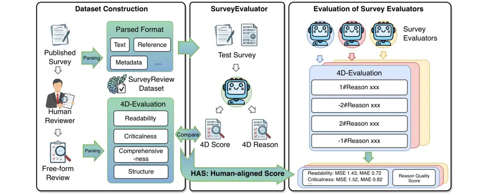

# SurveyReview: A Reviewer-Aligned Benchmark for Survey Evaluators

Conference: Proceedings of the 32nd ACM SIGKDD Conference on Knowledge
Discovery and Data Mining V.2; August 09–13, 2026; Jeju Island, Republic
of KoreaProceedings of the 32nd ACM SIGKDD Conference on Knowledge
Discovery and Data Mining V.2 (KDD ’26), August 09–13, 2026, Jeju
Island, Republic of
KoreaDOI: [10.1145/3770855.3817505](https://doi.org/10.1145/3770855.3817505)ISBN: 979-8-4007-2259-2/2026/08CCS: Computing
methodologies Natural language processing

Yuheng Zhang
[](https://orcid.org/0009-0005-5664-968X)
Note: These authors contributed equally. Note: Work was done when these
authors interned at Zhipu AI Affiliation: School of Information, Renmin
University of China, Beijing, China Affiliation: Key Laboratory of Data
Engineering and Knowledge Engineering, Beijing, China email:
<zhangyuheng@ruc.edu.cn> , Yuanchun Wang Affiliation: School of
Information, Renmin University of China, Beijing, China Affiliation: Key
Laboratory of Data Engineering and Knowledge Engineering, Beijing, China
email: <wangyuanchun@ruc.edu.cn> , Fanjin Zhang
[](https://orcid.org/0000-0001-8551-1966)
Affiliation: School of Information, Renmin University of China, Beijing,
China Affiliation: Engineering Research Center of Database and Business
Intelligence, Beijing, China email: <fanjinz@ruc.edu.cn> , Ruyu Zhao
[](https://orcid.org/0009-0003-9426-4911)
Affiliation: School of Information, Renmin University of China, Beijing,
China Affiliation: Key Laboratory of Data Engineering and Knowledge
Engineering, Beijing, China email: <ruyuzhao@ruc.edu.cn> , Juanzi Li
[](https://orcid.org/0000-0002-6244-0664)
Affiliation: Department of Computer Science and Technology, Tsinghua
University, Beijing, China , Jie Tang
[](https://orcid.org/0000-0003-3487-4593)
Affiliation: Department of Computer Science and Technology, Tsinghua
University, Beijing, China email: <lijuanzi@tsinghua.edu.cn> email:
<jietang@tsinghua.edu.cn> and Jing Zhang
[](https://orcid.org/0000-0003-2019-225X)
Note: Corresponding author. Affiliation: School of Information, Renmin
University of China, Beijing, China Affiliation: Engineering Research
Center of Database and Business Intelligence, Beijing, China email:
<zhang-jing@ruc.edu.cn>

© cc

###### Abstract.

The rapid advancement of large language models has transformed survey
writing from a months-long manual effort into an automated process. As
generation scales, reliable evaluation becomes the bottleneck, and LLMs
are increasingly used as survey evaluators. However, existing approaches
largely rely on off-the-shelf LLM-as-a-judge methods without systematic
alignment to human reviewers, and there remains a lack of systematic
frameworks for quantifying alignment with human reviewers. To address
this gap, we propose SurveyReview, a reviewer-aligned, multi-dimensional
benchmark and dataset for survey evaluation. We collect and annotate 675
survey papers with 1,630 review reports. We structure authentic
peer-review reports by converting free-form comments into
four-dimensional scores (Readability, Criticalness, Comprehensiveness,
Structure) paired with supporting rationales. We further release
standardized train/test splits and an evaluation protocol to measure
alignment between automatic evaluators and human reviewers. To validate
the benchmark, we develop SurveyAlign, a strong baseline evaluator by
fine-tuning Qwen3-32B with LoRA on our annotated data, augmented with
external knowledge for knowledge-intensive dimensions. On the test set,
SurveyAlign substantially improves reviewer alignment over prompt-based
judging with GPT-5.2, reducing average MSE from 2.28 to 1.38 and MAE
from 1.15 to 0.69 across all four dimensions. Our contributions are
twofold: (1) we establish the first multi-dimensional, reviewer-aligned
dataset with a reproducible evaluation framework for survey reviewing;
(2) we develop a strong baseline evaluator that substantially improves
alignment with human reviewers, providing a competitive reference for
future research. Our code and data are available at
[https://surveyreview.github.io](https://surveyreview.github.io)

###### Keywords: 

Benchmark, Automatic Evaluation, Large Language Models, Natural Language
Processing

^(†)^(†)cc-license: by


Figure 1. SurveyReview Benchmark: Evaluating to what extent the reviews
produced by existing survey evaluators align with those of human expert
reviewers.A diagram illustrating the SurveyReview benchmark

## 1. Introduction

Large language models (LLMs) have transformed survey paper generation
from a months-long manual process into an automated pipeline that
retrieves literature (Zhang et al., 2024), structures content (Zhu
et al., 2025), and drafts comprehensive manuscripts within hours (Wang
et al., 2024; Chen et al., 2025; Liang et al., 2025). Systems such as
DeepResearch (Du et al., 2025; Li et al., 2025) orchestrate retrieval,
clustering, outline generation, and multi-round refinement to produce
surveys that appear fluent and comprehensive in coverage. However, this
automation creates a critical evaluation bottleneck: while generation
scales rapidly, quality assessment remains a major bottleneck and still
often relies on human peer review (Chen et al., 2025). Although LLMs are
increasingly used as automatic evaluators (Schmidtová et al., 2024),
existing approaches largely apply off-the-shelf _LLM-as-a-judge_
prompting (Zheng et al., 2023) without systematic alignment to expert
reviewers, and there is no rigorous framework to quantify such
alignment.

An effective framework must satisfy three requirements that human
reviewers naturally provide: (1) multi-dimensional assessment across
stable quality dimensions (e.g., readability, structure,
comprehensiveness, criticalness); (2) interpretable rationales that
explain why each score was assigned, enabling targeted revision; and (3)
quantifiable alignment with human judgments, measured via error metrics
(MSE, MAE) to reveal systematic biases and ensure reliability. Simply
producing scores is insufficient—without structured rationales and
measurable alignment, automated evaluators cannot support iterative
improvement or establish credibility.

Prior work evaluates surveys from reference-based perspectives rather
than directly modeling expert peer review. SurveyScope (Shi et al., 2025) formalizes evaluation through reference-based comparison across
curated survey datasets. SurGE (Su et al., 2026) and
DeepSurvey-Bench (Zhang et al., 2026) compare generated surveys against
expert-written references, scoring dimensions like coverage, citation
accuracy, and “academic value” via LLM-as-a-judge. While valuable, these
approaches treat expert surveys as gold-standard texts rather than
learning from expert review reports. Consequently, they lack: (1)
quality dimensions grounded in actual reviewing practice across diverse
topics; (2) structured “score + rationale” representations that unify
expert judgments into learnable signals; and (3) explicit alignment
quantification via MSE/MAE to measure deviation from human reviewers. No
prior work constructs evaluation datasets from peer review reports or
systematically measures alignment error across quality dimensions.

We take a reviewer-aligned perspective and build an evaluation framework
directly from real peer-review data. Specifically, we propose
SurveyReview, a reviewer-aligned, multi-dimensional benchmark and
dataset for survey evaluation. We collect and annotate 675 survey papers
with 1,630 review reports, deriving four core dimensions consistently
emphasized by experts: readability, structure, comprehensiveness, and
criticalness. Readability captures clarity and ease of understanding;
Structure measures the logical organization and coherence of sections;
Comprehensiveness evaluates the breadth and relevance of literature
coverage; Criticalness assesses analytical depth and the extent of
original insight beyond summarization. We convert free-form review
comments into structured dimension-specific scores paired with
supporting rationales, and release standardized splits and an evaluation
protocol for reproducible alignment measurement. Figure 1 illustrates
the overall SurveyReview benchmark, where reviews generated by survey
evaluators are compared with human-written reviews to compute
human-aligned scores.

Building upon this dataset, we develop SurveyAlign, an evaluator based
on Qwen3-32B with LoRA adaptation. In addition to standard supervised
fine-tuning, we incorporate reference-expansion-based Knowledge
Augmentation for knowledge-intensive dimensions (Zhang et al., 2019).
This design reflects the role of references in expert review and
strengthens coverage and analytical assessment.

We evaluate automatic evaluators along two aspects: score alignment and
reasoning quality. Alignment with human reviewers is measured using MSE
and MAE across dimensions, while rationale quality is assessed based on
semantic consistency with reference explanations. We further integrate
these components into a unified Human-aligned Score (HAS), which jointly
reflects scoring accuracy and reasoning fidelity with respect to expert
peer review. Experiments show that SurveyAlign substantially improves
reviewer alignment, reducing average MSE from 2.28 to 1.38 and MAE from
1.15 to 0.69 compared with GPT-5.2.

We summarize our key contributions as follows:

##### Dataset

We establish the first multi-dimensional, reviewer-aligned dataset
derived from peer review reports. Under a unified rubric, each paper
receives fine-grained scores and structured rationales across four
dimensions (readability, structure, comprehensiveness, criticalness). We
also provide standardized train/test splits and an evaluation protocol
to measure reviewer alignment in a reproducible way.

##### Evaluator

We develop SurveyAlign, a strong baseline evaluator built on Qwen3-32B
with LoRA. Beyond text-only fine-tuning, we incorporate a modular
knowledge augmentation toolkit that enables structured integration of
relevant domain knowledge for knowledge-intensive dimensions such as
comprehensiveness and criticalness. On the test set, SurveyAlign reduces
average MSE from 2.28 to 1.38 and MAE from 1.15 to 0.69 compared with
GPT-5.2.

## 2. Related Work

### 2.1. Survey Generation

Automatic survey generation has attracted increasing attention as the
volume of scientific literature continues to grow. Existing systems
primarily focus on improving long-form generation pipelines through
retrieval, planning, and multi-stage writing.

AutoSurvey (Wang et al., 2024) presents an end-to-end pipeline combining
literature retrieval, outline construction, and section-wise generation,
highlighting evaluation as a critical bottleneck. SurveyGen (Chen
et al., 2025) introduces a planning-based framework with memory-guided
writing to improve global consistency in long survey articles.
SurveyX (Liang et al., 2025) addresses context limitations via
structured knowledge organization and multi-stage generation to enhance
coverage and citation accuracy. LLM$`\times`$MapReduce-V2 (Wang et al., 2025) further explores test-time scaling strategies for synthesizing
long-form academic content from extremely long resources.

While these approaches significantly advance generation quality,
evaluation is often not the primary focus, often relying on coverage
heuristics or LLM-based judgment.

### 2.2. Survey Evaluation

Existing work on survey evaluation can be categorized according to the
primary source of evaluation signals: (1) LLM-centered scoring, (2)
reference-grounded comparison, and (3) task-driven assessment.

LLM-centered scoring relies on large language models as primary
evaluators to assess generated surveys according to predefined rubrics.
SurGE (Su et al., 2026) and DeepSurvey-Bench (Zhang et al., 2026) adopt
rubric-guided LLM scoring, sometimes complemented with auxiliary
automatic metrics or reference-based statistics. While scalable, these
approaches predominantly depend on model-generated judgments rather than
structured supervision derived from authentic peer-review annotations.

Reference-grounded evaluation measures quality relative to
expert-written surveys. SurveyScope (SciSage) (Shi et al., 2025)
evaluates generated surveys against curated references in terms of
content coverage and citation usage. Traditional metrics such as
ROUGE (Lin, 2004), BLEU (Papineni et al., 2002), and BERTScore (Zhang
et al., 2020), are also applied to long-form academic text (Schmidtová
et al., 2024).

Task-driven assessment evaluates research agents through structured
academic tasks rather than direct survey comparison. DeepResearch
Bench (Du et al., 2025) and ReportBench (Li et al., 2025) assess systems
via expert-designed report-level protocols and task completion criteria.

Despite their scalability, these paradigms primarily derive supervision
from model judgments, reference texts, or task outcome signals, rather
than from real-world peer-review annotations. They do not explicitly
model authentic expert peer-review behavior, nor do they provide
dimension-level reviewer scores paired with rationales for
alignment-based measurement. In contrast, SurveyReview derives
structured evaluation signals from authentic peer-review reports and
quantifies reviewer-aligned error across dimension-level scores paired
with real reviewer rationales.

## 3. Task Formulation

We formalize survey evaluation as a multi-dimensional scoring task that
mimics expert peer review. Given a survey paper $`\mathcal{P}`$, our
goal is to produce a structured evaluation $`\mathcal{E}`$ aligning with
expert judgments:

```math
\mathcal{E}=f(\mathcal{P})=\{(d_{i},s_{i},r_{i})\}_{i=1}^{n} \tag{1}
```

where $`d_{i}\in\mathcal{D}`$ is a quality dimension, $`s_{i}`$ is the
numeric score, $`r_{i}`$ is the supporting rationale, and $`n`$ is the
number of dimensions.

##### Evaluation protocol.

We measure evaluator alignment with human reviewers using annotated
surveys as ground truth. For each survey paper $`\mathcal{P}`$, the
corresponding expert evaluation is denoted as
$`\mathcal{E}^{*}=\{(d_{i},s_{i}^{*},r_{i}^{*})\}_{i=1}^{n}`$, where
$`s_{i}^{*}`$ and $`r_{i}^{*}`$ represent the ground-truth score and
rationale for dimension $`d_{i}`$.

For dimension $`d_{i}`$ with $`m_{i}`$ samples, we compute mean squared
error and mean absolute error between human scores
$`\{s_{i,j}^{*}\}_{j=1}^{m_{i}}`$ and predictions
$`\{\hat{s}_{i,j}\}_{j=1}^{m_{i}}`$.

```math
\text{MSE}_{i}=\frac{1}{m_{i}}\sum_{j=1}^{m_{i}}(s_{i,j}^{*}-\hat{s}_{i,j})^{2},\quad\text{MAE}_{i}=\frac{1}{m_{i}}\sum_{j=1}^{m_{i}}|s_{i,j}^{*}-\hat{s}_{i,j}| \tag{2}
```

Overall metrics average across all $`n`$ dimensions:

```math
\text{AVGMSE}=\frac{1}{n}\sum_{i=1}^{n}\text{MSE}_{i},\quad\text{AVGMAE}=\frac{1}{n}\sum_{i=1}^{n}\text{MAE}_{i} \tag{3}
```

Additionally, we evaluate reasoning quality by measuring semantic
alignment between generated rationales $`\{\hat{r}_{i,j}\}`$ and
reference rationales $`\{r_{i,j}^{*}\}`$ via LLM-based assessment. For
each dimension $`d_{i}`$, we compute the average reason quality score:

```math
\text{RQ}_{i}=\frac{1}{m_{i}}\sum_{j=1}^{m_{i}}\text{Consistency}(\hat{r}_{i,j},r_{i,j}^{*}) \tag{4}
```

where $`\text{Consistency}(\cdot,\cdot)\in[0,1]`$ measures rationale
consistency. The overall reason quality score averages across all
dimensions:

```math
\text{RQS}=\frac{1}{n}\sum_{i=1}^{n}\text{RQ}_{i} \tag{5}
```

##### Human-aligned Score (HAS)

We define the Human-aligned Score (HAS) to combine score alignment and
reasoning quality. Let $`\Delta_{s}`$ denote the maximum possible
absolute score difference under our predefined score scale. We normalize
MSE and MAE into alignment scores:

```math
A_{\text{MSE}}=1-\frac{\text{AVGMSE}}{\Delta_{s}^{2}},\quad A_{\text{MAE}}=1-\frac{\text{AVGMAE}}{\Delta_{s}}. \tag{6}
```

Higher values indicate better score alignment.

Then compute the weighted alignment and final HAS:

```math
\text{Align}=\alpha_{1}\cdot A_{\text{MSE}}+\alpha_{2}\cdot A_{\text{MAE}} \tag{7}
```

```math
\text{HAS}=\beta_{1}\cdot\text{Align}+\beta_{2}\cdot\text{RQS} \tag{8}
```

##### SurveyReview Evaluation.

In our evaluation protocol, each evaluator is required to output a
structured four-dimensional assessment for a given survey paper,
consisting of (i) a numeric score and (ii) a supporting rationale for
each quality dimension: Readability, Criticalness, Comprehensiveness,
and Structure.

Readability reflects clarity and ease of understanding; Criticalness
captures analytical depth and synthesized insight beyond summarization;
Comprehensiveness evaluates the breadth and relevance of literature
coverage; and Structure measures the logical organization and coherence
of the survey.

Score alignment is measured by AVGMSE and AVGMAE, while rationale
quality is quantified by the Reason Quality Score (RQS). The final
Human-aligned Score (HAS) integrates both components into a unified
metric that quantifies overall alignment with expert peer review.

## 4. Dataset Construction



Figure 2. Overview of SurveyReview. Left: dataset construction. Middle:
the workflow of a single survey evaluator producing dimension-specific
score–rationale pairs. Right: evaluation of survey evaluators under the
unified benchmarking protocol.

Evaluating automatic survey evaluators requires ground-truth data
consisting of paired survey papers and expert assessments, denoted as
$`(\mathcal{P},\mathcal{E}^{*})`$, where $`\mathcal{P}`$ is a survey
paper and $`\mathcal{E}^{*}`$ represents the ground-truth
four-dimensional scores and supporting rationales provided by human
reviewers. Such data serves two key purposes: supervised training and
alignment-based benchmarking.

However, collecting high-quality annotations from domain experts at
scale is prohibitively expensive (Feng et al., 2025). While existing
peer review processes provide expert evaluations of survey papers, these
resources are not directly suitable for alignment-based benchmarking. To
our knowledge, no existing dataset systematically aggregates
survey–review pairs across domains with standardized, dimension-level
labels. Moreover, raw review texts are typically unstructured free-form
comments, lacking explicit scoring criteria and rationale annotations.

To address these challenges, we construct SurveyReview through a
three-stage pipeline. We collect survey papers with peer reviews from
multiple academic sources (Section 4.1), process each PDF to extract
full text and citation structure (Section 4.2), and annotate reviews
into structured four-dimensional scores and rationales (Section 4.3).
The resulting dataset contains 675 surveys with multi-dimensional expert
annotations, enabling both supervised training and rigorous evaluation.
The overall dataset construction pipeline is illustrated on the left
side of Figure 2.

### 4.1. Data Collection

##### Data sources.

We collect survey papers and their accompanying peer review reports from
three publicly available platforms: MOPRD (Lin et al., 2023), a
large-scale multidisciplinary dataset providing structured open peer
review records across the full review lifecycle; F1000Research, an open
publishing platform adopting a publish-first, post-publication peer
review model with fully transparent reviewer reports and evaluation
statuses (Thelwall et al., 2019); and OpenReview, a widely used
transparent peer review and conference management system in the machine
learning and AI community. Together, these sources offer diverse
domains, review processes, and transparency levels, enabling
comprehensive and heterogeneous evaluation settings  (Sun et al.,
2025a).

##### Survey identification.

For each source, we adopt a three-stage filtering strategy to identify
survey papers, consisting of keyword-based matching on titles (e.g.,
“survey” and “review”) to obtain high-recall candidates  (Zhuang and
Kennington, 2024), large language model–based screening of titles and
abstracts to verify survey-style content (Huotala et al., 2025), and
manual verification to remove ambiguous or misclassified cases, thereby
ensuring high precision and data quality. We retain only papers that
pass all stages and include substantive peer review reports with
explicit quality assessments or critical feedback.

| Datasets                              | Fields | \#Surveys | Metadata | Real Reviews | Quality Diversity | Fine-grained Annotation |
| ------------------------------------- | ------ | --------- | -------- | ------------ | ----------------- | ----------------------- |
| SurveyScope (Shi et al., 2025)        | CS     | 46        | ✓        | ✗            | ✗                 | ✗                       |
| SurveyBench (Sun et al., 2025b)       | CS     | 100       | ✓        | ✗            | ✗                 | ✗                       |
| SurGE (Su et al., 2026)               | CS     | 205       | ✓        | ✗            | ✗                 | ✗                       |
| DeepSurvey-Bench (Zhang et al., 2026) | Mixed  | 163       | ✓        | ✗            | ✗                 | ✗                       |
| SurveyReview                          | Mixed  | 675       | ✓        | ✓            | ✓                 | ✓                       |

Table 1. Comparison of survey datasets. Real Reviews denotes the use of
authentic peer review reports. Quality Diversity denotes the
availability of both positive and negative quality signals. Fine-grained
Annotation denotes structured dimension-level scores with rationales.

### 4.2. Survey Paper Processing

After identifying survey papers with accompanying reviews, we retrieve
the corresponding PDF files for downstream processing and analysis.

##### PDF parsing.

We extract structured information from the PDFs using two complementary
tools. Marker (Paruchuri, 2025) converts PDFs into clean markdown text,
providing full paper content for evaluator input. Grobid (gro, 2026)
parses PDFs into structured XML, extracting reference lists, citation
contexts, and bibliographic metadata. This dual-tool approach yields
comprehensive paper representations, including full text, citation
graphs, and metadata.

##### Extracted information.

The processing pipeline produces:

- •
  Full-text content (via Marker): complete paper text for evaluation
- •
  References (via Grobid): reference lists, citation contexts, and
  locations
- •
  Metadata: title, authors, abstract, and publication year

This structured representation supports both evaluator training (using
full text) and knowledge augmentation (using citation analysis).

### 4.3. Annotation Methodology

We convert free-form peer review reports into structured dimension-level
annotations. For each survey–review pair, annotators assign scores and
extract supporting rationales for four predefined dimensions:
Readability, Structure, Comprehensiveness, and Criticalness.

The resulting ground-truth expert evaluation for each survey paper is
denoted as
$`\mathcal{E}^{*}=\{(d_{i},s_{i}^{*},r_{i}^{*})\}_{i=1}^{n}`$, where
$`s_{i}^{*}`$ and $`r_{i}^{*}`$ represent the annotated score and
corresponding rationale for dimension $`d_{i}`$.

Annotation guidelines specify task definition, dimension criteria,
rationale extraction rules, and scoring standards. More annotation
details are provided in Appendix A.

All samples are annotated by trained annotators. To assess annotation
reliability, we randomly sample 280 annotation units from the dataset,
where each unit corresponds to one evaluation dimension of one survey
paper. This subset is independently annotated by multiple annotators.
Inter-annotator agreement on this subset, measured by Krippendorff’s
alpha, is 0.74. We provide per-dimension agreement statistics and
disagreement pattern analysis in Appendix A.2.

### 4.4. Dataset Statistics

The SurveyReview dataset comprises 675 survey papers and 1,630
associated peer review reports with structured four-dimensional
annotations.

As summarized in Table 1, SurveyReview differs from existing survey
benchmarks in three key aspects. First, it is constructed from authentic
peer review reports rather than synthetic judgments or reference-only
comparisons. Second, the dataset contains both positive and negative
quality signals, reflecting the naturally critical distribution of
real-world reviews. Third, each sample is annotated along four
predefined quality dimensions with explicit supporting rationales,
enabling fine-grained supervision and evaluation.

##### Source composition.

Reviews are collected from F1000Research (1,058; 64.9%), MOPRD (375;
23.0%), and OpenReview (197; 12.1%), providing heterogeneous domains and
review styles.

##### Score distribution.

Dimension-wise statistics are reported in Table 6. The overall score
distribution is: $`-2`$ (4.46%), $`-1`$ (66.25%), $`+1`$ (24.73%), and
$`+2`$ (4.56%). The distribution is skewed toward negative assessments,
with extreme scores ($`\pm 2`$) accounting for a small proportion of
annotations.

##### Train–test split.

The dataset is split into 1,216 training samples (75%) and 414 test
samples (25%), stratified by data source to preserve domain proportions.
The split is performed at the paper level: all reviews associated with
the same survey paper are assigned to the same partition, ensuring that
no paper appears in both training and test sets.

## 5. Methods

Under the task formulation in Section 3, survey evaluation aims to learn
a mapping $`f_{\theta}:\mathcal{P}\rightarrow\hat{\mathcal{E}}`$, where

```math
\hat{\mathcal{E}}=f_{\theta}(\mathcal{P})=\{(d_{i},\hat{s}_{i},\hat{r}_{i})\}_{i=1}^{n}
```

denotes the predicted dimension-specific score–rationale pairs for a
survey paper $`\mathcal{P}`$.

To realize this mapping in practice, we develop SurveyAlign, a modular
evaluator that implements $`f_{\theta}`$ under the unified evaluation
protocol. SurveyAlign combines supervised fine-tuning (SFT) for
surface-level dimensions (Readability and Structure) with
dimension-specific Knowledge Augmentation (KA) for knowledge-intensive
dimensions (Comprehensiveness and Criticalness), and further applies
inference-time consensus aggregation to improve prediction stability.

### 5.1. Supervised Fine-Tuning (SFT)

In supervised fine-tuning, we train an instruction-following LLM on
SurveyReview annotations to learn reviewer-aligned scoring and rationale
generation. We construct instruction-tuning examples consisting of
instruction, input, and output fields, each corresponding to a single
evaluation dimension. The input contains the survey text, and the output
includes a numeric score paired with a human-written rationale. We adopt
the same dimension-specific prompting scheme used for zero-shot
evaluation in Appendix C, ensuring consistency between prompt-based
baselines and supervised fine-tuning.

We build dimension-specific training sets using annotated reviews.
Qwen3-32B (Yang et al., 2025) is fine-tuned with LoRA (Hu et al., 2021)
for parameter-efficient adaptation, learning the mapping from survey
text to dimension-specific score–rationale pairs.

Implementation details are provided in Appendix D.

### 5.2. Knowledge-Augmented Training

The four evaluation dimensions exhibit different dependency structures.
Readability and Structure primarily rely on text-internal signals such
as fluency and organization. In contrast, Comprehensiveness and
Criticalness require reasoning beyond the survey text itself.
Comprehensiveness involves assessing literature coverage relative to the
surrounding research landscape, while Criticalness requires analytical
synthesis across multiple works. These dimensions therefore benefit from
explicit Knowledge Augmentation (KA).

#### 5.2.1. Reference Expansion

Given a survey paper $`\mathcal{P}`$, we extract its reference set
$`R`$. Using a citation graph constructed from AMiner (Tang, 2016), we
expand $`R`$ to obtain an augmented citation neighborhood $`R^{+}`$ by
retrieving papers that have citation relationships with items in $`R`$.
This expansion provides a structured view of the local research
landscape surrounding the survey.

#### 5.2.2. Dimension-Specific Knowledge Augmentation

Since $`R^{+}`$ can exceed the available context window, we construct
compact, dimension-specific KA representations before injecting external
knowledge into the model input.

##### Comprehensiveness-specific Knowledge Augmentation (Comp-KA)

Comprehensiveness focuses on coverage completeness. We therefore
identify structurally important works in $`R^{+}`$ based on their
connectivity to the original reference set $`R`$. Candidate papers are
ranked by citation links with $`R`$, and the top-ranked papers are
selected together with the original references. The resulting Comp-KA
representation is serialized as structured metadata (title, year,
citation count), highlighting representative and influential works in
the citation neighborhood. This allows the model to reason about
potential coverage gaps.

##### Criticalness-specific Knowledge Augmentation (Crit-KA)

Criticalness requires assessing analytical depth and synthesized
insight. Unlike coverage evaluation, this dimension depends on modeling
the evolution and interaction of ideas over time. We therefore construct
a temporally structured representation from $`R^{+}`$. Papers are
filtered using adaptive thresholds derived from reference statistics
(e.g., citation count and publication year), forming a representative
candidate set. Candidates are sorted chronologically and grouped under a
token budget, each block summarized, and the summaries further
compressed into a fixed-length representation (Crit-KA). This preserves
coarse temporal evolution signals to support cross-paper analytical
reasoning.

Detailed construction procedures are provided in Appendix F.

#### 5.2.3. Training with Knowledge-Augmented Inputs

For knowledge-intensive dimensions, the corresponding KA representation
is prepended to the survey text as part of the model input.

For Comprehensiveness, supervised fine-tuning (SFT) is performed on
inputs of the form \[Comp-KA; $`\mathcal{P}`$\].

For Criticalness, we adopt a two-stage strategy. First, SFT is conducted
on inputs augmented with Crit-KA. We then apply Direct Preference
Optimization (DPO) (Rafailov et al., 2024) under the same augmented
setting. Criticalness judgments are inherently more subjective and
require nuanced synthesis beyond factual grounding. DPO further aligns
the model toward human-preferred analytical reasoning.

Separate LoRA-adapted models (Hu et al., 2021) are trained for each
dimension, enabling dimension-specific supervision and optimization
strategies.

### 5.3. Model Composition and Inference

##### Test-Time Scaling via Consensus Aggregation.

To reduce stochastic variance in generative scoring, we apply a
lightweight test-time aggregation strategy inspired by prior work on
scaling test-time compute for LLMs (Agarwal et al., 2025; Weng et al.,
2025). For each evaluation dimension, the corresponding model is
executed multiple times with sampling, producing independent
score–rationale pairs. The final score is determined via majority voting
across runs, and the rationales are consolidated into a unified
explanation consistent with the consensus score. This strategy
introduces no additional training cost and improves prediction stability
purely through inference-time aggregation. Detailed configurations are
provided in Appendix E.

##### Overall Construction.

SurveyAlign is designed as a modular evaluation framework composed of
four dimension-specialized sub-models: SurveyAlign-Read,
SurveyAlign-Crit, SurveyAlign-Comp, and SurveyAlign-Stru. Each sub-model
is independently fine-tuned with LoRA to focus on a single evaluation
dimension, allowing dimension-specific supervision signals and
optimization strategies.

For the surface-level dimensions (Readability and Structure), we adopt
supervised fine-tuning (SFT) (Section 5.1) to improve score calibration
and rationale consistency. For the knowledge-intensive dimensions
(Criticalness and Comprehensiveness), we further incorporate
knowledge-augmented training (Section 5.2) to enhance evidence grounding
and coverage assessment.

At inference time, each dimension-specialized sub-model applies the
consensus-based test-time scaling strategy described above, and the
resulting dimension-level score–rationale pairs are combined into a
unified multi-dimensional evaluation output.

## 6. Experiments and Analysis

|              |                 |                    |                    |                    |                    |                    |                    |                    |                    |                    |                    |                  |                  |
| ------------ | --------------- | ------------------ | ------------------ | ------------------ | ------------------ | ------------------ | ------------------ | ------------------ | ------------------ | ------------------ | ------------------ | ---------------- | ---------------- |
|              |                 | Read.              |                    | Crit.              |                    | Comp.              |                    | Stru.              |                    | AVG                |                    | RQS $`\uparrow`$ | HAS $`\uparrow`$ |
| Method       | Model           | MSE $`\downarrow`$ | MAE $`\downarrow`$ | MSE $`\downarrow`$ | MAE $`\downarrow`$ | MSE $`\downarrow`$ | MAE $`\downarrow`$ | MSE $`\downarrow`$ | MAE $`\downarrow`$ | MSE $`\downarrow`$ | MAE $`\downarrow`$ |                  |                  |
| SurveyAlign  | Qwen3-32B-LoRA  | 1.43               | 0.72               | 1.52               | 0.82               | 1.26               | 0.56               | 1.29               | 0.65               | 1.38               | 0.69               | 0.36             | 0.74             |
| Zero-shot    |                 |                    |                    |                    |                    |                    |                    |                    |                    |                    |                    |                  |                  |
| Prompt       | Qwen3-32B       | 3.05               | 1.45               | 3.24               | 1.51               | 3.22               | 1.54               | 3.35               | 1.53               | 3.21               | 1.51               | 0.36             | 0.61             |
| Prompt       | GPT-5.2         | 2.13               | 1.07               | 1.97               | 0.97               | 2.04               | 1.08               | 2.98               | 1.47               | 2.28               | 1.15               | 0.42             | 0.68             |
| Prompt       | Gemini-3-pro    | 3.84               | 1.52               | 2.25               | 1.00               | 3.91               | 1.49               | 5.76               | 2.11               | 3.94               | 1.53               | 0.29             | 0.58             |
| Prompt       | DeepSeek-v3.2   | 4.78               | 1.88               | 2.49               | 1.15               | 4.59               | 1.82               | 4.02               | 1.76               | 3.97               | 1.65               | 0.37             | 0.58             |
| Prompt       | GLM-4.7         | 3.43               | 1.50               | 2.58               | 1.21               | 3.66               | 1.57               | 4.83               | 1.95               | 3.62               | 1.56               | 0.37             | 0.60             |
| Prompt       | Claude-Opus-4.5 | 2.91               | 1.29               | 1.88               | 0.88               | 2.66               | 1.23               | 3.65               | 1.58               | 2.77               | 1.25               | 0.48             | 0.68             |
| Prior Work   |                 |                    |                    |                    |                    |                    |                    |                    |                    |                    |                    |                  |                  |
| LLMMapReduce | Gemini-3-pro    | 2.95               | 1.27               | 3.04               | 1.29               | 5.04               | 1.83               | 6.13               | 2.24               | 4.29               | 1.66               | –                | –                |
| DR-Bench     | GPT-5.2         | 3.06               | 1.39               | 2.51               | 1.13               | 2.75               | 1.29               | –                  | –                  | –                  | –                  | –                | –                |
| SurveyX      | GPT-5.2         | –                  | –                  | 2.14               | 1.00               | –                  | –                  | 3.19               | 1.43               | –                  | –                  | –                | –                |

Table 2. Main results across all evaluated methods. AVG: average across
the four evaluation dimensions. RQS: Reason Quality Score. HAS:
Human-aligned Score

### 6.1. Experimental Setup

##### Evaluation Metrics.

Following the task formulation in Section 3, we evaluate automatic
survey evaluators along two aspects: _score alignment_ and _rationale
quality_.

For each evaluation dimension, alignment with human reviewers is
measured using mean squared error (MSE) and mean absolute error (MAE)
between predicted scores and annotated ground-truth scores. Lower values
indicate better alignment.

To assess rationale quality, we compute the Reason Quality Score (RQS),
which measures semantic consistency between generated rationales and
human-written explanations under a standardized evaluation prompt
(Appendix G). Higher RQS indicates better reasoning fidelity.

We further aggregate alignment and rationale quality into a unified
Human-aligned Score (HAS). Unless otherwise specified, we set
$`\alpha_{1}=0.4`$, $`\alpha_{2}=0.6`$ for combining MSE and MAE into an
alignment score, and $`\beta_{1}=0.75`$, $`\beta_{2}=0.25`$ for
combining alignment and RQS into HAS. Lower MSE/MAE and higher RQS/HAS
indicate better performance.

##### Implementation Details.

Our proposed evaluator, SurveyAlign, is built upon Qwen3-32B (Yang
et al., 2025). We apply Low-Rank Adaptation (LoRA) (Hu et al., 2021) for
parameter-efficient supervised fine-tuning. Dimension-specific models
are trained following the framework described in Section 5. Detailed
hyperparameters and training configurations are provided in Appendix D.

##### Input Format.

All evaluated methods operate under a unified prompting protocol
(Appendix C). For zero-shot LLM-as-a-Judge baselines and our fine-tuned
models, we instantiate a standardized prompt template consisting of (1)
the evaluation dimension definition, (2) scoring rubric, (3) explicit
output format specification, and (4) the full survey text.

For knowledge-augmented settings, the corresponding dimension-specific
Knowledge Augmentation (KA) representation is prepended to the survey
text without modifying the remaining prompt structure.

For prior evaluators, we follow their original prompting strategies and
pipeline designs while adapting their outputs to the standardized
score–rationale format required by our benchmark.

##### Baselines.

We compare SurveyAlign against two categories of baselines:

(i) Prompt-based LLM-as-a-Judge. Off-the-shelf instruction-tuned LLMs
are used as zero-shot evaluators without task-specific training on
SurveyReview. For each survey paper, models are executed independently
for each evaluation dimension, conditioned on the corresponding
dimension-specific rubric. We evaluate GPT-5.2 (OpenAI, 2025),
Claude-Opus-4.5-Thinking (Anthropic, 2025), Gemini-3-Pro-Preview (Google
DeepMind, 2025), DeepSeek-v3.2 (DeepSeek-AI, 2025), GLM-4.7 (Z.ai,
2025), and Qwen3-32B (Yang et al., 2025) in their zero-shot settings.

(ii) Prior Survey Evaluators. We additionally compare with
LLMMapReduce (Wang et al., 2025), DR-Bench (Du et al., 2025), and
SurveyX (Liang et al., 2025). These systems are evaluated using their
original methodologies, with outputs converted to the standardized
score–rationale format for fair comparison under our benchmark.

### 6.2. Main Results

##### Overall alignment.

Table 2 reports the alignment performance of all evaluators on
SurveyReview. Our fine-tuned evaluator, SurveyAlign (Qwen3-32B-LoRA),
achieves the best performance across all four dimensions. It obtains the
lowest MSE and MAE on every metric and achieves the highest overall HAS
score of 0.74, substantially outperforming all zero-shot baselines and
prior work.

##### Comparison with zero-shot LLM judges.

Even the strongest zero-shot model (GPT-5.2) reaches an HAS of 0.68,
whereas SurveyAlign achieves 0.74. Beyond the overall score, SurveyAlign
consistently attains lower MSE and MAE on every dimension. This
consistent margin indicates that task-specific supervision is necessary
to approach reviewer-level consistency.

##### Dimension-wise improvements.

Performance gains are observed across both surface-level and
knowledge-intensive dimensions. Readability and Structure, which rely
primarily on text-internal signals, benefit substantially from
supervised fine-tuning: Readability MSE decreases from 2.13 (GPT-5.2
zero-shot) to 1.43, and Structure from 2.98 to 1.29. The particularly
large reduction on Structure suggests that document-level organization
requires task-specific calibration.

For the knowledge-intensive dimensions—Criticalness and
Comprehensiveness—incorporating structured external knowledge further
improves alignment. Criticalness MSE decreases to 1.52 and
Comprehensiveness to 1.26, surpassing all zero-shot baselines. These
results highlight the importance of explicit knowledge modeling for
coverage reasoning and analytical depth.

##### Rationale quality.

Beyond numeric scores, we evaluate reasoning quality using RQS. While
Claude-Opus-4.5-Thinking achieves the highest zero-shot RQS (0.48), it
underperforms in score alignment. In contrast, SurveyAlign maintains
competitive rationale quality (0.36) while delivering substantially
better quantitative alignment, demonstrating a favorable trade-off
between explanation quality and scoring accuracy.

##### Comparison with prior evaluators.

We compare SurveyAlign with representative prior evaluators, including
DR-Bench, LLMMapReduce, and SurveyX. As these methods were not designed
for our multi-dimensional score-plus-rationale setting, we treat them as
informative reference points rather than fully matched competitors,
reusing their original prompts or formulations whenever feasible. The
results suggest that while adapted prompting-based evaluators provide
useful signals, SurveyAlign achieves more stable reviewer alignment
across all four dimensions through direct supervision from
human-annotated reviewer data.

##### Takeaway.

Overall, results demonstrate that supervised alignment is crucial for
reliable survey evaluation, and that knowledge augmentation further
strengthens performance on knowledge-intensive criteria.

### 6.3. Ablation Study of SurveyAlign

#### 6.3.1. Comprehensiveness

We further examine the effect of introducing Comprehensiveness-specific
Knowledge Augmentation (Comp-KA) on the Comprehensiveness dimension
under identical training settings. As shown in Table 3, incorporating
Comp-KA reduces MSE from 1.36 to 1.26 and MAE from 0.60 to 0.56. The
consistent improvement across both metrics indicates that structured
bibliographic context helps the model better assess survey coverage and
completeness.

| Setting (SurveyAlign-Comp) | MSE $`\downarrow`$ | MAE $`\downarrow`$ |
| -------------------------- | ------------------ | ------------------ |
| SFT                        | 1.36               | 0.60               |
| SFT + Comp-KA              | 1.26               | 0.56               |

Table 3. Ablation of the SurveyAlign-Comp submodel on the
Comprehensiveness (Comp) dimension.

#### 6.3.2. Criticalness

We further examine the interaction between Criticalness-specific
Knowledge Augmentation (Crit-KA) and Direct Preference Optimization
(DPO) on the Criticalness dimension (Table 4). Crit-KA alone does not
improve performance and slightly increases error, while DPO alone yields
only marginal gains. In contrast, combining Crit-KA with DPO
substantially reduces MSE (1.52) and MAE (0.82), achieving the best
performance. These results suggest that Criticalness evaluation requires
both access to relevant external knowledge and alignment of reasoning
behavior, highlighting the complementary roles of dimension-specific
Knowledge Augmentation and preference optimization.

| Setting (SurveyAlign-Crit) | MSE $`\downarrow`$ | MAE $`\downarrow`$ |
| -------------------------- | ------------------ | ------------------ |
| SFT                        | 1.96               | 0.93               |
| SFT + Crit-KA              | 2.04               | 1.02               |
| SFT + DPO                  | 1.90               | 0.99               |
| SFT + Crit-KA + DPO        | 1.52               | 0.82               |

Table 4. Ablation of the SurveyAlign-Crit submodel on the Criticalness
(Crit.) dimension.

## 7. Conclusion

We presented SurveyReview, a reviewer-aligned, multi-dimensional
benchmark for evaluating survey papers. By structuring peer-review
reports into four quality dimensions with rationales, the framework
enables quantitative measurement of alignment between automatic
evaluators and human reviewers.

Experiments show that task-specific supervision substantially improves
alignment compared to zero-shot judging, especially on subjective
dimensions such as Criticalness and Structure. Dimension-wise and
ablation analyses further reveal distinct roles of knowledge
augmentation, preference optimization, and inference strategies.

The benchmark provides standardized splits, evaluation metrics, and
diagnostic signals for studying reviewer-aligned assessment.

We hope this benchmark facilitates more transparent and measurable
progress in automated survey evaluation.

## 8. Ethical Considerations

This work follows standard ethical guidelines for responsible computing
research. The SurveyReview benchmark is built exclusively from publicly
available survey papers and open peer review materials originating from
OpenReview, F1000Research, and MOPRD. We do not claim ownership of any
third-party texts. We follow the licensing terms, terms of service, and
access controls of each source. Consistent with these requirements, we
will maximize redistribution of materials that are explicitly
redistributable, and for materials that are not redistributable we will
provide stable identifiers, provenance, and retrieval instructions so
that users can obtain them directly from the original sources under the
applicable terms. For metadata and structured annotations that are
legally redistributable, we will make them publicly available to the
greatest extent permitted, accompanied by clear documentation to
facilitate reproducibility and further research.

###### Acknowledgements.

This work is supported by the National Key Research & Development Plan
(2023YFF0725100), the National Natural Science Foundation of China
(92570121, 62322214, U23A20299, U24B20144, 62406164, 62476150,
62425601), a grant from the Institute for Guo Qiang, Tsinghua University
(2019GQB0003), and the new cornerstone Science Foundation through the
XPLORER PRIZE. We also acknowledge the support from Public Computing
Cloud, Renmin University of China. We acknowledge the data annotators at
Zhipu AI for their great support in this work.

## References

- gro (2026) 2008–2026. GROBID.
  [https://github.com/kermitt2/grobid](https://github.com/kermitt2/grobid).
  arXiv:1:dir:dab86b296e3c3216e2241968f0d63b68e8209d3c
- Agarwal et al. (2025) Aradhye Agarwal, Ayan Sengupta, and Tanmoy
  Chakraborty. 2025. The Art of Scaling Test-Time Compute for Large
  Language Models. arXiv:2512.02008 \[cs.CL\]
  [https://arxiv.org/abs/2512.02008](https://arxiv.org/abs/2512.02008)
- Anthropic (2025) Anthropic. 2025. Introducing Claude Opus 4.5.
  [https://www.anthropic.com/news/claude-opus-4-5](https://www.anthropic.com/news/claude-opus-4-5)
- Chen et al. (2025) Jing Chen, Zhiheng Yang, Yixian Shen, Jie Liu, Adam
  Belloum, Chrysa Papagainni, and Paola Grosso. 2025. SurveyGen-I:
  Consistent Scientific Survey Generation with Evolving Plans and
  Memory-Guided Writing. arXiv:2508.14317 \[cs.CL\]
  [https://arxiv.org/abs/2508.14317](https://arxiv.org/abs/2508.14317)
- DeepSeek-AI (2025) DeepSeek-AI. 2025. DeepSeek-V3.2: Pushing the
  Frontier of Open Large Language Models. arXiv:2512.02556 \[cs.CL\]
  [https://arxiv.org/abs/2512.02556](https://arxiv.org/abs/2512.02556)
- Du et al. (2025) Mingxuan Du, Benfeng Xu, Chiwei Zhu, Xiaorui Wang,
  and Zhendong Mao. 2025. DeepResearch Bench: A Comprehensive Benchmark
  for Deep Research Agents. arXiv:2506.11763 \[cs.CL\]
  [https://arxiv.org/abs/2506.11763](https://arxiv.org/abs/2506.11763)
- Feng et al. (2025) Kehua Feng, Keyan Ding, Hongzhi Tan, Kede Ma,
  Zhihua Wang, Shuangquan Guo, Yuzhou Cheng, Ge Sun, Guozhou Zheng,
  Qiang Zhang, and Huajun Chen. 2025. Sample-Efficient Human Evaluation
  of Large Language Models via Maximum Discrepancy Competition.
  arXiv:2404.08008 \[cs.LG\]
  [https://arxiv.org/abs/2404.08008](https://arxiv.org/abs/2404.08008)
- Google DeepMind (2025) Google DeepMind. 2025. Gemini 3 Pro Model Card.
  [https://deepmind.google/models/model-cards/gemini-3-pro/](https://deepmind.google/models/model-cards/gemini-3-pro/)
- Hu et al. (2021) Edward J. Hu, Yelong Shen, Phillip Wallis, Zeyuan
  Allen-Zhu, Yuanzhi Li, Shean Wang, Lu Wang, and Weizhu Chen. 2021.
  LoRA: Low-Rank Adaptation of Large Language Models.
  arXiv:2106.09685 \[cs.CL\]
  [https://arxiv.org/abs/2106.09685](https://arxiv.org/abs/2106.09685)
- Huotala et al. (2025) Aleksi Huotala, Miikka Kuutila, Olli-Pekka
  Turtio, and Mika Mäntylä. 2025. AISysRev – LLM-based Tool for
  Title-abstract Screening. arXiv:2510.06708 \[cs.SE\]
  [https://arxiv.org/abs/2510.06708](https://arxiv.org/abs/2510.06708)
- Li et al. (2025) Minghao Li, Ying Zeng, Zhihao Cheng, Cong Ma, and Kai
  Jia. 2025. ReportBench: Evaluating Deep Research Agents via Academic
  Survey Tasks. arXiv:2508.15804 \[cs.CL\]
  [https://arxiv.org/abs/2508.15804](https://arxiv.org/abs/2508.15804)
- Liang et al. (2025) Xun Liang, Jiawei Yang, Yezhaohui Wang, Chen Tang,
  Zifan Zheng, Shichao Song, Zehao Lin, Yebin Yang, Simin Niu, Hanyu
  Wang, Bo Tang, Feiyu Xiong, Keming Mao, and Zhiyu li. 2025. SurveyX:
  Academic Survey Automation via Large Language Models.
  arXiv:2502.14776 \[cs.CL\]
  [https://arxiv.org/abs/2502.14776](https://arxiv.org/abs/2502.14776)
- Lin (2004) Chin-Yew Lin. 2004. ROUGE: A Package for Automatic
  Evaluation of Summaries. In _Text Summarization Branches Out_.
  Association for Computational Linguistics, Barcelona, Spain, 74–81.
  [https://aclanthology.org/W04-1013/](https://aclanthology.org/W04-1013/)
- Lin et al. (2023) Jialiang Lin, Jiaxin Song, Zhangping Zhou, Yidong
  Chen, and Xiaodong Shi. 2023. MOPRD: A multidisciplinary open peer
  review dataset. _Neural Computing and Applications_ 35, 34 (Sept.
  2023), 24191–24206.
  [doi:10.1007/s00521-023-08891-5](https://doi.org/10.1007/s00521-023-08891-5)
- OpenAI (2025) OpenAI. 2025. Introducing GPT-5.2.
  [https://openai.com/index/introducing-gpt-5-2/](https://openai.com/index/introducing-gpt-5-2/)
- Papineni et al. (2002) Kishore Papineni, Salim Roukos, Todd Ward, and
  Wei-Jing Zhu. 2002. BLEU: a method for automatic evaluation of machine
  translation. In _Proceedings of the 40th Annual Meeting on Association
  for Computational Linguistics_ (Philadelphia, Pennsylvania) _(ACL
  ’02)_. Association for Computational Linguistics, USA, 311–318.
  [doi:10.3115/1073083.1073135](https://doi.org/10.3115/1073083.1073135)
- Paruchuri (2025) Vik Paruchuri. 2025. Marker.
  [https://github.com/VikParuchuri/marker](https://github.com/VikParuchuri/marker).
  GitHub repository.
- Rafailov et al. (2024) Rafael Rafailov, Archit Sharma, Eric Mitchell,
  Stefano Ermon, Christopher D. Manning, and Chelsea Finn. 2024. Direct
  Preference Optimization: Your Language Model is Secretly a Reward
  Model. arXiv:2305.18290 \[cs.LG\]
  [https://arxiv.org/abs/2305.18290](https://arxiv.org/abs/2305.18290)
- Schmidtová et al. (2024) Patrícia Schmidtová, Saad Mahamood, Simone
  Balloccu, Ondřej Dušek, Albert Gatt, Dimitra Gkatzia, David M.
  Howcroft, Ondřej Plátek, and Adarsa Sivaprasad. 2024. Automatic
  Metrics in Natural Language Generation: A Survey of Current Evaluation
  Practices. arXiv:2408.09169 \[cs.CL\]
  [https://arxiv.org/abs/2408.09169](https://arxiv.org/abs/2408.09169)
- Shi et al. (2025) Xiaofeng Shi, Qian Kou, Yuduo Li, Ning Tang, Jinxin
  Xie, Longbin Yu, Songjing Wang, and Hua Zhou. 2025. SciSage: A
  Multi-Agent Framework for High-Quality Scientific Survey Generation.
  arXiv:2506.12689 \[cs.AI\]
  [https://arxiv.org/abs/2506.12689](https://arxiv.org/abs/2506.12689)
- Su et al. (2026) Weihang Su, Anzhe Xie, Qingyao Ai, Jianming Long,
  Xuanyi Chen, Jiaxin Mao, Ziyi Ye, and Yiqun Liu. 2026. SurGE: A
  Benchmark and Evaluation Framework for Scientific Survey Generation.
  arXiv:2508.15658 \[cs.CL\]
  [https://arxiv.org/abs/2508.15658](https://arxiv.org/abs/2508.15658)
- Sun et al. (2025a) Hao Sun, Yunyi Shen, and Mihaela van der Schaar.
  2025a. OpenReview Should be Protected and Leveraged as a Community
  Asset for Research in the Era of Large Language Models.
  arXiv:2505.21537 \[cs.CY\]
  [https://arxiv.org/abs/2505.21537](https://arxiv.org/abs/2505.21537)
- Sun et al. (2025b) Zhaojun Sun, Xuzhou Zhu, Xuanhe Zhou, Xin Tong,
  Shuo Wang, Jie Fu, Guoliang Li, Zhiyuan Liu, and Fan Wu. 2025b.
  SurveyBench: Can LLM(-Agents) Write Academic Surveys that Align with
  Reader Needs? arXiv:2510.03120 \[cs.CL\]
  [https://arxiv.org/abs/2510.03120](https://arxiv.org/abs/2510.03120)
- Tang (2016) Jie Tang. 2016. AMiner: Toward Understanding Big Scholar
  Data. In _Proceedings of the Ninth ACM International Conference on Web
  Search and Data Mining_ (San Francisco, California, USA) _(WSDM ’16)_.
  Association for Computing Machinery, New York, NY, USA, 467.
  [doi:10.1145/2835776.2835849](https://doi.org/10.1145/2835776.2835849)
- Thelwall et al. (2019) Mike Thelwall, Verena Weigert, Liz Allen, Zena
  Nyakoojo, and Eleanor-Rose Papas. 2019. Does the use of open,
  non-anonymous peer review in scholarly publishing introduce bias?
  Evidence from the F1000 post-publication open peer review publishing
  model. arXiv:1911.03379 \[cs.DL\]
  [https://arxiv.org/abs/1911.03379](https://arxiv.org/abs/1911.03379)
- Wang et al. (2025) Haoyu Wang, Yujia Fu, Zhu Zhang, Shuo Wang, Zirui
  Ren, Xiaorong Wang, Zhili Li, Chaoqun He, Bo An, Zhiyuan Liu, and
  Maosong Sun. 2025. LLM$`\times`$MapReduce-V2: Entropy-Driven
  Convolutional Test-Time Scaling for Generating Long-Form Articles from
  Extremely Long Resources. arXiv:2504.05732 \[cs.CL\]
  [https://arxiv.org/abs/2504.05732](https://arxiv.org/abs/2504.05732)
- Wang et al. (2024) Yidong Wang, Qi Guo, Wenjin Yao, Hongbo Zhang, Xin
  Zhang, Zhen Wu, Meishan Zhang, Xinyu Dai, Min Zhang, Qingsong Wen, Wei
  Ye, Shikun Zhang, and Yue Zhang. 2024. AutoSurvey: Large Language
  Models Can Automatically Write Surveys. arXiv:2406.10252 \[cs.IR\]
  [https://arxiv.org/abs/2406.10252](https://arxiv.org/abs/2406.10252)
- Weng et al. (2025) Yixuan Weng, Minjun Zhu, Guangsheng Bao, Hongbo
  Zhang, Jindong Wang, Yue Zhang, and Linyi Yang. 2025. CycleResearcher:
  Improving Automated Research via Automated Review.
  arXiv:2411.00816 \[cs.CL\]
  [https://arxiv.org/abs/2411.00816](https://arxiv.org/abs/2411.00816)
- Yang et al. (2025) An Yang, Anfeng Li, Baosong Yang, Beichen Zhang,
  Binyuan Hui, Bo Zheng, Bowen Yu, Chang Gao, Chengen Huang, Chenxu Lv,
  Chujie Zheng, Dayiheng Liu, Fan Zhou, Fei Huang, Feng Hu, Hao Ge,
  Haoran Wei, Huan Lin, Jialong Tang, Jian Yang, Jianhong Tu, Jianwei
  Zhang, Jianxin Yang, Jiaxi Yang, Jing Zhou, Jingren Zhou, Junyang Lin,
  Kai Dang, Keqin Bao, Kexin Yang, Le Yu, Lianghao Deng, Mei Li,
  Mingfeng Xue, Mingze Li, Pei Zhang, Peng Wang, Qin Zhu, Rui Men, Ruize
  Gao, Shixuan Liu, Shuang Luo, Tianhao Li, Tianyi Tang, Wenbiao Yin,
  Xingzhang Ren, Xinyu Wang, Xinyu Zhang, Xuancheng Ren, Yang Fan, Yang
  Su, Yichang Zhang, Yinger Zhang, Yu Wan, Yuqiong Liu, Zekun Wang, Zeyu
  Cui, Zhenru Zhang, Zhipeng Zhou, and Zihan Qiu. 2025. Qwen3 Technical
  Report. arXiv:2505.09388 \[cs.CL\]
  [https://arxiv.org/abs/2505.09388](https://arxiv.org/abs/2505.09388)
- Z.ai (2025) Z.ai. 2025. GLM-4.7: Advancing the Coding Capability.
  [https://z.ai/blog/glm-4.7](https://z.ai/blog/glm-4.7)
- Zhang et al. (2019) Fanjin Zhang, Xiao Liu, Jie Tang, Yuxiao Dong,
  Peiran Yao, Jie Zhang, Xiaotao Gu, Yan Wang, Bin Shao, Rui Li,
  et al. 2019. OAG: Toward linking large-scale heterogeneous entity
  graphs. In _Proceedings of the 25th ACM SIGKDD international
  conference on knowledge discovery & data mining_. 2585–2595.
- Zhang et al. (2024) Fanjin Zhang, Shijie Shi, Yifan Zhu, Bo Chen,
  Yukuo Cen, Jifan Yu, Yelin Chen, Lulu Wang, Qingfei Zhao, Yuqing
  Cheng, et al. 2024. Oag-bench: a human-curated benchmark for academic
  graph mining. In _Proceedings of the 30th ACM SIGKDD Conference on
  Knowledge Discovery and Data Mining_. 6214–6225.
- Zhang et al. (2026) Guo-Biao Zhang, Ding-Yuan Liu, Da-Yi Wu, Tian Lan,
  Heyan Huang, Zhijing Wu, and Xian-Ling Mao. 2026. DeepSurvey-Bench:
  Evaluating Academic Value of Automatically Generated Scientific
  Survey. arXiv:2601.15307 \[cs.AI\]
  [https://arxiv.org/abs/2601.15307](https://arxiv.org/abs/2601.15307)
- Zhang et al. (2020) Tianyi Zhang, Varsha Kishore, Felix Wu, Kilian Q.
  Weinberger, and Yoav Artzi. 2020. BERTScore: Evaluating Text
  Generation with BERT. arXiv:1904.09675 \[cs.CL\]
  [https://arxiv.org/abs/1904.09675](https://arxiv.org/abs/1904.09675)
- Zheng et al. (2023) Lianmin Zheng, Wei-Lin Chiang, Ying Sheng, Siyuan
  Zhuang, Zhanghao Wu, Yonghao Zhuang, Zi Lin, Zhuohan Li, Dacheng Li,
  Eric P. Xing, Hao Zhang, Joseph E. Gonzalez, and Ion Stoica. 2023.
  Judging LLM-as-a-Judge with MT-Bench and Chatbot Arena.
  arXiv:2306.05685 \[cs.CL\]
  [https://arxiv.org/abs/2306.05685](https://arxiv.org/abs/2306.05685)
- Zhu et al. (2025) Kun Zhu, Lizi Liao, Yuxuan Gu, Lei Huang, Xiaocheng
  Feng, and Bing Qin. 2025. Context-aware hierarchical taxonomy
  generation for scientific papers via llm-guided multi-aspect
  clustering. In _Proceedings of the 2025 Conference on Empirical
  Methods in Natural Language Processing_. 15627–15645.
- Zhuang and Kennington (2024) Jun Zhuang and Casey Kennington. 2024.
  Understanding Survey Paper Taxonomy about Large Language Models via
  Graph Representation Learning. arXiv:2402.10409 \[cs.CL\]
  [https://arxiv.org/abs/2402.10409](https://arxiv.org/abs/2402.10409)

## Appendix A Annotation Details

Annotators label each (survey paper, review report, dimension) unit with
a dimension-specific score and its supporting rationale. The initial
annotation space is $`\{-3,-2,-1,0,+1,+2\}`$, where $`0`$ denotes that
the dimension is not mentioned and $`-3`$ denotes unjudgeable or
ambiguous sentiment. These two special cases are excluded from
supervised training and evaluation, leaving the final benchmark score
space $`\{-2,-1,+1,+2\}`$.

The scoring rubric distinguishes strong negative ($`-2`$), negative
($`-1`$), positive ($`+1`$), and strong positive ($`+2`$) assessments.
The detailed criteria for each score are specified separately for each
evaluation dimension. For each nonzero dimension, annotators extract the
most relevant sentence or sentences from the review text as rationales.
Rationales are kept complete enough to preserve their original meaning;
if several supporting statements are present, they are recorded as
separate rationale snippets.

### A.1. Dimension Definitions

##### Comprehensiveness

Evaluates the completeness and relevance of the manuscript’s references.
Annotators assess whether key works are cited, important literature is
omitted, or outdated/irrelevant sources are used.

##### Criticalness

Evaluates the originality and depth of the survey, focusing on whether
it provides new insights, critical perspectives, or meaningful synthesis
beyond summarizing prior work. Related keywords: insight, novel
perspective, depth.

##### Readability

Evaluates the overall clarity and presentation quality of the
manuscript, including whether the writing is clear, well-explained, easy
to follow, or difficult to understand. Related keywords: writing,
presentation, easy to follow, hard to follow.

##### Structure

Evaluates the logical organization and coherence of sections and
subsections, including whether ideas are well-structured and transitions
between parts are smooth and logical.

### A.2. Annotation Reliability

To assess annotation reliability, we randomly sampled 280 annotation
units, with 70 units for each dimension, and had each unit independently
labeled by two annotators. Overall Krippendorff’s $`\alpha`$ is 0.74.
Per-dimension agreement statistics are reported in Table 5.

| Dimension         | Units | Disagr. | Rate   | KP-$`\alpha`$ |
| ----------------- | ----- | ------- | ------ | ------------- |
| Comprehensiveness | 70    | 15      | 21.43% | 0.7702        |
| Criticalness      | 70    | 20      | 28.57% | 0.7867        |
| Readability       | 70    | 18      | 25.71% | 0.7260        |
| Structure         | 70    | 17      | 24.29% | 0.6329        |
| Overall           | 280   | 70      | 25.00% | 0.7400        |

Table 5. Annotation reliability statistics by dimension.

Among the 70 disagreement cases, 48 differ by one score level and 22
differ by two score levels, indicating that most remaining disagreements
are local rather than systematic.

## Appendix B Dataset Details

Table 6 summarizes the dimension-wise score distribution and rationale
density in SurveyReview. Avg. R denotes the average number of rationale
snippets per annotated instance.

| Dimension         | Mean Score | Std      | Avg. R |
| ----------------- | ---------- | -------- | ------ |
| Readability       | $`-0.36`$  | $`0.94`$ | 3.54   |
| Structure         | $`-0.40`$  | $`0.83`$ | 3.07   |
| Comprehensiveness | $`-0.29`$  | $`0.90`$ | 2.84   |
| Criticalness      | $`-0.17`$  | $`0.98`$ | 2.80   |

Table 6. Dimension-wise score and rationale statistics.

Mean scores range from $`-0.40`$ for Structure to $`-0.17`$ for
Criticalness, showing a moderate skew toward negative assessments across
dimensions. The standard deviations are close to 1.0, indicating
substantial variation in reviewer judgments. Avg. R ranges from 2.80 to
3.54, suggesting that reviewers often provide multiple rationale
snippets for each annotated dimension. Statistics are computed at the
(paper, review, dimension) level because one survey paper may receive
multiple review reports.

## Appendix C Evaluation Prompting Protocol

All evaluated methods are instantiated under a unified
dimension-specific prompting protocol. This protocol is used for
zero-shot LLM-as-a-judge baselines, for constructing supervised
fine-tuning examples, and for knowledge-augmented evaluation. Each
prompt contains four components: (1) a reviewer role instruction, (2)
the target evaluation dimension definition, (3) dimension-specific
scoring criteria, and (4) an explicit score–rationale output format. The
valid score set is $`\{-2,-1,+1,+2\}`$.

### C.1. Unified Prompt Template

```ltx_verbatim
Please act as a research paper reviewer and evaluate the
following survey from the perspective of [Target Dimension].

[Knowledge Augmentation Description, if applicable]

[Definition of Target Dimension]

[Dimension-Specific Scoring Criteria]

### Output Requirements:
Provide:
(1) A brief rationale explaining your evaluation.
(2) A numeric score chosen from {-2, -1, 1, 2}.

### Output Format:
Reason$$$X$$$

----------------------------
[Knowledge Augmentation Content, if applicable]

Survey to Evaluate:
{FullSurveyText}
----------------------------
```

##### Use in zero-shot evaluation.

For prompt-based LLM-as-a-judge baselines, the knowledge augmentation
fields are omitted. The model receives the dimension definition, the
corresponding scoring criteria, and the full survey text, and then
produces a rationale and a score in the required format.

##### Use in supervised fine-tuning.

The same schema is used to construct instruction-tuning examples. The
instruction field contains the dimension-specific reviewer instruction
and scoring criteria, the input field contains the survey text, and the
output field contains the human-annotated rationale and numeric score.
This keeps supervised fine-tuning aligned with the zero-shot evaluation
setting.

##### Use with knowledge augmentation.

For knowledge-intensive dimensions, the same prompt structure is
retained, but a dimension-specific external context block is prepended
before the survey text. For Comprehensiveness, this block contains the
original bibliography and an expanded reference set for
literature-coverage comparison. For Criticalness, it contains
chronological summaries of related expanded works to support assessment
of analytical depth and synthesis. The output format remains unchanged
across all settings, ensuring comparable score–rationale outputs.

## Appendix D SFT Details

We fine-tune separate Qwen3-32B models for each evaluation dimension
using LoRA. The LoRA rank is $`r=8`$, the scaling factor is
$`\alpha=16`$, and dropout is set to 0.0. LoRA is applied to all
attention and feed-forward projection layers, including q_proj, k_proj,
v_proj, o_proj, gate_proj, up_proj, and down_proj; the base model
weights remain frozen. Training uses AdamW with learning rate
$`5\times 10^{-5}`$, a cosine learning rate scheduler, 20 warmup steps,
15 epochs, per-device batch size 1, gradient accumulation steps of 16,
and a maximum sequence length of 16,384 tokens. We train in fp16
precision with gradient checkpointing, DeepSpeed ZeRO-3, and
FlashAttention-2. The best checkpoint is selected by validation loss
under a 90% / 10% train–validation split.

## Appendix E Test-Time Scaling Details

For each evaluation dimension, we sample $`K=5`$ independent outputs
with temperature $`T=0.7`$. The final score is selected by majority
voting:

```math
s_{\mathrm{final}}=\arg\max_{s}\sum_{i=1}^{K}\mathbb{1}[s_{i}=s].
```

In the case of ties, we choose the score with the highest average
generation log-probability. The rationales from all runs are then
synthesized into a single explanation conditioned on the dimension
rubric and the consensus score, ensuring that the final rationale is
consistent with $`s_{\mathrm{final}}`$.

## Appendix F Knowledge Augmentation Details

This appendix describes the construction of the dimension-specific
Knowledge Augmentation (KA) content used for knowledge-intensive
dimensions.

### F.1. Comprehensiveness-specific Knowledge Augmentation (Comp-KA)

Let $`R`$ denote the reference set cited by a survey, and $`R^{+}`$
denote the expanded citation neighborhood constructed by the toolkit.

##### Connectivity scoring.

For each candidate paper $`p\in R^{+}`$, we define its connectivity to
$`R`$ as:

```math
\text{score}(p)=\sum_{r\in R}\mathbb{1}[\,p\leftrightarrow r\,],
```

where $`(p\leftrightarrow r)`$ indicates that $`p`$ and $`r`$ have a
citation relationship (either direction).

##### Selection and serialization.

Given $`n=|R|`$, we select the top-$`2n`$ papers in $`R^{+}`$ ranked by
$`\text{score}(p)`$ and combine them with the original set $`R`$:

```math
\text{Comp-KA}=R\cup\operatorname{Top}_{2n}(R^{+}).
```

The resulting Comp-KA content is serialized as a list of paper entries,
each containing title, publication year, and citation count, providing
structured signals for coverage assessment.

### F.2. Criticalness-specific Knowledge Augmentation (Crit-KA)

We construct a temporally structured representation from $`R^{+}`$ to
support analysis-oriented evaluation.

##### Thresholding and candidate set.

We compute adaptive thresholds from the original reference set $`R`$:

```math
\tau_{c}=\text{Percentile}_{\alpha}(\{\text{citations}(r)\}_{r\in R}),\quad\tau_{y}=\text{Percentile}_{\beta}(\{\text{year}(r)\}_{r\in R}),
```

where $`\alpha`$ and $`\beta`$ are fixed hyperparameters.

We then form a candidate set:

```math
C=\{\,p\in R^{+}\mid\text{citations}(p)\geq\tau_{c}\;\lor\;\text{year}(p)\geq\tau_{y}\,\}.
```

Intuitively, $`C`$ includes papers that are either highly cited or
relatively recent compared with the survey’s references.

##### Stage 1: Temporal block summarization under a token budget.

We sort $`C`$ by publication year in ascending order. Under a predefined
token budget $`B`$, we sequentially pack (title, abstract) pairs into a
buffer until reaching the budget, forming a temporal block.

For each block, we record its year interval
$`\Delta t=[y_{\min},y_{\max}]`$ and apply an LLM to produce a concise
block summary:

```math
(\Delta t_{i},\text{Summary}_{i})=\text{Summarize}(\text{Block}_{i}).
```

##### Stage 2: Global compression to a fixed length.

Given the set of timestamped block summaries
$`\{(\Delta t_{i},\text{Summary}_{i})\}`$, we perform a second-stage
compression to obtain a final representation of fixed length $`L`$:

```math
\text{Crit-KA}=\text{Compress}(\{(\Delta t_{i},\text{Summary}_{i})\},L).
```

The output preserves coarse temporal structure through $`\Delta t_{i}`$
while enforcing a global length constraint.

## Appendix G Reason Quality Score

We compute the Reason Quality Score (RQS) using GPT-5.2 as a
meta-evaluator to assess semantic consistency between predicted
rationales and human-written reference rationales. For each instance,
the judge receives the evaluation dimension, paper title, reference
rationale, and predicted rationale, and assigns one score from
$`\{0.0,0.2,0.4,0.6,0.8,1.0\}`$, where higher values indicate stronger
rationale alignment. RQS is computed by averaging these scores across
samples and then across dimensions.

To validate the judge, we also conduct a small human meta-evaluation on
50 rationale pairs. The GPT-5.2 judge scores show strong agreement with
the mean human ratings (Pearson $`r=0.804`$, Spearman $`\rho=0.795`$),
suggesting that RQS provides a meaningful soft signal for rationale
quality.

## Appendix H Baseline Details

For prompt-based LLM-as-a-judge baselines, we use the same unified
dimension-specific prompt format described in Appendix C. For prior
survey evaluators, we follow their original evaluation designs when
available and adapt their outputs to the SurveyReview score–rationale
format. When a method uses a different scoring scale, we map its output
to the closest category in our unified score space $`\{-2,-1,+1,+2\}`$.

##### LLMMapReduce-V2.

We follow its original prompt design and use its recommended model
setting for long-form survey evaluation.

##### DeepResearch-Bench.

Because SurveyReview does not provide gold-standard reference survey
answers, we exclude reference-answer-dependent components and align its
insight score with our Criticalness dimension.

##### SurveyX

We follow the evaluation and prompting configuration described in
SurveyX and convert its outputs into our standardized score–rationale
format.

## Appendix I Additional Robustness and Diagnostic Analyses

### I.1. Source-wise Evaluation

Table 7 reports source-wise HAS on F1000Research, MOPRD, and OpenReview.
SurveyAlign ranks first on all three sources, showing that the main
conclusion is stable across data sources.

| Model           | F1000 | MOPRD | OpenReview |
| --------------- | ----- | ----- | ---------- |
| SurveyAlign     | 0.75  | 0.71  | 0.66       |
| GPT-5.2         | 0.70  | 0.62  | 0.65       |
| Gemini-3-pro    | 0.60  | 0.47  | 0.54       |
| DeepSeek-v3.2   | 0.61  | 0.53  | 0.56       |
| GLM-4.7         | 0.63  | 0.50  | 0.56       |
| Claude-Opus-4.5 | 0.71  | 0.57  | 0.59       |

Table 7. Source-wise HAS comparison across benchmark sources.

The absolute HAS values vary across sources: F1000Research appears
easier, whereas MOPRD and OpenReview are more challenging. However, the
ranking is stable across all sources. SurveyAlign obtains the highest
HAS on F1000Research, MOPRD, and OpenReview, indicating that source
composition changes the metric scale but does not change the main
comparative conclusion.

### I.2. Meta-Evaluation of the LLM Judge

We validate the GPT-5.2 rationale judge with a 50-pair human
meta-evaluation. Three human annotators independently assess rationale
consistency, yielding human-human agreement of Pearson $`r=0.705`$. The
GPT-5.2 judge scores show strong agreement with mean human ratings
(Pearson $`r=0.804`$, Spearman $`\rho=0.795`$), supporting RQS as a
meaningful soft signal.

### I.3. Sensitivity Analysis of HAS Weighting

Table 8 varies the RQS weight in HAS. SurveyAlign remains ranked first
under the default setting ($`\beta_{\mathrm{RQS}}=0.25`$) and the nearby
moderate setting ($`\beta_{\mathrm{RQS}}=0.40`$).

| Model           | Align | RQS  | 0.25 | 0.40 | 0.60 | 0.75 |
| --------------- | ----- | ---- | ---- | ---- | ---- | ---- |
| SurveyAlign     | 0.86  | 0.36 | 0.74 | 0.66 | 0.56 | 0.49 |
| GPT-5.2         | 0.77  | 0.42 | 0.68 | 0.63 | 0.56 | 0.51 |
| Gemini-3-pro    | 0.67  | 0.29 | 0.58 | 0.52 | 0.44 | 0.39 |
| DeepSeek-v3.2   | 0.65  | 0.37 | 0.58 | 0.54 | 0.48 | 0.44 |
| GLM-4.7         | 0.68  | 0.37 | 0.60 | 0.55 | 0.49 | 0.45 |
| Claude-Opus-4.5 | 0.74  | 0.48 | 0.68 | 0.64 | 0.59 | 0.55 |

Table 8. HAS sensitivity under different RQS weights.

These results show that the default HAS setting is not overly sensitive
to a single weighting choice. SurveyAlign remains first when
$`\beta_{\mathrm{RQS}}=0.25`$ and $`0.40`$. When rationale quality
receives a much larger weight, models with stronger raw RQS become more
competitive; this is expected because SurveyAlign’s main advantage is
human-grounded score alignment. Thus, the intended benchmark setting and
nearby alternatives support the same main conclusion.

### I.4. Multi-Judge Evaluation for RQS and HAS

To test whether the conclusion depends on a single rationale judge, we
recompute RQS and HAS with GPT-5.2, Claude-Opus-4.5, and Gemini-3-pro as
judges. Although RQS values vary by judge, SurveyAlign achieves the
highest HAS under all three judge choices.

| Model           | GPT-5.2 | Claude | Gemini |
| --------------- | ------- | ------ | ------ |
| SurveyAlign     | 0.36    | 0.41   | 0.22   |
| GPT-5.2         | 0.42    | 0.47   | 0.31   |
| Gemini-3-pro    | 0.29    | 0.46   | 0.31   |
| DeepSeek-v3.2   | 0.38    | 0.41   | 0.28   |
| GLM-4.7         | 0.37    | 0.44   | 0.30   |
| Claude-Opus-4.5 | 0.48    | 0.50   | 0.39   |

Table 9. Multi-judge RQS results.

| Model           | GPT-5.2 | Claude | Gemini |
| --------------- | ------- | ------ | ------ |
| SurveyAlign     | 0.74    | 0.75   | 0.71   |
| GPT-5.2         | 0.68    | 0.69   | 0.65   |
| Gemini-3-pro    | 0.58    | 0.62   | 0.59   |
| DeepSeek-v3.2   | 0.58    | 0.59   | 0.56   |
| GLM-4.7         | 0.60    | 0.62   | 0.58   |
| Claude-Opus-4.5 | 0.68    | 0.68   | 0.66   |

Table 10. Multi-judge HAS results after recomputing RQS.

The RQS values differ across judges, confirming that rationale-quality
scoring is judge-sensitive. Nevertheless, after recomputing HAS with
each judge, SurveyAlign remains the top-ranked method under GPT-5.2,
Claude-Opus-4.5, and Gemini-3-pro. This suggests that the final
system-level conclusion is robust even though the rationale component
itself should be interpreted as a softer diagnostic signal.
