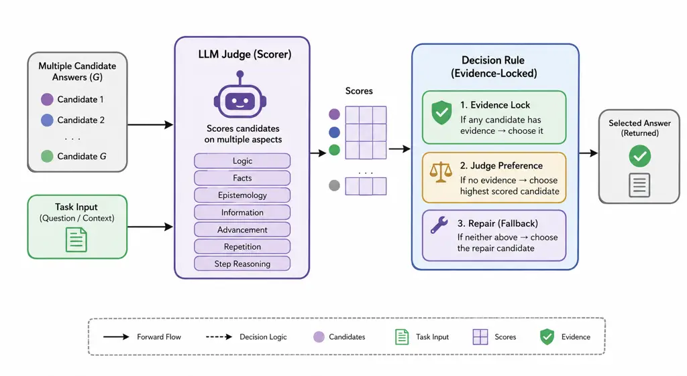

\workshoptitle

Can We Trust the Judge? Building Reliable Evaluation for Language Models

# When the Judge Should Not Decide: Evidence-Locked, Non-Compensatory Selection Bounds LLM-Judge Failure in Reasoning Pipelines

Yiyao Zhang^(a), Diksha Goel^(b), Hussain Ahmad^(a)  
^(a)School of Computer Science and Information Technology, Adelaide
University, Adelaide, SA, Australia  
^(b)CSIRO’s Data61, Clayton, VIC, Australia  
Author e-mail addresses: yiyao.zhang@student.adelaide.edu.au (Y. Zhang),
diksha.goel@csiro.au (D. Goel), hussain.ahmad@adelaide.edu.au (H. Ahmad)

###### Abstract

An LLM judge deployed inside a reasoning pipeline does not merely
measure quality , it decides which answer ships. We show that the cost
of that decision depends less on judge accuracy than on the _decision
rule_ the judge is embedded in. On frozen candidate pools from four GRPO
policies, an unconstrained scalar DeepSeek-R1-7B judge buys almost
nothing over answer-level majority vote ($`+1.0`$ pp on 500 GSM8K
questions, $`+0.34`$ EM on 300 HotpotQA questions), and on a frozen-rule
30-question confirmation split it is _10 points worse_ than majority , a
judge that destroys accuracy while scoring candidates confidently. We
then subordinate the same judge to Evidence-Locked Derive–Gate–Repair
(EL-DGR), a task-adaptive non-compensatory rule under which a judge
preference may override evidence-supported consensus only with an
extractive evidence certificate, and a repair only when neither
alternative is certified and the repair is. With no change to the judge,
the candidates, or the budget, EL-DGR reaches 58.2% on GSM8K (vs. 56.8%
judge, 55.8% majority, 55.4% first candidate) and 17.33 EM / 25.46 F1 on
HotpotQA (vs. 15.67/23.49, 15.33/23.19, 15.33/22.97), improving on
first-candidate GRPO by $`+2.8`$ pp (exact McNemar $`p{=}0.0026`$) and
$`+2.00`$ EM ($`p{=}0.070`$, borderline). A decision audit shows why:
EL-DGR overturns consensus on only 8 of 30 pilot questions and never
converts a correct consensus into an incorrect answer. We also report
what did _not_ work: the same seven-channel decomposition used as a
step-level gated training reward is null, and corrected channel-drop
ablations show no channel is individually necessary ($`p{=}1.0`$
throughout). The practitioner-facing finding is negative about judges
and positive about admissibility , bound the judge’s blast radius rather
than trying to make it accurate.

## 1 Introduction

LLM judges are increasingly load-bearing. They gate which of $`G`$
sampled candidates is returned, filter preference data, and supply
reward for RL post-training (Zheng et al., 2023; Ouyang and others,
2022; Shao and others, 2024; Lightman and others, 2023). In each case
the judge’s output is not a measurement that a human later reads , it is
a decision that the pipeline executes. The same is true wherever an LLM
score is wired into an operational loop: multi-LLM scoring and selection
for portfolio construction (Chen et al., 2025), agentic triage and
remediation of software vulnerabilities (Arifin et al., 2026), and
clinical question answering, where model-to-model disagreement is large
enough that the aggregation rule is itself a safety-relevant design
choice (Santhosh et al., 2026). Evaluation validity is therefore not a
property of the judge alone but of the judge _plus_ the rule that
consumes its score. A judge with a 60% pairwise agreement rate is
harmless if it can only break ties among already-admissible answers, and
dangerous if it can unilaterally overwrite a correct consensus.

Most work on judge reliability targets the first half of that pair ,
measuring and correcting the judge itself, through position-bias audits
and swap averaging (Wang et al., 2024), self-preference detection
(Panickssery et al., 2024), and the calibration and agreement protocols
surveyed by Gu et al. (2024). We study the second half: holding the
judge, candidate pool, prompts, and compute budget fixed and varying
only the decision rule isolates a quantity judge benchmarks do not
report , how much of a judge’s damage comes from its scores, and how
much from the authority it is granted.

#### The conflation a scalar judge cannot see.

Consider _“What is the capital of the country that hosted the 2022 FIFA
World Cup?”_ and the chain: (1) _The 2022 FIFA World Cup was hosted by
Qatar._ (2) _The capital of Qatar is Dubai._ (3) _Therefore the answer
is Dubai._ Step 3 follows validly from Step 2 and the chain reads
fluently, but Step 2 is contradicted by the first retrievable document.
A judge emitting one scalar for “quality” scores this chain highly,
because logical structure and evidential support have been collapsed
into a number that cannot represent their disagreement , and the failure
is silent, since the score carries no indication of _which_ dimension
produced it.

#### Two responses, one of which fails.

The obvious fix is to decompose: score the step on several explicit
dimensions and recombine. We implemented this as RA-MSD
(Retrieval-Augmented Multi-Signal Decision reward): seven step-level
channels with logic and factuality gating the weighted auxiliary score
(Section 4). As a _training_ signal this did not work , held-out
accuracy was indistinguishable from plain GRPO, and channel-drop
ablations show no channel is individually necessary (Section 7). We
report it because it localizes the problem: any scheme that eventually
recombines the channels into one scalar reinherits the conflation it was
built to remove.

The response that does work applies the decomposition elsewhere in the
pipeline: not as a summand, but as an _admissibility constraint_ on the
judge’s authority. Evidence-Locked Derive–Gate–Repair (EL-DGR)
partitions candidates into feasibility strata by a cheap certificate ,
an extractive occurrence check against retrieved evidence for retrieval
QA, an independently derived and re-checked numeric answer for
arithmetic. The judge’s scalar preference then ranks candidates _within_
a stratum but can never promote one across strata, so an
evidence-supported consensus answer cannot be displaced by a
higher-scoring but uncertified alternative.

#### Contributions.

1.  1.  A measurement of judge authority, not judge accuracy: on matched
        frozen pools, an unconstrained scalar judge is worth $`+1.0`$ pp
        (GSM8K, $`n{=}500`$) and $`+0.34`$ EM (HotpotQA, $`n{=}300`$) over
        majority vote, and $`-10.0`$ pp on a frozen-rule confirmation split
        ($`n{=}30`$), below even first-candidate selection (Section 6).
2.  2.  EL-DGR, a non-compensatory decision rule that subordinates the same
        judge to task-adaptive evidence certificates, improving every
        protocol-matched selector on both datasets with no extra candidates
        and $`\leq 5`$s/question of verifier latency (Sections 4–6).
3.  3.  A decision audit and a negative result: where EL-DGR’s gain comes
        from (8/30 consensus overrides, 0 correct-to-incorrect flips) and
        where the same decomposition fails as a training reward
        (Sections 6.3–7).

This is a post-training _selection_ study: we do not claim EL-DGR trains
a better policy, and absolute scores are not comparable to published
state of the art, since the candidate artifacts come from a 3B policy
under a constrained budget. All selectors consume the identical frozen
pool, so the paired contrasts are internally valid.

## 2 Related Work

#### Judge reliability.

The dominant framing treats evaluator quality as a measurement problem:
how well does the judge agree with humans, and which biases distort that
agreement? This line establishes pairwise-agreement benchmarks (Zheng et
al., 2023), documents position and ordering effects with swap-averaging
remedies (Wang et al., 2024), and shows that evaluators prefer their own
generations (Panickssery et al., 2024); Gu et al. (2024) survey the
resulting protocols. We take the judge’s error profile as given ,
neither debiasing nor fine-tuning it , and ask what the surrounding
decision rule does to the _consequences_ of those errors. That second
factor can dominate the first: below, identical scores swing from 10
points below majority vote to the best selector tested, purely through
admissibility. Constraining authority rather than improving the scorer
is the same move made by compositional shielding, where a verifier
decides which agent actions are admissible and the system abstains when
none is certified (Zhang et al., 2026b), and by uncertainty-gated
meta-reasoning, where a competence test decides whether an auxiliary
call is consulted at all (Zhang et al., 2026a). EL-DGR applies that
discipline to the narrower object of a judge’s selection authority over
a frozen pool.

#### Step supervision and grounded verification.

Process reward models supply dense local feedback but usually collapse
logical validity, factual support, and redundancy into one scalar
(Lightman and others, 2023; Wang and others, 2025). Retrieval-based
systems use external evidence during _generation_ (Lewis and others,
2020; Yao et al., 2023; Asai et al., 2024; Nakano et al., 2021), whereas
we use retrieval at scoring time. The grounding channel is closest to
claim-verification metrics such as FActScore (Min et al., 2023; Chern et
al., 2023), moved from offline evaluation into an online decision rule;
self-consistency (Wang et al., 2023) supplies our judge-free majority
baseline.

#### Positioning against recent multi-signal methods.

Table 5 states the comparison boundary against five 2025 systems that
also decompose or densify reasoning feedback (Table 5, Appendix A): DRM
(Wang et al., 2025), BCRL (Wu and others, 2025), GAR (Liu et al., 2025),
AutoDSPy (Azim et al., 2025), and SWiRL (Lu et al., 2025). Their
published scores are not copied into Table 2: model, retrieval corpus,
budget, and protocol all differ. Our matched baselines are therefore
_selectors_ that consume exactly the same frozen candidate pool , the
only class for which a paired test on a fixed pool is meaningful.

## 3 Setting: The Judge as a Selector

#### Judge conflation.

Let $`\mathcal{D}_{t}`$ be the documents retrieved for a reasoning step
$`s_{t}`$ and let $`f_{\mathrm{NLI}}(s_{t}\mid d)\in[-1,1]`$ map
contradiction to $`-1`$, neutral to $`0`$, and entailment to $`+1`$. A
step-level score $`R`$ suffers _$`(\eta,\delta)`$-conflation_, for
$`\delta\in(0,1]`$ and $`\eta<0`$, if some reachable step satisfies

```math
R(s_{t})\geq\delta\quad\text{and}\quad\max_{d\in\mathcal{D}_{t}}f_{\mathrm{NLI}}(s_{t}\mid d)\leq\eta. \tag{1}
```

The Qatar/Dubai step is a severe
$`(\eta{=}{-}0.8,\delta{=}0.85)`$-conflation. Closed-book judges admit
conflation by construction: nothing in their input distinguishes a
supported step from a fluent unsupported one. Outcome reward models
admit it at every intermediate step; rule-based format-plus-match
rewards admit it whenever surface form and evidence support decorrelate.

#### Selection protocol.

Fix a question $`Q`$, a frozen candidate set $`\{y_{1},\dots,y_{G}\}`$
with normalized answers $`a_{j}`$, and retrieved evidence $`E`$. Let
$`m`$ be the answer-level majority candidate (Wang et al., 2023), $`s`$
the candidate a scalar judge prefers, and $`r`$ an independently derived
and checked repair. A _selector_ maps $`(Q,\{y_{j}\},E)`$ to a returned
answer. Our baselines are first candidate (what a single-sample pipeline
returns), majority vote (judge-free consensus), and the scalar judge
$`s`$ (the judge given full authority); EL-DGR is a fourth selector
using the same $`s`$ and $`E`$. Because every selector is fed the
identical pool, differences measure decision rules, not generation.

## 4 Method

### 4.1 Seven diagnostic channels

Figure 1 shows the pipeline: a frozen candidate group and the task input
enter a judge that scores each candidate on several explicit aspects
rather than emitting one number, and the scores are consumed by a
non-compensatory rule that decides what is _admissible_ before deciding
what is best. Everything left of the decision rule is standard; the
contribution is the box on the right, and specifically the order in
which its cases are tried.



Figure 1: The judge-as-selector pipeline. Candidates and task input are
scored by an LLM judge on seven diagnostic aspects (Table 1) instead of
a single scalar; an evidence-locked rule then partitions candidates into
feasibility strata, the judge’s preference ranks candidates only within
a stratum, and a checked repair is admitted only when no certified
candidate exists. The exact ordering is Eq. (3).

RA-MSD replaces one scalar with seven channels, each scored in $`[0,1]`$
and each targeting a failure mode a scalar judge cannot separate
(Table 1). Grounding channels follow claim-verification metrics (Min et
al., 2023) but are computed online at reward time rather than offline.
Channels are _complementary_, not orthogonal: they target different
failures but are not assumed statistically independent. The point of the
decomposition is auditability , for any step, the seven values are a
trace of _why_ it scored as it did.

Two channels carry the structural load. Logical validity
$`R_{\mathrm{logic}}`$ asks whether a step is inferentially connected to
what precedes it, independently of whether its content is true , a step
can follow correctly from false premises, exactly the Qatar/Dubai
pattern. Factual grounding $`R_{\mathrm{fact}}`$ asks the complementary
question, whether the step survives contact with retrieved evidence, and
is the channel Eq. (1) makes necessary. Among the supporting five,
triangulation requires $`M{=}3`$ distinct corroborating sources so one
topically-overlapping document cannot certify a claim; adversarial
robustness compares $`R_{\mathrm{fact}}`$ against a counterfactually
perturbed step, catching lexical rather than semantic support; and
minimal sufficiency closes the reward-hacking route of padding a step
with unverifiable material.

| Channel                                         | Judge failure mode isolated       | Score                                                                          |
| ----------------------------------------------- | --------------------------------- | ------------------------------------------------------------------------------ | ----------- | --- |
| 1. Logical validity $`R_{\mathrm{logic}}`$      | Chain validity; non-sequiturs     | $`(1+f_{\text{NLI}}(s_{t}\mid Q,s_{<t}))/2`$                                   |
| 2. Factual grounding $`R_{\mathrm{fact}}`$      | Fluent but unsupported claims     | $`(1+\max_{d}f_{\text{NLI}}(s_{t}\mid d))/2`$                                  |
| 3. Epistemic calibration $`R_{\mathrm{epist}}`$ | Overconfidence; confident hedging | $`1-                                                                           | c*{t}-e*{t} | `$  |
| 4. Information gain $`R_{\mathrm{info}}`$       | Verbosity/length bias; stalling   | $`(\text{nov}_{t}+\text{prog}_{t})/2`$                                         |
| 5. Source triangulation $`R_{\mathrm{triang}}`$ | Single-source corroboration       | $`\min(n_{\text{indep}}/M,\,1)`$                                               |
| 6. Adversarial robustness $`R_{\mathrm{adv}}`$  | Surface vs. semantic sensitivity  | $`\sigma(R_{\mathrm{fact}}(s_{t})-R_{\mathrm{fact}}(s_{t}^{\text{counter}}))`$ |
| 7. Minimal sufficiency $`R_{\mathrm{min}}`$     | Padding with unverifiable claims  | $`\exp(-\beta\,n_{\text{new}})`$                                               |

Table 1: The seven RA-MSD channels, each computed from step text,
reasoning context, and retrieved evidence $`\mathcal{D}_{t}`$, and each
isolating a judge failure mode a single scalar cannot represent.
$`c_{t}`$: token confidence; $`e_{t}`$: evidence strength;
$`n_{\text{indep}}`$: distinct corroborating sources ($`M{=}3`$);
$`n_{\text{new}}`$: new unsupported claims ($`\beta{=}0.1`$).

### 4.2 Step-level gating (the variant that failed)

Let $`\bar{R}(\sigma_{t})=\sum_{i=1}^{7}w_{i}R_{i}(\sigma_{t})`$ with
$`\sum_{i}w_{i}=1`$ and $`\mathbf{w}=(.20,.20,.10,.15,.10,.15,.10)`$. To
block compensation, logic and factuality act as feasibility constraints
with threshold $`\tau=0.5`$:

```math
R_{\mathrm{step}}(\sigma_{t})=\begin{cases}\bar{R}(\sigma_{t}),&\min\{R_{\mathrm{logic}}(\sigma_{t}),R_{\mathrm{fact}}(\sigma_{t})\}\geq\tau,\\
\min\{R_{\mathrm{logic}}(\sigma_{t}),R_{\mathrm{fact}}(\sigma_{t})\},&\text{otherwise},\end{cases} \tag{2}
```

and the completion reward is
$`R_{\mathrm{total}}(y)=3.0\,R_{\mathrm{ORM}}+0.5\,R_{\mathrm{format}}+\frac{1}{n}\sum_{t}R_{\mathrm{step}}(\sigma_{t})`$,
optimized with TRL’s GRPOTrainer; baselines differ only in the reward
callback. Equation (2) prevents _step-level_ compensation but still
collapses all feasible channels into one number before the optimizer
sees them; empirically it is null (Section 7), motivating moving the
constraint from the summand to the decision.

### 4.3 Evidence-Locked Derive–Gate–Repair

EL-DGR makes evidence an _admissibility_ condition at the group level.
For retrieval QA define the strict extractive certificate
$`c(a,E)=\mathbf{1}[a\neq\varnothing\wedge a\ \text{occurs verbatim in}\ E]`$
and return

```math
a_{\mathrm{ret}}=\begin{cases}r,&c(r,E)=1,\ c(m,E)=c(s,E)=0,\\
s,&c(s,E)=1,\ c(m,E)=0,\\
m,&\text{otherwise}.\end{cases} \tag{3}
```

For arithmetic the constraint is executable rather than documentary: the
verifier must expose a derived numeric answer together with a
consistency check, and the branch returns the checked repair $`r`$ when
it parses and $`m`$ otherwise. The task-adaptive rule is

```math
a_{\textsc{EL-DGR}}=\begin{cases}a_{\mathrm{arith}},&\tau(Q)=\mathrm{arithmetic},\\
a_{\mathrm{ret}},&\tau(Q)=\mathrm{retrieval},\end{cases} \tag{4}
```

with $`\tau`$ fixed from the benchmark task type, never selected using
test answers.

#### Why the ordering is the whole method.

Equation (3) is deliberately asymmetric: consensus $`m`$ is the default
and is displaced only by a _certified_ alternative; the judge’s
preference $`s`$ is admitted only when certified _and_ consensus is not;
a repair $`r`$ only when neither $`m`$ nor $`s`$ is certified and $`r`$
itself is. Auxiliary scores , all seven channels and the judge’s scalar
, rank candidates only inside a feasibility stratum. This bounds the
judge’s error profile structurally: to cause a regression the judge must
prefer an answer that is both wrong and verbatim-present in the evidence
while the correct consensus is absent from it. The certificate is cheap
and conservative; it rejects valid paraphrases, which costs recall, and
the arithmetic branch sidesteps that by checking an executable
derivation instead of document occurrence. Eq. (3) also induces a
lexicographic group rank usable for training (certified $`\succ`$
uncertified; supported consensus breaks the first tie), but we evaluate
it only as a post-training selector here.

### 4.4 What the decomposition does and does not buy

Three component-level results characterize the design choices above. All
describe properties of the _score_; none is a policy-improvement
certificate, which matters because Section 7 reports a null training
result. For the pre-gate weighted score, bilinearity gives

```math
\mathrm{Var}(\bar{R})=\sum_{i=1}^{7}w_{i}^{2}\mathrm{Var}(R_{i})+2\!\!\sum_{1\leq i<j\leq 7}\!\!w_{i}w_{j}\mathrm{Cov}(R_{i},R_{j}), \tag{5}
```

so any pair with $`w_{i}w_{j}>0`$ and $`\mathrm{Cov}(R_{i},R_{j})<0`$
strictly lowers $`\mathrm{Var}(\bar{R})`$. The anti-conflation design
_manufactures_ that negative covariance: conflated steps in the sense of
Eq. (1) have high $`R_{\mathrm{logic}}`$ and low $`R_{\mathrm{fact}}`$
by construction, so channel disagreement on exactly the cases of
interest reduces rather than amplifies variance. Two caveats bound the
claim. The deployed gate is nonlinear, so Eq. (5) does _not_ describe
$`R_{\mathrm{step}}`$; and the induced score-function bound
$`\mathbb{E}\|g_{t}\|^{2}\leq G^{2}\mathbb{E}[\bar{R}^{2}]`$ (under a
$`G`$-Lipschitz log-policy) constrains one factor of a second moment,
not learning stability. Two smaller results follow similarly:
$`R_{\mathrm{fact}}`$ is a monotone transform of the statistic defining
the unsupported-step indicator $`U_{t}`$, so penalizing it penalizes
$`\mathbb{E}[U_{t}]`$ _conditional on the corpus_; and
$`R_{\mathrm{epist}}=1-|c_{t}-e_{t}|`$, an absolute-deviation loss,
elicits the median of the model’s evidence-strength belief rather than
its full distribution (Appendix B). Nothing here implies that optimizing
$`R_{\mathrm{step}}`$ improves a policy , the analysis characterizes a
random variable, while the empirical failure is about what a
_scalarized_ score transmits through GRPO. EL-DGR sidesteps that gap by
never scalarizing across feasibility strata.

## 5 Experimental Setup

#### Policies and data.

Base policy Qwen2.5-3B-Instruct with LoRA ($`r{=}16`$, $`\alpha{=}32`$
on q,k,v,o_proj; $`\approx`$4.7M trainable parameters), lr
$`2\times 10^{-5}`$, seed 42, 128 new tokens per completion. GSM8K
(Cobbe and others, 2021): train 500, evaluate 500 held out. HotpotQA
(Yang and others, 2018) distractor: train 500, evaluate 300 held out.
Retrieval is BM25 over the supporting-facts corpus ($`K{=}5`$) for
HotpotQA and over 1,000 training solutions for GSM8K, where grounding
therefore measures consistency with alternative valid solution paths
rather than external knowledge. NLI throughout is
cross-encoder/nli-deberta-v3-small.

#### Frozen candidate pool, judge, and statistics.

One pool per question is built from the four seed-42 full-budget policy
artifacts (GRPO, ORM, PRM, RA-MSD), so every selector sees exactly the
same candidates. The judge is a local deepseek-r1:7b via Ollama with
structured JSON output and hidden thinking disabled; it receives the
HotpotQA distractor context and _never_ the gold answer, and homogeneous
groups are returned without a judge call. We report percentile bootstrap
intervals over 20,000 paired question-level resamples and two-sided
exact McNemar tests; these quantify evaluation-set uncertainty only, not
training-seed variance. HotpotQA uses official normalization, reporting
EM and token F1.

## 6 Results

### 6.1 Matched full-budget selection

|                 |                   |                                 |                    |                          |                                 |                    |
| --------------- | ----------------- | ------------------------------- | ------------------ | ------------------------ | ------------------------------- | ------------------ |
|                 | GSM8K             |                                 |                    | HotpotQA                 |                                 |                    |
| Selector        | Acc. (%)          | $`\Delta`$ \[95% CI\]           | $`p`$              | EM / F1                  | $`\Delta`$ EM \[95% CI\]        | $`p`$              |
| First candidate | $`55.4`$          | $`\mathbf{+2.80}\,[1.20,4.60]`$ | $`\mathbf{.0026}`$ | $`15.33/22.97`$          | $`+2.00\,[0.33,4.00]`$          | $`.0703`$          |
| Majority vote   | $`55.8`$          | $`\mathbf{+2.40}\,[0.40,4.60]`$ | $`\mathbf{.0357}`$ | $`15.33/23.19`$          | $`\mathbf{+2.00}\,[0.67,3.67]`$ | $`\mathbf{.0313}`$ |
| Scalar judge    | $`56.8`$          | $`+1.40\,[-0.20,3.00]`$         | $`.1435`$          | $`15.67/23.49`$          | $`+1.67\,[0.33,3.33]`$          | $`.0625`$          |
| EL-DGR (ours)   | $`\mathbf{58.2}`$ | ,                               | ,                  | $`\mathbf{17.33/25.46}`$ | ,                               | ,                  |

Table 2: Full-budget matched post-training selection (GSM8K $`n{=}500`$,
HotpotQA $`n{=}300`$); all selectors consume the identical frozen
candidate pool. $`\Delta`$ is EL-DGR minus that row, in percentage
points with paired bootstrap 95% intervals (20,000 resamples); $`p`$ is
the two-sided exact McNemar test on EM. Bold $`\Delta`$ marks contrasts
resolved at $`\alpha{=}0.05`$.

Two things stand out in Table 2. First, full judge authority is worth
very little: the scalar judge beats judge-free majority vote by $`1.0`$
pp on GSM8K and $`0.34`$ EM on HotpotQA, well inside noise. Second, the
same judge under EL-DGR is worth substantially more: $`+2.4`$ pp and
$`+2.0`$ EM over majority, from identical scores and identical
candidates. The difference is attributable entirely to what the judge
may overrule.

On GSM8K the arithmetic derive–repair branch beats first-candidate by
$`2.8`$ pp with 17 paired wins and 3 losses (exact McNemar
$`p{=}0.0026`$); the contrast against the scalar judge is positive but
unresolved ($`+1.4`$ pp, $`[-0.2,3.0]`$, $`p{=}0.143`$). This supports
_executable task constraints_, not retrieval-channel importance , GSM8K
has no external facts to certify. On HotpotQA, evidence locking gains
$`2.0`$ EM and $`2.50`$ F1 with seven EM wins and one loss: the
bootstrap interval excludes zero, but the conservative exact test is
borderline ($`p{=}0.0703`$). F1 gains follow the same ordering. EL-DGR
is positive against all three matched selectors on both datasets, and
under-powered only against the stronger judge.

### 6.2 Frozen-rule confirmation: a judge that is worse than no judge

The rule in Section 4.3 was developed on three disjoint HotpotQA subsets
totalling 120 questions; we froze the prompts, certificate, and decision
order, then evaluated once on a fourth 30-question subset (seed 2029)
disjoint from all development data, with the corrected seed-42 GRPO
checkpoint producing the same four stochastic candidates (temperature
$`0.7`$, top-$`p`$ $`0.9`$) for every selector.

| Selector        | EM (%) | F1 (%) | $`\Delta`$ EM vs. EL-DGR \[95% CI\], exact $`p`$ |
| --------------- | ------ | ------ | ------------------------------------------------ |
| First candidate | 13.3   | 15.41  | $`-13.3\ [-26.7,-3.3]`$, $`p{=}0.125`$           |
| Majority vote   | 20.0   | 22.07  | $`-6.7\ [-16.7,0.0]`$, $`p{=}0.500`$             |
| Scalar judge    | 10.0   | 12.81  | $`-16.7\ [-30.0,-3.3]`$, $`p{=}0.0625`$          |
| EL-DGR          | 26.7   | 29.00  | ,                                                |

Table 3: Frozen-rule HotpotQA confirmation split ($`n{=}30`$), evaluated
once after the decision rule was locked. The unconstrained scalar judge
is the _worst_ selector tested , below majority vote and below taking
the first sample.

Table 3 is the result we consider most relevant to judge reliability.
Given full authority over a four-candidate pool, the scalar judge scores
$`10.0`$ EM , $`10`$ points below judge-free majority vote and $`3.3`$
below returning the first sample. It is not merely uninformative but
actively harmful, and harmful _confidently_, emitting well-formed JSON
preferences on every question. Restricted by Eq. (3) to certified
overrides, the same judge yields the best selector in the table
($`26.7`$ EM, $`+16.7`$ over its unconstrained self, exact
$`p{=}0.0625`$). Against majority the $`+6.7`$ pp difference is
unresolved at $`n{=}30`$ ($`p{=}0.5`$): a frozen-rule confirmation that
EL-DGR improved every tested selector on this split, not
population-level superiority.

### 6.3 Decision audit: where the gain comes from

On the 30 confirmation questions EL-DGR returns the majority answer on
22, the evidence-certified judge choice on 4, and an evidence-certified
repair on 4, changing no correct majority decision into an incorrect one
and adding two exact matches. This is the intended shape of a bounded
judge: it declines to act on 73% of questions, confining the judge’s
influence to cases where consensus carries no evidential support. An
unconstrained judge can convert correct consensus into error anywhere;
under Eq. (3) only where evidence contains the wrong answer and not the
right one.

#### Cost.

Excluding candidate generation, common to all selectors, the scalar and
derive–gate–repair calls average $`1.77`$s and $`2.91`$s per pilot
question ($`4.68`$s total); at full budget the pair averages $`1.36`$s
per GSM8K and $`4.99`$s per HotpotQA question, with verifier work
skipped entirely for 352 of 500 homogeneous GSM8K groups (172 of 300
HotpotQA groups are retrospectively homogeneous and skippable in
deployment). This is an inference-time accuracy–latency trade-off, not a
free lunch.

## 7 What Did Not Work

#### The gated reward is null.

Training with Eq. (2) did not improve held-out accuracy over plain GRPO.
Figure 2 shows why we decline to read anything into small differences
between reward methods: the on-policy trajectories (two sampled
completions per optimizer step, 10-step rolling mean) fluctuate
substantially on GSM8K , including a transient GRPO peak near step 72 ,
and are sparse and frequently zero on HotpotQA. No method separates
stably, which means final-checkpoint selection alone can manufacture or
erase a small reported gap. Under $`G{=}2`$ the z-normalized advantages
are also close to binary, which plausibly contributes.

Figure 2: Sampled-completion exact match during training (seed 42, two
candidates per step, 10-step rolling mean) , on-policy diagnostics,
_not_ held-out accuracy. No reward method separates stably, the basis
for treating the gated-reward comparison as null rather than as a small
win or loss.

#### The legacy ablation collapses.

Single-seed GSM8K channel-drop runs fall to $`44.6`$–$`47.4\%`$: not
just below full RA-MSD ($`55.6\%`$) but $`8`$–$`11`$ pp below GRPO,
which uses none of the channels ($`p<3.4\times 10^{-6}`$ on every row).
A collapse of this shape is incompatible with a marginal-importance
reading; zeroing and renormalizing one weight perturbed the trajectory
under a high-variance $`G{=}2`$ single-seed protocol. We retain it as a
diagnostic failure, not evidence that each channel matters.

#### Corrected ablations show no channel is necessary.

Rerunning every channel drop on HotpotQA with the corrected chat
template, $`G{=}4`$, and 30 optimizer steps (Table 4) removes the
pathology , all rows land between 18% and 20% EM , but supplies no
support for the decomposition either. Dropping logic or factuality
removes the channel from both the weighted score and the feasibility
gate; other drops zero and renormalize the corresponding auxiliary
weight. No drop differs from full gated RA-MSD by more than one example,
every exact paired McNemar test against full gives $`p{=}1.0`$, and the
factuality, information, and minimality drops are numerically _above_
full. We therefore cannot claim that any individual channel is
load-bearing at this budget; multi-seed, full-budget ablations remain
required.

| Config                     | EM/F1      | $`\Delta`$Full | $`\Delta`$GRPO | Config                      | EM/F1      | $`\Delta`$Full | $`\Delta`$GRPO |
| -------------------------- | ---------- | -------------- | -------------- | --------------------------- | ---------- | -------------- | -------------- |
| Full gated RA-MSD          | 19 / 28.62 | ,              | $`+1`$         | w/o $`R_{\mathrm{info}}`$   | 20 / 28.15 | $`+1`$         | $`+2`$         |
| GRPO                       | 18 / 27.99 | $`-1`$         | ,              | w/o $`R_{\mathrm{triang}}`$ | 19 / 27.46 | $`0`$          | $`+1`$         |
| w/o $`R_{\mathrm{logic}}`$ | 18 / 27.65 | $`-1`$         | $`0`$          | w/o $`R_{\mathrm{adv}}`$    | 18 / 26.53 | $`-1`$         | $`0`$          |
| w/o $`R_{\mathrm{fact}}`$  | 20 / 29.17 | $`+1`$         | $`+2`$         | w/o $`R_{\mathrm{min}}`$    | 20 / 28.85 | $`+1`$         | $`+2`$         |
| w/o $`R_{\mathrm{epist}}`$ | 18 / 27.01 | $`-1`$         | $`0`$          |                             |            |                |                |

Table 4: Corrected HotpotQA channel-drop pilot (seed 42, $`G{=}4`$, 30
steps, same 100 evaluation examples for all rows). Deltas are EM
percentage points. Every drop vs. full: exact McNemar $`p{=}1.0`$.

The boundary these draw is the point of the paper: the decomposition
earns nothing when summed into a training signal, and something when
used as a _feasibility partition_ , because a partition cannot be summed
away.

## 8 Discussion and Limitations

#### Bound the judge, don’t perfect it.

Tables 2 and 3 say that judge _accuracy_ and judge _usefulness_ are only
loosely coupled: the same deepseek-r1:7b scores are worth $`-10`$ pp or
$`+6.7`$ pp against majority vote depending only on the rule that
consumes them. Before investing in a better judge, ask what the current
one may overrule , a design parameter under direct control. A judge
deployment record should state (i) the default the judge must beat,
(ii) the certificate required to beat it, and (iii) the measured
override rate split by outcome; ours are 22/30 defaults preserved,
extractive occurrence, and 8 overrides with 0 correct-to-incorrect
flips.

#### Reading the null result correctly.

Section 7 is not evidence that decomposed evaluation does not help: the
decomposition failed where it was summed back into a scalar and
succeeded where it was used to partition. A judge pipeline that computes
seven diagnostics and then averages them has, from the optimizer’s
perspective, computed one number.

#### Limitations.

_Verifier-relative factuality:_ $`R_{\mathrm{fact}}`$ and the
certificate are defined against the retrieved corpus and NLI model, so
their errors propagate into the decision. _Certificate scope:_
exact-substring matching rejects supported paraphrases and does not
prove the extracted span satisfies the question’s relation. _Statistical
power:_ one training seed and one candidate pool; the HotpotQA
first-candidate contrast is borderline ($`p{=}0.0703`$) and $`n{=}30`$
cannot resolve the majority contrast. _Scale:_ one 3B policy, one 7B
judge, two benchmarks, with candidate artifacts inheriting a legacy
missing-chat-template defect, so absolute scores are not comparable to
published state of the art. _Responsible use:_ evidence-aware selection
is more persuasive and inherits corpus bias; high-stakes deployments
should retain evidence logs and human review.

## 9 Conclusion

On frozen candidate pools, an unconstrained scalar judge is worth
roughly nothing over majority vote at full budget and is the worst
selector we tested on a frozen-rule split; the identical judge under
task-adaptive evidence certificates is the best (58.2% on GSM8K,
$`p{=}0.0026`$; 17.33/25.46 EM/F1 on HotpotQA, $`p{=}0.0703`$) with zero
correct-to-incorrect flips. A judge’s error profile is bounded far more
cheaply by constraining what it may overrule than by improving what it
scores. Multi-seed, pre-registered replication is the next step.

## References

- Arifin et al. (2026) A. Arifin, H. Ahmad, Y. Zhang, and D. Goel
  AgenticVM: agentic AI for adaptive software vulnerability management.
  IEEE Software. Cited by: §1.
- Asai et al. (2024) A. Asai, Z. Wu, Y. Wang, A. Sil, and H. Hajishirzi
  Self-rag: learning to retrieve, generate, and critique through
  self-reflection. Note: arXiv:2310.11511 External Links: 2310.11511
  Cited by: §2.
- Azim et al. (2025) N. Azim, A. U. Alam, H. B. Omar, A. M. M. A.
  Jami, J. I. Ahad, M. R. Kabir, Md. I. Hossain, F. Rahman, M. R.
  Amin, S. Rahman, and N. Mohammed AutoDSPy: automating modular prompt
  design with reinforcement learning for small and large language
  models. In Proceedings of the 2025 Conference on Empirical Methods in
  Natural Language Processing: Industry Track, pp. 2881–2896. Cited by:
  Table 5, §2.
- Chen et al. (2025) K. Chen, H. Ahmad, D. Goel, and C. Szabo 3S-Trader:
  a multi-LLM framework for adaptive stock scoring, strategy, and
  selection in portfolio optimization. External Links: 2510.17393 Cited
  by: §1.
- Chern et al. (2023) I. Chern, S. Chern, S. Chen, W. Yuan, K. Feng, C.
  Zhou, J. He, G. Neubig, and P. Liu FacTool: factuality detection in
  generative ai — a tool augmented framework for multi-task and
  multi-domain scenarios. Note: arXiv:2307.13528 External Links:
  2307.13528 Cited by: §2.
- Cobbe et al. (2021) K. Cobbe et al. Training verifiers to solve math
  word problems. Note: arXiv:2110.14168 External Links: 2110.14168 Cited
  by: §5.
- Gu et al. (2024) J. Gu, X. Jiang, Z. Shi, H. Tan, X. Zhai, C. Xu, W.
  Li, Y. Shen, S. Ma, H. Liu, Y. Wang, and J. Guo A survey on
  LLM-as-a-judge. arXiv preprint arXiv:2411.15594. Cited by: §1, §2.
- Lewis et al. (2020) P. Lewis et al. Retrieval-augmented generation for
  knowledge-intensive nlp tasks. In Advances in Neural Information
  Processing Systems (NeurIPS), Vol. 33, Red Hook, NY, USA,
  pp. 9459–9474. Cited by: §2.
- Lightman et al. (2023) H. Lightman et al. Let’s verify step by step.
  Note: arXiv:2305.20050 External Links: 2305.20050 Cited by: §1, §2.
- Liu et al. (2025) Q. Liu, L. Ye, W. Ma, Y. Chou, and A. Yuille
  Generative adversarial reasoner: enhancing LLM reasoning with
  adversarial reinforcement learning. arXiv preprint arXiv:2512.16917.
  Cited by: Table 5, §2.
- Lu et al. (2025) Q. Lu, Z. Ma, S. Zhong, J. Wang, D. Yu, M. K. Ng,
  and P. Luo SWIRL: a staged workflow for interleaved reinforcement
  learning in mobile GUI control. arXiv preprint arXiv:2508.20018. Cited
  by: Table 5, §2.
- Min et al. (2023) S. Min, K. Krishna, X. Lyu, M. Lewis, W. Yih, P.
  Koh, M. Iyyer, L. Zettlemoyer, and H. Hajishirzi FActScore:
  fine-grained atomic evaluation of factual precision in long form text
  generation. In Proceedings of the 2023 Conference on Empirical Methods
  in Natural Language Processing, Singapore, pp. 12076–12100. External
  Links: [Document](https://dx.doi.org/10.18653/v1/2023.emnlp-main.741)
  Cited by: §2, §4.1.
- Nakano et al. (2021) R. Nakano, J. Hilton, S. Balaji, J. Wu, L.
  Ouyang, C. Kim, M. Nguyen, H. Jiang, P. Chen, Y. Xu, et al. WebGPT:
  browser-assisted question-answering with human feedback. Note:
  arXiv:2112.09332 External Links: 2112.09332 Cited by: §2.
- Ouyang et al. (2022) L. Ouyang et al. Training language models to
  follow instructions with human feedback. In Advances in Neural
  Information Processing Systems (NeurIPS), Vol. 35, Red Hook, NY, USA,
  pp. 27730–27744. Cited by: §1.
- Panickssery et al. (2024) A. Panickssery, S. R. Bowman, and S. Feng
  LLM evaluators recognize and favor their own generations. In Advances
  in Neural Information Processing Systems (NeurIPS), Note:
  arXiv:2404.13076 Cited by: §1, §2.
- Santhosh et al. (2026) S. Santhosh, F. Abbas, H. Ahmad, and C. Szabo
  Comparative analysis of large language models in healthcare. External
  Links: 2604.10316 Cited by: §1.
- Shao et al. (2024) Z. Shao et al. DeepSeekMath: pushing the limits of
  mathematical reasoning in open language models. Note: arXiv:2402.03300
  External Links: 2402.03300 Cited by: §1.
- Wang et al. (2025) B. Wang, W. Su, H. Tian, T. Yang, Y. Zhou, T.
  Yao, Q. Ai, and Y. Liu From \<Answer\> to \<Think\>: multidimensional
  supervision of reasoning process for LLM optimization. arXiv preprint
  arXiv:2510.11457. Cited by: Table 5, §2.
- Wang et al. (2024) P. Wang, L. Li, L. Chen, Z. Cai, D. Zhu, B. Lin, Y.
  Cao, Q. Liu, T. Liu, and Z. Sui Large language models are not fair
  evaluators. In Proceedings of the 62nd Annual Meeting of the
  Association for Computational Linguistics (ACL), Note:
  arXiv:2305.17926 Cited by: §1, §2.
- Wang et al. (2025) P. Wang et al. Math-shepherd: verify and reinforce
  llms step-by-step without human annotations. Note: arXiv:2312.08935
  External Links: 2312.08935 Cited by: §2.
- Wang et al. (2023) X. Wang, J. Wei, D. Schuurmans, Q. Le, E. Chi, S.
  Narang, A. Chowdhery, and D. Zhou Self-consistency improves chain of
  thought reasoning in language models. Note: arXiv:2203.11171 External
  Links: 2203.11171 Cited by: §2, §3.
- Wu et al. (2025) J. Wu et al. Mitigating LLM hallucination via
  behaviorally calibrated reinforcement learning. arXiv preprint
  arXiv:2512.19920. Cited by: Table 5, §2.
- Yang et al. (2018) Z. Yang et al. HotpotQA: a dataset for diverse,
  explainable multi-hop question answering. In Proceedings of the 2018
  Conference on Empirical Methods in Natural Language Processing,
  Brussels, Belgium, pp. 2369–2380. External Links:
  [Document](https://dx.doi.org/10.18653/v1/D18-1259) Cited by: §5.
- Yao et al. (2023) S. Yao, J. Zhao, D. Yu, N. Du, I. Shafran, K.
  Narasimhan, and Y. Cao ReAct: synergizing reasoning and acting in
  language models. Note: ICLR 2023; arXiv:2210.03629 External Links:
  2210.03629 Cited by: §2.
- Zhang et al. (2026a) Y. Zhang, D. Goel, and H. Ahmad Beyond reactive
  agents: uncertainty-gated meta-reasoning for tool-augmented
  decision-making. Note: Available at SSRN 6997675 Cited by: §2.
- Zhang et al. (2026b) Y. Zhang, D. Goel, and H. Ahmad VACS:
  value-aligned compositional shielding for multi-agent reasoning. Note:
  Available at SSRN 7115827 Cited by: §2.
- Zheng et al. (2023) L. Zheng, W. Chiang, Y. Sheng, S. Zhuang, Z.
  Wu, Y. Zhuang, Z. Lin, Z. Li, D. Li, E. P. Xing, H. Zhang, J. E.
  Gonzalez, and I. Stoica Judging LLM-as-a-judge with MT-Bench and
  chatbot arena. In Advances in Neural Information Processing Systems
  (NeurIPS) Datasets and Benchmarks Track, Note: arXiv:2306.05685 Cited
  by: §1, §2.

## Appendix A Positioning Against Recent Multi-Signal Methods

| Method                         | Year | Primary unit           | Main distinction                            | Matched here |
| ------------------------------ | ---- | ---------------------- | ------------------------------------------- | ------------ |
| DRM \[Wang et al., 2025\]      | 2025 | reasoning dimensions   | confidence/relevance/coherence reward       | ,            |
| BCRL \[Wu and others, 2025\]   | 2025 | calibrated response    | proper-score confidence and abstention      | ,            |
| GAR \[Liu et al., 2025\]       | 2025 | reasoner–discriminator | dense adversarial process feedback          | ,            |
| AutoDSPy \[Azim et al., 2025\] | 2025 | DSP pipeline           | RL-based modular pipeline selection         | ,            |
| SWiRL \[Lu et al., 2025\]      | 2025 | agent trajectory       | staged interleaved multi-agent RL           | ,            |
| EL-DGR (ours)                  | 2026 | candidate group        | task constraint plus evidence admissibility | yes          |

Table 5: Positioning against five recent multi-signal or
process-feedback methods. “Matched here” means rerun on our frozen
candidate pool; dashes mark systems whose published numbers are not
protocol-comparable and are therefore not reproduced as baselines.

## Appendix B Design Analysis: Derivations

#### Exact variance decomposition.

For $`\bar{R}=\sum_{i=1}^{7}w_{i}R_{i}`$ with $`\sum_{i}w_{i}=1`$,
$`w_{i}\geq 0`$, and $`R_{i}\in[0,1]`$,
$`\mathrm{Var}(\bar{R})=\sum_{i}w_{i}^{2}\mathrm{Var}(R_{i})+2\sum_{i<j}w_{i}w_{j}\mathrm{Cov}(R_{i},R_{j})`$
by bilinearity. Hence if any pair with $`w_{i}w_{j}>0`$ has
$`\mathrm{Cov}(R_{i},R_{j})<0`$ then
$`\mathrm{Var}(\bar{R})<\sum_{i}w_{i}^{2}\mathrm{Var}(R_{i})`$.
Conflated steps in the sense of Eq. (1) have high $`R_{\mathrm{logic}}`$
and low $`R_{\mathrm{fact}}`$ by construction, so the anti-conflation
design induces exactly the negative covariance that lowers pre-gate
variance. If additionally the log-policy score is uniformly
$`G`$-Lipschitz, then $`g_{t}=\phi_{t}\bar{R}(\sigma_{t})`$ satisfies
$`\mathbb{E}\|g_{t}\|^{2}\leq G^{2}\,\mathbb{E}[\bar{R}^{2}]`$, so
reducing $`\mathrm{Var}(\bar{R})`$ tightens one factor of the
score-function second-moment bound. This is a bound on an estimator, not
a learning-stability guarantee, and it does not apply to the gated
reward $`R_{\mathrm{step}}`$, which is nonlinear.

#### Unsupported-step rate.

With
$`U_{t}=\mathbf{1}[\max_{d\in\mathcal{D}_{t}}f_{\mathrm{NLI}}(s_{t}\mid d)\leq\eta]`$,
the factual-grounding channel is a monotone transform of the same
statistic, $`R_{\mathrm{fact}}=(1+\max_{d}f_{\mathrm{NLI}})/2`$, so
penalizing $`R_{\mathrm{fact}}`$ directly penalizes
$`\mathbb{E}[U_{t}]`$ conditional on the corpus. The bound is
corpus-relative: it says nothing about steps whose support is absent
from $`\mathcal{D}_{t}`$.

#### Calibration channel.

$`R_{\mathrm{epist}}=1-|c_{t}-e_{t}|`$ is an absolute-deviation loss and
therefore elicits the median of the model’s evidence-strength belief
rather than its full predictive distribution. A proper scoring rule
would elicit more, at the cost of a channel that is no longer bounded in
$`[0,1]`$ by construction.

## Appendix C Reproducibility

Code, per-question predictions for all four selectors on both datasets,
verifier prompts, timing logs, and the bootstrap/McNemar scripts are
released with the paper. All reported runs use seed 42 for training and
seed 2029 for the confirmation split; the frozen candidate pool is
distributed so that the selector comparison can be rerun without GPU
access.
