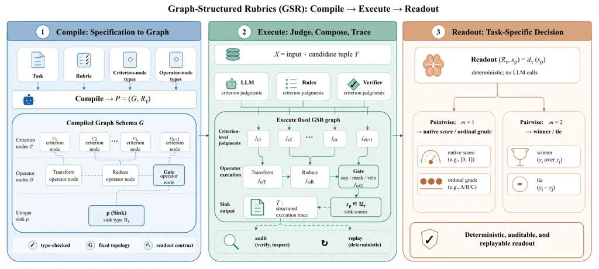
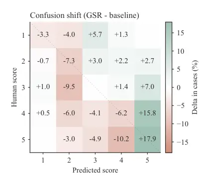

# Graph-Structured Rubrics: Compiling Rubrics into Typed Evaluation Graphs for LLM Judges

Xi Chen    Jie Mu    Mo Xuan    Qun Shao Affiliation: Ant Group
Email: [ct539484@antgroup.com](mailto:)

August 2026

###### Abstract

Rubric-based evaluators commonly treat rubrics as prompt context or flat
criteria: they specify what to judge but leave criterion composition
implicit, even when natural-language rules state it. We introduce
_Graph-Structured Rubrics_ (GSR), which compiles a rubric into a
response-independent typed evaluation graph before observing responses.
Criterion nodes elicit judgments; transformation, reduction, and gating
operators compose them through named ports; and a task-specific output
mapping, termed Readout, converts the unique sink into a score or
preference. Compilation rejects malformed or type-incompatible graphs.
Pointwise evaluation judges rubric dimensions separately before graph
aggregation; pairwise evaluation reuses the graph with one judgment for
each candidate under every criterion. Under GPT-OSS-120B, GSR improves
exact score agreement by 0.62–6.75 percentage points over
Prometheus-style scoring on four pointwise datasets and achieves the
numerically highest end-to-end pairwise accuracy on two preference
benchmarks under native tie and abstention policies.

   

An arXiv Preprint

|     |
| --- |
|     |

## Introduction

Rubrics have become a common interface for LLM evaluation across direct
scoring and pairwise comparison, yet many systems still treat them as
prompt context or flat collections of criteria. Such representations
specify what to judge but not how criterion-level judgments should
interact to produce a score or preference. LLM-based judges make such
evaluation scalable and can achieve substantial agreement with human
judgments on open-ended tasks (Zheng et al., 2023; Kim et al., 2024b).

Figure 1: Natural-language rules leave hierarchical composition implicit
within model inference; GSR routes criterion-level judgments through an
explicit graph before producing the final score or preference.

As evaluated tasks become more heterogeneous, however, high aggregate
agreement with human ratings does not guarantee procedural stability.
Prior studies document sensitivity to candidate order, output length,
evaluator familiarity, anchoring, and even confusion between named
quality criteria (Wang et al., 2023; Dubois et al., 2024; Stureborg et
al., 2024; Hu et al., 2024). Rubrics address the criterion-specification
component of this problem by making relevant requirements explicit.
Accordingly, recent benchmarks and evaluators have adopted
human-authored criteria, generated rubrics, or instance-specific
checklists (Zhou et al., 2026; Liu et al., 2025; Lee et al., 2025; Cook
et al., 2024). Because rubric-based judgments increasingly inform
benchmark reporting, reward-model data construction, and model-selection
workflows, the way a rubric is composed affects not only accuracy but
also reproducibility and auditability.

An important gap remains after criterion-level judgments have been
produced: their composition can still be implicit and unauditable.
Writing rules in the prompt does not remove this problem because the LLM
must execute them internally. Leaving these rules inside model inference
creates opportunities for applicability checks to be omitted, reductions
or gates to be applied out of order, or score caps to be enforced
inconsistently. Moreover, rubric rules are often hierarchical: criterion
judgments feed intermediate reductions, whose outputs feed gates,
constraints, and final Readout. This hierarchy defines an execution
policy rather than additional criteria. To make that policy explicit,
GSR represents it as a directed acyclic graph and executes deterministic
operators in topological order, exposing the decision path shown in
Figure 1.

GSR therefore compiles each rubric before observing candidate responses.
The program contains criterion nodes, deterministic operators, named
ports, and a unique sink; compilation rejects cycles, missing ports,
arity violations, and type-incompatible routes. At evaluation time,
language models interpret semantic criteria, while the fixed graph
controls routing, aggregation, non-compensatory constraints, and Readout
in topological order. The policy is inspectable, and its execution is
replayable from an audit trace that records the decision path.

We evaluate the framework in pointwise and pairwise settings. The
experiments test whether compiled rubric graphs yield higher agreement
than strong baselines, whether the gains transfer across judge
backbones, and whether they arise from graph composition rather than
direct scoring or flat aggregation. Our contributions are:

- •
  To our knowledge, we introduce the first response-independent
  compilation framework that turns a rubric specification into a typed
  cross-criterion evaluation DAG with rubric-derived criterion nodes,
  operator nodes, named ports, and a unique sink.
- •
  We define execution semantics in which criterion-level judgments flow
  through deterministic Transform, Reduce, and Gate operators in
  topological order. Static validation rejects malformed graphs.
  Task-specific Readout produces pointwise or pairwise decisions, while
  audit traces enable deterministic replay of composition.
- •
  We demonstrate the unified interface across four pointwise datasets
  and two pairwise preference benchmarks. Under GPT-OSS-120B, GSR
  achieves the numerically highest exact score agreement on all four
  pointwise datasets and the numerically highest end-to-end pairwise
  accuracy on both pairwise datasets; controlled ablations further show
  higher exact score agreement than direct scoring and weighted
  aggregation on every pointwise dataset.

## Related Work

#### From holistic judges to explicit criteria.

LLM judges produce direct scores or pairwise preferences, but their
outputs are sensitive to candidate position, response length, evaluator
familiarity, distribution shift, and anchoring (Zheng et al., 2023; Wang
et al., 2023; Dubois et al., 2024; Stureborg et al., 2024). G-Eval adds
structured reasoning (Liu et al., 2023), JudgeLM uses swap and reference
augmentation (Zhu et al., 2025), and Prometheus models support custom
criteria in direct and pairwise assessment (Kim et al., 2024a; Kim et
al., 2024b). Debate and judge panels introduce deliberation or evaluator
diversity (Chan et al., 2023; Verga et al., 2024). Other work exposes
finer-grained criteria: BiGGen uses instance criteria (Kim et al.,
2025); CheckEval, TICK, and RocketEval use checklist questions (Lee et
al., 2025; Cook et al., 2024; Wei et al., 2025); FLASK uses skill scores
(Ye et al., 2024); and LMUnit treats criteria as unit tests (Saad-Falcon
et al., 2025). These approaches improve judgment production or
decomposition, but generally leave cross-criterion composition in
prompts or fixed aggregation rather than an explicit typed program.

#### Rubric construction, aggregation, and calibration.

EvalLM supports application-specific criteria, while AutoCalibrate
generates and selects criteria against human labels (Kim et al., 2024c;
Liu et al., 2024). LLM-Rubric learns to aggregate multidimensional
rubric outputs into calibrated predictions, whereas Praetor supports
instance-level criteria in both pointwise and pairwise settings (Hashemi
et al., 2024; Leng et al., 2025). RubricBench, OpenRubrics, and
recursive rubric-refinement methods study rubric construction (Zhou et
al., 2026; Liu et al., 2025; Shen et al., 2026), while Autorubric
unifies criterion design, judge ensembles, aggregation, and calibration
practices (Rao and Callison-Burch, 2026). These works address criterion
selection, judgment elicitation, or score calibration. GSR assumes an
available rubric and gives executable semantics to its cross-criterion
composition.

#### Graphs in evaluation and the remaining gap.

Graph structures have been used in evaluation, but at different
abstraction boundaries. DAGMetric requires manual authoring of decision
DAGs (Confident AI, 2026); AgentEval derives graphs from agent execution
traces rather than rubric criteria (Guo et al., 2026); and OpenRS
instantiates response-adaptive pairwise meta-rubrics and externally
aggregates criterion-wise preferences (Jia et al., 2026). RULERS instead
compiles criteria into locked executable specifications with
deterministic evidence verification and post-hoc score calibration (Hong
et al., 2026). None of these systems defines the specific abstraction
studied here: a rubric compiled, before observing candidate responses,
into a response-independent typed cross-criterion graph shared by
pointwise and pairwise evaluation. GSR addresses this gap by compiling
operators and a task-specific Readout, statically validating the
resulting graph, and making its execution replayable.

## Graph-Structured Rubrics

GSR turns a hierarchical rubric policy into a graph program. Criterion
nodes produce semantic judgments, operator nodes encode reductions and
constraints, and edges fix their dependencies. Deterministic topological
execution applies the declared rules in order rather than asking the LLM
to reconstruct that order during every decision. For example, factuality
and completeness can be reduced before a safety flag gates the result,
preventing later positive evidence from overriding the cap. Pointwise
scoring and pairwise preference share these node and operator semantics
and differ only in task-specific Readout.



Figure 2: GSR procedure. Compile fixes the graph before observing
candidate responses; Execute runs criterion and operator nodes; Readout
maps sink scores to the task output.

#### Problem setup.

GSR fixes an instance-specific composition policy before observing the
responses it will judge. The compile-time specification
$`S=(x,r,z,\tau)`$ contains the task input $`x`$, rubric $`r`$, optional
fixed reference material $`z`$, and task contract $`\tau`$, but excludes
candidate responses and gold labels. The contract fixes the number of
candidates $`m`$, a closed internal quality-score interval
$`\mathcal{U}_{\tau}\subset\mathbb{R}`$, output space
$`\mathcal{A}_{\tau}`$, and quantization and tie policies. The execution
stage subsequently receives $`X=(x,Y)`$, where
$`Y=(y_{1},\ldots,y_{m})`$ is an ordered candidate tuple with stable
identifiers. This partition is enforced at the invocation boundary:
compilation cannot access $`Y`$, while execution cannot alter the
accepted program.

#### Evaluation procedure.

GSR has a three-stage interface. Given a graph language $`\Lambda`$,
Compile turns $`S`$ into a response-independent program,

```math
P=\mathrm{Compile}(S;\Lambda)=(G,R_{\tau}), \tag{1}
```

where $`G`$ is the rubric graph and $`R_{\tau}`$ is a readout contract.
Execute applies the program to $`X`$ and returns the score vector
produced at the unique sink and an audit trace $`T`$,

```math
\displaystyle(\mathbf{s}_{\rho},T) \displaystyle=\mathrm{Execute}(P,X), \tag{2}
```

```math
\displaystyle\mathbf{s}_{\rho} \displaystyle=\bigl((\operatorname{id}(y_{i}),s_{\rho,i})\bigr)_{i=1}^{m},
```

```math
\displaystyle s_{\rho,i} \displaystyle\in\mathcal{U}_{\tau}.
```

Readout then returns

```math
o=\mathrm{Readout}(R_{\tau},\mathbf{s}_{\rho})=d_{\tau}(\mathbf{s}_{\rho}). \tag{3}
```

### Compile: From a Rubric to a Graph Program

Compile receives the response-independent specification $`S`$ and a
graph language

```math
\Lambda=(\mathbb{T},\mathbb{F},\mathbb{H},\Pi), \tag{4}
```

where $`\mathbb{T}`$ gives the value types, $`\mathbb{F}`$ gives the
available graph operators, $`\mathbb{H}`$ gives the available
criterion-level judgment procedures, and $`\Pi`$ gives task defaults and
composition policies. This graph language fixes what kinds of
criterion-level judgments can be produced and how they can be composed.
The compiler therefore receives the rubric and the available graph
language, but not the candidate responses or gold labels.

#### LLM-guided graph synthesis and repair.

Compile uses an LLM to synthesize a declarative program from $`S`$ under
$`\Lambda`$. The model is restricted to catalogued types, criterion
procedures, and operators, and emits nodes, named-port edges,
parameters, and $`R_{\tau}`$. A deterministic validator $`V`$ checks
JSON parsing, acyclicity, sink reachability, ports, arity, routing type
compatibility, and readout compatibility. Writing $`\delta^{(t)}`$ for
its structured diagnostics, compilation follows

```math
\displaystyle P^{(0)} \displaystyle=C_{\phi}(S,\Lambda), \tag{5}
```

```math
\displaystyle(b^{(t)},\delta^{(t)}) \displaystyle=V(P^{(t)}),
```

```math
\displaystyle P^{(t+1)} \displaystyle=C_{\phi}(S,\Lambda,P^{(t)},\delta^{(t)})\quad\text{if }b^{(t)}=0.
```

The first structurally valid program with $`b^{(t)}=1`$ is accepted; no
manual semantic screening or selection among valid candidates is
performed. If none is valid after the fixed repair budget
$`K_{\mathrm{rep}}`$, the instance is recorded as a compilation failure.
Validation checks that the graph is executable and type-consistent;
whether the accepted graph captures the intended meaning of the
natural-language rubric is tested through downstream agreement. Compiler
and judge can use the same underlying LLM, as in our experiments, but
they are separate invocations with different inputs: the compiler
receives no candidate response, whereas the judge receives the frozen
program and candidates during Execute.

The output of Compile is a program $`P=(G,R_{\tau})`$. The graph

```math
\displaystyle G \displaystyle=(\mathcal{V},\mathcal{E},\rho), \tag{6}
```

```math
\displaystyle\mathcal{V} \displaystyle=\mathcal{C}\mathbin{\dot{\cup}}\mathcal{O},\qquad\rho\in\mathcal{V},
```

```math
\displaystyle\mathcal{E} \displaystyle\subseteq\mathcal{V}\times\mathcal{P}\times\mathbb{N}_{+}\times\mathcal{O}.
```

contains criterion nodes $`\mathcal{C}`$, operator nodes
$`\mathcal{O}`$, type-checked routing edges $`\mathcal{E}`$, port names
$`\mathcal{P}`$, and a unique sink $`\rho`$. An edge
$`(u,p,\ell,\omega)`$ routes the judgment produced by predecessor node
$`u`$ to slot $`\ell`$ of named port $`p`$ of operator node $`\omega`$.
The graph permits criterion-to-operator and operator-to-operator edges;
criterion nodes have no incoming judgment-flow edges. We write
$`v\leadsto\rho`$ when node $`v\in\mathcal{V}`$ has a directed path to
the sink $`\rho`$, and require this condition for every node so that no
criterion-level judgment is unreachable. Each node declares an output
type, each operator port declares an input type, and compilation rejects
cycles, missing ports, arity mismatches, and type-incompatible routes.

Criterion-node semantics are task-invariant. Compile instantiates one
node for each semantic criterion selected from the rubric, and every
criterion node returns candidate-aligned judgments for all $`m`$
candidates. Pointwise evaluation sets $`m=1`$, whereas pairwise
evaluation sets $`m=2`$. Here $`m`$ counts candidates, not criteria:
either regime may contain multiple criterion nodes corresponding to
different rubric dimensions. In both regimes, criterion nodes represent
rubric dimensions rather than native task labels; their differences are
confined to candidate arity, the task contract, and Readout.

Within $`\mathbb{F}`$, operators are grouped by the kind of composition
they perform. Let $`\mathcal{J}`$ denote judgment spaces and
$`\mathcal{B}`$ Boolean flags: a Transform operator maps
$`\mathcal{J}_{a}`$ to $`\mathcal{J}_{b}`$, a Reduce operator maps
$`\mathcal{J}_{1}\times\cdots\times\mathcal{J}_{k}`$ to $`\mathcal{J}`$,
and a Gate operator maps $`\mathcal{J}\times\mathcal{B}`$ to
$`\mathcal{J}`$ by applying a declared cap, mask, or veto. Gate is
therefore an operator node in $`\mathcal{O}`$, not an additional node
category beyond $`\mathcal{C}`$ and $`\mathcal{O}`$.

Compile also attaches a readout contract

```math
\displaystyle R_{\tau} \displaystyle=(\operatorname{Align}_{m}(\mathcal{U}_{\tau}),\mathcal{A}_{\tau},d_{\tau}), \tag{7}
```

```math
\displaystyle d_{\tau} \displaystyle:\operatorname{Align}_{m}(\mathcal{U}_{\tau})\rightarrow\mathcal{A}_{\tau}.
```

Here $`\operatorname{Align}_{m}(\mathcal{U}_{\tau})`$ denotes the
arity-$`m`$ schema for candidate-aligned quality scores; for an
evaluated instance it is instantiated as
$`((\operatorname{id}(y_{i}),s_{\rho,i}))_{i=1}^{m}`$ with
$`s_{\rho,i}\in\mathcal{U}_{\tau}`$. The map $`d_{\tau}`$ alone performs
native-scale conversion, output quantization, and tie or forced-choice
behavior. For pairwise tasks, the annotated label belongs to
$`\mathcal{A}_{\tau}`$ (for example, a winner or tie); the per-candidate
scores are internal sink values produced by the graph. The sink type
must be an aligned sequence of $`m`$ quality scores in
$`\mathcal{U}_{\tau}`$. The experiments instantiate this shared contract
for pointwise scoring and pairwise preference.

### Execute: Evaluate and Compose Judgments

Execute applies the fixed graph to $`X`$ without changing its nodes,
edges, or parameters. Each criterion node $`c\in\mathcal{C}`$ produces a
candidate-aligned judgment vector

```math
\mathbf{j}_{c}=\bigl((\operatorname{id}(y_{i}),j_{c,i})\bigr)_{i=1}^{m},\qquad j_{c,i}\in\mathsf{Judg}(c). \tag{8}
```

Here $`\mathsf{Judg}(c)`$ is the judgment space declared for criterion
$`c`$. The candidate-aligned vector can be produced by evaluating
candidates separately or jointly, but it must contain exactly one
criterion-level judgment for each candidate identifier. A criterion node
never receives another node’s judgment. Criterion procedures include LLM
calls, rule checks, verifiers, or human annotations, but their outputs
must conform to the criterion node’s declared judgment type.

After the criterion-level judgments are available, operators run in a
topological order of $`G`$. Each operator declares named input ports.
For a port $`p`$ of operator $`\omega`$, let
$`\operatorname{Pred}(\omega,p)=(v_{1},\ldots,v_{k})`$ denote the
predecessor nodes whose edges target $`p`$, ordered by their edge slots.
The input received at that port is

```math
\mathbf{j}^{\mathrm{in}}_{\omega,p}=(\mathbf{j}_{v_{1}},\ldots,\mathbf{j}_{v_{k}}).
```

The operator then produces

```math
\mathbf{j}_{\omega}=f_{\omega}\!\left(\bigl(p\mapsto\mathbf{j}^{\mathrm{in}}_{\omega,p}\bigr)_{p\in\operatorname{ports}(\omega)};\theta_{\omega}\right). \tag{9}
```

The deterministic function $`f_{\omega}`$ receives a named, slot-ordered
sequence at each port and applies the fixed parameters
$`\theta_{\omega}`$; positional parameters are validated against the
corresponding sequence length. For instance, a Gate:Cap reads a quality
judgment through base and a Boolean failure judgment through trigger;
the edge itself carries no cap semantics.

Let $`\mathbf{j}_{v}`$ denote the candidate-aligned output vector of
node $`v`$. Operators preserve candidate identifiers, and the terminal
node is type-checked to return aligned quality scores. Thus all
graph-level reductions and gates have been applied when the sink scores
are produced:

```math
\mathbf{s}_{\rho}=\mathbf{j}_{\rho}=\bigl((\operatorname{id}(y_{i}),s_{\rho,i})\bigr)_{i=1}^{m},\quad s_{\rho,i}\in\mathcal{U}_{\tau}. \tag{10}
```

Each $`s_{\rho,i}`$ is the final internal quality score for $`y_{i}`$.
Under the fixed topological order, the audit trace records node
identifiers, slot-ordered inputs, outputs, operator parameters, and
evidence references so that the composition stage can be replayed from
recorded criterion-level judgments.

### Readout: Decide from Candidate Scores

Readout is fixed during Compile and makes no additional LLM call. It
receives
$`\mathbf{s}_{\rho}=((\operatorname{id}(y_{i}),s_{\rho,i}))_{i=1}^{m}`$,
checks identifier coverage, finiteness, and domain membership, and
applies the deterministic task policy in $`R_{\tau}`$:

```math
o=d_{\tau}(\mathbf{s}_{\rho}). \tag{11}
```

For pointwise evaluation ($`m=1`$), $`d_{\tau}`$ returns the native
score or ordinal label obtained by the deterministic conversion and
quantization policies in $`\tau`$. For pairwise evaluation ($`m=2`$),

```math
d_{\tau}(\mathbf{s}_{\rho})=\begin{cases}\operatorname{id}(y_{1}),&s_{\rho,1}>s_{\rho,2}+\epsilon_{\tau},\\
\operatorname{id}(y_{2}),&s_{\rho,2}>s_{\rho,1}+\epsilon_{\tau},\\
\operatorname{resolve}_{\tau}(\operatorname{id}(y_{1}),\operatorname{id}(y_{2})),&|s_{\rho,1}-s_{\rho,2}|\leq\epsilon_{\tau},\end{cases} \tag{12}
```

where $`\epsilon_{\tau}\geq 0`$ and $`\operatorname{resolve}_{\tau}`$
are fixed by the task contract. The latter returns a tie, an abstention,
or a candidate selected by a declared deterministic forced-choice rule.
Scores are comparable only within the same program and task contract;
GSR does not assume calibration across rubrics or judge models.

Returning to the factuality–completeness–safety example, the graph
computes one quality score for each candidate after applying the safety
cap, if any. In a pointwise task, the same criterion graph emits one
aligned sink score and Readout quantizes it onto the native rubric
scale. In a pairwise task, it emits two aligned sink scores and Readout
compares them under the task’s tie policy. Thus pointwise scoring and
pairwise preference share criterion-node and operator semantics; they
differ only in candidate arity, task contract, and Readout.
Criterion-level judgments remain model-dependent, but their routing,
composition, gates, and final mapping are statically checked and
replayable.

## Experiments

### Experimental Setup

#### Evaluation questions.

We evaluate ordinal pointwise scoring and A/B preference through the
same criterion graph. Pointwise judging produces one judgment per rubric
dimension and a native 1–5 score; pairwise judging produces two
candidate-aligned judgments per criterion before preference Readout.
Only candidate arity and task output change.

#### Datasets and baselines.

Pointwise datasets are UltraFeedback–TruthfulQA (3,244 responses) (Cui
et al., 2024; Lin et al., 2022), HelpSteer2 validation (1,038) (Wang et
al., 2024), SummEval Relevance (1,600) (Fabbri et al., 2021), and BiGGen
(2,776) (Kim et al., 2025); their heterogeneous 1–5 targets are termed
_reference scores_. Pairwise datasets are MT-Bench (2,575 labeled pairs)
(Zheng et al., 2023) and RubricBench (1,147) (Zhou et al., 2026). Unless
noted, GPT-OSS-120B is the judge. Pointwise baselines are controlled,
same-backbone adaptations of Prometheus (Kim et al., 2024b), G-Eval (Liu
et al., 2023), and FLASK (Ye et al., 2024); pairwise baselines add
OpenRubric (Liu et al., 2025), TICK (Cook et al., 2024), and CheckEval
(Lee et al., 2025). Evaluation criteria are taken from public benchmark
annotations or task definitions. In pointwise experiments, each
benchmark is judged with its corresponding task criterion or released
scoring rubric; in pairwise experiments, MT-Bench uses a shared
preference rubric and RubricBench uses released instance-level checklist
rubrics. For each benchmark, GSR and the baselines receive the same
available task information, including the input, candidate response(s),
and criterion/rubric text, with fixed reference material when provided.
Gold scores and preference labels are reserved for metric computation,
and baselines retain their native prompting and output formats.

| Dataset            | Method           | Exact Agreement $`\uparrow`$ | Within-1 Accuracy $`\uparrow`$ | MAE $`\downarrow`$ | Pearson $`\uparrow`$ | Spearman $`\uparrow`$ |
| ------------------ | ---------------- | ---------------------------- | ------------------------------ | ------------------ | -------------------- | --------------------- |
| UF–TruthfulQA      | Prometheus-style | 43.30                        | 73.50                          | 0.928              | 0.637                | 0.623                 |
|                    | G-Eval-style     | 44.61                        | 74.98                          | 0.881              | 0.593                | 0.565                 |
|                    | FLASK-style      | 39.02                        | 68.39                          | 1.062              | 0.661                | 0.669                 |
|                    | GSR (Ours)       | 50.05 +5.44                  | 78.75 +3.77                    | 0.779 +0.102       | 0.678 +0.017         | 0.659                 |
| HelpSteer2         | Prometheus-style | 38.97                        | 77.38                          | 0.928              | 0.514                | 0.444                 |
|                    | G-Eval-style     | 35.16                        | 77.14                          | 0.976              | 0.504                | 0.438                 |
|                    | FLASK-style      | 35.81                        | 75.48                          | 0.978              | 0.468                | 0.405                 |
|                    | GSR (Ours)       | 43.75 +4.78                  | 80.81 +3.43                    | 0.845 +0.083       | 0.514                | 0.427                 |
| SummEval Relevance | Prometheus-style | 32.70                        | 83.73                          | 0.846              | 0.441                | 0.424                 |
|                    | G-Eval-style     | 28.28                        | 79.04                          | 0.942              | 0.429                | 0.405                 |
|                    | FLASK-style      | 28.83                        | 72.55                          | 1.068              | 0.301                | 0.286                 |
|                    | GSR (Ours)       | 33.32 +0.62                  | 86.75 +3.02                    | 0.804 +0.042       | 0.392                | 0.386                 |
| BiGGen             | Prometheus-style | 43.52                        | 79.73                          | 0.854              | 0.611                | 0.588                 |
|                    | G-Eval-style     | 40.83                        | 79.12                          | 0.890              | 0.589                | 0.565                 |
|                    | FLASK-style      | 38.27                        | 79.93                          | 0.891              | 0.570                | 0.546                 |
|                    | GSR (Ours)       | 44.51 +0.99                  | 80.49 +0.56                    | 0.833 +0.021       | 0.618 +0.007         | 0.591 +0.003          |

Table 1: Main pointwise comparison under GPT-OSS-120B, averaged over six
runs (green: improvement vs. the best baseline for each metric).



Figure 3: Six-run pointwise error geometry versus the strongest Exact
Agreement baseline: pooled residuals (left) and mean row-normalized
confusion shift (right). The baseline is G-Eval-style for UF–TruthfulQA
and Prometheus-style otherwise.

| Dataset     | Method     | Pairwise Accuracy $`\uparrow`$ | Valid Accuracy $`\uparrow`$ | Coverage $`\uparrow`$ | Invalid Rate $`\downarrow`$ | Tie Rate $`\downarrow`$ |
| ----------- | ---------- | ------------------------------ | --------------------------- | --------------------- | --------------------------- | ----------------------- |
| MT-Bench    | OpenRubric | 79.86                          | 79.86                       | 100.00                | 0.00                        | 0.00                    |
|             | TICK       | 54.10                          | 84.36                       | 64.13                 | 1.21                        | 34.66                   |
|             | CheckEval  | 65.28                          | 85.05                       | 76.74                 | 0.52                        | 22.74                   |
|             | GSR (Ours) | 80.63 +0.77                    | 80.73                       | 99.87                 | 0.13                        | 0.00                    |
| RubricBench | OpenRubric | 83.35                          | 84.30                       | 98.87                 | 1.13                        | 0.00                    |
|             | TICK       | 68.98                          | 88.38                       | 78.04                 | 2.18                        | 19.78                   |
|             | CheckEval  | 70.49                          | 88.59                       | 79.57                 | 0.86                        | 19.57                   |
|             | GSR (Ours) | 83.62 +0.28                    | 83.70                       | 99.91                 | 0.09                        | 0.00                    |

Table 2: Pairwise comparison under GPT-OSS-120B, averaged over six runs
(green: $`\Delta`$ Accuracy vs. OpenRubric).

Figure 4: Pairwise outcomes under native decision policies. Invalid
outputs and ties produced by baselines are grouped as non-decisions.
Valid-only accuracy can remain high despite lower end-to-end accuracy.

#### Implementation protocol.

Each instance is recompiled in a separate API call; the first
validator-approved program within $`K_{\mathrm{rep}}`$ repairs is
accepted without human selection and frozen for execution. Run-to-run
variation therefore includes compilation and judging nondeterminism.

#### Metrics and provenance.

Pointwise Exact Agreement, Within-1 Accuracy, MAE, Pearson, and Spearman
are computed from predicted scores. Pairwise Coverage counts A/B
decisions, Valid Accuracy conditions on them, and Pairwise Accuracy
counts ties and invalid outputs as errors. Invalid Rate includes
compile/parse failures and abstentions. GSR treats unresolved
comparisons as abstentions; ties produced by baselines remain ties.
Unless otherwise noted, reported tables use arithmetic means over six
complete runs. Predictions retain dataset, model, protocol, and
reference provenance, and no tie or abstention is forced post hoc into a
choice. When standard deviations are summarized in text, they are sample
standard deviations over the same six run-level primary metrics.

### Main Results

Tables 1 and 2 report pointwise and pairwise results under GPT-OSS-120B.
Exact Agreement and end-to-end Pairwise Accuracy are the respective
primary metrics. These metrics test the final decision produced after
criterion-level judgments have been composed, and therefore evaluate the
complete GSR pipeline rather than the accuracy of any individual
criterion node.

For pointwise scoring, GSR gives the best Exact Agreement, Within-1
Accuracy, and MAE in every dataset block. Relative to the strongest
baseline by Exact Agreement, its gains are 5.44 points on UF–TruthfulQA,
4.78 on HelpSteer2, 0.62 on SummEval Relevance, and 0.99 on BiGGen. The
corresponding Within-1 gains are 3.77, 3.43, 3.02, and 0.56 points,
while MAE falls by 0.102, 0.083, 0.042, and 0.021. The smaller Exact
margins on SummEval Relevance and BiGGen indicate that GSR is
competitive rather than decisively separated there. Across the four
datasets, the common result is therefore not a uniformly large margin,
but a consistent advantage on the final discrete score produced by the
graph and Readout. This is compatible with GSR’s intended role of making
cross-criterion dependencies explicit after criterion judgments are
obtained. Because the main comparison changes the full evaluation
procedure, the same-trace ablation below provides the more direct test
of graph composition. Across the four GSR rows, the six-run standard
deviations for Exact Agreement are 0.45–0.84 points.

Figure 3 localizes these changes. GSR increases zero residuals most
clearly on UF–TruthfulQA and HelpSteer2, but the confusion shift is not
uniformly favorable. For reference score 5, mass moves from
mispredictions of 4 to the correct score 5; for reference score 4, some
mass instead moves from 4 to 5. This mixed high-score redistribution is
consistent with Exact Agreement and MAE improving more uniformly than
Pearson or Spearman. Thus, explicit graph execution should not be read
as a generic correction that moves every prediction toward its
reference. It changes how criterion-level outputs cross the rubric’s
final decision boundaries, and those changes can help one reference
level while hurting a neighboring level. GSR therefore provides a
controlled composition path, not a uniform correction of the score
distribution.

The same criterion-node interface transfers to pairwise decisions
without architectural modification. GSR attains the highest end-to-end
Pairwise Accuracy at 99.87–99.91% coverage; TICK and CheckEval have
higher valid-only accuracy but 19.57–34.66% tie rates, which Figure 4
counts as non-decisions. The GSR Pairwise Accuracy standard deviation is
0.30 points on MT-Bench and 0.51 points on RubricBench.

### Ablation Study

Direct predicts one holistic score. Weighted aggregation applies a flat
weighted rule to the same criterion-level judgments as GSR, whereas full
GSR applies compiled operators and task-level quantization. This
isolates the effect of graph composition.

|                      |                              |                                |                    |                      |                       |
| -------------------- | ---------------------------- | ------------------------------ | ------------------ | -------------------- | --------------------- |
| Variant              | Exact Agreement $`\uparrow`$ | Within-1 Accuracy $`\uparrow`$ | MAE $`\downarrow`$ | Pearson $`\uparrow`$ | Spearman $`\uparrow`$ |
| BiGGen               |                              |                                |                    |                      |                       |
| Direct               | 41.00                        | 79.13                          | 0.889              | 0.589                | 0.562                 |
| Weighted aggregation | 41.91                        | 80.93                          | 0.836              | 0.615                | 0.590                 |
| GSR composition      | 44.51 +2.60                  | 80.49                          | 0.833 +0.003       | 0.618 +0.003         | 0.591 +0.001          |
| UF–TruthfulQA        |                              |                                |                    |                      |                       |
| Direct               | 43.04                        | 75.49                          | 0.897              | 0.612                | 0.586                 |
| Weighted aggregation | 44.26                        | 77.03                          | 0.851              | 0.664                | 0.649                 |
| GSR composition      | 50.05 +5.79                  | 78.75 +1.72                    | 0.779 +0.072       | 0.678 +0.014         | 0.659 +0.010          |
| HelpSteer2           |                              |                                |                    |                      |                       |
| Direct               | 35.79                        | 77.16                          | 0.963              | 0.522                | 0.451                 |
| Weighted aggregation | 40.49                        | 82.43                          | 0.844              | 0.521                | 0.446                 |
| GSR composition      | 43.75 +3.26                  | 80.81                          | 0.845              | 0.514                | 0.427                 |
| SummEval Relevance   |                              |                                |                    |                      |                       |
| Direct               | 24.07                        | 75.92                          | 1.022              | 0.454                | 0.442                 |
| Weighted aggregation | 32.96                        | 85.74                          | 0.817              | 0.401                | 0.382                 |
| GSR composition      | 33.32 +0.36                  | 86.75 +1.01                    | 0.804 +0.013       | 0.392                | 0.386 +0.004          |

Table 3: Six-run scoring and composition ablation. Full GSR rows reuse
the predictions in Table 1; weighted-aggregation predictions are
recomputed from the same criterion-level judgment traces (green:
improvement vs. weighted aggregation; MAE annotations show reductions).

GSR improves Exact Agreement over Direct by 3.51–9.25 points. Against
weighted aggregation, the gains are 2.60 points on BiGGen, 5.79 on
UF–TruthfulQA, 3.26 on HelpSteer2, and 0.36 on SummEval Relevance.
Because the latter comparison reuses the same criterion-level traces,
these differences isolate composition and Readout rather than criterion
elicitation: weighted aggregation collapses criterion-wise evidence in
one flat rule, whereas GSR routes the same evidence through compiled
Transform, Reduce, and Gate operators before task-level Readout.

The GSR-composition rows reuse the same six runs as the GSR rows in
Table 1; their Exact Agreement standard deviations are therefore
0.45–0.84 points across datasets. The gain varies from 0.36 to 5.79
points and does not identify which operator or dependency accounts for
the variation, but it supports the limited conclusion that the compiled
graph can change final ordinal boundaries while criterion-level inputs
are held fixed. The flat weighted variant still has better Within-1
Accuracy on BiGGen and HelpSteer2, a marginally lower MAE on HelpSteer2,
and sometimes stronger correlation, so GSR improves exact ordinal
selection here but does not dominate a flat rule on all secondary
metrics.

### Cross-Model Sensitivity

|                  |                              |                                |                    |                      |                       |
| ---------------- | ---------------------------- | ------------------------------ | ------------------ | -------------------- | --------------------- |
| Method           | Exact Agreement $`\uparrow`$ | Within-1 Accuracy $`\uparrow`$ | MAE $`\downarrow`$ | Pearson $`\uparrow`$ | Spearman $`\uparrow`$ |
| Qwen3.5-35B-A3B  |                              |                                |                    |                      |                       |
| Prometheus-style | 41.51                        | 77.44                          | 0.913              | 0.503                | 0.426                 |
| G-Eval-style     | 36.94                        | 73.68                          | 1.016              | 0.486                | 0.424                 |
| FLASK-style      | 39.03                        | 77.22                          | 0.932              | 0.461                | 0.393                 |
| GSR (Ours)       | 41.76 +0.25                  | 78.16 +0.72                    | 0.878 +0.035       | 0.500                | 0.427 +0.001          |
| GLM-4.7          |                              |                                |                    |                      |                       |
| Prometheus-style | 37.14                        | 71.06                          | 1.075              | 0.489                | 0.436                 |
| G-Eval-style     | 36.32                        | 71.73                          | 1.057              | 0.476                | 0.417                 |
| FLASK-style      | 34.52                        | 72.17                          | 1.056              | 0.452                | 0.399                 |
| GSR (Ours)       | 36.10                        | 74.64 +3.58                    | 1.004 +0.071       | 0.489                | 0.425                 |

Table 4: Six-run cross-model sensitivity on HelpSteer2 (green:
improvement vs. Prometheus-style; MAE annotations show reductions).

On HelpSteer2 with Qwen3.5-35B-A3B, GSR exceeds Prometheus-style by 0.25
points in Exact Agreement and 0.72 points in Within-1 Accuracy, while
reducing MAE by 0.035. With GLM-4.7, its Exact Agreement is 1.04 points
lower, but its Within-1 Accuracy is 3.58 points higher and its MAE is
lower by 0.071. The graph interface therefore transfers structurally,
but its metric profile is not backbone-invariant. GSR fixes
dependencies, operator order, and Readout; it does not replace or
correct the semantic judgments produced at criterion nodes. The Qwen
result preserves a small Exact advantage, whereas the GLM comparison
reverses despite better Within-1 Accuracy and MAE. Explicit composition
controls how judgments are combined, but remains conditioned on the
judgments entering the graph. The corresponding GSR Exact Agreement
standard deviations are 0.74 points for Qwen3.5-35B-A3B and 0.87 points
for GLM-4.7.

## Conclusion

GSR composes criterion-level judgments through a typed graph shared by
pointwise and pairwise evaluation. Under GPT-OSS-120B, GSR is
numerically strongest on the primary end-to-end metric in all six
evaluated datasets, while ablations support the value of graph
composition and cross-model results bound that value by backbone
dependence. GSR offers a programmable alternative whose composition step
is trace-replayable. Generative AI assisted with language, formatting,
and consistency checks; the authors verified and remain responsible for
all claims, results, and citations.

## References

- Chan et al. (2023) C. Chan, W. Chen, Y. Su, J. Yu, W. Xue, S.
  Zhang, J. Fu, and Z. Liu ChatEval: towards better LLM-based evaluators
  through multi-agent debate. arXiv preprint arXiv:2308.07201. External
  Links: [Link](https://arxiv.org/abs/2308.07201) Cited by: From
  holistic judges to explicit criteria..
- Confident AI (2026) Confident AI DAG (deep acyclic graph). Note:
  Accessed 2026-07-25 External Links:
  [Link](https://deepeval.com/docs/metrics-dag) Cited by: Graphs in
  evaluation and the remaining gap..
- Cook et al. (2024) J. Cook, T. Rocktäschel, J. Foerster, D. Aumiller,
  and A. Wang TICKing all the boxes: generated checklists improve LLM
  evaluation and generation. In Advances in Neural Information
  Processing Systems, External Links:
  [Link](https://arxiv.org/abs/2410.03608) Cited by: Introduction, From
  holistic judges to explicit criteria., Datasets and baselines..
- Cui et al. (2024) G. Cui, L. Yuan, N. Ding, G. Yao, B. He, W. Zhu, Y.
  Ni, G. Xie, R. Xie, Y. Lin, Z. Liu, and M. Sun UltraFeedback: boosting
  language models with scaled AI feedback. In Proceedings of the 41st
  International Conference on Machine Learning, Proceedings of Machine
  Learning Research, Vol. 235, pp. 9722–9744. External Links:
  [Link](https://proceedings.mlr.press/v235/cui24f.html) Cited by:
  Datasets and baselines..
- Dubois et al. (2024) Y. Dubois, B. Galambosi, P. Liang, and T. B.
  Hashimoto Length-controlled AlpacaEval: a simple way to debias
  automatic evaluators. In First Conference on Language Modeling,
  External Links: [Link](https://openreview.net/forum?id=CybBmzWBX0)
  Cited by: Introduction, From holistic judges to explicit criteria..
- Fabbri et al. (2021) A. R. Fabbri, W. Kryściński, B. McCann, C.
  Xiong, R. Socher, and D. Radev SummEval: re-evaluating summarization
  evaluation. Transactions of the Association for Computational
  Linguistics 9, pp. 391–409. External Links:
  [Document](https://dx.doi.org/10.1162/tacl%5Fa%5F00373),
  [Link](https://doi.org/10.1162/tacl_a_00373) Cited by: Datasets and
  baselines..
- Guo et al. (2026) D. Guo, J. Wu, and S. M. Yiu AgentEval:
  DAG-structured step-level evaluation for agentic workflows with error
  propagation tracking. arXiv preprint arXiv:2604.23581. External Links:
  [Link](https://arxiv.org/abs/2604.23581) Cited by: Graphs in
  evaluation and the remaining gap..
- Hashemi et al. (2024) H. Hashemi, J. Eisner, C. Rosset, B. Van Durme,
  and C. Kedzie LLM-rubric: a multidimensional, calibrated approach to
  automated evaluation of natural language texts. In Proceedings of the
  62nd Annual Meeting of the Association for Computational Linguistics,
  pp. 13806–13834. External Links:
  [Document](https://dx.doi.org/10.18653/v1/2024.acl-long.745),
  [Link](https://aclanthology.org/2024.acl-long.745/) Cited by: Rubric
  construction, aggregation, and calibration..
- Hong et al. (2026) Y. Hong, H. Yao, B. Shen, W. Xu, H. Wei, and Y.
  Dong From rubrics to reliable scores: evidence-grounded text
  evaluation with LLM judges. arXiv preprint arXiv:2601.08654. External
  Links: [Link](https://arxiv.org/abs/2601.08654) Cited by: Graphs in
  evaluation and the remaining gap..
- Hu et al. (2024) X. Hu, M. Gao, S. Hu, Y. Zhang, Y. Chen, T. Xu,
  and X. Wan Are LLM-based evaluators confusing NLG quality criteria?.
  In Proceedings of the 62nd Annual Meeting of the Association for
  Computational Linguistics, pp. 9530–9570. External Links:
  [Document](https://dx.doi.org/10.18653/v1/2024.acl-long.516),
  [Link](https://aclanthology.org/2024.acl-long.516/) Cited by:
  Introduction.
- Jia et al. (2026) R. Jia, Y. Yang, Y. Wu, Y. Gai, S. Tao, M. Zhou, J.
  Lin, X. Jiang, and G. Jiang Open rubric system: scaling reinforcement
  learning with pairwise adaptive rubric. arXiv preprint
  arXiv:2602.14069. External Links:
  [Link](https://arxiv.org/abs/2602.14069) Cited by: Graphs in
  evaluation and the remaining gap..
- Kim et al. (2024a) S. Kim, J. Shin, Y. Cho, J. Jang, S. Longpre, H.
  Lee, S. Yun, S. Shin, S. Kim, J. Thorne, and M. Seo Prometheus:
  inducing fine-grained evaluation capability in language models. In
  International Conference on Learning Representations, External Links:
  [Link](https://proceedings.iclr.cc/paper_files/paper/2024/hash/803485352e61e3ebf41221e4776c9fd4-Abstract-Conference.html)
  Cited by: From holistic judges to explicit criteria..
- Kim et al. (2025) S. Kim, J. Suk, J. Y. Cho, S. Longpre, C. Kim, D.
  Yoon, G. Son, Y. Cho, S. Shafayat, J. Baek, S. H. Park, H. Hwang, J.
  Jo, H. Cho, H. Shin, S. Lee, H. Oh, N. Lee, N. Ho, S. J. Joo, M.
  Ko, Y. Lee, H. Chae, J. Shin, J. Jang, S. Ye, B. Y. Lin, S.
  Welleck, G. Neubig, M. Lee, K. Lee, and M. Seo The BiGGen bench: a
  principled benchmark for fine-grained evaluation of language models
  with language models. In Proceedings of the 2025 Conference of the
  Nations of the Americas Chapter of the Association for Computational
  Linguistics: Human Language Technologies, pp. 5877–5919. External
  Links: [Document](https://dx.doi.org/10.18653/v1/2025.naacl-long.303),
  [Link](https://aclanthology.org/2025.naacl-long.303/) Cited by: From
  holistic judges to explicit criteria., Datasets and baselines..
- Kim et al. (2024b) S. Kim, J. Suk, S. Longpre, B. Y. Lin, J. Shin, S.
  Welleck, G. Neubig, M. Lee, K. Lee, and M. Seo Prometheus 2: an open
  source language model specialized in evaluating other language models.
  In Proceedings of the 2024 Conference on Empirical Methods in Natural
  Language Processing, pp. 4334–4353. External Links:
  [Document](https://dx.doi.org/10.18653/v1/2024.emnlp-main.248),
  [Link](https://aclanthology.org/2024.emnlp-main.248/) Cited by:
  Introduction, From holistic judges to explicit criteria., Datasets and
  baselines..
- Kim et al. (2024c) T. S. Kim, Y. Lee, J. Shin, Y. Kim, and J. Kim
  EvalLM: interactive evaluation of large language model prompts on
  user-defined criteria. In Proceedings of the 2024 CHI Conference on
  Human Factors in Computing Systems, pp. 1–21. External Links:
  [Document](https://dx.doi.org/10.1145/3613904.3642216),
  [Link](https://doi.org/10.1145/3613904.3642216) Cited by: Rubric
  construction, aggregation, and calibration..
- Lee et al. (2025) Y. Lee, J. Kim, J. Kim, H. Cho, J. Kang, P. Kang,
  and N. Kim CheckEval: a reliable LLM-as-a-judge framework for
  evaluating text generation using checklists. In Proceedings of the
  2025 Conference on Empirical Methods in Natural Language Processing,
  pp. 15771–15798. External Links:
  [Document](https://dx.doi.org/10.18653/v1/2025.emnlp-main.796),
  [Link](https://aclanthology.org/2025.emnlp-main.796/) Cited by:
  Introduction, From holistic judges to explicit criteria., Datasets and
  baselines..
- Leng et al. (2025) Y. Leng, R. Jin, Y. Chen, Z. Han, L. Shi, J.
  Peng, L. Yang, J. Xiao, and D. Xiong Praetor: a fine-grained
  generative LLM evaluator with instance-level customizable evaluation
  criteria. In Proceedings of the 63rd Annual Meeting of the Association
  for Computational Linguistics, pp. 10386–10418. External Links:
  [Document](https://dx.doi.org/10.18653/v1/2025.acl-long.513),
  [Link](https://aclanthology.org/2025.acl-long.513/) Cited by: Rubric
  construction, aggregation, and calibration..
- Lin et al. (2022) S. Lin, J. Hilton, and O. Evans TruthfulQA:
  measuring how models mimic human falsehoods. In Proceedings of the
  60th Annual Meeting of the Association for Computational Linguistics,
  pp. 3214–3252. External Links:
  [Document](https://dx.doi.org/10.18653/v1/2022.acl-long.229),
  [Link](https://aclanthology.org/2022.acl-long.229/) Cited by: Datasets
  and baselines..
- Liu et al. (2025) T. Liu, R. Xu, T. Yu, I. Hong, C. Yang, T. Zhao,
  and H. Wang OpenRubrics: towards scalable synthetic rubric generation
  for reward modeling and LLM alignment. arXiv preprint
  arXiv:2510.07743. External Links:
  [Link](https://arxiv.org/abs/2510.07743) Cited by: Introduction,
  Rubric construction, aggregation, and calibration., Datasets and
  baselines..
- Liu et al. (2023) Y. Liu, D. Iter, Y. Xu, S. Wang, R. Xu, and C. Zhu
  G-Eval: NLG evaluation using GPT-4 with better human alignment. In
  Proceedings of the 2023 Conference on Empirical Methods in Natural
  Language Processing, pp. 2511–2522. External Links:
  [Document](https://dx.doi.org/10.18653/v1/2023.emnlp-main.153),
  [Link](https://aclanthology.org/2023.emnlp-main.153/) Cited by: From
  holistic judges to explicit criteria., Datasets and baselines..
- Liu et al. (2024) Y. Liu, T. Yang, S. Huang, Z. Zhang, H. Huang, F.
  Wei, W. Deng, F. Sun, and Q. Zhang Calibrating LLM-based evaluator. In
  Proceedings of the 2024 Joint International Conference on
  Computational Linguistics, Language Resources and Evaluation,
  pp. 2638–2656. External Links:
  [Link](https://aclanthology.org/2024.lrec-main.237/) Cited by: Rubric
  construction, aggregation, and calibration..
- Rao and Callison-Burch (2026) D. Rao and C. Callison-Burch Autorubric:
  unifying rubric-based LLM evaluation. arXiv preprint arXiv:2603.00077.
  External Links: [Link](https://arxiv.org/abs/2603.00077) Cited by:
  Rubric construction, aggregation, and calibration..
- Saad-Falcon et al. (2025) J. Saad-Falcon, R. P. Vivek, W.
  Berrios, N. S. Naik, M. Franklin, B. Vidgen, A. Singh, D. Kiela,
  and S. Mehri LMUNIT: fine-grained evaluation with natural language
  unit tests. In Findings of the Association for Computational
  Linguistics: EMNLP 2025, pp. 3303–3324. External Links:
  [Document](https://dx.doi.org/10.18653/v1/2025.findings-emnlp.176),
  [Link](https://aclanthology.org/2025.findings-emnlp.176/) Cited by:
  From holistic judges to explicit criteria..
- Shen et al. (2026) W. F. Shen, X. Qiu, C. Whitehouse, L. Alazraki, S.
  Goel, F. Barbieri, T. Willi, A. Mathur, and I. Leontiadis Rethinking
  rubric generation for improving LLM judge and reward modeling for
  open-ended tasks. arXiv preprint arXiv:2602.05125. External Links:
  [Link](https://arxiv.org/abs/2602.05125) Cited by: Rubric
  construction, aggregation, and calibration..
- Stureborg et al. (2024) R. Stureborg, D. Alikaniotis, and Y. Suhara
  Large language models are inconsistent and biased evaluators. arXiv
  preprint arXiv:2405.01724. External Links:
  [Link](https://arxiv.org/abs/2405.01724) Cited by: Introduction, From
  holistic judges to explicit criteria..
- Verga et al. (2024) P. Verga, S. Hofstatter, S. Althammer, Y. Su, A.
  Piktus, A. Arkhangorodsky, M. Xu, N. White, and P. Lewis Replacing
  judges with juries: evaluating LLM generations with a panel of diverse
  models. arXiv preprint arXiv:2404.18796. External Links:
  [Link](https://arxiv.org/abs/2404.18796) Cited by: From holistic
  judges to explicit criteria..
- Wang et al. (2023) P. Wang, L. Li, L. Chen, Z. Cai, D. Zhu, B. Lin, Y.
  Cao, Q. Liu, T. Liu, and Z. Sui Large language models are not fair
  evaluators. arXiv preprint arXiv:2305.17926. External Links:
  [Link](https://arxiv.org/abs/2305.17926) Cited by: Introduction, From
  holistic judges to explicit criteria..
- Wang et al. (2024) Z. Wang, Y. Dong, O. Delalleau, J. Zeng, G.
  Shen, D. Egert, J. J. Zhang, M. N. Sreedhar, and O. Kuchaiev HelpSteer
  2: open-source dataset for training top-performing reward models. In
  Advances in Neural Information Processing Systems, External Links:
  [Document](https://dx.doi.org/10.52202/079017-0047),
  [Link](https://papers.nips.cc/paper_files/paper/2024/hash/02fd91a387a6a5a5751e81b58a75af90-Abstract-Datasets_and_Benchmarks_Track.html)
  Cited by: Datasets and baselines..
- Wei et al. (2025) T. Wei, W. Wen, R. Qiao, X. Sun, and J. Ma
  RocketEval: efficient automated LLM evaluation via grading checklist.
  In International Conference on Learning Representations, External
  Links:
  [Link](https://proceedings.iclr.cc/paper_files/paper/2025/hash/937defc32e8ad2daba66a0e434177ae9-Abstract-Conference.html)
  Cited by: From holistic judges to explicit criteria..
- Ye et al. (2024) S. Ye, D. Kim, S. Kim, H. Hwang, S. Kim, Y. Jo, J.
  Thorne, J. Kim, and M. Seo FLASK: fine-grained language model
  evaluation based on alignment skill sets. In International Conference
  on Learning Representations, External Links:
  [Link](https://proceedings.iclr.cc/paper_files/paper/2024/hash/f41b4a6b202adcd8e150a9d4f124d8f6-Abstract-Conference.html)
  Cited by: From holistic judges to explicit criteria., Datasets and
  baselines..
- Zheng et al. (2023) L. Zheng, W. Chiang, Y. Sheng, S. Zhuang, Z.
  Wu, Y. Zhuang, Z. Lin, Z. Li, D. Li, E. P. Xing, H. Zhang, J. E.
  Gonzalez, and I. Stoica Judging LLM-as-a-judge with MT-Bench and
  chatbot arena. In Advances in Neural Information Processing Systems,
  External Links: [Link](https://arxiv.org/abs/2306.05685) Cited by:
  Introduction, From holistic judges to explicit criteria., Datasets and
  baselines..
- Zhou et al. (2026) J. Zhou, Q. Zhang, Y. Wang, F. Lyu, Y. Ming, C.
  Xu, Q. Sun, K. Zheng, P. Kang, X. Liu, and C. Ma RubricBench: aligning
  model-generated rubrics with human standards. In Proceedings of the
  64th Annual Meeting of the Association for Computational Linguistics,
  pp. 31179–31200. External Links:
  [Document](https://dx.doi.org/10.18653/v1/2026.acl-long.1439),
  [Link](https://aclanthology.org/2026.acl-long.1439/) Cited by:
  Introduction, Rubric construction, aggregation, and calibration.,
  Datasets and baselines..
- Zhu et al. (2025) L. Zhu, X. Wang, and X. Wang JudgeLM: fine-tuned
  large language models are scalable judges. In International Conference
  on Learning Representations, External Links:
  [Link](https://proceedings.iclr.cc/paper_files/paper/2025/hash/7f8f73134e253845a8f82983219a8452-Abstract-Conference.html)
  Cited by: From holistic judges to explicit criteria..
