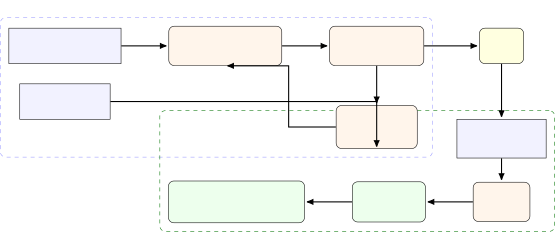

# Inducing Reward-Free Judging Rubrics that Reduce Over-Crediting in Agent Evaluation

Darragh Quinn    David Dylan    Roisin Healy    Fionn Carroll   
Maeve Donnelly    and Cormac Sheehan ^(†)^(†)thanks: D.˜Dylan, D.˜Quinn
and M.˜Donnelly are with Trinity College Dublin; R.˜Healy and C.˜Sheehan
are with University College Dublin; F.˜Carroll is with Dublin City
University, Dublin, Ireland.

###### Abstract

Evaluating language-model agents at scale increasingly relies on a
second language model as an automatic judge, because the gold signal, an
executable environment reward, is expensive, slow, or unavailable at
deployment time. Such a judge is a reward-free proxy whose value depends
on whether it can be trusted, yet existing judges either hand-write the
scoring rubric, as in G-Eval, or fine-tune the judge’s weights, and both
tend to credit fluent but unsuccessful trajectories as successes. We
instead induce the text of an agent-judging rubric from a small set of
ground-truth-labeled trajectories, grounding it in true outcomes. We
present RubricForge, which evolves a judge rubric by reflective
evolution against labeled trajectories to maximize agreement with the
environment reward, freezes it, and applies it to held-out trajectories
in one model call with no environment access. The optimized artifact is
human-readable text, so every verdict is attributable to named criteria.
Using one frozen 7B model as both agent and judge, on $`\tau`$-bench
(173 labeled trajectories drawn from 220 rollouts) and WebShop (160),
the principal gain is faithfulness rather than raw agreement. The edge
over a generic G-Eval judge is not statistically significant (McNemar
$`p=0.248`$), and absolute-score calibration marginally favors the
generic judge ($`|{\rm err}|`$ difference $`-0.048`$,
$`p=2\!\times\!10^{-4}`$). Yet RubricForge over-credits failed
trajectories roughly half as often ($`0.115`$ vs. $`0.173`$ false-pass
rate on $`\tau`$-bench, with three over-credit catches and zero
reversals) and ranks graded WebShop outcomes more faithfully (Spearman
$`0.410`$ vs. $`0.370`$). For a reward-free evaluator the false-pass
rate, not aggregate agreement, is the deployment-relevant quantity,
since a false pass ships a broken agent whereas a false fail merely
costs a retry.

###### Index Terms: 

Automatic evaluation, evaluation metrics, intelligent agents,
interpretability, large language models, LLM-as-a-judge, prompt
optimization, reward modeling, trustworthy machine learning.

Fig. 1: RubricForge at a glance. An evaluation rubric is _induced_ from
ground-truth-labeled agent trajectories by reflective evolution, then
frozen and applied to held-out trajectories with one model call and no
environment access. Left: against a generic G-Eval judge, the
binary-agreement edge is directional and _not_ statistically significant
(McNemar $`p=0.248`$). Right: where it matters, the induced rubric
over-credits fluent-but-failed trajectories about half as often
($`0.115`$ vs. $`0.173`$ false-pass rate on $`\tau`$-bench), the
deployment-relevant error for a reward-free evaluator. RubricForge is
thus _harder to fool than to agree_.

## I Introduction

Language-model agents—systems that interleave reasoning with tool calls
to act in an external environment—are now evaluated, debugged, and
ranked at a scale that no longer admits human grading of every
trajectory \[1, 2, 3, 4\]. The cleanest evaluation signal is an
_environment reward_: a programmatic oracle that inspects the world
state after an episode and returns success or a graded score—a database
hash in a customer-service simulator, an attribute match in a shopping
environment, a passing test suite for a code agent \[5, 6, 7\]. Such
oracles are the ground truth this paper is built on. But they are also
the very thing one rarely has when it is most needed. During development
one wants to score thousands of candidate rollouts cheaply; in
deployment the environment is the production system itself, where a
destructive “ground-truth” probe (issuing the refund, placing the order,
mutating the record) is exactly what must _not_ be run merely to grade
the agent. The field has therefore turned to the _LLM-as-a-judge_: a
second language model that reads a trajectory and predicts whether the
agent succeeded \[8, 9, 10\]. The judge is a _reward-free proxy_—a
learned stand-in for an oracle it never queries.

A proxy is only as useful as it is trustworthy, and judges are known to
fail in characteristic ways: they prefer verbose, fluent, confident
answers \[11\], they favor their own generations \[12\], and they reward
surface form over substance. For an _agent_ judge these biases
concentrate into one particularly costly mistake. A trajectory can read
beautifully—the agent authenticates the user, narrates a plan, and signs
off with a polished confirmation—while the underlying action failed: the
booking errored out, the record was never committed, the purchased item
does not match the request. A judge that rewards the narration
_over-credits_ the failure. We argue that this single error type, not
aggregate agreement, is what determines whether a reward-free evaluator
is safe to deploy, because the two ways a binary judge can be wrong are
not symmetric. A _false pass_—scoring a truly-failed trajectory as
success—silently certifies and ships a broken agent: it inflates
reported success rates, masks regressions, and selects bad policies
during optimization. A _false fail_—scoring a truly-successful
trajectory as failure—merely costs a retry or a discarded sample. The
risk is asymmetric, so the metric should be too.

This paper studies whether the _text_ of an agent-judging rubric should
be _written_ or _induced_. The dominant practice writes the rubric by
hand—G-Eval prompts a strong model with human-authored criteria \[9\]—or
fine-tunes the judge’s *weights* \[13, 14, 15\]. We take a third path.
We keep the judge model _frozen_ and instead optimize the rubric
_string_ by reflective evolution against a small set of
ground-truth-labeled trajectories, using each trajectory’s true
environment outcome as the supervision signal. The induced rubric is
then frozen and applied to a held-out, by-task-disjoint split with a
single model call and no environment access. We call this RubricForge.
Because the artifact under optimization is human-readable text, the
resulting metric is interpretable by construction: every verdict is
attributable to named criteria the practitioner can inspect, edit, and
audit. And because induction grounds the rubric in true outcomes rather
than in the judge’s untethered intuitions, we hypothesize that it is
more resistant to over-crediting fluent failures.

Our central result separates two questions that the literature usually
conflates: whether the judge agrees with the oracle in aggregate, and
whether it fails in the dangerous direction. On a hard binary success
label the frozen 7B judge is near its agreement ceiling, and RubricForge
does not significantly out-agree a generic G-Eval judge; on graded
WebShop the generic judge is in fact marginally better calibrated in
absolute score. We report both outcomes without qualification. On the
false-pass rate, however, RubricForge over-credits fluent failures
roughly half as often, and the entire margin between the two judges on
$`\tau`$-bench reduces to three trajectories, all of which are
over-credit catches in RubricForge’s favor with zero reversals.
Aggregate agreement is therefore the wrong headline for a reward-free
evaluator: induction leaves it essentially unchanged while sharply
reducing the error that determines whether the proxy is safe to deploy.

This result speaks to a broader question about optimizing in the space
of prompts. When the objective being optimized is decoupled from real
outcomes, an optimized prompt can drift or collapse; grounding the same
optimization in checkable signal is what keeps it useful. RubricForge
grounds rubric induction in labeled trajectory outcomes, which is
precisely what lets an induced proxy resist drifting away from the true
reward, and we develop this connection to Goodhart’s law in Section II
and Section VIII.

Contributions. The main contributions of this paper are summarized as
follows.

- •
  RubricForge: automatic metric induction for agents. We introduce a
  method that evolves a judge rubric against ground-truth-labeled
  trajectories with a _frozen_ backbone, then freezes the rubric and
  scores held-out trajectories with one model call and no environment
  access (Section IV). Induction reliably improves validation agreement
  ($`0.654\!\to\!0.769`$ on $`\tau`$-bench, $`0.667\!\to\!0.750`$ on
  WebShop) and produces concrete, human-readable, trajectory-grounded
  criteria.
- •
  Faithfulness, not agreement, is where induction pays off. We show
  RubricForge over-credits failed trajectories about half as often as a
  generic judge ($`0.173\!\to\!0.115`$ false-pass on $`\tau`$-bench;
  three fluent failures caught, zero reversed), never scoring worse than
  G-Eval on any item—while stating explicitly that the binary-agreement
  margin is directional and _not_ significant (McNemar $`p=0.248`$).
- •
  Better ranking of graded outcomes. RubricForge ranks graded WebShop
  outcomes more faithfully (Spearman $`0.410`$ vs. $`0.370`$), even
  though absolute calibration marginally favors the generic judge
  ($`|{\rm err}|`$ difference $`-0.048`$, $`p=2\!\times\!10^{-4}`$). We
  separate ranking faithfulness from absolute calibration and report
  both.
- •
  A reward-free evaluation protocol and an over-crediting probe. We
  package an oracle-reward ceiling, a false-pass rate, a
  ranking-versus-calibration split, per-criterion leave-one-out
  attribution, and difficulty/fluency/length stratification into a
  reusable protocol (Section VII), and connect the false-pass rate to
  proxy-objective misalignment and Goodhart’s law.

Roadmap. Section II surveys LLM-as-a-judge, reward modeling, agent
benchmarks, prompt optimization, and proxy misalignment. Section III
formalizes reward-free trajectory evaluation. Section IV presents
RubricForge with an algorithm and an architecture diagram. Section V
details datasets, baselines, and protocol; Section VI reports the main
table; Section VII is the faithfulness diagnosis. Section VIII discusses
implications and limitations, and Section IX concludes.

## II Related Work

We organize the literature into five themes: (a) LLM-as-a-judge and
automatic evaluation, where the false-pass failure our probe measures is
named; (b) reward modeling, RLHF/RLAIF, and learned evaluators; (c)
agent benchmarks and evaluation; (d) prompt optimization and evolution;
and (e) proxy/metric misalignment and Goodhart’s law. Throughout, we
mark the differentiator of RubricForge: prior judges either _hand-write_
the rubric or _fine-tune_ the judge’s weights, whereas RubricForge
_induces_ the rubric _text_ by evolution while keeping the judge model
frozen.

### II-A LLM-as-a-Judge and Automatic Evaluation

Using a strong language model to grade the outputs of another has become
the default scalable alternative to human evaluation. G-Eval prompts a
capable model with a hand-written rubric and a chain-of-thought
form-filling protocol to score natural-language generation \[9\];
MT-Bench and Chatbot Arena established LLM and human pairwise judging as
a benchmark substrate for chat models \[8\]. A complementary line trains
dedicated _open_ evaluators: Prometheus and Prometheus 2 fine-tune
models to apply fine-grained, user-supplied score rubrics and to
approximate GPT-4-level judgments \[13, 14\]; JudgeLM, PandaLM, and
Auto-J fine-tune scalable judges for instruction-following and pairwise
comparison \[15, 16, 17\]; FLASK decomposes evaluation into skill
sets \[18\]; and aggregation schemes such as branch-solve-merge and
panels of diverse juror models reduce single-judge variance \[19, 20\].
The same machinery is increasingly turned on _agents_ rather than single
responses—PersonaGym scores persona-conditioned agents and CharacterEval
grades multi-turn role-play behavior \[21, 22\]— which is the regime
RubricForge targets. Surveys catalog the rapidly growing space \[10, 23,
24\].

Crucially for us, the same line documents that judges are _biased
estimators_ that fail in a specific, dangerous direction. LLM evaluators
are not fair: they are swayed by answer position, verbosity, and
superficial fluency \[11\]; they recognize and favor their own
generations \[12\]. These biases are exactly what produce a _false
pass_—scoring a fluent-but-failed trajectory as a success—which is the
error our over-crediting probe isolates and measures. Viewed through
this lens, an induced agent rubric is a _learned proxy_ for the true
environment reward, and the false-pass rate is the operational
measurement of the gap between that proxy and the reward \[25\].
RubricForge differs from all of the above in _what_ is optimized. G-Eval
fixes a human-written rubric; Prometheus and JudgeLM move the judge’s
weights. RubricForge leaves the judge model frozen and optimizes the
rubric _string_ against ground-truth labels—cheaper than fine-tuning,
more faithful than hand-writing, and interpretable by construction
because the artifact is text.

### II-B Reward Modeling, RLHF, and Learned Evaluators

Learned evaluators have a long lineage in preference-based alignment.
Reward models trained on human comparisons drive RLHF for summarization
and instruction following \[26, 27\]; RLAIF replaces or augments the
human signal with AI feedback and constitutional self-critique \[28,
29\]; and direct preference optimization recasts the language model
itself as an implicit reward model \[30\]. “Self-rewarding” and
“meta-rewarding” schemes let a model generate its own training rewards
or judge its own judgments \[31, 32\], and self-feedback loops such as
Self-Refine and tool-interactive critique iteratively improve an output
against the model’s own criticism \[33, 34\]. The reliability of these
learned rewards is itself now benchmarked, e.g. RewardBench measures how
well reward models track held-out preferences \[35\]. RubricForge shares
the goal of a learned evaluator but targets a different object and
supervision. Reward models score _responses_ from _scalar preference_
data and are typically consumed by an optimizer; RubricForge scores
entire _agent trajectories_ against _programmatic outcome_ labels and is
consumed as a frozen, reward-free _measurement_ instrument whose
verdicts are human-auditable rather than a black-box scalar.

### II-C Agent Benchmarks and Evaluation

The agents we judge come from interactive benchmarks with executable
rewards. $`\tau`$-bench scores tool-agent-user dialogues in retail and
airline customer-service domains by hashing the final database state
against a gold state, yielding a strict binary reward \[5\]. WebShop
provides a graded reward measuring how well a purchased product matches
a natural -language instruction’s attributes and price \[6\]. Broader
suites—AgentBench across eight environments \[36\], WebArena for
realistic web tasks \[37\], GAIA for general assistants \[38\], and
SWE-bench for repository-level coding \[7\]—all rely on programmatic
success checks. The trajectories themselves are produced by agent
policies such as ReAct \[1\], reflective and tree-structured
variants \[2, 39\], experiential and memory-augmented agents \[40, 41,
42\], generative agents \[43\], reasoning bootstrappers \[44\], and
self-evolving or recursively-composed agents \[3, 4, 45\]. Many of these
agents are moreover _retrieval-augmented_, grounding their actions in
fetched evidence rather than parametric memory alone \[46, 47, 48, 49\],
which only widens the space of fluent-but-unfaithful traces a
reward-free judge must screen. These benchmarks supply the ground-truth
labels RubricForge induces against; RubricForge is orthogonal to them,
learning a reward-free proxy that predicts their oracle from the
trajectory alone, so it can grade rollouts when re-running the oracle is
too costly or unsafe.

### II-D Prompt Optimization and Evolution

RubricForge induces its rubric with reflective prompt evolution rather
than gradient descent. Automatic prompt search spans Monte-Carlo
instruction generation (APE) \[50\], optimization-by-prompting where an
LLM proposes improved prompts from a trajectory of past attempts
(OPRO) \[51\], evolutionary prompt search (PromptBreeder) \[52\], and
the DSPy line that compiles and optimizes language-model pipelines \[53,
54\]. We specifically build on GEPA, which uses natural-language
_reflection_ over execution traces to mutate prompts and has been shown
to rival reinforcement learning at far lower sample cost \[55\].
RubricForge applies this machinery to a target it was not previously
used for: the single mutated component is the _judge’s own rubric_, the
“rollout” is a _judging pass_ rather than an environment rollout, and
the fitness is _agreement with the ground-truth label_. The optimizer is
reused unchanged; the contribution is the reward-free induction
_objective_, not a new search algorithm.

Reflective prompt evolution sits within a broader family of
_self-improvement without weight updates_. Models can bootstrap from
their own high-confidence generations \[56\], marginalize over sampled
reasoning paths \[57\], and revise prior attempts—though the limits of
unaided self-correction are now well documented: it helps with external
feedback but can fail or even hurt when the model grades itself \[58,
59\], which is precisely why RubricForge grounds its reflection in
_external_ ground-truth labels rather than the model’s own confidence.
The induction stage is also a form of _test-time_ adaptation: it spends
extra compute to fit an instrument before deployment, echoing test-time
scaling \[60, 61\] and the classical meta-learning and
test-time-adaptation program \[62, 63, 64, 65, 66, 67\] of
learning-to-adapt from limited supervision—here adapting a _rubric_, not
weights.

### II-E Proxy/Metric Misalignment and Goodhart’s Law

That an optimized proxy drifts from the true objective is Goodhart’s
law: once a measure becomes a target it ceases to be a good
measure \[68\]. In machine learning this manifests as reward
over-optimization and reward hacking—policies that exploit an imperfect
reward to score highly while violating the intent \[69, 70, 71\], with
characterized scaling laws for how proxy reward and true reward diverge
under optimization pressure \[72\]. A reward-free judge is itself a
proxy at risk of this drift: an ungrounded judge that learns to reward
fluency _is_ a Goodharted metric. Our over-crediting probe is a direct,
operational measurement of this drift for evaluation metrics—the
false-pass rate is how far the proxy has slipped toward rewarding form
over outcome. The enabling contrast is grounding. ToolTree grounds an
agent’s planning in per-instance, programmatically checkable
feedback \[73\]; analogously, RubricForge grounds rubric _induction_ in
per-trajectory ground-truth labels, which is exactly why the induced
metric resists drifting toward fluency where an ungrounded generic judge
silently does. Grounding a small-sample objective in real outcomes
rather than an internal preference is the same move that few-shot
preference alignment makes \[74\]. This grounded stance contrasts with
ungrounded prompt-space optimization, in which an aggregate objective
decoupled from real outcomes can drift or collapse; here a grounded
objective instead confers faithfulness.

## III Problem Formulation

We formalize reward-free trajectory evaluation and state the induction
objective. Table I summarizes the notation.

| Symbol                                                             | Meaning                                                          |
| ------------------------------------------------------------------ | ---------------------------------------------------------------- |
| $`\tau`$                                                           | An agent trajectory (actions, observations, final answer)        |
| $`x(\tau)`$                                                        | Judge-readable text rendering of $`\tau`$                        |
| $`r^{\star}(\tau)`$                                                | Environment (ground-truth) reward: binary or graded              |
| $`y(\tau)`$                                                        | Binary success label, $`y=\mathbf{1}[r^{\star}>0]`$              |
| $`\mathcal{D}`$                                                    | Pool of labeled trajectories $`\{(\tau_{i},r^{\star}_{i})\}`$    |
| $`\mathcal{D}_{\rm tr},\mathcal{D}_{\rm va},\mathcal{D}_{\rm te}`$ | Train / val / test splits (by-task disjoint)                     |
| $`g_{\theta}`$                                                     | Frozen judge backbone with parameters $`\theta`$                 |
| $`\rho`$                                                           | Rubric string (the judge’s system prompt)                        |
| $`M_{\rho}`$                                                       | Induced metric: $`M_{\rho}(\tau)\!=\!(\hat{p},\hat{s},\hat{z})`$ |
| $`\hat{p}\in\{0,1\}`$                                              | Predicted pass verdict                                           |
| $`\hat{s}\in[0,1]`$                                                | Predicted graded score                                           |
| $`\hat{z}`$                                                        | Free-text rationale (one sentence)                               |
| $`\mathcal{C}=\{c_{1},\dots,c_{K}\}`$                              | Induced criteria parsed from $`\rho`$                            |
| $`A(\rho;\mathcal{D})`$                                            | Agreement of $`M_{\rho}`$ with labels on $`\mathcal{D}`$         |
| $`\mathrm{FP}(\rho)`$                                              | False-pass rate on truly-failed trajectories                     |

TABLE I: Notation used throughout the paper.

Setup. An agent acting in an environment produces a trajectory
$`\tau`$—a sequence of actions (tool calls and user-facing messages)
interleaved with observations (tool results and user replies),
terminating in a final committed answer. After the episode an oracle
returns the environment reward $`r^{\star}(\tau)`$, either binary (e.g.
a database-state hash in $`\tau`$-bench \[5\]) or graded in $`[0,1]`$
(e.g. the attribute -match score in WebShop \[6\]). We define the binary
success label $`y(\tau)=\mathbf{1}[r^{\star}(\tau)>0]`$. The oracle is
the ground truth; the defining constraint of _reward-free_ evaluation is
that at scoring time the evaluator may _not_ query it, because doing so
is expensive, slow, or, in a live system, destructive.

The induced metric. A reward-free evaluator is a function that maps the
trajectory _text_ $`x(\tau)`$ to a prediction without environment
access. We realize it as a frozen judge backbone $`g_{\theta}`$
conditioned on a rubric string $`\rho`$:

```math
M_{\rho}(\tau)\;=\;g_{\theta}\big(\rho,\,x(\tau)\big)\;=\;(\hat{p},\,\hat{s},\,\hat{z}), \tag{1}
```

a single deterministic call (temperature $`0`$) returning a pass verdict
$`\hat{p}\in\{0,1\}`$, a graded score $`\hat{s}\in[0,1]`$, and a
one-sentence rationale $`\hat{z}`$. The text rendering $`x(\tau)`$
exposes only what an observer of the interaction would see—actions, tool
results, user replies, counters, and the final answer—and never the
oracle reward or gold world-state, so no label leaks into the judge’s
input.

Objective. Let agreement on a labeled set be

```math
A(\rho;\mathcal{D})\;=\;\frac{1}{|\mathcal{D}|}\sum_{\tau\in\mathcal{D}}\mathbf{1}\!\big[\hat{p}_{\rho}(\tau)=y(\tau)\big]. \tag{2}
```

Rubric induction seeks the rubric maximizing agreement on the labeled
training pool, with selection on a held-out validation pool to avoid
overfitting the exact training trajectories:

```math
\rho^{\star}\;=\;\arg\max_{\rho\,\in\,\mathcal{R}}\;A\big(\rho;\,\mathcal{D}_{\rm tr}\big),\quad\text{selected by }A\big(\rho;\,\mathcal{D}_{\rm va}\big), \tag{3}
```

over the space $`\mathcal{R}`$ of candidate rubric strings reachable by
the evolution operator. The judge backbone $`\theta`$ is _frozen_:
optimization moves only the text $`\rho`$, not the weights. The frozen
$`\rho^{\star}`$ is then applied once per held-out trajectory in
$`\mathcal{D}_{\rm te}`$.

What we actually optimize for. Agreement (Equation 2) is the _training_
signal, but it is not the deployment-relevant quantity. We separate two
error directions. On a truly-failed trajectory ($`y=0`$), a _false pass_
($`\hat{p}=1`$) silently certifies a broken agent; on a truly-successful
trajectory ($`y=1`$), a _false fail_ merely costs a retry. We therefore
single out the false-pass rate,

```math
\mathrm{FP}(\rho)\;=\;\frac{\big|\{\tau:\,y(\tau)=0\ \wedge\ \hat{p}_{\rho}(\tau)=1\}\big|}{\big|\{\tau:\,y(\tau)=0\}\big|}, \tag{4}
```

as the primary _faithfulness_ criterion, and treat raw agreement,
$`\kappa`$, AUC, ranking (Spearman), and absolute calibration as
complementary diagnostics. The central empirical question is then sharp:
does grounding the rubric in labels (Equation 3) reduce $`\mathrm{FP}`$
(Equation 4)—make the proxy harder to fool—even where it does not move
raw agreement?

## IV Method: RubricForge

RubricForge has three stages: _induce_ a rubric by reflective evolution
against labeled trajectories, _freeze_ it, and _apply_ it to held-out
trajectories as a one-call reward-free metric. Figure 2 diagrams the
pipeline and Algorithm 1 states it.



Fig. 2: RubricForge architecture. Induce (top, blue): the frozen judge
$`g_{\theta}`$ scores training trajectories with the current rubric
$`\rho_{t}`$; a reflection step reads the cases whose verdict disagreed
with the ground-truth label and proposes an improved rubric
$`\rho_{t+1}`$; candidates are pooled and selected by validation
agreement (Equation 3). Freeze: the best rubric $`\rho^{\star}`$ is
frozen. Apply (bottom, green): for each held-out trajectory
$`M_{\rho^{\star}}`$ emits a verdict $`(\hat{p},\hat{s},\hat{z})`$ in a
single call with no environment access, feeding the faithfulness /
over-crediting probe. The judge backbone is never updated; only the
rubric text is optimized.

### IV-A Stage 1: Rubric Induction

The optimizer is GEPA’s reflective prompt evolution \[55\], reused
unchanged; RubricForge’s novelty is in the component, the rollout, and
the fitness it is pointed at. The single evolved component is the rubric
string $`\rho`$ (the judge’s system prompt). The “rollout” for a
candidate rubric is not an environment rollout but a _judging pass_: the
frozen backbone scores each training trajectory with $`\rho`$, and the
per-trajectory fitness is binary agreement with the gold label,

```math
s(\tau;\rho)\;=\;\mathbf{1}\!\big[\hat{p}_{\rho}(\tau)=y(\tau)\big], \tag{5}
```

so the optimizer’s objective is exactly agreement (Equation 2).

The reflection step is where grounding enters. After a minibatch is
scored, the mis-scored trajectories—those where the judge’s verdict
disagreed with the true label—are collected, and the reflection
meta-prompt presents the current rubric together with these failures and
their true labels, asking for a revised rubric that would label them
correctly and generalize. Two design choices keep the induction honest
and leakage-free. First, the rubric author (the reflecting model) is
told the true label _only for the training trajectories it is revising_,
and is explicitly instructed to describe _observable trajectory
evidence_ (which signals indicate the user’s needs were met versus the
agent guessing) rather than to mention the reward—so the evolved rubric
encodes _symptoms of success_, not a memorized answer key, and the
deployed judge never sees a label. Second, the seed of the search is not
an empty or strawman rubric but the same competent generic G-Eval-style
rubric used by our G-Eval baseline; any rubric the search accepts must
therefore beat a real judge, not a degenerate one, so reported gains are
not an artifact of a weak starting point. Candidates are pooled and the
rubric maximizing validation agreement (Equation 3) is retained.

### IV-B Stage 2: Freeze

The selected rubric $`\rho^{\star}`$ is frozen verbatim. If the search
never beats its seed, RubricForge explicitly records that the effective
rubric is the generic default; in our runs the search did improve over
the seed on both benchmarks (Section VI), accepting evolved rubrics into
pools of size $`6`$ ($`\tau`$-bench) and $`4`$ (WebShop). Freezing makes
the metric a fixed, reproducible instrument: the same trajectory always
receives the same verdict.

### IV-C Stage 3: Reward-Free Application

At test time the frozen $`\rho^{\star}`$ is the judge’s system prompt
and the rendered held-out trajectory $`x(\tau)`$ is the user message; a
single deterministic call returns the verdict (Equation 1). A fixed
output contract, kept separate from the evolved rubric so the optimizer
shapes criteria rather than formatting, requests a strict JSON object
$`\{\text{pass},\text{score},\text{reason}\}`$. Parsing is robust—the
first brace-delimited object is extracted and decoded—and
_conservative_: any network or parse failure falls back to
$`\hat{p}=0`$, so a malformed judge call never spuriously _passes_ a
trajectory (it can only abstain toward failure, the safe direction for a
reward-free evaluator). Because the rubric is text, its named criteria
$`\mathcal{C}`$ can be applied individually to attribute each verdict to
the criterion responsible, which we exploit in Section VII.

0:  labeled pools $`\mathcal{D}_{\rm tr},\mathcal{D}_{\rm va}`$; frozen
judge $`g_{\theta}`$; seed rubric $`\rho_{0}`$; budget $`T`$; minibatch
$`b`$

1:  // Stage 1: induce

2:  pool $`\leftarrow\{\rho_{0}\}`$;  evaluate
$`A(\rho_{0};\mathcal{D}_{\rm va})`$

3:  for $`t=1`$ to $`T`$ do

4:   sample parent $`\rho`$ from pool; draw minibatch
$`B\subset\mathcal{D}_{\rm tr}`$, $`|B|=b`$

5:   for each $`\tau\in B`$:
$`(\hat{p},\hat{s},\hat{z})\leftarrow g_{\theta}(\rho,x(\tau))`$; 
$`s(\tau)\leftarrow\mathbf{1}[\hat{p}=y(\tau)]`$

6:   $`F\leftarrow\{\tau\in B:\hat{p}\neq y(\tau)\}`$ {mis-scored cases}

7:
  $`\rho^{\prime}\leftarrow\textsc{Reflect}(\rho,\,F,\,\text{true labels of }F)`$
{describe symptoms, not the label}

8:   if
$`A(\rho^{\prime};\mathcal{D}_{\rm va})\geq\max_{\rho\in\text{pool}}A(\rho;\mathcal{D}_{\rm va})`$
then

9:    pool $`\leftarrow`$ pool $`\cup\,\{\rho^{\prime}\}`$

10:   end if

11:  end for

12:  // Stage 2: freeze

13:
 $`\rho^{\star}\leftarrow\arg\max_{\rho\in\text{pool}}A(\rho;\mathcal{D}_{\rm va})`$

14:  // Stage 3: apply (reward-free, no env access)

15:  return
$`M_{\rho^{\star}}:\tau\mapsto g_{\theta}(\rho^{\star},x(\tau))`$

Algorithm 1 RubricForge: reward-free metric induction

## V Experimental Setup

Benchmarks and trajectories. We evaluate on two agent benchmarks with
executable rewards. $`\tau`$-bench \[5\] covers retail and airline
customer service with a strict _binary_ database-state-hash reward; we
dump $`220`$ labeled rollouts and admit them _whole tasks at a time_
(all of a task’s cells stay in one split, so no task leaks across the
train/val/test boundary) into a class-stratified $`85/26/62`$ split,
which fills its budget with the $`173`$ cells reported below; the
remaining $`47`$ surplus cells are held out. The $`173`$ enter the
experiment at a $`\sim`$$`15\%`$ positive rate. WebShop \[6\] provides a
_graded_ attribute-match reward; we collect $`160`$ trajectories, of
which $`116`$ carry graded scores. For each benchmark we dump
trajectories from two agent policies—the standard ReAct loop \[1\] and a
self-evolving RSEA policy—so the judge sees both terse and elaborated
traces. Each trajectory is rendered to judge-readable text exposing only
observable signals (actions, tool results and errors, user replies,
step/error counters, and the final committed answer); the oracle reward
and gold world-state are withheld from the renderer.

Frozen backbone. A single frozen Qwen2.5-7B model serves as _both_ the
agent backbone and the judge, at temperature $`0`$ for deterministic,
reproducible verdicts. Using one frozen 7B model for everything is a
deliberate stress test: it removes any capability gap between agent and
judge and isolates the effect of the _rubric_ rather than a stronger
grader.

Splits. Trajectories are partitioned _by task_ into
train/validation/test at roughly $`50/15/35`$, so no test task appears
in induction. On $`\tau`$-bench the $`173`$ admitted cells yield $`85`$
train ($`12`$ positive), $`26`$ validation ($`4`$ positive), and $`62`$
test trajectories ($`10`$ positive, $`\sim 16\%`$), summing to
$`85\!+\!26\!+\!62=173`$ at an overall $`\sim 15\%`$ positive rate;
WebShop uses $`80`$ train and $`24`$ validation, with $`56`$ graded test
trajectories for the calibration analysis. Table II consolidates these
per-split trajectory counts, positive rates, reward types, and induction
budgets in one place; note that the test positive rate
($`\sim`$$`16\%`$) is held close to the pool rate ($`\sim`$$`15\%`$) by
the by-task class-stratified split, so the agreement numbers below are
not an artifact of a skewed test label.

|                          |                        |                        |
| ------------------------ | ---------------------- | ---------------------- |
|                          | $`\tau`$-bench         | WebShop                |
| Reward type              | binary (db-hash)       | graded $`[0,1]`$       |
| Rollouts dumped          | $`220`$                | $`160`$                |
| Admitted into split      | $`173`$                | $`160`$                |
| Train (# / #pos)         | $`85`$ / $`12`$        | $`80`$ / —             |
| Validation (# / #pos)    | $`26`$ / $`4`$         | $`24`$ / —             |
| Test (# / #pos)          | $`62`$ / $`10`$        | $`56`$ graded          |
| Test positive rate       | $`\sim`$$`16\%`$       | graded                 |
| Overall positive rate    | $`\sim`$$`15\%`$       | —                      |
| Agent policies           | ReAct / RSEA           | ReAct / RSEA           |
| Induction budget (calls) | $`200`$ ($`208`$ used) | $`150`$ ($`156`$ used) |
| Accepted rubric pool     | $`6`$                  | $`4`$                  |
| Best val. agreement      | $`0.769`$ ($`20/26`$)  | $`0.750`$ ($`18/24`$)  |

TABLE II: Dataset and protocol statistics. Trajectories are split _by
task_ (no task crosses a split boundary); positive rate is
$`\Pr[r^{\star}>0]`$. “Graded” counts the subset carrying a continuous
$`r^{\star}\in[0,1]`$ used for the calibration analysis. Budget is GEPA
judging calls during induction.

Baselines. We compare RubricForge against (i) _Oracle_, the environment
reward itself (a ceiling, agreement $`1.0`$ by construction); (ii)
G-Eval \[9\], the generic hand-written judge—the same rubric that seeds
induction, so the comparison isolates the value of grounding; (iii)
_FewShot_, the generic rubric augmented with $`k\!=\!4`$ in-context
labeled trajectory examples (no rubric evolution); (iv) _Heuristic_, a
non-LLM surface-feature rule; and (v) _Majority_, the train-majority
class predicted for every item (degenerate but a standard sanity floor
on an imbalanced label).

Metrics. For binary agreement we report Accuracy with a bootstrap
$`95\%`$ confidence interval, $`F_{1}`$ on the positive class, Cohen’s
$`\kappa`$ (which, unlike accuracy, penalizes the degenerate
all-negative predictor), and ROC-AUC. For graded outcomes we report
Spearman’s $`\rho`$ and Kendall’s $`\tau`$ (ranking faithfulness) and
mean absolute error $`|\hat{s}-r^{\star}|`$ (absolute calibration). The
faithfulness primary metric is the false-pass rate $`\mathrm{FP}`$
(Equation 4).

Significance. Every judge-vs-judge comparison carries a paired test:
McNemar’s exact test on per-item agreement for binary verdicts, and a
paired bootstrap on absolute error for graded scores. We mark
significance as \*\*\* $`p\!<\!0.001`$, \*\* $`p\!<\!0.01`$,
\* $`p\!<\!0.05`$, and ns otherwise, and we label
directional-but-not-significant gaps _ns_ explicitly rather than
implying they are wins. Confidence intervals are $`10^{4}`$-resample
nonparametric bootstrap.

## VI Results

Table III reports the main $`\tau`$-bench test results. We read it
through finding-titled observations rather than a single aggregate
verdict, because the honest story is split across metrics.

| Judge                 | Acc. $`\uparrow`$ \[95% CI\]           | $`F_{1}`$ $`\uparrow`$ | Cohen $`\kappa`$ $`\uparrow`$ | AUC $`\uparrow`$   | McNemar vs. RubricForge |
| --------------------- | -------------------------------------- | ---------------------- | ----------------------------- | ------------------ | ----------------------- |
| Oracle (env. reward)  | $`1.000`$ \[$`1.000,1.000`$\]          | $`1.000`$              | $`1.000`$                     | $`1.000`$          | —                       |
| RubricForge (ours)    | $`\mathbf{0.774}`$ \[$`0.661,0.871`$\] | $`\mathbf{0.222}`$     | $`\mathbf{+0.092}`$           | $`0.485`$          | —                       |
| G-Eval (generic)      | $`0.726`$ \[$`0.613,0.839`$\]          | $`0.190`$              | $`+0.026`$                    | $`0.500`$          | $`p=0.248`$ ns          |
| FewShot ($`k=4`$)     | $`0.613`$ \[$`0.484,0.726`$\]          | $`0.200`$              | $`-0.019`$                    | $`\mathbf{0.535}`$ | $`p=0.009`$ \*\*        |
| Heuristic             | $`0.161`$ \[$`0.081,0.258`$\]          | \[$`0.278`$\]          | $`\phantom{+}0.000`$          | $`0.500`$          | $`p<0.001`$ \*\*\*      |
| Majority (degenerate) | \[$`0.839`$\] \[$`0.742,0.919`$\]      | $`0.000`$              | $`\phantom{+}0.000`$          | $`0.500`$          | $`p=0.289`$ ns          |

TABLE III: Main results on $`\tau`$-bench test ($`n=62`$,
$`\sim`$$`16\%`$ positive). Judge $`\leftrightarrow`$ ground-truth
agreement. Best non-degenerate value per column in bold. Majority
(all-fail) and Heuristic (pass-almost-everything, acc. $`0.161`$) are
degenerate predictors; their inflated metrics are bracketed and excluded
from the per-column best. McNemar column tests each judge against
RubricForge on per-item agreement ($`p`$, significance). $`\uparrow`$:
higher is better.

Finding 1: Induction works, and the rubric is concrete. Reflective
evolution improves validation agreement from the generic seed in both
domains: $`0.654\!\to\!0.769`$ on $`\tau`$-bench (a pool of $`6`$
rubrics, $`208`$ judging calls) and $`0.667\!\to\!0.750`$ on WebShop (a
pool of $`4`$, $`156`$ calls). The induced $`\tau`$-bench rubric is not
an opaque tuned string but five named, trajectory-grounded
criteria—successful authentication (no repeated failed attempts), order
verification (no “order not found”), request fulfillment with explicit
user confirmation, error-free tool usage, and clear user
communication—each phrased in terms of observable trajectory evidence
(Appendix A).

Finding 2: The binary-agreement edge is real in direction but not
significant. RubricForge attains the highest accuracy among informative
judges ($`0.774`$ vs. $`0.726`$ for G-Eval) and the highest informative
Cohen $`\kappa`$ ($`+0.092`$ vs. $`+0.026`$); $`\kappa`$ is the honest
headline here because it discounts the trivial benefit of predicting the
majority class on a $`16\%`$ -positive label. But the McNemar test
against G-Eval is _not_ significant ($`p=0.248`$): on a hard binary
label, a frozen 7B judge is near its agreement ceiling, and we do not
claim a significant binary win. We say so in the abstract and here.

Finding 3: Majority is degenerate; $`\kappa`$ exposes it. The Majority
baseline posts the highest _accuracy_ in the table ($`0.839`$) purely by
predicting “fail” for every trajectory on an imbalanced label—yet its
$`\kappa`$ and $`F_{1}`$ are both $`0`$, and McNemar versus RubricForge
is not significant ($`p=0.289`$). This is the canonical reason accuracy
alone is the wrong headline metric for reward-free evaluation: a metric
that never identifies a success is useless for ranking agents, which
$`\kappa`$ correctly reflects and accuracy hides.

Finding 4: FewShot and Heuristic are clearly worse. Adding four
in-context examples without rubric evolution _hurts_ ($`0.613`$
accuracy, $`\kappa=-0.019`$; McNemar $`p=0.009`$, \*\*): the
demonstrations bias the judge toward over-passing fluent traces (its
predicted-positive rate jumps to $`0.32`$). The non-LLM Heuristic
collapses to near-zero accuracy ($`p<0.001`$, \*\*\*). Neither is a
competitive reward-free evaluator. These two significant gaps confirm
the test has power; the non-significant G-Eval gap is therefore a
genuine near-tie on binary agreement, not low power—which is exactly why
the next section moves the analysis to where induction does separate.

Finding 5: The error decomposition shows the tie is one-sided. Table IV
unpacks each informative judge’s $`62`$ test verdicts into the full
confusion count (TP/FP/FN/TN) together with its predicted-positive rate
$`\hat{p}_{+}`$, false-pass count, and false-fail count. The
decomposition makes the “near-tie” precise and reveals it is
_asymmetric_. RubricForge and G-Eval agree on their true-positive count
($`2`$) and—critically—on their false-fail count ($`8`$ each): induction
does _not_ cost a single extra retry. The whole difference is in false
passes, which fall from $`9`$ (G-Eval) to $`6`$ (RubricForge), dragging
the predicted-positive rate from $`0.177`$ toward the gold
$`\sim`$$`0.16`$ ($`0.129`$ for RubricForge). FewShot moves the opposite
way—its demonstrations push $`\hat{p}_{+}`$ up to $`0.323`$ and its
false passes to $`17`$, the mechanism behind its significant accuracy
loss. Reading the table by _error direction_ rather than by aggregate
accuracy is what exposes that the G-Eval tie is entirely a false-pass
tie that RubricForge wins; Figure 4 visualizes the same decomposition.

|                       |            |                |            |                 |                    |                    |                               |                              |                        |
| --------------------- | ---------- | -------------- | ---------- | --------------- | ------------------ | ------------------ | ----------------------------- | ---------------------------- | ---------------------- |
| Judge                 | TP         | FP             | FN         | TN              | $`\hat{p}_{+}`$    | Acc. $`\uparrow`$  | Cohen $`\kappa`$ $`\uparrow`$ | \# false-pass $`\downarrow`$ | FP rate $`\downarrow`$ |
| Oracle (env. reward)  | $`10`$     | $`0`$          | $`0`$      | $`52`$          | $`0.161`$          | $`1.000`$          | $`1.000`$                     | $`0`$                        | $`0.000`$              |
| RubricForge (ours)    | $`2`$      | $`\mathbf{6}`$ | $`8`$      | $`\mathbf{46}`$ | $`\mathbf{0.129}`$ | $`\mathbf{0.774}`$ | $`\mathbf{+0.092}`$           | $`\mathbf{6}`$               | $`\mathbf{0.115}`$     |
| G-Eval (generic)      | $`2`$      | $`9`$          | $`8`$      | $`43`$          | $`0.177`$          | $`0.726`$          | $`+0.026`$                    | $`9`$                        | $`0.173`$              |
| FewShot ($`k=4`$)     | $`3`$      | $`17`$         | $`7`$      | $`35`$          | $`0.323`$          | $`0.613`$          | $`-0.019`$                    | $`17`$                       | $`0.327`$              |
| Heuristic             | \[$`10`$\] | \[$`52`$\]     | \[$`0`$\]  | \[$`0`$\]       | \[$`1.000`$\]      | $`0.161`$          | $`\phantom{+}0.000`$          | \[$`52`$\]                   | \[$`1.000`$\]          |
| Majority (degenerate) | \[$`0`$\]  | \[$`0`$\]      | \[$`10`$\] | \[$`52`$\]      | \[$`0.000`$\]      | \[$`0.839`$\]      | $`\phantom{+}0.000`$          | \[$`0`$\]                    | \[$`0.000`$\]          |

TABLE IV: Error-direction decomposition on $`\tau`$-bench test
($`n=62`$; $`10`$ pass, $`52`$ fail). Each row splits the judge’s
verdicts into true/false positives/negatives, its predicted-positive
rate $`\hat{p}_{+}`$, the deployment-relevant false-pass count/rate
(Equation 4), and the merely-costly false-fail count. RubricForge and
G-Eval share an identical false-fail count ($`8`$); the entire margin is
the $`3`$ fewer false passes, so RubricForge is _never worse on any
item_. Degenerate predictors (Heuristic, Majority) are bracketed. Best
informative value per column in bold; for $`\hat{p}_{+}`$ “best” is
closest to the gold positive rate $`0.161`$.

## VII Analysis: Faithfulness and Over-Crediting

If binary agreement does not separate RubricForge from a generic judge,
what does? This section answers with the faithfulness probe: the
over-crediting (false-pass) rate and its case study, per-criterion
attribution, the ranking-versus-calibration split, and stratification by
difficulty, fluency, and length.

### VII-A The Over-Crediting Probe

Figure 3 reports the false-pass rate (Equation 4): how often each judge
scores a _truly-failed_ trajectory as a success. On $`\tau`$-bench, of
$`52`$ ground-truth failures RubricForge over-credits $`6`$
($`\mathrm{FP}=0.115`$) versus G-Eval’s $`9`$
($`\mathrm{FP}=0.173`$)—about half as often. Decisively, the two judges
disagree on _exactly three_ $`\tau`$-bench items, and all three are
G-Eval false-passes that RubricForge correctly fails, with _zero_
reversals (no item where RubricForge over-credits and G-Eval does not).
The entire margin between the two judges in Table III _is_ these three
over-credit catches: RubricForge is never worse than G-Eval on any
individual item. On graded WebShop the gap is narrower but in the same
direction: of $`47`$ failures RubricForge over-credits $`22`$
($`0.468`$) versus G-Eval’s $`23`$ ($`0.489`$), with $`2`$ caught and
$`1`$ reversed. The takeaway is the paper’s thesis in one number:
induction’s benefit is concentrated in the dangerous error direction
even where it is invisible in aggregate agreement.

Fig. 3: Over-crediting (false-pass) rate on truly-failed trajectories.
RubricForge over-credits fluent-but-failed trajectories about half as
often as G-Eval on $`\tau`$-bench ($`0.115`$ vs. $`0.173`$) and slightly
less often on WebShop ($`0.468`$ vs. $`0.489`$). On $`\tau`$-bench the
only three judge disagreements are three G-Eval false-passes that
RubricForge catches, with zero reversals.

Figure 4 recasts the same result as a two-way error decomposition.
Stacking each judge’s $`62`$ test verdicts by error _direction_ (left)
shows the false-fail bars are identical height ($`8`$ each) while the
false-pass bar shrinks from $`9`$ to $`6`$; the RubricForge confusion
grid (right) makes explicit that the $`3`$ caught cases all move out of
the over-credit (FP) cell and into the true-fail (TN) cell, with the
false-fail (FN) cell untouched. This is the visual statement of “harder
to fool than to agree”: the only cell that changes is the dangerous one,
and it changes in the safe direction.

Fig. 4: Error-direction decomposition on $`\tau`$-bench test ($`n=62`$).
Left: verdicts stacked by error type—both judges make the same $`8`$
false fails (amber), so the only difference is the dangerous false-pass
bar (red), which RubricForge cuts $`9\!\to\!6`$. Right: RubricForge’s
confusion grid; the $`3`$ caught cases leave the over-credit (FP) cell
for the true-fail (TN) cell while the false-fail (FN) cell is unchanged.
RubricForge is thus never worse than G-Eval on any item.

### VII-B Case Study: The Three Caught Trajectories

Because the $`\tau`$-bench margin reduces to three trajectories, we can
inspect them exhaustively (Table V). Each is a fluent airline trajectory
that G-Eval passes with high confidence ($`\hat{s}\in[0.85,0.90]`$) and
RubricForge fails—and in each case the induced rubric pins the failure
to a specific named criterion. In airline$`|`$RSEA$`|`$2 the agent
narrates a savings breakdown from downgrades but never commits the
update; RubricForge’s *Request Fulfillment* criterion fires (“did not
confirm … or ensure the downgrades were completed”). In
airline$`|`$RSEA$`|`$38 the agent assures the user a certificate is
“immediately available” though the order was never verified; *Order
Verification* fires. In airline$`|`$ReAct$`|`$45 the book_reservation
call returns “payment amount does not add up,” yet the agent reports
“successfully booked”; _Successful Authentication_ (and, in the
breakdown, Order Verification and Request Fulfillment) fire. In all
three, G-Eval rewards the confident final message; RubricForge reads the
trajectory evidence the rubric tells it to look for. This is the
interpretability dividend of inducing _text_: the metric does not merely
disagree, it says _which criterion_ the trajectory violated.

| Trajectory | Why it truly failed | Criterion fired |
| ---------- | ------------------- | --------------- | ------------------------------------------------------------------------------------ | ------------------------- |
| airline$`  | `$RSEA$`            | `$2             | Narrates a savings breakdown from downgrades but never commits the update            | Request Fulfillment       |
| airline$`  | `$RSEA$`            | `$38            | Claims certificate “immediately available”; order never verified                     | Order Verification        |
| airline$`  | `$ReAct$`           | `$45            | Booking call returns “payment amount does not add up” yet the agent reports “booked” | Successful Authentication |

TABLE V: The only three $`\tau`$-bench judge disagreements (all
$`r^{\star}=`$ fail). In every case G-Eval=pass (over-credit) and
RubricForge=fail (correct), with the induced criterion that fired.

### VII-C Per-Criterion Leave-One-Out Ablation

Which criteria carry the faithfulness? We re-run the frozen judge with
each of the five induced criteria removed in turn and re-measure
accuracy, $`\kappa`$, and the false-pass rate on $`\tau`$-bench test
(Figure 5). Removing _Request Fulfillment_ is the only ablation that
clearly _degrades_ faithfulness: accuracy falls $`0.774\!\to\!0.758`$,
$`\kappa`$ falls $`+0.092\!\to\!+0.068`$, and the false-pass rate
_worsens_ $`0.115\!\to\!0.135`$—this criterion, which demands explicit
user confirmation that the requested action was completed, is what most
resists over-crediting. Removing _Tool Usage_ is mildly redundant:
accuracy nudges to $`0.790`$, $`\kappa`$ to $`+0.118`$, and false-pass
to $`0.096`$ (the tool-error signal it captures is partly subsumed by
the other criteria). Removing Authentication, Order Verification, or
User Communication leaves accuracy, $`\kappa`$, and false-pass exactly
unchanged on this test set. The rubric is thus robust to
single-criterion removal, with a clear faithfulness driver and one
mildly redundant criterion—an interpretability statement no opaque judge
can make.

Fig. 5: Per-criterion leave-one-out on $`\tau`$-bench test. Removing
_Request Fulfillment_ worsens every faithfulness metric (false-pass
$`0.115\!\to\!0.135`$, $`\kappa`$ $`+0.092\!\to\!+0.068`$): it most
drives faithfulness. Removing _Tool Usage_ is mildly redundant; the
remaining criteria leave the test metrics unchanged.

### VII-D Ranking versus Calibration

On graded WebShop we separate two often-conflated notions of score
quality: _ranking_ (does a higher judge score imply a higher true
reward?) and _absolute calibration_ (is the score numerically close to
the reward?). Figure 6 shows they come apart, and honesty requires
reporting both directions. RubricForge _wins ranking_: Spearman
$`0.410`$ (Kendall $`0.347`$) versus G-Eval’s $`0.370`$ (Kendall
$`0.314`$)—its scores order graded outcomes more faithfully, which is
what one needs to compare or select agents. But G-Eval is marginally
better _calibrated_ in absolute error: mean $`|\hat{s}-r^{\star}|`$ is
$`0.288`$ for G-Eval versus $`0.336`$ for RubricForge, and a paired
bootstrap on absolute error favors G-Eval by $`0.048`$ ($`95\%`$ CI
$`[0.018,0.083]`$, $`p=2\!\times\!10^{-4}`$). We do not paper over this:
RubricForge’s evolved rubric tends toward more decisive
$`\{0.2,1.0\}`$-style scores, which sharpens ranking but inflates
absolute error against the smooth graded reward. The two metrics measure
different things, and a reward-free evaluator used for _agent
comparison_ should be judged on ranking—where RubricForge wins—while one
used as an absolute score regressor should not.

Fig. 6: Ranking versus calibration on graded WebShop ($`n=56`$).
RubricForge ranks graded outcomes better (Spearman $`0.410`$ vs.
$`0.370`$) but G-Eval is marginally better calibrated in absolute error
(mean $`|\hat{s}-r^{\star}|`$ $`0.288`$ vs. $`0.336`$; paired-bootstrap
$`\Delta=-0.048`$, $`p=2\!\times\!10^{-4}`$). Ranking faithfulness and
absolute calibration are distinct, and we report both honestly.

### VII-E Stratification: Where the Advantage Lives

Finally we ask _where_ RubricForge’s over-crediting advantage
concentrates, since a uniform gap and a localized one have different
implications. Stratifying the $`\tau`$-bench false-pass gap (Table VI)
shows the advantage is not uniform. It concentrates in the _harder
airline_ domain (false-pass gap $`+0.19`$: G-Eval $`0.438`$ vs.
RubricForge $`0.250`$), and within it in the _fluent_ self-evolving
airline$`|`$RSEA policy (gap $`+0.25`$: G-Eval $`0.375`$ vs. RubricForge
$`0.125`$), whose elaborated, confident narration is exactly what fools
a generic judge. The easier retail domain shows no gap (both $`0.056`$):
there, fluent-failure over-crediting is rare for either judge, so there
is little to win. Critically, the advantage is _not_ a length artifact:
in the longest-trajectory tertile the false-pass gap is $`0.00`$ (both
judges over-credit nothing there), while the gap is largest in shorter,
surface-fluent traces. RubricForge’s faithfulness edge is therefore
driven by surface-fluency $`\times`$ task-difficulty—precisely the
regime where a reward-free evaluator is most likely to be fooled—rather
than by trajectory length.

| Stratum                           | $`n_{\rm fail}`$ | G-Eval FP | RubricForge FP | Gap                 |
| --------------------------------- | ---------------- | --------- | -------------- | ------------------- | --------- |
| Retail                            | $`36`$           | $`0.056`$ | $`0.056`$      | $`\phantom{+}0.00`$ |
| Airline (harder)                  | $`16`$           | $`0.438`$ | $`0.250`$      | $`+0.19`$           |
| airline$`                         | `$RSEA (fluent)  | $`8`$     | $`0.375`$      | $`0.125`$           | $`+0.25`$ |
| Length T1 ($`\leq`$$`30`$, short) | $`18`$           | $`0.278`$ | $`0.167`$      | $`+0.11`$           |
| Length T3 ($`>`$$`54`$, longest)  | $`17`$           | $`0.000`$ | $`0.000`$      | $`\phantom{+}0.00`$ |

TABLE VI: $`\tau`$-bench false-pass rate stratified. The over-crediting
advantage concentrates in the hard _airline_ domain and the fluent RSEA
policy, _not_ in the longest trajectories. Gap $`=`$ G-Eval $`-`$
RubricForge (higher $`=`$ larger RubricForge advantage).

## VIII Discussion

The false-pass rate is the deployment-relevant metric. The through-line
of our results is that for a reward-free evaluator, aggregate agreement
is the wrong headline and the false-pass rate is the right one. A metric
that ships broken agents (high false-pass) is dangerous regardless of
its accuracy on an imbalanced label; a metric that occasionally discards
a good sample (false-fail) is merely inefficient. RubricForge does not
significantly win the former-irrelevant binary-agreement contest, and we
say so plainly—but it nearly halves the false-pass rate, the quantity
that actually governs whether one can trust a reported success number.
“Harder to fool than to agree” is not a slogan covering a weak result;
it is the precise, honest description of _which_ axis induction
improves.

Grounding the objective resists Goodhart. Why does inducing the rubric
against labels help where it matters? Because it grounds the metric’s
objective in true outcomes. An ungrounded judge optimizes an internal
notion of “looks successful,” which a fluent agent can satisfy without
succeeding—a Goodharted metric drifting toward form \[68, 72\].
RubricForge’s reflection step is repeatedly shown trajectories that
_looked_ successful but were labeled failures, and is pushed to
articulate the observable evidence that distinguishes them—which is
exactly an anti-over-crediting pressure. This is the _grounded dual_ of
the sibling negative result (Section II-E): where an ungrounded
prompt-space meta-objective _collapses_ across users, a grounded
evaluation objective confers faithfulness, and just as grounding an
agent’s planning in checkable feedback sharpens it, RubricForge grounds
metric induction in checkable labels. Grounding the objective, on
whichever axis, is the common lever.

A reward-free evaluation protocol. Beyond the method, we advocate the
evaluation _protocol_ as the reusable contribution. Reporting an
oracle-reward ceiling, the false-pass rate alongside agreement, a
ranking-versus-calibration split, per-criterion attribution, and
fluency/difficulty stratification gives a far more honest picture of a
reward-free judge than a single accuracy or correlation number. We
recommend it for anyone deploying an LLM judge over agent trajectories,
independent of RubricForge.

When induction helps, and threats to validity. Induction helps most
exactly where generic judges are most dangerous: hard tasks with fluent,
confident agents. It helps least where over-crediting is already rare
(easy retail). Several threats temper the generality of our claims. The
7B judge is near its binary-agreement ceiling, so the agreement story is
genuinely a tie, not a latent win; the positive class on $`\tau`$-bench
is small ($`\sim`$$`16\%`$), which is intrinsic to a hard binary success
label but inflates the variance of $`F_{1}`$ and $`\kappa`$; and the
WebShop calibration loss is real and reported. We also note that the
renderer’s faithfulness—surfacing the right observable signals without
leaking the reward—is a load-bearing assumption we audited but that any
deployment must re-audit for its own trajectory format.

## IX Conclusion

We presented RubricForge, a method that _induces_ the text of an
agent-evaluation rubric by reflective evolution against
ground-truth-labeled trajectories, freezes it, and applies it as a
reward-free metric with one frozen-model call and no environment access.
Our central finding is deliberately honest and contrarian: on a hard
binary success label an induced rubric does _not_ significantly
out-agree a generic LLM judge (McNemar $`p=0.248`$), and it is
marginally worse calibrated in absolute graded score. Where it pays off
is _faithfulness_: it over-credits fluent-but-failed trajectories about
half as often ($`0.115`$ vs. $`0.173`$ false-pass on $`\tau`$-bench;
three catches, zero reversals), ranks graded outcomes better (Spearman
$`0.410`$ vs. $`0.370`$), and—because the artifact is human-readable
text—attributes every verdict to the named criterion responsible. For a
reward-free evaluator, where a false pass ships a broken agent and a
false fail merely costs a retry, this is the metric that matters:
RubricForge is _harder to fool than to agree_. By grounding the
evaluation objective in labeled outcomes, induction resists the Goodhart
drift toward fluency that an ungrounded judge silently suffers—the
grounded dual of the sibling meta-objective-collapse result. We release
the induction method and a reward-free evaluation protocol (oracle
ceiling, false-pass probe, ranking–calibration split, per-criterion
attribution) as a step toward trustworthy automatic evaluation of
language-model agents.

Limitations. (i) _Single frozen 7B judge._ All results use one frozen
Qwen2.5-7B model as both agent and judge; whether the faithfulness
advantage transfers to a stronger or larger judge (e.g. 30B or a
frontier model) is future work. We expect it to transfer because the
induced rubric is backbone-agnostic _text_—it can be dropped into any
judge—but we do not claim it here. (ii) _Two benchmarks._ We evaluate on
$`\tau`$-bench and WebShop; broader validation on AgentBench, WebArena,
GAIA, and code agents remains open. (iii) _Small positive class /
binary-agreement tie._ The $`\sim`$$`16\%`$ $`\tau`$-bench positive rate
is intrinsic to a hard binary label and widens the CIs on
$`F_{1}`$/$`\kappa`$; correspondingly the binary-agreement edge over
G-Eval is directional and not significant, and we do not over-claim it.
(iv) _Calibration._ RubricForge ranks graded outcomes better but is
marginally worse in absolute calibration, so it should be used for agent
comparison, not as an absolute score regressor. (v) _Induction
supervision._ Induction needs a modest pool of labeled trajectories; in
the fully label-free regime the method reduces to its generic seed.

## Appendix A Induced Rubrics, Sweep, and Hyperparameters

Induction hyperparameters. GEPA reflective evolution (reused
unchanged \[55\]) with minibatch $`4`$ and seed $`0`$; budget $`200`$
rollout calls on $`\tau`$-bench (the run used $`208`$ judging calls and
accepted a pool of $`6`$ rubrics, best validation agreement $`0.769`$ at
$`20/26`$) and $`150`$ on WebShop ($`156`$ calls, pool of $`4`$, best
validation $`0.750`$ at $`18/24`$). The seed candidate is the generic
G-Eval-style rubric, so accepted rubrics must beat a competent judge.
Judge calls are deterministic (temperature $`0`$, max $`220`$ tokens)
with a robust-JSON parse and a conservative $`\hat{p}{=}0`$ fallback on
any parse/network failure.

Full validation curves. Table VII lists every rubric in the accepted
pool with its validation agreement, and Figure 7 plots the same
trajectory. $`\tau`$-bench: seed $`17/26`$, then accepted children at
$`19,19,18,20,18`$ ($`/26`$), best $`20/26=0.769`$. WebShop: seed
$`16/24`$, then $`17,14,18`$ ($`/24`$), best $`18/24=0.750`$; the
corresponding graded-test ranking-vs-calibration summary is reported in
Table VIII. In both domains every accepted child except one sits at or
above the generic seed, and the selected $`\rho^{\star}`$ improves the
seed by $`+11.5`$ and $`+8.3`$ validation points respectively—confirming
that induction beats a competent starting rubric rather than a strawman,
while the modest absolute gains are consistent with the frozen 7B judge
operating near its agreement ceiling.

| Benchmark                | $`\rho_{0}`$ (seed) | $`\rho_{1}`$ | $`\rho_{2}`$ | $`\rho_{3}`$    | $`\rho_{4}`$    | $`\rho_{5}`$ | best               |
| ------------------------ | ------------------- | ------------ | ------------ | --------------- | --------------- | ------------ | ------------------ |
| $`\tau`$-bench ($`/26`$) | $`17`$              | $`19`$       | $`19`$       | $`18`$          | $`\mathbf{20}`$ | $`18`$       | $`\mathbf{0.769}`$ |
| WebShop ($`/24`$)        | $`16`$              | $`17`$       | $`14`$       | $`\mathbf{18}`$ | —               | —            | $`\mathbf{0.750}`$ |

TABLE VII: Induction sweep: validation agreement of every rubric in the
accepted pool (counts out of the validation split; $`26`$ for
$`\tau`$-bench, $`24`$ for WebShop). $`\rho_{0}`$ is the generic G-Eval
seed; $`\rho^{\star}`$ (the selected, frozen rubric) is in bold.
Children are listed in acceptance order.

Fig. 7: Validation-agreement trajectory of rubric induction. Grey is the
generic G-Eval seed ($`\rho_{0}`$); green bars are accepted rubrics in
the pool; the selected $`\rho^{\star}`$ (outlined) lifts validation
agreement $`0.654\!\to\!0.769`$ on $`\tau`$-bench and
$`0.667\!\to\!0.750`$ on WebShop. The induced rubric must beat a
competent seed, not a degenerate one.

| Judge       | Spearman $`\uparrow`$ | Kendall $`\uparrow`$ | mean $`            | \hat{s}-r^{\star} | `$ $`\downarrow`$ |
| ----------- | --------------------- | -------------------- | ------------------ | ----------------- | ----------------- |
| RubricForge | $`\mathbf{0.410}`$    | $`\mathbf{0.347}`$   | $`0.336`$          |
| G-Eval      | $`0.370`$             | $`0.314`$            | $`\mathbf{0.288}`$ |

TABLE VIII: WebShop graded-test summary ($`n=56`$). RubricForge wins
ranking; G-Eval wins absolute calibration (paired-bootstrap
$`\Delta|{\rm err}|=-0.048`$, $`95\%`$ CI $`[-0.083,-0.018]`$,
$`p=2\!\times\!10^{-4}`$).

The frozen $`\tau`$-bench rubric. The induced rubric applied at test
time (verbatim, lightly truncated) is:

> 1. Successful Authentication: the agent must successfully authenticate
>    the user using at least one valid method; any errors or repeated
>    failed attempts indicate failed authentication. 2. Order Verification:
>    the agent must retrieve and verify the user’s order details; any
>    “order not found” or repeated lookups indicate failure. 3. Request
>    Fulfillment: the agent must correctly fulfill the request (cancel,
>    modify, return, exchange) under policy, with explicit user
>    confirmation; any unfulfilled request indicates failure. 4. Tool
>    Usage: the agent must call the appropriate tools without errors;
>    tool-call errors reduce the score. 5. User Communication: the agent
>    must maintain clear, relevant communication throughout the
>    interaction.

The frozen WebShop rubric (summary). Four criteria: (1) the search query
broadly aligns with the instruction’s key attributes; (2) the purchased
product’s attributes (color, size, style) match the request, allowing
only explicitly-justified minor variances; (3) the purchase respects the
price limit; (4) the agent completes Buy Now with final options matching
its selections. Failure is indicated if any criterion is unmet.

Reproducibility. All verdicts are deterministic given the frozen
backbone, the frozen rubric, and the fixed by-task split (seed $`0`$).
The agreement table, McNemar tests, bootstrap CIs, the over-crediting
probe, the leave-one-out ablation, the calibration split, and the
stratification are computed from the persisted per-item predictions on
the held-out test split.

## References

- \[1\] S. Yao, J. Zhao, D. Yu, N. Du, I. Shafran, K. Narasimhan, and Y.
  Cao (2023) ReAct: synergizing reasoning and acting in language models.
  In International Conference on Learning Representations (ICLR), Cited
  by: §I, §II-C, §V.
- \[2\] N. Shinn, F. Cassano, E. Berman, A. Gopinath, K. Narasimhan,
  and S. Yao (2023) Reflexion: language agents with verbal reinforcement
  learning. In Advances in Neural Information Processing Systems
  (NeurIPS), Cited by: §I, §II-C.
- \[3\] G. Wang, Y. Xie, Y. Jiang, A. Mandlekar, C. Xiao, Y. Zhu, L.
  Fan, and A. Anandkumar (2023) Voyager: an open-ended embodied agent
  with large language models. arXiv preprint arXiv:2305.16291. Cited by:
  §I, §II-C.
- \[4\] H. Su, J. Luo, C. Liu, X. Yang, Y. Zhang, Y. Dong, and J.
  Zhu (2025) A survey on autonomy-induced security risks in large
  model-based agents. arXiv preprint arXiv:2506.23844. Cited by: §I,
  §II-C.
- \[5\] S. Yao, N. Shinn, P. Razavi, and K. Narasimhan (2024)
  $`\tau`$-bench: a benchmark for tool-agent-user interaction in
  real-world domains. arXiv preprint arXiv:2406.12045. Cited by: §I,
  §II-C, §III, §V.
- \[6\] S. Yao, H. Chen, J. Yang, and K. Narasimhan (2022) WebShop:
  towards scalable real-world web interaction with grounded language
  agents. In Advances in Neural Information Processing Systems
  (NeurIPS), Note: arXiv:2207.01206 Cited by: §I, §II-C, §III, §V.
- \[7\] C. E. Jimenez, J. Yang, A. Wettig, S. Yao, K. Pei, O. Press,
  and K. Narasimhan (2024) SWE-bench: can language models resolve
  real-world GitHub issues?. In International Conference on Learning
  Representations (ICLR), Note: arXiv:2310.06770 Cited by: §I, §II-C.
- \[8\] L. Zheng, W. Chiang, Y. Sheng, S. Zhuang, Z. Wu, Y. Zhuang, Z.
  Lin, Z. Li, D. Li, E. P. Xing, H. Zhang, J. E. Gonzalez, and I.
  Stoica (2023) Judging LLM-as-a-judge with MT-Bench and Chatbot Arena.
  In Advances in Neural Information Processing Systems (NeurIPS),
  Datasets and Benchmarks Track, Vol. 36. Note: arXiv:2306.05685 Cited
  by: §I, §II-A.
- \[9\] Y. Liu, D. Iter, Y. Xu, S. Wang, R. Xu, and C. Zhu (2023)
  G-Eval: NLG evaluation using GPT-4 with better human alignment. In
  Proceedings of the 2023 Conference on Empirical Methods in Natural
  Language Processing (EMNLP), pp. 2511–2522. Note: arXiv:2303.16634
  External Links:
  [Document](https://dx.doi.org/10.18653/v1/2023.emnlp-main.153) Cited
  by: §I, §I, §II-A, §V.
- \[10\] J. Gu, X. Jiang, Z. Shi, H. Tan, X. Zhai, C. Xu, W. Li, Y.
  Shen, S. Ma, H. Liu, S. Wang, K. Zhang, Y. Wang, W. Gao, L. Ni, and J.
  Guo (2024) A survey on LLM-as-a-judge. arXiv preprint
  arXiv:2411.15594. Cited by: §I, §II-A.
- \[11\] P. Wang, L. Li, L. Chen, Z. Cai, D. Zhu, B. Lin, Y. Cao, L.
  Kong, Q. Liu, T. Liu, and Z. Sui (2024) Large language models are not
  fair evaluators. In Proceedings of the 62nd Annual Meeting of the
  Association for Computational Linguistics (ACL), Volume 1: Long
  Papers, pp. 9440–9450. Note: arXiv:2305.17926 External Links:
  [Document](https://dx.doi.org/10.18653/v1/2024.acl-long.511) Cited by:
  §I, §II-A.
- \[12\] A. Panickssery, S. R. Bowman, and S. Feng (2024) LLM evaluators
  recognize and favor their own generations. In Advances in Neural
  Information Processing Systems (NeurIPS), Vol. 37. Note:
  arXiv:2404.13076 Cited by: §I, §II-A.
- \[13\] S. Kim, J. Shin, Y. Cho, J. Jang, S. Longpre, H. Lee, S.
  Yun, S. Shin, S. Kim, J. Thorne, and M. Seo (2024) Prometheus:
  inducing fine-grained evaluation capability in language models. In
  International Conference on Learning Representations (ICLR), Note:
  arXiv:2310.08491 Cited by: §I, §II-A.
- \[14\] S. Kim, J. Suk, S. Longpre, B. Y. Lin, J. Shin, S. Welleck, G.
  Neubig, M. Lee, K. Lee, and M. Seo (2024) Prometheus 2: an open source
  language model specialized in evaluating other language models. In
  Proceedings of the 2024 Conference on Empirical Methods in Natural
  Language Processing (EMNLP), pp. 4334–4353. Note: arXiv:2405.01535
  External Links:
  [Document](https://dx.doi.org/10.18653/v1/2024.emnlp-main.248) Cited
  by: §I, §II-A.
- \[15\] L. Zhu, X. Wang, and X. Wang (2025) JudgeLM: fine-tuned large
  language models are scalable judges. In International Conference on
  Learning Representations (ICLR), Note: arXiv:2310.17631 Cited by: §I,
  §II-A.
- \[16\] Y. Wang, Z. Yu, Z. Zeng, L. Yang, C. Wang, H. Chen, C.
  Jiang, R. Xie, J. Wang, X. Xie, W. Ye, S. Zhang, and Y. Zhang (2024)
  PandaLM: an automatic evaluation benchmark for LLM instruction tuning
  optimization. In International Conference on Learning Representations
  (ICLR), Note: arXiv:2306.05087 Cited by: §II-A.
- \[17\] J. Li, S. Sun, W. Yuan, R. Fan, H. Zhao, and P. Liu (2024)
  Generative judge for evaluating alignment. In International Conference
  on Learning Representations (ICLR), Note: arXiv:2310.05470. The
  proposed evaluator is named Auto-J. Cited by: §II-A.
- \[18\] S. Ye, D. Kim, S. Kim, H. Hwang, S. Kim, Y. Jo, J. Thorne, J.
  Kim, and M. Seo (2024) FLASK: fine-grained language model evaluation
  based on alignment skill sets. In International Conference on Learning
  Representations (ICLR), Note: arXiv:2307.10928 Cited by: §II-A.
- \[19\] S. Saha, O. Levy, A. Celikyilmaz, M. Bansal, J. Weston, and X.
  Li (2023) Branch-solve-merge improves large language model evaluation
  and generation. arXiv preprint arXiv:2310.15123. Cited by: §II-A.
- \[20\] P. Verga, S. Hofstatter, S. Althammer, Y. Su, A. Piktus, A.
  Arkhangorodsky, M. Xu, N. White, and P. Lewis (2024) Replacing judges
  with juries: evaluating LLM generations with a panel of diverse
  models. arXiv preprint arXiv:2404.18796. Cited by: §II-A.
- \[21\] V. Samuel, H. P. Zou, Y. Zhou, S. Chaudhari, A. Kalyan, T.
  Rajpurohit, A. Deshpande, K. Narasimhan, and V. Murahari (2024)
  PersonaGym: evaluating persona agents and LLMs. arXiv preprint. Note:
  arXiv:2407.18416 Cited by: §II-A.
- \[22\] Q. Tu, S. Fan, Z. Tian, and R. Yan (2024) CharacterEval: a
  chinese benchmark for role-playing conversational agent evaluation. In
  Proceedings of the 62nd Annual Meeting of the Association for
  Computational Linguistics (ACL), Note: arXiv:2401.01275 Cited by:
  §II-A.
- \[23\] D. Li, B. Jiang, L. Huang, A. Beigi, C. Zhao, Z. Tan, A.
  Bhattacharjee, Y. Jiang, C. Chen, T. Wu, K. Shu, L. Cheng, and H.
  Liu (2024) From generation to judgment: opportunities and challenges
  of LLM-as-a-judge. arXiv preprint arXiv:2411.16594. Cited by: §II-A.
- \[24\] H. Li, Q. Dong, J. Chen, H. Su, Y. Zhou, Q. Ai, Z. Ye, and Y.
  Liu (2024) LLMs-as-judges: a comprehensive survey on LLM-based
  evaluation methods. arXiv preprint arXiv:2412.05579. Cited by: §II-A.
- \[25\] S. Yang, S. C. Han, S. Wang, Y. Li, Y. Ding, and E. Hovy (2026)
  Toward understanding misalignment in LLM agents: a survey of taxonomy,
  causes, mitigation, and evaluation. Note: ACL ARR 2026 External Links:
  [Link](https://openreview.net/forum?id=zzTEGP2BYa) Cited by: §II-A.
- \[26\] N. Stiennon, L. Ouyang, J. Wu, D. M. Ziegler, R. Lowe, C.
  Voss, A. Radford, D. Amodei, and P. Christiano (2020) Learning to
  summarize from human feedback. In Advances in Neural Information
  Processing Systems (NeurIPS), Note: arXiv:2009.01325 Cited by: §II-B.
- \[27\] L. Ouyang, J. Wu, X. Jiang, D. Almeida, C. L. Wainwright, P.
  Mishkin, C. Zhang, S. Agarwal, K. Slama, A. Ray, J. Schulman, J.
  Hilton, F. Kelton, L. Miller, M. Simens, A. Askell, P. Welinder, P.
  Christiano, J. Leike, and R. Lowe (2022) Training language models to
  follow instructions with human feedback. In Advances in Neural
  Information Processing Systems (NeurIPS), Note: arXiv:2203.02155 Cited
  by: §II-B.
- \[28\] H. Lee, S. Phatale, H. Mansoor, T. Mesnard, J. Ferret, K.
  Lu, C. Bishop, E. Hall, V. Carbune, A. Rastogi, and S. Prakash (2024)
  RLAIF vs. RLHF: scaling reinforcement learning from human feedback
  with AI feedback. In Proceedings of the 41st International Conference
  on Machine Learning (ICML), Note: arXiv:2309.00267 Cited by: §II-B.
- \[29\] Y. Bai, S. Kadavath, S. Kundu, A. Askell, J. Kernion, A.
  Jones, A. Chen, A. Goldie, A. Mirhoseini, C. McKinnon, et al. (2022)
  Constitutional AI: harmlessness from AI feedback. arXiv preprint.
  Note: arXiv:2212.08073 Cited by: §II-B.
- \[30\] R. Rafailov, A. Sharma, E. Mitchell, S. Ermon, C. D. Manning,
  and C. Finn (2023) Direct preference optimization: your language model
  is secretly a reward model. In Advances in Neural Information
  Processing Systems (NeurIPS), Note: arXiv:2305.18290 Cited by: §II-B.
- \[31\] W. Yuan, R. Y. Pang, K. Cho, S. Sukhbaatar, J. Xu, and J.
  Weston (2024) Self-rewarding language models. arXiv preprint. Note:
  arXiv:2401.10020 Cited by: §II-B.
- \[32\] T. Wu, W. Yuan, O. Golovneva, J. Xu, Y. Tian, J. Jiao, J.
  Weston, and S. Sukhbaatar (2024) Meta-rewarding language models:
  self-improving alignment with LLM-as-a-meta-judge. arXiv preprint.
  Note: arXiv:2407.19594 Cited by: §II-B.
- \[33\] A. Madaan, N. Tandon, P. Gupta, S. Hallinan, L. Gao, et
  al. (2023) Self-refine: iterative refinement with self-feedback. In
  Advances in Neural Information Processing Systems (NeurIPS), Cited by:
  §II-B.
- \[34\] Z. Gou, Z. Shao, Y. Gong, Y. Shen, Y. Yang, N. Duan, and W.
  Chen (2023) CRITIC: large language models can self-correct with
  tool-interactive critiquing. arXiv preprint. Note: arXiv:2305.11738
  Cited by: §II-B.
- \[35\] N. Lambert, V. Pyatkin, J. Morrison, L. Miranda, B. Y. Lin, K.
  Chandu, N. Dziri, S. Kumar, T. Zick, Y. Choi, N. A. Smith, and H.
  Hajishirzi (2024) RewardBench: evaluating reward models for language
  modeling. Cited by: §II-B.
- \[36\] X. Liu, H. Yu, H. Zhang, Y. Xu, X. Lei, H. Lai, Y. Gu, H.
  Ding, K. Men, K. Yang, S. Zhang, X. Deng, A. Zeng, Z. Du, C. Zhang, S.
  Shen, T. Zhang, Y. Su, H. Sun, M. Huang, Y. Dong, and J. Tang (2024)
  AgentBench: evaluating LLMs as agents. In International Conference on
  Learning Representations (ICLR), Note: arXiv:2308.03688 Cited by:
  §II-C.
- \[37\] S. Zhou, F. F. Xu, H. Zhu, X. Zhou, R. Lo, A. Sridhar, X.
  Cheng, T. Ou, Y. Bisk, D. Fried, U. Alon, and G. Neubig (2024)
  WebArena: a realistic web environment for building autonomous agents.
  In International Conference on Learning Representations (ICLR), Note:
  arXiv:2307.13854 Cited by: §II-C.
- \[38\] G. Mialon, C. Fourrier, C. Swift, T. Wolf, Y. LeCun, and T.
  Scialom (2024) GAIA: a benchmark for general AI assistants. In
  International Conference on Learning Representations (ICLR), Note:
  arXiv:2311.12983 Cited by: §II-C.
- \[39\] S. Yao, D. Yu, J. Zhao, I. Shafran, T. L. Griffiths, Y. Cao,
  and K. Narasimhan (2023) Tree of thoughts: deliberate problem solving
  with large language models. In Advances in Neural Information
  Processing Systems (NeurIPS), Note: arXiv:2305.10601 Cited by: §II-C.
- \[40\] A. Zhao, D. Huang, Q. Xu, M. Lin, Y. Liu, and G. Huang (2024)
  ExpeL: LLM agents are experiential learners. In AAAI Conference on
  Artificial Intelligence, Cited by: §II-C.
- \[41\] Z. Z. Wang, J. Mao, D. Fried, and G. Neubig (2024) Agent
  workflow memory. arXiv preprint arXiv:2409.07429. Cited by: §II-C.
- \[42\] C. Packer, S. Wooders, K. Lin, V. Fang, S. G. Patil, I. Stoica,
  and J. E. Gonzalez (2023) MemGPT: towards LLMs as operating systems.
  arXiv preprint arXiv:2310.08560. Cited by: §II-C.
- \[43\] J. S. Park, J. C. O’Brien, C. J. Cai, M. R. Morris, P. Liang,
  and M. S. Bernstein (2023) Generative agents: interactive simulacra of
  human behavior. In ACM Symposium on User Interface Software and
  Technology (UIST), Cited by: §II-C.
- \[44\] E. Zelikman, Y. Wu, J. Mu, and N. D. Goodman (2022) STaR:
  bootstrapping reasoning with reasoning. In Advances in Neural
  Information Processing Systems (NeurIPS), Cited by: §II-C.
- \[45\] X. Yang, J. Zou, R. Pan, R. Qiu, P. Lu, S. Diao, J. Jiang, H.
  Tong, T. Zhang, M. J. Buehler, J. He, and J. Zou (2026) Recursive
  multi-agent systems. arXiv preprint arXiv:2604.25917. Cited by: §II-C.
- \[46\] P. Lewis, E. Perez, A. Piktus, F. Petroni, V. Karpukhin, N.
  Goyal, H. Küttler, M. Lewis, W. Yih, T. Rocktäschel, S. Riedel, and D.
  Kiela (2020) Retrieval-augmented generation for knowledge-intensive
  NLP tasks. In Advances in Neural Information Processing Systems
  (NeurIPS), Note: arXiv:2005.11401 Cited by: §II-C.
- \[47\] V. Karpukhin, B. Oğuz, S. Min, P. Lewis, L. Wu, S. Edunov, D.
  Chen, and W. Yih (2020) Dense passage retrieval for open-domain
  question answering. In Proceedings of the 2020 Conference on Empirical
  Methods in Natural Language Processing (EMNLP), pp. 6769–6781. Note:
  arXiv:2004.04906 Cited by: §II-C.
- \[48\] A. Asai, Z. Wu, Y. Wang, A. Sil, and H. Hajishirzi (2024)
  Self-RAG: learning to retrieve, generate, and critique through
  self-reflection. In International Conference on Learning
  Representations (ICLR), Note: arXiv:2310.11511 Cited by: §II-C.
- \[49\] W. Shi, S. Min, M. Yasunaga, M. Seo, R. James, M. Lewis, L.
  Zettlemoyer, and W. Yih (2024) REPLUG: retrieval-augmented black-box
  language models. In Proceedings of the 2024 Conference of the North
  American Chapter of the Association for Computational Linguistics
  (NAACL), Note: arXiv:2301.12652 Cited by: §II-C.
- \[50\] Y. Zhou, A. I. Muresanu, Z. Han, K. Paster, S. Pitis, H. Chan,
  and J. Ba (2023) Large language models are human-level prompt
  engineers. In International Conference on Learning Representations
  (ICLR), Note: arXiv:2211.01910 Cited by: §II-D.
- \[51\] C. Yang, X. Wang, Y. Lu, H. Liu, Q. V. Le, D. Zhou, and X.
  Chen (2024) Large language models as optimizers. In International
  Conference on Learning Representations (ICLR), Cited by: §II-D.
- \[52\] C. Fernando, D. Banarse, H. Michalewski, S. Osindero, and T.
  Rocktäschel (2023) Promptbreeder: self-referential self-improvement
  via prompt evolution. arXiv preprint. Note: arXiv:2309.16797 Cited by:
  §II-D.
- \[53\] O. Khattab, K. Santhanam, X. L. Li, D. Hall, P. Liang, C.
  Potts, and M. Zaharia (2022) Demonstrate-search-predict: composing
  retrieval and language models for knowledge-intensive NLP. arXiv
  preprint. Note: arXiv:2212.14024 Cited by: §II-D.
- \[54\] O. Khattab, A. Singhvi, P. Maheshwari, Z. Zhang, et al. (2024)
  DSPy: compiling declarative language model calls into self-improving
  pipelines. In International Conference on Learning Representations
  (ICLR), Cited by: §II-D.
- \[55\] L. A. Agrawal, S. Tan, D. Soylu, N. Ziems, R. Khare, K.
  Opsahl-Ong, A. Singhvi, H. Shandilya, M. J. Ryan, M. Jiang, et
  al. (2025) GEPA: reflective prompt evolution can outperform
  reinforcement learning. arXiv preprint arXiv:2507.19457. Cited by:
  Appendix A, §II-D, §IV-A.
- \[56\] J. Huang, S. S. Gu, L. Hou, Y. Wu, X. Wang, H. Yu, and J.
  Han (2022) Large language models can self-improve. arXiv preprint.
  Note: arXiv:2210.11610 Cited by: §II-D.
- \[57\] X. Wang, J. Wei, D. Schuurmans, Q. Le, E. Chi, S. Narang, A.
  Chowdhery, and D. Zhou (2023) Self-consistency improves chain of
  thought reasoning in language models. In International Conference on
  Learning Representations (ICLR), Note: arXiv:2203.11171 Cited by:
  §II-D.
- \[58\] J. Huang, X. Chen, S. Mishra, H. S. Zheng, A. W. Yu, X. Song,
  and D. Zhou (2024) Large language models cannot self-correct reasoning
  yet. International Conference on Learning Representations (ICLR).
  Note: arXiv:2310.01798 Cited by: §II-D.
- \[59\] R. Kamoi, Y. Zhang, N. Zhang, J. Han, and R. Zhang (2024) When
  can LLMs actually correct their own mistakes? a critical survey of
  self-correction of LLMs. Transactions of the Association for
  Computational Linguistics (TACL) 12, pp. 1417–1440. Cited by: §II-D.
- \[60\] C. Snell, J. Lee, K. Xu, and A. Kumar (2024) Scaling LLM
  test-time compute optimally can be more effective than scaling model
  parameters. arXiv preprint. Note: arXiv:2408.03314 Cited by: §II-D.
- \[61\] N. Muennighoff, Z. Yang, W. Shi, X. L. Li, L. Fei-Fei, H.
  Hajishirzi, L. Zettlemoyer, P. Liang, E. Candès, and T.
  Hashimoto (2025) S1: simple test-time scaling. arXiv preprint. Note:
  arXiv:2501.19393 Cited by: §II-D.
- \[62\] C. Finn, P. Abbeel, and S. Levine (2017) Model-agnostic
  meta-learning for fast adaptation of deep networks. In International
  Conference on Machine Learning (ICML), Note: arXiv:1703.03400 Cited
  by: §II-D.
- \[63\] A. Nichol, J. Achiam, and J. Schulman (2018) On first-order
  meta-learning algorithms. arXiv preprint. Note: arXiv:1803.02999 Cited
  by: §II-D.
- \[64\] T. M. Hospedales, A. Antoniou, P. Micaelli, and A. J.
  Storkey (2022) Meta-learning in neural networks: a survey. IEEE
  Transactions on Pattern Analysis and Machine Intelligence (TPAMI) 44
  (9), pp. 5149–5169. Note: arXiv:2004.05439 Cited by: §II-D.
- \[65\] S. Min, M. Lewis, L. Zettlemoyer, and H. Hajishirzi (2022)
  MetaICL: learning to learn in context. In Proceedings of the 2022
  Conference of the North American Chapter of the Association for
  Computational Linguistics (NAACL), Note: arXiv:2110.15943 Cited by:
  §II-D.
- \[66\] Y. Sun, X. Wang, Z. Liu, J. Miller, A. A. Efros, and M.
  Hardt (2020) Test-time training with self-supervision for
  generalization under distribution shifts. In International Conference
  on Machine Learning (ICML), Note: arXiv:1909.13231 Cited by: §II-D.
- \[67\] D. Wang, E. Shelhamer, S. Liu, B. Olshausen, and T.
  Darrell (2021) Tent: fully test-time adaptation by entropy
  minimization. In International Conference on Learning Representations
  (ICLR), Note: arXiv:2006.10726 Cited by: §II-D.
- \[68\] C. A. E. Goodhart (1984) Problems of monetary management: the
  UK experience. Monetary Theory and Practice: The UK Experience,
  pp. 91–121. Cited by: §II-E, §VIII.
- \[69\] D. Amodei, C. Olah, J. Steinhardt, P. Christiano, J. Schulman,
  and D. Mané (2016) Concrete problems in AI safety. arXiv preprint
  arXiv:1606.06565. Cited by: §II-E.
- \[70\] J. Skalse, N. H. R. Howe, D. Krasheninnikov, and D.
  Krueger (2022) Defining and characterizing reward hacking. In Advances
  in Neural Information Processing Systems (NeurIPS), Note:
  arXiv:2209.13085 Cited by: §II-E.
- \[71\] A. Pan, K. Bhatia, and J. Steinhardt (2022) The effects of
  reward misspecification: mapping and mitigating misaligned models. In
  International Conference on Learning Representations (ICLR), Note:
  arXiv:2201.03544 Cited by: §II-E.
- \[72\] L. Gao, J. Schulman, and J. Hilton (2023) Scaling laws for
  reward model overoptimization. In International Conference on Machine
  Learning (ICML), Note: arXiv:2210.10760 Cited by: §II-E, §VIII.
- \[73\] S. Yang, S. C. Han, Y. Ding, S. Wang, and E. Hovy (2026)
  ToolTree: efficient LLM agent tool planning via dual-feedback monte
  carlo tree search and bidirectional pruning. Note: ICLR 2026 External
  Links: 2603.12740 Cited by: §II-E.
- \[74\] S. Zhao, J. Dang, and A. Grover (2024) Group preference
  optimization: few-shot alignment of large language models. In
  International Conference on Learning Representations (ICLR), Note:
  arXiv:2310.11523 Cited by: §II-E.
