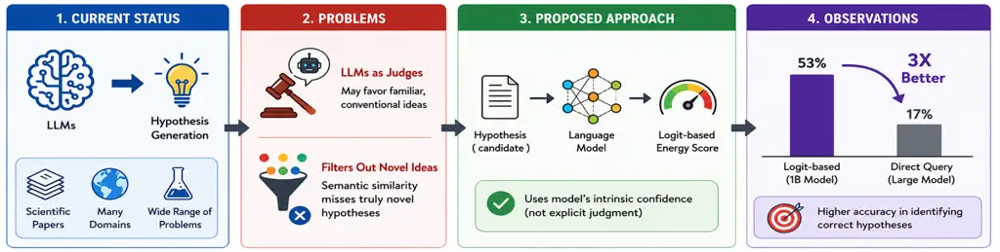

# Do LLMs Know a Good Hypothesis When They See One? Logit-Based Energy Scoring Outperforms Prompted LLM-as-Judge for Scientific Hypothesis Ranking

Swati Rajwal^(†1), Sanjay Das^(†1), Tirthankar Ghosal^(†)
Affiliation: ^(†)Oak Ridge National Laboratory,
{rajwals,dass3,ghosalt}@ornl.gov Affiliation: ¹These authors contributed
equally to this work.

###### Abstract

Large language models (LLMs) are increasingly used for scientific
hypothesis generation. However, evaluating generated hypotheses remains
a challenge for trustworthy AI-enabled scientific workflows. Existing
approaches often use LLMs as judges or rely on semantic similarity,
which can favor familiar ideas over novel ones. We propose a logit-based
energy scoring method that evaluates hypotheses using a language model’s
intrinsic confidence rather than comparative judgment. We benchmarked
seven language models on 1,323 papers across 12 disciplines. Each paper
was paired with its hypothesis and fifteen incorrect alternatives.
Intrinsic scoring reached 33.0% Hit@1 pooled across both scorers,
compared with 16.6% for prompted listwise ranking. The strongest
configuration, a 1-billion-parameter model using logit-based energy
scoring, reached 53.1%, though this was the maximum across 14
model-by-scorer combinations selected post hoc. Overall, intrinsic model
confidence shows potential for scientific hypothesis evaluation. This
study also motivates future research on confidence-based methods for
trustworthy AI-enabled scientific discovery.

###### Index Terms: 

Large Language Models, Scientific Hypothesis Ranking, Energy-Based
Scoring, Scientific Discovery.

^(†)^(†)footnotetext: This manuscript has been authored by UT-Battelle,
LLC, under contract DE-AC05-00OR22725 with the US Department of Energy
(DOE). The US government retains and the publisher, by accepting the
article for publication, acknowledges that the US government retains a
nonexclusive, paid-up, irrevocable, worldwide license to publish or
reproduce the published form of this manuscript, or allow others to do
so, for US government purposes. DOE will provide public access to these
results of federally sponsored research in accordance with the DOE
Public Access Plan
([https://www.energy.gov/doe-public-access-plan](https://www.energy.gov/doe-public-access-plan)).

## I Introduction

Recent advances in large language models (LLMs) have transformed the
landscape of scientific research assistance, enabling unprecedented
capabilities in hypothesis generation, literature analysis, and even
autonomous discovery workflows. Pioneering systems, such as Google’s AI
Co-Scientist or Sakana AI, exemplify this technological trend,
illustrating how LLMs can propose plausible hypotheses either in
collaboration with human experts or as independent agents within
scientific pipelines. These developments open new possibilities for
accelerating discovery, fostering interdisciplinarity, and automating
hypothesis-driven exploration in both established and emerging fields.



Fig. 1: Overview of the study. Given a background and research question,
a candidate hypothesis is scored by a language model’s internal
confidence rather than by prompted comparison. 53% is the best of 14
model-by-scorer combinations.

A central step in the scientific process is the formulation of a
hypothesis that is both consistent with prior literature and capable of
explaining or predicting a phenomenon of interest. As LLMs are
increasingly proposed as tools for accelerating scientific discovery
(from literature-grounded ideation to automated experimental design) it
becomes important to ask a more basic question: given the background and
research question that motivate a study, can a language model recognize
which of several candidate hypotheses is the one that domain experts
actually pursued? This question is distinct from, and arguably
prerequisite to, the harder task of generating novel hypotheses: before
a model can be trusted to propose new scientific ideas, it should first
be able to discriminate correct hypotheses from superficially plausible
but incorrect ones.

The evaluation of LLM-generated scientific hypotheses currently relies
primarily on LLM-as-a-judge frameworks, which depend on explicit verbal
feedback and semantic similarity metrics, or manual human expert
verification. Both paradigms pose significant constraints: automated
judges frequently suffer from position bias, verbosity bias, and
semantic alignment tendencies that favor conventional ideas \[1, 2, 3\]
while discarding genuinely novel hypotheses, whereas expert human review
is inherently unscalable, time-consuming, and resource-intensive.


To overcome these limitations, we propose Logit-based Energy Scoring, an
alternative model-intrinsic evaluation framework. By leveraging output
logit probabilities as a direct proxy for internal model confidence, our
approach calculates “energy scores” to reliably identify the most
plausible candidate hypothesis without relying on verbalized judgment.
Extensive benchmarking across a curated dataset reveals that this
mechanism scales effectively from 1B-parameter models up to 20B systems
and top proprietary baselines. Notably, lightweight open-source models
such as Llama 3.2 1B match or surpass a high-capacity proprietary
baseline under either intrinsic criterion, with the raw target-logit
energy variant producing the largest single gain. We emphasize that the
energy criterion is not uniformly superior to likelihood scoring: its
benefit is concentrated in a subset of models, and characterizing that
subset is a contribution of this work rather than a caveat to it.
Ultimately, this work shows the potential of intrinsic confidence
metrics for scientific discovery and offers a path toward democratizing
advanced hypothesis evaluation via open-source models.

Our contributions are as follows:

1.  1.  This work introduces a novel, fully automatic evaluation metric for
        LLM-generated scientific hypotheses based on logit-derived energy
        scoring, thus harnessing the internal confidence distributions of
        language models, in contrast to conventional judge-style approaches
        relying on externalized judgments or semantic similarity measures.
2.  2.  The paper presents the first systematic comparison of a range of
        open-source LLMs and a state-of-the-art closed commercial LLM,
        evaluating their capabilities to discern correct scientific
        hypotheses, thereby highlighting performance disparities between
        model architectures, model scale, and evaluation paradigms.
3.  3.  Our analysis demonstrates that intrinsic model confidence provides a
        more reliable signal of scientific hypothesis validity than explicit
        LLM-judge prompting.

The rest of the article is organized as follows. Section II provides the
background on LLM-based scientific hypothesis generation and
evaluations. Section III describes the proposed techniques. Section IV
delineates the experimental setup and Section V showcases the results.
Lastly, the limitations and future works are discussed in Section VI and
the article is concluded in Section VII.

## II Background and Related Work

### II-A LLM-based Scientific Hypothesis Generation

A growing body of work deploys LLMs as active participants in the
scientific discovery process rather than as passive writing assistants.
Google’s AI co-scientist system orchestrates multiple LLM agents in a
generate-debate-rank loop, producing biomedical hypotheses that were
subsequently evaluated favorably by domain experts on a small number of
case studies\[4\]. Sakana AI’s AI Scientist pursues fully automated,
closed-loop research: an LLM ideates a project, writes and executes code
to test it, and drafts the resulting paper\[5\]. Related systems target
materials discovery, retrosynthesis planning, and automated theorem or
conjecture generation. Across this literature, hypothesis generation
itself is treated as largely solved in the sense that LLMs reliably
produce fluent, domain-appropriate candidate hypotheses; the harder and
less standardized problem, which motivates this paper, is deciding which
of many plausible-sounding candidates are actually correct or promising.

### II-B Evaluation via LLM-as-Judge and Semantic Similarity

The two evaluation strategies in current practice are (i) LLM-as-judge
protocols, in which a (typically large, closed) model is prompted to
compare a candidate hypothesis to a reference or to other candidates and
produce a score, ranking, or preference\[6\]; and (ii) embedding-based
semantic similarity, in which a candidate hypothesis and a reference
hypothesis are each encoded and compared via cosine similarity or a
related metric\[7\]. Both strategies have been widely adopted because
they are inexpensive, automatable, and correlate reasonably well with
human judgment in aggregate benchmarks composed largely of previously
documented findings. However, both strategies presuppose that
correctness and similarity-to-reference are tightly coupled. This
coupling is a much weaker assumption for open-ended or forward-looking
scientific hypotheses, where a correct hypothesis is, by definition, not
already documented in a form the evaluator has seen, and where
surface-level plausibility can be a poor proxy for mechanistic
correctness.

### II-C Confidence and Likelihood as Evaluation Signals

A separate line of work outside the scientific-discovery literature has
studied a language model’s own token-level probabilities as a signal for
downstream selection tasks, including re-ranking of generated text,
factuality estimation, and out-of-distribution or hallucination
detection\[8\]. Energy-based models (EBMs) formalize an unnormalized
notion of compatibility between an input and a candidate output via a
scalar energy function, with lower energy corresponding to higher
compatibility, and have been used to reinterpret the output layer of a
classifier or language model without requiring the softmax normalization
used to obtain a proper probability distribution\[9, 10, 11\]. This
literature motivates our use of raw, pre-softmax logit magnitude as a
complementary signal to normalized log-likelihood: because normalization
is computed over the full vocabulary at each position, it can compress
or distort the very confidence signal that distinguishes a
well-supported hypothesis continuation from a merely fluent one,
particularly in smaller or less calibrated models.

## III Methodology

In this section, we present our approach to investigating whether
logit-based models can reliably evaluate scientific hypotheses without
relying on comparative judging. Rather than exposing the model to
surface fluency or stylistic biases through comparative selection, we
measure its per-token confidence given the background context. A model
assigns high probability to a well-supported hypothesis while
registering high surprise (score) for a less plausible one, reframing
hypothesis evaluation as an absolute assessment of intrinsic model
predictability.

### III-A Problem Setup: Confidence as a Plausibility Signal

For a given paper $`p`$, let $`b_{p}`$ denote its background survey,
$`q_{p}`$ its research question, and
$`\mathcal{H}_{p}=\{h_{p}^{(1)},\dots,h_{p}^{(16)}\}`$ a set of sixteen
candidate hypotheses, exactly one of which, $`h_{p}^{\star}`$, is the
gold hypothesis, with the remaining fifteen serving as plausible but
incorrect distractors. Rather than presenting $`\mathcal{H}_{p}`$
jointly and requesting a single selection, we evaluate each candidate
independently: for every $`h_{p}^{(i)}\in\mathcal{H}_{p}`$, an
open-weight language model is conditioned on $`(b_{p},q_{p})`$, and its
next-token predictions are compared against the tokens of
$`h_{p}^{(i)}`$. Because all candidates for a given paper are scored
under an identical background and research question, differences in
score are attributable to the hypothesis text alone, and the candidate
assigned the lowest predictive surprisal is treated as the model’s top
choice. Hypothesis evaluation is thereby reduced to a ranking problem
requiring a single forward pass per candidate, with no explicit
comparative judgment step.

### III-B Prompt Construction and Hypothesis-Span Isolation

Each candidate hypothesis is scored using a fixed prompt template that
places the paper’s background and research question first, followed by
the candidate hypothesis:


The full prompt is tokenized and processed in a single forward pass,
producing next-token logits at every position. Only positions
corresponding to the hypothesis span are used in scoring: the background
and research question are identical across all sixteen candidates for a
given paper, so including their token-level predictions would add shared
noise without aiding discrimination among candidates. The hypothesis
span is isolated by separately tokenizing the fixed prefix (everything
up to and including the literal string “Hypothesis:”) and using its
token length as an offset into the full tokenized sequence. Token
positions at or beyond this offset constitute the hypothesis span
$`\mathcal{H}`$ and contribute to the score; positions preceding it are
discarded. This ensures that the resulting score reflects the model’s
assessment of the hypothesis text alone, with the conditioning context
held fixed.

### III-C Logit-Based Energy Scores

Let $`x=(x_{1},\dots,x_{n})`$ denote the tokenized prompt, with the
hypothesis span occupying the final positions
$`t\in\mathcal{H}=\{s,\dots,n\}`$, where $`s`$ is the offset determined
in Section III-B. Let $`z_{t}\in\mathbb{R}^{|V|}`$ denote the model’s
output logit vector at position $`t-1`$ (i.e., the logits used to
predict token $`x_{t}`$), where $`V`$ is the model’s vocabulary. From
$`z_{t}`$ we derive two complementary token-level scores, one normalized
and one unnormalized, and aggregate each over the hypothesis span into a
single scalar per candidate.

#### III-C1 Softmax Negative Log-Likelihood (NLL) Energy Score

The first score is the standard per-token cross-entropy between the
model’s predictive distribution and the token observed at that position:

```math
\ell_{t}\;=\;-\log\operatorname{softmax}(z_{t})[x_{t}]\;=\;-\log\frac{\exp(z_{t}[x_{t}])}{\sum_{v\in V}\exp(z_{t}[v])}. \tag{1}
```

$`\ell_{t}`$ is small when the model’s normalized probability
distribution concentrates mass on the observed token $`x_{t}`$, and
large otherwise. Because $`\ell_{t}`$ is computed after softmax
normalization, it reflects the model’s calibrated probability estimate
for the hypothesis text; a lower NLL indicates that the model’s
predictive distribution assigns higher likelihood to the hypothesis
given the context, which we interpret as evidence of plausibility.

#### III-C2 Raw Target-Logit Energy Score

The second score follows the general framing of unnormalized
log-probabilities as an energy function over the vocabulary. For each
position in the hypothesis span, the energy is defined as the negated
raw logit assigned to the observed token, prior to softmax
normalization:

```math
E_{t}\;=\;-\,z_{t}[x_{t}]. \tag{2}
```

Unlike $`\ell_{t}`$, $`E_{t}`$ is not renormalized against the remainder
of the vocabulary distribution and is therefore directly sensitive to
the scale and calibration of the model’s output logits: two hypotheses
with identical softmax probability can receive different energies if the
underlying logit distribution differs in sharpness. This score is
computed in addition to NLL to test whether ranking conclusions are an
artifact of softmax normalization or hold under a complementary,
unnormalized notion of confidence. For brevity, we refer to the softmax
negative log-likelihood score as NLL and the raw target-logit energy
score as Raw throughout the remainder of the paper, including in all
tables and figures. Finally, note that the two criteria differ only in
the partition term, which measures the model’s total confidence mass at
that position independent of the observed token. NLL divides it out; Raw
retains it.

#### III-C3 Sequence-Level Aggregation

Both token-level scores are aggregated over the hypothesis span by
averaging, yielding one scalar per candidate hypothesis $`h`$:

```math
S_{\mathrm{NLL}}(h)\;=\;\frac{1}{|\mathcal{H}|}\sum_{t\in\mathcal{H}}\ell_{t},\qquad S_{Raw}(h)\;=\;\frac{1}{|\mathcal{H}|}\sum_{t\in\mathcal{H}}E_{t}. \tag{3}
```

(We additionally report the unnormalized _sum_ over $`\mathcal{H}`$ for
both scores, to check sensitivity to hypothesis length; the mean in
Eq. (3) is our primary score.) Both $`S_{\mathrm{NLL}}`$ and $`S_{Raw}`$
are lower-is-better: for a given paper $`p`$, we rank all sixteen
candidates in $`\mathcal{H}_{p}`$ in ascending order of score and record
the rank $`r_{p}`$ of the gold hypothesis $`h_{p}^{\star}`$ as the
outcome of interest for that paper. A model that reliably assigns the
gold hypothesis the lowest energy achieves $`r_{p}=1`$; our top-line
metric across the benchmark is the fraction of papers for which
$`r_{p}=1`$.

### III-D Scoring Pipeline

Algorithm 1 summarizes the procedure applied to every (paper, candidate)
pair. The prefix is tokenized separately from the full sequence
(lines 5–7) to locate the hypothesis span, ensuring that the shared
background and research question never contribute to the score for any
candidate.

1: background $`b_{p}`$, research question $`q_{p}`$, candidate set
$`\mathcal{H}_{p}=\{h_{p}^{(1)},\dots,h_{p}^{(16)}\}`$, model $`M`$

2: rank $`r_{p}`$ of the gold hypothesis under $`S_{\mathrm{NLL}}`$ and
$`S_{Raw}`$

3: for each candidate $`h\in\mathcal{H}_{p}`$ do

4:   prefix $`\leftarrow`$ FormatPrompt($`b_{p}`$, $`q_{p}`$)
$`\triangleright`$ everything through “Hypothesis:”

5:   $`s\leftarrow|\textsc{Tokenize}(\text{prefix})|`$
$`\triangleright`$ hypothesis-span offset

6:   $`x\leftarrow\textsc{Tokenize}(\text{prefix}\,\|\,h)`$

7:   $`\mathcal{H}\leftarrow\{s,\dots,|x|\}`$ $`\triangleright`$ token
positions belonging to $`h`$

8:   $`\{z_{t}\}_{t=1}^{|x|}\leftarrow\textsc{Forward}(M,x)`$
$`\triangleright`$ single forward pass, teacher forcing

9:
  $`S_{\mathrm{NLL}}(h)\leftarrow\frac{1}{|\mathcal{H}|}\sum_{t\in\mathcal{H}}-\log\operatorname{softmax}(z_{t})[x_{t}]`$

10:
  $`S_{Raw}(h)\leftarrow\frac{1}{|\mathcal{H}|}\sum_{t\in\mathcal{H}}-z_{t}[x_{t}]`$

11: end for

12: Rank $`\mathcal{H}_{p}`$ ascending by $`S_{\mathrm{NLL}}`$ (resp.
$`S_{Raw}`$)

13: $`r_{p}\leftarrow`$ rank position of the gold hypothesis
$`h_{p}^{\star}`$

14: return $`r_{p}`$

Algorithm 1 Logit-Based Energy Scoring for One Paper

Scoring a candidate requires only a single forward pass, with no
sampling and no additional model calls; the procedure is therefore
deterministic given the model weights, and the cost of evaluating a
paper scales linearly in the number of candidates (i.e., $`16`$).

### III-E Proprietary LLM-as-Judge

As a point of comparison, we evaluate a proprietary, instruction-tuned
model accessible only through an API, for which token-level logits are
not exposed and the logit-based scoring pipeline described above cannot
be applied. For this baseline, we construct a single zero-shot prompt
for each paper as shown below. We restrict the prompted model to
identifying its top 5 candidates rather than producing a full ordering
of all 16, reasoning that selecting the most plausible subset is a
simpler and more tractable task for the model than exhaustively ranking
the entire pool. This baseline represents standard practice in using a
large commercial model as an explicit judge and enables a direct
comparison between comparative judgment and intrinsic per-candidate
confidence as signals for hypothesis evaluation. The following prompt
template is used for proprietary LLMs.


Fig. 2: Distribution of papers across disciplines in ResearchBench
\[12\].

## IV Experimental setup

### IV-A Dataset

We used ResearchBench\[12\] which is constructed from 1,323 papers
across 12 disciplines (Figure 2). Each instance in this dataset
corresponds to a single published paper and consists of: (i) a
_background survey_, a passage summarizing the prior literature and
context motivating the study; (ii) a _research question_ posed by the
paper; and (iii) a pool of $`16`$ candidate hypotheses of which exactly
one is the _gold hypothesis_. We build directly on this decomposition
and formulate hypothesis identification as a within-paper ranking task.
Given the background survey and research question, each LLM in our paper
produces a complete ranking of the candidate hypotheses. A system’s
performance is determined by the extent to which it ranks the gold
hypothesis above the candidate hypotheses.

| Model               | Cutoff Date | Params | Release Date (License)                                                       |
| ------------------- | ----------- | ------ | ---------------------------------------------------------------------------- |
| Llama 3.2 1B \[13\] | Dec 2023    | 1B     | Sep 2024 ([CL](https://www.llama.com/llama3_2/license/))                     |
| Llama 3.2 3B \[14\] | Dec 2023    | 3B     | Sep 2024 ([CL](https://www.llama.com/llama3_2/license/))                     |
| Gemma 2 2B \[15\]   | April 2024  | 2B     | Jun 2024 ([ToU](https://ai.google.dev/gemma/terms))                          |
| Gemma 4 12B \[16\]  | Jan 2025    | 12B    | Jun 2026 ([Apache 2.0](https://www.apache.org/licenses/LICENSE-2.0))         |
| Mistral 7B \[17\]   | Sep 2023    | 7B     | Sep 2023 ([Apache 2.0](https://www.apache.org/licenses/LICENSE-2.0))         |
| Phi-4 \[18\]        | June 2024   | 14B    | Dec 2024 ([MIT](https://huggingface.co/microsoft/phi-4/blob/main/LICENSE))   |
| GPT OSS 20B \[19\]  | June 2024   | 20B    | Aug 2025 ([Apache 2.0](https://www.apache.org/licenses/LICENSE-2.0))         |
| GPT-5 \[20\]        | Azure API   | N/A    | Aug 2025 ([Service Terms](https://openai.com/en-GB/policies/service-terms/)) |

TABLE I: Models evaluated with knowledge cutoff date, parameter counts,
release dates, and license terms.

### IV-B Compute Setup

We report results for $`8`$ language models, ranging from roughly one to
twenty billion parameters (Table I). Each model is scored under both the
NLL and Raw energy criteria described in Section III-C. GPT-5
(proprietary) was evaluated under the zero-shot listwise prompting
protocol. All results below are computed over the same pool of
$`1{,}323`$ papers. Open-weight models were run on a shared compute node
with NVIDIA A100-SXM4 GPUs (80 GB memory each), two AMD EPYC 7742
64-core processors, and 2 TB of system memory, running Ubuntu 22.04.5.
We used Python 3.12.13, PyTorch 2.6.0 with CUDA 12.4, and Transformers
5.12.1. The proprietary model was accessed through the Azure API and
used no local GPUs.

### IV-C Evaluation Metrics

For every paper and every LLM, we obtain the rank $`r_{p}`$ of the gold
hypothesis within the full sixteen-candidate pool. All metrics below are
computed over the resulting distribution of gold-hypothesis ranks across
the $`P=1{,}323`$ papers in the benchmark.

- •
  Hit@k. The fraction of papers for which the gold hypothesis is ranked
  at or above position $`k`$, for $`k\in\{1,2,3,5\}`$:

  ```math
  \mathrm{Hit}@k=\frac{1}{P}\sum_{p=1}^{P}\mathbb{1}[\,r_{p}\leq k\,] \tag{4}
  ```

  Hit@1 corresponds to the gold hypothesis being identified as the
  single most plausible candidate.

- •
  Mean Reciprocal Rank (MRR). The mean, across papers, of the reciprocal
  of the gold hypothesis’s rank:

  ```math
  \mathrm{MRR}=\frac{1}{P}\sum_{p=1}^{P}\frac{1}{r_{p}} \tag{5}
  ```

## V Results

### V-A Overall Hypothesis-Identification Performance

Fig. 3: Hit@k by scoring paradigm and open-weight model. Each panel
shows Hit@$`k`$ (gold hypothesis ranked in the top $`k`$ of 16
candidates) for $`k\in\{1,2,3,5\}`$, across $`N=1{,}323`$ papers. Bars
compare NLL and energy-based scoring per model; the dashed line marks
the proprietary model under zero-shot prompted ranking. All panels share
the same y-axis scale.

Table II reports Hit@$`k`$ and MRR for every model under every scoring
paradigm, aggregated across all papers and disciplines. Reported values
are means of per-hypothesis, with 95% percentile confidence intervals
from 2,000 bootstrap resamples.

|                               |                        |                        |                        |                        |                        |
| ----------------------------- | ---------------------- | ---------------------- | ---------------------- | ---------------------- | ---------------------- |
| Model                         | Hit@1                  | Hit@2                  | Hit@3                  | Hit@5                  | MRR                    |
| Softmax NLL Energy Score      |                        |                        |                        |                        |                        |
| GPT OSS 20B                   | 0.278 \[0.254, 0.303\] | 0.398 \[0.372, 0.423\] | 0.482 \[0.457, 0.509\] | 0.614 \[0.589, 0.640\] | 0.437 \[0.418, 0.458\] |
| Gemma 2 2B                    | 0.352 \[0.328, 0.378\] | 0.463 \[0.437, 0.489\] | 0.537 \[0.510, 0.565\] | 0.640 \[0.615, 0.666\] | 0.493 \[0.474, 0.515\] |
| Gemma 4 12B                   | 0.346 \[0.321, 0.371\] | 0.459 \[0.432, 0.485\] | 0.521 \[0.494, 0.548\] | 0.636 \[0.610, 0.661\] | 0.487 \[0.466, 0.508\] |
| Llama 3.2 1B                  | 0.322 \[0.299, 0.347\] | 0.429 \[0.402, 0.456\] | 0.494 \[0.467, 0.521\] | 0.587 \[0.561, 0.613\] | 0.460 \[0.439, 0.481\] |
| Llama 3.2 3B                  | 0.368 \[0.342, 0.395\] | 0.475 \[0.448, 0.501\] | 0.546 \[0.520, 0.574\] | 0.649 \[0.624, 0.675\] | 0.506 \[0.486, 0.528\] |
| Mistral 7B                    | 0.327 \[0.302, 0.353\] | 0.426 \[0.401, 0.454\] | 0.492 \[0.466, 0.520\] | 0.602 \[0.577, 0.628\] | 0.464 \[0.444, 0.486\] |
| Phi-4                         | 0.327 \[0.302, 0.352\] | 0.439 \[0.414, 0.466\] | 0.506 \[0.479, 0.533\] | 0.621 \[0.596, 0.646\] | 0.471 \[0.451, 0.492\] |
| All models                    | 0.331 \[0.312, 0.352\] | 0.441 \[0.420, 0.463\] | 0.511 \[0.489, 0.533\] | 0.621 \[0.601, 0.642\] | 0.474 \[0.457, 0.492\] |
| Raw Target Logit Energy Score |                        |                        |                        |                        |                        |
| GPT OSS 20B                   | 0.249 \[0.227, 0.272\] | 0.367 \[0.342, 0.394\] | 0.435 \[0.409, 0.462\] | 0.550 \[0.522, 0.577\] | 0.403 \[0.384, 0.423\] |
| Gemma 2 2B                    | 0.135 \[0.116, 0.153\] | 0.192 \[0.172, 0.212\] | 0.250 \[0.228, 0.272\] | 0.336 \[0.312, 0.361\] | 0.260 \[0.244, 0.276\] |
| Gemma 4 12B                   | 0.263 \[0.239, 0.286\] | 0.357 \[0.331, 0.380\] | 0.420 \[0.393, 0.446\] | 0.531 \[0.504, 0.557\] | 0.402 \[0.382, 0.422\] |
| Llama 3.2 1B                  | 0.531 \[0.505, 0.558\] | 0.620 \[0.594, 0.646\] | 0.679 \[0.654, 0.704\] | 0.774 \[0.751, 0.797\] | 0.641 \[0.620, 0.662\] |
| Llama 3.2 3B                  | 0.458 \[0.432, 0.485\] | 0.568 \[0.544, 0.594\] | 0.639 \[0.614, 0.664\] | 0.732 \[0.709, 0.757\] | 0.586 \[0.566, 0.608\] |
| Mistral 7B                    | 0.411 \[0.386, 0.439\] | 0.506 \[0.480, 0.534\] | 0.576 \[0.549, 0.603\] | 0.676 \[0.651, 0.702\] | 0.538 \[0.517, 0.560\] |
| Phi-4                         | 0.246 \[0.224, 0.271\] | 0.367 \[0.341, 0.393\] | 0.447 \[0.422, 0.474\] | 0.559 \[0.534, 0.586\] | 0.405 \[0.386, 0.425\] |
| All models                    | 0.328 \[0.314, 0.342\] | 0.425 \[0.411, 0.441\] | 0.492 \[0.477, 0.507\] | 0.594 \[0.580, 0.608\] | 0.462 \[0.450, 0.475\] |
| Prompted                      |                        |                        |                        |                        |                        |
| GPT-5                         | 0.166 \[0.146, 0.186\] | 0.232 \[0.209, 0.255\] | 0.280 \[0.254, 0.304\] | 0.417 \[0.389, 0.443\] | –                      |

TABLE II: Overall hypothesis-ranking performance, aggregated across all
1,323 papers. GPT-5 reports top-5 ranks and MRR is omitted (see Section
V-C).

Two patterns stand out. First, the raw target-logit energy criterion is
not uniformly better or worse than NLL: it substantially improves
ranking performance for the three small open-weight models (Llama 3.2
1B, Llama 3.2 3B, Mistral 7B) relative to NLL, but degrades performance
for Gemma 2 2B and leaves GPT OSS 20B, Gemma 4 12B, and Phi-4 roughly
comparable to their NLL-based scores. Gemma 2 applies tanh-based
soft-capping to its final logits \[15\], compressing precisely the raw
logit magnitude that $`S_{Raw}`$ reads while leaving the normalized
quantity $`S_{NLL}`$ reads intact. Gemma 4 12B, which does not use the
same capping, recovers to 0.263 under the Raw criterion. We offer this
explanation as a mechanistic conjecture.

The two criteria are indistinguishable (e.g., Hit@1 0.3315 vs. 0.3276;
MRR 0.4742 vs. 0.4622), a gap well inside the ±0.026 margin of a single
Hit@1 estimate at N = 1,323. The variance across models is far larger
than the variance across scorers. The highest single cell is Llama 3.2
1B under the Raw criterion (Hit@1 = 0.5314 \[0.504, 0.558\]), but as the
maximum of 14 model-by-scorer combinations chosen after seeing the
results, this value should be read as an upper bound on what a
well-matched pairing can achieve rather than as an unbiased estimate of
that pairing’s performance.

Second, GPT-5 under zero-shot listwise prompting performs markedly worse
than nearly every open-weight likelihood-based configuration: its Hit@1
of 0.1663 and Hit@5 of 0.4172 fall below every NLL-scored model and
every Raw-scored model except Gemma 2 2B under the energy criterion. In
other words, asking a large proprietary model to explicitly rank all 16
candidate hypotheses in a single pass is, in aggregate, a less reliable
indicator of the true hypothesis than measuring how probable a much
smaller open-weight model already finds the hypothesis text to be,
without any explicit ranking instruction.

We highlight that ResearchBench \[12\] used published papers (in 2024 or
later). Hence, memorization is a natural concern. However, in our
experiments, the strongest results come from Llama 3.2 1B and 3B, whose
training data ends in December 2023, well before these papers were
published. While the models with later cutoffs perform worse. This does
not rule out memorization, but the pattern runs opposite to what it
would predict.

### V-B Per-Discipline Performance

Table III breaks down Hit@1 and Hit@5 by discipline for each of the
three scoring paradigms (NLL and Raw pooled across all seven open-weight
models, and GPT-5 alone). The best-performing paradigm for each
discipline and metric is shown in bold.

|                       | Hit@1 |       |       | Hit@5 |       |       |
| --------------------- | ----- | ----- | ----- | ----- | ----- | ----- |
| Discipline            | NLL   | Raw   | GPT-5 | NLL   | Raw   | GPT-5 |
| Astronomy             | 0.308 | 0.326 | 0.195 | 0.678 | 0.610 | 0.488 |
| Biology               | 0.379 | 0.382 | 0.243 | 0.626 | 0.628 | 0.449 |
| Business              | 0.439 | 0.427 | 0.130 | 0.742 | 0.702 | 0.370 |
| Cell Biology          | 0.376 | 0.371 | 0.180 | 0.666 | 0.650 | 0.400 |
| Chemistry             | 0.345 | 0.332 | 0.065 | 0.622 | 0.569 | 0.315 |
| Earth Science         | 0.421 | 0.413 | 0.046 | 0.720 | 0.664 | 0.185 |
| Energy Science        | 0.264 | 0.228 | 0.246 | 0.524 | 0.493 | 0.553 |
| Environmental Science | 0.381 | 0.394 | 0.081 | 0.740 | 0.678 | 0.324 |
| Law                   | 0.298 | 0.328 | 0.190 | 0.568 | 0.603 | 0.368 |
| Material Science      | 0.188 | 0.196 | 0.212 | 0.435 | 0.441 | 0.575 |
| Math                  | 0.371 | 0.368 | 0.176 | 0.646 | 0.633 | 0.422 |
| Physics               | 0.210 | 0.184 | 0.224 | 0.507 | 0.475 | 0.544 |

TABLE III: Hit@1 and Hit@5 by discipline.

Likelihood-based scoring (NLL or Raw) yields the best Hit@1 and Hit@5 in
the large majority of disciplines. GPT-5 is nominally best in Physics
and Material Science, though per-discipline N (approximately 110 to 125)
makes these differences statistically indistinguishable (Table III). We
note this pattern as a hypothesis for future work rather than a finding.

| Model                         | Gold beats candidate |
| ----------------------------- | -------------------- |
| Softmax NLL Energy Score      |                      |
| GPT OSS 20B                   | 70.9%                |
| Gemma 2 2B                    | 73.2%                |
| Gemma 4 12B                   | 72.7%                |
| Llama 3.2 1B                  | 68.8%                |
| Llama 3.2 3B                  | 74.3%                |
| Mistral 7B                    | 69.8%                |
| Phi-4                         | 71.7%                |
| Raw Target Logit Energy Score |                      |
| GPT OSS 20B                   | 66.7%                |
| Gemma 2 2B                    | 45.8%                |
| Gemma 4 12B                   | 63.7%                |
| Llama 3.2 1B                  | 82.2%                |
| Llama 3.2 3B                  | 79.1%                |
| Mistral 7B                    | 74.7%                |
| Phi-4                         | 67.3%                |
| GPT-5                         | 37.4%                |

TABLE IV: Percentage of head-to-head (pairwise) comparisons in which the
correct hypothesis outranks a candidate.

### V-C Pairwise Comparison of Correct & Competing Hypotheses

Table IV reports how reliably each method separates a paper’s actual
hypothesis from the alternatives it is presented alongside. For every
paper we take the correct hypothesis and compare it against each
competing one in turn, and record the share of these comparisons in
which the correct hypothesis is placed higher; a method that ordered
hypotheses at random would score 50%. Likelihood-based scoring is stable
across models, clustering between 69% and 74% regardless of scale, which
suggests the signal it captures is a general property of the models
rather than an artifact of any one of them. Raw target-logit
energy-based scoring is more variable but reaches the strongest results
overall, with Llama 3.2 1B at 82.2% and Llama 3.2 3B at 79.1%
outperforming every likelihood-based configuration; the exception is
Gemma 2 2B at 45.8%, which is indistinguishable from chance and
indicates that the Raw signal is not informative for that model.
Listwise prompting of GPT-5 performs worst at 37.4%, falling below what
random ordering would achieve.

### V-D Cross-Model Agreement

Across the seven open-weight models, all seven agree in ranking the gold
hypothesis first for 167 of 1,323 papers (12.6%) under NLL scoring, but
only 3 of 1,323 papers (0.2%) under Raw scoring. This indicates that
while NLL-based rankings are of similar aggregate quality to (slightly
ahead in seven of twelve disciplines and slightly behind in the
remainder) raw target logit-based rankings, they are considerably more
consistent with one another across models, whereas Raw-based rankings
vary more sharply from model to model despite comparable average
performance.

One further point is needed to correctly interpret Hit@$`k`$ for the
prompted model. Because GPT-5 is asked only to produce an explicit top-5
ranking, all candidates excluded from the top 5 are, by construction,
placed in a single unranked tied group; under the fixed tie-breaking
convention used to place these candidates on a numerical scale, the gold
hypothesis, when excluded from the top 5, is always assigned the same
fixed rank rather than a range of ranks reflecting a graded preference.
Consistent with this, the empirical rank distribution for GPT-5 has
non-zero mass only at ranks 1 through 5 (16.6%, 6.6%, 4.8%, 5.7%, and
8.0% of papers, respectively) and at the single terminal rank, which
accounts for the remaining 58.3% of papers. For this reason, Table II
reports only Hit@$`k`$ for $`k\leq 5`$ for GPT-5 and omits MRR, which
would conflate “ranked just outside the top 5” with “ranked as the least
plausible candidate of all 16.” Hit@5 for GPT-5 is therefore equivalent
to its raw top-5 inclusion rate (41.7%, 552 of 1,323 papers) and is the
most directly interpretable summary statistic for the prompt-based
paradigm.

## VI Discussion

Across all three scoring paradigms tested, a consistent picture emerges.
Likelihood-based scoring of open-weight models, whether measured through
NLL or through the Raw criterion, substantially outperforms zero-shot
listwise prompting of a proprietary flagship model at identifying the
correct scientific hypothesis from a pool of sixteen candidates. The
strongest single configuration in our results is not the largest or most
capable model: it is a one-billion-parameter open-weight model scored
under the Raw criterion, which outperforms nearly every other model,
scoring function, and paradigm we tested, including a substantially
larger proprietary model that was explicitly instructed to rank the
candidates. At the same time, the advantage of likelihood-based scoring
is not uniform across disciplines: prompted ranking is nominally best in
Physics and Material Science and competitive in Energy Science. With
roughly 110 to 125 papers per discipline, however, these gaps are within
sampling noise, and we report the pattern as a hypothesis worth testing
at larger per-discipline N rather than as a finding. And while Raw
target-logit energy scoring achieves the best raw performance of any
configuration, it is also considerably less consistent across models
than NLL-based scoring, with far fewer papers on which every model
agrees that the gold hypothesis is the top choice.

### VI-A Mechanistic Signal May Outperform Explicit Prompting

The most interesting result of this study is the qualitative contrast it
points to: a mechanistic signal, obtained without ever asking a model to
reason about or articulate a preference, can rival or exceed the
performance of directly instructing a much larger model to do exactly
that. NLL and Raw energy scores are computed purely from the model’s own
next-token distribution over the hypothesis text, conditioned on the
background and research question; the model is never told that a ranking
task is taking place, never asked to compare candidates against one
another, and never required to produce a well-formed structured
response. Prompted ranking, by contrast, asks the model to explicitly
read all sixteen candidates, reason about their relative merit, and
report a preference in a specific format. This is a strictly harder and
more indirect pathway to the same judgment: it depends on the model’s
ability to hold sixteen candidates in context simultaneously, to follow
the ranking instruction faithfully, and to externalize a judgment that
may or may not track its own internal estimate of plausibility.

Our results align with prior work showing that a model’s stated
judgments do not always reflect its internal probabilities. Similar gaps
have been found for bias: a model’s outputs and internal reasoning can
show different bias signals \[21\]. If the same is true here, then for
tasks like ours, choosing between a specific hypothesis and plausible
alternatives, it may be better to use the model’s likelihoods directly
rather than asking it to explain its own uncertainty. We believe this is
the key novel aspect of our results: unlike prior work on this
benchmark, which compares prompted models, we compare models against
their own internal likelihoods.

The fact that the smallest model in our study performs best overall is
worth noting, although we are cautious about drawing strong conclusions
from it. This suggests that a model’s usefulness for this task does not
simply increase with size. Other factors may matter, such as how the
model was trained, what data it saw, or how confidently it assigns
probabilities to different answers. We did not measure these factors
directly, so we cannot say which one explains the result. We see this as
an open question for future work.

### VI-B Limitations

This work is an initial step rather than a definitive evaluation of
energy-based scoring, prompted ranking, or their relative strengths.
Several limitations should be considered when interpreting the results.
Our benchmark is built from published hypotheses and the authors curated
the candidate hypothesis after the given paper was published. As a
result, the task is closer to identifying a known hypothesis than
evaluating truly open-ended scientific reasoning. In addition, gold
hypotheses were written by domain experts and may simply be more fluent
than the distractors. This raises the possibility that likelihood-based
methods capture writing quality as well as scientific plausibility,
which our current design cannot fully separate. Relatedly, the low
cross-model agreement under energy scoring leaves open whether the
models share a common signal tracking scientific correctness or whether
each one is picking up different surface cues that happen to favor the
gold hypothesis. Our evaluation is also limited in scope. We tested
prompted ranking with only one proprietary model and one zero-shot
prompting strategy, so different prompting methods or models could
produce different results. Likewise, the open-weight models differ in
size, training data, tokenizer, and alignment, making them useful for
comparison but not for isolating the cause of performance differences.
These limitations mean our findings should be viewed as evidence from
one experimental setting rather than a general conclusion about the
strengths of energy-based scoring or prompted ranking.

### VI-C Future Work

Our next goal is to evaluate hypothesis ranking on genuinely novel
scientific hypotheses. We plan to collaborate with experts across
scientific fields to build a benchmark of open research questions paired
with unpublished candidate hypotheses \[22, 23\]. Experts will
independently rank these hypotheses based on scientific judgment,
enabling comparison with energy-based and prompt-based methods. Their
rankings will also allow us to measure inter-annotator agreement and
derive a robust reference ranking. This setting requires a different
evaluation protocol: because open research questions lack a single
agreed-upon answer, evaluation should focus on agreement between model
and expert rankings (e.g., Kendall’s $`\tau`$ or Spearman’s $`\rho`$)
rather than retrieval metrics like accuracy/Hit@$`k`$.

## VII Conclusion

We show that scoring candidate hypotheses by a language model’s own
likelihood, particularly an energy-based criterion, matches or exceeds
explicitly prompting a much larger proprietary model to rank them in
aggregate, with per-discipline differences too small at our sample sizes
to support paradigm-specific claims. This suggests mechanistic scoring
signals deserve more attention relative to prompting-based approaches.
Because our benchmark is built from already-published hypotheses with
known ground truth, we cannot rule out that likelihood-based scores
partly reflect textual familiarity rather than scientific reasoning. We
therefore propose evaluating these methods against domain-expert
rankings of genuinely novel hypotheses as the critical next step.

## Acknowledgments

This work was primarily supported by the U.S. Department of Energy,
Office of Science, Office of Advanced Scientific Computing Research and
Office of Basic Energy Sciences, Scientific Discovery through Advanced
Computing (SciDAC) program under the FORUM-AI project. Swati Rajwal
gratefully acknowledges support through the Graduate Research at Oak
Ridge National Laboratory (GRO) program. Sanjay Das is sponsored by the
Office of the Laboratory Director, Oak Ridge National Laboratory’s
Operational Excellence Initiatives, which is supported by the United
States Department of Energy (DOE)’s Office of Science under Contract No.
DE-AC05-00OR22725.

## Data and Code Availability

The data used in this study are publicly available from a previously
published study \[12\]. The code and associated artifacts will be
released upon acceptance.

## References

- \[1\] L. Shi, C. Ma, W. Liang, X. Diao, W. Ma, and S. Vosoughi (2025)
  Judging the judges: a systematic study of position bias in
  LLM-as-a-judge. In Proceedings of the 14th International Joint
  Conference on Natural Language Processing and the 4th Conference of
  the Asia-Pacific Chapter of the Association for Computational
  Linguistics, Mumbai, India, pp. 292–314. External Links:
  [Link](https://aclanthology.org/2025.ijcnlp-long.18/),
  [Link](https://10.18653/v1/2025.ijcnlp-long.18), ISBN
  979-8-89176-298-5 Cited by: §I.
- \[2\] K. Saito, A. Wachi, K. Wataoka, and Y. Akimoto (2023) Verbosity
  bias in preference labeling by large language models. External Links:
  2310.10076, [Link](https://arxiv.org/abs/2310.10076) Cited by: §I.
- \[3\] K. Wataoka, T. Takahashi, and R. Ri (2025) Self-preference bias
  in llm-as-a-judge. External Links: 2410.21819,
  [Link](https://arxiv.org/abs/2410.21819) Cited by: §I.
- \[4\] J. Gottweis, W. Weng, A. Daryin, T. Tu, P. Sirkovic, A.
  Myaskovsky, G. Glowaty, F. Weissenberger, A. Orlandi, D. Popovici, et
  al. (2026) Accelerating scientific discovery with co-scientist.
  Nature, pp. 1–3. External Links:
  [Link](https://doi.org/10.1038/s41586-026-10644-y) Cited by: §II-A.
- \[5\] C. Lu, C. Lu, R. T. Lange, Y. Yamada, S. Hu, J. Foerster, D. Ha,
  and J. Clune (2026) Towards end-to-end automation of ai research.
  Nature 651 (8107), pp. 914–919. External Links:
  [Link](https://doi.org/10.1038/s41586-026-10265-5) Cited by: §II-A.
- \[6\] L. Zheng, W. Chiang, Y. Sheng, et al. (2023) Judging
  llm-as-a-judge with mt-bench and chatbot arena. In Advances in Neural
  Information Processing Systems, A. Oh, T. Naumann, A. Globerson, K.
  Saenko, M. Hardt, and S. Levine (Eds.), Vol. 36, pp. 46595–46623.
  External Links:
  [Link](https://proceedings.neurips.cc/paper_files/paper/2023/file/91f18a1287b398d378ef22505bf41832-Paper-Datasets_and_Benchmarks.pdf)
  Cited by: §II-B.
- \[7\] N. Reimers and I. Gurevych (2019) Sentence-BERT: sentence
  embeddings using Siamese BERT-networks. In Proceedings of the 2019
  Conference on Empirical Methods in Natural Language Processing and the
  9th International Joint Conference on Natural Language Processing
  (EMNLP-IJCNLP), K. Inui, J. Jiang, V. Ng, and X. Wan (Eds.), Hong
  Kong, China, pp. 3982–3992. External Links:
  [Link](https://aclanthology.org/D19-1410/),
  [Link](https://10.18653/v1/D19-1410) Cited by: §II-B.
- \[8\] S. Kadavath, T. Conerly, A. Askell, et al. (2022) Language
  models (mostly) know what they know. External Links: 2207.05221,
  [Link](https://arxiv.org/abs/2207.05221) Cited by: §II-C.
- \[9\] Y. LeCun, S. Chopra, R. Hadsell, M. Ranzato, and F. J.
  Huang (2006) A tutorial on energy-based learning. In Predicting
  Structured Data, G. Bakır, T. Hofmann, B. Schölkopf, A. Smola, and B.
  Taskar (Eds.), External Links:
  [Link](https://cs.nyu.edu/~sumit/publications/assets/ebmtutorial.pdf)
  Cited by: §II-C.
- \[10\] W. Grathwohl, K. Wang, J. Jacobsen, D. Duvenaud, M. Norouzi,
  and K. Swersky (2020) Your classifier is secretly an energy based
  model and you should treat it like one. In International Conference on
  Learning Representations, External Links:
  [Link](https://openreview.net/forum?id=Hkxzx0NtDB) Cited by: §II-C.
- \[11\] W. Liu, X. Wang, J. D. Owens, and Y. Li (2020) Energy-based
  out-of-distribution detection. In Proceedings of the 34th
  International Conference on Neural Information Processing Systems,
  NIPS ’20, Red Hook, NY, USA. External Links: ISBN 9781713829546 Cited
  by: §II-C.
- \[12\] Y. Liu, Z. Yang, T. Xie, J. Ni, B. Gao, Y. Li, S. Tang, W.
  Ouyang, E. Cambria, and D. Zhou (2026) Researchbench: benchmarking
  llms in scientific discovery via inspiration-based task decomposition.
  In Findings of the Association for Computational Linguistics: ACL
  2026, pp. 13187–13207. External Links:
  [Link](https://doi.org/10.18653/v1/2026.findings-acl.644) Cited by:
  Fig. 2, §IV-A, §V-A, Data and Code Availability.
- \[13\] Meta (2024) Llama-3.2-1b-instruct. Hugging Face. Note:
  [https://huggingface.co/meta-llama/Llama-3.2-1B-Instruct](https://huggingface.co/meta-llama/Llama-3.2-1B-Instruct)Model
  card, accessed August 3, 2026 Cited by: TABLE I.
- \[14\] Meta (2024) Meta-llama/llama-3.2-3b. Hugging Face. Note:
  [https://huggingface.co/meta-llama/Llama-3.2-3B](https://huggingface.co/meta-llama/Llama-3.2-3B)Model
  card, accessed August 3, 2026 Cited by: TABLE I.
- \[15\] G. Team, M. Riviere, S. Pathak, et al. (2024) Gemma 2:
  improving open language models at a practical size. External Links:
  2408.00118, [Link](https://arxiv.org/abs/2408.00118) Cited by: TABLE
  I, §V-A.
- \[16\] G. Team, S. E. Abd, V. Aggarwal, et al. (2026) Gemma 4
  technical report. External Links: 2607.02770,
  [Link](https://arxiv.org/abs/2607.02770) Cited by: TABLE I.
- \[17\] A. Q. Jiang, A. Sablayrolles, A. Mensch, C. Bamford, D. S.
  Chaplot, D. de las Casas, F. Bressand, G. Lengyel, G. Lample, L.
  Saulnier, L. R. Lavaud, M. Lachaux, P. Stock, T. L. Scao, T.
  Lavril, T. Wang, T. Lacroix, and W. E. Sayed (2023) Mistral 7b.
  External Links: 2310.06825, [Link](https://arxiv.org/abs/2310.06825)
  Cited by: TABLE I.
- \[18\] M. Abdin, J. Aneja, H. Behl, et al. (2024) Phi-4 technical
  report. External Links: 2412.08905,
  [Link](https://arxiv.org/abs/2412.08905) Cited by: TABLE I.
- \[19\] OpenAI, :, S. Agarwal, L. Ahmad, et al. (2025) Gpt-oss-120b &
  gpt-oss-20b model card. External Links: 2508.10925,
  [Link](https://arxiv.org/abs/2508.10925) Cited by: TABLE I.
- \[20\] A. Singh, A. Fry, A. Perelman, et al. (2026) OpenAI gpt-5
  system card. External Links: 2601.03267,
  [Link](https://arxiv.org/abs/2601.03267) Cited by: TABLE I.
- \[21\] S. Rajwal, S. Garg, R. Abdel-Salam, and A. Zayed (2025) Do
  biased models have biased thoughts?. External Links: 2508.06671,
  [Link](https://arxiv.org/abs/2508.06671) Cited by: §VI-A.
- \[22\] C. Si, D. Yang, and T. Hashimoto (2025) Can llms generate novel
  research ideas? a large-scale human study with 100+ nlp researchers.
  In International Conference on Learning Representations, Y. Yue, A.
  Garg, N. Peng, F. Sha, and R. Yu (Eds.), Vol. 2025, pp. 94003–94092.
  External Links:
  [Link](https://proceedings.iclr.cc/paper_files/paper/2025/file/ea94957d81b1c1caf87ef5319fa6b467-Paper-Conference.pdf)
  Cited by: §VI-C.
- \[23\] C. Si, T. Hashimoto, and D. Yang (2026) The ideation-execution
  gap: execution outcomes of LLM-generated versus human research ideas.
  In The Fourteenth International Conference on Learning
  Representations, External Links:
  [Link](https://openreview.net/forum?id=Fllp8l6Puy) Cited by: §VI-C.
