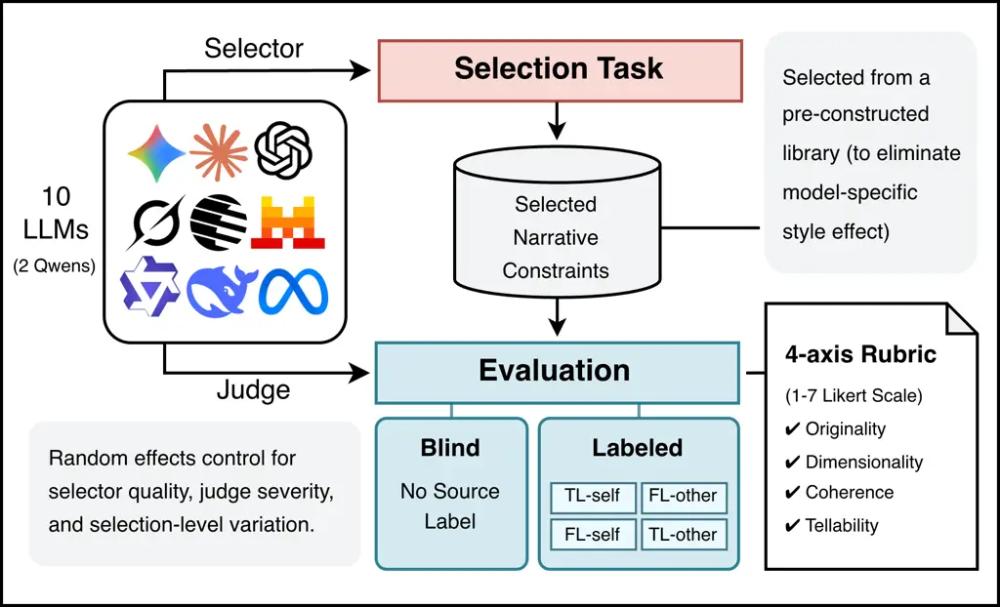
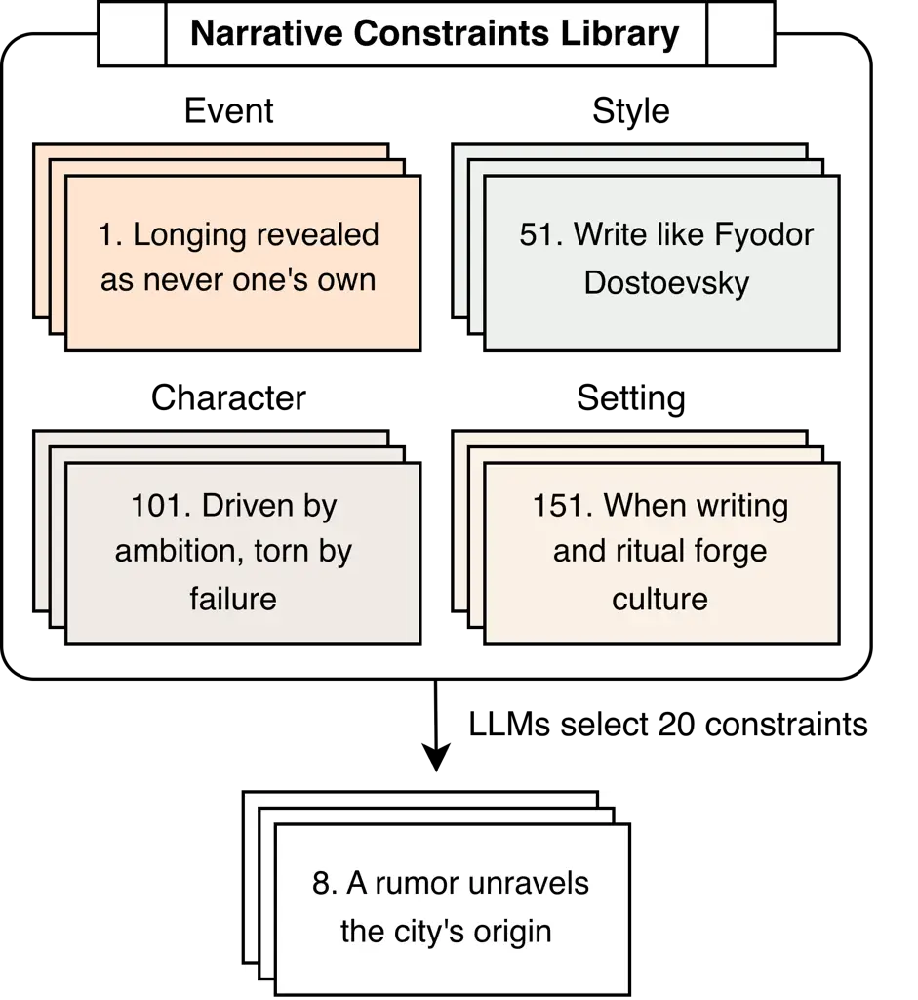
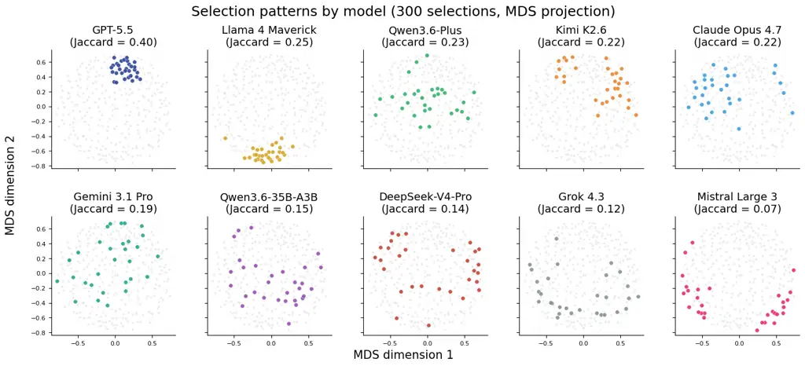
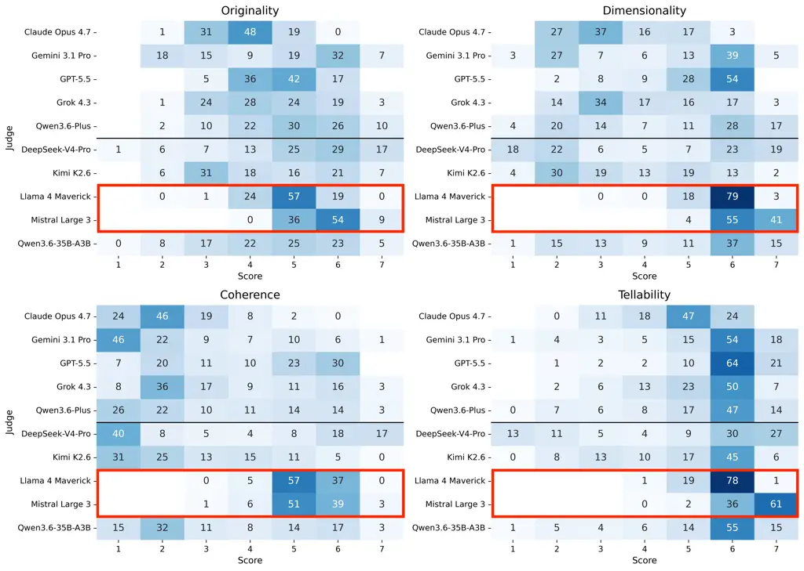
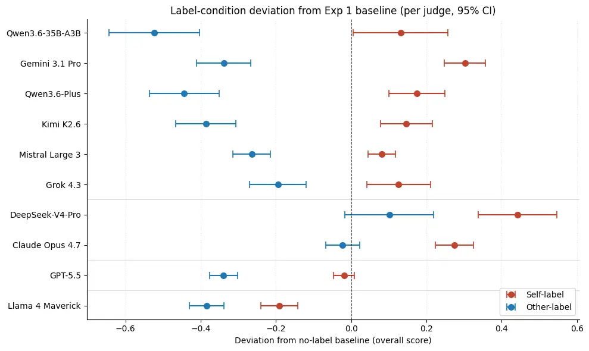
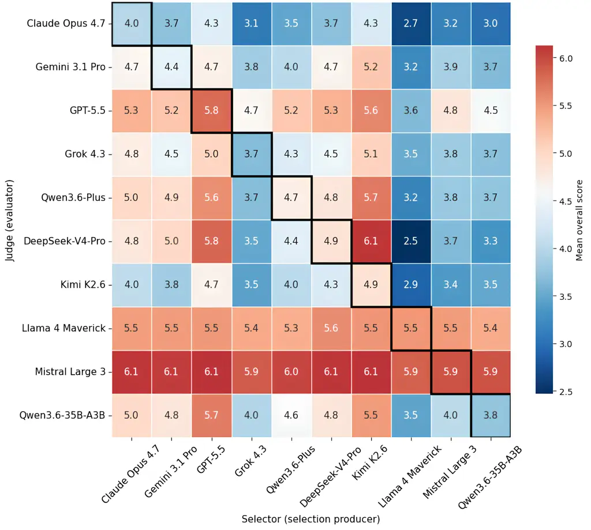

# Self- and Other-Labels Induce Bidirectional Bias in LLM Judges

Songeun Chae    Min Kim    Donghoon Jung    Seojin Choi    Seohyon Jung
^(†)^(†)thanks: Corresponding author. Affiliation: School of Digital
Humanities and Computational Social Sciences, KAIST, South Korea
Affiliation: {songeun, mk, donghoon.jung, seojin64,
seohyon.jung}@kaist.ac.kr

###### Abstract

As LLM-as-a-judge becomes increasingly widespread, self-preference—the
tendency of a judge to favor its own outputs—raises growing concerns
about evaluation reliability. However, this bias has been studied
predominantly on generated text, where stylistic features and response
quality are inevitably conflated. As a result, existing measurements
cannot separate genuine self-preference from these confounds. We address
this limitation by changing the object of evaluation: instead of judging
generated text, ten LLMs assess sets of narrative constraints selected
from a shared pool, which carry no stylistic fingerprint yet retain a
recoverable model-specific signature. Two experiments on this task yield
complementary findings. Under blind evaluation, self-preference
disappears, with a small effect remaining in the opposite direction once
selection quality and judge severity are controlled. Under matched
quality, however, self- and other-labels alone—without naming any
model—shift scores bidirectionally. LLM judges inflate scores for
self-labeled selections and deflate those for other-labeled ones
regardless of the selection’s actual source. We make two
contributions: 1) authorship attribution is a distinct driver of
evaluation bias, and 2) ground-truth-free tasks can serve as controlled
instruments for studying LLM judge behavior.

## 1 Introduction

LLM-as-a-judge has emerged as a widely adopted paradigm for scalable
evaluation, using large language models (LLMs) as automatic assessors
across diverse tasks (Gu et al., 2026). Despite their extensive use, LLM
judges have been shown to exhibit systematic biases (Shi et al., 2025;
Ye et al., 2025). A particularly concerning bias is self-preference
(Zheng et al., 2023; Xu et al., 2024), where an LLM judge rates its own
outputs more favorably than those of other models. Prior work has
examined potential sources of this bias, including low perplexity
(Wataoka et al., 2024) and self-recognition (Panickssery et al., 2024).
Saraf et al. (2025) investigated the effect of authorship labels by
manipulating them across three commercial LLMs, with the Claude label
elevating scores across judges.



Figure 1: Experimental design. Ten LLMs participate in dual roles: as
selectors who construct evaluation targets via a constraint selection
task, and as judges who evaluate the resulting selections on a 4-axis
rubric. Each selection is judged under two conditions: Blind (no source
label) and Labeled, where source attribution is experimentally
manipulated in a $`2\times 2`$ design crossing label veracity (TL =
true, FL = false) with claimed source (self vs. other).

Meanwhile, recent studies have identified methodological confounds in
measuring self-preference. Chen et al. (2025a); Chen et al. (2025b)
argue that existing measurements conflate response quality with genuine
self-preference, and Roytburg et al. (2026) attribute almost 90% of the
observed self-preference to evaluator uncertainty—a judge’s limited
ability to reliably assess response quality. These findings raise two
questions: First, does self-preference persist once confounds are
controlled? Second, can self/other labels alone shift evaluations under
the same controls?

To address these questions, we introduce a novel experimental design
built around an open-ended creative task. Instead of model-generated
text, ten LLM judges assess combinations of narrative constraints
selected from a pre-constructed pool of 200, under both blind and
labeled conditions. Our results on this task show that although most
LLMs assign higher mean scores to their own selections, this apparent
self-preference largely disappears once selection quality and judge
severity are controlled. Moreover, authorship labels alone shift
evaluations bidirectionally—judges inflate scores under self-labels
while simultaneously deflating them under other-labels—even when the
evaluation target is identical.

We make two contributions. First, we provide direct evidence that
self/other labels alone can induce bidirectional evaluation bias.
Second, by leveraging creative tasks as a testbed for assessing LLM
biases, we show that ground-truth-free settings can serve as controlled
instruments for studying LLM judge behavior. Additionally, our
experimental design lends further support to the view that apparent
self-preference in LLM judges may be largely a measurement artifact
(Chen et al., 2025b; Roytburg et al., 2026).

## 2 Related Work

### 2.1 LLM-as-a-Judge and Evaluation Bias

LLMs are increasingly deployed as evaluators across a broad range of
assessment tasks, such as pairwise comparison and direct scoring
(Saunders et al., 2022; Liu et al., 2023; Bai et al., 2023; Li et al.,
2025). However, prior work has identified systematic biases that
undermine the reliability of LLM-as-a-judge. Position bias—the tendency
of judges to favor a response based on its order rather than its
quality—is one of the most extensively studied (Zheng et al., 2023; Wang
et al., 2024; Shi et al., 2025). Koo et al. (2024) examined six
cognitive biases in LLM evaluators, including attentional bias and the
bandwagon effect, while Ye et al. (2025) documented a broader spectrum,
showing that judges also prefer responses based on verbosity and
sentiment. Among these biases, _self-preference_ (Panickssery et al.,
2024; Liu et al., 2024; Pombal et al., 2026)—also termed
self-enhancement bias (Zheng et al., 2023)—refers to the tendency of an
LLM judge to favor its own outputs over other models’ outputs. This bias
is particularly concerning because it can directly compromise the
validity of LLM-based evaluation, motivating closer examination.

### 2.2 Proposed Mechanisms and Measurement Confounds

While self-preference has been demonstrated across diverse evaluation
domains (Mahbub and Feng, 2026; Pombal et al., 2026), its underlying
sources remain contested. Panickssery et al. (2024) find a positive
correlation between self-recognition ability and self-preference
strength, whereas Wataoka et al. (2024) attribute self-preference to a
familiarity effect, with judges favoring lower-perplexity outputs.
Recent work raises a more fundamental question: whether this effect
reflects a genuine bias. Chen et al. (2025b) show that existing measures
conflate self-preference with response quality; Chen et al. (2025a)
argue that, while stronger models exhibit greater self-preference, much
of this preference reflects their objectively superior output quality.
Notably, Roytburg et al. (2026) attribute roughly 90% of measured
self-preference to evaluator uncertainty, demonstrating that judges’
difficulty in assessing harder queries inflates the apparent
self-preference rate. Collectively, these findings suggest that most
reported self-preference may stem from measurement confounds, though the
mechanism behind any residual is still contested.

### 2.3 Authorship Labels and Self-Preference

A distinct line of work examines whether authorship labels can shift
LLM-based evaluations. Sun et al. (2026) reveal that LLM judges attend
more closely to the authorship label than to content itself, using it as
a shortcut for evaluation. Marioriyad et al. (2025) identify a
preference hierarchy among authorship labels (Expert $`>`$ Human $`>`$
LLM $`>`$ Unknown). Most relevant to our work, Saraf et al. (2025) test
label-induced bias in three commercial LLM judges under four
conditions—no attribution, true attribution, and two false attributions.
The Claude label elevates scores while the Gemini label lowers them,
producing apparent self-preference in Claude and self-deprecation in
Gemini. However, since the evaluated content consisted of LLM-generated
blog posts, these effects remain confounded with stylistic fingerprints,
perplexity, and output quality, leaving self-recognition as a potential
driver of self-preference. More critically, because the labels were real
model names, it is unclear whether the observed shifts reflect
self-preference or model reputation effects.

## 3 Methodology

To address the limitations of prior work, we adopt a narrative selection
task to construct evaluation targets. We then prompt LLM judges to
assess these selections on a 4-dimension rubric across two settings:
blind and labeled evaluation. Ten LLMs serve as both selectors and
judges: five commercial models (Claude Opus 4.7, Gemini 3.1 Pro,
GPT-5.5, Grok 4.3, and Qwen3.6-Plus) and five open-weight models
(DeepSeek-V4-Pro, Kimi K2.6, Llama 4 Maverick, Mistral Large 3, and
Qwen3.6-35B-A3B; see Appendix A).

### 3.1 Narrative Constraint Selection Task

Instead of relying on text-based evaluation and post-hoc style control,
we eliminate model-specific stylistic features by changing the type of
evaluation target: LLM judges assess structured narrative selections,
with no narrative text generated at any stage. To produce these
selections, we prompt each LLM to perform the selection task 30 times,
providing sufficient inter-run coverage per model. In each run, the LLM
selects the 20 items it considers most useful for constructing a single
story from a curated set of 200 narrative constraints (Jung et al.,
2026)—each a pre-written, single-sentence description of an Event,
Style, Character, or Setting (see Figure 2). This design offers two
advantages. First, word choice, sentence structure, and phrasing are
held constant, preventing model-specific stylistic features from
influencing the evaluations. Second, creative tasks provide a sensitive
testbed for detecting LLM judgment biases, as such biases tend to be
more salient in subjective, open-ended domains (Marioriyad et al., 2025;
Fein et al., 2026).



Figure 2: Narrative constraint selection task, adapted from Jung et al.
(2026). The pool comprises 200 single-sentence constraints from that
work, organized into four categories. In each run, an LLM freely selects
any 20 constraints from the full pool with no category-level quota. All
ten models each perform 30 runs, yielding 300 constraint sets in total.
No narrative text is generated from the selected constraints; the
selections themselves are the evaluation targets.

Analysis of selections reveals that each model draws on a characteristic
subset. Within-model Jaccard similarity (Broder, 1997) exceeds chance
for all ten models, indicating that each LLM exhibits a consistent
selection profile (see Figure 3; Appendix E for numerical values).
Moreover, a leave-one-out k-NN classifier ($`k=5`$) identifies the
source model with 50.7% accuracy—more than five times the 10% chance
baseline (robust across $`k\in\{1,3,5,7\}`$: 46.7–50.7%) (see
Appendix D). Together, these analyses indicate that LLMs maintain
distinct selection profiles when model-specific stylistic cues are
eliminated by design, providing the variation necessary for meaningful
self-versus-other comparisons.



Figure 3: Selection patterns by model (300 selections), projected via
Multidimensional Scaling (Borg and Groenen, 2005). Each subplot
highlights one model’s selections against the full set; models are
ordered by within-model Jaccard similarity (descending).

### 3.2 Evaluation Procedure

#### 3.2.1 Rubric

Each selection set is assessed on a 7-point Likert scale across four
dimensions: Originality, Dimensionality, Coherence, and Tellability. The
rubric provides a structured interpretive frame for eliciting judgments
consistently across models and experimental conditions. Originality and
Coherence are adapted from the Torrance Test of Creative Writing
(Chakrabarty et al., 2024), while Dimensionality and Tellability draw on
narrative theory (Barthes, 1977; Labov, 1972). By directing each judge
to assess specific, theoretically grounded properties rather than
self-selecting which aspects to attend to, this framework reduces
evaluative arbitrariness and renders judge behavior decomposable across
conceptually distinct dimensions (see Appendix B for full rubric with
anchor descriptions and theoretical rationale).

#### 3.2.2 Experiment 1: Blind Evaluation

##### Setup.

In Experiment 1, each model serves as a judge, evaluating all 300
selections without labels. Each judge returns a JSON object with an
integer score on a 1–7 scale for each dimension and a 2–3 sentence
justification. To average over stochastic variability in LLM scoring,
each judge evaluates each selection three times, yielding
$`10\text{ judges}\times 300\text{ selections}\times 3\text{ repetitions}=9{,}000`$
runs. Within each run, both the order of the 20 constraints in the
selection and the order of the four rubric dimensions are independently
shuffled using a per-run seed, mitigating potential ordering biases. The
full evaluation prompt and response format are provided in Appendix C.

##### Raw self–other comparison.

For each judge, we compare the mean scores it assigns to its own
selections versus those produced by other models, for the average score
and each rubric dimension. To account for stochastic variability in LLM
scoring, we test each judge’s self-produced selections against its
other-produced ones with Welch’s two-sample t-tests; p-values are
Holm-corrected across the ten judges. This comparison controls for
neither selector quality nor judge severity; it serves as the baseline
against which the confound-controlled analysis is interpreted.

##### Confound-controlled estimation.

To test whether self-preference remains once measurement confounds are
controlled for, we fit a mixed-effects model:

```math
\displaystyle\texttt{score}=\beta_{0} \displaystyle+\beta_{S}\cdot\texttt{is\_self}+(1\,|\,\texttt{judge})
```

```math
\displaystyle}{\displaystyle+(1\,|\,\texttt{selector})+(1\,|\,\texttt{selection\_id})
```

where $`\beta_{S}`$ is the coefficient of interest; the random
intercepts absorb three measurement confounds: judge for rater severity,
selector for selection quality, and selection*id for non-independence
across repeated evaluations of the same selection. A positive,
significant $`\beta*{S}`$ indicates that judges score their own
selections higher after controls; a non-significant $`\beta\_{S}`$
indicates that the apparent self-preference is attributable to the
controlled confounds.

#### 3.2.3 Experiment 2: Labeled Evaluation

##### Setup.

In Experiment 2, LLM judges evaluate selections under four label
conditions: TL-self, TL-other, FL-self, and FL-other (see Table 1). For
each judge, we construct quality-matched pairs from Experiment 1 scores:
a self- and an other-produced selection can be paired if the judge rated
them within 0.25 on the overall mean and within 1 point on each
dimension. The thresholds ensure that paired selections are comparable
not only in overall score but on each individual dimension, while
producing enough pairs per judge for estimation. Among eligible
candidates, the closest match by total dimension distance is selected,
yielding 40 pairs per judge (400 in total).

Each evaluation run presents a single selection to the judge, so the
attribution label affects an absolute rating rather than a direct
pairwise comparison. The label is inserted as an anonymous self/other
phrase—“your own selection” for self-labels and “another language model”
for other-labels—without naming specific models. This isolates the
self-other distinction from model-identity effects (full prompts in
Appendix C). As in Experiment 1, each selection is evaluated three
times, yielding
$`40\text{ pairs}\times 10\text{ judges}\times 4\text{ conditions}\times 3\text{ reps}=4{,}800`$
runs.

|                |                              |                               |
| -------------- | ---------------------------- | ----------------------------- |
|                | Self label                   | Other label                   |
|                | TL-self                      | FL-other                      |
| Self-produced  | self selection + self label  | self selection + other label  |
|                | FL-self                      | TL-other                      |
| Other-produced | other selection + self label | other selection + other label |

Table 1: $`2\times 2`$ design for Experiment 2, crossing the actual
source of a selection with the label shown to the judge. TL = _true
label_ (label matches the actual source); FL = _false label_ (label
contradicts the actual source).

##### Label-induced attribution effect estimation.

To investigate the authorship label effect and test whether it depends
on the true content origin, we fit a mixed-effects model:

```math
\displaystyle\texttt{score}=\beta_{0} \displaystyle+\beta_{L}\cdot\texttt{label}+\beta_{A}\cdot\texttt{actual}
```

```math
\displaystyle}{\displaystyle+\beta_{LA}\cdot(\texttt{label}\times\texttt{actual})
```

```math
\displaystyle}{\displaystyle+(1\,|\,\texttt{judge})+(1\,|\,\texttt{selection\_id})
```

where label indicates the displayed source (self vs. other) and actual
the true source, with random intercepts. $`\beta_{L}`$ captures the main
effect of the displayed label—the average score shift for a self- versus
other-label—whereas $`\beta_{A}`$ reflects the main effect of actual
source, the average score difference between self- and other-produced
selections. A non-significant $`\beta_{LA}`$ would indicate that the
label effect is invariant across actual sources, with the same
label-induced shift regardless of who actually produced the selection.

##### Directional decomposition.

$`\beta_{L}`$ captures magnitude but not direction: it cannot
distinguish whether self-labels inflate scores, other-labels deflate
them, or both. To resolve this, we use each judge’s Experiment 1 (blind
evaluation) scores as the baseline and compute the deviation of every
labeled evaluation from this baseline.

## 4 Results

### 4.1 Experiment 1: Apparent Self-Preference Disappears Under Control

#### 4.1.1 Sanity Check



Figure 4: Score frequency distribution across all Experiment 1 (blind)
evaluations, used as a sanity check. Each cell reports the percentage of
evaluations in which a judge assigned that score for the given
dimension.

In Experiment 1, eight of the ten judges produce meaningful score
variation across selections (see Figure 4). The remaining two—Llama 4
Maverick and Mistral Large 3, both open-weight LLMs—fall short of the
basic discriminative capacity required for self–other comparisons,
placing at least 81% of their ratings on two adjacent scores in every
dimension.

#### 4.1.2 Raw Self-Other Comparison

|                  |      |       |            |           |
| ---------------- | ---- | ----- | ---------- | --------- |
| Judge            | Self | Other | $`\Delta`$ | $`p`$     |
| Kimi K2.6        | 4.88 | 3.79  | $`+1.09`$  | $`<.001`$ |
| GPT-5.5          | 5.78 | 4.92  | $`+0.86`$  | $`<.001`$ |
| DeepSeek-V4-Pro  | 4.86 | 4.34  | $`+0.52`$  | $`.350`$  |
| Claude Opus 4.7  | 4.01 | 3.50  | $`+0.51`$  | $`<.001`$ |
| Qwen3.6-Plus     | 4.73 | 4.49  | $`+0.24`$  | $`.484`$  |
| Gemini 3.1 Pro   | 4.41 | 4.21  | $`+0.21`$  | $`.484`$  |
| Llama 4 Maverick | 5.51 | 5.47  | $`+0.04`$  | $`.484`$  |
| Mistral Large 3  | 5.94 | 6.02  | $`-0.08`$  | $`.352`$  |
| Grok 4.3         | 3.68 | 4.35  | $`-0.67`$  | $`<.001`$ |
| Qwen3.6-35B-A3B  | 3.75 | 4.65  | $`-0.90`$  | $`<.001`$ |

Table 2: Raw self–other comparison on the average score, sorted by
$`\Delta=\text{Self}-\text{Other}`$. $`p`$-values from Welch’s
two-sample t-tests, Holm-corrected across the ten judges. Confounds are
not controlled; per-dimension results are in Appendix F.

On average, seven of ten judges rate their own selections higher than
others’, but the significant gaps emerge in both directions: positive
for Kimi K2.6, GPT-5.5, and Claude Opus 4.7, and negative for Grok 4.3
and Qwen3.6-35B-A3B (see Table 2; per-dimension results in Appendix F).
However, the per-judge $`\times`$ selector matrix (see Appendix G)
suggests this pattern reflects selection quality rather than genuine
self-preference, as strong selectors receive higher scores from most
judges, and weak selectors receive lower ones—including from themselves.
Kimi K2.6 illustrates this—it shows the largest raw self–other gap, yet
its selections also rank among the highest from nearly every judge. The
raw gaps may therefore reflect producer-level quality differences rather
than genuine self-preference, which we disentangle in the following
analysis.

#### 4.1.3 Confound-Controlled Estimation

Table 3 reports the self-preference coefficient ($`\beta_{S}`$) from
§3.2.2 for the average score and each rubric dimension, before and after
excluding the two low-discrimination judges identified in §4.1.1. Before
the exclusion, $`\beta_{S}`$ is significantly positive on the average
score and on Dimensionality, Coherence, and Tellability, while
Originality shows a small negative effect. After excluding the two, all
positive effects disappear; only the negative Originality effect
remains, which is contrary to self-preference. To ensure that the
exclusion itself does not drive this result, we refit the model on all
ten judges with a random slope for is_self by judge. We find no
significant self-preference on any dimension, with substantial
between-judge variability ($`\tau`$ = 0.41–0.63; see Appendix H). In
sum, the raw self–other gap is attributable to the inflated ratings of
the two low-discrimination judges and to selection quality rather than
genuine self-preference.

|      |                  |                          |                        |                          |
| ---- | ---------------- | ------------------------ | ---------------------- | ------------------------ |
|      | Full (10 judges) |                          | Excl. low-discrim. (8) |                          |
| Dim. | $`\beta_{S}`$    | 95% CI                   | $`\beta_{S}`$          | 95% CI                   |
| Avg. | $`+0.181^{*}`$   | \[ 0.13, 0.23 \]         | $`+0.003`$             | \[$`-0.05`$, 0.06 \]     |
| Org. | $`-0.144^{*}`$   | \[$`-0.21`$, $`-0.08`$\] | $`-0.133^{*}`$         | \[$`-0.21`$, $`-0.05`$\] |
| Dim. | $`+0.316^{*}`$   | \[ 0.24, 0.39 \]         | $`+0.039`$             | \[$`-0.05`$, 0.12 \]     |
| Coh. | $`+0.276^{*}`$   | \[ 0.21, 0.34 \]         | $`+0.042`$             | \[$`-0.03`$, 0.12 \]     |
| Tel. | $`+0.278^{*}`$   | \[ 0.21, 0.34 \]         | $`+0.065`$             | \[$`-0.01`$, 0.14 \]     |

Table 3: Confound-controlled self-preference coefficient $`\beta_{S}`$
from the mixed-effects model, before and after excluding the two
low-discrimination judges. Avg. = the average of the four rubric
dimensions and the primary outcome; Org. = Originality, Dim. =
Dimensionality, Coh. = Coherence, Tel. = Tellability. $`{}^{*}p<.05`$.
The positive effects on the average score and three dimensions vanish
once low-discrimination judges are removed; only a _negative_
Originality effect remains, which runs counter to self-preference
(though not robust to random-slope specification; Appendix H).

### 4.2 Experiment 2: Labels Alone Induce Bidirectional Attribution Bias

#### 4.2.1 Per-Condition Descriptive Statistics

Table 4reports descriptive scores across four label–source conditions,
illustrating how self- versus other-attribution shifts evaluations of
identical selections regardless of actual authorship. Within each Actual
block, self-labels elevate scores over other-labels by 0.29–0.57 across
all four dimensions without exception—notably including Originality,
which had shown, if anything, a weak self-deprecation tendency in the
blind condition. By contrast, comparing across actual sources at the
same label yields near-identical scores (4.92 vs. 4.91 average under
self-labels; 4.50 vs. 4.48 under other-labels), suggesting that the
label, not the content, drives the shift in this experiment.

|           |           |             |             |             |             |             |
| --------- | --------- | ----------- | ----------- | ----------- | ----------- | ----------- |
| Actual    | Condition | Average     | Org.        | Dim.        | Coh.        | Tel.        |
| Self      | TL-self   | 4.92 (1.04) | 4.76 (1.24) | 5.16 (1.55) | 3.85 (1.74) | 5.91 (1.09) |
| -produced | FL-other  | 4.50 (1.10) | 4.28 (1.25) | 4.60 (1.60) | 3.56 (1.69) | 5.55 (1.14) |
| Other     | FL-self   | 4.91 (1.06) | 4.83 (1.23) | 5.09 (1.57) | 3.92 (1.80) | 5.79 (1.12) |
| -produced | TL-other  | 4.48 (1.16) | 4.30 (1.19) | 4.52 (1.68) | 3.63 (1.82) | 5.47 (1.22) |

Table 4: Per-condition descriptive statistics for Experiment 2. Mean
(SD) across all judges, pairs, and repetitions. TL = label matches
actual source; FL = label contradicts actual source.

#### 4.2.2 Label-Induced Attribution Effect

Table 5 presents the mixed-effects model estimates from §3.2.3. The
label main effect ($`\beta_{L}`$) is significantly positive across all
four dimensions and for the average score, while neither the
actual-source effect ($`\beta_{A}`$) nor the label$`\times`$actual
interaction ($`\beta_{LA}`$) reaches significance on any dimension. As a
manipulation check, $`\beta_{A}`$—the effect of the selection’s true
source—should be near zero if quality matching succeeded; its
non-significance on every dimension indicates that matching left no
substantial content-driven differences, so the displayed-label effect
($`\beta_{L}`$) cannot be attributed to residual quality gaps. Together,
these results show that the displayed attribution label alone can shift
scores, even when the evaluation target is identical.

|      |                |                          |                   |                |
| ---- | -------------- | ------------------------ | ----------------- | -------------- |
| Dim. | Effect         | Estimate                 | 95% CI            | $`\mathbf{p}`$ |
|      | $`\beta_{L}`$  | $`\mathbf{+0.43^{***}}`$ | $`[+0.39,+0.47]`$ | $`<.001`$      |
| Avg. | $`\beta_{A}`$  | $`+0.02`$                | $`[-0.09,+0.14]`$ | $`.689`$       |
|      | $`\beta_{LA}`$ | $`-0.01`$                | $`[-0.06,+0.05]`$ | $`.823`$       |
|      | $`\beta_{L}`$  | $`\mathbf{+0.53^{***}}`$ | $`[+0.47,+0.60]`$ | $`<.001`$      |
| Org. | $`\beta_{A}`$  | $`-0.03`$                | $`[-0.15,+0.09]`$ | $`.663`$       |
|      | $`\beta_{LA}`$ | $`-0.05`$                | $`[-0.14,+0.05]`$ | $`.346`$       |
|      | $`\beta_{L}`$  | $`\mathbf{+0.57^{***}}`$ | $`[+0.50,+0.65]`$ | $`<.001`$      |
| Dim. | $`\beta_{A}`$  | $`+0.11`$                | $`[-0.06,+0.27]`$ | $`.197`$       |
|      | $`\beta_{LA}`$ | $`-0.02`$                | $`[-0.12,+0.08]`$ | $`.721`$       |
|      | $`\beta_{L}`$  | $`\mathbf{+0.29^{***}}`$ | $`[+0.24,+0.35]`$ | $`<.001`$      |
| Coh. | $`\beta_{A}`$  | $`-0.06`$                | $`[-0.26,+0.14]`$ | $`.541`$       |
|      | $`\beta_{LA}`$ | $`-0.01`$                | $`[-0.09,+0.07]`$ | $`.805`$       |
|      | $`\beta_{L}`$  | $`\mathbf{+0.32^{***}}`$ | $`[+0.26,+0.38]`$ | $`<.001`$      |
| Tel. | $`\beta_{A}`$  | $`+0.07`$                | $`[-0.05,+0.20]`$ | $`.257`$       |
|      | $`\beta_{LA}`$ | $`+0.05`$                | $`[-0.04,+0.13]`$ | $`.261`$       |

Table 5: Fixed-effect estimates from the mixed-effects models for
Experiment 2. $`\beta_{L}`$ captures the displayed-label effect;
$`\beta_{A}`$ the actual-source effect (expected $`\approx 0`$ under
successful quality matching); $`\beta_{LA}`$ their interaction.
$`{}^{***}p<.001`$. Across all dimensions, $`\beta_{L}`$ is the only
significant fixed effect, and this pattern is robust to excluding two
low-discrimination judges (see Appendix I).

#### 4.2.3 A Bidirectional Label-Induced Attribution Bias

Table 6 indicates that the label-induced attribution bias operates
bidirectionally. All ten judges rate self-labels above other-labels, and
six follow the dominant symmetric pattern—inflating scores under
self-labels while simultaneously deflating them under other-labels.
Three exhibit one-sided variants: Claude Opus 4.7 and DeepSeek-V4-Pro
show significant inflation under self-labels but no reliable change
under other-labels (self-boost), while GPT-5.5 shows the reverse
(other-penalty). Llama 4 Maverick deflates under both labels
(general-penalty), consistent with its low-discrimination behavior in
the sanity check. These findings refine the previous analysis by showing
that the label main effect ($`\beta_{L}`$) operates in two
directions—self-inflation and other-deflation—that may co-occur or
appear alone.

|                  |                |                |                 |
| ---------------- | -------------- | -------------- | --------------- |
| Judge            | Self-label     | Other-label    | Pattern         |
| Qwen3.6-35B-A3B  | $`+0.131^{*}`$ | $`-0.523^{*}`$ | symmetric       |
| Gemini 3.1 Pro   | $`+0.302^{*}`$ | $`-0.339^{*}`$ | symmetric       |
| Qwen3.6-Plus     | $`+0.175^{*}`$ | $`-0.444^{*}`$ | symmetric       |
| Kimi K2.6        | $`+0.147^{*}`$ | $`-0.386^{*}`$ | symmetric       |
| Mistral Large 3  | $`+0.081^{*}`$ | $`-0.265^{*}`$ | symmetric       |
| Grok 4.3         | $`+0.126^{*}`$ | $`-0.195^{*}`$ | symmetric       |
| DeepSeek-V4-Pro  | $`+0.443^{*}`$ | $`+0.101`$     | self-boost      |
| Claude Opus 4.7  | $`+0.275^{*}`$ | $`-0.023`$     | self-boost      |
| GPT-5.5          | $`-0.019`$     | $`-0.340^{*}`$ | other-penalty   |
| Llama 4 Maverick | $`-0.192^{*}`$ | $`-0.384^{*}`$ | general-penalty |

Table 6: Per-judge mean deviation from the Experiment 1 (no-label)
baseline under self- and other-label conditions on the average score.
Patterns: symmetric (self $`\uparrow`$, other $`\downarrow`$),
self-boost (self $`\uparrow`$ only), other-penalty (other $`\downarrow`$
only), general-penalty (both $`\downarrow`$). Rows grouped by pattern;
within each group, judges are sorted by the magnitude of the
label-induced shift. $`{}^{*}p<.05`$ (one-sample $`t`$-test, H₀:
$`\mu=0`$).



Figure 5: Per-judge mean deviation from the Experiment 1 (blind
evaluation) baseline under self-labels (red) and other-labels (blue) on
the average score, with 95% CIs.

## 5 Discussion

### 5.1 Candidate Mechanisms: Familiarity vs. Self-Recognition

Across our two experiments, apparent self-preference disappears under
blind evaluation once confounds are controlled, and gives way to a
label-driven shift when self- and other-labels are attached to identical
targets. If LLM judges favor lower-perplexity outputs, as Wataoka et al.
(2024) argue, self-preference should have arisen in Experiment 1: each
judge exhibits a distinct selection pattern, so its own selections
should be the most familiar to it even though model-specific stylistic
cues are structurally eliminated. However, self-preference is no longer
significant once selection quality and judge severity are controlled.
More fundamentally, the familiarity hypothesis cannot explain why
attributed authorship shifts evaluation scores when the targets
themselves remain identical. Familiarity thus does not appear to be a
substantial driver of self-preference in our setting; the higher mean
scores that judges initially assigned to their own selections are better
attributed to measurement confounds.

By contrast, the self-recognition hypothesis of Panickssery et al.
(2024), who reported a linear correlation between self-recognition
ability and self-preference strength, provides a useful starting point
for interpreting both experiments. We view Experiment 1 as a setting
where self-recognition is hindered by the nature of the evaluation
targets: although each model’s selections carry a statistically
recoverable signature (§3.1), this signal may be too weak for a judge to
recognize its own selections during evaluation. In Experiment 2, in
contrast, we speculate that explicit self- and other-labels establish
the conditions under which the self/other distinction becomes operative.
While assigning explicit labels differs from text-based implicit
self-recognition, our findings align with the account of Panickssery et
al. (2024) in a broader sense: what matters is whether authorship is
marked as self or other, regardless of whether it is inferred through
self-recognition or supplied by an explicit label. Still, how LLM judges
internally represent these self/other attributions warrants further
examination.

### 5.2 Generalizability and Broader Implications

In our two experiments, the evaluation targets are narrative selections
rather than generated texts. While this design separates content from
model-specific surface cues and thus enables rigorous control of
potential confounds, our main findings are established on this task. To
examine whether the observed label-induced effects extend beyond the
constraint-based narrative selection setting, we conducted a
supplementary replication applying the Experiment 2 design to the
evaluation of full-length generated research proposals, following Si et
al. (2025).

Specifically, the ten models each generated three research proposals for
each of three topics, yielding 90 proposals in total. We then normalized
the style of all proposals using the style-normalization prompt of Si et
al. (2025) with a fixed non-judge model (Claude Haiku 4.5) to reduce
stylistic variation across models. All ten judges subsequently evaluated
all 90 normalized proposals in a blind setting using the accompanying
review form verbatim, with anchored 1–10 scales for Novelty,
Feasibility, Expected Effectiveness, Excitement, and Overall. For the
labeled evaluation, we constructed 85 self–other pairs from proposals
whose blind Overall scores differed by no more than 0.5. Each proposal
was then evaluated three times under both self and other labels in a
2$`\times`$2 design using the same review form, with anonymous
self/other phrases as in our main experiments.

|         |                |                  |           |
| ------- | -------------- | ---------------- | --------- |
| Dim.    | Effect         | Estimate         | $`p`$     |
|         | $`\beta_{L}`$  | $`+0.196^{***}`$ | $`<.001`$ |
| Overall | $`\beta_{A}`$  | $`+0.011`$       | $`.897`$  |
|         | $`\beta_{LA}`$ | $`+0.016`$       | $`.779`$  |
|         | $`\beta_{L}`$  | $`+0.244^{**}`$  | $`.003`$  |
| Nov.    | $`\beta_{A}`$  | $`-0.014`$       | $`.908`$  |
|         | $`\beta_{LA}`$ | $`-0.043`$       | $`.426`$  |
|         | $`\beta_{L}`$  | $`-0.116^{*}`$   | $`.016`$  |
| Fea.    | $`\beta_{A}`$  | $`+0.125`$       | $`.182`$  |
|         | $`\beta_{LA}`$ | $`+0.051`$       | $`.366`$  |
|         | $`\beta_{L}`$  | $`+0.047`$       | $`.202`$  |
| Eff.    | $`\beta_{A}`$  | $`+0.002`$       | $`.989`$  |
|         | $`\beta_{LA}`$ | $`+0.078`$       | $`.133`$  |
|         | $`\beta_{L}`$  | $`+0.206^{***}`$ | $`<.001`$ |
| Exc.    | $`\beta_{A}`$  | $`+0.019`$       | $`.810`$  |
|         | $`\beta_{LA}`$ | $`-0.008`$       | $`.880`$  |

Table 7: Fixed-effect estimates from the mixed-effects models for the
research-proposal replication following Si et al. (2025). Nov. =
Novelty, Fea. = Feasibility, Eff. = Expected Effectiveness, Exc. =
Excitement. $`\beta_{L}`$ captures the displayed-label effect;
$`\beta_{A}`$ the actual-source effect; $`\beta_{LA}`$ their
interaction. $`{}^{*}p<.05`$, $`{}^{**}p<.01`$, $`{}^{***}p<.001`$.

The results in Table 7 show that label attribution significantly shifted
evaluations of identical research proposals, while neither actual
authorship nor the interaction between label and actual authorship was
significant. The effect was dimension-specific, increasing Overall,
Novelty, and Excitement scores while decreasing Feasibility scores. The
reversal for Feasibility indicates that attribution does not simply
induce uniformly more favorable scoring; the direction of the shift
varies with the evaluation dimension. The recurrence of systematic
attribution effects suggests that the bias is not specific to the
narrative-selection setup and may extend to more naturalistic evaluation
settings.

These findings have two implications for the measurement and deployment
of LLM judges. First, self-preference measured without sophisticated
confound controls is likely overstated. The raw self–other gaps in our
data were attributable to selection quality and judge severity, so
future measurement should identify and control for such confounds.
Second, our results identify a source of evaluation bias operating at
the level of assigned authorship, independently of content. If an
evaluation pipeline marks outputs as the judge’s own by design—as in
self-refinement, where self-preference is known to amplify (Xu et al.,
2024)—such attribution may distort the resulting evaluations. Future
research is needed to determine if withholding or obfuscating
attribution reliably suppresses this bias across evaluation settings.

## 6 Conclusion

This study asks whether self-preference in LLM judges persists once
surface-level cues and confounders are controlled, and whether a
self-authorship label alone can induce such bias under the same
controls. Drawing on a narrative selection task that eliminates
stylistic features by design, we examine LLM judge behavior under two
settings. Our results show that, while most LLM judges assign higher
mean scores to their own selections in blind evaluation, this apparent
self-preference disappears once selection quality and judge severity are
controlled. When authorship labels are assigned, however, they
systematically shift judges’ evaluations regardless of the evaluation
target’s actual source: the most common pattern is a symmetric
shift—judges inflate scores under self-labels and deflate them under
other-labels—while some models show one-sided variants, inflating
self-labeled or deflating other-labeled scores alone. A supplementary
replication on the evaluation of generated research proposals suggests
that this label-induced bias extends beyond the narrative selection
setting, though its direction varies by dimension. Our contributions are
twofold. First, by introducing an experimental design that structurally
eliminates surface confounders, we provide direct evidence that
self/other labels alone can induce bidirectional evaluation bias in LLM
judges. Second, we suggest that open-ended, ground-truth-free tasks can
serve as controlled instruments for studying LLM judge behavior.

## Limitations

Our main experiments are confined to a single creative-selection
domain—a setting that prioritizes rigorous experimental control over
ecological validity. The replication on research-proposal evaluation in
§5.2 provides initial evidence of generalization, but to one additional
domain only. Whether similar effects emerge in settings with verifiable
ground truth, such as reasoning or instruction-following evaluation,
remains unclear. In addition, all experiments in this study are
conducted in English, so the cross-lingual generalizability of the
label-induced bias remains an open question. Moreover, our labeled
evaluations—in both the main and the additional experiments—rely on
explicit self/other attribution prompts, whereas in real-world
LLM-as-a-judge deployments authorship information is often implicit or
unavailable. It remains unexamined whether real-world attribution cues,
such as stylistic fingerprints, model-specific linguistic patterns, or
interface-level signals, induce the same bias. Finally, the 4-axis
rubric we establish is not validated against human evaluation. It serves
as a structured interpretive frame that constrains how judges interpret
the evaluation criteria, rather than an absolute measure of quality.

## References

- Aristotle (1995) AristotleS. Halliwell (Ed.) Poetics. Loeb Classical
  Library, Harvard University Press, Cambridge, MA, USA. Cited by:
  Appendix B.
- Bai et al. (2023) Y. Bai, J. Ying, Y. Cao, X. Lv, Y. He, X. Wang, J.
  Yu, K. Zeng, Y. Xiao, H. Lyu, J. Zhang, J. Li, and L. Hou Benchmarking
  foundation models with language-model-as-an-examiner. In Advances in
  Neural Information Processing Systems, Vol. 36, pp. 78142–78167.
  External Links:
  [Link](https://proceedings.neurips.cc/paper_files/paper/2023/hash/f64e55d03e2fe61aa4114e49cb654acb-Abstract-Datasets_and_Benchmarks.html)
  Cited by: §2.1.
- Baroni (2007) R. Baroni La tension narrative: suspense, curiosité et
  surprise. Éditions du Seuil, Paris, France. External Links:
  [Link](https://www.seuil.com/ouvrage/la-tension-narrative-suspense-curiosite-et-surprise-raphael-baroni/9782020906777)
  Cited by: Appendix B.
- Barthes (1977) R. Barthes Introduction to the structural analysis of
  narratives. In Image-Music-Text, S. Heath (Ed.), pp. 79–124. Note:
  Original work published 1966 Cited by: Appendix B, §3.2.1.
- Borg and Groenen (2005) I. Borg and P. J. F. Groenen Modern
  multidimensional scaling: theory and applications. 2 edition, Springer
  Series in Statistics, Springer, New York, NY. External Links:
  [Document](https://dx.doi.org/10.1007/0-387-28981-X), ISBN
  978-0-387-25150-9 Cited by: Figure 3.
- Broder (1997) A. Z. Broder On the resemblance and containment of
  documents. In Proceedings. Compression and Complexity of SEQUENCES
  1997 (Cat. No.97TB100171), pp. 21–29. External Links:
  [Document](https://dx.doi.org/10.1109/SEQUEN.1997.666900) Cited by:
  §3.1.
- Chakrabarty et al. (2024) T. Chakrabarty, P. Laban, D. Agarwal, S.
  Muresan, and C. Wu Art or artifice? large language models and the
  false promise of creativity. In Proceedings of the 2024 CHI Conference
  on Human Factors in Computing Systems, New York, NY, USA, pp. 1–34.
  External Links:
  [Document](https://dx.doi.org/10.1145/3613904.3642731),
  [Link](https://doi.org/10.1145/3613904.3642731) Cited by: Appendix B,
  §3.2.1.
- Chen et al. (2025a) W. Chen, Z. Wei, X. Zhu, S. Feng, and Y. Meng Do
  LLM evaluators prefer themselves for a reason?. arXiv preprint
  arXiv:2504.03846. External Links:
  [Document](https://dx.doi.org/10.48550/arXiv.2504.03846),
  [Link](https://arxiv.org/abs/2504.03846) Cited by: §1, §2.2.
- Chen et al. (2025b) Z. Chen, H. Wang, X. Zhang, E. Hu, and Y. Lin
  Beyond the surface: measuring self-preference in LLM judgments. In
  Proceedings of the 2025 Conference on Empirical Methods in Natural
  Language Processing, Suzhou, China, pp. 1653–1672. External Links:
  [Document](https://dx.doi.org/10.18653/v1/2025.emnlp-main.86),
  [Link](https://aclanthology.org/2025.emnlp-main.86/), ISBN
  979-8-89176-332-6 Cited by: §1, §1, §2.2.
- Fein et al. (2026) D. Fein, S. Russo, V. Xiang, K. Jolly, R. Rafailov,
  and N. Haber LitBench: a benchmark and dataset for reliable evaluation
  of creative writing. In Proceedings of the 19th Conference of the
  European Chapter of the Association for Computational Linguistics
  (Volume 1: Long Papers), Rabat, Morocco, pp. 7740–7755. External
  Links: [Document](https://dx.doi.org/10.18653/v1/2026.eacl-long.362),
  [Link](https://aclanthology.org/2026.eacl-long.362/), ISBN
  979-8-89176-380-7 Cited by: §3.1.
- Gu et al. (2026) J. Gu, X. Jiang, Z. Shi, H. Tan, X. Zhai, C. Xu, W.
  Li, Y. Shen, S. Ma, H. Liu, S. Wang, K. Zhang, Z. Lin, B. Zhang, L.
  Ni, W. Gao, Y. Wang, and J. Guo A survey on LLM-as-a-judge. The
  Innovation 7 (6), pp. 101253. External Links:
  [Document](https://dx.doi.org/10.1016/j.xinn.2025.101253),
  [Link](https://doi.org/10.1016/j.xinn.2025.101253) Cited by: §1.
- Jung et al. (2026) D. Jung, J. Choi, S. Chae, and S. Jung Style over
  story: measuring LLM narrative preferences via structured selection.
  In Findings of the Association for Computational Linguistics: ACL
  2026, M. Liakata, V. P. Moreira, J. Zhang, and D. Jurgens (Eds.), San
  Diego, California, United States, pp. 27304–27331. External Links:
  [Link](https://aclanthology.org/2026.findings-acl.1361/),
  [Document](https://dx.doi.org/10.18653/v1/2026.findings-acl.1361),
  ISBN 979-8-89176-395-1 Cited by: Figure 2, §3.1.
- Koo et al. (2024) R. Koo, M. Lee, V. Raheja, J. I. Park, Z. M. Kim,
  and D. Kang Benchmarking cognitive biases in large language models as
  evaluators. In Findings of the Association for Computational
  Linguistics: ACL 2024, Bangkok, Thailand, pp. 517–545. External Links:
  [Document](https://dx.doi.org/10.18653/v1/2024.findings-acl.29),
  [Link](https://aclanthology.org/2024.findings-acl.29/) Cited by: §2.1.
- Labov (1972) W. Labov Language in the inner city: studies in the black
  english vernacular. University of Pennsylvania Press, Philadelphia,
  PA, USA. External Links:
  [Link](https://www.google.co.kr/books/edition/Language_in_the_Inner_City/snEEdFKLJ5cC?hl=ko&gbpv=0)
  Cited by: Appendix B, §3.2.1.
- Li et al. (2025) D. Li, B. Jiang, L. Huang, A. Beigi, C. Zhao, Z.
  Tan, A. Bhattacharjee, Y. Jiang, C. Chen, T. Wu, K. Shu, L. Cheng,
  and H. Liu From generation to judgment: opportunities and challenges
  of LLM-as-a-judge. In Proceedings of the 2025 Conference on Empirical
  Methods in Natural Language Processing, Suzhou, China, pp. 2757–2791.
  External Links:
  [Document](https://dx.doi.org/10.18653/v1/2025.emnlp-main.138),
  [Link](https://aclanthology.org/2025.emnlp-main.138/), ISBN
  979-8-89176-332-6 Cited by: §2.1.
- Liu et al. (2023) Y. Liu, D. Iter, Y. Xu, S. Wang, R. Xu, and C. Zhu
  G-eval: NLG evaluation using GPT-4 with better human alignment. In
  Proceedings of the 2023 Conference on Empirical Methods in Natural
  Language Processing, Singapore, pp. 2511–2522. External Links:
  [Document](https://dx.doi.org/10.18653/v1/2023.emnlp-main.153),
  [Link](https://aclanthology.org/2023.emnlp-main.153/) Cited by: §2.1.
- Liu et al. (2024) Y. Liu, N. Moosavi, and C. Lin LLMs as narcissistic
  evaluators: when ego inflates evaluation scores. In Findings of the
  Association for Computational Linguistics: ACL 2024, Bangkok,
  Thailand, pp. 12688–12701. External Links:
  [Document](https://dx.doi.org/10.18653/v1/2024.findings-acl.753),
  [Link](https://aclanthology.org/2024.findings-acl.753/) Cited by:
  §2.1.
- Mahbub and Feng (2026) T. Mahbub and S. Feng Mitigating
  self-preference by authorship obfuscation. In Proceedings of the AAAI
  Conference on Artificial Intelligence, Vol. 40, pp. 37701–37708.
  External Links:
  [Document](https://dx.doi.org/10.1609/aaai.v40i44.41105),
  [Link](https://ojs.aaai.org/index.php/AAAI/article/view/41105) Cited
  by: §2.2.
- Marioriyad et al. (2025) A. Marioriyad, M. H. Rohban, and M. S.
  Baghshah The silent judge: unacknowledged shortcut bias in
  LLM-as-a-judge. arXiv preprint arXiv:2509.26072. External Links:
  [Document](https://dx.doi.org/10.48550/arXiv.2509.26072),
  [Link](https://arxiv.org/abs/2509.26072) Cited by: §2.3, §3.1.
- Panickssery et al. (2024) A. Panickssery, S. R. Bowman, and S. Feng
  LLM evaluators recognize and favor their own generations. In Advances
  in Neural Information Processing Systems, Vol. 37, pp. 68772–68802.
  External Links:
  [Link](https://proceedings.neurips.cc/paper_files/paper/2024/hash/7f1f0218e45f5414c79c0679633e47bc-Abstract-Conference.html)
  Cited by: §1, §2.1, §2.2, §5.1.
- Pombal et al. (2026) J. Pombal, R. Rei, and A. F. T. Martins
  Self-preference bias in rubric-based evaluation of large language
  models. arXiv preprint arXiv:2604.06996. External Links:
  [Document](https://dx.doi.org/10.48550/arXiv.2604.06996),
  [Link](https://arxiv.org/abs/2604.06996) Cited by: Appendix B, §2.1,
  §2.2.
- Roytburg et al. (2026) D. Roytburg, M. Bozoukov, M. Nguyen, J.
  Barzdukas, M. Puig-Hall, and N. Oozeer Are LLM evaluators really
  narcissists? sanity checking self-preference evaluations. arXiv
  preprint arXiv:2601.22548. External Links:
  [Document](https://dx.doi.org/10.48550/arXiv.2601.22548),
  [Link](https://arxiv.org/abs/2601.22548) Cited by: §1, §1, §2.2.
- Ryan (2005) M. Ryan Tellability. In Routledge Encyclopedia of
  Narrative Theory, D. Herman, M. Jahn, and M. Ryan (Eds.), pp. 589–591.
  External Links:
  [Link](https://www.routledge.com/Routledge-Encyclopedia-of-Narrative-Theory/Herman-Jahn-Ryan/p/book/9780415775120)
  Cited by: Appendix B.
- Saraf et al. (2025) M. Saraf, S. R. Boroujeni, J. Beaudry, H. Abedi,
  and T. Bush Quantifying label-induced bias in large language model
  self- and cross-evaluations. arXiv preprint arXiv:2508.21164. External
  Links: [Document](https://dx.doi.org/10.48550/arXiv.2508.21164),
  [Link](https://arxiv.org/abs/2508.21164) Cited by: §1, §2.3.
- Saunders et al. (2022) W. Saunders, C. Yeh, J. Wu, S. Bills, L.
  Ouyang, J. Ward, and J. Leike Self-critiquing models for assisting
  human evaluators. arXiv preprint arXiv:2206.05802. External Links:
  [Document](https://dx.doi.org/10.48550/arXiv.2206.05802),
  [Link](https://arxiv.org/abs/2206.05802) Cited by: §2.1.
- Shi et al. (2025) L. Shi, C. Ma, W. Liang, X. Diao, W. Ma, and S.
  Vosoughi Judging the judges: a systematic study of position bias in
  LLM-as-a-judge. In Proceedings of the 14th International Joint
  Conference on Natural Language Processing and the 4th Conference of
  the Asia-Pacific Chapter of the Association for Computational
  Linguistics, Mumbai, India, pp. 292–314. External Links:
  [Document](https://dx.doi.org/10.18653/v1/2025.ijcnlp-long.18),
  [Link](https://aclanthology.org/2025.ijcnlp-long.18/), ISBN
  979-8-89176-298-5 Cited by: §1, §2.1.
- Si et al. (2025) C. Si, D. Yang, and T. Hashimoto Can LLMs Generate
  Novel Research Ideas? A Large-Scale Human Study with 100+ NLP
  Researchers. In International Conference on Learning Representations,
  External Links:
  [Link](https://proceedings.iclr.cc/paper_files/paper/2025/hash/ea94957d81b1c1caf87ef5319fa6b467-Abstract-Conference.html)
  Cited by: §5.2, §5.2, Table 7.
- Sun et al. (2026) X. Sun, D. Wu, S. Qin, I. Echizen, A. El Ali, and S.
  Sugawara Label effects: shared heuristic reliance in trust assessment
  by humans and LLM-as-a-judge. In Proceedings of the 64th Annual
  Meeting of the Association for Computational Linguistics (Volume 1:
  Long Papers), M. Liakata, V. P. Moreira, J. Zhang, and D. Jurgens
  (Eds.), San Diego, California, United States, pp. 32378–32392.
  External Links: [Link](https://aclanthology.org/2026.acl-long.1495/),
  [Document](https://dx.doi.org/10.18653/v1/2026.acl-long.1495), ISBN
  979-8-89176-390-6 Cited by: §2.3.
- Wang et al. (2024) P. Wang, L. Li, L. Chen, Z. Cai, D. Zhu, B. Lin, Y.
  Cao, L. Kong, Q. Liu, T. Liu, and Z. Sui Large Language Models are not
  Fair Evaluators. In Proceedings of the 62nd Annual Meeting of the
  Association for Computational Linguistics (Volume 1: Long Papers),
  Bangkok, Thailand, pp. 9440–9450. External Links:
  [Document](https://dx.doi.org/10.18653/v1/2024.acl-long.511),
  [Link](https://aclanthology.org/2024.acl-long.511/) Cited by: §2.1.
- Wataoka et al. (2024) K. Wataoka, T. Takahashi, and R. Ri
  Self-preference bias in LLM-as-a-judge. arXiv preprint
  arXiv:2410.21819. External Links:
  [Document](https://dx.doi.org/10.48550/arXiv.2410.21819),
  [Link](https://arxiv.org/abs/2410.21819) Cited by: §1, §2.2, §5.1.
- Xu et al. (2024) W. Xu, G. Zhu, X. Zhao, L. Pan, L. Li, and W. Wang
  Pride and prejudice: LLM amplifies self-bias in self-refinement. In
  Proceedings of the 62nd Annual Meeting of the Association for
  Computational Linguistics (Volume 1: Long Papers), Bangkok, Thailand,
  pp. 15474–15492. External Links:
  [Document](https://dx.doi.org/10.18653/v1/2024.acl-long.826),
  [Link](https://aclanthology.org/2024.acl-long.826/) Cited by: §1,
  §5.2.
- Ye et al. (2025) J. Ye, Y. Wang, Y. Huang, D. Chen, Q. Zhang, N.
  Moniz, T. Gao, W. Geyer, C. Huang, P. Chen, N. Chawla, and X. Zhang
  Justice or Prejudice? Quantifying Biases in LLM-as-a-Judge. In
  International Conference on Learning Representations, External Links:
  [Link](https://proceedings.iclr.cc/paper_files/paper/2025/hash/fdca08d371e4b6c031397909e20043bd-Abstract-Conference.html)
  Cited by: §1, §2.1.
- Zheng et al. (2023) L. Zheng, W. Chiang, Y. Sheng, S. Zhuang, Z.
  Wu, Y. Zhuang, Z. Lin, Z. Li, D. Li, E. Xing, H. Zhang, J. Gonzalez,
  and I. Stoica Judging LLM-as-a-judge with MT-Bench and Chatbot Arena.
  In Advances in Neural Information Processing Systems, A. Oh, T.
  Naumann, A. Globerson, K. Saenko, M. Hardt, and S. Levine (Eds.), Vol.
  36, pp. 46595–46623. External Links:
  [Link](https://dl.acm.org/doi/10.5555/3666122.3668142) Cited by: §1,
  §2.1.

## Appendix A Model Setup

|                  |                                               |
| ---------------- | --------------------------------------------- |
| Model            | OpenRouter ID                                 |
| Commercial       |                                               |
| Claude Opus 4.7  | anthropic/claude-4.7-opus-20260416            |
| Gemini 3.1 Pro   | google/gemini-3.1-pro-preview-20260219        |
| GPT-5.5          | openai/gpt-5.5-20260423                       |
| Grok 4.3         | x-ai/grok-4.3-20260430                        |
| Qwen3.6-Plus     | qwen/qwen3.6-plus-04-02                       |
| Open-weight      |                                               |
| DeepSeek-V4-Pro  | deepseek/deepseek-v4-pro-20260423             |
| Kimi K2.6        | moonshotai/kimi-k2.6-20260420                 |
| Llama 4 Maverick | meta-llama/llama-4-maverick-17b-128e-instruct |
| Mistral Large 3  | mistralai/mistral-large-2512                  |
| Qwen3.6-35B-A3B  | qwen/qwen3.6-35b-a3b-20260415                 |

Table 8: All models were accessed via OpenRouter²² 2
[https://openrouter.ai](https://openrouter.ai); exact snapshot
identifiers are provided. The set spans nine developers and covers
frontier general-purpose systems alongside open-weight models of varying
scale and training lineage, providing sufficient heterogeneity to probe
self-preference across diverse judges and model families. All models are
queried with temperature = 1.0 and reasoning_effort = high where each
parameter is supported; unsupported parameters were left at their
defaults.

## Appendix B Evaluation Rubric

|                |                                                                                                                                                         |                                                                                                                                                                      |
| -------------- | ------------------------------------------------------------------------------------------------------------------------------------------------------- | -------------------------------------------------------------------------------------------------------------------------------------------------------------------- |
| Dimension      | Anchor at 1 (Low)                                                                                                                                       | Anchor at 7 (High)                                                                                                                                                   |
| Originality    | The selected constraints lean on familiar story patterns and well-worn tropes, producing a combination that is predictable and conventional.            | The selected constraints break from familiar story patterns and well-worn tropes, producing a combination that is unpredictable and fresh.                           |
| Dimensionality | The selected constraints operate independently; altering one does not affect the meaning or function of the others.                                     | The selected constraints are mutually constitutive, each element defining the others’ meaning and weight, producing narrative depth.                                 |
| Coherence      | The selected constraints contain irreconcilable contradictions that no narrative device can resolve within a single coherent story.                     | The selected constraints integrate seamlessly into a single narrative without logical tensions or unresolved contradictions.                                         |
| Tellability    | The selected constraints lack a point worth telling—no conflict, question, or stake arises that would make an audience want to hear or tell this story. | The selected constraints carry a point worth telling—a clear conflict, urgent question, or meaningful stake that naturally invites narration and sustains attention. |

Table 9: Four-dimension evaluation rubric with anchor descriptions at
the endpoints of a 7-point Likert scale. Coherence asks whether the
constraints can share one story, Dimensionality whether they need each
other once they do. Theoretical grounding for each dimension is provided
in the text below.

##### Theoretical Rationale for the Proposed Rubric.

Existing narrative evaluation rubrics are built for generated text. Our
task, however, produces selections, not text, so we use a four-dimension
rubric that scores a selection directly: Originality, Dimensionality,
Coherence, and Tellability. Each of these four aspects of narrative
design targets a specific property of the selection instead of asking
for a single overall quality score, and the four are meant to measure
different things. We deliberately remove surface properties like style
and pacing since they can’t be judged before a story is written, and
scoring them would bring back the stylistic confound.

We adapt Originality and Coherence from the Torrance Test of Creative
Writing Chakrabarty et al. (2024), a framework for assessing the
creativity of LLM-generated narratives. While TTCW operates at the
surface text level, we modify its construct definitions to
selection-level material by rewriting anchors to describe configurations
of chosen components rather than executed prose. Originality rewards
selections that break from familiar patterns and tropes, and Coherence
rewards selections whose constraints fit together without contradiction.

Dimensionality is a selection-level construct we introduce to
characterize how chosen narrative components interlock to produce
narrative depth — the degree to which each element constitutively shapes
the meaning of the others. We introduce the term, but the idea is old:
the classical principle that the parts of a narrative are mutually
reinforcing, each taking its meaning from the others Aristotle (1995);
Barthes (1977). We distinguish it from Coherence: Coherence asks whether
the pieces can share one story, Dimensionality whether they need each
other once they do.

Tellability measures whether a selection has a point worth telling—a
conflict, question, or stake that answers “so what?” The idea originates
from Labov’s study of natural storytelling Labov (1972), where an event
is narratable only if it earns the telling. It later came to be treated
as a core category in narrative theory Ryan (2005); Baroni (2007). It is
independent of the other three since a selection can be original,
coherent, and dimensional and still give a reader no reason to care,
making the story lack Tellability.

LLM judges are usually run in one of two ways: pairwise comparison or
direct scoring Pombal et al. (2026). For creative work, “which one is
better” is a less meaningful task because two very different selections
can both be defensible. Thus we score each selection on its own, on a
7-point scale with described endpoints. Scoring selections individually
also gives us an absolute number per selection, which is what lets the
Experiment 2 label manipulation move a single rating instead of only a
ranking.

We did not validate the rubric against human annotation. It functions as
a held-constant comparative frame, since our claims concern differences
in how a fixed instrument is applied across conditions, not absolute
quality scores. Validating it against human judgments would be needed
before using it to score quality in absolute terms.

## Appendix C Evaluation Run Template

### C.1 Experiment 1: Blind Evaluation


Figure 6: Schematic of an Experiment 1 evaluation run (Kimi K2.6
evaluating a GPT-5.5 selection). The model output reports actual scores
from this run; per-dimension reasoning text is omitted.

### C.2 Experiment 2: Labeled Evaluation


Figure 7: Schematic of an Experiment 2 evaluation run (Gemini 3.1 Pro
evaluating a Qwen3.6-Plus selection under the FL-self condition: the
selection is labeled as the judge’s own, though it was produced by
another model). The input prompt differs from Experiment 1 only in the
opening label phrase (bold); all other components are identical.

## Appendix D k-NN Source-Model Classification

![[Uncaptioned
image]](arxiv-2608-18091v3--6d425bf0535d.figures/figure-6.webp)

Figure 8: Label-permutation null distribution for the k-NN source-model
classifier ($`k=5`$). The null is constructed by randomly shuffling
model labels 5,000 times and recomputing leave-one-out k-NN accuracy at
each iteration. The observed accuracy of 0.507 falls far above the null
distribution (null mean $`=0.095`$, close to the 0.10 chance baseline;
$`p<.001`$), confirming that selection-based source identification
substantially exceeds chance.

|       |          |               |          |            |        |
| ----- | -------- | ------------- | -------- | ---------- | ------ |
| $`k`$ | Accuracy | Correct/$`N`$ | Macro-F1 | $`\kappa`$ | $`p`$  |
| 1     | 0.477    | 143/300       | 0.427    | 0.419      | \*\*\* |
| 3     | 0.467    | 140/300       | 0.405    | 0.407      | \*\*\* |
| 5     | 0.507    | 152/300       | 0.448    | 0.452      | \*\*\* |
| 7     | 0.493    | 148/300       | 0.424    | 0.437      | \*\*\* |

Table 10: Leave-one-out $`k`$-NN classification of selection profiles by
source model ($`N=300`$, chance $`=0.10`$, 10 classes). Cohen’s
$`\kappa`$ ranges from 0.41 to 0.45, indicating _moderate_
chance-corrected agreement. $`k=5`$ is used as the primary
configuration. $`{}^{***}p<.001`$ (binomial test against
$`H_{0}:p=1/10`$).

|                  |     |     |     |       |      |      |
| ---------------- | --- | --- | --- | ----- | ---- | ---- |
| Model            | TP  | FP  | FN  | Prec. | Rec. | F1   |
| Claude Opus 4.7  | 25  | 10  | 5   | 0.71  | 0.83 | 0.77 |
| Llama 4 Maverick | 30  | 22  | 0   | 0.58  | 1.00 | 0.73 |
| GPT-5.5          | 30  | 37  | 0   | 0.45  | 1.00 | 0.62 |
| Kimi K2.6        | 20  | 18  | 10  | 0.53  | 0.67 | 0.59 |
| Qwen3.6-Plus     | 20  | 24  | 10  | 0.45  | 0.67 | 0.54 |
| DeepSeek-V4-Pro  | 7   | 6   | 23  | 0.54  | 0.23 | 0.33 |
| Gemini 3.1 Pro   | 8   | 12  | 22  | 0.40  | 0.27 | 0.32 |
| Qwen3.6-35B-A3B  | 5   | 10  | 25  | 0.33  | 0.17 | 0.22 |
| Grok 4.3         | 4   | 9   | 26  | 0.31  | 0.13 | 0.19 |
| Mistral Large 3  | 3   | 0   | 27  | 1.00  | 0.10 | 0.18 |

Table 11: Per-model $`k`$-NN classification report ($`k=5`$, $`n=30`$
per model), sorted by F1 descending. Two asymmetric patterns stand out:
Llama 4 Maverick and GPT-5.5 achieve perfect recall but lower precision,
whereas Mistral Large 3 achieves perfect precision but is rarely
selected as the prediction.

## Appendix E Within-Model Jaccard Similarity

|                  |       |       |       |       |     |
| ---------------- | ----- | ----- | ----- | ----- | --- |
| Model            | Mean  | SD    | Min   | Max   |     |
| Commercial       |       |       |       |       |     |
| Claude Opus 4.7  | 0.218 | 0.086 | 0.026 | 0.482 |     |
| Gemini 3.1 Pro   | 0.190 | 0.093 | 0.026 | 0.600 |     |
| GPT-5.5          | 0.405 | 0.092 | 0.143 | 0.667 |     |
| Grok 4.3         | 0.120 | 0.060 | 0.000 | 0.333 |     |
| Qwen3.6-Plus     | 0.235 | 0.079 | 0.026 | 0.539 |     |
| Open-weight      |       |       |       |       |     |
| DeepSeek-V4-Pro  | 0.136 | 0.062 | 0.000 | 0.429 |     |
| Kimi K2.6        | 0.221 | 0.069 | 0.081 | 0.429 |     |
| Llama 4 Maverick | 0.247 | 0.091 | 0.053 | 0.600 |     |
| Mistral Large 3  | 0.072 | 0.040 | 0.000 | 0.212 |     |
| Qwen3.6-35B-A3B  | 0.153 | 0.064 | 0.000 | 0.379 |     |
| Random null      | 0.054 | —     |       |       |     |

Table 12: Within-model selection consistency measured by pairwise
Jaccard similarity, computed over all $`\binom{30}{2}=435`$ unique pairs
from 30 selection runs per model. The random null is the expected mean
Jaccard under uniform random selection from 200 constraints (10,000
permutations; mean $`=0.054`$, 95% CI: $`[0.051,0.058]`$). All ten
models exceed the random null at $`p<.0001`$ (one-tailed permutation
test).

## Appendix F Self–Other Comparison by Judge Across Rubric Dimensions

|                  |             |       |            |                |       |            |           |       |            |             |       |            |
| ---------------- | ----------- | ----- | ---------- | -------------- | ----- | ---------- | --------- | ----- | ---------- | ----------- | ----- | ---------- |
|                  | Originality |       |            | Dimensionality |       |            | Coherence |       |            | Tellability |       |            |
| Judge            | Self        | Other | $`\Delta`$ | Self           | Other | $`\Delta`$ | Self      | Other | $`\Delta`$ | Self        | Other | $`\Delta`$ |
| Kimi K2.6        | 3.43        | 4.47  | $`-1.04`$  | 5.44           | 3.40  | $`+2.05`$  | 4.72      | 2.44  | $`+2.28`$  | 5.93        | 4.85  | $`+1.08`$  |
| GPT-5.5          | 4.46        | 4.74  | $`-0.28`$  | 5.99           | 5.16  | $`+0.83`$  | 5.83      | 3.89  | $`+1.94`$  | 6.82        | 5.87  | $`+0.95`$  |
| DeepSeek-V4-Pro  | 5.68        | 5.07  | $`+0.60`$  | 4.40           | 4.02  | $`+0.38`$  | 4.02      | 3.48  | $`+0.54`$  | 5.33        | 4.78  | $`+0.56`$  |
| Claude Opus 4.7  | 3.84        | 3.87  | $`-0.03`$  | 4.13           | 3.23  | $`+0.91`$  | 2.69      | 2.13  | $`+0.56`$  | 5.36        | 4.77  | $`+0.58`$  |
| Qwen3.6-Plus     | 4.74        | 5.00  | $`-0.26`$  | 4.96           | 4.48  | $`+0.47`$  | 3.53      | 3.16  | $`+0.37`$  | 5.69        | 5.30  | $`+0.39`$  |
| Gemini 3.1 Pro   | 3.76        | 4.63  | $`-0.88`$  | 4.94           | 4.34  | $`+0.60`$  | 2.86      | 2.27  | $`+0.59`$  | 6.10        | 5.59  | $`+0.51`$  |
| Llama 4 Maverick | 5.39        | 4.89  | $`+0.50`$  | 5.89           | 5.83  | $`+0.06`$  | 4.90      | 5.37  | $`-0.47`$  | 5.86        | 5.78  | $`+0.07`$  |
| Mistral Large 3  | 5.98        | 5.70  | $`+0.28`$  | 6.26           | 6.38  | $`-0.12`$  | 5.00      | 5.41  | $`-0.41`$  | 6.52        | 6.60  | $`-0.07`$  |
| Grok 4.3         | 4.97        | 4.42  | $`+0.55`$  | 3.02           | 4.07  | $`-1.04`$  | 2.06      | 3.51  | $`-1.45`$  | 4.69        | 5.41  | $`-0.72`$  |
| Qwen3.6-35B-A3B  | 3.73        | 4.62  | $`-0.89`$  | 3.96           | 4.93  | $`-0.97`$  | 2.29      | 3.47  | $`-1.18`$  | 5.02        | 5.59  | $`-0.56`$  |

Table 13: Raw self–other comparison per judge across all four rubric
dimensions. $`\Delta=\text{Self}-\text{Other}`$. Confounds are not
controlled.

## Appendix G Average Score by Judge and Selector



Figure 9: Average score assigned by each judge (rows) to each selector’s
selections (columns). Diagonal cells indicate self-evaluation. Row-level
variation reflects judge-level severity differences; column-level
variation reflects selection quality. Selectors that receive
consistently high scores across judges—notably GPT-5.5 and Kimi
K2.6—also score highly on the diagonal, suggesting that the raw
self–other gap is driven in part by selection quality rather than
genuine self-preference.

## Appendix H Random-Slope Robustness Check

The random intercepts of the model in §3.2.2 absorb judge severity,
selection quality, and the non-independence of repeated ratings.
However, they cannot capture whether a judge discriminates among
selections at all. Under the single $`\beta_{S}`$ shared by all judges,
the two non-discriminating judges—whose scores carry no self–other
signal—still enter the estimate, as if their near-zero gaps were
evidence about self-preference. To model judge heterogeneity directly,
we refit the model on the full 10-judge sample with a random slope for
is_self by judge:

```math
\begin{split}\texttt{score}=\beta_{0}&+\beta_{S}\cdot\texttt{is\_self}+(1\,|\,\texttt{judge})\\
&+(0+\texttt{is\_self}\,|\,\texttt{judge})\\
&+(1\,|\,\texttt{selector})+(1\,|\,\texttt{selection\_id})\end{split}
```

|      |               |           |                |          |          |
| ---- | ------------- | --------- | -------------- | -------- | -------- |
|      |               | M0        | M1             |          |          |
| Dim. | $`\beta_{S}`$ | $`p`$     | 95% CI         | $`p`$    | $`\tau`$ |
| Avg. | $`+.181`$     | $`<.001`$ | $`[-.08,.44]`$ | $`.173`$ | $`.41`$  |
| Org. | $`-.144`$     | $`<.001`$ | $`[-.41,.12]`$ | $`.284`$ | $`.41`$  |
| Dim. | $`+.316`$     | $`<.001`$ | $`[-.08,.71]`$ | $`.120`$ | $`.63`$  |
| Coh. | $`+.276`$     | $`<.001`$ | $`[-.05,.60]`$ | $`.098`$ | $`.52`$  |
| Tel. | $`+.278`$     | $`<.001`$ | $`[-.07,.63]`$ | $`.116`$ | $`.55`$  |

Table 14: Self-preference coefficient $`\beta_{S}`$ on the full 10-judge
sample under the intercept-only model (M0) and the random-slope model
(M1). $`\tau`$ = between-judge SD of the self effect under M1. Point
estimates are shared across the two specifications; M0 confidence
intervals appear in the “Full (10 judges)” column of Table 3.

Point estimates are unchanged, but the standard errors now account for
between-judge variability: no dimension shows a significant average
self-preference, including Originality. The heterogeneity is substantial
relative to the point estimates ($`\tau=0.41`$–$`0.63`$), indicating
that the self effect varies markedly across judges rather than
reflecting a shared bias.

## Appendix I Experiment 2 Estimates Excluding Low-Discrimination Judges

|      |                |                          |                   |                |
| ---- | -------------- | ------------------------ | ----------------- | -------------- |
| Dim. | Effect         | Estimate                 | 95% CI            | $`\mathbf{p}`$ |
|      | $`\beta_{L}`$  | $`\mathbf{+0.47^{***}}`$ | $`[+0.43,+0.52]`$ | $`<.001`$      |
| Avg. | $`\beta_{A}`$  | $`+0.08`$                | $`[-0.07,+0.22]`$ | $`.293`$       |
|      | $`\beta_{LA}`$ | $`-0.02`$                | $`[-0.09,+0.05]`$ | $`.638`$       |
|      | $`\beta_{L}`$  | $`\mathbf{+0.57^{***}}`$ | $`[+0.49,+0.65]`$ | $`<.001`$      |
| Org. | $`\beta_{A}`$  | $`-0.12`$                | $`[-0.27,+0.02]`$ | $`.089`$       |
|      | $`\beta_{LA}`$ | $`-0.03`$                | $`[-0.14,+0.08]`$ | $`.595`$       |
|      | $`\beta_{L}`$  | $`\mathbf{+0.68^{***}}`$ | $`[+0.59,+0.76]`$ | $`<.001`$      |
| Dim. | $`\beta_{A}`$  | $`+0.15`$                | $`[-0.06,+0.35]`$ | $`.164`$       |
|      | $`\beta_{LA}`$ | $`-0.04`$                | $`[-0.17,+0.08]`$ | $`.468`$       |
|      | $`\beta_{L}`$  | $`\mathbf{+0.27^{***}}`$ | $`[+0.20,+0.33]`$ | $`<.001`$      |
| Coh. | $`\beta_{A}`$  | $`+0.15`$                | $`[-0.09,+0.39]`$ | $`.214`$       |
|      | $`\beta_{LA}`$ | $`-0.03`$                | $`[-0.12,+0.06]`$ | $`.538`$       |
|      | $`\beta_{L}`$  | $`\mathbf{+0.38^{***}}`$ | $`[+0.31,+0.45]`$ | $`<.001`$      |
| Tel. | $`\beta_{A}`$  | $`+0.13`$                | $`[-0.03,+0.28]`$ | $`.101`$       |
|      | $`\beta_{LA}`$ | $`+0.04`$                | $`[-0.06,+0.13]`$ | $`.462`$       |

Table 15: Robustness check: fixed-effect estimates from the
mixed-effects models for Experiment 2 after excluding the two
low-discrimination judges (Llama 4 Maverick and Mistral Large 3). Model
specification identical to Table 5. $`\beta_{L}`$ captures the
displayed-label effect; $`\beta_{A}`$ the actual-source effect (expected
$`\approx 0`$ under successful quality matching); $`\beta_{LA}`$ their
interaction. $`{}^{***}p<.001`$. The label effect ($`\beta_{L}`$)
remains the only significant fixed effect on every dimension, and its
magnitude is comparable to or slightly larger than the full-sample
estimate, confirming that the main findings are not driven by the two
excluded judges.
