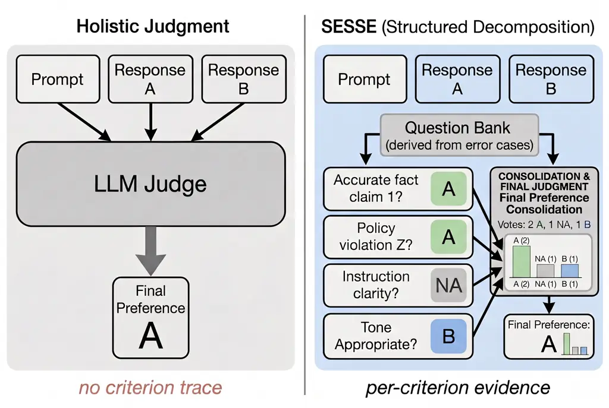
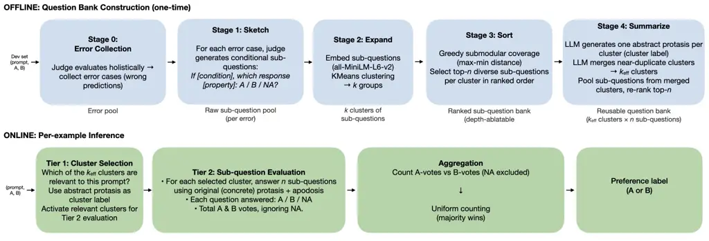

# SESSE: Sketch, Expand, Sort, Summarize, Evaluate LLM-as-Judge Evaluation via Structured Decomposition

Dae Lee    Mihai Delgeanu    Adel Youssef Affiliation: Apple
Email: [dae_lee@apple.com](mailto:)

###### Abstract

LLM-as-judge evaluation reduces response quality assessment to a single
holistic A/B preference choice, providing no mechanism to isolate which
quality dimensions drove the preference or distinguish model errors from
genuine label ambiguity. We propose SESSE (Sketch, Expand, Sort,
Summarize, Evaluate), a training-free framework that decomposes holistic
judgment into structured sub-questions mined directly from the judge’s
own error cases — requiring no oracle responses, task-specific rubrics,
or fine-tuning. On RewardBench ($`n{=}1{,}000`$), SESSE achieves
near-parity with the chain-of-thought baseline and is competitive with
RISE-Judge-32B (92.7%), a fine-tuned specialist, while remaining fully
training-free. Per-criterion vote evidence provides an interpretable
audit trail for diagnosing label ambiguity and judge failure modes
unavailable from a single holistic output token.

## 1 Introduction

LLM-as-judge evaluation has become a standard paradigm for scalable
response quality assessment — popularized by MT-Bench Zheng et al.
(2023), Chatbot Arena Chiang et al. (2024), and AlpacaFarm Dubois et al.
(2023) — yet it reduces evaluation to a single holistic A/B preference
choice. Even with chain-of-thought prompting, the reasoning is
unstructured free text produced in a single pass — offering no mechanism
to decompose quality into auditable dimensions, isolate which aspects
drove the preference, or detect systematic annotation noise.

Figure 1: SESSE replaces holistic judgment with structured decomposition
— criteria emerge automatically from the judge’s own error cases,
producing per-criterion vote evidence.

Existing approaches fall into two paradigms, each with a critical
limitation. The first, _criterion-based_ methods — G-Eval Liu et al.
(2023), FActScore Min et al. (2023), UniEval Zhong et al. (2022),
CheckList Ribeiro et al. (2020) — decompose quality into predefined
dimensions but require _manually specified criteria_ or human-designed
rubrics. The second, _trained specialist_ methods, fits directly to
labeled data: oracle-dependent approaches such as DeCE Yu et al. (2025a)
and CheckEval Lee et al. (2025) derive criteria from gold responses,
while RISE-Judge Yu et al. (2025b) and other fine-tuned variants —
JudgeLM Zhu et al. (2024), Prometheus 2 Kim et al. (2024b), Auto-J Li et
al. (2024) — improve calibration via SFT+DPO at the cost of training
data and parameter updates. SESSE differs from all prior work: criteria
emerge _directly from the judge’s own error distribution_ on standard
pairwise labels, requiring no oracle responses, task-type annotation, or
fine-tuning.

We propose SESSE, a training-free framework that replaces holistic
judgment with structured decomposition. Error cases from a first-pass
holistic run on a dev set drive automatic mining of evaluation criteria.
These criteria are clustered into $`k`$ groups and generalized into a
reusable A/B/NA (Not Applicable) sub-question bank. Independent
per-criterion voting produces an interpretable audit trail and a final
preference; ordering randomization across position mitigates positional
bias Wang et al. (2024a), and constraining the judge to discrete tokens
A/B/NA yields superior calibration over open-ended scoring Zhao et al.
(2021); Ren et al. (2023).

Decomposition addresses the reliability problem central to holistic
judgment: a single output token conflates every quality dimension into
one binary decision, so two judges — or one judge across two runs — can
disagree without any way to localize why. By contrast, each SESSE
sub-question is independently verifiable: an annotator, a second model,
or the same judge at a later time can re-check a single A/B/NA vote in
isolation, without re-deriving the entire holistic judgment. This
mirrors why checklist- and rubric-style protocols improve inter-rater
agreement over free-form human judgments Ribeiro et al. (2020): breaking
one hard judgment into many easy ones bounds disagreement to specific,
inspectable criteria rather than an opaque holistic vote.

Our contributions are: (i) SESSE, a fully automated 5-stage pipeline
that mines evaluation criteria from judge error cases, clusters them
into a reusable sub-question bank, and aggregates per-criterion votes —
without oracle responses, rubrics, or fine-tuning; and (ii) empirical
evidence that SESSE is competitive with fine-tuned specialist evaluators
on RewardBench while providing per-criterion diagnostic evidence
unavailable from holistic judgment.

## 2 Method

Figure 2: SESSE pipeline: offline bank construction (Stages 0–4, once)
and online per-example inference (Stage 5).

SESSE operates as a five-stage pipeline (Figure 2). Stages 0–1 (Error
Collection, Sketch). Stage 0 runs the judge holistically on the dev set,
collecting cases where the prediction disagrees with the ground-truth
label. Stage 1 prompts the judge to generate conditional evaluation
criteria from these errors as sub-questions: “If \[protasis: the
condition under which the criterion applies\], which response better
satisfies \[apodosis: the evaluation property\]: A, B, or NA?” Criteria
emerge from the judge’s own failure distribution — unlike Prometheus Kim
et al. (2024a) and G-Eval Liu et al. (2023), which require manually
specified dimensions.

Stages 2–3 (Expand, Sort). Stage 2 embeds candidate sub-questions and
clusters them into $`k`$ thematic groups. Stage 3 ranks sub-questions
within each cluster via greedy farthest-first traversal Gonzalez (1985),
producing a diversity-ordered active bank of depth $`n\leq n_{\max}`$
without rerunning clustering, enforcing criterion orthogonality across
the bank. This ranked structure enables depth ablation at inference time
(Appendix A).

Stage 4 (Summarize). An LLM call produces one generalized protasis per
cluster, serving as a human-readable cluster label. Near-duplicate
clusters are merged via LLM binary equivalence judgment; sub-questions
from merged clusters are pooled and top-$`n`$ re-selected.

Stage 5 (Evaluate). Tier 1 presents each abstract protasis to the judge
and selects only relevant clusters for the current example, skipping
inapplicable clusters to reduce per-example cost. Tier 2 answers each
selected question with its original (error-derived) protasis paired with
its apodosis, preserving the concrete, instance-specific phrasing from
Stage 1. When a criterion does not apply (e.g., a code cluster on a
poetry prompt), the judge returns NA; NA votes are excluded from the A/B
tally, letting the judge gracefully skip criteria that do not apply. The
final preference is the majority of all A and B ballots across selected
clusters; if A and B votes are equal, the example is declared a tie and
excluded from the accuracy denominator.

## 3 Experiments

### 3.1 Setup

Dataset: RewardBench Lambert et al. (2024), 2,985 pairwise preference
examples across chat, chat-hard, safety, and reasoning subsets. Dev
($`n{=}1{,}985`$) for error collection; held-out val ($`n{=}1{,}000`$)
for all reported metrics. The dev/val split is a random partition of the
full 2,985-example set: 1,000 examples held out for val, with the
remainder used as dev.

Metric: Pairwise preference accuracy on held-out val. Table 1 reports
CoT holistic accuracy split by whether SESSE reaches a decision:
_non-tie_ rows (SESSE commits to a preference) and _tie_ rows (equal A/B
votes, SESSE has no preference to offer); Tie% is the fraction of tied
examples. SESSE accuracy is reported on non-tie rows only.

Models: Qwen2-VL-7B Wang et al. (2024b), Gemini Flash Lite, and Gemini
2.5 Flash Gemini Team (2024).

Configuration: $`k{=}25`$ clusters (selected by preliminary silhouette
analysis), $`n{=}10`$, temperature 0. Optimal depth $`n^{*}`$ per model
is selected by dev accuracy.

### 3.2 Main Results

| System                                 | Holistic |       | SESSE     | Tie%  |
| -------------------------------------- | -------- | ----- | --------- | ----- |
|                                        | non-tie  | tie   | non-tie   |       |
| Qwen2-VL-7B                            | 0.698    | 0.667 | 0.663^(‡) | 21.3% |
| Flash Lite                             | 0.880    | 0.679 | 0.820^(‡) | 2.6%  |
| Gemini 2.5 Flash                       | 0.945    | 0.695 | 0.933     | 3.5%  |
| RISE-Judge (32B)^(†) Yu et al. (2025b) | 0.927    |       | —         |       |

Table 1: RewardBench val ($`n{=}1{,}000`$), dev-optimal $`n^{*}`$.
$`{}^{\ddagger}p{<}0.05`$ McNemar (non-tie subset). ^(†)SFT+DPO.

Table 1 presents SESSE results at the dev-optimal $`n^{*}`$ across all
three evaluated models. To ensure a fair comparison, all gaps between
the holistic baseline and SESSE are computed on non-tie rows only,
matching the McNemar test, which likewise restricts its analysis to the
pairs where the two methods disagree, testing $`H_{0}`$: SESSE and the
CoT holistic baseline are equally likely to be correct when their
predictions diverge. Gemini 2.5 Flash shows a minor 1.3% relative gap,
which is not statistically significant ($`p{>}0.05`$). Flash Lite and
Qwen2-VL-7B show statistically significant relative gaps of 6.8% and
5.0%, respectively ($`p{<}0.05`$). Notably, SESSE with Gemini 2.5 Flash
reaches 93.3% accuracy alongside a low 3.5% tie rate, placing it in the
same performance tier as the specialist evaluator RISE-Judge (32B) Yu et
al. (2025b) (92.7%); while RISE-Judge requires SFT+DPO fine-tuning,
SESSE achieves comparable performance while remaining fully
training-free and providing per-criterion evidence.

Depth ablation (Appendix A) shows a per-tier pattern: the capable judge
(Gemini 2.5 Flash) saturates at $`n{=}2`$ sub-questions per cluster, the
mid-tier judge (Flash Lite) benefits from broader evidence and peaks at
$`n{=}5`$, while the weakest judge (Qwen2-VL-7B) peaks earlier, at
$`n{=}3`$, before degrading. Qwen2-VL-7B’s degradation past $`n{=}3`$
reveals a bank quality effect: accuracy peaks at $`n{=}3`$ then
degrades, because 51.9% of instances are covered by a single dominant
protasis in the self-generated bank — beyond $`n{=}3`$, the depth budget
is consumed by redundant sub-questions from that cluster. A cross-model
transfer experiment — regenerating the bank with Gemini while keeping
Qwen2-VL-7B as judge — confirms the accuracy ceiling is set by judge
capability, not bank quality (Table B.1, Appendix B).

SESSE tie rows are harder examples: holistic accuracy on tie rows is
consistently lower than on non-tie rows across all three models
(Table 1). The gap is most pronounced for capable judges — Gemini 2.5
Flash drops from 94.5% to 69.5% on tie rows, suggesting that ties signal
genuine ambiguity rather than arbitrary disagreement.

## 4 Discussion

Training-free parity with fine-tuned judges. SESSE’s near-parity with
CoT holistic for Gemini 2.5 Flash (Table 1) represents a minor
trade-off: near-parity in exchange for structured, auditable
per-criterion evidence at no training cost. CoT holistic itself already
outperforms RISE-Judge Yu et al. (2025b), so SESSE’s comparable accuracy
mainly shows that it preserves the base model’s advantage without
requiring fine-tuning. For mid-tier judges, the gap is significant but
reflects a different dynamic: Flash Lite’s drop stems primarily from
Tier-1 false positives on safety subsets (see Domain-specific signal
recovery below), not from the decomposition mechanism itself.

Domain-specific signal recovery. SESSE’s impact varies substantially
across RewardBench subsets. On donotanswer, Gemini 2.5 Flash gains
+20.6% relative over holistic ($`75.9\%\rightarrow 91.5\%`$) as explicit
safety-refusal criteria isolate a signal that holistic judgment
conflates with general preference. Conversely, xstest-should-respond
drops 27.1% relative due to Tier-1 false positives on borderline-safe
prompts, pointing to Tier-1 precision as the key failure mode for
domain-sensitive subsets.

When to prefer SESSE. SESSE is preferable when interpretability matters:
the per-criterion vote trail enables annotation auditing and exposes
label noise, justifying its inference overhead beyond raw accuracy.

Tie rate as a deployment-time capability signal. Tie% is a label-free
proxy for judge reliability: Qwen2-VL-7B’s 21.3% tie rate — versus
2.6–3.5% for the Gemini models — predicts its accuracy gap, since the
judge cannot form a directional preference on roughly one-in-five
examples (which score only 66.7% accuracy when forced holistically;
Table 1). A high Tie% on a held-out probe thus signals a capability
mismatch or domain shift without requiring ground-truth labels, letting
a practitioner switch judges, retarget the bank, or flag examples for
human review.

Failure modes. When SESSE diverges from holistic judgment, analysis
reveals capability-dependent failure modes (see Table C.1, Appendix C,
for the full three-bucket taxonomy). We conducted further analysis on
Flash Lite and Gemini 2.5 Flash (SESSE accuracy above 80%) to understand
failure modes. For Flash Lite, disagreements split roughly evenly
between genuine label ambiguity (49%, high vote entropy), decomposition
failure (26%), and semantic equivalence (26%), reflecting a mid-tier
judge without a single dominant failure signature. For the capable judge
(Gemini 2.5 Flash), 48% of disagreements instead reflect _semantic
equivalence_ between responses (C3): these pairs have higher response
similarity than the dataset average (0.75 vs. 0.69 mean cosine
similarity between Sentence-BERT embeddings; Reimers and Gurevych 2019),
and the bank correctly returns high NA rates when no meaningful
distinction exists. This C3 signature is not a model failure but a
dataset property — nearly half of Gemini’s degradation rows encode
stylistic preference rather than substantive quality differences, making
the per-criterion vote distribution a lightweight benchmark audit tool
independent of accuracy measurement. In all cases, per-criterion vote
distributions make failure modes explicitly diagnosable, a feature
absent from monolithic A/B scoring.

## 5 Conclusion

We presented SESSE, a training-free framework that decomposes holistic
LLM-as-judge evaluation into automatically derived A/B/NA sub-questions
mined from the judge’s own error distribution. On RewardBench, SESSE
achieves a non-significant gap to CoT holistic for capable judges and is
in the same performance range as a fine-tuned specialist evaluator
(RISE-Judge 32B) while remaining training-free. Beyond accuracy, the
per-criterion vote distributions provide interpretable diagnostic
evidence — surfacing failure modes and benchmark quality issues that
holistic scoring leaves opaque — a use case that scales with judge
capability rather than against it.

## Limitations

Bank portability. The question bank is derived from a specific judge
model’s error distribution on a specific dev set. Changing the judge
model or evaluation domain requires re-running Stages 0–4 (a one-time
offline cost). Amortization strategies — cross-domain bank transfer,
incremental error pool updates, shared banks across related judge models
— are not explored here.

Cluster count & benchmark scope. We fix $`k{=}25`$ by silhouette
analysis; ablation over $`k`$ and generalization beyond RewardBench
(open-ended generation, multi-turn, non-English) are deferred to future
work.

Inference cost. SESSE at $`n{=}10`$ requires $`{\sim}282`$ LLM calls per
example vs. 1 holistic; capable judges saturate at $`n{=}2`$, reducing
cost proportionally with no accuracy loss.

Decomposition limits. A/B/NA sub-questions cannot capture end-to-end
execution evaluation (code compilation, derivation correctness) — the
primary source of SESSE degradation on reasoning and code subsets.

## Ethical Considerations

SESSE evaluates LLM outputs using an LLM judge, inheriting any biases
present in the judge model’s error distribution. Criteria mined from
judge failures may encode systematic biases — users deploying SESSE in
high-stakes annotation pipelines should audit the generated question
bank for bias before use. All experiments use publicly available models
and datasets.

## References

- Chiang et al. (2024) W. Chiang, L. Zheng, Y. Sheng, A. N.
  Angelopoulos, T. Li, D. Li, B. Zhu, H. Zhang, M. I. Jordan, J. E.
  Gonzalez, and I. Stoica Chatbot Arena: an open platform for evaluating
  LLMs by human preference. In Proceedings of the 41st International
  Conference on Machine Learning, pp. 8359–8388. Cited by: §1.
- Dubois et al. (2023) Y. Dubois, X. Li, R. Taori, T. Zhang, I.
  Gulrajani, J. Ba, C. Guestrin, P. Liang, and T. B. Hashimoto
  AlpacaFarm: a simulation framework for methods that learn from human
  feedback. In Advances in Neural Information Processing Systems, Cited
  by: §1.
- Gemini Team (2024) Gemini Team Gemini 1.5: unlocking multimodal
  understanding across millions of tokens of context. arXiv preprint
  arXiv:2403.05530. Cited by: §3.1.
- Gonzalez (1985) T. F. Gonzalez Clustering to minimize the maximum
  intercluster distance. Theoretical Computer Science 38, pp. 293–306.
  Cited by: §2.
- Kim et al. (2024a) S. Kim, J. Shin, Y. Cho, J. Jang, S. Longpre, H.
  Lee, S. Yun, S. Shin, S. Kim, J. Thorne, and M. Seo Prometheus:
  inducing fine-grained evaluation capability in language models. In
  Proceedings of the Twelfth International Conference on Learning
  Representations, Cited by: §2.
- Kim et al. (2024b) S. Kim, J. Suk, S. Longpre, B. Y. Lin, J. Shin, S.
  Welleck, G. Neubig, M. Lee, K. Lee, and M. Seo Prometheus 2: an open
  source language model specialized in evaluating other language models.
  In Proceedings of the 2024 Conference on Empirical Methods in Natural
  Language Processing, Cited by: §1.
- Lambert et al. (2024) N. Lambert, V. Pyatkin, J. Morrison, L.
  Miranda, B. Y. Lin, K. Chandu, N. Dziri, S. Kumar, T. Zick, Y.
  Choi, N. A. Smith, and H. Hajishirzi RewardBench: evaluating reward
  models for language modeling. arXiv. External Links:
  [Document](https://dx.doi.org/10.48550/arxiv.2403.13787) Cited by:
  §3.1.
- Lee et al. (2025) Y. Lee, J. Kim, J. Kim, H. Cho, J. Kang, P. Kang,
  and N. Kim CheckEval: a reliable LLM-as-a-judge framework for
  evaluating text generation using checklists. In Proceedings of the
  2025 Conference on Empirical Methods in Natural Language
  Processing, C. Christodoulopoulos, T. Chakraborty, C. Rose, and V.
  Peng (Eds.), Suzhou, China, pp. 15771–15798. External Links:
  [Link](https://aclanthology.org/2025.emnlp-main.796/),
  [Document](https://dx.doi.org/10.18653/v1/2025.emnlp-main.796), ISBN
  979-8-89176-332-6 Cited by: §1.
- Li et al. (2024) J. Li, S. Sun, W. Yuan, R. Fan, H. Zhao, and P. Liu
  Generative judge for evaluating alignment. In Proceedings of the 12th
  International Conference on Learning Representations, Cited by: §1.
- Liu et al. (2023) Y. Liu, D. Iter, Y. Xu, S. Wang, R. Xu, and C. Zhu
  G-Eval: NLG evaluation using gpt-4 with better human alignment. In
  Proceedings of the 2023 Conference on Empirical Methods in Natural
  Language Processing, Cited by: §1, §2.
- Min et al. (2023) S. Min, K. Krishna, X. Lyu, M. Lewis, W. Yih, P. W.
  Koh, M. Iyyer, L. Zettlemoyer, and H. Hajishirzi FActScore:
  fine-grained atomic evaluation of factual precision in long form text
  generation. In Proceedings of the 2023 Conference on Empirical Methods
  in Natural Language Processing, Cited by: §1.
- Reimers and Gurevych (2019) N. Reimers and I. Gurevych Sentence-BERT:
  sentence embeddings using siamese BERT-networks. In Proceedings of the
  2019 Conference on Empirical Methods in Natural Language Processing,
  Cited by: §4.
- Ren et al. (2023) J. Ren, Y. Zhao, T. Vu, P. J. Liu, and B.
  Lakshminarayanan Self-evaluation improves selective generation in
  large language models. In NeurIPS 2023 Workshop on Robustness of
  Few-shot and Zero-shot Learning in Foundation Models, Cited by: §1.
- Ribeiro et al. (2020) M. T. Ribeiro, T. Wu, C. Guestrin, and S. Singh
  Beyond accuracy: behavioral testing of NLP models with CheckList. In
  Proceedings of the 58th Annual Meeting of the Association for
  Computational Linguistics, Cited by: §1, §1.
- Wang et al. (2024a) P. Wang, L. Li, L. Chen, D. Zhu, B. Lin, Y.
  Cao, Q. Liu, T. Liu, and Z. Sui Large language models are not robust
  multiple choice selectors. In Proceedings of the 12th International
  Conference on Learning Representations, Cited by: §1.
- Wang et al. (2024b) P. Wang, S. Bai, S. Tan, S. Wang, Z. Fan, J.
  Bai, K. Chen, X. Liu, J. Wang, W. Ge, Y. Fan, K. Dang, M. Du, X.
  Ren, R. Men, D. Liu, C. Zhou, J. Zhou, and J. Lin Qwen2-VL: enhancing
  vision-language model’s perception of the world at any resolution.
  arXiv preprint arXiv:2409.12191. External Links:
  [Document](https://dx.doi.org/10.48550/arXiv.2409.12191) Cited by:
  §3.1.
- Yu et al. (2025a) F. Yu, N. Seedat, D. Herrmannova, F. Schilder,
  and J. R. Schwarz Beyond pointwise scores: decomposed criteria-based
  evaluation of LLM responses. arXiv preprint arXiv:2509.16093. External
  Links: [Document](https://dx.doi.org/10.48550/arXiv.2509.16093) Cited
  by: §1.
- Yu et al. (2025b) J. Yu, S. Sun, X. Hu, J. Yan, K. Yu, and X. Li
  Improve LLM-as-a-judge ability as a general ability. In Proceedings of
  the 2025 Conference on Empirical Methods in Natural Language
  Processing, Suzhou, China, pp. 14099–14115. External Links:
  [Link](https://aclanthology.org/2025.emnlp-main.712/),
  [Document](https://dx.doi.org/10.18653/v1/2025.emnlp-main.712) Cited
  by: §1, §3.2, Table 1, §4.
- Zhao et al. (2021) Z. Zhao, E. Wallace, S. Feng, D. Klein, and S.
  Singh Calibrate before use: improving few-shot performance of language
  models. In Proceedings of the 38th International Conference on Machine
  Learning, Cited by: §1.
- Zheng et al. (2023) L. Zheng, W. Chiang, Y. Sheng, S. Zhuang, Z.
  Wu, Y. Zhuang, Z. Lin, Z. Li, D. Li, E. P. Xing, H. Zhang, J. E.
  Gonzalez, and I. Stoica Judging LLM-as-a-judge with MT-Bench and
  Chatbot Arena. In Advances in Neural Information Processing Systems,
  Vol. 36, pp. 46595–46623. Cited by: §1.
- Zhong et al. (2022) M. Zhong, Y. Liu, D. Yin, Y. Mao, Y. Jiao, P.
  Liu, C. Zhu, H. Ji, and J. Han Towards a unified multi-dimensional
  evaluator for text generation. Proceedings of the 2022 Conference on
  Empirical Methods in Natural Language Processing. External Links:
  [Document](https://dx.doi.org/10.18653/v1/2022.emnlp-main.131) Cited
  by: §1.
- Zhu et al. (2024) L. Zhu, X. Wang, and X. Wang JudgeLM: fine-tuned
  large language models are scalable judges. In Proceedings of the 38th
  AAAI Conference on Artificial Intelligence, Cited by: §1.

## Appendix A Depth Ablation

Table A.1 sweeps $`n{=}1`$–$`10`$ sub-questions per cluster for all
three self-generated banks (bold = best per model). All models plateau
quickly: accuracy stabilizes within the first few values of $`n`$ and
shows little change beyond that, suggesting a small question budget is
sufficient once the most informative sub-questions are exhausted.
Qwen2-VL-7B is the exception, showing a slight degradation at larger
$`n`$ due to limited cluster diversity in the self-generated bank.

| $`n`$ | Qwen2-VL-7B | Gemini 2.5 Flash | Flash Lite |
| ----- | ----------- | ---------------- | ---------- |
| 1     | 0.626       | 0.923            | 0.790      |
| 2     | 0.648       | 0.933            | 0.804      |
| 3     | 0.663       | 0.927            | 0.801      |
| 5     | 0.644       | 0.932            | 0.820      |
| 7     | 0.645       | 0.929            | 0.817      |
| 10    | 0.643       | 0.930            | 0.819      |

Table A.1: Accuracy (excl. ties) vs. $`n`$ (self-generated banks; bold =
$`n^{*}`$).

## Appendix B Cross-Model Bank Transfer

Table B.1 compares Qwen2-VL-7B accuracy when evaluated with a
self-generated bank versus a bank whose questions were generated by
Gemini 2.5 Flash, holding the judge model fixed. Both banks reach the
same peak accuracy (66.3%), showing that substituting a stronger model’s
questions does not meaningfully change evaluation performance when the
judge model is held fixed.

| Config               | $`k_{\text{eff}}`$ | SESSE acc ($`n{=}10`$) | SESSE ($`n^{*}`$)     |
| -------------------- | ------------------ | ---------------------- | --------------------- |
| Qwen self-generated  | 8                  | 0.640                  | 0.663 ($`n^{*}{=}3`$) |
| Qwen$`+`$Gemini bank | 14                 | 0.637                  | 0.663 ($`n^{*}{=}2`$) |

Table B.1: Qwen2-VL-7B with Gemini-generated vs. self-generated bank
(val).

## Appendix C Failure Mode Taxonomy

Table C.1 reports the per-configuration breakdown of degradation rows —
examples where SESSE and the holistic baseline disagree. We report this
breakdown only for configurations with SESSE accuracy above 80% (Flash
Lite, Gemini 2.5 Flash); at lower accuracy, degradation rows are too
frequent to characterize as a small set of distinct failure signatures.
Each row is attributed to one of three buckets: C1 (Ambiguous) reflects
genuine label difficulty, where sub-question votes are evenly split; C2
(Decomposition failure) indicates the judge is confidently wrong, with
$`\geq`$65% of non-NA votes against the ground-truth label; C3 (Semantic
equivalence) indicates the bank correctly declines to pick a winner,
returning high NA rates when the two responses are too similar to
discriminate.

| Config           | Judge            | Bank           | Degradation (% val) | C1 (Ambiguous) | C2 (Decomposition) | C3 (Semantic equiv.) |
| ---------------- | ---------------- | -------------- | ------------------- | -------------- | ------------------ | -------------------- |
| Flash Lite       | Flash Lite       | self-generated | 105 (10.5%)         | 49%            | 26%                | 26%                  |
| Gemini 2.5 Flash | Gemini 2.5 Flash | self-generated | 48 (4.8%)           | 29%            | 23%                | 48%                  |

Table C.1: Degradation bucket distribution. C1 = genuine ambiguity (high
vote entropy); C2 = decomposition failure (SESSE consistently wrong
$`\geq`$65% non-NA votes against label); C3 = semantic equivalence (high
NA rate, responses too similar to discriminate). Percentages of
degradation rows per config.
