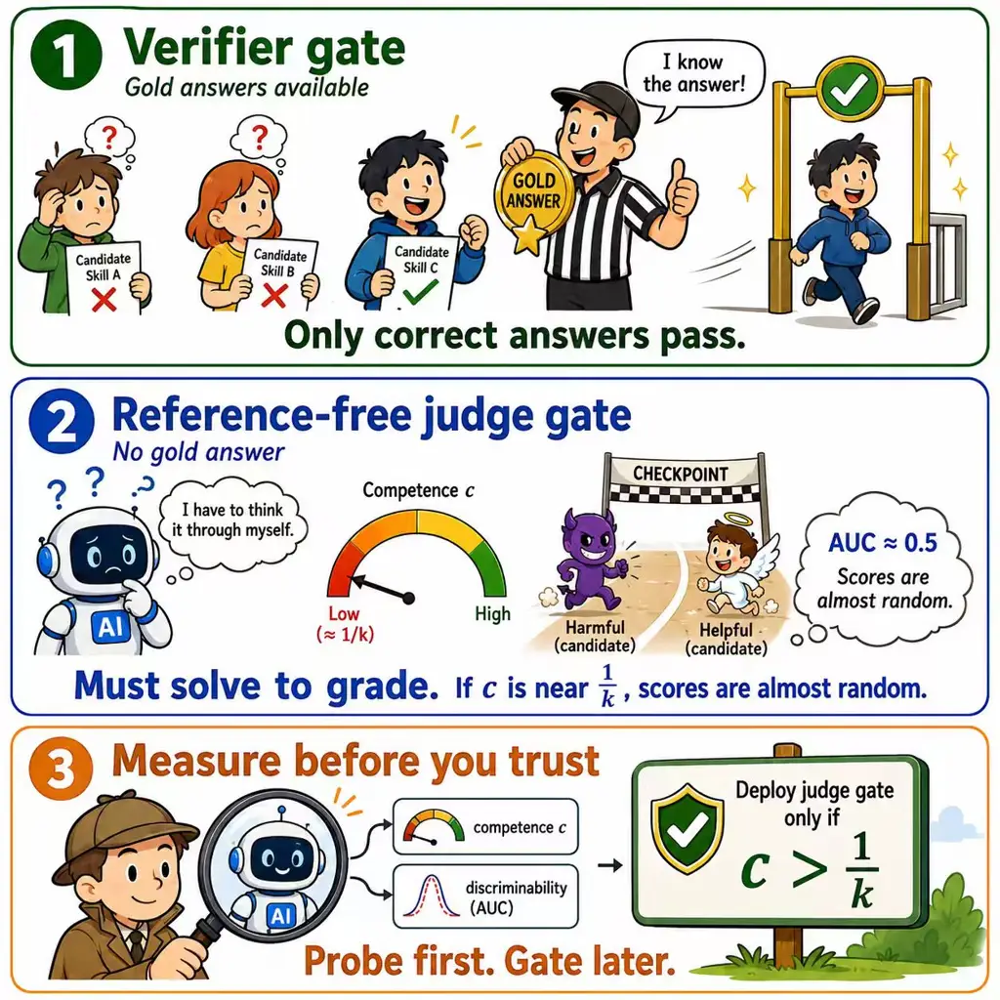
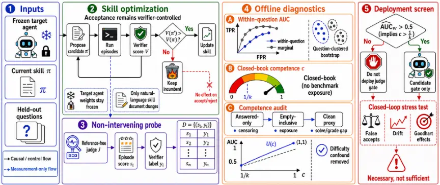

Competence, Not Accuracy: A Diagnostic for  
Reference-Free Judge Gates in Skill Optimization

Chenle Chen¹    Yangbo Wei²    Chao Yao³    Shaoqiang Lu²  
Junhong Qian²    Chen Wu⁴    Lei He⁴

¹University of California, Los Angeles  ²Shanghai Jiao Tong University

³Arizona State University  ⁴Eastern Institute of Technology, Ningbo

chenle@ucla.edu

Abstract

Text-space skill optimization adapts a frozen agent by evolving a
natural-language skill document, accepting each candidate through a
validation gate. Existing gates rely on _verifiable_ rewards, confining
these methods to tasks with an automatic verifier. Replacing the
verifier with an _LLM-judge gate_ would lift that restriction, but
whether such a gate carries usable signal is untested. We ask a prior
question: can we tell, before placing a judge in the loop, whether its
scores separate correct from incorrect answers at all? We formalize a
reference-free judge as a _latent solver_—its verdict rests on agreement
with whatever it would itself conclude, so its capacity to evaluate is
bounded by its capacity to solve. The model yields a closed-form bound
on discriminability (ROC-AUC) in the judge’s competence $`c`$ and
answer-space size $`k`$, a necessary condition $`c>1/k`$, and the result
that the marginal AUC is confounded by item difficulty while a
within-question estimator is not. A _non-intervening_ probe records
judge scores on genuine optimization runs without altering any decision.
We find discriminability at chance where competence sits near the floor
and usable above it; that a judge’s benchmark accuracy overstates the
competence that matters; and, in a closed-loop study, that the screen
predicts which _kind_ of gating error occurs. The result is a cheap
pre-deployment diagnostic for judge gates.

## 1 Introduction



Figure 1: (1) A verifier gate has gold answers, so only correct
candidates pass. (2) A reference-free judge has none and must in effect
re-solve each item to grade it, so once its competence $`c`$ nears the
chance floor $`1/k`$ its scores are near-random. (3) We therefore
measure competence and discriminability _before_ deployment, screening
out judges that do not clear the floor—necessary, though not sufficient.

Recent work adapts frozen language-model agents to new domains by
evolving a compact, natural-language _skill_ document rather than
updating weights \[Yang et al., 2026, Alzubi et al., 2026\]. These
optimizers run a candidate skill, score it, and use a _validation gate_
to keep the candidate only if it improves a held-out score—directly
analogous to model selection in supervised learning. Crucially, the gate
score comes from a _verifiable_ signal: exact match against a gold
answer, or an executable check. This works well when such a verifier
exists, but it confines the paradigm to verifiable tasks. Figure 1
summarizes the problem and our response. The long-run motivation for
lifting that constraint is open-ended generation—writing, dialogue,
design rationale—but we state at the outset that the present study does
not reach that far. Our model and measurements both require a single
gold answer and a verifier label, so the tasks studied here are
objectively checkable ones; extending the diagnostic to genuinely
open-ended tasks, where correctness is not binary, the answer space has
no natural size, and judging is rubric-driven rather than
agreement-driven, is future work. What we can do now is answer the
prerequisite question on tasks where ground truth is available to audit
against.

A natural way to lift this restriction is to replace the verifier gate
with an _LLM-judge gate_: score each candidate skill by how a judge
model rates its outputs, and accept on the judge’s preference. In
reinforcement learning, judge-based signals have extended optimization
beyond verifiable rewards \[Corbitt et al., 2025\], but always in
_weight space_; they have not been brought into text-space skill
optimization, where weights are frozen and the optimized object is a
persistent document. Moreover, judge reliability cannot be assumed:
judges are known to be biased and gameable, and coupling a judge to an
acceptance loop creates selection pressure that can amplify reward
hacking \[Zheng et al., 2023\].

This paper asks a question that must be answered before any judge gate
is deployed: when can a judge gate substitute for a verifier gate, and
when does it fail? Rather than swap the gate and hope, we take a
_diagnostic_ approach. We instrument an existing optimizer’s gate with a
judge probe that scores every candidate but _does not affect any
accept/reject decision_, leaving the optimization dynamics unchanged.
This lets us measure, on real runs, whether the judge signal is
trustworthy—operationalized as _discriminability_: can the judge score
separate answers the verifier marks correct from those it marks wrong
(ROC-AUC)?

Our findings are threefold. (i) Judge discriminability varies sharply
across tasks—at chance on research mathematics, usable on factual QA and
graduate science—so judge signal cannot be assumed. (ii) Where the
judge’s own competence sits near the chance floor, discriminability
collapses, as the model predicts; and the closed-form bound holds
wherever it can be tested without difficulty confounding. (iii) A
judge’s headline benchmark accuracy is an optimistic input to this test:
decomposing the gap to genuine competence shows censoring convention,
benchmark exposure, and the solve/grade context gap each contribute, all
in the same direction.

#### Contributions.

(1) Theory. We model a reference-free judge as a latent solver and
derive a closed-form bound on discriminability in its competence $`c`$
and answer-space size $`k`$, a _necessary but not sufficient_ condition
$`c>1/k`$ for any discrimination, and an identification result: the
marginal AUC is confounded by item difficulty—a judge reading only
difficulty and never the answer can score above chance—while a
within-question estimator is invariant to it. (2) Measurement. We give a
non-intervening probe that records judge signal on genuine optimization
runs without altering acceptance, together with a reusable
protocol—episode-level scoring, answer-content feeding, within-question
stratification with a question-clustered bootstrap, and proxy-based
decontamination—for auditing a candidate judge gate before deployment.
(3) Findings. Discriminability collapses to chance where competence
approaches the floor, and the predicted bound holds wherever it can be
cleanly tested; a judge’s headline benchmark accuracy overstates
competence, for three separable reasons that we decompose using
estimators with orthogonal error sources; and in a closed-loop study the
screen predicts which _kind_ of gating error occurs—judges that fail it
import regressions, while one that passes imports none and errs only by
over-rejection.

## 2 Related Work

#### Self-evolving agent skills.

A rapidly growing line of work equips frozen agents with reusable,
natural-language skills \[Zhang et al., 2025\] and optimizes them
automatically: offline distillation from execution traces \[Ni et al.,
2026, Wang et al., 2026\], and online evolution through failure-driven
reflection \[Alzubi et al., 2026\], validation-gated updates \[Yang et
al., 2026\], adversarial co-evolution against a verifier \[Zhang et al.,
2026\], shared asset layers \[Ma et al., 2026\], credit signals \[Tu et
al., 2026\], reinforcement learning over skill libraries \[Xia et al.,
2026\], and skill–tool co-evolution \[Wei et al., 2026\]; reflective
textual evolution can even outperform scalar-reward RL in sample
efficiency \[Agrawal et al., 2025\]. Despite their diversity, these
systems share one commitment: acceptance is decided by a _verifiable_
signal—exact match, an executable check, or a programmatic scorer. Our
work targets that shared assumption and asks whether a judge can stand
in for the verifier, and when.

#### Judges already inside the evaluation loop.

The assumption is not that judges are absent from this setting, but that
where they appear they are _reference-based_. SealQA \[Pham et al.,
2025\], a benchmark used throughout the skill-evolution literature, is
scored by a frozen judge model that receives the question, the gold
answer, and the agent’s response before returning a binary verdict.
Supplying the gold answer converts judging into a comparison task and
sidesteps the question we study. Our concern is the _reference-free_
regime that a judge gate necessarily occupies: during optimization no
gold answer exists for the candidate being evaluated, so the judge must
supply the standard itself.

#### Reward-free and judge-based optimization.

In RL post-training, LLM judges supply learning signal where verifiable
rewards are unavailable, e.g. by ranking rollouts \[Corbitt et al.,
2025\] or combining preference, judge, and programmatic signals to curb
reward hacking \[Peng et al., 2025\]. This work operates in weight space
and assumes the judge provides usable signal; it does not characterize
when that assumption holds. We transpose the judge-signal idea into
frozen-weight, text-space skill optimization and treat judge
trustworthiness as the object of study.

#### LLM-as-judge reliability.

LLM judges exhibit systematic biases and can be gamed \[Zheng et al.,
2023\]. We add a task-dependent axis: a judge’s ability to _evaluate_
answers is bounded by its ability to _solve_ them, and this bound—not
generic bias—explains where judge gating fails.

## 3 Method



Figure 2: Overview. Skill optimization (2) remains verifier-controlled:
$`\pi^{\prime}`$ is accepted only when its verifier score improves,
while target weights stay frozen. A non-intervening probe (3) records
$`(s_{i},y_{i})`$ per episode without affecting acceptance, yielding
$`\mathcal{D}=\{(s_{i},y_{i})\}`$. Offline diagnostics (4) estimate
within-question AUC with a question-clustered bootstrap, closed-book
competence, and the effects of censoring, exposure, and the solve/grade
gap. The deployment screen (5) rules out judge gating unless competence
exceeds the chance floor—a necessary but not sufficient condition.

Figure 2 gives the overall pipeline. Where does a judge’s verdict get
its information, if it cannot see the gold answer? Our starting point is
a minimal hypothesis: a reference-free judge has no source of ground
truth independent of its own ability to solve, so evaluation degenerates
informationally into an implicit re-solving—_to grade, one must first be
able to answer_. We first set up the _judge-as-latent-solver_ model,
then derive the closed-form relation between ROC-AUC and competence
together with its testable predictions, and finally present the
corresponding measurement instruments—the non-intervening probe,
episode-level estimation, and competence measurement.

### 3.1 Setup and Model Assumptions

Consider a task whose answer space has size $`k\geq 2`$ (four-option MCQ
gives $`k{=}4`$; free-text is the limit $`k\to\infty`$), with gold
answer $`a^{*}`$. An _episode_ consists of a candidate answer $`a`$
produced by the optimized system and its verifier label
$`y=\mathbb{1}[a=a^{*}]\in\{0,1\}`$. Without access to $`a^{*}`$, the
judge emits a score $`s`$ for the pair (question, $`a`$). Writing
$`S_{1},S_{0}`$ for scores sampled under $`y{=}1`$ and $`y{=}0`$,
discriminability is
$`\mathrm{AUC}:=\Pr(S_{1}>S_{0})+\tfrac{1}{2}\Pr(S_{1}=S_{0})`$, the
Mann–Whitney probability that a random positive–negative pair is
correctly ordered.

We model a reference-free judge with three assumptions. (A1) Implicit
re-solving: the judge forms an internal solution $`\hat{a}`$,
conditionally independent of $`a`$, with $`\Pr(\hat{a}=a^{*})=c`$, where
$`c\in[0,1]`$ is its _competence in the grading context_. (A2) Error
dispersion: on $`\{\hat{a}\neq a^{*}\}`$, $`\hat{a}`$ is uniform over
the remaining $`k-1`$ answers. (A3) Consistency scoring:
$`s=\mathbb{1}[a=\hat{a}]`$. The model is in the tradition of
Dawid–Skene noisy-annotator models \[Dawid and Skene, 1979\], differing
in that the annotator’s confusion structure is realized as an explicit
re-solving process, which makes $`c`$ separately measurable by
closed-book self-solve accuracy.

#### Scope of the model.

(A1) does not assert that verification is universally as hard as
generation. Where a rubric or external evidence supplies a
solution-independent standard, or where a cheap local check
suffices—units, a boundary condition, one step of a supplied
proof—verification is easier and (A1) understates the judge. We
accordingly scope the model to _single-answer tasks judged without
rubric or external evidence_, where the verdict rests on agreement
between the candidate and what the judge would itself conclude. Within
that scope (A1) is falsifiable: it predicts collapse to chance as
$`c\to 1/k`$, which our experiments test. Rubric-based and
evidence-grounded judging are natural extensions.

### 3.2 Analytic Characterization of Discriminability

Proposition 1. _Under (A1)–(A3),_

```math
\mathrm{AUC}=\frac{1}{2}\left(1+c-\frac{1-c}{k-1}\right)=\frac{1}{2}+\frac{ck-1}{2(k-1)}. \tag{1}
```

_Proof sketch._ When $`y{=}1`$, $`a=a^{*}`$, so
$`\mathrm{TPR}=\Pr(\hat{a}=a^{*})=c`$. When $`y{=}0`$, the event
$`\{\hat{a}=a\}`$ implies $`\{\hat{a}\neq a^{*}\}`$, so by (A1)–(A2)
$`\mathrm{FPR}=(1-c)/(k-1)`$. For a binary score,
$`\mathrm{AUC}=\tfrac{1}{2}(1+\mathrm{TPR}-\mathrm{FPR})`$; substituting
gives (1). $`\square`$

Equation (1) exhibits a threshold structure:
$`\mathrm{AUC}-\tfrac{1}{2}`$ has the same sign as $`ck-1`$. Two results
show this threshold is robust to realistic departures, while the
closed-form value should be read as an _upper bound_.

Lemma 1 (noise shrinks toward chance). _Let $`s^{\prime}=s+\varepsilon`$
with $`\varepsilon`$ i.i.d., independent of $`(s,y)`$, continuously
distributed. Then
$`\mathrm{AUC}^{\prime}-\tfrac{1}{2}=(\mathrm{AUC}-\tfrac{1}{2})(2q-1)`$
with $`q:=\Pr(Z<1)\in(\tfrac{1}{2},1]`$,
$`Z:=\varepsilon_{0}-\varepsilon_{1}`$._ Noise therefore shrinks AUC
toward $`\tfrac{1}{2}`$ by a factor in $`(0,1]`$ without changing its
sign relative to $`\tfrac{1}{2}`$.

Remark 1 (collusion and upper-boundedness). Relaxing (A1)–(A2) to
specify only the _collusion rate_ $`\rho:=\Pr(\hat{a}=a\mid y{=}0)`$
gives $`\mathrm{AUC}=\tfrac{1}{2}(1+c-\rho)`$, strictly decreasing in
$`\rho`$. (A1)–(A2) correspond to $`\rho=(1-c)/(k-1)`$. When judge and
evaluated model err in correlated ways—both drawn to the same
distractor, typical of models sharing a training distribution—$`\rho`$
exceeds that value, so at fixed $`c`$ Proposition 1 is an attainable
upper bound. With Lemma 1, the model’s commitment is to _bounds and
thresholds, not a fitted curve_, matching the necessary-condition
phrasing we keep throughout.

Corollary 1 (chance-floor threshold). _(i) Under (A1)–(A3), with or
without the noise of Lemma 1,
$`\mathrm{AUC}>\tfrac{1}{2}\Longleftrightarrow c>1/k`$. (ii) In the
relaxed family of Remark 1 with super-uniform collusion
$`\rho\geq(1-c)/(k-1)`$, only the forward implication survives:_

```math
\mathrm{AUC}>\tfrac{1}{2}\;\Longrightarrow\;c>1/k. \tag{2}
```

_Proof._ (i) is immediate from (1), whose sign relative to
$`\tfrac{1}{2}`$ is that of $`ck-1`$; Lemma 1 rescales the deviation by
a strictly positive factor and cannot change its sign. For (ii),
Remark 1 gives $`\mathrm{AUC}>\tfrac{1}{2}\iff c>\rho`$; combining with
$`\rho\geq(1-c)/(k-1)`$ yields $`c(k-1)>1-c`$, i.e. $`c>1/k`$.
$`\square`$

The converse fails in the relaxed family: whenever $`\rho\geq c`$—judge
and candidate erring together at least as often as the judge is
right—discriminability is at or below chance even though $`c>1/k`$. We
therefore state the chance-floor threshold throughout as a _necessary
but not sufficient_ condition: above-chance competence must hold for a
judge gate to discriminate at all, but it does not guarantee that it
does. Correspondingly $`\mathrm{AUC}\downarrow\tfrac{1}{2}`$ as
$`c\downarrow 1/k`$, and low-$`k`$ tasks whose models share a training
distribution are precisely where $`\rho`$ is expected to be large.

Corollary 2 (free-text limit).
$`\lim_{k\to\infty}\mathrm{AUC}=(1+c)/2`$. Two independent errors almost
never coincide verbatim in free text ($`\rho\to 0`$), so errors cannot
collude and a unit of competence buys the most discriminability; at
small $`k`$ the judge’s wrong solution may coincide with—and thereby
endorse—the candidate’s wrong answer. Discriminability is thus ordered
jointly by $`(c,k)`$, not by task difficulty alone.

Corollary 3 (AUC-inversion competence meter). Under (A1)–(A3), $`c`$ is
identified by $`(\mathrm{AUC},k)`$:
$`\hat{c}_{\mathrm{AUC}}=[(k-1)(2\,\mathrm{AUC}-1)+1]/k`$, degenerating
to $`2\,\mathrm{AUC}-1`$ in the free-text limit. By Lemma 1 and Remark 1
both noise and super-uniform collusion depress the observed AUC, so
$`\hat{c}_{\mathrm{AUC}}`$ is systematically _conservative_.
Methodologically this matters because it is constructed purely from
grading behavior, never routing through the closed-book answering path,
and is therefore an estimator orthogonal to benchmark contamination.

Remark 2 (difficulty heterogeneity confounds the marginal AUC). Let item
$`t`$ have target accuracy $`p_{t}`$ and judge competence $`c_{t}`$,
with (A1)–(A3) holding conditionally. Tilting the item distribution by
class yields

```math
\displaystyle\mathrm{AUC}_{\mathrm{marg}} \displaystyle=\underbrace{\tfrac{1}{2}\Big(1+\bar{c}-\tfrac{1-\bar{c}}{k-1}\Big)}_{\text{Prop.~1 at }\bar{c}}\;+\;\tfrac{1}{2}\,\mathrm{Cov}(p_{T},c_{T})\,\Delta_{k},
```

```math
\displaystyle\Delta_{k} \displaystyle:=\tfrac{1}{\mathbb{E}[p_{T}]}-\tfrac{1}{(k-1)\,\mathbb{E}[1-p_{T}]}.
```

When difficulty acts on both models, $`\mathrm{Cov}(p_{T},c_{T})>0`$:
positive episodes are enriched in easy items, negatives in hard ones. If
$`\mathbb{E}[p_{T}]<(k-1)/k`$—always true in the free-text limit—then
$`\Delta_{k}>0`$ and the marginal AUC is systematically inflated. In the
extreme, a judge that scores only by perceived difficulty and never
reads the answer attains $`\mathrm{AUC}>\tfrac{1}{2}`$ with _no_
answer-level discrimination. The marginal AUC therefore does not
identify the quantity of interest.

Proposition 2 (stratified discriminability is invariant). _Define the
within-question AUC
$`\mathrm{AUC}_{w}:=\sum_{t}\omega_{t}\mathrm{AUC}_{t}`$, pairing
positives and negatives only within the same item, with $`\omega_{t}`$
the normalized count of such pairs. Then (i) Proposition 1 holds per
item; (ii) by linearity in $`c_{t}`$, $`\mathrm{AUC}_{w}`$ equals (1) at
the pair-weighted competence $`\tilde{c}:=\sum_{t}\omega_{t}c_{t}`$; and
(iii) $`\mathrm{AUC}_{w}`$ is invariant to any additive item-only score
component $`g(T)`$, since all episodes in a stratum shift by the same
constant._

Corollary 4 (stratified threshold).
$`\mathrm{AUC}_{w}>\tfrac{1}{2}\iff\tilde{c}>1/k`$: the necessary
condition survives difficulty heterogeneity, with the competence
parameter refined from the population mean to the pair-weighted mean.
The gap $`\mathrm{AUC}_{\mathrm{marg}}-\mathrm{AUC}_{w}`$ directly
estimates the difficulty-confound share, and we report both side by
side.

### 3.3 The Non-Intervening Probe

Let the optimizer \[Yang et al., 2026\] hold the incumbent skill $`\pi`$
and accept a candidate $`\pi^{\prime}`$ by the rule
$`\mathbb{1}[V(\pi^{\prime})>V(\pi)]`$ on a verifier score $`V`$. The
quantity in Proposition 1 requires the pairs $`(s_{i},y_{i})`$ to be
drawn from the episode distribution induced by the _genuine_
optimization process: once judge scores enter the acceptance rule,
selection pressure changes the candidate distribution, and what one
measures is discriminability already distorted by that pressure.

We therefore record judge scores $`J(\cdot)`$ on the selection set in
parallel while leaving the acceptance rule unchanged. Since the decision
is a deterministic function of $`V`$ and $`J`$ does not enter its
domain, the probed and unprobed runs are path-wise identical in
distribution; the probe’s entire output is the episode-level sample
$`\mathcal{D}=\{(s_{i},y_{i})\}_{i=1}^{n}`$. The instrument therefore
measures discriminability on the distribution induced by the _verifier_
gate—a _necessary_ condition for a usable judge gate; sufficiency under
judge control is a separate question we take up in the closed-loop study
below.

### 3.4 Estimating Episode-Level Discriminability

Given $`\mathcal{D}`$ with positive and negative index sets
$`\mathcal{P},\mathcal{N}`$, we estimate discriminability by the
Mann–Whitney statistic
$`\widehat{\mathrm{AUC}}=\frac{1}{n_{1}n_{0}}\sum_{i\in\mathcal{P}}\sum_{j\in\mathcal{N}}[\mathbb{1}(s_{i}>s_{j})+\tfrac{1}{2}\mathbb{1}(s_{i}=s_{j})]`$,
and its stratified counterpart $`\widehat{\mathrm{AUC}}_{w}`$ by
restricting pairs to a common item and weighting strata by their pair
counts; only items carrying both classes form valid strata. We report
both, their difference estimating the difficulty-confound share. Because
episodes cluster within items, confidence intervals for both come from a
_question-clustered bootstrap_—episode-level resampling would understate
variance. AUC is chosen over accuracy because it is exactly the quantity
characterized by Propositions 1–2, and because it is insensitive to
class imbalance and to strictly monotone rescaling of scores.

Two design choices follow directly from the model. _Granularity:_ the
consistency event $`\mathbb{1}[a=\hat{a}]`$ is defined per episode;
averaging scores at the skill level erases this structure before
measurement and leaves only sparse samples, since candidate skills
update only occasionally. Episode-level scoring builds $`\mathcal{D}`$
from stored rollouts with no reruns. _Answer-content feed:_ (A3)
requires $`s`$ to be a function of the answer’s _content_. A feed that
renders $`s`$ independent of $`a`$—for instance a bare multiple-choice
letter with no option text—implies $`s\perp y`$ and
$`\mathrm{AUC}\equiv\tfrac{1}{2}`$ under the model: a measurement
artifact unrelated to judge competence. An early version of our probe
fell into exactly this degenerate case and produced a spurious null. We
feed answer content and report both the chosen option’s text and the
full reasoning; the model further predicts a small advantage for the
latter, as intermediate derivations give the judge’s implicit re-solving
checkable alignment points.

### 3.5 Measuring Competence and Decontamination

#### Closed-book self-solve.

The judge answers each task without access to the gold answer, which is
used only for offline scoring. We adopt the _empty-inclusive_ accuracy
$`\hat{c}_{\mathrm{solve}}=\frac{1}{n}\sum_{t}\mathbb{1}[\hat{a}_{t}=a_{t}^{*}]`$,
counting episodes that fail to produce a parseable answer within the
generation budget as unsolved. Answered-only accuracy would introduce
survivorship bias, since models are more likely to fail to converge on
items they cannot solve.

#### Two notions of competence.

The parameter $`c`$ in (A1) denotes grading-context competence,
$`c_{\mathrm{grade}}`$, whereas closed-book evaluation measures
$`c_{\mathrm{solve}}`$. Because the candidate answer and its reasoning
may scaffold re-solving, we expect
$`c_{\mathrm{solve}}\leq c_{\mathrm{grade}}`$ in recall-friendly
domains, making $`c_{\mathrm{solve}}`$ a lower-bound proxy. Since
$`U(c)=\tfrac{1}{2}+(ck-1)/(2(k-1))`$ increases with $`c`$, an observed
AUC below $`U(c_{\mathrm{solve}})`$ conservatively supports the bound.
An observation above it does not falsify the theory, as it may reflect
either difficulty confounding or underestimation of
$`c_{\mathrm{grade}}`$. Likewise, we invoke the chance-floor test only
when a plausible upward correction still leaves $`c_{\mathrm{solve}}`$
near $`1/k`$.

#### Cross-validation under contamination.

Accuracy on a public benchmark $`B`$ may be inflated by memorized
question–answer mappings, which may transfer differently between direct
answering and rollout grading. We therefore use two estimators with
distinct error sources. First, we measure
$`\hat{c}_{\mathrm{solve}}(B^{\prime})`$ on a domain- and
difficulty-matched but less-exposed benchmark $`B^{\prime}`$, with
$`\widehat{\Delta}=\hat{c}_{\mathrm{solve}}(B)-\hat{c}_{\mathrm{solve}}(B^{\prime})`$
estimating memorization inflation. Second, we use the grading-only
inversion estimate $`\hat{c}_{\mathrm{AUC}}`$. The former depends on the
cleanliness and match of $`B^{\prime}`$, whereas the latter depends on
the model assumptions and is conservative. If the two agree and both lie
well below the surface accuracy, then the conclusion that the headline
figure is inflated does not rely on either estimator alone.

## 4 Experiments

### 4.1 Setup

The optimizer is SkillOpt, the target Haiku, the judge Claude Sonnet
(fixed throughout), with its prompt reusing the optimizer’s template. We
evaluate three tasks spanning distinct competence regimes: research
mathematics (MCQ), factual QA (free-text), and GPQA-Diamond \[Rein et
al., 2023\] (graduate-science MCQ), with episode counts (pos/neg) 210
(87/123), 360 (223/137), and 198 (141/57).

### 4.2 Discriminability Varies Sharply Across Tasks

Table 1 reports discriminability for the primary judge (Claude Sonnet).
The marginal AUC ranges from near-random on mathematics (0.46) to strong
on factual QA (0.86), with GPQA in between (0.74). By Remark 2, however,
the marginal estimate conflates answer-level discrimination with a
shared difficulty axis; the identifying quantity is the within-question
estimate $`\widehat{\mathrm{AUC}}_{w}`$ (Proposition 2), which pairs
only positive and negative episodes of the _same_ question. On factual
QA a large difficulty-confound share ($`+0.12`$) is removed, dropping
the honest reading to $`0.735`$; on mathematics the two agree
($`\approx 0`$). GPQA is evaluated in a single pass and admits no
within-question strata, so only the (optimistic) marginal AUC is
available. Even after stratification, the task ordering is preserved and
mathematics stays near chance: judge signal is task-dependent and cannot
be assumed.

| Task          | $`k`$      | $`\widehat{\mathrm{AUC}}`$ | $`\widehat{\mathrm{AUC}}_{w}`$ | confound  |
| ------------- | ---------- | -------------------------- | ------------------------------ | --------- |
| Research math | 5          | 0.457                      | 0.489                          | $`-0.03`$ |
| Factual QA    | $`\infty`$ | 0.855                      | 0.735                          | $`+0.12`$ |
| GPQA-Diamond  | 4          | 0.735                      | n/a                            | —         |

Table 1: Marginal vs. within-question discriminability (Sonnet judge),
with the difficulty-confound share
$`\widehat{\mathrm{AUC}}-\widehat{\mathrm{AUC}}_{w}`$. 0.5 is chance.
GPQA has no within-question strata.

### 4.3 Testing the Closed-Form Bound

Proposition 1 predicts an _upper bound_ on discriminability given an
independent measurement of competence. We supply that independent
measurement with closed-book self-solve accuracy
$`\hat{c}_{\mathrm{solve}}`$; note that $`\hat{c}_{\mathrm{AUC}}`$
cannot serve here, since inversion and forward prediction are mutual
inverses and the test would be vacuous. Table 2 reports the comparison
for two judges. The prediction to be tested is the inequality, not
equality: by Lemma 1 and Remark 1, label-independent noise and
super-uniform collusion both depress the observed value below the bound.

| Task    | Judge  | $`k`$      | $`\hat{c}_{\mathrm{solve}}`$ | pred. | obs.      | obs $`\leq`$ pred |
| ------- | ------ | ---------- | ---------------------------- | ----- | --------- | ----------------- |
| Math    | Sonnet | 5          | 0.267                        | 0.542 | 0.489^(w) | ✓                 |
| Factual | Sonnet | $`\infty`$ | 0.567                        | 0.783 | 0.735^(w) | ✓                 |
| Factual | Haiku  | $`\infty`$ | 0.633                        | 0.817 | 0.634^(w) | ✓                 |
| GPQA    | Sonnet | 4          | 0.626                        | 0.751 | 0.735^(m) | ✓                 |
| GPQA    | Haiku  | 4          | 0.540                        | 0.694 | 0.794^(m) | $`\times`$        |

Table 2: Closed-form bound (Proposition 1) against observation.
^(w)within-question $`\widehat{\mathrm{AUC}}_{w}`$; ^(m)marginal
$`\widehat{\mathrm{AUC}}`$ (GPQA admits no strata). The single violation
falls in the only cell lacking both a stratified estimate and a
contamination-free competence measurement; see text.

The bound holds on every task that admits within-question
stratification. The one violation, GPQA$`\times`$Haiku, falls in the
only cell meeting neither condition for a clean test, and two mechanisms
are jointly consistent with its $`+0.10`$ excess. First, GPQA is
evaluated in a single pass, so no strata exist and the observation is
necessarily the _marginal_ AUC, which Remark 2 shows is inflated by the
difficulty confound; the sign of the excess matches that prediction.
Second, $`\hat{c}_{\mathrm{solve}}`$ lower-bounds grading-context
competence, so $`U(\hat{c}_{\mathrm{solve}})=0.694`$ may be evaluated
below $`U(c_{\mathrm{grade}})`$: a grading competence of $`0.66`$, well
within the gap our estimators span here, would place the bound above the
observation. Separating the two requires a task that is both
contamination-controlled and multiply evaluated.

Turning to the chance floor, mathematics is the clearest case for
Corollary 1: $`\hat{c}_{\mathrm{solve}}=0.267`$ against $`1/k=0.2`$, and
even a substantial scaffolding correction leaves competence near the
floor, where discriminability should be barely above $`\tfrac{1}{2}`$.
We observe $`0.489`$, marginally below chance. Competence this close to
the floor cannot support a usable gate, while competence above it does
not guarantee one.

### 4.4 Decomposing the Gap Between Benchmark and Genuine Competence

Corollary 3 supplies an estimator built purely from grading behavior,
bypassing the answering path where memorized question–answer mappings
are cued. Table 3 places it beside the proxy estimate and two surface
figures. The headline gap for Sonnet—$`0.840`$ reported against
$`\approx 0.55`$ genuine (Figure 3)—decomposes into distinct mechanisms
that we separate rather than attribute wholesale to contamination.

| Judge  | Answered-only | Empty-incl. | Proxy $`B^{\prime}`$ | Inversion |
| ------ | ------------- | ----------- | -------------------- | --------- |
| Sonnet | 0.840         | 0.626       | 0.547                | 0.602     |
| Haiku  | —             | 0.540       | 0.353                | 0.691     |

Table 3: Competence estimates on GPQA-Diamond. The first two differ only
in counting non-convergent episodes; the last two are independent
estimators with orthogonal errors.

#### (i) Censoring, not exposure: $`0.840\to 0.626`$.

The larger part of the gap, $`21.4`$ points, is a scoring convention.
Both figures are the same judge on the same items; they differ only in
whether episodes that fail to converge within the generation budget
enter the denominator. Reasoning judges fail to converge precisely on
items they cannot solve, so discarding them selects for solvable items.
This is survivorship bias and has nothing to do with benchmark exposure;
it is, however, the convention under which headline accuracies are
frequently reported, which is why we flag it first.

#### (ii) Exposure: $`0.626\to 0.547`$.

The part plausibly attributable to benchmark exposure \[Golchin and
Surdeanu, 2024\] is the residual $`7.9`$ points between the
empty-inclusive GPQA figure and a domain-matched proxy $`B^{\prime}`$:
the hard-difficulty physics, chemistry and biology subset of SuperGPQA
\[Du et al., 2026\], same subjects as GPQA-Diamond but larger and more
recent, hence less per-item exposure. This is what our decontamination
design estimates, and it is materially smaller than the raw gap. It also
inherits the proxy’s uncertainty: $`B^{\prime}`$ matches on domain and
difficulty but is not the same instrument, so part of these $`7.9`$
points may reflect dataset mismatch rather than memorization.

#### (iii) The inversion estimate, and estimator disagreement.

For Sonnet, the inversion estimate corroborates the other measures:
$`\hat{c}_{\mathrm{AUC}}=0.602`$ lies between the empty-inclusive and
proxy estimates. Despite different error sources—scoring convention,
dataset match, and model assumptions—all three fall in the
$`0.55`$–$`0.63`$ range, well below the answered-only headline. For
Haiku, however, the proxy ($`0.353`$) and inversion ($`0.691`$) differ
by $`0.34`$, so we do not claim agreement. As noted above, the inversion
estimates $`c_{\mathrm{grade}}`$, whereas the proxy measures
$`c_{\mathrm{solve}}`$. Their gap may therefore reflect a stronger
scaffolding effect for the weaker judge, which benefits more from seeing
a candidate answer. Thus, the two estimates may bracket Haiku’s
competence, but too widely to support a point estimate. We therefore
restrict the agreement claim to Sonnet and treat Haiku as a case of
estimator divergence, also consistent with the competence-mismatch
explanation for its bound violation above. For deployment, the key point
is directional: censoring, exposure, and the solve/grade gap all make
the uncorrected benchmark figure an optimistic input to the chance-floor
test.

Figure 3: Competence-gap decomposition for Sonnet on GPQA-Diamond.

### 4.5 Cross-Provider Generalization

To test whether the competence–discriminability relationship
generalizes, we repeat the diagnostic with four judges from independent
model families: DeepSeek-8B, Qwen-7B, Xiaomi MiMo-7B, and
DeepSeek-V4-flash (a reasoning model), through the identical harness
path with a matched 16k-token budget. Table 4 and Figure 4 report
empty-inclusive self-solve competence (non-convergent episodes counted
as unsolved) and discriminability.

|             | Math   |      | Factual |      | GPQA  |      |
| ----------- | ------ | ---- | ------- | ---- | ----- | ---- |
| Judge       | comp.  | AUC  | comp.   | AUC  | comp. | AUC  |
| DeepSeek-8B | 14%    | 0.45 | 35%     | 0.75 | 37%   | 0.48 |
| Qwen-7B     | 21%    | 0.32 | 33%     | 0.77 | 26%   | 0.55 |
| MiMo-7B     | 11%    | 0.57 | 42%     | 0.67 | 42%   | 0.47 |
| V4-flash    | 8%^(∗) | 0.31 | 80%     | 0.80 | 73%   | 0.76 |

Table 4: Cross-provider competence (empty-inclusive) and
discriminability. ^(∗)high non-convergence (75% empty); competence is a
bound.

Figure 4: Discriminability versus genuine competence across four judges
and three tasks. It approaches chance near the competence floor and
becomes usable only clearly above it. The solid line connects V4-flash
across tasks, giving within-judge evidence.

The task-level pattern reproduces across every provider: on mathematics,
where competence is at or below the chance floor (8–21%),
discriminability is near-random (0.31–0.57); on factual QA, where
competence is moderate-to-high (33–80%), it is usable (0.67–0.80). That
four independently trained families reproduce the same collapse-on-math
/ usable-on-factual pattern indicates the relationship is not an
artifact of any single provider. DeepSeek-V4-flash is the clearest case
because it varies competence _within a single judge_: competent on GPQA
(73%) and discriminable (0.76), yet not competent on mathematics (8%)
and near-random (0.31)—holding the judge fixed and giving within-judge
evidence consistent with competence as an important driver.

#### Measurement note.

Reasoning judges emit long chains of thought and frequently exhaust the
generation budget without emitting an answer. We count such
non-convergent episodes as unsolved rather than excluding them: an
answered-only accuracy inflates competence by survivorship (V4-flash
scores 94.8% over answered GPQA items but 73.0% once non-convergence is
included). We flag V4-flash on mathematics (75% non-convergence) as a
bound, consistent with genuine inability. This matrix covers the four
open-weight judges, and so replicates on independent families the
pattern first observed on Claude.

#### Estimator caveat.

This matrix reports marginal AUC, since per-episode scores were not
retained for these judges. The confound it carries lands where it does
not bear on the claim: in our main analysis the share is $`+0.12`$ to
$`+0.19`$ on free-text factual QA but $`\approx 0`$ on mathematics—the
column that carries the collapse result.

### 4.6 From Discriminability to Closed-Loop Safety

The probe deliberately withholds control from the judge, which raises
the question of whether the offline screen anticipates how a judge
behaves once it controls acceptance. We test this at small scale. For a
fixed judge we measure $`\widehat{\mathrm{AUC}}_{w}`$ on stored
rollouts, then run optimization under gates that differ only in the
signal driving accept/reject: the verifier score, the judge score, or a
random gate. In the judge and random arms the verifier is used only for
offline evaluation and never enters a decision. Target and optimizer
models are fixed; only the gate varies.

| Task    | Gate           | $`\widehat{\mathrm{AUC}}_{w}`$ | Final | FA   | FR   |
| ------- | -------------- | ------------------------------ | ----- | ---- | ---- |
| Factual | Verifier       | —                              | 0.908 | 0.00 | 0.00 |
|         | Judge (passes) | 0.735                          | 0.825 | 0.00 | 0.44 |
|         | Judge (fails)  | 0.620                          | 0.842 | 0.33 | 0.33 |
|         | Random         | —                              | 0.875 | 0.33 | 0.50 |
| Math    | Verifier       | —                              | 0.363 | 0.00 | 0.00 |
|         | Judge (fails)  | 0.425                          | 0.238 | 0.50 | 0.50 |
|         | Random         | —                              | 0.350 | 0.25 | 0.25 |

Table 5: Diagnostic discriminability against closed-loop outcome.
“Final” is the held-out verifier score of the final skill, averaged over
seeds (3 for factual QA, 2 for math); FA/FR are false-accept and
false-reject rates. “Passes” denotes a judge whose
$`\widehat{\mathrm{AUC}}_{w}`$ interval excludes $`\tfrac{1}{2}`$.

Table 5 separates two questions the aggregate score conflates: whether
gating on a judge _helps_, and what mistakes it makes—the latter being
where the screen is informative.

#### Failing the screen predicts harmful acceptance.

Both judges whose discriminability interval includes or falls below
$`\tfrac{1}{2}`$ accept candidates that measurably hurt: false-accept
rates of $`0.33`$ on factual QA and $`0.50`$ on mathematics, the latter
matching a coin flip. On mathematics, where the point estimate is
_below_ $`\tfrac{1}{2}`$—a weakly anti-correlated signal—the judge gate
is worse than random ($`0.238`$ vs. $`0.350`$; per-seed ranges
$`[0.225,0.250]`$ and $`[0.325,0.375]`$ do not overlap). A judge that
fails the screen is thus not merely uninformative but can be actively
harmful, since optimizing against an anti-correlated signal drives the
system away from improvement rather than leaving it where it started.

#### Passing the screen avoids harmful acceptance in this pilot.

The judge that passes behaves qualitatively differently: its
false-accept rate is $`0.00`$—across seeds it never admitted a candidate
that hurt—and it issued the same number of accepts and rejects as the
verifier gate. Its errors are one-sided over-rejection
($`\mathrm{FR}=0.44`$): it forgoes some improvements rather than
importing regressions, and on the aggregate score it is conservative,
matching the random gate rather than the verifier ($`0.825`$ vs.
$`0.875`$ vs. $`0.908`$; the judge and random per-seed ranges
$`[0.800,0.850]`$ and $`[0.825,0.925]`$ overlap). At this scale, then,
the screen is informative about the _composition_ of a gate’s errors—and
specifically about harmful acceptance—rather than about final
performance, which depends on further factors it does not capture.

#### Interpretation.

Read as a screen, clearing the chance floor is a _prerequisite_ for safe
judge-driven optimization, not a guarantee of competitive
performance—predicting the latter needs criteria beyond
discriminability. These are preliminary observations: at two to three
seeds they support ordering and error-type claims, not effect-size
estimates, and on mathematics the verifier gate itself barely separates
from random ($`0.363`$ vs. $`0.350`$), so the informative comparison
there is judge against random.

## 5 Conclusion

Before an LLM judge can gate skill optimization, one must know whether
its scores carry signal at all. Modeling a reference-free judge as a
latent solver makes this precise: discriminability is bounded by the
judge’s competence, giving a necessary—though not sufficient—condition,
competence above the chance floor. A non-intervening probe provides
support on the tested tasks—discriminability approaches chance where
measured competence is near the floor, and a judge that fails the screen
can gate worse than randomly. The upshot is a cheap pre-deployment
screen: estimate uncontaminated competence on the target task, and
decline to gate on a judge that does not clear the floor. The competence
that governs discriminability is the judge’s _genuine_ ability, not its
headline benchmark accuracy—a distinction that matters most exactly
where contamination is most likely, on the standard benchmarks a
practitioner would reach for first. Whether a judge that clears the
screen survives sustained optimization—under drift and Goodhart
pressure—is the question our necessary condition leaves open, and the
natural next step.

## References

- Agrawal et al. (2025) L. A. Agrawal, S. Tan, D. Soylu, N. Ziems, R.
  Khare, K. Opsahl-Ong, A. Singhvi, H. Shandilya, M. J. Ryan, M. Jiang,
  et al. Gepa: reflective prompt evolution can outperform reinforcement
  learning. arXiv preprint arXiv:2507.19457. Cited by: §2.
- Alzubi et al. (2026) S. Alzubi, N. Provenzano, J. Bingham, W. Chen,
  and T. Vu EvoSkill: automated skill discovery for multi-agent systems.
  External Links: 2603.02766, [Link](https://arxiv.org/abs/2603.02766)
  Cited by: §1, §2.
- Corbitt et al. (2025) K. Corbitt, S. Gandhi, A. William, A. Jones, B.
  Hilton, D. Corbitt, and B. Kovalevski RULER: relative universal
  LLM-elicited rewards. Note:
  [https://openpipe.ai/blog/ruler](https://openpipe.ai/blog/ruler)Blog
  post, OpenPipe.ai. Part of the Agent Reinforcement Trainer (ART)
  framework Cited by: §1, §2.
- Dawid and Skene (1979) A. P. Dawid and A. M. Skene Maximum likelihood
  estimation of observer error-rates using the em algorithm. Journal of
  the Royal Statistical Society: Series C (Applied Statistics) 28 (1),
  pp. 20–28. Cited by: §3.1.
- Du et al. (2026) X. Du, Y. Yao, K. Ma, B. Wang, T. Zheng, M. Liu, Y.
  Liang, X. Jin, Z. Wei, C. Zheng, et al. Supergpqa: scaling llm
  evaluation across 285 graduate disciplines. Advances in Neural
  Information Processing Systems 38. Cited by: §4.4.
- Golchin and Surdeanu (2024) S. Golchin and M. Surdeanu Time travel in
  LLMs: tracing data contamination in large language models. In The
  Twelfth International Conference on Learning Representations, External
  Links: [Link](https://openreview.net/forum?id=2Rwq6c3tvr) Cited by:
  §4.4.
- Ma et al. (2026) Z. Ma, S. Yang, Y. Ji, X. Wang, Y. Wang, Y. Hu, T.
  Huang, and X. Chu Skillclaw: let skills evolve collectively with
  agentic evolver. arXiv preprint arXiv:2604.08377. Cited by: §2.
- Ni et al. (2026) J. Ni, Y. Liu, X. Liu, Y. Sun, M. Zhou, P. Cheng, D.
  Wang, E. Zhao, X. Jiang, and G. Jiang Trace2skill: distill
  trajectory-local lessons into transferable agent skills. arXiv
  preprint arXiv:2603.25158. Cited by: §2.
- Peng et al. (2025) H. Peng, Y. Qi, X. Wang, Z. Yao, B. Xu, L. Hou,
  and J. Li Agentic reward modeling: integrating human preferences with
  verifiable correctness signals for reliable reward systems. In
  Proceedings of the 63rd Annual Meeting of the Association for
  Computational Linguistics (Volume 1: Long Papers), pp. 15934–15949.
  Cited by: §2.
- Pham et al. (2025) T. Pham, N. Nguyen, P. Zunjare, W. Chen, Y. Tseng,
  and T. Vu SealQA: raising the bar for reasoning in search-augmented
  language models. arXiv preprint arXiv:2506.01062. Cited by: §2.
- Rein et al. (2023) D. Rein, B. L. Hou, A. C. Stickland, J.
  Petty, R. Y. Pang, J. Dirani, J. Michael, and S. R. Bowman Gpqa: a
  graduate-level google-proof q&a benchmark. arXiv preprint
  arXiv:2311.12022. Cited by: §4.1.
- Tu et al. (2026) S. Tu, C. Xu, Q. Zhang, Y. Zhang, X. Lan, L. Li, D.
  Li, and D. Zhao Dynamic dual-granularity skill bank for agentic rl.
  arXiv preprint arXiv:2603.28716. Cited by: §2.
- Wang et al. (2026) C. Wang, Z. Yu, X. Xie, W. Yao, R. Fang, S.
  Qiao, K. Cao, G. Zheng, X. Qi, P. Zhang, et al. Skillx: automatically
  constructing skill knowledge bases for agents. arXiv preprint
  arXiv:2604.04804. Cited by: §2.
- Wei et al. (2026) Y. Wei, Z. Huang, S. Lu, J. Qian, Q. Wang, C. Wu,
  and L. He SkillSmith: co-evolving skills and tools for self-improving
  agent systems. arXiv preprint arXiv:2606.01314. Cited by: §2.
- Xia et al. (2026) P. Xia, J. Chen, H. Wang, J. Liu, K. Zeng, Y.
  Wang, S. Han, Y. Zhou, X. Zhao, H. Chen, et al. Skillrl: evolving
  agents via recursive skill-augmented reinforcement learning. arXiv
  preprint arXiv:2602.08234. Cited by: §2.
- Yang et al. (2026) Y. Yang, Z. Gong, W. Huang, Q. Yang, Z. Zhou, Z.
  Huang, Y. Li, X. Gao, Q. Dai, B. Liu, K. Qiu, Y. Yang, D. Chen, X.
  Yang, and C. Luo SkillOpt: executive strategy for self-evolving agent
  skills. External Links: 2605.23904,
  [Link](https://arxiv.org/abs/2605.23904) Cited by: §1, §2, §3.3.
- Zhang et al. (2025) B. Zhang, K. Lazuka, and M. Murag Equipping agents
  for the real world with agent skills. Note:
  [https://www.anthropic.com/engineering/equipping-agents-for-the-real-world-with-agent-skills](https://www.anthropic.com/engineering/equipping-agents-for-the-real-world-with-agent-skills)
  Cited by: §2.
- Zhang et al. (2026) H. Zhang, S. Fan, H. P. Zou, Y. Chen, Z. Wang, J.
  Zhou, C. Li, W. Huang, Y. Yao, K. Zheng, et al. Coevoskills:
  self-evolving agent skills via co-evolutionary verification. arXiv
  preprint arXiv:2604.01687. Cited by: §2.
- Zheng et al. (2023) L. Zheng, W. Chiang, Y. Sheng, S. Zhuang, Z.
  Wu, Y. Zhuang, Z. Lin, Z. Li, D. Li, E. Xing, et al. Judging
  llm-as-a-judge with mt-bench and chatbot arena. Advances in neural
  information processing systems 36, pp. 46595–46623. Cited by: §1, §2.
