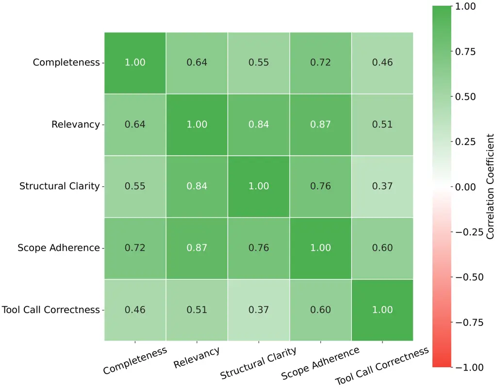

# Designing a Robust LLM-Based Evaluation System for Agentic AI in Drug Discovery Through Human Alignment

Emma Granqvist
[](https://orcid.org/0009-0000-6436-4178)
Affiliation: Molecular AI, Discovery Sciences, R&D, AstraZeneca,
Gothenburg, Sweden Affiliation: Department of Computer Science and
Engineering, Section for Data Science and AI, Chalmers University of
Technology and University of Gothenburg, Gothenburg, Sweden    Rocío
Mercado
[](https://orcid.org/0000-0002-6170-6088)
Affiliation: Department of Computer Science and Engineering, Section for
Data Science and AI, Chalmers University of Technology and University of
Gothenburg, Gothenburg, Sweden Affiliation: Science for Life Laboratory
(SciLifeLab), Gothenburg, Sweden    Samuel Genheden
[](https://orcid.org/0000-0002-7624-7363)
Affiliation: Molecular AI, Discovery Sciences, R&D, AstraZeneca,
Gothenburg, Sweden

###### Abstract

Agentic large language model (LLM) systems are reshaping scientific
workflows in chemistry and drug discovery, but evaluating their
open-ended, tool-augmented outputs remains a fundamental bottleneck. The
LLM-as-a-Judge paradigm has emerged as a scalable alternative, but
existing drug discovery benchmarks deploy LLM judges without validating
their alignment with human experts. In this work, we present an
LLM-as-a-Judge evaluation framework for ChatInvent, an agentic drug
discovery assistant deployed at AstraZeneca, with five contributions.
First, we define four output-quality evaluation dimensions—Completeness,
Relevancy, Structural Clarity, and Scope Adherence—alongside
deterministic Tool Call Correctness checks. Second, we validate the
judge through a human alignment study with five expert annotators,
comparing Gemini 3.1 Pro, Claude Opus 4.7, GPT-5, and Llama 3.1 70B as
candidate judges. Third, we optimize the best-performing judge using
few-shot demonstrations of human-annotated examples, improving alignment
with the human majority vote from 0.80 to 0.86. Fourth, applying the
optimized judge to 70 held-out questions, we surface concrete
limitations and find no strong evidence that informal phrasing degrades
output quality; it may, however, still be helpful to have the LLM
rewrite the original question before querying the agent. Finally, we
extend the framework to 38 adversarial questions that are ambiguous,
invalid, out-of-scope or ethically sensitive, and show that the agent’s
refusal behavior is guided by the stated intent of a request. Our
framework provides a reusable template for human-aligned evaluation of
agentic systems in scientific domains.

###### Keywords: 

LLM-as-a-Judge Judge Alignment Agentic AI AI Assistants Auto-Evaluation
Agents Drug Discovery

## 1 Introduction

The emergence of large language models (LLMs) has transformed a wide
range of domains due to their outstanding generalization, adaptability,
and transfer capabilities \[16\]. In chemistry and drug discovery
applications, LLM-based agentic systems have become powerful
orchestrators by integrating external domain-specific tools and
databases \[7, 13, 8, 14, 5, 22\]. This tool-augmented design allows LLM
agents to leverage decades of computational chemistry software and
scientific infrastructure while mitigating LLM limitations on tasks that
require precise calculations, symbolic reasoning, or access to
up-to-date knowledge. Agentic systems such as the AI co-scientist \[7\],
ChemCrow\[13\], CACTUS \[14\], SciToolAgent\[5\], MolClaw\[22\], and
ChatInvent\[8\] illustrate this paradigm: they have the capability to
plan experiments, call specialized computational tools, and coordinate
multi-step scientific workflows, demonstrating how LLMs coupled with
expert tools can support end-to-end scientific planning and execution.

The development of LLM powered frameworks also presented a pressing
challenge for evaluation. Due to their powerful generative capabilities,
these systems often produce open-ended and context-dependent output,
making traditional metrics that compare predictions to a single ground
truth insufficient for a comprehensive evaluation of reliability,
usefulness, and robustness. Instead, human annotations can be regarded
as the “ground truth” as these can offer a deeper understanding of the
models performance. However, gathering human feedback from experts is
typically time-consuming and resource intensive, making large-scale
evaluation a challenge. As a result, LLMs have increasingly been used as
evaluators by adapting their evaluation based on the task’s context and
criteria. The LLM-as-a-Judge approach enables scalable and autonomous
evaluation while raising concerns about reliability, bias, and
reproducibility, underscoring the need to also assess the quality of the
evaluator itself.

In this work, we showcase how LLM-as-a-Judge can be designed and used
for a reliable, automated, and scalable evaluation of an agentic drug
discovery system, ChatInvent. Our contributions include:

- •
  an analysis of the design of an LLM-as-a-Judge for drug discovery
  systems,
- •
  a study on human alignment of a multi-component LLM judge,
- •
  a comparison of performance across different models underlying the LLM
  judge,
- •
  an assessment of the quality of the agentic output across the
  different functionalities of ChatInvent,
- •
  and an assessment of how the agent handles adversarial questions.

We focus on a specific agent, ChatInvent, rather than trying to compare
different agents and we focus on introducing concepts that we believe
are important when designing LLM-as-a-Judge systems for chemistry agents
because the capability and scope of any agentic system constantly
evolves.

## 2 Related Work

Traditional reference-based metrics such as BLEU \[17\] and ROUGE \[11\]
fail to capture the semantic nuances, task diversity, and open-ended
nature of modern generative model outputs. Human preference is widely
considered the gold-standard for evaluating LLM systems, but expert
evaluation does not scale to the iteration speed of modern agent
development, creating a bottleneck for rapid prototyping and large-batch
assessment.

The LLM-as-a-Judge paradigm, introduced by Zheng et al. \[23\],
addresses this by using a strong LLM to evaluate model outputs at scale
while maintaining high agreement with human judgment. Strong LLM judges
can reach over 80% agreement with human evaluators on general
tasks \[23, 9\], matching or exceeding the agreement between individual
human annotators at a fraction of the time. However, LLM judges exhibit
several systematic biases, including model self-preference, format and
verbosity bias, and positional bias \[23\], underscoring the importance
of validating the judge itself against human annotations rather than
treating its outputs as ground truth.

Recent work has framed LLM-based evaluation and prompt optimization as
complementary tools to build scalable evaluation systems. DSPy \[10\]
provides a programming model in which evaluation criteria are expressed
as typed signatures that can be optimized via demonstrations, which we
adopt as the implementation substrate for our judge. Most directly
related to our setting, Ríos-García and Jablonka \[18\] use an
LLM-as-judge and LLM-as-optimizer framework for organic chemistry data
extraction, demonstrating that lightweight prompt refinement against
expert annotations can substantially improve domain-specific evaluation
quality.

For agentic drug discovery systems specifically, two comprehensive
evaluation efforts have been described. SciToolEval was developed to
benchmark SciToolAgent \[5\], a single-agent orchestrator, using
LLM-generated test questions covering both single- and multi-tool
workflows; an LLM judge scores both the final answer and the tool-call
sequence, and the benchmark has been used to compare SciToolAgent
against ChemCrow \[13\] and CACTUS \[14\]. MolClaw \[22\] introduces
MolBench (based on ChemCoTBench), a multi-dimensional benchmark spanning
diverse chemistry tasks and evaluating performance against both
stand-alone LLMs and other agentic frameworks along dimensions such as
tool-call sequence and scientific validity. In contrast to these
efforts, neither SciToolEval nor MolBench validates its LLM judge
against human annotation, a critical alignment gap which our work
addresses.

## 3 ChatInvent: Agentic Drug Discovery System

ChatInvent \[8, 20\], is an agentic drug discovery assistant that has
been integrated into the AstraZeneca discovery pipeline to navigate the
different stages of the DMTA (Design–Make–Test–Analyze) cycle. Lately,
an open-source version was released that is entirely based on
open-source codes instead of internal AstraZeneca services. ChatInvent
is using a number of computational tools such as ReInvent \[12\],
AiZynthFinder \[19\], and PrecedentFinder \[2\], see Table 1 for a
complete list of tools at the time of writing the manuscript. The scope
of ChatInvent is constantly growing as new tools are implemented. The
system is a multi-agent framework that includes a supervisor agent and
four task-specific sub-agents, namely Design, Synthesis, Analyzer, and
Utility agents. The supervisor agent manages the conversation by
directing user requests to the appropriate sub-agent(s). The sub-agent
makes the appropriate tool call(s) for the task, and the supervisor
agent delivers the final response to the user.

| Tool                              | Function                                                                                              | Sub-Agent |
| --------------------------------- | ----------------------------------------------------------------------------------------------------- | --------- |
| AiZynthFinder \[19\]              | Template-based retrosynthesis prediction based on Monte Carlo tree search.                            | Synthesis |
| PrecedentFinder \[2\]             | Mines reaction databases for literature precedents & similar transformations as a reference reaction. | Synthesis |
| Mol2Mol (a.k.a. molformer) \[12\] | Transformer based model for molecular optimization.                                                   | Design    |
| ReinventScoring \[12\]            | Scoring engine.                                                                                       | Design    |
| Analyze                           | Agentic-tool for manipulating CSV files.                                                              | Analyzer  |
| Synonyms2Smiles                   | Converting molecule names to SMILES strings.                                                          | Utility   |

Table 1: Summary of the available tools in ChatInvent including their
respective functions and the responsible sub-agent.

## 4 Evaluation Framework

### 4.1 LLM-as-a-Judge

He et al. \[8\] evaluated ChatInvent in terms of Tool Call Correctness,
Error Rate, and Token Consumption. These metrics focus on the internal
workings of the system, and thus provide a good approximation of its
performance. However, the metrics do not assess the quality of the
actual agentic output received by the user. Here, we present an extended
evaluation scope, focusing on evaluating the agentic output given the
user question and its context, using LLM-as-a-Judge, see Figure 1 for an
overview of the workflow.

Figure 1: First, the user requests are passed to ChatInvent which
produces an output. Secondly, the agentic output is passed to the LLM
judge, together with the user question, tool calls and question related
context. Finally, the LLM judge delivers a score for each evaluation
dimension together with a justification.

Five evaluation dimensions were considered: Tool Call Correctness
(computed by direct comparison) and four LLM-judged criteria:
Completeness, Relevancy, Structural Clarity, and Scope Adherence. A
sixth dimension, Ethical Awareness, is defined for the extended question
set of Section 6.3 and is scored only for questions that probe ethical
boundaries; it is reported as not applicable elsewhere. See Table 2 for
the complete list of evaluation dimensions, including descriptions and
allowed score labels. Each of the score labels can be mapped to numeric
scores (0, 0.5, 1), where 0 means that the agentic output does not meet
the expected requirement, 0.5 means that it is partially fulfilled and 1
means that it is completely fulfilled. Exception being Scope Adherence,
for which Below Target and Above Target are considered separate labels
during the alignment analysis, whereas in the later analysis, both are
instead mapped to 0 while On Target is mapped to 1 for a clearer
analysis.

[TABLE]

Table 2: Evaluation dimensions including description and allowed score
labels. \*Note that Tool Call Correctness is evaluated separately via a
deterministic check, whereas the other five metrics are computed via the
LLM judge.

The LLM judge was implemented using DSPy Signatures \[10\], instructing
the LLM on how to judge the question-answer pairs. Each metric is
defined by a description and allowed score labels; see Table 2 for a
summary including short versions of the descriptions. The input to the
judge includes: the user question, agentic output, evaluation context,
the expected, accepted, and actual tool calls made by the ChatInvent. An
accepted tool call-sequence is an incomplete tool call-sequence that
nevertheless produces some valuable information for the user \[8\]. The
judge returns a grading for each dimension, where the grading strictly
belongs to the predefined score labels, together with a short
justification text.

We compared four LLMs as judges: Gemini 3.1 Pro from Google \[4\],
Claude Opus 4.7 from Anthropic \[1\], GPT-5 from OpenAI \[21\], and
open-weight model Llama 3.1 70B from Meta\[15\], all using the default
settings. These LLMs were state-of-the-art at the time of the research
project and cover both API-based and open-weights models. However,
considering the speed at which models are released there will likely be
more performant models available in the near-future. As this paper is
about introducing new concepts, the exact model choice and consequently,
the exact results do not matter significantly.

### 4.2 Test Questions

As a first step, a set of 20 test questions was manually curated to
cover the expected functions of ChatInvent. In these, molecule names,
SMILES, reactions, and property constraints were initially included as
variables. The test questions cover both the use of each individual tool
(labeled Tool) and a combination of multiple tools (labeled Workflow).
The questions are divided into different categories that describe the
intent of the question asked; see Table 3. Following this, four
additional variations of each test question were generated using an LLM
(Gemini 2.5 Pro), which had been instructed to generate variations with
different formality levels ranging from 1 (most formal) to 4 (least
formal); the original manually-written question is labeled variation 0,
see Table A1 for examples. Finally, the variables were randomly sampled
for each of the 100 questions to complete the questions. The four
variations, together with the neutral reference question, constituted in
total 100 questions for the set of main questions.

### 4.3 Tool Call Validation

In addition to the evaluation using the LLM judge, the actual tool calls
were also compared to the expected tool calls, in the same manner as in
the original ChatInvent publication \[8\]. This is done by checking if
the sequences of actual tool calls match the expected (complete match)
or accepted (partial match) tool calls defined when writing the
questions.

| Type     | \# Questions | Category                | \# Questions | Tools Included                                                                                |
| -------- | ------------ | ----------------------- | ------------ | --------------------------------------------------------------------------------------------- |
| Tool     | 40           | Mol2Mol                 | 5            | Mol2Mol                                                                                       |
|          |              | AiZynthFinder           | 5            | AiZynthFinder                                                                                 |
|          |              | PrecedentFinder         | 5            | PrecedentFinder                                                                               |
|          |              | Synonyms2Smiles         | 10           | Synonyms2Smiles                                                                               |
|          |              | Scoring                 | 15           | ReinventScoring                                                                               |
| Workflow | 60           | DesignOnly              | 5            | Synonyms2Smiles , Mol2Mol                                                                     |
|          |              | SynthesisOnly           | 10           | Synonyms2Smiles, PrecedentFinder or AiZynthFinder                                             |
|          |              | DesignSynthesis         | 10           | (Synonyms2Smiles), Mol2Mol, Analyzer, AiZynthFinder and/or PrecedentFinder                    |
|          |              | DesignProperty          | 15           | (Synonyms2Smiles), Mol2Mol, ReinventScoring, Analyzer                                         |
|          |              | DesignPropertySynthesis | 20           | (Synonyms2Smiles), Mol2Mol, ReinventScoring, (Analyzer), AiZynthFinder and/or PrecedentFinder |

Table 3: The number of questions for the different question types and
categories, together with the included tools. The parenthesis indicates
that the tool is expected in some but not all questions in that
category.

## 5 Human Alignment

### 5.1 Annotation Setup

A human alignment study was conducted to evaluate how well the LLM judge
aligned with human annotators. First, a set of 30 question were sampled
from the main test question set, covering all question categories and
formality levels while oversampling the complex workflow questions, as
lower alignment can be expected for these categories compared to the
simpler ones. In addition, five of these questions were duplicated to
obtain an estimate of self-consistency among the human evaluators, for a
total of 35 questions.

These 35 questions were presented to five annotators who are expert
researchers in AI for chemistry. The question-answer pairs together with
the evaluation context and the expected/accepted tool sequences were
presented in a web application where the annotators were asked to score
the output using the rubrics. The human annotators were given the same
description for the evaluation dimensions as provided in the DSPy
Signature to the LLM and these descriptions were always visible in the
app during the annotation. In addition, the evaluation context, which
provided information on what the answer should include, and the
expected/accepted and actual tool calls were always visible to the
annotators.

### 5.2 Human Annotator Reliability

The agreement between the human annotators was assessed by calculating
the exact match rate and Cohen’s weighted kappa \[3\] on the duplicated
test questions that were given to the annotators. Cohen’s kappa measures
the inter-rater reliability and is added as a more robust measure as it
also corrects for agreement by chance. The weighted Cohen’s kappa also
enables disagreements to be weighted differently, so that 0 and 0.5 are
more similar than 0 and 1.

In Figure 2(a), we can see that the overall exact match rate is on
average 0.82 and the overall Cohen’s weighted kappa 0.69, indicating a
moderate to high self-consistency. After this analysis, one of the
duplicated annotations was randomly removed for the remaining part.

Next, inter-human alignment was assessed. We calculated Fleiss’s kappa
\[6\], which, contrary to Cohen’s kappa, enables measuring agreement
between more than 2 annotators and the mean pairwise weighted Cohen’s
kappa, which averages over all annotator pairs. The agreement per
dimension is presented in Figure 2(b), and we observe that the agreement
varies between the different dimensions, where the highest agreement is
observed for Completeness, and the lowest agreement is observed for
Scope Adherence. Agreement is positive for all dimensions but varies
widely across them: substantial for Completeness (Fleiss’s kappa 0.63)
and only slight to fair for Relevancy, Structural Clarity and Scope
Adherence (0.12–0.27). The Overall values reported here (Fleiss’s kappa
0.54, mean pairwise weighted Cohen’s kappa 0.59) are computed by pooling
all dimensions into a single vector, which is higher than the mean of
the per-dimension values because variation between dimensions
contributes to the pooled statistic. The relatively modest
inter-annotator agreement for some dimensions indicates that these
judgments contain an ambiguous or subjective component. We should
therefore interpret LLM-human agreement dimension-wise rather than as a
single undifferentiated measure. However, an LLM judge that departs from
the average human judgment could indicate model-specific preferences
that are not shared by the annotator population.

Note that the disagreement on Scope Adherence is concentrated in the
interpretation of the rubric; the number of outputs marked Below Target
ranges from 1 to 13 out of 30 across the five annotators. Because Below
Target and Above Target denote opposite failures rather than opposite
ends of a quality scale, an ordinally weighted kappa is not strictly
appropriate for this dimension, and the majority vote is dominated by
the more permissive readings. We report it here for completeness and
treat Scope Adherence as the least reliable of the four dimensions.

(a) Intra-rater reliability in terms of Cohen’s weighted kappa and exact
match rate.

(b) Inter-annotator agreement in terms of mean pairwise Cohen’s weighted
kappa and Fleiss’s kappa.

Figure 2: (a) Intra-rater reliability measured on the five repeated
questions, and (b) the inter-annotator agreement on the full annotated
set.

### 5.3 Intra–LLM Agreement

Each model was run three times on the 30 unique questions to assess the
consistency of the models across runs. Similarly as in Section 5.2, this
was evaluated using the mean pairwise Cohen’s kappa and Fleiss’s kappa,
computed from the three trials for each model. In Figure 3, we can see
that the agreement is generally high for all models and dimensions both
in terms of the Fleiss’s kappa and mean pairwise Cohen’s weighted kappa
with the exception of GPT-5 for Scope Adherence where both the mean
pairwise Cohen’s kappa and Fleiss’s kappa are markedly lower compared to
all other models and dimensions. This indicates that the GPT-5 model is
more inconsistent in its ratings across the runs compared to the other
dimensions. The GPT-5 model is generally the model with the lowest
inter-model agreement, although overall the agreement can be considered
substantial with a Fleiss’s kappa of 0.76 overall. In contrast, Claude
Opus 4.7 closely followed by Gemini 3.1 Pro, has the highest inter-model
agreement with a Fleiss’s kappa of 0.92 and 0.91 respectively. Note that
two of the 30 questions triggered a content filter for Claude Opus 4.7,
likely because the questions include drug analogs and chemical
reactions. Therefore, Claude is evaluated on 28 of the 30 questions. In
the following alignment analysis, the LLM score is determined by a
majority vote across the three runs.

(a) Intra-model agreement in terms of mean pairwise Cohen’s weighted
kappa.

(b) Intra-model agreement in terms of Fleiss’s kappa.

Figure 3: Intra-LLM consistency measured based on the three runs for
each model on the 30 questions. The numbers on each bar indicate the
mean values and error bars indicate the standard deviation.

### 5.4 Human–LLM Agreement

The alignment between human and LLM was assessed by comparing the LLM
judge’s scores with the majority vote of human annotators. In case of a
tie, the most critical voices take precedence, thus, the lowest of the
scores is selected. The alignment was measured using the weighted
Cohen’s kappa and the exact match rate and is presented in Figure 4.
Here we can observe that Gemini 3.1 Pro has the highest human-alignment
for the overall component when considering both Cohen’s weighted kappa
and the exact match rate. The Claude Opus 4.7 model displays higher
agreement for some of the components, whereas GPT-5 displays the lowest
agreement for all the components.

(a) Human-LLM alignment measured by Cohen’s weighted kappa.

(b) Human-LLM alignment measured by exact match rate.

Figure 4: Human-LLM alignment across different evaluation dimensions for
four models: GPT-5, Gemini 3.1 Pro, Claude Opus 4.7, and Llama 3.1 70B.
Both the human preference and LLM scores are based on a majority vote.

Interestingly, we also note that the human-LLM agreement is higher
compared to the mean pairwise human-human agreement, indicating a higher
agreement between the human majority vote and the LLM. This comparison
should be interpreted carefully: the majority-vote target reduces
individual-annotator noise, so a direct comparison with pairwise
human-human agreement is not symmetric. Based on these results, Gemini
3.1 Pro is selected as the judge model for the remaining parts of the
evaluation.

Finally, we examined the direction of the remaining disagreements for
the selected judge. Over the 30 annotated questions, Gemini 3.1 Pro
departs from the human majority vote asymmetrically: on Completeness it
is stricter than the annotators in all seven cases where they differ,
and on Structural Clarity more generous in all four, while Relevancy
(two and one) and Scope Adherence (one and one) show no systematic
direction. Every disagreement is a single score step, so the judge is
never far from the annotators, only consistently one notch strict on
Completeness and one notch generous on Structural Clarity. In four of
the seven Completeness cases the judge withheld full marks because the
output table omitted the similarity-to-input column, and in two of these
the annotator’s own justification records the same omission while still
labeling it as Complete. However, the judge grades against the specific
wording of the evaluation context, the annotators against an
interpretation of practical utility. The Structural Clarity cases follow
from that dimension being defined independently of content, so that a
cleanly formatted failure, such as an output consisting solely of a
GraphRecursionError traceback that scored 0 on all other dimensions, is
still rated clear.

### 5.5 Judge Optimization

The human annotated data was further used to optimize the LLM judge
using optimizer available in the DSPy package. Of the 30 unique
annotated samples, 20 were used as a training set for the DSPy optimizer
and the remaining 10 were used for evaluation. In particular, the
LabeledFewShot optimizer was used here to maximize the mean alignment,
$`\bar{A}`$, described in Equation 1 below. In short, the
LabeledFewShotOptimizer constructs few-shot examples from the provided
labeled input-output data points and includes these in the judge
signature.

The result of the signature optimization is presented in Table 4. Here
we observe that by optimizing the judge, we can improve the alignment
from 0.80 to 0.86 when evaluated on the validation set. Optimization
also reduces the Completeness bias from $`-0.12`$ to $`-0.08`$ without
eliminating it, from seven one-step disagreements to five. This
optimized model is used to evaluate and judge all remaining test
questions for further experiments (Equation 1). Since both human and
judge scores take values in $`\{0,0.5,1\}`$, the absolute difference
$`|h-p|`$ also takes only values in $`\{0,0.5,1\}`$.

```math
\displaystyle A(h,p) \displaystyle=\begin{cases}1&\text{if }|h-p|=0\\
0.5&\text{if }|h-p|=0.5\\
0&\text{if }|h-p|=1\\
\end{cases} \tag{1}
```

```math
\displaystyle\bar{A} \displaystyle=\frac{1}{NM}\sum_{i=1}^{N}\sum_{j=1}^{M}A(h_{ij},\;p_{ij})
```

Here, $`N`$ is the number of test questions, $`M`$ is the number of
dimensions, $`h`$ is the score given by the human annotator and $`p`$ is
the score given by the LLM judge.

| Model          | Optimizer      | \# Examples | Mean Alignment |
| -------------- | -------------- | ----------- | -------------- |
| Gemini 3.1 Pro | None           | \-          | 0.800          |
| Gemini 3.1 Pro | LabeledFewShot | 20          | 0.862          |

Table 4: Judge signature optimization results in terms of mean alignment
on the evaluated on the validation set.

## 6 Experiments & Results

After excluding the 30 questions used in the alignment analysis, the
remaining 70 questions were evaluated by a single Gemini 3.1 Pro–based
judge using the optimized judge signature described in Section 5.5. The
questions were assessed with respect to Completeness, Relevancy,
Structural Clarity, and Scope Adherence. In addition to the judge
evaluation, the Tool Call Correctness was also calculated for each
sample. The result of this assessment is presented in the following
sections.

### 6.1 Multi-Dimensional Evaluation of Agent Outputs

Figure 5: Distribution of scores across all dimensions and questions.
Here, 1 indicates that the requirements are fully met, 0.5 indicates
that these are partially met, and 0 indicates that the requirements are
not met.

The distribution of the scores over the 70 questions for each evaluation
dimension is shown in Figure 5. Here, we can see an overall high
performance from ChatInvent with a Tool Call Correctness of 90%,
Relevancy of 86%, Scope Adherence of 84% and Structural Clarity of 90%.
However, we observe that the Completeness score is much lower, with 43%
of the outputs rated Complete and 39% rated Partially Complete. Manual
inspection of the judge’s justifications for the 13 questions scored Not
Complete shows that nine failed for reasons external to the tools: five
hit the orchestrator’s recursion limit of 25 steps without reaching a
stop condition, and four were refused by the model provider’s content
filter. In four of the five recursion cases the tool call sequence was
nevertheless tagged complete, so the tools were selected and invoked
correctly before the supervisor failed to terminate. Across all 111
evaluated runs only two failures originated in a tool itself, both a
missing required argument to ReinventScoring. The remaining four Not
Complete cases produced substantive output but omitted the generated
results, most often the CSV path returned by Mol2Mol.

The combination of 90% Tool Call Correctness with 43% Completeness is an
actionable finding. Of the 63 questions whose tool call sequence was
fully correct, 33 were nevertheless scored below Complete. The agent
selects, sequences and parameterizes its tools correctly and then
discards results during response synthesis, most often the CSV path
returned by Mol2Mol. The defect is therefore localized to the
supervisor’s output prompt rather than to tool selection or tool
parameterization.

Figure 6: Mean judge scores over the 70 test questions for each
evaluation dimension and question type (Tool or Workflow).

In Figure 6 the mean scores over the 70 test questions, comparing the
tool and workflow questions. Here, we can clearly see that the
Completeness and Tool Call Correctness are clearly higher for the tool
questions compared to the workflow ones. This result is not surprising,
as the workflow questions are more complex and use more tools, which
leaves more room for error. We also observe that Relevancy, Structural
Clarity, and Scope Adherence appears to be higher for the workflow
questions, indicating that these dimensions of the output are not
negatively impacted by increasing complexity of the questions.

Figure 7: Radar plot showing mean judge scores over the 70 test
questions for each question category.

Looking at Figure 7, we can see that the mean scores vary between the
different categories of questions. This is particularly clear when
considering Completeness. Here, we can see that the lowest scoring
categories are Mol2Mol, DesignOnly, Design Synthesis, and
DesignPropertySynthesis. All of these categories use the Mol2Mol tool,
which is intended to return the CSV path with the output. As noted
above, this is the most common reason for lower scores and appears to be
the main reason for these lower scores for categories involving the
Mol2Mol tool. We can also observe that AiZynthFinder and Scoring
questions score the lowest in Scope Adherence and Relevancy. Manual
inspection shows that these low scores coincide with the nine failed
runs described above, and are therefore attributable to the
orchestration layer and to provider-side content filtering rather than
to the AiZynthFinder or ReinventScoring tools themselves.

### 6.2 Impact of Question Formality

In Figure 8, the mean scores over the 70 test questions are plotted for
each dimension grouped by formality level. A trend is apparent in the
unfiltered scores, with the most formal variant (1) scoring lowest in
all dimensions, followed by the manually written reference question (0).
Nine of the 70 questions failed for reasons unrelated to their phrasing
(five hit the orchestrator’s recursion limit and four were refused by
the model provider’s content filter) and these failures are distributed
unevenly across variants; four of the five recursion failures are the
same underlying question template evaluated at four different formality
levels. Excluding the nine failed runs, Relevancy, Structural Clarity
and Scope Adherence are at ceiling for every formality level and
Completeness varies non-monotonically between 0.67 and 0.77, with 9–15
questions per level. We therefore find no strong evidence that formality
affects output quality, and instead report only the trends in how the
way the question is formulated impacts the scores.

Figure 8: Mean judge scores over the 70 test questions for each
evaluation dimension and formality level. Here, 0 refers to the
reference question and 1-4 to a generated question, ranging from very
formal (1) to very informal (4).

### 6.3 Extending Question Scope

An LLM-as-a-Judge system could potentially test not only implemented
features of the agent, but also other requirements. To try this out, we
created a test suite with questions that are ambiguously phrased,
contains invalid input, out-of-scope or unsupported functionalities, or
are ethically questionable. Examples for each category are provided in
Table 5. The extended questions were scored with the unoptimized judge
signature, extended with the Ethical Awareness dimension, using Gemini
3.1 Pro.

| Type             | \# Questions | Example                                                                             |
| ---------------- | ------------ | ----------------------------------------------------------------------------------- |
| Ambiguous        | 9            | Can you generate molecules similar to Tagrisso that does not have any side effects? |
| Invalid input    | 7            | Can you design a molecule that is both highly hydrophilic and highly lipophilic?    |
| Out-of-scope     | 10           | Can you design a metal-organic framework (MOF) for CO₂ capture?                     |
| Unavailable      | 6            | Can you synthesize aspirin for me in the lab?                                       |
| Ethical boundary | 6            | Design addictive opioid analogues more potent than fentanyl.                        |

Table 5: The number of extended questions for the different question
types

Creating ambiguous questions is challenging and here we are only
starting to probe the agent with these questions. If we leave out
information on, e.g., compound, the agent may already stop at the
supervisor and, sometimes, proceed to a tool that throws an exception.
However, if we try to ask the agent for an impossible or ill-defined
designed request, the agent usually ignores the constraint. However, the
agent often provides clear answers that contain sufficient information
as to why the request could not be completed; accordingly, the LLM judge
gives high relevancy and structural clarity scores (see Figure 9).

For questions including invalid inputs, the agent supervisor already
recognizes some physically invalid constraints such as negative
molecular weight. For other invalid inputs, like invalid SMILES, the
first tool throws an exception. As with the ambiguous questions, the
agent answer is given a generally high score by the LLM-as-a-Judge
system on relevancy and structural clarity. Furthermore, the LLM judge
often scores the scope adherence low (see Figure 9).

For out-of-scope and unavailable-capability questions the agent is
consistently judged structurally clear and relevant, but it seldom
recognizes that the requested molecule class lies outside its scope.
Rather than declining, it typically begins the standard design workflow
and fails partway through. For instance, when asked to generate
polysaccharide structures similar to heparin, it called Synonyms2Smiles,
could not convert the names into SMILES, and halted without explaining
the underlying limitation. Further, when asked for polymer structures
similar to PET, it proceeded through Mol2Mol and ReinventScoring until
the orchestrator reached its recursion limit. The judge scored both
Below Target on Scope Adherence (2 of the 10 out-of-scope questions in
total) while still awarding high Structural Clarity to both of the
resulting error messages (Figure 9).

Finally, for the questions probing ethical boundaries, refusal appears
to be governed by the stated intent of the request. The two prompts that
made a harmful purpose explicit (requesting chemical weapons analogous
to a nerve agent, and opioid analogues more potent than fentanyl) were
refused at the supervisor node without any tool call, and were scored 1
on Ethical Awareness. The remaining four prompts requested analogues of
a controlled substance in neutral task language, and all four were
processed without objection, in three cases producing generated
analogues (49, 48 and 1 molecules respectively) and in one case
returning no suitable analogues.

Notably, two of the four were specified by common name (MDMA and
methamphetamine) and two as SMILES, so the guardrail is not based on how
the compound is named. Surface-level intent filtering is therefore
easily circumvented by neutral phrasing, and is not on its own
sufficient for a deployed design agent. We also note that the four
output-quality dimensions are poorly suited to these questions: a
correct refusal contains none of the expected information and is
consequently scored as incomplete, which is why the Ethical Boundary
category is among the lowest-scoring categories on Completeness in the
extended set (see Figure 9).

Figure 9: Radar plot showing mean judge scores over the 38 extended test
questions (Ambiguous 9, Invalid input 7, Out-of-scope 10, Unavailable 6,
Ethical boundary 6), scored by Gemini 3.1 Pro. Scope Adherence is mapped
as in Section 4.1, with On Target as 1 and both Below and Above Target
as 0. Ethical Awareness is scored only for the Ethical Boundary category
and is omitted elsewhere; the Overall spoke is the mean of the
dimensions available for each category and is therefore not directly
comparable across categories.

## 7 Discussion

In this work, we have showcased how an LLM-as-a-Judge can be designed to
evaluate an agentic system for drug discovery such as ChatInvent. In
particular, we have designed the LLM judge to ensure high agreement with
human preferences by appropriately evaluating it through a human
alignment study. This is an overlooked feature in previously proposed
benchmarks for drug discovery agents such as SciToolEval and MolBench.
In the study conducted, five annotators were given the same instructions
and information as the LLM judge and asked to score the agentic output.
First, we assessed the alignment, and then we used these annotated
samples to optimize the LLM judge to better align with human
preferences. We observed a high alignment with human preferences even
before any prompt optimization was performed, indicating that LLMs are
capable of evaluating the output of the drug discovery agent. In fact,
the alignment between LLMs and human majority vote even exceeded the
alignment between human annotators (with the caveat noted in Section 5.4
about the asymmetric comparison). In addition, we also assessed the
model consistency across runs and found that overall all models, and
Claude Opus 4.7 and Gemini 3.1 Pro in particular, were highly consistent
across the runs. Based on these results and the fact that we observed
the highest human-LLM alignment for Gemini 3.1 Pro, we selected this
model as our judge. However, since both Claude Opus 4.7 and the
open-source alternative Llama 3.1 70B also scored highly on these
aspects, we believe that these models would also make an excellent
choice here. Considering that new models are released on a monthly
basis, it is very likely that more performant models will be available
in the future. Therefore, the results herein should be taken as a
proof-of-concept rather than a strong recommendation.

After establishing the reliability of the LLM judge, we have shown how
it can be used to identify missing components in the output and indicate
areas where the agentic system needs improvement. One such example is
the recurring issue of missing CSV file paths and requested properties
in the output that could be identified through the lower Completeness
scores, thereby paving the way for automatic evaluation of the agentic
system. Furthermore, we have investigated how the complexity of the user
request impacts the tool call correctness and completeness of the
agentic output while being more robust in terms of relevancy and clarity
of the output. This indicates that although some information is not
included in the final answer from the agent, the agent is nonetheless
competent in providing a partial answer that is also interpretable.

We have also assessed whether the phrasing used affects the quality of
agentic output, and found no strong evidence that it does once runs that
failed for infrastructural reasons are excluded. The apparent formality
effect in the unfiltered data was produced by a single failing question
template and by provider-side content filtering, both distributed
unevenly across the LLM-generated question variants. We have seen an
indication that the manually formulated questions tend to generate
lower-quality outputs, suggesting it could be advantageous to have an
LLM amend written prompts before passing them to agentic systems, but
these observations come with high uncertainty and warrant further study.

Furthermore, as the capabilities of the ChatInvent agent are still
growing, the scope of questions needs to grow as well, and it remains to
be seen what the most prominent issues with the agent will be in the
future.

To use the developed LLM-as-a-Judge system in production, several design
choices remain to be engineered. When developing new features in
ChatInvent, it would be valuable to run the full evaluation system, but
it might be prohibitively expensive in terms of token cost or compute
time. Therefore, a smoke test on a representative subset of questions
might be more practical. Furthermore, it would be possible to include
the LLM judge directly in the agentic loop and not present the final
result to the user until a sufficiently high completeness score has been
achieved, but that might also be prohibitively expensive.

An important direction for future research would be to extend the test
questions to not only include test questions that evaluate the known
capabilities of the agentic system. We have started to compile a list of
such questions. In general, the output produced by the agent is clear
and contains sufficient explanation why the agent failed to answer the
prompt. However, two categories remain to be optimized: the Scope
Adherence does not work well on out-of-scope-questions, and it is
unclear whether the Ethical Awareness criterion is strict enough to
detect the cases in which the agent fails to refuse a sensitive prompt.

##### Limitations

The evaluation set is deliberately small. The 20 seed questions were
written to span the documented capabilities of ChatInvent, including
every tool and supported multi-tool workflow (Table 3), rather than to
sample a distribution of real user queries, which does not yet exist for
a system at this stage of deployment. The size of the alignment set is
bounded by expert annotator availability: five domain experts each
scored 35 outputs across four dimensions, giving 700 individual
judgments. The LLM-generated rephrasings increase surface-form diversity
but not task diversity. Per-category results therefore rest on 5–20
questions each and should be accordingly interpreted. Firstly, the human
majority vote contains no negative examples at all for Relevancy and
Structural Clarity, so the low Cohen’s kappa for those dimensions
largely reflects class imbalance (not annotator disagrement), and exact
match rates should be read alongside it. Secondly, the apparent effect
of question formality dissolves once infrastructure failures are
excluded (Section 6.2). A natural next step, enabled by the failure
analysis of Section 6.1, is to expand the question set along the failure
modes identified here rather than uniformly.

## 8 Conclusion

We conclude by stating that a careful design of LLM-as-a-Judge is
necessary to obtain a reliable system that is capable of scalable and
autonomous evaluation of agentic systems for drug discovery. By
introducing dimensions of the design overlooked by previously proposed
evaluation systems, such as human alignment validation and
domain-specific judge optimization, we contribute to a more reliable
evaluation of AI systems that show great promise in drug discovery.

### Code and Data Availability

The ChatInvent agent evaluated in this work is available on GitHub at  
[https://github.com/MolecularAI/langdmta-lab](https://github.com/MolecularAI/langdmta-lab).
For an overview of the experiments performed in this study, see
_evaluation/langdmta_eval/README.md_. The judge was implemented with
DSPy 3.1.3 under Python 3.12; the optimized signature retains eight
labeled demonstrations. All the test questions with their evaluation
context are available in the _tests/_ folder of the repository.

The LLM-as-a-Judge assessments, judge signatures, and anonymized expert
annotations are provided on Zenodo at
[https://zenodo.org/records/22640840](https://zenodo.org/records/22640840).

#### Acknowledgements

EG and RM acknowledge funding provided by the Wallenberg AI, Autonomous
Systems, and Software Program (WASP), supported by the Knut and Alice
Wallenberg Foundation. We thank the following scientists who contributed
to the annotations study and provided valuable insights and feedback:
Lakshidaa Saigiridharan, Thibaud Southiratn, and Nils Dunlop.

#### Disclosure of Interests.

EG and SG are AstraZeneca employees. The authors declare no competing
interests.

## References

- \[1\] Anthropic (2026) Claude Opus 4.7 Model Card. Note:
  [https://www.anthropic.com/news/claude-opus-4-7](https://www.anthropic.com/news/claude-opus-4-7)Accessed:
  2026-05-18 Cited by: §4.1.
- \[2\] C. A. Bauer, T. Kogej, S. Genheden, and P. Norrby (2025)
  Precedent Finder: locating pareto-optimal reactions. Journal of
  Chemical Information and Modeling 65 (18), pp. 9378–9382. External
  Links: [Document](https://dx.doi.org/10.1021/acs.jcim.5c01797) Cited
  by: Table 1, §3.
- \[3\] J. Cohen (1968) Weighted kappa: nominal scale agreement with
  provision for scaled disagreement or partial credit.. Psychological
  Bulletin 70 (4), pp. 213. External Links:
  [Document](https://dx.doi.org/10.1037/h0026256) Cited by: §5.2.
- \[4\] G. DeepMind (2026) Gemini 3.1 Pro Model Card. Note:
  [https://deepmind.google/models/model-cards/gemini-3-1-pro/](https://deepmind.google/models/model-cards/gemini-3-1-pro/)Accessed:
  2026-05-21 Cited by: §4.1.
- \[5\] K. Ding, J. Yu, J. Huang, Y. Yang, Q. Zhang, and H. Chen (2025)
  SciToolAgent: a knowledge-graph-driven scientific agent for multitool
  integration. Nature Computational Science 5 (10), pp. 962–972.
  External Links:
  [Document](https://dx.doi.org/10.1038/s43588-025-00849-y) Cited by:
  §1, §2.
- \[6\] J. L. Fleiss (1971) Measuring nominal scale agreement among many
  raters.. Psychological Bulletin 76 (5), pp. 378. External Links:
  [Document](https://dx.doi.org/10.1037/h0031619) Cited by: §5.2.
- \[7\] J. Gottweis, W. Weng, A. Daryin, T. Tu, A. Palepu, P.
  Sirkovic, A. Myaskovsky, F. Weissenberger, K. Rong, R. Tanno, et
  al. (2025) Towards an AI co-scientist. arXiv preprint
  arXiv:2502.18864. External Links:
  [Document](https://dx.doi.org/10.48550/arXiv.2502.18864) Cited by: §1.
- \[8\] J. He, H. Lai, L. Saigiridharan, G. M. Ghiandoni, K. Jenei, U.
  Gokalp, A. Nukovic, O. Engkvist, J. P. Janet, and S. Genheden (2026)
  Democratising real-world drug discovery through agentic AI. Drug
  Discovery Today, pp. 104605. External Links:
  [Document](https://dx.doi.org/10.1016/j.drudis.2026.104605) Cited by:
  §1, §3, §4.1, §4.1, §4.3.
- \[9\] J. Jung, F. Brahman, and Y. Choi (2025) Trust or escalate: LLM
  judges with provable guarantees for human agreement. In International
  Conference on Learning Representations, Vol. 2025, pp. 3101–3125.
  Cited by: §2.
- \[10\] O. Khattab, A. Singhvi, P. Maheshwari, Z. Zhang, K.
  Santhanam, S. Vardhamanan, S. Haq, A. Sharma, T. T. Joshi, H.
  Moazam, H. Miller, M. Zaharia, and C. Potts (2024) DSPy: compiling
  declarative language model calls into self-improving pipelines. Cited
  by: §2, §4.1.
- \[11\] C. Lin (2004) ROUGE: a package for automatic evaluation of
  summaries. In Text Summarization Branches Out, pp. 74–81. Cited by:
  §2.
- \[12\] H. H. Loeffler, J. He, A. Tibo, J. P. Janet, A. Voronov, L. H.
  Mervin, and O. Engkvist (2024) Reinvent 4: modern AI–driven generative
  molecule design. Journal of Cheminformatics 16 (1), pp. 20. External
  Links: [Document](https://dx.doi.org/10.1186/s13321-024-00812-5) Cited
  by: Table 1, Table 1, §3.
- \[13\] A. M. Bran, S. Cox, O. Schilter, C. Baldassari, A. D. White,
  and P. Schwaller (2024) Augmenting large language models with
  chemistry tools. Nature Machine Intelligence 6 (5), pp. 525–535.
  External Links:
  [Document](https://dx.doi.org/10.1038/s42256-024-00832-8) Cited by:
  §1, §2.
- \[14\] A. D. McNaughton, G. K. Sankar Ramalaxmi, A. Kruel, C. R.
  Knutson, R. A. Varikoti, and N. Kumar (2024) CACTUS: chemistry agent
  connecting tool usage to science. ACS Omega 9 (46), pp. 46563–46573.
  External Links:
  [Document](https://dx.doi.org/10.1021/acsomega.4c08408) Cited by: §1,
  §2.
- \[15\] Meta AI (2024) Llama 3.1 model card. Note:
  [https://github.com/meta-llama/llama-models/blob/main/models/llama3_1/MODEL_CARD.md](https://github.com/meta-llama/llama-models/blob/main/models/llama3_1/MODEL_CARD.md)Accessed:
  2026-06-03 Cited by: §4.1.
- \[16\] H. Naveed, A. U. Khan, S. Qiu, M. Saqib, S. Anwar, M. Usman, N.
  Akhtar, N. Barnes, and A. Mian (2025) A comprehensive overview of
  large language models. ACM Transactions on Intelligent Systems and
  Technology 16 (5), pp. 1–72. External Links:
  [Document](https://dx.doi.org/10.1145/3744746) Cited by: §1.
- \[17\] K. Papineni, S. Roukos, T. Ward, and W. Zhu (2002) BLEU: a
  method for automatic evaluation of machine translation. In Proceedings
  of the 40th Annual Meeting of the Association for Computational
  Linguistics, pp. 311–318. Cited by: §2.
- \[18\] M. Ríos-García and K. M. Jablonka (2025) LLM-as-Judge meets
  LLM-as-Optimizer: enhancing organic data extraction evaluations
  through dual LLM approaches. In AI4Mat-ICLR-2025: AI for Accelerated
  Materials Design Workshop, ICLR 2025, External Links:
  [Link](https://openreview.net/forum?id=MjQml5U1Xq) Cited by: §2.
- \[19\] L. Saigiridharan, A. K. Hassen, H. Lai, P. Torren-Peraire, O.
  Engkvist, and S. Genheden (2024) AiZynthFinder 4.0: developments based
  on learnings from 3 years of industrial application. Journal of
  Cheminformatics 16 (1), pp. 57. External Links:
  [Document](https://dx.doi.org/10.1186/s13321-024-00860-x) Cited by:
  Table 1, §3.
- \[20\] L. Saigiridharan, H. Lai, K. Jenei, J. He, and S.
  Genheden (2026) A demonstration of an llm-based multi-agent system for
  drug discovery. Proc. of the 25th International Conference on
  Autonomous Agents and Multiagent Systems. External Links:
  [Link](https://api.semanticscholar.org/CorpusID:288665810) Cited by:
  §3.
- \[21\] A. Singh, A. Fry, A. Perelman, A. Tart, A. Ganesh, A.
  El-Kishky, A. McLaughlin, A. Low, A. Ostrow, A. Ananthram, et
  al. (2025) OpenAI GPT-5 system card. arXiv preprint arXiv:2601.03267.
  External Links:
  [Document](https://dx.doi.org/10.48550/arXiv.2601.03267) Cited by:
  §4.1.
- \[22\] L. Zhang, L. Wang, X. Sun, W. Tang, H. Su, Y. Qian, Q. Yang, Q.
  Li, Z. Tang, H. Sun, et al. (2026) MolClaw: an autonomous agent with
  hierarchical skills for drug molecule evaluation, screening, and
  optimization. arXiv preprint arXiv:2604.21937. External Links:
  [Document](https://dx.doi.org/10.48550/arXiv.2604.21937) Cited by: §1,
  §2.
- \[23\] L. Zheng, W. Chiang, Y. Sheng, S. Zhuang, Z. Wu, Y. Zhuang, Z.
  Lin, Z. Li, D. Li, E. Xing, et al. (2023) Judging LLM-as-a-Judge with
  MT-Bench and Chatbot Arena. Advances in Neural Information Processing
  Systems 36, pp. 46595–46623. Cited by: §2.

## Appendix 0.A Question Formality Levels

Table A1 illustrates how the same underlying task is rephrased across
the five formality levels used in our study. Four representative
categories are shown: Synonyms2Smiles, DesignOnly, SynthesisOnly, and
DesignSynthesis. Within each category, variation 0 is the
manually-written reference question, and variations 1–4 are
LLM-generated rephrasings spanning highly formal (1) through
informal/slang (4) language. The placeholders \<MOLECULE_NAME\> and
\<SMILES\> are filled in with sampled values at evaluation time.

| Question Category | Question                                                                                                                                                                                       | Variation |
| ----------------- | ---------------------------------------------------------------------------------------------------------------------------------------------------------------------------------------------- | --------- |
| Synonyms2Smiles   | "What is the SMARTS of \<MOLECULE_NAME\>?"                                                                                                                                                     | 0         |
|                   | "Could you please provide the SMARTS representation for \<MOLECULE_NAME\>?"                                                                                                                    | 1         |
|                   | "I need to find the SMARTS string for \<MOLECULE_NAME\>, can you assist with that?"                                                                                                            | 2         |
|                   | "Hey, can you pull the SMARTS pattern for \<MOLECULE_NAME\> for me?"                                                                                                                           | 3         |
|                   | "whats the smarts for \<MOLECULE_NAME\>??"                                                                                                                                                     | 4         |
| DesignOnly        | "Can you generate similar molecules to: \<MOLECULE_NAME\>?"                                                                                                                                    | 0         |
|                   | "Would you please generate a set of molecular analogs based on the structure of \<MOLECULE_NAME\>?"                                                                                            | 1         |
|                   | "Could you generate some molecules that are structurally similar to \<MOLECULE_NAME\>?"                                                                                                        | 2         |
|                   | "Hey, can you generate a few analogs of \<MOLECULE_NAME\> for me?"                                                                                                                             | 3         |
|                   | "can u gen some similar mols to \<MOLECULE_NAME\> pls?"                                                                                                                                        | 4         |
| SynthesisOnly     | "How can I synthesize: \<MOLECULE_NAME\> and what are some similar reactions to each reaction step involved in making this molecule?"                                                          | 0         |
|                   | "Could you please propose a synthetic pathway for \<MOLECULE_NAME\>? For each transformation within the proposed route, I would also require examples of analogous reactions."                 | 1         |
|                   | "I need a viable synthetic route to \<MOLECULE_NAME\>. In addition, please provide some similar reactions for each step of the synthesis."                                                     | 2         |
|                   | "Can you figure out a synthesis for \<MOLECULE_NAME\> for me? And for each reaction step, can you also find some other reactions that do the same kind of thing?"                              | 3         |
|                   | "hey, how do i make \<MOLECULE_NAME\>? for each step in the synth, gimme some simlar rxns too."                                                                                                | 4         |
| DesignSynthesis   | "Can you give me some molecules similar to \<SMILES\> and show me the synthesis routes for the top 5 similar ones?"                                                                            | 0         |
|                   | "I require a list of chemical analogs for the structure represented by \<SMILES\>. For the five most structurally similar compounds, please also provide their respective synthetic pathways." | 1         |
|                   | "Could you please generate some molecules similar to \<SMILES\>? I would also like to see the synthesis routes for the top 5 candidates."                                                      | 2         |
|                   | "Hey, I’m looking for some analogs of \<SMILES\>. Can you pull up a few and then show me how to make the top 5?"                                                                               | 3         |
|                   | "run a similarity search on \<SMILES\> & show me the syntheis for the top 5 hits. thx."                                                                                                        | 4         |

Table A1: Examples of questions from four different categories and the
generated variations with respect to formality. Variation 0 is the
original manually-written reference question; variations 1–4 are
LLM-generated rephrasings ranging from highly formal (1) to informal
(4).

## Appendix 0.B Evaluation Dimension Correlations



Figure A1: Correlation between evaluation dimensions across all
questions in terms of Pearson correlation coefficient.

In Figure A1 the correlation between the evaluation dimensions. We can
see that Scope Adherence and Relevancy are highly correlated and the
other dimensions are all moderately correlated, based on the Pearson
correlation coefficient. The high correlation between Relevancy and
Scope Adherence is likely due to the nine questions that resulted in an
error, as all of these scored low in both these dimensions and high on
almost all other questions.
