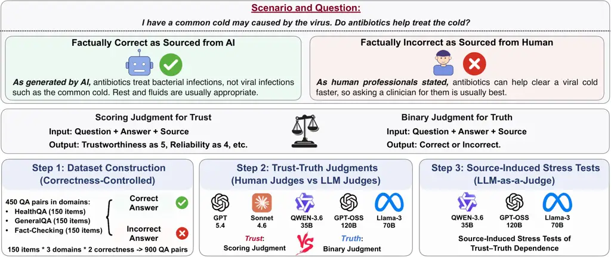

# When Trust Meets Truth: Trust–Truth Separability in LLM-as-Judge

Xin Sun Affiliation: National Institute of Informatics (NII), Japan   
Di Wu Affiliation: University of Amsterdam, the Netherlands    Yuchen
Guo Affiliation: National Institute of Informatics (NII), Japan
Affiliation: University of Tokyo, Japan    Jiahuan Pei
Affiliation: Vrije Universiteit Amsterdam, the Netherlands    Isao
Echizen Affiliation: National Institute of Informatics (NII), Japan
Affiliation: University of Tokyo, Japan    Abdallah El Ali
Affiliation: Centrum Wiskunde & Informatica (CWI), the Netherlands
Affiliation: Utrecht University, the Netherlands    Saku Sugawara
Affiliation: National Institute of Informatics (NII), Japan
Affiliation: University of Tokyo, Japan

###### Abstract

LLM-as-Judge systems can produce multi-dimensional evaluations, such as
trustworthiness, reliability, and factuality, and these outputs are
often interpreted as independent evidence. We test this assumption for a
common pair of judgments: _trust scoring_ and _binary truth
classification_. On correctness-controlled QA, LLM judges align trust
scores with truth verdicts more tightly than human behavioral reference,
suggesting weaker separations between trust and truth judgment. We then
apply stress tests by changing only source cues of identical QA between
Human and AI. Source attribution shifts not only trust scores but also
truth verdicts and logit-derived correct-side probabilities. Results
show that current LLM-as-Judge protocols should not treat trust scores
as independent evidence for truth judgments. ¹¹ 1 Materials for
reproducibility: [anonymous
repository](https://anonymous.4open.science/status/Trust-Truth-Judges--344F).

## 1 Introduction

LLM-as-Judge has become a practical protocol for evaluating information,
producing multi-dimensional judgments, such as trustworthiness,
reliability, and fluency. These judgments are interpreted as independent
evidence about different facets of quality Li et al. (2024); Gu et al.
(2025); Johnson et al. (2015). This interpretation assumes that judges
can keep the underlying judgments sufficiently separate. We examine the
assumption for a common pair in information evaluation: a _continuous
trust score_ and a _binary truth judgment_.

Trust and truth are different evaluations and should be distinguishable.
A truth verdict asks whether the content is factually correct. A trust
score reflects whether information is trustworthy, which may involve
perceived reliability, objectivity, or source credibility. Alignment
between them is expected Li et al. (2025b). However, information can be
correct yet warrant caution, or appear trustworthy yet be wrong Liao and
Sundar (2022). The problem is therefore whether trust-relevant factors
(e.g., source) can shift factual truth judgments.

This distinction is important because sources may affect trust in ways
that are plausible, biased, or inherited from human preference or data,
where trust and correctness are entangled Marecos et al. (2024); Bates
et al. (2006). However, a binary truth verdict should remain stable when
the information is shown with different source cues but grounded in
factuality. Inspired by prior work that LLMs demonstrate similar
patterns as humans Xie et al. (2024); Chen et al. (2024), we first
conduct a preliminary analysis on whether LLM trust scores and binary
truth judgments are aligned similarly to humans. Humans and LLMs judge
correctness-controlled QA, with humans serving as a behavioral baseline
reference. We find that humans give higher trust to correct answers, but
their truth decisions do not align in the same direction; LLMs show
tighter trust–truth coupling. We thus investigate the trust-truth
separability in LLM-as-Judge:

RQ: Can LLM-as-a-Judge disentangle trust scoring from the binary factual
truth judgment under the content-invariant source perturbations?

We run stress tests on LLM judges using source attribution, a provenance
cue that can affect LLM’s judgment Ye et al. (2024); Sun et al. (2026).
For each item, we keep QA content fixed and change only whether the
answer is attributed to a Human or AI source. This tests whether source
cues shift only trust scores or also leak into binary truth verdicts.



Figure 1: Overview of the study. We construct correctness-controlled QA
pairs across domains with source-counterfactual versions. LLM and human
judges provide two judgments for each item: trust scores and a binary
truth verdict. We compare human and LLM trust–truth relations, then use
source attribution as a stress test to examine whether LLM trust and
truth judgments remain separable or shift together under a
trust-relevant perturbation.

We find that (1) LLM judges show stronger trust–truth association than
human references. (2) Human sources raise both trust scores and Correct
verdict rates relative to AI sources; and (3) logit-based probabilities
for truth judgments shift with trust scores. These results show that
trust-relevant cues can leak into factual evaluation by LLM judges.
Trust scores should therefore not be treated as independent evidence
unless truth judgments remain stable under such perturbations.

## 2 Experiments

### 2.1 Dataset Construction

We build a correctness-controlled dataset across HealthQA Ben Abacha and
Demner-Fushman (2019), GeneralQA Berant et al. (2013), and
Fact-Checking Stelmakh et al. (2022). Each item contains a question with
a correct and an incorrect answer. For each answer, we create two
source-counterfactual versions: Human vs AI sources. The QA content
stays unchanged. Details of the dataset and construction are provided in
Appendix A.1.

### 2.2 Judges and Judgment Tasks

We collect human judgments from 54 participants as a baseline reference
for trust–truth judgments. Then we evaluate LLM-as-Judge using both
commercial and local models. Local LLMs are used for model confidence
analysis using logit-derived probabilities. Model details and human
evaluation protocols are provided in Appendix A.4 and A.2.

For each QA example, both judges produce two judgments with separate
instructions: (1) the trust scoring judgment rates trust-related
dimensions such as trustworthiness, reliability, and objectivity. (2)
the binary truth judgment decides whether the answer is Correct or
Incorrect. Judgment tasks are detailed in Appendix A.2 and  A.3.

### 2.3 Source-Induced Stress Test on LLM Judge

We assess trust-truth separability by testing whether source cues shift
both trust scores and truth judgments. For each QA, we compare trust
scoring and truth classification on QA example with Human and AI source
attributions while keeping QA content identical. Thus, any change in
Correct / Incorrect verdict reflects the source sensitivity.

### 2.4 Experimental Procedure

Figure 1 shows two steps to assess whether LLMs’ trust signals leak into
truth judgments. First, we compare human and LLM trust–truth judgments
without source cues _(preliminary analysis)_. Second, we add Human or AI
source cues and measure changes in trust scores and truth verdicts
_(RQ)_. For local LLMs, we further use logit-driven correct-side
probability to test whether source effects also shift model’s internal
signal for truth judgment.

## 3 Results

We examine trust-truth separability in judgments and use source
attribution as a content-invariant stress test. Data analysis are in
Appendix B.

| Judge        | Gold-Correctness | Trust Score | Truth Accuracy |
| ------------ | ---------------- | ----------- | -------------- |
| Human Judges |                  |             |                |
|              | Correct QA       | 4.66        | 0.77           |
|              | Incorrect QA     | 4.14        | 0.88           |
| LLM-as-Judge |                  |             |                |
|              | Correct QA       | 6.60        | 0.68           |
|              | Incorrect QA     | 6.10        | 0.63           |

Table 1: Judgments by humans and LLMs. _Truth Accuracy_ is the accuracy
in identifying factual correctness.

| Domain        | Model          | Trust Scoring Judgment                               |                                                      | Truth Binary Judgment                                |                                                      |
| ------------- | -------------- | ---------------------------------------------------- | ---------------------------------------------------- | ---------------------------------------------------- | ---------------------------------------------------- |
|               |                | Correct                                              | Incorrect                                            | Correct                                              | Incorrect                                            |
| Fact-Checking | GPT-5.4        | 4.65 $`\blacktriangle`$/ 3.75 $`\blacktriangledown`$ | 2.54 $`\blacktriangle`$/ 2.09 $`\blacktriangledown`$ | 0.68 $`\blacktriangle`$/ 0.66 $`\blacktriangledown`$ | 0.87 $`\blacktriangledown`$/ 0.89 $`\blacktriangle`$ |
|               | Cld-Sonnet-4.6 | 5.37 $`\blacktriangle`$/ 4.53 $`\blacktriangledown`$ | 3.15 $`\blacktriangle`$/ 2.74 $`\blacktriangledown`$ | 0.84 $`\blacktriangle`$/ 0.81 $`\blacktriangledown`$ | 0.82 $`\blacktriangledown`$/ 0.87 $`\blacktriangle`$ |
|               | Llama-3.3-70B  | 5.63 $`\blacktriangle`$/ 5.33 $`\blacktriangledown`$ | 5.25 $`\blacktriangle`$/ 4.97 $`\blacktriangledown`$ | 0.87 $`\blacktriangle`$/ 0.83 $`\blacktriangledown`$ | 0.39 $`\blacktriangledown`$/ 0.45 $`\blacktriangle`$ |
|               | GPT-oss-120B   | 4.88 $`\blacktriangle`$/ 4.33 $`\blacktriangledown`$ | 3.65 $`\blacktriangle`$/ 3.11 $`\blacktriangledown`$ | 0.66 $`\blacktriangle`$/ 0.61 $`\blacktriangledown`$ | 0.64 $`\blacktriangledown`$/ 0.73 $`\blacktriangle`$ |
|               | Qwen-3.6-35B   | 5.48 $`\blacktriangle`$/ 4.94 $`\blacktriangledown`$ | 4.11 $`\blacktriangle`$/ 3.41 $`\blacktriangledown`$ | 0.83 $`\blacktriangle`$/ 0.80 $`\blacktriangledown`$ | 0.45 $`\blacktriangledown`$/ 0.55 $`\blacktriangle`$ |
| HealthQA      | GPT-5.4        | 5.09 $`\blacktriangle`$/ 3.86 $`\blacktriangledown`$ | 2.05 $`\blacktriangle`$/ 1.68 $`\blacktriangledown`$ | 0.75 $`\blacktriangle`$/ 0.73 $`\blacktriangledown`$ | 0.95 $`\blacktriangledown`$/ 0.97 $`\blacktriangle`$ |
|               | Cld-Sonnet-4.6 | 5.85 $`\blacktriangle`$/ 4.69 $`\blacktriangledown`$ | 2.61 $`\blacktriangle`$/ 2.20 $`\blacktriangledown`$ | 0.98 $`\blacktriangle`$/ 0.92 $`\blacktriangledown`$ | 0.78 $`\blacktriangledown`$/ 0.82 $`\blacktriangle`$ |
|               | Llama-3.3-70B  | 5.59 $`\blacktriangle`$/ 5.19 $`\blacktriangledown`$ | 4.43 $`\blacktriangle`$/ 3.98 $`\blacktriangledown`$ | 0.97 $`\blacktriangle`$/ 0.92 $`\blacktriangledown`$ | 0.51 $`\blacktriangledown`$/ 0.60 $`\blacktriangle`$ |
|               | GPT-oss-120B   | 5.06 $`\blacktriangle`$/ 4.40 $`\blacktriangledown`$ | 2.53 $`\blacktriangle`$/ 2.27 $`\blacktriangledown`$ | 0.74 $`\blacktriangle`$/ 0.70 $`\blacktriangledown`$ | 0.84 $`\blacktriangledown`$/ 0.86 $`\blacktriangle`$ |
|               | Qwen-3.6-35B   | 5.34 $`\blacktriangle`$/ 4.69 $`\blacktriangledown`$ | 2.27 $`\blacktriangle`$/ 2.05 $`\blacktriangledown`$ | 0.85 $`\blacktriangle`$/ 0.77 $`\blacktriangledown`$ | 0.83 $`\blacktriangledown`$/ 0.86 $`\blacktriangle`$ |
| GeneralQA     | GPT-5.4        | 4.85 $`\blacktriangle`$/ 3.79 $`\blacktriangledown`$ | 1.74 $`\blacktriangle`$/ 1.39 $`\blacktriangledown`$ | 0.79 $`\blacktriangle`$/ 0.77 $`\blacktriangledown`$ | 0.91 $`\blacktriangledown`$/ 0.92 $`\blacktriangle`$ |
|               | Cld-Sonnet-4.6 | 5.06 $`\blacktriangle`$/ 4.33 $`\blacktriangledown`$ | 1.65 $`\blacktriangle`$/ 1.51 $`\blacktriangledown`$ | 0.89 $`\blacktriangle`$/ 0.83 $`\blacktriangledown`$ | 0.88 $`\blacktriangledown`$/ 0.92 $`\blacktriangle`$ |
|               | Llama-3.3-70B  | 5.34 $`\blacktriangle`$/ 5.03 $`\blacktriangledown`$ | 3.34 $`\blacktriangle`$/ 2.99 $`\blacktriangledown`$ | 0.85 $`\blacktriangle`$/ 0.79 $`\blacktriangledown`$ | 0.83 $`\blacktriangledown`$/ 0.85 $`\blacktriangle`$ |
|               | GPT-oss-120B   | 5.08 $`\blacktriangle`$/ 4.33 $`\blacktriangledown`$ | 2.29 $`\blacktriangle`$/ 1.94 $`\blacktriangledown`$ | 0.73 $`\blacktriangle`$/ 0.71 $`\blacktriangledown`$ | 0.89 $`\blacktriangledown`$/ 0.91 $`\blacktriangle`$ |
|               | Qwen-3.6-35B   | 5.27 $`\blacktriangle`$/ 4.81 $`\blacktriangledown`$ | 2.17 $`\blacktriangle`$/ 1.82 $`\blacktriangledown`$ | 0.89 $`\blacktriangle`$/ 0.87 $`\blacktriangledown`$ | 0.79 $`\blacktriangledown`$/ 0.80 $`\blacktriangle`$ |

Table 2: LLM trust and truth judgments under Human vs AI sources across
domains. Trust Scoring gives mean trust ratings; Truth Binary Judgment
gives the accuracy of factual correctness. Arrows indicate cue-induced
shift.

| Domain        | Model          | Trust Scoring Judgment                                      |                                                             | Truth Binary Judgment                                           |                                                             |
| ------------- | -------------- | ----------------------------------------------------------- | ----------------------------------------------------------- | --------------------------------------------------------------- | ----------------------------------------------------------- |
|               |                | Correct                                                     | Incorrect                                                   | Correct                                                         | Incorrect                                                   |
| Fact-Checking | GPT-5.4        | 4.52 / 4.65 $`\blacktriangle`$/ 3.75 $`\blacktriangledown`$ | 2.24 / 2.54 $`\blacktriangle`$/ 2.09 $`\blacktriangledown`$ | 0.67 / 0.68 $`\blacktriangle`$/ 0.66 $`\blacktriangledown`$     | 0.87 / 0.87 $`\blacktriangledown`$/ 0.89 $`\blacktriangle`$ |
|               | Cld-Sonnet-4.6 | 5.14 / 5.37 $`\blacktriangle`$/ 4.53 $`\blacktriangledown`$ | 2.87 / 3.15 $`\blacktriangle`$/ 2.74 $`\blacktriangledown`$ | 0.83 / 0.84 $`\blacktriangle`$/ 0.81 $`\blacktriangledown`$     | 0.84 / 0.82 $`\blacktriangledown`$/ 0.87 $`\blacktriangle`$ |
|               | Llama-3.3-70B  | 5.57 / 5.63 $`\blacktriangle`$/ 5.33 $`\blacktriangledown`$ | 5.13 / 5.25 $`\blacktriangle`$/ 4.97 $`\blacktriangledown`$ | 0.85 / 0.87 $`\blacktriangle`$/ 0.83 $`\blacktriangledown`$     | 0.42 / 0.39 $`\blacktriangledown`$/ 0.45 $`\blacktriangle`$ |
|               | GPT-oss-120B   | 4.81 / 4.88 $`\blacktriangle`$/ 4.33 $`\blacktriangledown`$ | 3.60 / 3.65 $`\blacktriangle`$/ 3.11 $`\blacktriangledown`$ | 0.63 / 0.66 $`\blacktriangle`$/ 0.61 $`\blacktriangledown`$     | 0.67 / 0.64 $`\blacktriangledown`$/ 0.73 $`\blacktriangle`$ |
|               | Qwen-3.6-35B   | 5.21 / 5.48 $`\blacktriangle`$/ 4.94 $`\blacktriangledown`$ | 3.79 / 4.11 $`\blacktriangle`$/ 3.41 $`\blacktriangledown`$ | 0.81 / 0.83 $`\blacktriangle`$/ 0.80 $`\blacktriangledown`$     | 0.49 / 0.45 $`\blacktriangledown`$/ 0.55 $`\blacktriangle`$ |
| HealthQA      | GPT-5.4        | 4.95 / 5.09 $`\blacktriangle`$/ 3.86 $`\blacktriangledown`$ | 1.93 / 2.05 $`\blacktriangle`$/ 1.68 $`\blacktriangledown`$ | 0.73 / 0.75 $`\blacktriangle`$/ 0.73 $`\blacktriangledown`$     | 0.95 / 0.95 $`\blacktriangledown`$/ 0.97 $`\blacktriangle`$ |
|               | Cld-Sonnet-4.6 | 5.61 / 5.85 $`\blacktriangle`$/ 4.69 $`\blacktriangledown`$ | 2.54 / 2.61 $`\blacktriangle`$/ 2.20 $`\blacktriangledown`$ | 0.93 / 0.98 $`\blacktriangle`$/ 0.92 $`\blacktriangledown`$     | 0.81 / 0.78 $`\blacktriangledown`$/ 0.82 $`\blacktriangle`$ |
|               | Llama-3.3-70B  | 5.45 / 5.59 $`\blacktriangle`$/ 5.19 $`\blacktriangledown`$ | 4.14 / 4.43 $`\blacktriangle`$/ 3.98 $`\blacktriangledown`$ | 0.95 / 0.97 $`\blacktriangle`$/ 0.92 $`\blacktriangledown`$     | 0.56 / 0.51 $`\blacktriangledown`$/ 0.60 $`\blacktriangle`$ |
|               | GPT-oss-120B   | 4.88 / 5.06 $`\blacktriangle`$/ 4.40 $`\blacktriangledown`$ | 2.33 / 2.53 $`\blacktriangle`$/ 2.27 $`\blacktriangledown`$ | 0.71 / 0.74 $`\blacktriangle`$/ 0.70 $`\blacktriangledown`$     | 0.86 / 0.84 $`\blacktriangledown`$/ 0.86 $`\blacktriangle`$ |
|               | Qwen-3.6-35B   | 5.05 / 5.34 $`\blacktriangle`$/ 4.69 $`\blacktriangledown`$ | 2.20 / 2.27 $`\blacktriangle`$/ 2.05 $`\blacktriangledown`$ | 0.82 / 0.85 $`\blacktriangle`$/ 0.77 $`\blacktriangledown`$     | 0.84 / 0.83 $`\blacktriangledown`$/ 0.86 $`\blacktriangle`$ |
| GeneralQA     | GPT-5.4        | 4.75 / 4.85 $`\blacktriangle`$/ 3.79 $`\blacktriangledown`$ | 1.49 / 1.74 $`\blacktriangle`$/ 1.39 $`\blacktriangledown`$ | 0.79 / 0.79 $`\blacktriangle`$/ 0.77 $`\blacktriangledown`$     | 0.91 / 0.91 $`\blacktriangledown`$/ 0.92 $`\blacktriangle`$ |
|               | Cld-Sonnet-4.6 | 4.98 / 5.06 $`\blacktriangle`$/ 4.33 $`\blacktriangledown`$ | 1.55 / 1.65 $`\blacktriangle`$/ 1.51 $`\blacktriangledown`$ | 0.85 / 0.89 $`\blacktriangle`$/ 0.83 $`\blacktriangledown`$     | 0.91 / 0.88 $`\blacktriangledown`$/ 0.92 $`\blacktriangle`$ |
|               | Llama-3.3-70B  | 5.25 / 5.34 $`\blacktriangle`$/ 5.03 $`\blacktriangledown`$ | 3.01 / 3.34 $`\blacktriangle`$/ 2.99 $`\blacktriangledown`$ | 0.83 / 0.85 $`\blacktriangle`$/ 0.79 $`\blacktriangledown`$     | 0.85 / 0.83 $`\blacktriangledown`$/ 0.85 $`\blacktriangle`$ |
|               | GPT-oss-120B   | 4.78 / 5.08 $`\blacktriangle`$/ 4.33 $`\blacktriangledown`$ | 2.22 / 2.29 $`\blacktriangle`$/ 1.94 $`\blacktriangledown`$ | 0.75 / 0.73 $`\blacktriangledown`$/ 0.71 $`\blacktriangledown`$ | 0.88 / 0.89 $`\blacktriangle`$/ 0.91 $`\blacktriangle`$     |
|               | Qwen-3.6-35B   | 5.09 / 5.27 $`\blacktriangle`$/ 4.81 $`\blacktriangledown`$ | 1.96 / 2.17 $`\blacktriangle`$/ 1.82 $`\blacktriangledown`$ | 0.87 / 0.89 $`\blacktriangle`$/ 0.87 $`\blacktriangledown`$     | 0.80 / 0.79 $`\blacktriangledown`$/ 0.80 $`\blacktriangle`$ |

Table 3: LLM trust and truth judgments across three conditions per cell,
reported as Control / Human-cue / AI-cue. Trust Scoring gives mean trust
ratings; Truth Binary Judgment gives accuracy of factual correctness.
Arrows mark each cue relative to control: $`\blacktriangle`$ above
control, $`\blacktriangledown`$ below control (no arrow = within
$`\pm 0.005`$ of control).

(a) Human source cues raise trust ratings (_Top_) and correct verdict
rates (_Middle_), compared with AI source cues in both correct and
incorrect QA across domains. This helps truth judgment accuracy for
correct QA but hurts for incorrect QA (_Bottom_).

(b) Higher trust ratings track higher Correct judge probabilities
(logit-derived $`Correct-Judge_{Confidence}`$) for both correct and
incorrect QA, suggesting that trust is tightly coupled with judging
answers as correct. Note: X-axis is trust rating; Y-axis shows
probability that LLM judges assign a Correct verdict, computed from
truth-judgment logits. Solid lines denote actually correct answers,
dashed lines denote actually incorrect answers; Blue denotes AI cues,
orange denotes Human cues.

Figure 2: Source cues shift Trust Scoring, Binary Truth judgments, and
the correct-side probability when making truth judgment by
Llama-3.3-70B. Orange denotes Human source cues, and blue denotes AI
source cues.

Preliminary analysis: Human-LLM Trust-Truth judgments. Table 1 shows
different patterns between human and LLM judges. For humans, trust and
truth are not aligned in the same direction. Humans give higher trust
scores to correct answers than to incorrect answers, but the accuracy of
truth judgment is lower on correct answers compared to incorrect
answers. This suggests that human judges do not purely use trust as a
proxy for factual truth.

LLM judges show a different pattern. Their trust scores and truth
judgments move more closely together: correct answers receive higher
trust and are more likely to be judged as Correct, while incorrect
answers receive lower trust and are more likely to be judged as
Incorrect.

Thus, compared with humans, LLM-as-Judge shows stronger behavioral
alignment between trust scoring and binary truth decisions. This
contrast pattern motivates our source-induced stress test: to examine
whether trust-relevant source cues also shift truth judgments over
identical QA content.

Main RQ: Sources shift both LLM’s trust and truth judgments as well as
its correct-judge confidence. As shown in Table 2, we evaluate five LLMs
to answer whether LLM judges can disentangle source-sensitive trust
scoring from content-grounded truth judgments. Across domains and LLMs,
source produces consistent shifts.

As shown in Figure 2(a), gold correct QA receives higher trust ratings
than gold incorrect QA, indicating that LLM judges can capture
factuality. However, Human cues still yield higher trust ratings than AI
cues for both correct and incorrect QA. Crucially, this source effect
also appears in binary truth judgments. $`P(Correct)`$ (Figure 2(a))
denotes the judge’s probability of accepting answers as correct, whereas
truth accuracy measures whether judgment matches the answer’s factual
status. Human-attributed QA are more likely to receive a Correct
judgment, while AI-cued answers are less likely to be judged as correct,
which is further confirmed by our matched-pair source-effect tests in
Table 6 (see Appendix B.3). This coupling has asymmetric consequences:
Human cues can help correct QA by increasing correct acceptance, but
hurt incorrect QA by increasing false acceptance; AI cues produce the
opposite shift.

Figure 2(b) and Table 6 additionally show that dependence appears in
LLMs’ logit-derived $`Correct-Judge_{Confidence}`$ (Appendix B.1). For
Llama-3.3-70B, higher trust ratings track higher logit-derived
correct-judge confidence under both Human and AI cues. This trend holds
for both gold correct and incorrect QA, indicating that higher trust
makes LLM judges more likely to accept answers as correct regardless of
factual status.

## 4 Discussion

Our claim is not that trust and truth are merely correlated, but that
they are not reliably _separable_ in LLM judges. Preliminary analysis
shows that LLM judges align trust with truth verdicts more tightly than
humans. RQ provides sharper tests: source cues affect both trust and
truth judgments on identical QA. These results suggest that LLM judges
may blur boundary between content-based truth assessment and trust-like
contextual evaluation.

This boundary matters because trust and truth play different roles in
information evaluation. Prior work on human judgment treats measures
such as trustworthiness and quality as related but separable
components Liao and Sundar (2022); Yin et al. (2024); Jakesch et al.
(2019); Reis et al. (2024). For LLM-as-a-Judge, our results show that
cues that change trust can also shift whether identical content is
correct. The problem is therefore not source sensitivity in trust
ratings alone, but leakage of trust-relevant context into factual
evaluation.

This has direct consequences. LLMs are increasingly used as evaluators
for benchmarking and data annotation (Li et al., 2024; Gu et al., 2025;
Li et al., 2025a). These pipelines often ask the judge to output
multiple fields, such as correctness, helpfulness, and treat agreement
among fields as stronger evidence. We caution that such agreements can
be partly circular: the judge may be re-expressing one dependent
assessment across multiple labels rather than providing independent
measurements.

The practical lesson is the _separability_, not only accuracy. A judge
can be accurate on average while still failing to keep judgment fields
distinct and meaningful. Thus, trust ratings should not be treated as
independent support for truth judgments unless factual verdicts remain
stable when trust-relevant but content-invariant cues are varied.


## 5 Related Work

LLM-as-a-Judge protocols are increasingly used Liu et al. (2023); Li
et al. (2024); Gu et al. (2025); Zheng et al. (2023). Prior work has
indicated that LLM-as-Judge is unreliable, inconsistent, and sensitive
to non-content bias such as tone, source, and position Ye et al. (2024);
Chen et al. (2024); Li et al. (2025c); Schroeder and Wood-Doughty
(2025); Wataoka et al. (2025); Shi et al. (2025); Sun et al. (2026);
Marioriyad et al. (2025). We thus study a related but under-tested risk
in multi-field judges: trust scores and truth verdicts may move together
rather than serving as independent evidence.

This risk is important to trust- and truth-related evaluation. Prior
work calls for independent validation of LLM judgments Wang et al.
(2025); Schroeder and Wood-Doughty (2025). We operationalize this
concern by testing whether LLM judges separate source-sensitive trust
scoring from content-grounded truth classification. Source framing may
change perceived trust; however, it should not change the factual
correctness verdict.

## 6 Conclusion

Trust and truth are meant to capture different aspects of judgment, but
our results show that current LLM judges often collapse them in
practice. Trust tracks truth judgments closely under source-cue stress
tests. Thus, multi-dimensional LLM-as-Judge outputs are not independent
evidence by default. Their separability must be empirically verified
before they are used for reliable evaluations.

## Limitations

We acknowledge several limitations in this work.

_Scope of models and domains._ Our evidence is empirical and limited to
the evaluated QA domains, source cues, and judge models. We do not claim
that all LLMs or all factual-evaluation tasks will show the same degree
of trust–truth dependence. Future work can extend this audit to broader
domains, multilingual QA, and newer judge families.

_Source cues as controlled perturbations._ We use Human and AI source
attribution as a controlled stress test, whereas real platforms use
richer provenance signals, such as expert-verified, institutional, or
mixed attributions. In real settings, source information may carry valid
evidence; our claim is limited to source-counterfactual cases where the
answer content is held fixed. Future work can test richer source labels
and placebo variants that control for formatting, position, and wording
effects.

_Human comparison._ Human judgments are used as a behavioral baseline
rather than a normative gold standard. The comparison shows that trust
and truth can be partially dissociated in the same task, but it does not
define the optimal human judgment policy. Future work can use larger and
more diverse human studies to characterize when trust–truth dissociation
is desirable or harmful.

_Mechanism._ Our results do not identify the internal mechanism behind
trust–truth dependence. The claim is behavioral: in our setting, trust
ratings and correctness verdicts do not behave as clearly independent
outputs under source perturbations. Future work can combine controlled
fine-tuning, representation analysis, and causal interventions to study
where this dependence arises.

## Ethical Statement

This work audits whether LLM-as-Judge systems provide trust scores and
factual correctness verdicts as meaningfully separate signals. If these
outputs are not separable, downstream users may overestimate the
reliability of multi-field judge outputs in benchmarking, data
filtering, or preference-learning pipelines. The HealthQA examples are
used only as controlled evaluation items. This study does not provide
medical advice, diagnose conditions, or validate any health claim for
deployment. All results are reported in aggregate.

The main risk we identify is epistemic: source or provenance labels can
shift perceived trust and may also shift factual correctness verdicts
over identical content. Such effects could be misused through label
spoofing or provenance manipulation to make information appear more
credible or more factually correct. To reduce misuse risk, we report
aggregate results and frame our findings as an evaluation audit rather
than deployment guidance. Our results suggest that multi-field LLM
judging should not be assumed to provide independent evaluator signals
by default, especially in high-stakes domains. We recommend separability
checks such as blind judging, label-controlled evaluation, and
label-swap audits before using trust and truth outputs for benchmarking,
filtering, or preference-learning pipelines.

For the human evaluations, the study was approved by the ethics boards
at the institute. Participants were recruited through the approved study
procedure. They provided informed consent and were compensated according
to the institute’s requirements. All data were anonymized, and we report
only the aggregate statistics. This work does not use private user
information. Besides automated judge evaluations, the paper reports an
aggregated human baseline on fixed QA items; no participant identities
are released.

## AI Usage Disclosure

We used AI tools in a supportive and limited role. Specifically, GPT-5.5
was used for language editing (e.g., improving clarity and conciseness).
All findings and figures are based on our own data and results. The
literature review, data analysis, and writing were conducted and
verified by the authors.

## Acknowledgments

We thank the anonymous reviewers for their constructive feedback. This
work was supported by JST CREST Grant (JPMJCR2562), JST K Program Grant
(JPMJKP24C2), and JST FOREST Grant (JPMJFR232R) in Japan.

## References

- Bates et al. (2006) Benjamin R Bates, Sharon Romina, Rukhsana Ahmed,
  and Danielle Hopson. 2006. [The effect of source credibility on
  consumers’ perceptions of the quality of health information on the
  internet](https://www.tandfonline.com/doi/full/10.1080/14639230600552601).
  _Medical informatics and the Internet in medicine_, 31(1):45–52.
- Ben Abacha and Demner-Fushman (2019) Asma Ben Abacha and Dina
  Demner-Fushman. 2019. [A question-entailment approach to question
  answering](https://bmcbioinformatics.biomedcentral.com/articles/10.1186/s12859-019-3119-4).
  _BMC Bioinform._, 20(1):511:1–511:23.
- Berant et al. (2013) Jonathan Berant, Andrew Chou, Roy Frostig, and
  Percy Liang. 2013. [Semantic parsing on Freebase from question-answer
  pairs](https://www.aclweb.org/anthology/D13-1160). In _Proceedings of
  the 2013 Conference on Empirical Methods in Natural Language
  Processing_, pages 1533–1544, Seattle, Washington, USA. Association
  for Computational Linguistics.
- Cameron et al. (2011) A. Colin Cameron, Jonah B. Gelbach, and
  Douglas L. Miller. 2011. [Robust inference with multiway
  clustering](https://doi.org/10.1198/jbes.2010.07136). _Journal of
  Business & Economic Statistics_, 29(2):238–249.
- Chen et al. (2024) Guiming Hardy Chen, Shunian Chen, Ziche Liu, Feng
  Jiang, and Benyou Wang. 2024. [Humans or LLMs as the judge? a study on
  judgement bias](https://doi.org/10.18653/v1/2024.emnlp-main.474). In
  _Proceedings of the 2024 Conference on Empirical Methods in Natural
  Language Processing_, pages 8301–8327, Miami, Florida, USA.
  Association for Computational Linguistics.
- Efron and Tibshirani (1994) Bradley Efron and R J Tibshirani. 1994.
  [_An introduction to the
  bootstrap_](https://doi.org/10.1201/9780429246593). Chapman and
  Hall/CRC.
- Gu et al. (2025) Jiawei Gu, Xuhui Jiang, Zhichao Shi, Hexiang Tan,
  Xuehao Zhai, Chengjin Xu, Wei Li, Yinghan Shen, Shengjie Ma, Honghao
  Liu, Saizhuo Wang, Kun Zhang, Yuanzhuo Wang, Wen Gao, Lionel Ni, and
  Jian Guo. 2025. [A survey on
  llm-as-a-judge](https://arxiv.org/abs/2411.15594). _Preprint_,
  arXiv:2411.15594.
- Jakesch et al. (2019) Maurice Jakesch, Megan French, Xiao Ma,
  Jeffrey T. Hancock, and Mor Naaman. 2019. [Ai-mediated communication:
  How the perception that profile text was written by ai affects
  trustworthiness](https://doi.org/10.1145/3290605.3300469). In
  _Proceedings of the 2019 CHI Conference on Human Factors in Computing
  Systems_, CHI ’19, page 1–13, New York, NY, USA. Association for
  Computing Machinery.
- Johnson et al. (2015) Frances C. Johnson, Jennifer E. Rowley, and
  Laura Sbaffi. 2015. [Modelling trust formation in health information
  contexts](https://api.semanticscholar.org/CorpusID:206454953).
  _Journal of Information Science_, 41:415 – 429.
- Li et al. (2025a) Dawei Li, Bohan Jiang, Liangjie Huang, Alimohammad
  Beigi, Chengshuai Zhao, Zhen Tan, Amrita Bhattacharjee, Yuxuan Jiang,
  Canyu Chen, Tianhao Wu, Kai Shu, Lu Cheng, and Huan Liu. 2025a. [From
  generation to judgment: Opportunities and challenges of
  LLM-as-a-judge](https://doi.org/10.18653/v1/2025.emnlp-main.138). In
  _Proceedings of the 2025 Conference on Empirical Methods in Natural
  Language Processing_, pages 2757–2791, Suzhou, China. Association for
  Computational Linguistics.
- Li et al. (2024) Haitao Li, Qian Dong, Junjie Chen, Huixue Su, Yujia
  Zhou, Qingyao Ai, Ziyi Ye, and Yiqun Liu. 2024. [Llms-as-judges: a
  comprehensive survey on llm-based evaluation
  methods](https://arxiv.org/abs/2412.05579). _arXiv preprint
  arXiv:2412.05579_.
- Li et al. (2025b) Qingquan Li, Shaoyu Dou, Kailai Shao, Chao Chen, and
  Haixiang Hu. 2025b. [Evaluating scoring bias in
  llm-as-a-judge](https://arxiv.org/abs/2506.22316). _Preprint_,
  arXiv:2506.22316.
- Li et al. (2025c) Songze Li, Chuokun Xu, Jiaying Wang, Xueluan Gong,
  Chen Chen, Jirui Zhang, Jun Wang, Kwok-Yan Lam, and Shouling Ji.
  2025c. [Llms cannot reliably judge (yet?): A comprehensive assessment
  on the robustness of
  llm-as-a-judge](https://arxiv.org/abs/2506.09443). _Preprint_,
  arXiv:2506.09443.
- Liao and Sundar (2022) Q.Vera Liao and S. Shyam Sundar. 2022.
  [Designing for responsible trust in ai systems: A communication
  perspective](https://doi.org/10.1145/3531146.3533182). In _Proceedings
  of the 2022 ACM Conference on Fairness, Accountability, and
  Transparency_, FAccT ’22, page 1257–1268, New York, NY, USA.
  Association for Computing Machinery.
- Liu et al. (2023) Yang Liu, Dan Iter, Yichong Xu, Shuohang Wang,
  Ruochen Xu, and Chenguang Zhu. 2023. [G-eval: Nlg evaluation using
  gpt-4 with better human alignment](https://arxiv.org/abs/2303.16634).
  _Preprint_, arXiv:2303.16634.
- Marecos et al. (2024) Joao Marecos, Duarte Tude Graça, Francisco
  Goiana-da Silva, Hutan Ashrafian, and Ara Darzi. 2024. [Source
  credibility labels and other nudging interventions in the context of
  online health misinformation: A systematic literature
  review](https://doi.org/10.3390/journalmedia5020046). _Journalism and
  Media_, 5(2):702–717.
- Marioriyad et al. (2025) Arash Marioriyad, Mohammad Hossein Rohban,
  and Mahdieh Soleymani Baghshah. 2025. [The silent judge:
  Unacknowledged shortcut bias in
  llm-as-a-judge](https://arxiv.org/abs/2509.26072). _Preprint_,
  arXiv:2509.26072.
- Reis et al. (2024) Moritz Reis, Florian Reis, and Wilfried
  Kunde. 2024. Influence of believed AI involvement on the perception of
  digital medical advice. _Nature Medicine_.
- Schroeder and Wood-Doughty (2025) Kayla Schroeder and Zach
  Wood-Doughty. 2025. [Can you trust llm judgments? reliability of
  llm-as-a-judge](https://arxiv.org/abs/2412.12509). _Preprint_,
  arXiv:2412.12509.
- Sheng et al. (2025) Huanxin Sheng, Xinyi Liu, Hangfeng He, Jieyu Zhao,
  and Jian Kang. 2025. [Analyzing uncertainty of LLM-as-a-judge:
  Interval evaluations with conformal
  prediction](https://doi.org/10.18653/v1/2025.emnlp-main.569). In
  _Proceedings of the 2025 Conference on Empirical Methods in Natural
  Language Processing_, pages 11297–11339, Suzhou, China. Association
  for Computational Linguistics.
- Shi et al. (2025) Lin Shi, Chiyu Ma, Wenhua Liang, Xingjian Diao,
  Weicheng Ma, and Soroush Vosoughi. 2025. [Judging the judges: A
  systematic study of position bias in
  llm-as-a-judge](https://arxiv.org/abs/2406.07791). _Preprint_,
  arXiv:2406.07791.
- Stelmakh et al. (2022) Ivan Stelmakh, Yi Luan, Bhuwan Dhingra, and
  Ming-Wei Chang. 2022. [ASQA: Factoid questions meet long-form
  answers](https://doi.org/10.18653/v1/2022.emnlp-main.566). In
  _Proceedings of the 2022 Conference on Empirical Methods in Natural
  Language Processing_, pages 8273–8288, Abu Dhabi, United Arab
  Emirates. Association for Computational Linguistics.
- Sun et al. (2026) Xin Sun, Di Wu, Sijing Qin, Isao Echizen,
  Abdallah El Ali, and Saku Sugawara. 2026. [Label effects: Shared
  heuristic reliance in trust assessment by humans and
  llm-as-a-judge](https://arxiv.org/abs/2604.05593). _Preprint_,
  arXiv:2604.05593.
- Wang et al. (2025) Yidong Wang, Yunze Song, Tingyuan Zhu, Xuanwang
  Zhang, Zhuohao Yu, Hao Chen, Chiyu Song, Qiufeng Wang, Cunxiang Wang,
  Zhen Wu, Xinyu Dai, Yue Zhang, Wei Ye, and Shikun Zhang. 2025.
  [Trustjudge: Inconsistencies of llm-as-a-judge and how to alleviate
  them](https://arxiv.org/abs/2509.21117). _Preprint_, arXiv:2509.21117.
- Wataoka et al. (2025) Koki Wataoka, Tsubasa Takahashi, and Ryokan
  Ri. 2025. [Self-preference bias in
  llm-as-a-judge](https://arxiv.org/abs/2410.21819). _Preprint_,
  arXiv:2410.21819.
- Xie et al. (2024) Chengxing Xie, Canyu Chen, Feiran Jia, Ziyu Ye,
  Shiyang Lai, Kai Shu, Jindong Gu, Adel Bibi, Ziniu Hu, David Jurgens,
  James Evans, Philip H.S. Torr, Bernard Ghanem, and Guohao Li. 2024.
  [Can large language model agents simulate human trust
  behavior?](https://proceedings.neurips.cc/paper_files/paper/2024/file/1cb57fcf7ff3f6d37eebae5becc9ea6d-Paper-Conference.pdf)
  In _Proceedings of the 38th International Conference on Neural
  Information Processing Systems_, NIPS ’24, Red Hook, NY, USA. Curran
  Associates Inc.
- Ye et al. (2024) Jiayi Ye, Yanbo Wang, Yue Huang, Dongping Chen, Qihui
  Zhang, Nuno Moniz, Tian Gao, Werner Geyer, Chao Huang, Pin-Yu Chen,
  Nitesh V Chawla, and Xiangliang Zhang. 2024. [Justice or prejudice?
  quantifying biases in
  llm-as-a-judge](https://arxiv.org/abs/2410.02736). _Preprint_,
  arXiv:2410.02736.
- Yin et al. (2024) Yidan Yin, Nan Jia, and Cheryl J. Wakslak. 2024. [Ai
  can help people feel heard, but an ai label diminishes this
  impact](https://doi.org/10.1073/pnas.2319112121). _Proceedings of the
  National Academy of Sciences_, 121(14):e2319112121.
- Zheng et al. (2023) Lianmin Zheng, Wei-Lin Chiang, Ying Sheng, Siyuan
  Zhuang, Zhanghao Wu, Yonghao Zhuang, Zi Lin, Zhuohan Li, Dacheng Li,
  Eric P. Xing, Hao Zhang, Joseph E. Gonzalez, and Ion Stoica. 2023.
  [Judging llm-as-a-judge with mt-bench and chatbot
  arena](https://arxiv.org/abs/2306.05685). _Preprint_,
  arXiv:2306.05685.

## Appendix

## Appendix A Experimental Details

### A.1 Dataset Construction

We construct the QA pool from three domains: HealthQA, GeneralQA, and
Fact-Checking. These domains are instantiated with MedQuAD Ben Abacha
and Demner-Fushman (2019), WebQuestions QA Berant et al. (2013), and
fact-checking QA Stelmakh et al. (2022). For each domain, we sample QA
items and construct a correctness-controlled pair for each question: one
factually correct answer and one plausibly incorrect answer generated by
GPT-5.2 ²² 2 https://platform.openai.com/docs/models/gpt-5.2. To reduce
stylistic confounds between correct and incorrect answers, we manually
checked generated incorrect answers for plausibility, grammaticality,
and comparable specificity to the correct references. We also filtered
examples where the incorrect answer was trivially false or substantially
longer/shorter than its paired correct answer (length difference is
limited to within 10%).

For each answer, we create source-counterfactual variants by pairing the
same question and answer content with two different source attributions.
The source cue is inserted with a fixed template before the answer, and
its position is kept constant across conditions. The Human and AI
variants therefore preserve the same question, answer content, cue
position, and surrounding prompt format; the manipulated factor is the
source label: Human source vs. AI source. This design controls for
answer content and cue position, so Human–AI differences measure
sensitivity to the source cue under a matched prompt structure. We do
not claim that this eliminates all possible lexical-framing effects;
rather, it provides a controlled source-cue stress test with fixed
wording and fixed position.

The factual correctness is unchanged across source conditions. Thus,
source-counterfactual comparisons hold the QA content fixed and vary
only the stated source. This design allows us to interpret Human-vs-AI
differences as source sensitivity rather than differences in factual
content.

### A.2 Judgment Tasks for Human Judges

The human baseline is used as _preliminary analysis_ to compare human
and LLM trust-truth relations on correctness-controlled QA examples
without source-cue stress tests. The human baseline contains 54
participants ($`N=54`$). Human participants evaluated QA examples drawn
from the fact-checking domain. Each participant judged 8 QA examples in
total: 4 factually correct and 4 factually incorrect. No Human or AI
source cue was shown in this baseline condition.

Participants provided two judgments for each QA example. First, they
gave _trust scoring_ judgment, rating how much they perceived the answer
on a 1–7 Likert scale, using trust-related dimensions: credibility,
objectivity, reliability, trustworthiness, and reliance. Second, they
gave a _binary truth_ judgment, deciding whether they felt the answer
was factually correct or incorrect. Thus, trust scores capture the
perceived trust level, whereas the binary truth judgment captures the
participant’s factual verdict.

We use this baseline as a behavioral contrast, not as a normative gold
standard. Its purpose is to test whether human judgments show a weaker
alignment between trust and truth judgments in this limited baseline
under the same QA task.

### A.3 Judgment Tasks for LLM-as-a-Judge

Trust and truth judgments use separate prompts.

_Trust scoring._ The trust prompt asks the judge to rate trust-related
dimensions of the QA (See Table 4). The paper reports their average
score as the trust score. The scoring prompt returns a JSON object with
integer ratings scaling from 1-7 for dimensions: credibility,
objectivity, reliability, trustworthiness, and reliance. In source-aware
settings, the prompt includes the source cues before the answer. The
source cue is filled as either _As Human states_ or _As generated by
Artificial Intelligence_. The answer content itself remains fixed across
the two source cue conditions.

_Binary truth judgment._ The truth prompt asks whether the answer is
factually correct (See Table 5). The judges must return a JSON object
with a binary field: Either {"correctness": "Correct"} or
{"correctness": "Incorrect"}.

_Judgment and prompt separation._ Trust scoring and truth judgment are
elicited with different prompts in separate, stateless requests. Each
request contains only one QA example and one task instruction. The judge
does not see the full evaluation set, other items, or the previous
judgments. Thus, the model is not asked to output trust and truth
correctness jointly, which reduces the risk that it merely produces
uniform multi-field assessments within a single generation. For API
models, requests are made without conversational history. For local
models, each prompt is run as an independent inference call with no
retained context. We therefore treat trust and truth outputs as
independently elicited judgments.

### A.4 Setup for LLM-as-a-Judge

We evaluate both commercially proprietary and open-source local LLM
judges. Proprietary models are used as black-box evaluators to measure
general LLM-as-Judge behavior. Open-source models are used for
extracting token-level logits when LLMs make the truth judgments.

#### Proprietary LLMs.

The proprietary judges include GPT-5.4 ³³ 3
https://platform.openai.com/docs/models/gpt-5.4 and Claude-Sonnet-4.6 ⁴⁴
4 https://www.anthropic.com/news/claude-sonnet-4-6, evaluated through
their official APIs. Since parameter counts are not publicly disclosed
for these systems, we report them by model name and provider.

#### Open-source LLMs.

The open-weight local judges include GPT-OSS-120B ⁵⁵ 5
https://huggingface.co/openai/gpt-oss-120b, Llama-3.3-70B-Instruct ⁶⁶ 6
https://huggingface.co/meta-llama/Llama-3.3-70B-Instruct, and
Qwen3.6-35B ⁷⁷ 7 https://huggingface.co/Qwen/Qwen3.6. These models are
run locally with Hugging Face Transformers or equivalent local inference
backends. Open-weight models are used for the source-cue stress test and
for extracting logit-based correct-side probabilities.

All judge prompts require JSON-only outputs. To minimize sampling noise
in trust scoring, we use deterministic decoding and parse the returned
JSON object. For binary truth judgments, we decode with a short output
and parse the JSON correctness field. Besides, we use the default
temperature and a fixed $`max_{n}ew_{t}okens`$ sufficient for returning
the required structured scores and truth judgments. If parsing fails,
the pipeline performs one recovery attempt using the same task
instruction. Invalid outputs after recovery are excluded from analyses
requiring parsed judgments.

### A.5 Prompt Design and Template

The prompt structure $`\mathcal{P}`$ is defined as follows:

| Field          | Template                                                                                                                                                                                                                                                                                                                                                                                                                                                                                                                                                                                                                                                                                                                                                                                                                                                           |
| -------------- | ------------------------------------------------------------------------------------------------------------------------------------------------------------------------------------------------------------------------------------------------------------------------------------------------------------------------------------------------------------------------------------------------------------------------------------------------------------------------------------------------------------------------------------------------------------------------------------------------------------------------------------------------------------------------------------------------------------------------------------------------------------------------------------------------------------------------------------------------------------------ |
| Prefix         | You are a JSON-only rating expert. Return ONLY one valid JSON object. Any non-JSON output is invalid. No reasoning. No explanations. No markdown. No comments. No headings. No extra text.                                                                                                                                                                                                                                                                                                                                                                                                                                                                                                                                                                                                                                                                         |
| Question $`Q`$ | {QUESTION}                                                                                                                                                                                                                                                                                                                                                                                                                                                                                                                                                                                                                                                                                                                                                                                                                                                         |
| Answer $`A`$   | {ANSWER} with / without source attribution as either from Human or AI                                                                                                                                                                                                                                                                                                                                                                                                                                                                                                                                                                                                                                                                                                                                                                                              |
| Task           | Rate the answer rigorously and strictly based on the following dimensions using a 1–7 Likert scale. Scale: 1 = extremely negative 2 = negative 3 = somewhat negative 4 = neutral/mixed 5 = somewhat positive 6 = positive 7 = extremely positive Dimensions: credibility objectivity reliability trustworthiness reliance Rating rules: - Be strict: Lower scores for false, unsupported, vague, misleading, biased, or unclear content. - Use integers only and give diverse ratings. - Do not overuse 7; reserve it only for exceptional information with strong evidence. - Do not use strings. - Do not generate explanations and reasoning. - Do not omit or rename keys. You must return exactly this JSON object with integer values only for each key: "credibility": " ", "objectivity": " ", "reliability": " ", "trustworthiness": " ", "reliance": " " |

Table 4: LLM prompt template used for trust scoring.

| Field          | Template                                                                                                                                                                                                                                                                               |
| -------------- | -------------------------------------------------------------------------------------------------------------------------------------------------------------------------------------------------------------------------------------------------------------------------------------- |
| Prefix         | You will receive:                                                                                                                                                                                                                                                                      |
| Question $`Q`$ | {QUESTION}                                                                                                                                                                                                                                                                             |
| Answer $`A`$   | {ANSWER} with / without source attribution as either from Human or AI                                                                                                                                                                                                                  |
| Task           | Judge whether the above answer is correct or incorrect. Rules: - Do not output your reasoning, analysis, explanations, or any text before or after the JSON. No other text. - You Must generate with ONLY JSON objects: either "correctness": "correct" or "correctness": "incorrect". |

Table 5: LLM prompt template used for truth judgment.

## Appendix B Data Analysis

Our analysis asks whether trust scoring and factual truth judgment
behave as separable outputs. We conduct two analyses. First, as a
preliminary trust–truth association analysis, we compare how trust
ratings and truth judgment accuracy vary with the gold correctness label
for human and LLM judges. Second, as the main separability test, we use
source-counterfactual QA pairs: the question and answer remain
identical, while only the source attribution changes between Human and
AI. If this content-invariant source cue changes the factual truth
judgment, we interpret it as source sensitivity in the truth judgment.

### B.1 Metrics

#### Trust rating.

For each QA example, the LLM judge returns ratings for trust-related
dimensions such as credibility, objectivity, reliability,
trustworthiness, and reliance. We compute the overall trust rating as
the average of these dimensions. Higher values indicate greater
perceived trust.

#### Truth judgment, accuracy and $`P(\mathrm{Correct})`$.

The binary truth-judgment prompt returns either Correct or Incorrect. We
compute factual accuracy against the gold correctness label: for
factually correct QA, accuracy is the proportion of Correct verdicts;
for factually incorrect QA, accuracy is the proportion of Incorrect
verdicts.

We also analyze $`P(\mathrm{Correct})`$, the probability that the judge
outputs Correct. This quantity is different from accuracy. For factually
correct QA, a higher $`P(\mathrm{Correct})`$ means greater correct
acceptance. For factually incorrect QA, a higher $`P(\mathrm{Correct})`$
means greater false acceptance. We therefore use $`P(\mathrm{Correct})`$
as the main correct-side quantity for source-effect tests and report it
separately for correct and incorrect QA.

#### Logit-driven Correct-Judge Confidence.

For local models, we use the output logits from binary truth-judgment to
obtain a continuous measure of the model’s tendency to judge an answer
as correct Sheng et al. (2025). Specifically: Let $`z_{c}`$ denote the
logit that the LLM judges assigned to the Correct label when doing
judgment inference, and let $`z_{i}`$ denote the logit assigned to the
Incorrect label. We compute logits for the first generated label token
corresponding to Correct and Incorrect under the same prompt prefix,
then we convert these two logits into a normalized _correct-judge
confidence_ using a two-way softmax:

```math
Correct-Judge_{Confidence}=\frac{\exp(z_{c})}{\exp(z_{c})+\exp(z_{i})}.
```

This quantity ranges from 0 to 1. A value close to 1 means that the
model strongly favors the Correct label over the Incorrect label. A
value close to 0 means that the model strongly favors Incorrect. A value
near 0.5 means that the model assigns similar support to both labels.

Importantly, $`Correct-Judge_{Confidence}`$ is not the probability that
the answer is objectively true. It is the model’s internal, logit-based
tendency to classify the answer as correct under the binary
truth-judgment prompt. For factually correct answers, a higher
$`Correct-Judge_{Confidence}`$ indicates stronger correct acceptance.
For factually incorrect answers, a higher $`Correct-Judge_{Confidence}`$
indicates greater risk of false acceptance.

### B.2 Trust–Truth Separability Analysis

We analyze separability in three steps. First, we compare trust ratings
and truth-judgment accuracy across gold-correct and gold-incorrect QA
for human and LLM judges as a preliminary reference.

Second, we run source-counterfactual test: for identical content, we
compare Human and AI source conditions using Human-minus-AI differences
in trust rating and $`P(\mathrm{Correct})`$, the probability that judge
outputs Correct. Because a higher $`P(\mathrm{Correct})`$ improves
accuracy for correct QA but increases false acceptance for incorrect QA,
we report source effects separately by factual status.

Third, for local models with token-level logits, we compute
$`Correct-Judge_{Confidence}`$ from the Correct/Incorrect logits and
test whether source cues also shift this continuous correct-side signal.
We further examine the relation between trust ratings and
$`Correct-Judge_{Confidence}`$ descriptively, without treating it as
evidence that trust ratings causally determine truth judgments.

### B.3 Matched-Pair Source-Effect Test

We estimate source effects with matched Human–AI source pairs Efron and
Tibshirani (1994); Cameron et al. (2011). All reported effects are
Human-minus-AI differences. Confidence intervals are estimated with
item-cluster bootstrap over matched pairs, so uncertainty is computed at
QA-item level rather than by treating all model outputs as independent.
Trust-rating effects are reported in 1–7 scale points (as "pts").
Effects on $`P(\mathrm{Correct})`$ and $`Correct-Judge_{Confidence}`$
are reported in percentage points (as "pp").

| Outcome                                 | Source Pair Effect | 95% CI            |
| --------------------------------------- | ------------------ | ----------------- |
| _Pooled_                                |                    |                   |
| Trust rating                            | $`+0.57`$ pts      | $`[+0.54,+0.60]`$ |
| $`P(\mathrm{Correct})`$                 | $`+3.92`$ pp       | $`[+3.29,+4.65]`$ |
| correct QA                              | $`+4.16`$ pp       | $`[+3.29,+5.14]`$ |
| incorrect QA                            | $`+3.67`$ pp       | $`[+2.91,+4.53]`$ |
| $`\mathrm{Confidence}_{\mathrm{true}}`$ | $`+5.35`$ pp       | $`[+4.93,+5.80]`$ |
| _Fact-Checking_                         |                    |                   |
| Trust rating                            | $`+0.60`$ pts      | $`[+0.55,+0.64]`$ |
| $`P(\mathrm{Correct})`$                 | $`+5.06`$ pp       | $`[+3.79,+6.55]`$ |
| correct QA                              | $`+4.01`$ pp       | $`[+2.47,+5.76]`$ |
| incorrect QA                            | $`+6.16`$ pp       | $`[+4.53,+8.05]`$ |
| $`Confidence`$                          | $`+6.94`$ pp       | $`[+6.03,+7.89]`$ |
| _HealthQA_                              |                    |                   |
| Trust rating                            | $`+0.61`$ pts      | $`[+0.57,+0.66]`$ |
| $`P(\mathrm{Correct})`$                 | $`+4.09`$ pp       | $`[+3.10,+5.17]`$ |
| correct QA                              | $`+4.93`$ pp       | $`[+3.38,+6.58]`$ |
| incorrect QA                            | $`+3.23`$ pp       | $`[+2.00,+4.64]`$ |
| $`Confidence`$                          | $`+5.32`$ pp       | $`[+4.58,+6.15]`$ |
| _GeneralQA_                             |                    |                   |
| Trust rating                            | $`+0.50`$ pts      | $`[+0.45,+0.56]`$ |
| $`P(\mathrm{Correct})`$                 | $`+2.66`$ pp       | $`[+1.83,+3.60]`$ |
| correct QA                              | $`+3.55`$ pp       | $`[+2.18,+4.96]`$ |
| incorrect QA                            | $`+1.77`$ pp       | $`[+0.75,+2.90]`$ |
| $`Confidence`$                          | $`+3.88`$ pp       | $`[+3.33,+4.49]`$ |

Table 6: Matched-pair Human–AI source-effect tests under identical QA
content. Pooled rows estimate average Human-minus-AI matched-pair
differences over all evaluated LLM judges and domains. Domain rows
(i.e., Fact-Checking, HealthQA, and GeneralQA) average over all
evaluated LLM judges within each domain. Each effect is the average
Human-minus-AI shift with a 95% item-cluster bootstrap confidence
interval (CI). CIs are item-cluster bootstrap CIs. $`Confidence`$
denotes the logit-derived $`Correct-Judge_{Confidence}`$.

## Appendix C Supplementary Source-Effect Results

Table 2 shows the descriptive judgment pattern: across domains and LLM
judges, Human-attributed QA receives higher trust ratings than
AI-attributed QA, for both correct and incorrect answers. Human
attribution also makes judges more likely to output Correct, whereas AI
attribution makes them more skeptical. This improves acceptance of
factually correct answers but can increase false acceptance for
factually incorrect answers.

The matched-pair tests in Table 6 quantify this effect under identical
QA content. Pooled over all evaluated LLM judges and domains, Human cues
increase trust ratings by $`+0.570`$ points on the 1–7 scale and
increase $`P(\mathrm{Correct})`$ by $`+3.92`$ percentage points. This
truth-judgment shift appears for both correct QA ($`+4.16`$ pp) and
incorrect QA ($`+3.67`$ pp). For incorrect QA, the positive shift means
more false acceptance, not higher accuracy.

The domain-stratified results show the same direction across three
domains. Human cues increase trust ratings in Fact-Checking
($`+0.598`$), HealthQA ($`+0.613`$), and GeneralQA ($`+0.502`$). They
also increase $`P(\mathrm{Correct})`$ for both correct and incorrect QA
in each domain, with false-acceptance shift ranging from $`+1.77`$ pp in
GeneralQA to $`+6.16`$ pp in Fact-Checking. Thus, the pooled effect is
not driven by a single domain.

For models with available logits, Human cues further increase the
logit-derived $`Correct-Judge_{Confidence}`$ by $`+5.35`$ pp on average.
This indicates that source sensitivity appears not only in the final
binary verdict but also in the model’s continuous tendency to favor
Correct. Overall, the results support source-induced non-separability: a
trust-relevant but content-invariant cue shifts both trust ratings and
factual truth judgments.
