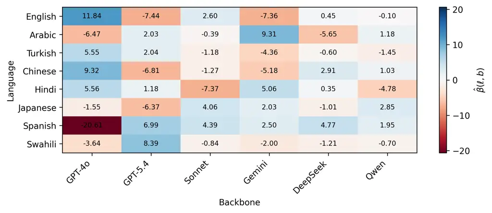
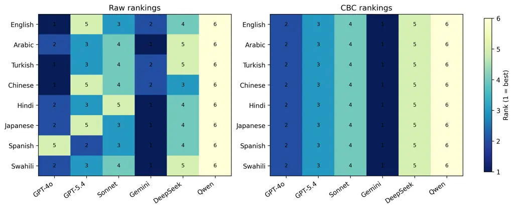
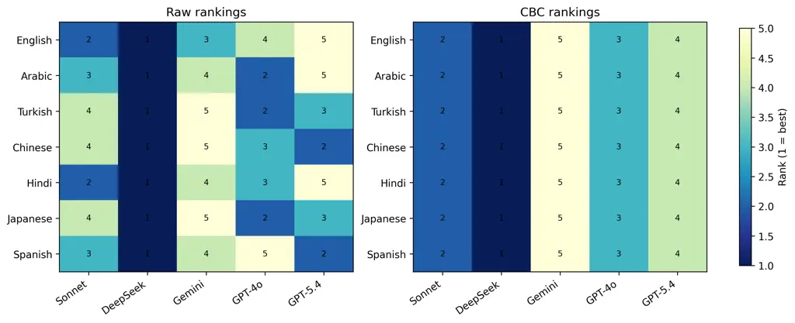
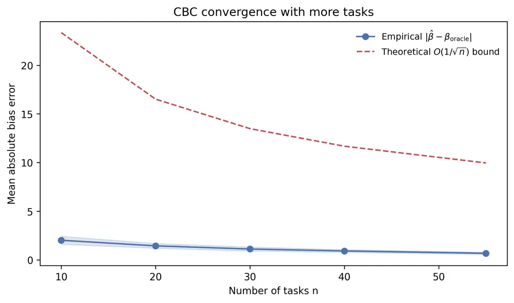

# Rank Reversal in Multilingual LLM Judges

###### Abstract

Multilingual LLM judges produce different evaluator-backbone rankings
depending on the prompt language: on an eight-language Agent-as-a-Judge
benchmark, the top-ranked backbone alternates across English, Arabic,
Chinese, Hindi, Japanese, Spanish, Turkish, and Swahili, and 7 of 15
backbone pairs show statistically significant pairwise rank reversal. We
treat this as a measurement problem. The multilingual judge score
decomposes additively into task difficulty, backbone skill, and a
language-backbone interaction term, the last of which is recoverable
without human labels by double-centering the cell-mean score matrix. We
make this estimator (Consensus-Based Calibration, CBC) explicit, give an
$`O(1/\sqrt{n})`$ finite-sample concentration bound with variance
constant $`(1-\tfrac{1}{m})(1-\tfrac{1}{k})`$, and show that it is
unbiased even when task-language interactions are present. Across 7,920
judge runs (6 backbones, 8 languages, 55 tasks, 3 frameworks), CBC
raises held-out cross-task rank consistency $`\tau`$ from 0.650 to 0.902
and agrees with the held-out additive-model oracle in 100% of
per-language decisions versus 68.5% raw; these are consistency
diagnostics, not human-grounded correctness measures. On a separately
collected M-RewardBench panel (7 languages, 1,500 items per language,
10,500 language-item instances, 5 evaluators), panel agreement with the
public human gold preferences rises from 68.7% to 76.6% (gain 7.9
percentage points, 95% CI $`[6.0,9.9]`$), our strongest external
evidence of downstream usefulness. The estimator is the standard two-way
ANOVA interaction-recovery operation under sum-to-zero contrasts; our
contribution is its application as a label-free post-hoc calibrator for
multilingual LLM judges, an explicit finite-sample concentration bound,
and an unbiasedness result that holds even under task-language
misspecification. Code is available at
[https://github.com/KurbanIntelligenceLab/multilingual-judge-calibration](https://github.com/KurbanIntelligenceLab/multilingual-judge-calibration)

KEYWORDS  multilingual evaluation; LLM-as-a-judge; rank reversal;
calibration; double centering

## 1  Introduction

The use of LLM-based judges to evaluate model and agent outputs is now
common across recent benchmarks \[1, 2, 3, 4\]. As this deployment
extends across languages, multiple studies have shown that judge
behavior is not stable across the prompt language: Hada et al. \[5\]
report systematic score inflation in multilingual evaluators against
native-speaker references; Fu and Liu \[6\] document weak cross-lingual
consistency (Fleiss’ $`\kappa\approx 0.3`$) across 25 languages; Singh
et al. \[7\] show that multilingual benchmark construction itself
encodes linguistic and cultural bias; and Mahmood et al. \[8\] report
concrete backbone-ranking reversals when judge prompts are localized.

What is less settled is what to do about it without expensive new
annotations. Hada et al. \[5\] calibrate against 20,000 human judgments;
Fu and Liu \[6\] propose an ensemble; Xu et al. \[9\] extend
Bradley–Terry–Luce with judge-specific discrimination for pairwise
comparisons; Li et al. \[10\] address position-induced selection bias.
None directly targets the additive language-backbone _interaction_ that
appears when several backbones are scored on the same items across
languages, even though that is the structure produced by any
multi-evaluator multilingual benchmark.

This paper studies that structure. We adopt the standard two-way
additive layout from analysis of variance \[11, 12\],
$`S(t,\ell,b)=\mu(t)+\alpha(b)+\beta(\ell,b)+\gamma(t,\ell)+\epsilon`$,
in which $`\beta(\ell,b)`$ is the language-backbone interaction we
target when a language-invariant evaluator ranking is the operational
goal. Under sum-to-zero normalization, $`\beta(\ell,b)`$ is identified
by double-centering the cell-mean matrix. The estimator is standard in
two-way ANOVA; the contribution is its application as a label-free
post-hoc calibrator for multilingual LLM-judge matrices, together with a
finite-sample concentration bound and a misspecification-robustness
analysis. We call this Consensus-Based Calibration (CBC).

This two-way model does not cover a genuine task–language–backbone
interaction $`\gamma(t,\ell,b)`$: backbone-specific task adaptation can
be absorbed into the estimated language-backbone interaction rather than
separated by double-centering. We treat this three-way effect as a
central misspecification risk, not as evidence that every observed
interaction is evaluative bias.

The internal experiments build on the previously introduced
five-language multilingual Agent-as-a-Judge setting \[8\]. That prior
work supplies the benchmark infrastructure and original language panel;
this paper adds Japanese, Spanish, and Swahili, conducts the
rank-reversal analysis, formalizes and evaluates CBC, and adds the
separately collected M-RewardBench validation panel.

Our contributions are:

1.  1.  Empirical characterization. On the expanded eight-language
        Agent-as-a-Judge benchmark (7,920 judge runs across 6 backbones, 55
        tasks, and 3 frameworks), 7 of 15 backbone pairs exhibit pairwise
        rank reversal (Benjamini–Hochberg corrected at FDR $`=0.05`$); the
        empirical top-ranked backbone alternates across all 8 languages.
2.  2.  A label-free estimator with explicit guarantees. CBC is one
        operation on the multi-evaluator score matrix and requires no human
        labels. Under independent homoskedastic Gaussian noise,
        $`|\hat{\beta}(\ell,b)-\beta(\ell,b)|`$ concentrates at
        $`O(1/\sqrt{n})`$ with explicit variance constant
        $`(1{-}1/m)(1{-}1/k)`$ (Prop. 3). The central non-trivial guarantee,
        beyond classical ANOVA, is that the estimator remains _unbiased_
        even when task-language interactions $`\gamma(t,\ell)`$ are present
        (Prop. 5).
3.  3.  Decision-level and external validation. CBC raises held-out
        cross-task rank consistency $`\tau`$ from $`0.650`$ to $`0.902`$ and
        agrees with the held-out additive-model oracle in 100% of
        per-language decisions versus 68.5% raw; this is model-based
        consistency, not human-grounded correctness. On a separately
        collected M-RewardBench panel of 1,500 items per language (10,500
        language-item instances across 7 languages and 5 evaluator
        backbones), CBC raises $`\tau`$ from $`0.430`$ to $`0.900`$, while
        external human-anchor agreement with the public gold preferences
        \[13\] rises from 68.7% to 76.6% (+7.9 percentage points, 95% CI
        $`[6.0,9.9]`$), our strongest external evidence of downstream
        usefulness.

Scope. CBC removes the language-backbone interaction term and nothing
else. This correction is appropriate when the deployment objective is a
language-invariant evaluator ranking; if language-specific evaluator
specialization is itself the target, removing the interaction can remove
meaningful capability differences, so CBC should be treated as a
sensitivity analysis. A shared language-level shift $`g(\ell)`$ where
all evaluators systematically over- or under-score one language is
invisible to double-centering; correcting it would require an external
anchor.

## 2  Related Work

#### Multilingual LLM-judge evaluation.

Hada et al. \[5\] calibrate multilingual evaluators against 20,000
native-speaker judgments and report systematic score inflation in
uncalibrated evaluators. Fu and Liu \[6\] survey 25 languages, document
weak cross-lingual consistency (Fleiss’ $`\kappa\approx 0.3`$), and
propose an ensemble strategy. Sheth et al. \[14\] introduce a Universal
Criteria Set for cross-lingual transfer with minimal supervision.
Multilingual meta-evaluation benchmarks \[15, 16\] and analyses of
multilingual benchmark construction bias \[7\] provide additional
context. Known judge biases (position, verbosity, self-enhancement) are
characterized in Zheng et al. \[2\]; benchmarks for judge quality
include RewardBench \[4\], JudgeBench \[3\], and MT-Bench-101 \[17\].
Our work is label-free, post-hoc on an already-collected multi-backbone
score matrix, and targets the language-backbone interaction term that
arises in any multi-evaluator multilingual benchmark.

#### Label-free judge calibration and aggregation.

Xu et al. \[9\] extend the Bradley–Terry–Luce model with judge-specific
discrimination for pairwise comparisons. Li et al. \[10\] address
position-induced selection bias in pairwise LLM judges. The Dawid–Skene
tradition \[18, 19, 20, 21\] and learning-from-crowds methods \[22, 23\]
estimate annotator reliability on categorical labels without ground
truth; Item Response Theory \[24, 25\] models rater-item interactions
for psychometric measurement. Empirical work shows substantial
cross-task LLM-judge variability \[26\], and disagreement-aware NLP
evaluation \[27, 28\] emphasizes preserving annotator variation. Our
setting is continuous pointwise score matrices with a structured
language-backbone interaction, where the relevant object is an
interaction term in a two-way layout rather than a pairwise reliability
parameter.

#### Two-way layouts and agentic code evaluation.

The additive decomposition is the standard two-way ANOVA layout \[11,
12\]; double centering under sum-to-zero contrasts is the standard
interaction-recovery operation. Classical references target F-test
inference under a correctly specified model. The two formal properties
we use, a finite-sample uniform bound on $`|\hat{\beta}-\beta|`$ across
all $`mk`$ cells with explicit variance constant
$`(1{-}\tfrac{1}{m})(1{-}\tfrac{1}{k})`$ (Prop. 3) and unbiasedness
under an unmodeled task-language interaction $`\gamma(t,\ell)`$
(Prop. 5), are not standard there. We build on Agent-as-a-Judge \[1\]
and a previously introduced multilingual Agent-as-a-Judge setting \[8\];
M-RewardBench \[13\] supplies the public preference instances for our
external validation panel.

## 3  Score Model and Identifiability

### 3.1  Setup and Notation

#### Terminology.

We use _evaluator backbone_ $`b`$ for the LLM that scores an item,
_judge framework_ $`f`$ for the evaluation harness and prompt/rubric
protocol (MetaGPT, GPT-Pilot, or OpenHands), and _evaluated agent
output_ for the code artifact produced for task $`t`$ that the judge
scores. For the internal benchmark, the CBC task-level matrix averages
the three framework-level scores for each $`(t,\ell,b)`$; framework
effects are retained as fixed effects in framework-level variance
checks. Thus our rankings compare evaluator backbones on shared
evaluated outputs, not judge frameworks or the underlying agents.

We have $`n`$ tasks $`\mathcal{T}`$, $`m`$ backbones $`\mathcal{B}`$,
and $`k`$ languages $`\mathcal{L}`$. The judge produces a score
$`S(t,\ell,b)\in[0,100]`$, modeled as a two-way additive layout with
interaction \[11, 12\]:

```math
S(t,\ell,b)=\mu(t)+\alpha(b)+\beta(\ell,b)+\gamma(t,\ell)+\epsilon, \tag{1}
```

where $`\mu(t)`$ is task difficulty, $`\alpha(b)`$ is backbone skill,
$`\beta(\ell,b)`$ is the _language-backbone interaction_ targeted by
CBC, $`\gamma(t,\ell)`$ is a residual task-language effect (any
language-uniform offset across backbones is absorbed into
$`g(\ell)=\frac{1}{n}\sum_{t}\gamma(t,\ell)`$), and $`\epsilon`$ is
mean-zero noise. A framework term $`\phi(f)`$ for pooling across judge
frameworks does not depend on both $`\ell`$ and $`b`$ and cancels under
the estimator below. Eq. 1 is the standard Type III two-way ANOVA layout
with factors backbone and language and an interaction term.

The interpretation of $`\beta(\ell,b)`$ as an evaluative bias is
operational rather than intrinsic: it is appropriate when deployment
requires a shared evaluator ranking for the same items across languages.
If a language-backbone interaction instead reflects genuine
language-specific evaluator capability or task competence, it should not
automatically be removed; in that setting, CBC is best treated as a
sensitivity analysis.

### 3.2  Pairwise Rank Reversal

The interaction term $`\beta(\ell,b)`$ is empirically non-trivial
whenever per-language backbone rankings disagree. Writing
$`d_{ij}(\ell)\triangleq\mathbb{E}_{t}[S(t,\ell,b_{i})-S(t,\ell,b_{j})]`$
for the per-language gap between two backbones, measured in score
points:

###### Definition 1 (Pairwise rank reversal).

Backbones $`b_{i},b_{j}`$ exhibit _pairwise rank reversal_ with respect
to a language set $`\mathcal{L}`$ if there exist
$`\ell_{a},\ell_{b}\in\mathcal{L}`$ such that
$`d_{ij}(\ell_{a})\cdot d_{ij}(\ell_{b})\leq-\delta`$ for some strength
$`\delta>0`$.

Because $`\delta`$ is a product of two score gaps, its units are squared
score points ($`\mathrm{points}^{2}`$). A single satisfying pair rules
out universal dominance between those two backbones. On the expanded
eight-language Agent-as-a-Judge benchmark (Section 5, Table 1), 7 of 15
backbone pairs satisfy this condition under task-level one-sided tests
with Benjamini–Hochberg correction at FDR $`=0.05`$; the empirical
top-ranked backbone alternates across the eight languages, so no
universal winner exists in the observed data. The strongest reversal is
GPT-4o vs. GPT-5.4: GPT-4o leads in English by $`+35.63`$ points and
trails in Spanish by $`-11.25`$ points, giving
$`\delta=400.79~\mathrm{points}^{2}`$ from the unrounded means. Figure 1
visualizes the corresponding centered language-backbone interaction
matrix $`\hat{\beta}(\ell,b)`$ recovered by CBC; these $`\hat{\beta}`$
cells are not the raw pairwise gaps $`d_{ij}`$.



Figure 1: Estimated centered language-backbone interaction
$`\hat{\beta}(\ell,b)`$ from the expanded multilingual Agent-as-a-Judge
benchmark (8 languages, 6 backbones), computed by double-centering the
framework-averaged task scores. Positive values: backbone scores higher
than expected in that language. These cells are distinct from the raw
pairwise gaps $`d_{ij}`$ reported in score points. Strongest cells:
GPT-4o in Spanish ($`-20.61`$) vs. English ($`+11.84`$), Gemini in
Arabic ($`+9.31`$), GPT-5.4 in Swahili ($`+8.39`$) vs. English
($`-7.44`$). The simultaneous radius is about $`10.0`$ points at
$`\varepsilon=0.05`$ under Proposition 3, so moderate cells should be
interpreted cautiously (Section Limitations).

### 3.3  Identifiability Without Human Labels

Assume a complete balanced panel: every task $`t\in\mathcal{T}`$ is
scored by every language-backbone pair
$`(\ell,b)\in\mathcal{L}\times\mathcal{B}`$. Under the simplified model
$`\gamma(t,\ell)\approx 0`$:

```math
S(t,\ell,b)=\mu(t)+\alpha(b)+\beta(\ell,b)+\epsilon. \tag{2}
```

###### Proposition 2 (Identifiability of the interaction matrix).

The standard two-way ANOVA interaction-identifiability result \[11, 12\]
specializes to our setting as follows. Assume $`m\geq 2`$, $`k\geq 2`$,
a complete balanced panel, and $`\mathbb{E}[\epsilon(t,\ell,b)]=0`$.
Under the sum-to-zero normalization
$`\sum_{\ell}\beta(\ell,b)=0\;\forall b`$ and
$`\sum_{b}\beta(\ell,b)=0\;\forall\ell`$, the interaction matrix
$`\beta(\ell,b)`$ is uniquely identifiable from the population cell
means $`M(\ell,b)\triangleq\frac{1}{n}\sum_{t}\mathbb{E}[S(t,\ell,b)]`$
via double centering. The proof is in Appendix A.

#### Scope of identifiability.

Under the sum-to-zero constraints, $`\beta(\ell,b)`$ is uniquely
identified from the population cell means for _observed_
language-backbone cells; the absolute levels of $`\mu(t)`$ and
$`\alpha(b)`$ are not separately identified, but this indeterminacy does
not affect $`\beta`$. A three-way effect $`\gamma(t,\ell,b)`$ is outside
the two-way model and cannot be separated from $`\beta`$ by CBC.

## 4  Consensus-Based Calibration

CBC removes the language-backbone interaction term $`\beta(\ell,b)`$
when the operational goal is a shared evaluator ranking across
languages. It does _not_ detect or remove a shift shared across all
backbones in a language. For example, if every evaluator backbone
systematically underscored Swahili by 5 points, that shared
language-level shift would cancel under double centering and CBC would
leave it unchanged. Correcting such a shared shift requires an external
anchor, such as human labels or a trusted reference evaluator, which is
outside the scope of the present label-free interaction-calibration
setting.

### 4.1  Algorithm

Proposition 2 yields a constructive estimator:

Step 1. Compute $`\bar{S}(\ell,b)=\frac{1}{n}\sum_{t}S(t,\ell,b)`$.

Step 2. Estimate the interaction via double centering:

```math
\hat{\beta}(\ell,b)=\bar{S}(\ell,b)-\bar{S}(\cdot,b)-\bar{S}(\ell,\cdot)+\bar{S}(\cdot,\cdot). \tag{3}
```

Step 3. Calibrate:
$`\hat{S}(t,\ell,b)=S(t,\ell,b)-\hat{\beta}(\ell,b)`$.

CBC requires zero human annotations. It uses only multi-backbone
evaluation data that labs already collect.

### 4.2  Convergence and Consistency

###### Proposition 3 (Convergence of CBC).

Assume Eq. 2, a complete balanced panel with $`n`$ tasks per
language-backbone cell, and independent homoskedastic Gaussian noise
$`\epsilon(t,\ell,b)\sim\mathcal{N}(0,\sigma^{2})`$. Then for each fixed
$`(\ell,b)`$ and every $`x>0`$,

```math
\Pr\!\left(|\hat{\beta}(\ell,b){-}\beta(\ell,b)|\geq x\right)\leq 2\exp\!\left(\frac{-nx^{2}}{2\sigma^{2}(1{-}\tfrac{1}{m})(1{-}\tfrac{1}{k})}\right). \tag{4}
```

Consequently, with probability at least $`1-\varepsilon`$,

```math
\max_{\ell,b}|\hat{\beta}(\ell,b)-\beta(\ell,b)|\leq\sigma\sqrt{\frac{2(1{-}\tfrac{1}{m})(1{-}\tfrac{1}{k})\log(2mk/\varepsilon)}{n}}. \tag{5}
```

The exact constant comes from the variance of the double-centering
operator:
$`\mathrm{Var}[\hat{\beta}(\ell,b)-\beta(\ell,b)]=\frac{\sigma^{2}}{n}(1-\frac{1}{m})(1-\frac{1}{k})`$.
For the expanded panel used in our main experiments ($`m{=}6`$,
$`k{=}8`$, $`n{=}55`$), the simultaneous high-probability radius is
about $`10.0`$ points at $`\varepsilon{=}0.05`$ with
$`\hat{\sigma}=22.24`$ estimated from the benchmark score dispersion
(Appendix B). This model-dependent numerical radius is conditional on
independent homoskedastic Gaussian noise; it is not a distribution-free
guarantee and need not transfer to heteroskedastic or heavy-tailed judge
noise. The weaker consistency result below does not require Gaussian
tails.

###### Proposition 4 (Consistency).

Without the Gaussian assumption, if Eq. 2 holds with independent tasks
and $`\mathbb{E}[|\epsilon(t,\ell,b)|]<\infty`$, then
$`\hat{\beta}(\ell,b)\xrightarrow{p}\beta(\ell,b)`$ as $`n\to\infty`$
for every $`(\ell,b)`$ by continuous mapping on the four sample marginal
means (Appendix A). The $`O(1/\sqrt{n})`$ rate is the standard
parametric rate for this sample-mean construction; we do not claim a
minimax lower bound here.

### 4.3  Model Misspecification

###### Proposition 5 (Robustness to Task-Language Effects).

Under the full model (Eq. 1), the CBC estimator $`\hat{\beta}(\ell,b)`$
is unbiased for $`\beta(\ell,b)`$: the task-language interaction
$`\gamma(t,\ell)`$ cancels exactly in the double-centering operation
(Eq. 3), because $`\gamma`$ does not depend on $`b`$.

###### Proof.

Define $`g(\ell)=\frac{1}{n}\sum_{t}\gamma(t,\ell)`$. Under Eq. 1,
$`\bar{S}(\ell,b)=\bar{\mu}+\alpha(b)+\beta(\ell,b)+g(\ell)+\bar{\epsilon}`$.
In the double-centering operator of Eq. 3, $`g(\ell)`$ appears in
$`\bar{S}(\ell,b)`$ and $`\bar{S}(\ell,\cdot)`$ with coefficients $`+1`$
and $`-1`$, and $`\bar{g}`$ appears in $`\bar{S}(\cdot,b)`$ and
$`\bar{S}(\cdot,\cdot)`$ with coefficients $`-1`$ and $`+1`$. All
$`\gamma`$-derived terms cancel, leaving
$`\hat{\beta}(\ell,b)=\beta(\ell,b)`$ plus mean-zero noise. ∎

###### Remark 6.

This robustness result is what separates CBC’s formal contribution from
a direct application of two-way ANOVA, whose standard reference
inference assumes the model is correctly specified. CBC handles
task-language interactions without bias in the point estimate, though
the simplified-model error bars of Proposition 3 need not carry over
unchanged under the misspecified model. Proposition 5 does not cover a
genuine _three-way_ interaction $`\gamma(t,\ell,b)`$, which can arise
from backbone-specific task adaptation and lies outside the two-way
additive model. Under such an effect, double centering may absorb real
performance heterogeneity as well as evaluation interaction, so
additional structure would be needed to separate the two.

## 5  Experiments

### 5.1  Data

We build on the previously introduced five-language multilingual
Agent-as-a-Judge setting \[8\]. The present paper adds Japanese,
Spanish, and Swahili, yielding an expanded internal benchmark with 7,920
runs across 6 backbones, 8 languages, 3 judge frameworks (MetaGPT,
GPT-Pilot, and OpenHands), and 55 DevAI tasks from one agentic
software-engineering benchmark family. The six internal evaluator
identifiers are gpt-4o, gpt-5.4, claude-sonnet-4.6,
gemini-3-flash-preview, deepseek-v3.2, and qwen3.5-9b, displayed in the
paper as GPT-4o, GPT-5.4, Sonnet, Gemini, DeepSeek, and Qwen. Because
provider billing exports were not preserved consistently, we report
estimated list-price API cost rather than billed totals: using recorded
token counts from the saved run artifacts, the added three-language
extension is estimated at \$54.93 (from 25.68M input plus 6.64M output
tokens times contemporaneous public list prices; Appendix D).

#### Statistical methodology.

Because CBC estimates a language-backbone interaction term
$`\beta(\ell,b)`$, our main evaluation keeps all eight languages in the
observed set and uses task-level bootstrap resampling: in each of 1,000
replicates, we sample tasks with replacement to form the training set,
estimate $`\hat{\beta}`$ from all eight observed languages on those
sampled tasks, and evaluate calibrated rankings on the out-of-bag tasks
from the same language set. Our primary metric is mean pairwise Kendall
rank correlation $`\tau`$ across all 28 language pairs, computed from
the backbone rankings on the held-out tasks. We additionally report an
exploratory leave-one-language-out (LOLO) extrapolation diagnostic: for
each held-out language $`\ell_{h}`$, we estimate $`\hat{\beta}`$ on the
remaining seven languages using the sampled training tasks, calibrate
those seven languages, and compare the held-out ranking on out-of-bag
tasks against each retained language via mean Kendall $`\tau`$. For the
held-out language we consider two simple heuristics, zero-shot
$`\hat{\beta}(\ell_{h},b)=0`$ and backbone-wise mean imputation. Under
CBC’s sum-to-zero normalization, however, the backbone-wise mean of
$`\hat{\beta}(\cdot,b)`$ over the retained languages is exactly zero, so
the two LOLO heuristics coincide up to numerical noise.

### 5.2  Verifying Theoretical Conditions

#### Rank reversal.

Using framework-averaged task scores, 7 of 15 backbone pairs exhibit
pairwise rank reversal ($`\delta>0`$ in Definition 1); see Table 1. The
raw witness gaps are in score points: for GPT-4o vs. GPT-5.4, English
favors GPT-4o ($`d=+35.63`$) and Spanish favors GPT-5.4 ($`d=-11.25`$),
giving $`\delta=400.79~\mathrm{points}^{2}`$ from the unrounded means.
We use the intersection-union test over the two witness languages and
apply Benjamini–Hochberg correction at FDR $`=0.05`$ to the 15 pairwise
tests; all 7 observed reversal pairs remain significant after
correction. The centered interaction cells $`\hat{\beta}`$ shown in
Figure 1 are a different quantity from these raw pairwise gaps. The
empirical top-ranked backbone alternates between GPT-4o (English,
Chinese, Turkish) and Gemini (Arabic, Hindi, Japanese, Spanish,
Swahili), so no universal winner exists in the observed data.

| Pair                 | $`\delta`$ ($`\mathrm{points}^{2}`$) | Adj. $`p`$             |
| -------------------- | ------------------------------------ | ---------------------- |
| GPT-4o vs. GPT-5.4   | 400.8                                | $`9.7{\times}10^{-8}`$ |
| GPT-4o vs. Sonnet    | 221.1                                | 0.0019                 |
| GPT-4o vs. Gemini    | 312.0                                | 0.0019                 |
| GPT-4o vs. DeepSeek  | 140.7                                | 0.0031                 |
| GPT-4o vs. Qwen      | 0.0                                  | 1.000                  |
| GPT-5.4 vs. Sonnet   | 95.9                                 | $`7.5{\times}10^{-6}`$ |
| GPT-5.4 vs. Gemini   | 0.0                                  | 1.000                  |
| GPT-5.4 vs. DeepSeek | 71.8                                 | 0.0119                 |
| GPT-5.4 vs. Qwen     | 0.0                                  | 1.000                  |
| Sonnet vs. Gemini    | 0.0                                  | 1.000                  |
| Sonnet vs. DeepSeek  | 38.1                                 | 0.0246                 |
| Sonnet vs. Qwen      | 0.0                                  | 1.000                  |
| Gemini vs. DeepSeek  | 0.0                                  | 1.000                  |
| Gemini vs. Qwen      | 0.0                                  | 1.000                  |
| DeepSeek vs. Qwen    | 0.0                                  | 1.000                  |

Table 1: Rank-reversal strength ($`\delta`$ in $`\mathrm{points}^{2}`$)
for backbone pairs on the expanded eight-language benchmark. Each test
uses one-sided task-level tests in the two witness languages (the
language pair attaining the most negative product
$`d_{ij}(\ell_{a})\cdot d_{ij}(\ell_{b})`$), combined by the
intersection-union rule; adj. $`p`$ uses Benjamini–Hochberg over all 15
pairs. Witness language pairs are listed in Appendix A.

#### Simplified model fit.

We fit Eq. 2 and Eq. 1 by OLS on all 7,920 framework-level observations
with framework fixed effects. The simplified model achieves
$`R^{2}=0.691`$; the full model with task-language interactions reaches
$`R^{2}=0.705`$. The simplified two-way structure captures a substantial
majority of the variance; task-language effects contribute only
$`\Delta R^{2}\approx 0.015`$.

### 5.3  Calibration Results

Our primary evaluation estimates out-of-bag cross-task stability within
the observed eight-language panel. Using the full observed language set
and splitting over tasks, raw scores achieve mean held-out cross-task
rank consistency $`\tau=0.650`$, while CBC reaches $`\tau=0.902`$. After
full-fit calibration, all eight languages align on the same backbone
order (Figure 2); this $`\tau=1.000`$ ordering is an in-sample sanity
check, not an independent generalization estimate or a human-grounded
correctness measure. Separately, the exploratory LOLO diagnostic rises
from $`\tau=0.649`$ under Raw to $`\tau=0.740`$ under the LOLO zero-shot
CBC heuristic (best: Arabic $`0.750\to 0.898`$; hardest: Spanish
$`0.411\to 0.504`$). Mean imputation coincides with zero-shot here under
CBC’s sum-to-zero normalization, so this diagnostic does not establish
zero-shot transfer to unseen languages. We compare against post-hoc
baselines that match score adjustment on a continuous matrix: quantile
normalization \[29\] and ComBat-EB batch correction \[30\], alongside
simpler controls (Table 2). Per-language normalization, z-score,
quantile normalization, ensemble, backbone-only normalization, and
random control are diagnostic controls for generic location/scale
alignment or aggregation; ComBat-EB is the strongest substantive
continuous post-hoc comparator compatible with this matrix. The oracle
is an unattainable upper bound using the held-out-task interaction.

| Method                       | $`\tau`$ $`\uparrow`$ | 95% CI             | Full-fit^(∗) |
| ---------------------------- | --------------------- | ------------------ | ------------ |
| Raw (no calib.)              | 0.650                 | \[0.610, 0.714\]   | 0.629        |
| Per-language norm.           | 0.650                 | \[0.610, 0.714\]   | 0.629        |
| ComBat-EB                    | 0.650                 | \[0.610, 0.714\]   | 0.629        |
| Z-score                      | 0.220                 | \[-0.038, 0.586\]  | -0.086       |
| Quantile norm.               | -0.097                | \[-0.119, -0.068\] | -0.118       |
| Ensemble                     | 0.013                 | \[-0.086, 0.186\]  | -0.081       |
| Backbone-only norm.          | 0.060                 | \[-0.081, 0.295\]  | -0.086       |
| Random control               | 0.002                 | \[-0.095, 0.148\]  | -0.067       |
| CBC                          | 0.902                 | \[0.795, 0.968\]   | 1.000^(∗)    |
| Oracle (eval-task $`\beta`$) | 1.000                 | —                  | 1.000^(∗)    |

Table 2: Calibration on the observed eight-language benchmark (higher is
better). In each bootstrap replicate, methods are fit on sampled
training tasks and evaluated on out-of-bag held-out tasks.
“Full-fit^(∗)” is an in-sample diagnostic on all 55 tasks. The oracle
subtracts $`\beta`$ on the held-out tasks themselves and is an
unattainable additive-model upper bound. ^(∗) denotes an in-sample
sanity check, not an independent generalization estimate.

Among the substantive continuous post-hoc comparisons, CBC significantly
outperforms ComBat-EB: the paired-bootstrap difference
$`\tau_{\text{CBC}}-\tau_{\text{ComBat}}`$ is positive in all 1,000
replicates ($`p<0.002`$). The diagnostic controls are also informative.
ComBat-EB matches Raw because, under CBC’s sum-to-zero normalization,
the average interaction over backbones for each language is zero, so a
language-wide offset has nothing to remove. Quantile normalization is
worse than Raw because aligning per-backbone score distributions across
languages destroys the cross-language ranking signal CBC is designed to
estimate (implementation in Appendix D.1); the ensemble, z-score,
backbone-only, and random controls likewise do not target the
interaction directly. A Dawid–Skene EM diagnostic \[18\] produced an
unstable bootstrap interval (Appendix D.3). Pairwise-comparison methods
such as CalibraEval \[10\] and judge-aware BTL \[9\] target a different
input regime; we treat the adapted judge-aware BTL model as the
substantive external pairwise comparator in Section 5.5. Supervised
calibration, criterion-annotation, and position-bias methods require
human labels, criterion annotations, or position-bias calibration data
that are unavailable in our label-free continuous-score setting, so they
are not applicable comparators here.



Figure 2: Backbone ranks by language before (left) and after (right) CBC
on the expanded eight-language benchmark. Raw rankings vary
substantially across languages, whereas CBC aligns all eight languages
to the same backbone order: Gemini $`>`$ GPT-4o $`>`$ GPT-5.4 $`>`$
Sonnet $`>`$ DeepSeek $`>`$ Qwen ($`\tau=1.000`$). The shared post-CBC
order is a full-fit in-sample sanity check, not an independent
generalization estimate.

### 5.4  Decision-Level Backbone Selection

Rank consistency is useful only if it changes actual choices. To test
that directly, we convert each bootstrap replicate into a per-language
deployment decision. For each language, we use the training split to
choose the top-ranked backbone under Raw or CBC, then evaluate that
choice on the held-out tasks against the additive-model oracle winner
obtained by subtracting eval-task $`\beta`$ on the held-out tasks
themselves. This uses the same unattainable oracle as Table 2, but now
asks a discrete question: did the method pick the backbone that the
held-out calibrated scores would have preferred?

| Method | Oracle selection acc. $`\uparrow`$ | Regret $`\downarrow`$ |
| ------ | ---------------------------------- | --------------------- |
| Raw    | 68.5% \[67.4, 69.5\]               | 3.23 \[0.90, 5.82\]   |
| CBC    | 100.0% \[99.95, 100.0\]            | 0.00 \[0.00, 0.00\]   |

Table 3: Decision-level backbone selection on the observed
eight-language benchmark. Each bootstrap replicate produces 8
language-specific deployment decisions. Selection accuracy is reported
with exact binomial 95% confidence intervals over the resulting 8,000
language-decisions; regret is the held-out additive-model oracle-score
gap between the selected backbone and the held-out oracle winner, with
percentile intervals over bootstrap replicates.

The result is sharper than the Kendall-$`\tau`$ view alone (Table 3).
Raw rankings agree with the held-out additive-model oracle winner for
only 68.5% of language-decisions, whereas CBC agrees in all observed
decisions. The raw errors are concentrated in English, Chinese, and
Turkish, where Raw frequently selects GPT-4o while the held-out
calibrated winner is Gemini. This is agreement with a model-based
reference, not human-grounded correctness; within the stated deployment
objective, it shows that CBC changes which evaluator backbone a
practitioner would actually deploy.

### 5.5  External Validation on M-RewardBench

#### Scaled validation panel.

As an external validation setting beyond the internal benchmark, we
examined M-RewardBench \[13\], which provides aligned multilingual
preference instances across 23 languages. The public release does not
ship evaluator-by-language score matrices, so we built a collection
pipeline that queries five provider-qualified
evaluators—openrouter/anthropic/claude-sonnet-4.6,
deepseek/deepseek-v3.2, openrouter/google/gemini-3-flash-preview,
openrouter/openai/gpt-4o-2024-08-06, and openrouter/openai/gpt-5.4—with
a fixed 1–5 pointwise rubric on chosen/rejected responses, over 7
overlapping languages (English, Arabic, Turkish, Simplified Chinese,
Hindi, Japanese, Spanish) and 1,500 aligned items per language, or
10,500 language-item instances in total. We display these evaluators as
Sonnet, DeepSeek, Gemini, GPT-4o, and GPT-5.4. Only two evaluator
families are shared with the internal panel at the reported
configuration level; because the provider routes, prompts, task sources,
and language panels differ, no cross-panel consistency should be
inferred. The estimated list-price API cost is \$195.3 (Appendix D).
Pipeline details and the adapted Bradley–Terry–Luce \[9\] pairwise
baseline are in Appendix C.

#### Calibration results.

Under the same bootstrap train/OOB protocol as the main benchmark, raw
cross-language $`\tau`$ is moderate ($`0.430`$, 95% CI
$`[0.371,0.486]`$); CBC raises it to $`0.900`$ ($`[0.790,1.000]`$); the
adapted judge-aware BTL pairwise baseline, our substantive comparator
for the external pairwise regime, reaches only $`0.405`$
($`[0.352,0.467]`$), close to Raw and well below CBC (Table 4). After
full-fit calibration, all seven languages align on the order DeepSeek
$`>`$ Sonnet $`>`$ GPT-4o $`>`$ GPT-5.4 $`>`$ Gemini with $`\tau=1.000`$
(Figure 3); this common full-fit order is an in-sample sanity check, not
an independent generalization estimate.

#### Human-anchor check.

To add an external signal independent of our evaluator scores, we use
the public human-judged chosen/rejected gold preferences in
M-RewardBench itself. For each language we sample 100 items stratified
by subset (54 alpacaeval-easy, 46 alpacaeval-hard), average the 5
evaluator margins per item, and ask whether the panel decision agrees
with the gold preference (ties count as non-agreement). Raw agreement is
68.7% (95% CI $`[65.4,71.7]`$); CBC-aligned panel agreement rises to
76.6% ($`[73.6,79.3]`$), a gain of 7.9 points ($`[6.0,9.9]`$; Table 5).
Because the gold labels are human-judged and released by an independent
group \[13\], this human-anchor gain is our strongest external evidence
that the correction is useful for a downstream target. It is supportive
aggregate panel-level evidence, not a per-language diagnosis of whether
an individual interaction cell reflects evaluative bias or genuine
language-specific evaluator specialization; it also does not establish
that every component removed by CBC is undesirable or that the
calibrated scores are universally correct.

The two validation panels are materially different: the internal panel
uses synthetic software-engineering tasks, three judge frameworks, and
the six internal identifiers above, whereas the external panel uses
public preference instances, a different pointwise rubric, seven
overlapping languages, and provider-qualified evaluator routes. Together
they reproduce language-conditioned rank instability; CBC improves
cross-language consistency in both panels, and its human-anchor gain
improves agreement with M-RewardBench gold preferences. Neither panel
establishes universality across domains, languages, or evaluator
families.

| Method              | $`\tau`$ $`\uparrow`$ | 95% CI           | Full-fit^(∗) |
| ------------------- | --------------------- | ---------------- | ------------ |
| Raw (no calib.)     | 0.430                 | \[0.371, 0.486\] | 0.410        |
| Judge-aware BTL^(†) | 0.405                 | \[0.352, 0.467\] | 0.410        |
| CBC                 | 0.900                 | \[0.790, 1.000\] | 1.000^(∗)    |

Table 4: Scaled validation on self-collected evaluator scores over
public 7-language, 5-evaluator M-RewardBench instances, with the same
bootstrap train/OOB protocol as the main benchmark. “BTL^(†)” is an
adapted Xu et al. \[2026\] pairwise-only baseline. “Full-fit^(∗)” is an
in-sample diagnostic on 1,500 items per language (10,500 language-item
instances total). ^(∗) denotes an in-sample sanity check, not an
independent generalization estimate.

| Method                | Gold agree. $`\uparrow`$ | 95% CI         |
| --------------------- | ------------------------ | -------------- |
| Raw panel mean margin | 68.7%                    | \[65.4, 71.7\] |
| CBC-aligned           | 76.6%                    | \[73.6, 79.3\] |

Table 5: Human-anchor validation on the M-RewardBench panel containing
1,500 items per language (10,500 language-item instances total). For
each of the 7 languages we sample 100 items stratified by subset and
compare the sign of the evaluator-panel mean margin against the public
gold preference (higher is better). Ties count as non-agreement.



Figure 3: Evaluator ranks before (left) and after (right) CBC on the
self-collected 7-language, 5-evaluator score panel built from public
M-RewardBench instances. Raw rankings vary across languages, while CBC
aligns all seven languages to the same order: DeepSeek $`>`$ Sonnet
$`>`$ GPT-4o $`>`$ GPT-5.4 $`>`$ Gemini ($`\tau=1.000`$). The shared
post-CBC order is a full-fit in-sample sanity check, not an independent
generalization estimate.

### 5.6  Ablations

The $`0.906`$ value at $`n{=}55`$ comes from an independently seeded
100-replicate task-ablation loop, whereas the $`0.902`$ headline uses
the primary 1,000-replicate bootstrap/OOB loop; the small difference is
Monte Carlo variation, not a different benchmark configuration.

Three ablations on the same expanded benchmark, with tables, a figure,
and full discussion, are reported in Appendix B. (i) Varying the number
of backbones $`m\in\{2,3,4,5,6\}`$: mean $`\tau`$ stays near $`0.90`$
for all $`m`$, but cross-subset variability drops sharply once
$`m\geq 3`$ (Std. $`0.206\to 0.105`$). (ii) Varying the number of tasks
$`n\in\{10,20,30,40,55\}`$: mean $`\tau`$ rises from $`0.759`$ at
$`n{=}10`$ to $`0.906`$ at $`n{=}55`$, and the mean absolute estimation
error $`|\hat{\beta}-\beta_{\text{oracle}}|`$ drops from $`2.01`$ to
$`0.67`$, consistent with the $`O(1/\sqrt{n})`$ rate. For practitioners
with $`m\geq 3`$ backbones we recommend $`n\geq 30`$ as a stable minimum
and $`n\approx 52`$ as a more conservative target. (iii) Splitting by
requirement type, CBC improves operational checks from $`\tau=0.770`$ to
$`0.789`$ and semantic checks from $`0.737`$ to $`0.840`$; the larger
semantic gain is consistent with semantic judgments being more
language-sensitive, while operational checks were already relatively
stable across languages.

## 6  Analysis

To corroborate the rank-based results with an information-theoretic
quantity, we estimate
$`I(\text{Score};\text{Language}\mid\text{Backbone},\text{Task})`$ from
the framework-level scores. Each $`(\text{task},\text{backbone})`$ slice
contains 24 observations (8 languages $`\times`$ 3 frameworks); we apply
a KSG-style nearest-neighbor estimator \[31\] per slice, average over
all 330 slices, and report a permutation-debiased value (500 shuffles
per slice). The conditional MI is $`0.178`$ nats (permutation interval
$`[0.169,0.187]`$, one-sided $`p<0.002`$): small in absolute terms but
statistically reliable, and exactly the non-redundant signal that
$`\beta(\ell,b)`$ represents. The seven verified pairwise reversals
(Table 1) are exactly the cross-family pairs among GPT-4o, GPT-5.4,
Sonnet, and DeepSeek; Qwen is Pareto-dominated in this panel and Gemini
is top- or second-ranked in every language, so neither produces a sign
change. A rigorous regression against standardized model-card metadata
requires information that current cards do not consistently disclose and
remains future work.

## 7  Discussion

#### Theory meets practice.

The pairwise rank reversals tell practitioners that searching for a
language-neutral backbone is unreliable; Proposition 2 shows they
already have the data needed to estimate the interaction; and CBC tells
them how to remove it when language-invariant ranking is the deployment
objective. Unlike Dawid–Skene \[18\], which models annotator-level
reliability on categorical labels, CBC operates on continuous pointwise
scores and exploits the two-way (language$`\times`$backbone) structure
rather than treating each language-backbone pair as an independent
annotator. This structural assumption replaces per-annotator confusion
matrices with a single scalar interaction term per language-backbone
pair, which is what enables stable estimation with $`n=55`$ tasks.

#### Cost and applicability.

CBC requires zero human annotations; by comparison, Hada et al. \[5\]
use 20,000 native-speaker annotations across eight languages. Our
compute cost is \$54.93 for the three-language extension and \$195.3 for
the M-RewardBench panel (Appendix D). The same two-way decomposition and
calibrator apply beyond agentic code evaluation, to any setting where
multiple judge backbones produce continuous scores on shared items
across languages, including RLHF reward modeling, safety classification,
automated grading, and machine-translation evaluation.

## 8  Conclusion

Multilingual LLM-judge rankings reverse across prompt languages, and the
resulting language-backbone interaction is recoverable without human
labels by double-centering the multi-evaluator score matrix. On the
eight-language Agent-as-a-Judge benchmark, CBC raises held-out
cross-task rank consistency $`\tau`$ from $`0.650`$ to $`0.902`$ and
agrees with the held-out additive-model oracle in 100% of per-language
decisions versus 68.5% for raw scores. On a separately collected
M-RewardBench panel, $`\tau`$ rises from $`0.430`$ to $`0.900`$, while
agreement with the public human gold preferences rises from 68.7% to
76.6% (+7.9 percentage points, 95% CI $`[6.0,9.9]`$). These internal
gains are consistency and model-reference diagnostics rather than
objective correctness; the human-anchor gain is supportive aggregate
evidence and our strongest external evidence of downstream usefulness,
not a complete per-language diagnosis of bias versus genuine evaluator
specialization. The estimator is the textbook two-way ANOVA
interaction-recovery operation under sum-to-zero contrasts; our
contribution is its application to multilingual LLM-judge calibration,
the explicit finite-sample concentration bound (Proposition 3), and the
unbiasedness result under task-language misspecification
(Proposition 5).

Two directions remain open: three-way effects and zero-shot transfer to
unseen languages. We recommend at least three evaluator backbones,
rank-reversal testing, $`\hat{\beta}(\ell,b)`$ reporting, and CBC before
any model-selection claim.

## Limitations

Three-way misspecification. Proposition 5 establishes unbiasedness for
two-way task-language interactions, but it does not cover genuine
three-way effects $`\gamma(t,\ell,b)`$. If some backbones fail on
particular task families only in particular languages, then the
language$`\times`$backbone residual is no longer a pure evaluation
interaction: it mixes stable language-backbone interaction with
task-conditional failure modes. In that regime, double centering can
partially absorb real performance heterogeneity rather than only
deployment-relevant evaluation variation, and the simplified-model error
bars need not carry over unchanged. This is the sharpest structural
limitation of the two-way additive model and the main reason we
interpret $`\hat{\beta}(\ell,b)`$ as a benchmark-level interaction
estimate rather than a universal property of a model family.

Observed-language calibration versus extrapolation. Our strongest
results are in the observed-language setting, where CBC improves mean
pairwise Kendall $`\tau`$ from $`0.650`$ to $`0.902`$. The
leave-one-language-out (LOLO) result is an exploratory extrapolation
diagnostic: when one language is held out and
$`\hat{\beta}(\ell_{h},b)`$ must be extrapolated heuristically, the mean
held-out-to-training agreement improves only from $`0.649`$ to
$`0.740`$. That is still positive, but clearly smaller than the
observed-language gain. We therefore do not claim that the current CBC
estimator solves zero-shot transfer to unseen languages; rather, it
provides strong correction when all target languages are observed, plus
a modest diagnostic signal under simple LOLO heuristics.

Complete shared-item panels. The closed-form estimator and its
finite-sample guarantees assume a complete, balanced panel in which
every shared task or item is scored in every language-backbone cell.
LOLO addresses an unobserved language, not arbitrary missing or
unbalanced cells; with partial coverage, naive double-centering need not
identify the interaction. Weighted least squares for unequal coverage,
matrix completion, and hierarchical mixed-effects or shrinkage
estimators are natural future directions for small or incomplete panels;
we leave these extensions to future work rather than adding an ad hoc
missing-cell experiment.

Interaction versus shared language-level effects. CBC is designed to
remove the interaction term $`\beta(\ell,b)`$, not a language effect
shared uniformly across all backbones. If all evaluators were
systematically 5 points harsher in one language, that shift would vanish
under double centering and remain uncorrected by CBC. Addressing that
kind of shared language-level shift requires an external anchor such as
human judgments or a trusted calibrated reference model. Our small
human-anchor experiment is included only as a downstream validation
check, not as part of the CBC estimator itself.

Finite-sample uncertainty. The finite-sample concentration bound is
conservative in practice. In the present benchmark ($`m=6`$, $`k=8`$,
$`n=55`$), the simultaneous high-probability radius is about $`10.0`$
points at $`\varepsilon=0.05`$ using $`\hat{\sigma}=22.24`$. The largest
observed interaction cells, such as GPT-4o in Spanish ($`-20.61`$) or
GPT-4o in English ($`+11.84`$) in Figure 1, sit comfortably outside this
radius, but moderate cells such as GPT-5.4 in Swahili ($`+8.39`$) or
English ($`-7.44`$) in the same figure fall within it. The empirical
signal is therefore strong for the largest language-backbone affinities,
but smaller cells should not be over-interpreted as if they were known
with negligible uncertainty.

Distributional assumptions. Proposition 3 assumes independent Gaussian
noise with constant variance. That assumption is analytically
convenient, but real judge noise is likely heteroskedastic,
heavy-tailed, and partly structured by prompt format, task family, or
provider behavior. The consistency result only requires weaker moment
conditions, but the explicit finite-sample radius does depend on the
Gaussian tail calculation. More general sub-Gaussian, robust, or
heteroskedastic concentration results would strengthen the theory and
make the uncertainty statement less model-dependent.

Validation data construction. The scaled M-RewardBench result uses
public benchmark _instances_, but the evaluator score matrix itself was
collected by us rather than released by the benchmark authors. This is
the right design for CBC, since the public release does not provide
evaluator-by-language scores, but it also means the validation panel
inherits our rubric, prompting template, provider routing, and parser
assumptions. The result therefore demonstrates generalization to an
external _instance source_, not validation against an externally
supplied fixed score matrix.

Benchmark scope. The internal benchmark still contains only 55 DevAI
tasks from one agentic code-evaluation family, even after expansion to
eight languages. That is enough to show large and repeatable
language$`\times`$backbone interactions, but it is not enough to claim
universality across all agentic coding tasks, all judge prompts, or all
evaluation formats. The external public-instance panel broadens the
evidence substantially, yet it also focuses on one preference-style
benchmark family. Broader validation across additional task domains,
more languages, and more evaluator families would strengthen both the
empirical claims and the practical scope of CBC.

Backbone set and benchmark dependence. Our conclusions are always
relative to a finite set of judge backbones and a fixed benchmark
distribution. The non-dominance observation depends on empirical rank
reversal in the observed pool; adding or removing a backbone can change
whether that condition is satisfied, how strong $`\delta`$ appears, and
which ordering CBC aligns to. Likewise, the estimated $`\beta(\ell,b)`$
matrix is benchmark-dependent: it is shaped by the prompts, tasks, and
scoring rubric used in this study rather than representing a
context-free property of the models.

Open theoretical directions. The current non-dominance result is
deterministic and conditional on observed reversal. We do not yet
provide a fully probabilistic impossibility theorem that would quantify
how likely universal dominance is under a generative prior over
language-backbone affinities. Developing such a result, together with
sharper uncertainty characterizations and explicit models of
unseen-language transfer, is an important next step if this line of work
is to mature from a benchmark-specific calibration method into a broader
statistical theory of multilingual evaluation.

## Reproducibility Statement

All proofs are provided in full (main text and appendix). Experimental
validation builds on the previously introduced five-language
multilingual Agent-as-a-Judge benchmark \[8\], adds our three-language
extension and the rank-reversal/CBC analyses, and uses a separately
collected evaluator panel over the public M-RewardBench dataset of
Gureja et al. \[13\]. Because provider billing exports were not
preserved consistently, Appendix D reports estimated list-price API
costs computed from recorded token counts in the saved artifacts and
public model rates. The public repository at
[https://github.com/KurbanIntelligenceLab/multilingual-judge-calibration](https://github.com/KurbanIntelligenceLab/multilingual-judge-calibration)
contains the CBC implementation, analysis scripts, external collection
pipeline, requirements file with pinned versions, and the derived
evaluator-score matrices used in the reported analyses.

## Ethics Statement

This work uses no human annotations and no personal data. The
multilingual Agent-as-a-Judge benchmark consists of synthetic
software-engineering tasks; the M-RewardBench instances and their gold
preference labels are public and released under their original license
\[13\]. All evaluator runs were obtained through official commercial
APIs under standard terms of service. No human subjects were involved at
any stage.

Two scope concerns are worth surfacing. First, CBC calibrates the
language-backbone interaction $`\beta(\ell,b)`$ only for languages
observed in the calibration panel; languages outside the panel,
including most low-resource languages, do not receive the benefit of
calibration and may continue to receive systematically shifted
evaluations. Second, CBC corrects the interaction term but not a shared
language-level shift $`g(\ell)`$ (Section 3); if every evaluator
backbone systematically under- or over-scores a particular language by
the same amount, that shift remains. Treating CBC-aligned rankings as
ground truth without an external anchor therefore risks entrenching a
shared shift rather than detecting it. Practitioners deploying CBC for
fairness-sensitive decisions should combine it with a human-anchor
check, such as the gold-preference comparison in Section 5.

## References

- \[1\] Mingchen Zhuge, Changsheng Zhao, Dylan R. Ashley, Wenyi Wang,
  Dmitrii Khizbullin, Yunyang Xiong, Zechun Liu, Ernie Chang, Raghuraman
  Krishnamoorthi, Yuandong Tian, Yangyang Shi, Vikas Chandra, and Jürgen
  Schmidhuber. Agent-as-a-judge: Evaluate agents with agents. In
  _Proceedings of the 42nd International Conference on Machine
  Learning_, volume 267 of _Proceedings of Machine Learning Research_,
  pages 80569–80611. PMLR, 2025. URL
  [https://proceedings.mlr.press/v267/zhuge25a.html](https://proceedings.mlr.press/v267/zhuge25a.html).
- \[2\] Lianmin Zheng, Wei-Lin Chiang, Ying Sheng, Siyuan Zhuang,
  Zhanghao Wu, Yonghao Zhuang, Zi Lin, Zhuohan Li, Dacheng Li, Eric P.
  Xing, Hao Zhang, Joseph E. Gonzalez, and Ion Stoica. Judging
  llm-as-a-judge with mt-bench and chatbot arena. In _Advances in Neural
  Information Processing Systems 36_, 2023. URL
  [https://openreview.net/forum?id=uccHPGDlao](https://openreview.net/forum?id=uccHPGDlao).
- \[3\] Sijun Tan, Siyuan Zhuang, Kyle Montgomery, William Y. Tang,
  Alejandro Cuadron, Chenguang Wang, Raluca Ada Popa, and Ion Stoica.
  Judgebench: A benchmark for evaluating llm-based judges. In _The
  Thirteenth International Conference on Learning
  Representations_, 2025. URL
  [https://openreview.net/forum?id=G0dksFayVq](https://openreview.net/forum?id=G0dksFayVq).
- \[4\] Nathan Lambert, Valentina Pyatkin, Jacob Morrison, LJ Miranda,
  Bill Yuchen Lin, Khyathi Chandu, Nouha Dziri, Sachin Kumar, Tom Zick,
  Yejin Choi, Noah A. Smith, and Hannaneh Hajishirzi. Rewardbench:
  Evaluating reward models for language modeling. In _Findings of the
  Association for Computational Linguistics: NAACL 2025_, pages
  1755–1797, Albuquerque, New Mexico, 2025. Association for
  Computational Linguistics. doi: 10.18653/v1/2025.findings-naacl.96.
  URL
  [https://aclanthology.org/2025.findings-naacl.96/](https://aclanthology.org/2025.findings-naacl.96/).
- \[5\] Rishav Hada, Varun Gumma, Adrian de Wynter, Harshita Diddee,
  Mohamed Ahmed, Monojit Choudhury, Kalika Bali, and Sunayana Sitaram.
  Are large language model-based evaluators the solution to scaling up
  multilingual evaluation? In _Findings of the Association for
  Computational Linguistics: EACL 2024_, pages 1051–1070, St. Julian’s,
  Malta, 2024. Association for Computational Linguistics. doi:
  10.18653/v1/2024.findings-eacl.71. URL
  [https://aclanthology.org/2024.findings-eacl.71/](https://aclanthology.org/2024.findings-eacl.71/).
- \[6\] Xiyan Fu and Wei Liu. How reliable is multilingual
  llm-as-a-judge? In _Findings of the Association for Computational
  Linguistics: EMNLP 2025_, pages 11040–11053, Suzhou, China, 2025.
  Association for Computational Linguistics. doi:
  10.18653/v1/2025.findings-emnlp.587. URL
  [https://aclanthology.org/2025.findings-emnlp.587/](https://aclanthology.org/2025.findings-emnlp.587/).
- \[7\] Shivalika Singh, Angelika Romanou, Clémentine Fourrier,
  David Ifeoluwa Adelani, Jian Gang Ngui, Daniel Vila-Suero, Peerat
  Limkonchotiwat, Kelly Marchisio, Wei Qi Leong, Yosephine Susanto,
  Raymond Ng, Shayne Longpre, Sebastian Ruder, Wei-Yin Ko, Antoine
  Bosselut, Alice Oh, Andre Martins, Leshem Choshen, Daphne Ippolito,
  Enzo Ferrante, Marzieh Fadaee, Beyza Ermis, and Sara Hooker. Global
  MMLU: Understanding and addressing cultural and linguistic biases in
  multilingual evaluation. In _Proceedings of the 63rd Annual Meeting of
  the Association for Computational Linguistics (Volume 1: Long
  Papers)_, pages 18761–18799, Vienna, Austria, 2025. Association for
  Computational Linguistics. doi: 10.18653/v1/2025.acl-long.919. URL
  [https://aclanthology.org/2025.acl-long.919/](https://aclanthology.org/2025.acl-long.919/).
- \[8\] Alhasan Mahmood, Samir Abdaljali, and Hasan Kurban. Multilingual
  prompt localization for agent-as-a-judge: Language and backbone
  sensitivity in requirement-level evaluation. In _Third Conference on
  Language Modeling_, 2026. URL
  [https://openreview.net/forum?id=POUd74r8RR](https://openreview.net/forum?id=POUd74r8RR).
- \[9\] Mingyuan Xu, Xinzi Tan, Jiawei Wu, and Doudou Zhou. A
  judge-aware ranking framework for evaluating large language models
  without ground truth, 2026. URL
  [https://arxiv.org/abs/2601.21817](https://arxiv.org/abs/2601.21817).
  arXiv preprint.
- \[10\] Haitao Li, Junjie Chen, Qingyao Ai, Zhumin Chu, Yujia Zhou,
  Qian Dong, and Yiqun Liu. Calibraeval: Calibrating prediction
  distribution to mitigate selection bias in llms-as-judges. In
  _Proceedings of the 63rd Annual Meeting of the Association for
  Computational Linguistics (Volume 1: Long Papers)_, pages 16537–16552,
  Vienna, Austria, 2025. Association for Computational Linguistics. doi:
  10.18653/v1/2025.acl-long.808. URL
  [https://aclanthology.org/2025.acl-long.808/](https://aclanthology.org/2025.acl-long.808/).
- \[11\] Henry Scheffé. _The Analysis of Variance_. John Wiley &
  Sons, 1959.
- \[12\] Shayle R Searle. _Linear Models_. John Wiley & Sons, 1971.
- \[13\] Srishti Gureja, Lester James Validad Miranda, Shayekh Bin
  Islam, Rishabh Maheshwary, Drishti Sharma, Gusti Triandi Winata,
  Nathan Lambert, Sebastian Ruder, Sara Hooker, and Marzieh Fadaee.
  M-RewardBench: Evaluating reward models in multilingual settings. In
  Wanxiang Che, Joyce Nabende, Ekaterina Shutova, and Mohammad Taher
  Pilehvar, editors, _Proceedings of the 63rd Annual Meeting of the
  Association for Computational Linguistics (Volume 1: Long Papers)_,
  pages 43–58, Vienna, Austria, July 2025. Association for Computational
  Linguistics. ISBN 979-8-89176-251-0. doi: 10.18653/v1/2025.acl-long.3.
  URL
  [https://aclanthology.org/2025.acl-long.3/](https://aclanthology.org/2025.acl-long.3/).
- \[14\] Ivaxi Sheth, Zeno Jonke, Amin Mantrach, and Saab Mansour.
  Cross-lingual llm-judge transfer via evaluation decomposition, 2026.
  URL
  [https://arxiv.org/abs/2603.18557](https://arxiv.org/abs/2603.18557).
  arXiv preprint.
- \[15\] Sumanth Doddapaneni, Mohammed Safi Ur Rahman Khan, Dilip
  Venkatesh, Raj Dabre, Anoop Kunchukuttan, and Mitesh M. Khapra.
  Cross-lingual auto evaluation for assessing multilingual llms. In
  _Proceedings of the 63rd Annual Meeting of the Association for
  Computational Linguistics (Volume 1: Long Papers)_, pages 29297–29329,
  Vienna, Austria, 2025. Association for Computational Linguistics. doi:
  10.18653/v1/2025.acl-long.1419. URL
  [https://aclanthology.org/2025.acl-long.1419/](https://aclanthology.org/2025.acl-long.1419/).
- \[16\] Guijin Son, Dongkeun Yoon, Juyoung Suk, Javier Aula-Blasco,
  Mano Aslan, Vu Trong Kim, Shayekh Bin Islam, Jaume Prats-Cristià,
  Lucía Tormo-Bañuelos, and Seungone Kim. Mm-eval: A multilingual
  meta-evaluation benchmark for llm-as-a-judge and reward models, 2024.
  URL
  [https://arxiv.org/abs/2410.17578](https://arxiv.org/abs/2410.17578).
  arXiv preprint.
- \[17\] Ge Bai, Jie Liu, Xingyuan Bu, Yancheng He, Jiaheng Liu, Zhanhui
  Zhou, Zhuoran Lin, Wenbo Su, Tiezheng Ge, Bo Zheng, and Wanli Ouyang.
  Mt-bench-101: A fine-grained benchmark for evaluating large language
  models in multi-turn dialogues. In _Proceedings of the 62nd Annual
  Meeting of the Association for Computational Linguistics (Volume 1:
  Long Papers)_, pages 7421–7454, Bangkok, Thailand, 2024. Association
  for Computational Linguistics. doi: 10.18653/v1/2024.acl-long.401. URL
  [https://aclanthology.org/2024.acl-long.401/](https://aclanthology.org/2024.acl-long.401/).
- \[18\] A Philip Dawid and Allan M Skene. Maximum likelihood estimation
  of observer error-rates using the em algorithm. _Journal of the Royal
  Statistical Society: Series C (Applied Statistics)_,
  28(1):20–28, 1979. doi: 10.2307/2346806. URL
  [https://doi.org/10.2307/2346806](https://doi.org/10.2307/2346806).
- \[19\] Jacob Whitehill, Ting-fan Wu, Jacob Bergsma, Javier Movellan,
  and Paul Ruvolo. Whose vote should count more: Optimal integration of
  labels from labelers of unknown expertise. In _NeurIPS_, 2009.
- \[20\] Dirk Hovy, Taylor Berg-Kirkpatrick, Ashish Vaswani, and Eduard
  Hovy. Learning whom to trust with mace. In _NAACL-HLT_, 2013.
- \[21\] Silviu Paun, Bob Carpenter, Jon Chamberlain, Dirk Hovy, Udo
  Kruschwitz, and Massimo Poesio. Comparing bayesian models of
  annotation. _Transactions of the Association for Computational
  Linguistics_, 6:571–585, 2018. doi: 10.1162/tacl_a_00040. URL
  [https://doi.org/10.1162/tacl_a_00040](https://doi.org/10.1162/tacl_a_00040).
- \[22\] Vikas C. Raykar, Shipeng Yu, Linda H. Zhao, Gerardo
  Hermosillo Valadez, Charles Florin, Luca Bogoni, and Linda Moy.
  Learning from crowds. _Journal of Machine Learning Research_,
  11:1297–1322, 2010. URL
  [https://jmlr.csail.mit.edu/papers/v11/raykar10a.html](https://jmlr.csail.mit.edu/papers/v11/raykar10a.html).
- \[23\] Yuan Li, Benjamin I. P. Rubinstein, and Trevor Cohn. Truth
  inference at scale: A bayesian model for adjudicating highly redundant
  crowd annotations. In _The World Wide Web Conference_, pages
  1028–1038. ACM, 2019. doi: 10.1145/3308558.3313459. URL
  [https://doi.org/10.1145/3308558.3313459](https://doi.org/10.1145/3308558.3313459).
- \[24\] Susan E Embretson and Steven P Reise. _Item Response Theory for
  Psychologists_. Psychology Press, 2013.
- \[25\] Felipe Maia Polo, Lucas Weber, Leshem Choshen, Yuekai Sun,
  Gongjun Xu, and Mikhail Yurochkin. tinybenchmarks: evaluating LLMs
  with fewer examples. In _Proceedings of the 41st International
  Conference on Machine Learning_, volume 235 of _Proceedings of Machine
  Learning Research_, pages 34303–34326. PMLR, 2024. URL
  [https://proceedings.mlr.press/v235/maia-polo24a.html](https://proceedings.mlr.press/v235/maia-polo24a.html).
- \[26\] Anna Bavaresco, Aditya K. Surikuchi, Daniel Herschcovich, Alan
  Ramponi, Maha Elbayad Taïeb, Barbara Plank, and Anders Søgaard. LLMs
  instead of human judges? a large scale empirical study across 20 NLP
  evaluation tasks, 2024. URL
  [https://arxiv.org/abs/2406.18403](https://arxiv.org/abs/2406.18403).
  arXiv preprint.
- \[27\] Ellie Pavlick and Tom Kwiatkowski. Inherent disagreements in
  human textual inferences. _Transactions of the Association for
  Computational Linguistics_, 7:677–694, 2019. doi:
  10.1162/tacl_a_00293. URL
  [https://aclanthology.org/Q19-1043/](https://aclanthology.org/Q19-1043/).
- \[28\] Elisa Leonardelli, Gavin Abercrombie, Dina Almanea, Valerio
  Basile, Tommaso Fornaciari, Barbara Plank, Verena Rieser, Alexandra
  Uma, and Massimo Poesio. Semeval-2023 task 11: Learning with
  disagreements (LeWiDi). In _Proceedings of the 17th International
  Workshop on Semantic Evaluation (SemEval-2023)_, pages 2304–2318,
  Toronto, Canada, 2023. Association for Computational Linguistics. doi:
  10.18653/v1/2023.semeval-1.314. URL
  [https://aclanthology.org/2023.semeval-1.314/](https://aclanthology.org/2023.semeval-1.314/).
- \[29\] Benjamin M Bolstad, Rafael A Irizarry, Magnus Astrand, and
  Terence P Speed. A comparison of normalization methods for high
  density oligonucleotide array data based on variance and bias.
  _Bioinformatics_, 19(2):185–193, 2003.
- \[30\] W Evan Johnson, Cheng Li, and Ariel Rabinovic. Adjusting batch
  effects in microarray expression data using empirical bayes methods.
  _Biostatistics_, 8(1):118–127, 2007.
- \[31\] Alexander Kraskov, Harald Stogbauer, and Peter Grassberger.
  Estimating mutual information. _Physical Review E_,
  69(6):066138, 2004. doi: 10.1103/PhysRevE.69.066138. URL
  [https://doi.org/10.1103/PhysRevE.69.066138](https://doi.org/10.1103/PhysRevE.69.066138).
- \[32\] José Pombal, Dongkeun Yoon, Patrick Fernandes, Ian Wu, Seungone
  Kim, Ricardo Rei, Graham Neubig, and André F. T. Martins.
  M-prometheus: A suite of open multilingual llm judges, 2025. URL
  [https://arxiv.org/abs/2504.04953](https://arxiv.org/abs/2504.04953).
  arXiv preprint; published as a conference paper at COLM 2025.

 

APPENDIX

## Appendix A Proof Details and Identifiability Scope

#### Witness language pairs (Table 1).

For each of the seven significant pairs in Table 1, the witness language
pair $`(\ell_{a},\ell_{b})`$ used in the test is the language pair
attaining the most negative product
$`d_{ij}(\ell_{a})\cdot d_{ij}(\ell_{b})`$ over the eight observed
languages (En, Ar, Zh, Hi, Ja, Es, Tr, Sw): GPT-4o vs. GPT-5.4: En/Es;
GPT-4o vs. Sonnet: Hi/Es; GPT-4o vs. Gemini: En/Es; GPT-4o vs. DeepSeek:
En/Es; GPT-5.4 vs. Sonnet: Ja/Sw; GPT-5.4 vs. DeepSeek: Zh/Sw; Sonnet
vs. DeepSeek: Ar/Hi. The remaining eight pairs achieved $`\delta=0`$ (no
negative product over any observed language pair) and are reported with
adjusted $`p=1.000`$.

### A.1  Identifiability Proof in Full

We restate the simplified model:

```math
S(t,\ell,b)=\mu(t)+\alpha(b)+\beta(\ell,b)+\epsilon(t,\ell,b),
```

with a complete balanced panel over tasks, languages, and backbones.
Define the population cell mean

```math
M(\ell,b)\triangleq\frac{1}{n}\sum_{t\in\mathcal{T}}\mathbb{E}[S(t,\ell,b)]=\bar{\mu}+\alpha(b)+\beta(\ell,b),
```

where $`\bar{\mu}\triangleq\frac{1}{n}\sum_{t}\mu(t)`$ and
$`\mathbb{E}[\epsilon(t,\ell,b)]=0`$.

Let

```math
M(\cdot,b)\triangleq\tfrac{1}{k}\sum_{\ell^{\prime}}M(\ell^{\prime},b),
```

```math
M(\ell,\cdot)\triangleq\tfrac{1}{m}\sum_{b^{\prime}}M(\ell,b^{\prime}),
```

```math
M(\cdot,\cdot)\triangleq\tfrac{1}{mk}\sum_{\ell^{\prime},b^{\prime}}M(\ell^{\prime},b^{\prime}).
```

Under the normalization constraints

```math
\sum_{\ell}\beta(\ell,b)=0\;\;\forall b,\quad\sum_{b}\beta(\ell,b)=0\;\;\forall\ell,
```

we have

```math
M(\cdot,b)=\bar{\mu}+\alpha(b),
```

```math
M(\ell,\cdot)=\bar{\mu}+\bar{\alpha},\quad M(\cdot,\cdot)=\bar{\mu}+\bar{\alpha},
```

where $`\bar{\alpha}\triangleq\frac{1}{m}\sum_{b}\alpha(b)`$. Therefore

```math
\displaystyle M(\ell,b)-M(\cdot,b)-M(\ell,\cdot)+M(\cdot,\cdot)
```

```math
\displaystyle\quad=\big(\bar{\mu}+\alpha(b)+\beta(\ell,b)\big)-\big(\bar{\mu}+\alpha(b)\big)
```

```math
\displaystyle\qquad-\big(\bar{\mu}+\bar{\alpha}\big)+\big(\bar{\mu}+\bar{\alpha}\big)
```

```math
\displaystyle\quad=\beta(\ell,b).
```

Hence the centered interaction matrix is recovered exactly by double
centering. Uniqueness follows immediately: if another matrix
$`\beta^{\prime}`$ with the same zero-sum constraints produced the same
cell means, double centering those means would yield both $`\beta`$ and
$`\beta^{\prime}`$, so $`\beta^{\prime}=\beta`$.

### A.2  What Label-Free Identifiability Means

The phrase “identifiable without labels” should be interpreted narrowly.
The observable data determine the centered interaction matrix
$`\beta(\ell,b)`$ for _observed_ language-backbone cells. This is
sufficient for calibration on those observed languages. However:

-  
  No human gold labels are needed to estimate $`\beta(\ell,b)`$.
-  
  The absolute location of $`\mu(t)`$ and $`\alpha(b)`$ is not unique;
  additive shifts can be absorbed between them.
-  
  The interaction for an unseen language $`\ell^{\prime}`$ or unseen
  backbone $`b^{\prime}`$ is not identifiable without collecting scores
  for that new cell.
-  
  A three-way effect $`\gamma(t,\ell,b)`$ is not identified by the
  two-way model and cannot be separated from $`\beta`$ without
  additional structure.

### A.3  Convergence Bound with Exact Constants

Write the cell-average noise as

```math
\bar{\epsilon}(\ell,b)\triangleq\frac{1}{n}\sum_{t\in\mathcal{T}}\epsilon(t,\ell,b).
```

Under the Gaussian assumption in Proposition 3, each
$`\bar{\epsilon}(\ell,b)`$ is Gaussian with mean $`0`$ and variance
$`\sigma^{2}/n`$. Since $`\hat{\beta}`$ is the double-centered cell
mean,

```math
\hat{\beta}(\ell,b)-\beta(\ell,b)=\bar{\epsilon}(\ell,b)-\bar{\epsilon}(\cdot,b)-\bar{\epsilon}(\ell,\cdot)+\bar{\epsilon}(\cdot,\cdot).
```

For a fixed target cell $`(\ell,b)`$, the coefficient of each averaged
noise term is:

```math
c_{\ell^{\prime}b^{\prime}}=\begin{cases}1-\frac{1}{k}-\frac{1}{m}+\frac{1}{mk},&\ell^{\prime}=\ell,\;b^{\prime}=b,\\[4.0pt]
-\frac{1}{k}+\frac{1}{mk},&\ell^{\prime}\neq\ell,\;b^{\prime}=b,\\[4.0pt]
-\frac{1}{m}+\frac{1}{mk},&\ell^{\prime}=\ell,\;b^{\prime}\neq b,\\[4.0pt]
\frac{1}{mk},&\ell^{\prime}\neq\ell,\;b^{\prime}\neq b.\end{cases}
```

Because the cell-average noises are independent across
$`(\ell^{\prime},b^{\prime})`$,

```math
\mathrm{Var}\!\left[\hat{\beta}(\ell,b)-\beta(\ell,b)\right]=\frac{\sigma^{2}}{n}\sum_{\ell^{\prime},b^{\prime}}c_{\ell^{\prime}b^{\prime}}^{2}.
```

Grouping the four coefficient types gives

```math
\displaystyle\sum_{\ell^{\prime},b^{\prime}}c_{\ell^{\prime}b^{\prime}}^{2} \displaystyle=\Big(1-\tfrac{1}{k}-\tfrac{1}{m}+\tfrac{1}{mk}\Big)^{2}
```

```math
\displaystyle\hskip 9.24994pt+(k-1)\Big(\tfrac{1}{k}-\tfrac{1}{mk}\Big)^{2}
```

```math
\displaystyle\hskip 9.24994pt+(m-1)\Big(\tfrac{1}{m}-\tfrac{1}{mk}\Big)^{2}
```

```math
\displaystyle\hskip 9.24994pt+(m-1)(k-1)\Big(\tfrac{1}{mk}\Big)^{2}
```

```math
\displaystyle=\Big(1-\tfrac{1}{m}\Big)\Big(1-\tfrac{1}{k}\Big).
```

Therefore

```math
\hat{\beta}(\ell,b)-\beta(\ell,b)\sim\mathcal{N}\!\left(0,\;\tfrac{\sigma^{2}}{n}\big(1-\tfrac{1}{m}\big)\big(1-\tfrac{1}{k}\big)\right).
```

Applying the standard Gaussian tail bound yields, for any $`x>0`$,

```math
\displaystyle\Pr\!\left(|\hat{\beta}(\ell,b)-\beta(\ell,b)|\geq x\right)
```

```math
\displaystyle\hskip 17.00024pt\leq 2\exp\!\left(-\tfrac{nx^{2}}{2\sigma^{2}(1-1/m)(1-1/k)}\right).
```

Finally, applying a union bound over the $`mk`$ observed
language-backbone cells gives

```math
\displaystyle\Pr\!\Big(\max_{\ell,b}|\hat{\beta}(\ell,b)-\beta(\ell,b)|\geq x\Big)
```

```math
\displaystyle\hskip 17.00024pt\leq 2mk\exp\!\Big(-\tfrac{nx^{2}}{2\sigma^{2}(1-1/m)(1-1/k)}\Big),
```

and solving for $`x`$ proves Proposition 3.

### A.4  Consistency Proof in Full

For each fixed $`(\ell,b)`$, the cell mean

```math
\bar{S}(\ell,b)=\frac{1}{n}\sum_{t\in\mathcal{T}}S(t,\ell,b)
```

converges in probability to $`M(\ell,b)`$ by the law of large numbers,
since the task-level observations are independent and have finite first
moment. The CBC estimator is a linear transformation of the finite
collection of cell means:

```math
\hat{\beta}(\ell,b)=\bar{S}(\ell,b)-\bar{S}(\cdot,b)-\bar{S}(\ell,\cdot)+\bar{S}(\cdot,\cdot).
```

Linear combinations preserve convergence in probability, so
$`\hat{\beta}(\ell,b)`$ converges in probability to

```math
M(\ell,b)-M(\cdot,b)-M(\ell,\cdot)+M(\cdot,\cdot)=\beta(\ell,b),
```

where the final equality follows from the identifiability argument
above. This proves Proposition 4.

## Appendix B Additional Ablations

This appendix contains the three ablation studies referenced from
Section 5.6, with full tables, a convergence figure, and the original
discussion. All ablations use the same expanded eight-language
Agent-as-a-Judge benchmark. The backbone and requirement-type ablations
use the observed-language bootstrap/OOB protocol, while the task-count
ablation uses an independently seeded 100-replicate task-ablation loop
described below.

### B.1  Ablation: Number of Backbones ($`m`$)

Proposition 2 requires at least two backbones and two languages; more
backbones reduce estimation variance. We test sensitivity to $`m`$ by
subsampling backbone subsets.

| $`m`$         | 2     | 3     | 4     | 5     | 6     |
| ------------- | ----- | ----- | ----- | ----- | ----- |
| Rank $`\tau`$ | 0.901 | 0.907 | 0.900 | 0.898 | 0.911 |
| Std.          | 0.206 | 0.105 | 0.075 | 0.044 | —     |

Table A1: CBC calibration quality as a function of the number of
backbones $`m`$. Rank $`\tau`$ is averaged over all $`\binom{6}{m}`$
subsets using the observed-language bootstrap/OOB protocol.

CBC remains strong even with small backbone subsets (Table A1): the mean
$`\tau`$ is already 0.901 with $`m{=}2`$ and stays near 0.90 for
$`m\geq 3`$. However, the $`m{=}2`$ setting is much less stable than the
larger subsets (Std. $`=0.206`$), so the main effect of larger $`m`$ is
reduced variability across subsets rather than a large increase in mean
performance.

### B.2  Ablation: Number of Tasks ($`n`$)

The convergence bound (Proposition 3) scales as $`O(1/\sqrt{n})`$. We
test empirically by subsampling tasks. The grid
$`n\in\{10,20,30,40,55\}`$ was chosen to show a simple progression from
very small task panels to the full benchmark, using 10-task increments
plus the full-data endpoint.

| $`n`$         | 10    | 20    | 30    | 40    | 55    |
| ------------- | ----- | ----- | ----- | ----- | ----- |
| Rank $`\tau`$ | 0.759 | 0.838 | 0.853 | 0.891 | 0.906 |
| Std.          | 0.103 | 0.061 | 0.057 | 0.054 | 0.051 |

Table A2: CBC calibration quality as a function of the number of tasks
$`n`$. Averaged over 100 random subsamples.

The task ablation shows that CBC remains useful even with only 10 tasks,
but improves and becomes more stable as more tasks are available
(Table A2). The mean absolute estimation error
$`|\hat{\beta}-\beta_{\text{oracle}}|`$ drops from 2.01 at $`n{=}10`$ to
0.67 at $`n{=}55`$, consistent with the convergence story (Figure A1).

For a simple practitioner-facing power check, consider the largest
observed interaction magnitude, $`|\hat{\beta}|_{\max}=20.61`$ (GPT-4o
in Spanish). Under Proposition 3, the simultaneous high-probability
radius drops below half of that scale once $`n>51`$, i.e., at about 52
tasks in this benchmark. Empirically, CBC is already fairly stable by
$`n{=}30`$ (mean pairwise $`\tau=0.853`$ and mean absolute
interaction-estimation error $`1.11`$), with smaller gains thereafter.
For practitioners deploying CBC with $`m\geq 3`$ backbones, we therefore
recommend $`n\geq 30`$ tasks as a practical minimum for stable
interaction estimates, while $`n\approx 52`$ is a more conservative
target if one wants the Proposition 3 radius to fall below half of the
largest observed $`|\beta|`$.



Figure A1: Convergence of CBC interaction-estimation error as a function
of the number of tasks $`n`$. The empirical mean absolute error
$`|\hat{\beta}-\beta_{\mathrm{oracle}}|`$ decreases steadily with more
tasks. The dashed reference curve plots the explicit Proposition 3
constant using $`\hat{\sigma}=22.24`$, $`\varepsilon=0.05`$, $`m=6`$,
and $`k=8`$, so it should be read as the paper’s conservative
finite-sample bound rather than as a generic asymptotic envelope.

### B.3  Ablation: Requirement-Type Decomposition

We fit CBC separately for operational types (Data Loading, Training) and
semantic types (Model Construction, Evaluation Metrics). The pattern is
positive in both cases, though stronger for semantic requirements: for
operational requirements, CBC improves stability from $`\tau=0.770`$ to
$`\tau=0.789`$, while for semantic requirements it improves stability
from $`\tau=0.737`$ to $`\tau=0.840`$. This suggests that CBC’s largest
benefit comes from correcting cross-language instability in semantically
richer judgments, but the expanded benchmark also reveals a smaller gain
on operational checks.

One plausible explanation is that the operational slice is thinner at
the requirement level. Under the benchmark’s requirement taxonomy,
operational requirements comprise 82 items in total (62 Data Loading +
20 Training), whereas the semantic slice contains 114 items (64 Model
Construction + 50 Evaluation Metrics). Thus the operational split has
less per-task signal available for estimating the language-backbone
interaction. At the same time, the gap is not purely a task-count
artifact: operational requirements still appear in 54 of the 55 tasks,
so the weaker gain is better understood as a combination of lower slice
size and lower raw instability. Operational checks are often closer to
concrete existence or execution conditions, which are already relatively
stable across languages ($`\tau=0.770`$ before calibration), whereas
semantic checks require more language-sensitive judgment about modeling
choices and evaluation adequacy, leaving more multilingual interaction
for CBC to remove.

## Appendix C External Validation Details

This appendix expands the M-RewardBench validation setting summarized in
Section 5.5.

#### Collection pipeline.

M-RewardBench provides aligned multilingual preference instances across
23 languages, but does not release evaluator-by-language score matrices,
only the public instances. We built a collection pipeline that queries
each evaluator with a fixed 1–5 pointwise rubric on chosen/rejected
responses, then converts chosen-minus-rejected margins into CBC-ready
task$`\times`$language$`\times`$evaluator tables. The completed panel
covers 7 overlapping languages (English, Arabic, Turkish, Simplified
Chinese, Hindi, Japanese, Spanish), 1,500 aligned items per language
(10,500 language-item instances total), and 5 evaluator backbones
(Claude Sonnet 4.6, DeepSeek-V3.2, Gemini 3 Flash Preview, GPT-4o,
GPT-5.4). This corresponds to 52,500 judged preference pairs, or 105,000
pointwise evaluator calls once chosen and rejected responses are scored
separately.

#### Adapted judge-aware Bradley–Terry–Luce baseline.

As the substantive external pairwise comparator, we adapt Xu et al.’s
\[2026\] judge-aware Bradley–Terry–Luce model to the evaluator-ranking
target. For each language we convert item-level chosen-minus-rejected
margins into pairwise evaluator wins (sign of the margin difference),
then fit the BTL likelihood with judge-specific discrimination
parameters. Under the same bootstrap/OOB protocol as the main benchmark,
this baseline reaches $`\tau=0.405`$ (95% CI $`[0.352,0.467]`$), close
to Raw and well below CBC. The comparison is informative because the two
methods operate in different input regimes: the Xu-style model is
appropriate when only pairwise wins/ties are available and confidence
intervals over latent rankings are desired, whereas CBC exploits the
stronger pointwise-margin regime and outperforms this comparator when
the dominant issue is an additive language-backbone interaction in
observed score matrices.

| Component                                    | Calls   | Input tokens | Output tokens | Est. cost |
| -------------------------------------------- | ------- | ------------ | ------------- | --------- |
| 3-language extension (JA / ES / SW)          | 19,710  | 25.68M       | 6.64M         | \$54.93   |
| M-RewardBench 1,500-items-per-language panel | 105,000 | 52.06M       | 9.85M         | \$195.30  |

Table A3: Estimated API cost breakdown for the two added experimental
components. “Calls” counts direct model invocations; the M-RewardBench
panel contains 1,500 items per language (10,500 language-item instances)
and scores both chosen and rejected responses separately, so 52,500
judged pairs correspond to 105,000 pointwise calls. Costs are estimates
from recorded token counts and public list prices, not billing exports.

#### In-sample full-fit diagnostic.

The bootstrap train/OOB number is the headline in Table 4. We
additionally report an in-sample full-fit diagnostic: $`\hat{\beta}`$ is
estimated on all 1,500 items per language and $`\tau`$ is computed on
that same fitted panel. The resulting $`\tau=1.000`$ should be read as a
sanity check on the recovered shared ordering, not as an independent
generalization estimate. The adapted Xu baseline stays at the raw
full-panel level ($`\tau=0.410`$), consistent with the fact that it
discards margin magnitudes and retains only pairwise orderings within
each item.

#### Panel-construction notes.

We attempted to include a Qwen3 evaluator in the M-RewardBench panel but
excluded it from the completed panel because its provider run produced
incomplete chosen/rejected outputs and never reached a clean terminal
state. M-Prometheus \[32\] is positioned by its authors as a
multilingual judge-training resource rather than a public
evaluator-output release on a shared benchmark, so we did not adopt it
as a validation panel here.

## Appendix D Estimated API Cost Breakdown

Table A3 reports estimated API costs for the two added experimental
components that required fresh model calls. These are _not_
billing-export totals. Instead, we aggregate the recorded input/output
token counts stored in the saved artifacts and multiply by
contemporaneous public list prices for the corresponding model versions.
This was necessary because provider-side dollar fields were preserved
inconsistently across runs.

### D.1  Appendix Note on Quantile Normalization

We audited the quantile-normalization baseline and replaced an earlier
column-wise empirical-CDF transform with the standard
target-distribution formulation used by
preprocessCore::normalize.quantiles. The exact implementation used for
Table 2 is:

```ltx_verbatim
def col_quantile(matrix, train_matrix):
    sorted_train = np.sort(
        train_matrix.to_numpy(dtype=float),
        axis=0)
    target = sorted_train.mean(axis=1)
    qdf = pd.DataFrame(
        index=matrix.index,
        columns=matrix.columns, dtype=float)
    for b in matrix.columns:
        v = matrix[b].to_numpy(dtype=float)
        order = np.argsort(v, kind="mergesort")
        sv = v[order]
        ns = target.copy()
        s = 0
        while s < len(sv):
            e = s + 1
            while e < len(sv) and sv[e] == sv[s]:
                e += 1
            if e - s > 1:
                ns[s:e] = float(np.mean(ns[s:e]))
            s = e
        nv = np.empty_like(v, dtype=float)
        nv[order] = ns
        qdf[b] = nv
    return qdf
```

On the full benchmark score matrix, this implementation matches an
independent NumPy implementation of the standard sort-average
target-distribution algorithm exactly (maximum absolute difference
$`0.0`$).

### D.2  Appendix Note on Weighted CBC

We also explored a weighted variant of CBC that replaces the uniform
backbone average with weights
$`w_{b^{\prime}}\propto\mathrm{Var}_{\ell}[\bar{S}(\ell,b^{\prime})]^{-1}`$.
On the expanded multilingual Agent-as-a-Judge benchmark, this variant
matched uniform CBC on the observed-language bootstrap/OOB metric
($`\tau=0.902`$ for both), so we omit it from the main comparison table
and do not treat it as a separate method in the main paper.

### D.3  Appendix Note on Dawid–Skene EM

We also tested a Dawid–Skene EM baseline \[18\] by binarizing
requirement outcomes and treating each language-backbone pair as an
annotator. On this benchmark it produced a highly unstable bootstrap
summary ($`\tau=0.446`$ with 95% CI $`[-0.042,1.000]`$), indicating that
the binary latent-class model was a poor fit for our continuous
score-matrix setting. Because this interval spans nearly the full range
of possible outcomes, we do not treat Dawid–Skene EM as a useful
main-table baseline here.
