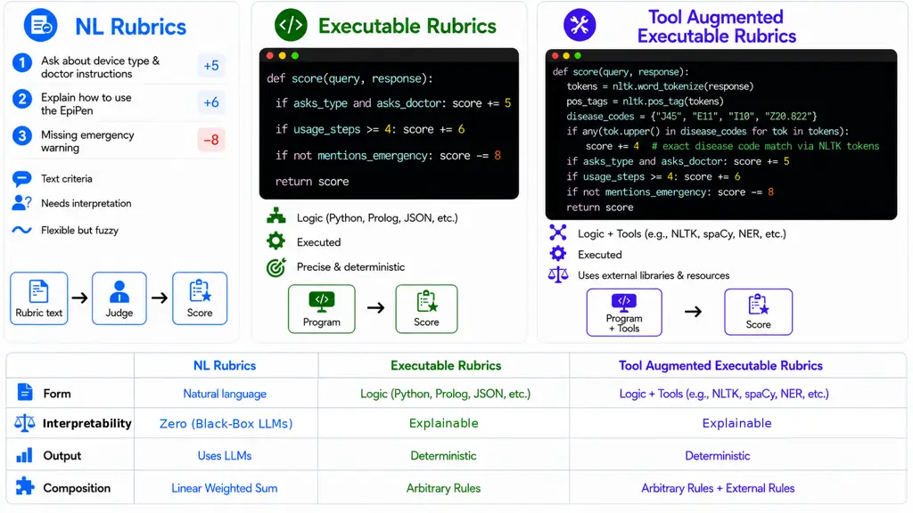

# ExecRubrics: Executable Tool-Augmented Rubrics for Verifiable and Efficient Long-Form Evaluation

Kaustubh D. Dhole    Department of Computer Science    Emory University
   Atlanta    USA    [kdhole@stanford.edu](mailto:kdhole@stanford.edu)
   Charles L. A. Clarke Affiliation: School of Computer Science
Affiliation: University of Waterloo Affiliation: Waterloo, Canada
Email: [](mailto:)[claclark@gmail.com](mailto:claclark@gmail.com)   
Eugene Agichtein    Department of Computer Science    Emory University
   Atlanta    USA   
[eugene.agichtein@emory.edu](mailto:eugene.agichtein@emory.edu)

###### Abstract

Rubrics aim to make language-model evaluation transparent by decomposing
response quality into interpretable criteria. However, natural-language
rubrics are often ambiguous, require LLM judges, and typically assume
criteria aggregated through linear weighted sums, limiting their ability
to capture dependencies, alternatives, penalties, and override
conditions. We propose ExecRubrics, a framework for representing rubrics
as compact executable programs. ExecRubrics encodes evaluation logic as
verifiable Python scoring functions, giving natural-language rubric
intent an operational semantics: a fixed decision procedure that can be
inspected, executed, and edited. On three long-form response benchmarks
– HealthBench, HelpSteer, and ArgQuality – we show that ExecRubrics can
recover substantial preference signal without an LLM judge at evaluation
time. On ArgQuality and HelpSteer, the strongest executable variants are
within $`1.1`$ and $`4`$ percentage points, respectively, of the direct
GPT-5.5 agentic baseline. Executable rubrics are also considerably
faster, achieving a 192× average speedup. We show that incorporating
external logic and resources from text processing libraries such as NLTK
and spaCy can further improve preference accuracy. Our results suggest a
novel way of approaching automated evaluation, by offering a faster,
more explainable, and less ambiguous alternative to black-box rubric
evals, particularly in high-stakes domains such as healthcare and
banking where precision and auditability are critical.¹¹ 1
[github.com/emory-irlab/executable-rubrics](https://github.com/emory-irlab/executable-rubrics)

## 1 Introduction

Large Language Models (LLMs) are increasingly evaluated and trained with
automated graders, such as LLM-as-judge systems that output scalar
scores or preferences. Although convenient, these judgments are opaque:
they rarely explain which requirements were missed or how a system
should improve. This is problematic in high-stakes domains such as
health Hager et al. (2024); Asan et al. (2020); Sivasothy et al. (2026)
where precision is critical or in evaluating long-horizon workflows
where evaluation should account for multiple intermediate
deliverables Sun et al. (2026); Chen et al. (2026); Phan et al. (2025);
Kapoor et al. (2026). Rubric-based evaluation addresses this by
decomposing response quality into explicit natural-language
criteria Arora et al. (2025); Dhole et al. (2025b).

Natural-language (NL) rubrics still leave evaluation semantics
underspecified: criteria such as “appropriately recommends urgent care”
or “instruction following ability” are readable but require a human or
LLM judge to interpret Popham (1997); Li and Lindsey (2015). This makes
scores judge-dependent and makes the effect of rubric changes difficult
to predict.



Figure 1: Natural language rubrics can be ambiguous and require a judge
to compute criterion satisfiability. Executable rubrics are
deterministic and verifiable, thereby mitigating the need for a judge.

This reliance on NL rubric criteria also encourages flat weighted
checklists, even though evaluation logic may involve prerequisites,
alternatives, penalties, and overrides. For example, in a medical query
mentioning a penicillin allergy, an executable rubric can activate an
allergy-specific branch, reward non-penicillin alternatives, and
penalize uncaveated amoxicillin recommendations.

To address these problems, we propose ExecRubrics: a method of compiling
NL rubrics into symbolic scoring programs. Each program defines the
checks, branches, penalties, normalization, and tool calls used to score
a candidate response. Such executable rubrics can be made more
expressive by invoking deterministic NLP tools, such as tokenizers,
lexicons, entity recognizers, negation detectors, readability, and
n-gram metrics, as transparent primitives for atomic checks. Since
modern LLMs are strong code generators, we use them to automatically
translate the rubrics into code only once per rubric, enabling highly
efficient execution of the code many times, resulting in dramatic
savings in computational complexity and cost.

Hence, our research question is: Can LLMs automatically generate
executable rubrics that deterministically distinguish high-quality
responses from low-quality responses as effectively as natural-language
rubrics? Specifically, our contributions are:

- •
  We introduce ExecRubrics as an explicit and expressive representation
  of NL rubrics for automated response evaluation ( Figure 1).
- •
  We demonstrate how Python-based ExecRubrics can be generated from
  natural language rubrics. Across HealthBench, ArgQuality, and
  HelpSteer, we evaluate whether executable rubrics can serve as a
  judge-free intermediate representation for preference evaluation. We
  find that generated Python rubrics often match or exceed
  natural-language rubric judging while making the scoring logic
  inspectable, deterministic, and modifiable.
- •
  We further show how allowing these rubrics to exploit logic through
  external text processing tools improves their performance further by
  providing more expressive power.

## 2 Related Work

Rubric-based and adaptive evaluation: Rubric-based benchmarks make
evaluation more transparent by exposing the criteria used to score
responses. HealthBench uses physician-written, query-specific criteria
with point values Arora et al. (2025); Hicks et al. (2026); Cook et al.
(2024); and ProfBench Wang et al. (2025) and PRBench Akyürek et al.
(2025) use expert-authored weighted rubrics in professional domains.
Recent work also makes rubrics more scalable and adaptive: RUBICON
generates rubrics for domain-specific conversations Biyani et al.
(2024), Health-SCORE selects relevant healthcare rubric items for each
prompt Mallinar et al. (2026), and RubricRAG retrieves related examples
to generate query-specific rubrics Dhole and Agichtein (2026). However,
these systems still largely represent rubrics as a weighted linear sum
of NL checklist items whose satisfaction must be judged by a human or an
LLM.

Limitations of NL rubrics: Prior assessment work shows that rubrics are
not automatically reliable or valid: they require clear, appropriate
granularity Dhole and Agichtein (2026); Fensore et al. (2026) and, often
calibration or exemplars Li and Lindsey (2015). Vague criteria can lead
raters to interpret rubrics inconsistently or rely on holistic
impressions Popham (1997). This limitation is especially relevant for
LLM evaluation, where criteria such as “does not overstate certainty” or
“appropriately recommends urgent care” remain operationally
underspecified and require another judge to decide whether they are
satisfied. (Other related studies are also discussed in Appendix A)

## 3 Rubric-Based Evaluation

We consider the setting where an evaluator must choose a preferred
response $`y^{+}`$ over a dispreferred response $`y^{-}`$ for an input
query $`x`$ through rubric criteria. Let $`R`$ denote rubric system,
e.g., a set of rubric items or criteria and let $`E_{R}(y\mid x)`$
denote an evaluation score assigned to a candidate response $`y`$ for a
query $`x`$ under the rubric system $`R`$. A rubric-based evaluator is
effective when it assigns a higher score to the preferred response. One
measures the effectiveness under a rubric system by measuring the
preference accuracy across a large number of query and preference pairs
$`\mathcal{D}`$.

```math
\mathrm{Acc_{R}}=\frac{1}{|\mathcal{D}|}\sum_{(x,y^{+},y^{-})\in\mathcal{D}}\mathbbm{\mathbf{1}}\left[E_{R}(y^{+}\mid x)>E_{R}(y^{-}\mid x)\right]
```

### 3.1 Natural Language Rubrics

In rubric-based evaluations, the rubric system represented rubric
criteria as a list of (weighted) items:

```math
R=\{(r_{1},p_{1}),(r_{2},p_{2}),\ldots,(r_{n},p_{n})\}
```

where $`r_{i}`$ is a textual description of the $`i`$-th rubric
criterion and $`p_{i}\in\mathbb{R}`$ is the number of points assigned to
each criterion. Positive points reward desirable properties, while
negative points penalize unsafe, incorrect, or otherwise undesirable
properties.

Because each rubric criterion is written in long descriptive natural
language, its satisfaction is not directly computable. A separate judge
model $`M`$ is therefore used to determine whether response $`y`$
satisfies criterion $`r_{i}`$ for query $`x`$:

```math
M(x,y,r_{i})\in\{0,1\}
```

The final rubric score is then computed as a weighted sum of satisfied
criteria, normalized by the total positive points:

```math
E_{R}(y\mid x)=\frac{\sum_{i=1}^{n}p_{i}\cdot\mathbbm{1}\!\left[M(x,y,r_{i})=1\right]}{\sum_{i=1}^{n}p_{i}\cdot\mathbbm{1}\!\left[p_{i}>0\right]}
```

This formulation makes evaluation more interpretable than a single
scalar judge score because individual criteria can be inspected.
However, the semantics of each criterion are still mediated by $`M`$,
and the aggregation assumes that criteria contribute independently and
linearly to the final score.

### 3.2 Executable Rubrics

We define an executable rubric as a symbolic scoring program that
evaluates the candidate response based on any arbitrary function
$`f_{r_{i}}`$ that approximates a rubric criteria $`r_{i}`$ into
explicit rules. Specifically, an executable rubric replaces
judge-mediated criterion satisfaction with a scoring function
$`f_{r_{i}}`$ that encodes explicit rules and may call deterministic
tools for atomic text checks or arbitrary logic, and returns the rubric
score.

The resulting scores are then weighted by the points ($`p_{i}`$)
assigned to the original rubric ($`r_{i}`$), and aggregated. Let
($`m_{i}`$) denote the maximum attainable score of the executable
scoring function ($`f_{r_{i}}`$):

```math
E_{R}(y\mid x)=\frac{\sum_{i=1}^{n}p_{i}\cdot f_{r_{i}}(x,y)}{\sum_{i=1}^{n}p_{i}\cdot m_{i}\cdot\mathbbm{1}\left[p_{i}>0\right]}
```

which normalizes the aggregated score by the highest possible number of
points.

|                   |                                               |                |                |                |                             |
| ----------------- | --------------------------------------------- | -------------- | -------------- | -------------- | --------------------------- |
| Rubric Source     | Rubric Type                                   | HealthBench    | ArgQuality     | HelpSteer      | Execution (s)$`\downarrow`$ |
| No Rubrics        | Black-Box Agentic Eval (GPT 5.5 All Queries)  | .64            | .90            | .79            | .7393                       |
| Human             | Natural Language Rubrics (Qwen 30B Per Query) | .52            | .76            | .62            | 1.688                       |
| GPT-5.5           | Executable Rubrics                            | .53 \[+1.9%\]  | .81 \[+6.6%\]  | .64 \[+3.2%\]  | .0109 \[155$`\times`$\]     |
|                   | Executable Rubrics + Popular Tools            | .52 \[0.0%\]   | .80 \[+5.3%\]  | .74 \[+19.4%\] | .6518 \[2.6$`\times`$\]     |
|                   | Executable Rubrics + Deterministic Tools      | .48 \[-7.7%\]  | .82 \[+7.9%\]  | .66 \[+6.5%\]  | .4187 \[4.0$`\times`$\]     |
| Gemini 3.5 Flash  | Executable Rubrics                            | .48 \[-7.7%\]  | .82 \[+7.9%\]  | .75 \[+21.0%\] | .0088 \[192$`\times`$\]     |
|                   | Executable Rubrics + Popular Tools            | .43 \[-17.3%\] | .70 \[-7.9%\]  | .58 \[-6.5%\]  | .5707 \[3.0$`\times`$\]     |
|                   | Executable Rubrics + Deterministic Tools      | .52 \[0.0%\]   | .87 \[+14.5%\] | .59 \[-4.8%\]  | .1189 \[14.2$`\times`$\]    |
| Claude Sonnet 4.6 | Executable Rubrics                            | .40 \[-23.1%\] | .76 \[0.0%\]   | .65 \[+4.8%\]  | .0229 \[73.7$`\times`$\]    |
|                   | Executable Rubrics + Popular Tools            | .51 \[-1.9%\]  | .67 \[-11.8%\] | .63 \[+1.6%\]  | .9062 \[1.9$`\times`$\]     |
|                   | Executable Rubrics + Deterministic Tools      | .42 \[-19.2%\] | .91 \[+19.7%\] | .70 \[+12.9%\] | .1293 \[13.1$`\times`$\]    |

Table 1: Performance across rubric sources versus benchmarks. The first
column depicts the source of the rubrics created once per corpus. Except
for the first row, all evaluations have been done query-wise. The first
two rows require LLMs for evaluation, while the bottom nine rows do not.
The last column is averaged across datasets. Values in brackets indicate
percentage change relative to the Human row.

## 4 Experimental Setup

We now describe our experimental setup where we compare the
effectiveness of human written rubrics and the corresponding translated
executable rubrics, with and without external logic.

Benchmarks: We evaluate preference accuracy over three datasets that
provide both rubric information and preference-style supervision. First,
on HealthBench Arora et al. (2025), we treat the physician-authored
completions as the positive responses and use negative responses from
RubricRAG Dhole and Agichtein (2026), which are generated by
conditioning on mismatched rubrics. We also evaluate on two long-form
preference benchmarks, HelpSteer Wang et al. (2024) and
ArgQuality Wachsmuth et al. (2017). Our primary metric is Preference
Accuracy: the fraction of queries for which the positive response is
preferred over the negative response.

Rubric Generation Methods:

1.  1.  NL Rubrics: We first compute preference accuracies using
        human-written rubric criteria. Each benchmark has 5 to 14
        corpus-level criteria like cogency, emotional appeal, instruction
        following, etc., shown in Table 2. We use single sentence
        definitions for each of them. Qwen3-30B-A3B-Instruct Yang et
        al. (2025) is used for predicting criterion satisfaction²² 2 We use
        NVIDIA H200 for NL rubric experiments. Different choices of NL
        judges may result in different performances..
2.  2.  Executable Rubric Variants: We evaluate three families of executable
        rubrics by generating them from their natural language counterparts.
        (i) Executable Rubrics: the model directly converts natural-language
        rubrics into Python scoring functions. Each rubric criterion (eg.,
        cogency, coherence, etc.) is translated to one scoring function, and
        the sum of the scores is used for evaluating (query, response) pairs
        (i.e. we use $`p_{i}=1`$ for all rubric criteria). The prompts used
        for generating the rubrics are shown in Appendix Figure 4
        (ii) Executable Rubrics with Popular tools: the model generates a
        Python scoring function with access to two widely used NLP
        libraries, NLTK Bird (2006) and spaCy Honnibal et al. (2020).
        (iii) Executable Rubrics with Deterministic Tools: the model
        generates a Python scoring function that can call a wider range of
        different deterministic text processing libraries. For ArgQuality,
        and HealthBench, we use few-shot prompts by constructing 3
        executable functions for 3 rubric criteria from HelpSteer.
        For HelpSteer, we construct a zero-shot prompt. We evaluate 3
        frontier LLMs, viz., GPT 5.5 OpenAI (2026), Claude Sonnet
        4.6 Anthropic (2026), and Gemini 3.5 Flash Google (2026).
3.  3.  Black-Box Agentic Evaluation: We include a no-rubric agentic
        baseline using GPT 5.5. Given the permitted long context length, we
        feed a single all queries file to the chat, and prompt it to
        generate a preferred response for each row of the file.

Tool Augmentation: We augment rubric generation with helper functions
built on top of existing text-processing libraries and deterministic
analyzers (shown in Table 5), and expose them directly in the prompts so
the model sees their signatures, inputs, and outputs. For
popular-library augmentation, this includes functions for tokenization,
lemmatization, entity extraction, phrase matching, profanity checks,
negation detection, and lexical frequency statistics. For
deterministic-tool augmentation, we expose higher-level checks such as
medical red-flag detection, refusal-policy matching, markdown-table
detection, readability scoring, keyword coverage, language matching, and
actionable-harm detection. This setup lets the model write rubric
programs that call concrete tools allowing arbitrary custom logic to
enrich the evaluation.

## 5 Results and Analysis

We report preference accuracies in Table 1. Overall, executable rubrics
recover substantial preference signal without invoking an LLM judge at
evaluation time. The strongest executable variant exceeds the
natural-language rubric baseline on all three benchmarks, though the
size and source of the gain vary substantially across datasets.
Natural-language rubrics are not consistently effective when evaluated
with Qwen3-30B-A3B-Instruct. They perform substantially worse on
HealthBench ($`.52`$ vs. $`.64`$) and HelpSteer ($`.62`$ vs. $`.79`$).
This suggests that natural-language rubrics remain dependent on the
judge model used to interpret each criterion (Results for different
NL-judges shown in Appendix Table 3). Executable rubrics improve over
the natural-language rubric baseline on all three benchmarks. The best
executable systems reach $`.53`$ on HealthBench, $`.91`$ on ArgQuality,
and $`.75`$ on HelpSteer, compared with $`.52`$, $`.76`$, and $`.62`$
for natural-language rubrics.

These results suggest that deterministic scoring programs can recover
much of the preference signal captured by NL rubric judging, while
replacing repeated black-box criterion interpretation with explicit
executable logic. Deterministic tools are especially helpful on
ArgQuality, improving performance for all three rubric generators and
yielding the best overall score of $`.91`$ with Claude Sonnet 4.6. On
HelpSteer, deterministic tools modestly improve GPT-5.5 and
Claude-generated rubrics from $`.64`$ to $`.66`$ and from $`.65`$ to
$`.70`$, respectively, although the best executable result of $`.75`$ is
obtained by Gemini 3.5 Flash without tool augmentation. However, on
HealthBench, tool use is less reliable, and does not close the gap with
GPT-5.5’s direct evaluation.

Importantly, executable rubrics are considerably faster, as shown in the
execution times in the rightmost column in Table 1, achieving dramatic
efficiency gains compared to their NL counterparts. For instance,
standard executable rubrics generated by Gemini 3.5 Flash achieved an
overall average speedup of $`{\sim}192\times`$ compared to the Qwen-30B
NL judge (0.0088s vs. 1.688s). Also note that efficiency-focused models
(like Gemini 3.5 Flash) sometimes produce “no-op” or shallow tool
wrappers rather than deeply integrating heavy NLP pipelines due to
misunderstanding the task. This leads to low latency (up to
$`327\times`$ faster than the NL baseline on HealthBench) but severely
degrades preference accuracy (.43). We also find that sometimes
generated rubrics can also contain internal scoring inconsistencies; for
example, Claude Sonnet 4.6’s HealthBench ‘score_accuracy‘ function
declares a maximum score of 20 although its positive components sum only
to 19. The representative excerpts of the generated code of the
executable rubrics generated by GPT 5.5 and Claude are shown in the
Appendix Figures 3 and 2.

## 6 Conclusion and Future Work

We introduced ExecRubrics, a framework for turning natural-language
rubrics into executable scoring programs. Unlike conventional rubric
evaluators, which require an LLM or human judge to interpret each
criterion, executable rubrics make evaluation logic explicit: they can
encode complex logic as deterministic code.

Across HealthBench, ArgQuality, and HelpSteer, generated executable
rubrics recover substantial preference signals without requiring a
black-box LLM at evaluation time. The strongest executable variants
outperform the natural-language rubric baseline on all three benchmarks.
Moreover, tool-augmented rubrics demonstrate that deterministic tools,
such as NLP libraries, can provide useful and transparent primitives for
evaluation. These results suggest that executable rubrics are a
promising intermediate representation for auditable, modifiable, and
efficient LLM evaluation.

Our experiments study executable rubrics as automatically generated
evaluators, and they point to several interesting directions for future
work. First, we instruct models to generate rubrics that operate over
the full response text. This makes the setup simple, broadly applicable,
and easy to execute across domains, but different domains may require
different levels of granularity. In high-stakes settings such as
medicine, high-precision checks over specific symptoms, entities,
contraindications, or safety actions can be especially important,
because small omissions or unsafe recommendations may materially change
the quality of an answer. In more open-ended settings, however, very
precise lexical or structural checks may be less desirable, since there
may be many valid ways to satisfy the same evaluation intent. Future
work could therefore adapt the granularity of executable rubrics to the
domain by incorporating explicit parsing, sentence-level decomposition,
claim extraction, domain-specific entity recognition, or typed
intermediate representations before scoring.

Further room for improvement remains on making executable rubrics more
robust across domains. Another valuable direction for future work is to
study how executable evaluation logic can support dataset filtering,
reward modeling, preference optimization while avoiding hacking. More
broadly, ExecRubrics points toward evaluation systems whose judgments
are accurate, explainable, inspectable, and highly efficient.

## 7 Limitations

Although executable rubrics are intended to be more interpretable
because their scoring logic is explicit, we do not directly evaluate
human interpretability which could arguably be subjective. In practice,
there is likely a balance between expressivity and interpretability.
More expressive rubric programs can capture dependencies, alternatives,
penalties, and override conditions, but they may also become more
complex for humans to inspect and revise. Conversely, flatter and more
generic rubrics may be easier to read, but they can fail to express the
evaluation structure needed for accurate preference judgments, as
suggested by the comparatively lower performance of natural-language
rubrics in our preference analysis. Future work could therefore study
how humans write, inspect, debug, and simplify executable rubrics, and
how interfaces can expose the underlying logic without making the
representation tedious to use.

Executable rubrics may be vulnerable to gaming. Since their scoring
logic is explicit, response generators could learn to trigger specific
textual, structural, or semantic checks without satisfying the
underlying evaluation intent. This risk is especially important if
executable rubrics are used as reward signals for RL optimization.
Future work should study adversarial robustness and whether executable
rubric scores remain aligned with human judgments under optimization
pressure.

As frontier models become increasingly capable of scraping and
extracting publicly visible data with high accuracy, the risk of
memorization cannot be ignored. The performance of executable rubrics,
especially on datasets such as HelpSteer and ArgQuality, may be
influenced in part by memorized content. However, we also believe that
predicting dictionaries, loops, and generic logic should not necessarily
be attributed directly to memorization, since such patterns commonly
appear throughout LLMs’ pretraining and midtraining data.

## 8 Ethical Considerations

LLMs are increasingly used as evaluators, but LLM judges are black boxes
whose scoring behavior can be difficult to inspect, reproduce, or
contest. This opacity raises concerns about accountability, bias, and
overreliance on automated judgments, especially in high-stakes settings.
Our work aims to make rubric-based evaluation more responsible by
replacing repeated black-box criterion interpretation with explicit
executable scoring logic. Because executable rubrics expose the rules,
branches, penalties, and tool calls used during evaluation, they can be
inspected, audited, revised, and stress-tested more directly than opaque
judge-model outputs. However, executable rubrics are not inherently fair
or correct: poorly written rules may encode bias, miss valid response
variations, or overfit to superficial textual cues. We therefore view
ExecRubrics as a step toward more transparent and accountable
evaluation, not as a substitute for human oversight, domain expertise,
or careful validation.

The experiments in this paper were mostly conducted using GPT 5.5
Codex ³³ 3 [https://chatgpt.com/codex/](https://chatgpt.com/codex/) and
Gemini CLIs ⁴⁴ 4 [https://geminicli.com/](https://geminicli.com/). Some
paragraphs of the paper were grammatically corrected using ChatGPT
5.5 OpenAI (2026).

## Acknowledgements

The authors would like to thank the anonymous reviewers of ARR for
reviewing our work, William Stern and Fei Liu for valuable comments, and
Amazon Research Awards and Emory University for partially supporting
this work.

## References

- Akyürek et al. (2025) A. F. Akyürek, A. Gosai, C. B. C. Zhang, V.
  Gupta, J. Jeong, A. Gunjal, T. Rabbani, M. Mazzone, D. Randolph, M. M.
  Meymand, et al. PRBench: large-scale expert rubrics for evaluating
  high-stakes professional reasoning. arXiv preprint arXiv:2511.11562.
  Cited by: §2.
- Anthropic (2026) Anthropic Introducing Claude Sonnet 4.6. Note:
  [https://www.anthropic.com/news/claude-sonnet-4-6](https://www.anthropic.com/news/claude-sonnet-4-6)
  Cited by: item 2.
- Armgaan et al. (2024) B. Armgaan, M. Dalmia, S. Medya, and S. Ranu
  Graphtrail: translating gnn predictions into human-interpretable
  logical rules. Advances in Neural Information Processing Systems 37,
  pp. 123443–123470. Cited by: Appendix A.
- Arora et al. (2025) R. K. Arora, J. Wei, R. S. Hicks, P. Bowman, J.
  Quiñonero-Candela, F. Tsimpourlas, M. Sharman, M. Shah, A. Vallone, A.
  Beutel, et al. Healthbench: evaluating large language models towards
  improved human health. arXiv preprint arXiv:2505.08775. Cited by: §1,
  §2, §4.
- Asan et al. (2020) O. Asan, A. E. Bayrak, and A. Choudhury Artificial
  intelligence and human trust in healthcare: focus on clinicians.
  Journal of medical Internet research 22 (6), pp. e15154. Cited by: §1.
- Bird (2006) S. Bird NLTK: the natural language toolkit. In Proceedings
  of the COLING/ACL 2006 interactive presentation sessions, pp. 69–72.
  Cited by: item 2.
- Biyani et al. (2024) P. Biyani, Y. Bajpai, A. Radhakrishna, G. Soares,
  and S. Gulwani Rubicon: rubric-based evaluation of domain-specific
  human ai conversations. In Proceedings of the 1st ACM International
  Conference on AI-Powered Software, pp. 161–169. Cited by: §2.
- Chen et al. (2026) H. Chen, D. Metelski, L. Qi, T. Xia, J. Lee, S.
  Brown, K. Riley, F. Wang, T. Liu, H. C. MD, et al. CHI-bench: can ai
  agents automate end-to-end, long-horizon, policy-rich healthcare
  workflows?. arXiv preprint arXiv:2605.16679. Cited by: §1.
- Chung et al. (2026) P. Chung, A. Swaminathan, A. J. Goodell, Y.
  Kim, S. M. Reincke, L. Han, B. Deverett, M. A. Sadeghi, A. Ariss, M.
  Ghanem, D. Seong, A. A. Lee, C. E. Coombes, B. Bradshaw, M. A.
  Sufian, H. J. Hong, T. P. Nguyen, M. R. Rasouli, K. Kamra, M. A.
  Burbridge, J. C. McAvoy, R. Saffary, S. P. Ma, D. Dash, J. Xie, E. Y.
  Wang, C. A. Schmiesing, N. Shah, and N. Aghaeepour Verifying facts in
  patient care documents generated by large language models using
  electronic health records. NEJM AI 3 (1), pp. AIdbp2500418. External
  Links: [Document](https://dx.doi.org/10.1056/AIdbp2500418),
  [Link](https://ai.nejm.org/doi/full/10.1056/AIdbp2500418),
  https://ai.nejm.org/doi/pdf/10.1056/AIdbp2500418 Cited by: Appendix A.
- Condor et al. (2022) A. Condor, Z. Pardos, and M. Linn Representing
  scoring rubrics as graphs for automatic short answer grading. In
  International Conference on Artificial Intelligence in Education,
  pp. 354–365. Cited by: Appendix A.
- Cook et al. (2024) J. Cook, T. Rocktäschel, J. Foerster, D. Aumiller,
  and A. Wang Ticking all the boxes: generated checklists improve llm
  evaluation and generation. arXiv preprint arXiv:2410.03608. Cited by:
  §2.
- Cranmer et al. (2020) M. Cranmer, A. Sanchez Gonzalez, P.
  Battaglia, R. Xu, K. Cranmer, D. Spergel, and S. Ho Discovering
  symbolic models from deep learning with inductive biases. Advances in
  neural information processing systems 33, pp. 17429–17442. Cited by:
  Appendix A.
- Dhole and Agichtein (2024) K. Dhole and E. Agichtein Llm judges for
  retrieval augmented argumentation. Cited by: Appendix A.
- Dhole et al. (2025a) K. Dhole, R. Chandradevan, and E. Agichtein
  AdvERSEM: adversarial robustness testing and training of llm-based
  groundedness evaluators via semantic structure manipulation. In
  Proceedings of the 14th Joint Conference on Lexical and Computational
  Semantics (\* SEM 2025), pp. 395–408. Cited by: Appendix A.
- Dhole and Agichtein (2026) K. D. Dhole and E. Agichtein RubricRAG:
  towards interpretable and reliable llm evaluation via domain knowledge
  retrieval for rubric generation. In Proceedings of the ACM SIGIR
  Conference on Research and Development in Information Retrieval, Note:
  Accepted at SIGIR 2026 External Links:
  [Link](https://arxiv.org/abs/2603.20882) Cited by: §2, §2, §4.
- Dhole et al. (2025b) K. Dhole, K. Shu, and E. Agichtein Conqret: a new
  benchmark for fine-grained automatic evaluation of retrieval augmented
  computational argumentation. In Proceedings of the 2025 Conference of
  the Nations of the Americas Chapter of the Association for
  Computational Linguistics: Human Language Technologies (Volume 1: Long
  Papers), pp. 5687–5713. Cited by: Appendix A, §1.
- Farzi and Dietz (2025) N. Farzi and L. Dietz Criteria-based llm
  relevance judgments. In Proceedings of the 2025 International ACM
  SIGIR Conference on Innovative Concepts and Theories in Information
  Retrieval (ICTIR), pp. 254–263. Cited by: Appendix A.
- Fensore et al. (2026) C. M. Fensore, K. Dhole, J. Fan, E. Agichtein,
  and J. C. Ho How fine-grained should a rag benchmark be? a
  hierarchical framework for synthetic question generation. arXiv
  preprint arXiv:2606.12789. Cited by: §2.
- Google (2026) Google Gemini 3.5: Frontier Intelligence with Action.
  Note:
  [https://deepmind.google/blog/gemini-3-5-frontier-intelligence-with-action/](https://deepmind.google/blog/gemini-3-5-frontier-intelligence-with-action/)
  Cited by: item 2.
- Hager et al. (2024) P. Hager, F. Jungmann, R. Holland, K. Bhagat, I.
  Hubrecht, M. Knauer, J. Vielhauer, M. Makowski, R. Braren, G. Kaissis,
  et al. Evaluation and mitigation of the limitations of large language
  models in clinical decision-making. Nature medicine 30 (9),
  pp. 2613–2622. Cited by: §1.
- Hicks et al. (2026) R. S. Hicks, M. Trofimov, D. Lim, R. K. Arora, F.
  Tsimpourlas, P. Bowman, M. Sharman, C. Tong, K. Karthik, A. Dugar, et
  al. HealthBench professional: evaluating large language models on real
  clinician chats. Technical report tech. rep., OpenAI. Cited by: §2.
- Honnibal et al. (2020) M. Honnibal, I. Montani, S. Van Landeghem,
  and A. Boyd SpaCy: industrial-strength natural language processing in
  python. External Links:
  [Document](https://dx.doi.org/10.5281/zenodo.1212303) Cited by:
  item 2.
- Jeong et al. (2025) Y. Jeong, M. Kim, S. Hwang, and B. Kim
  Agent-as-judge for factual summarization of long narratives. In
  Proceedings of the 2025 Conference on Empirical Methods in Natural
  Language Processing, C. Christodoulopoulos, T. Chakraborty, C. Rose,
  and V. Peng (Eds.), Suzhou, China, pp. 23591–23608. External Links:
  [Link](https://aclanthology.org/2025.emnlp-main.1204/),
  [Document](https://dx.doi.org/10.18653/v1/2025.emnlp-main.1204), ISBN
  979-8-89176-332-6 Cited by: Appendix A.
- Kapoor et al. (2026) S. Kapoor, P. Kirgis, A. Schwartz, S.
  Rabanser, J. Allaire, R. Bommasani, H. Coppock, M. Dubois, G. K.
  Hadfield, A. B. Hall, et al. Open-world evaluations for measuring
  frontier ai capabilities. arXiv preprint arXiv:2605.20520. Cited by:
  §1.
- Li et al. (2026) B. Li, W. Walden, Y. Hou, G. K. Liu, D. Lawrie, J.
  Mayfield, E. Yang, C. Callison-Burch, and L. Dietz DoGMaTiQ: automated
  generation of question-and-answer nuggets for report evaluation. arXiv
  preprint arXiv:2605.04458. Cited by: Appendix A.
- Li and Lindsey (2015) J. Li and P. Lindsey Understanding variations
  between student and teacher application of rubrics. Assessing writing
  26, pp. 67–79. Cited by: §1, §2.
- Liu et al. (2023) Y. Liu, D. Iter, Y. Xu, S. Wang, R. Xu, and C. Zhu
  G-eval: NLG evaluation using gpt-4 with better human alignment. In
  Proceedings of the 2023 Conference on Empirical Methods in Natural
  Language Processing, H. Bouamor, J. Pino, and K. Bali (Eds.),
  Singapore, pp. 2511–2522. External Links:
  [Link](https://aclanthology.org/2023.emnlp-main.153/),
  [Document](https://dx.doi.org/10.18653/v1/2023.emnlp-main.153) Cited
  by: Appendix A.
- Mallinar et al. (2026) N. Mallinar, A. A. Heydari, X. Liu, A. Z.
  Faranesh, B. Winslow, N. Hammerquist, B. Graef, C. Speed, M.
  Malhotra, S. Patel, et al. A scalable framework for evaluating health
  language models. npj Digital Medicine. Cited by: §2.
- Min et al. (2023) S. Min, K. Krishna, X. Lyu, M. Lewis, W. Yih, P.
  Koh, M. Iyyer, L. Zettlemoyer, and H. Hajishirzi Factscore:
  fine-grained atomic evaluation of factual precision in long form text
  generation. In Proceedings of the 2023 Conference on Empirical Methods
  in Natural Language Processing, pp. 12076–12100. Cited by: Appendix A.
- Mu et al. (2024) T. Mu, A. Helyar, J. Heidecke, J. Achiam, A.
  Vallone, I. Kivlichan, M. Lin, A. Beutel, J. Schulman, and L. Weng
  Rule based rewards for language model safety. Advances in Neural
  Information Processing Systems 37, pp. 108877–108901. Cited by:
  Appendix A.
- OpenAI (2026) OpenAI Introducing GPT-5.5. Note:
  [https://openai.com/index/introducing-gpt-5-5/](https://openai.com/index/introducing-gpt-5-5/)
  Cited by: item 2, §8.
- Phan et al. (2025) L. Phan, A. Gatti, Z. Han, N. Li, J. Hu, H.
  Zhang, C. B. C. Zhang, M. Shaaban, J. Ling, S. Shi, et al. Humanity’s
  last exam. arXiv preprint arXiv:2501.14249. Cited by: §1.
- Popham (1997) W. J. Popham What’s wrong-and what’s right-with rubrics.
  Educational leadership 55, pp. 72–75. Cited by: §1, §2.
- Rai et al. (2026) D. Rai, M. Geva, and Z. Yao Data-driven circuit
  discovery for interpretability of language models. arXiv preprint
  arXiv:2605.09129. Cited by: Appendix A.
- Ribeiro et al. (2020) M. T. Ribeiro, T. Wu, C. Guestrin, and S. Singh
  Beyond accuracy: behavioral testing of NLP models with CheckList. In
  Proceedings of the 58th Annual Meeting of the Association for
  Computational Linguistics, D. Jurafsky, J. Chai, N. Schluter, and J.
  Tetreault (Eds.), Online, pp. 4902–4912. External Links:
  [Link](https://aclanthology.org/2020.acl-main.442/),
  [Document](https://dx.doi.org/10.18653/v1/2020.acl-main.442) Cited by:
  Appendix A.
- Rorseth et al. (2026) J. Rorseth, P. Godfrey, L. Golab, D. Srivastava,
  and J. Szlichta RUBEN: rule-based explanations for retrieval-augmented
  llm systems. arXiv preprint arXiv:2605.10862. Cited by: Appendix A.
- Sivasothy et al. (2026) S. Sivasothy, A. Bingham, I. Logothetis, S.
  Barnett, M. Abdelrazek, C. Luckhoff, J. Mathew, R. Vasa, and K.
  Mouzakis Large language models and conditional rules in clinical
  decision support systems. Health Information Science and Systems 14
  (1), pp. 32. Cited by: §1.
- Sun et al. (2026) Y. Sun, X. Han, W. Zhang, Y. Pang, T. Wang, Y.
  Cao, Y. Huang, C. Duroiu, H. Zhang, J. Lin, W. Zhang, T. Zeng, Y.
  Yan, B. Liu, H. Wen, M. Xu, X. Liu, Z. Chen, W. Shi, A. Dsouza, V. S.
  Chen, P. Bryant, C. Boettiger, Y. Rangan, B. Rothenberg, K.
  Steinfeld, A. Rao, T. Schneider, G. Yannakakis, L. Zanna, K. Ozbay, I.
  Sim, T. Zohdi, G. E. Karniadakis, J. Gallant, T. Head-Gordon, Y.
  Li, W. Deng, T. Sun, H. Wang, Z. Wang, J. Xu, C. Y. Liu, Y. Cheng, R.
  Hu, A. Bacho, S. Cao, Z. Qin, Y. Chen, H. Fan, H. Liu, L. Zeng, S. M.
  Bharadwaj, L. Gong, Y. Yang, M. Song, R. Wang, Z. Zhang, H. Bao, S.
  Lu, J. Tu, Z. Wang, Z. Zhang, Z. Chen, Y. Jiang, Z. Li, B. Lyu, C.
  Ma, P. Xu, B. Zhang, S. Gu, H. Hua, H. Li, W. Liao, C. Liu, J.
  Peng, H. Sun, Z. Xu, B. Chen, J. Cheng, Y. Jiang, K. Kuang, Y. Li, Y.
  Pan, Z. Rao, A. Schubert, Y. Shen, V. Siu, X. Sun, K. Zhang, X.
  Zhang, Y. Zhu, I. S. Chandok, L. Ding, J. Fan, A. Glover, J. Hu, Y.
  Hu, W. Huang, Z. Jiang, H. Jin, L. Kim, M. Liu, Y. Liu, A. Rafiei, X.
  Shen, K. Sun, S. Sun, T. Sun, E. Wang, Y. Wang, H. Xing, S. Xu, Y.
  Xu, Z. Xu, Z. Yan, B. Yuan, R. Zhang, Y. Zhang, Z. Zhao, Liana, S. B.
  Antu, H. Bai, C. Bosio, J. Cavanagh, P. Cavazos-Rehg, T. Chen, X.
  Chen, Y. Chen, C. Zhu, C. Dai, S. D. Castro, Y. Deng, K. Dhole, J.
  Ding, C. Du, Z. Du, H. Fan, R. Fan, H. Fu, S. Gu, Y. Gu, C. Guo, B.
  Huang, B. Huang, R. Jaiswal, Z. Jiang, R. Jin, E. Kasson, X. Lan, J.
  Lee, D. Lei, C. Li, D. Li, H. Li, H. Li, J. Li, X. Li, Y. Li, Y.
  Li, Y. Li, Z. Li, W. Liang, L. Liao, K. Q. Lin, A. Z. Liu, C. Liu, J.
  Liu, K. Liu, X. Liu, P. Lu, W. Lv, Y. Lyu, Q. Mang, K. Montgomery, Y.
  Nie, R. Ning, J. Overwiening, X. Pan, L. Paraboschi, C. F. Park, J.
  Purnomo, S. Rajwal, S. Rankin, B. Ren, Y. Rong, H. Shang, V. Shaw, F.
  Shen, J. Shen, M. Shi, S. Qiu, H. Yao, T. Shi, J. So, V. Susoy, H.
  Szlyk, H. Wang, J. Wang, W. Wang, X. Wang, Z. Wang, D. Wong, A. Wu, D.
  Wu, F. Wu, M. ". Wu, Y. Wu, Y. Wu, Y. Wu, Q. Wuwu, W. Xiao, Y.
  Xiong, F. Xu, R. Xu, M. Yan, B. Yang, J. Yang, S. Yang, X. Yang, Y.
  Yang, H. Ye, X. Yu, Z. Yu, C. Zhang, C. Zhang, H. Zhang, H. Zhang, J.
  Zhang, K. Zhang, S. Zhang, W. Zhang, W. Zhang, Y. Zhang, Y. Zhang, B.
  Zhao, Q. Zhao, Y. Zhao, Y. Zheng, L. Zhou, T. Zhou, S. Zhu, S. Zhu, Y.
  Zhu, Y. Zhu, J. Zuo, C. Cai, H. Casademunt, W. Chen, C. Cheng, N.
  Deng, R. Fu, T. Fu, Y. Han, H. Ren, Z. He, Q. Jin, L. Li, Y. Li, S.
  Liu, L. Lu, L. Zhou, S. Mukherjee, Y. Ouyang, Y. Ren, D. Shi, H.
  Wu, Z. Wu, H. Yao, Z. Yi, J. Yu, R. Zhan, H. Zhou, B. Zhu, J. Zhu, A.
  Yuille, Y. Liu, R. A. Poldrack, J. Li, Z. Li, M. Tao, J. Huang, W.
  Shi, C. Spanos, L. Sun, C. Wang, O. Xu, Z. Dong, H. Gomez, A.
  Caliskan, A. Emami, H. Hu, Z. Li, L. Liu, M. Niu, Y. Shao, J. Sun, M.
  Tolonen, T. Wang, S. Das, Y. Gao, W. Guo, E. J. Schneider, Z. Lu, Y.
  Ma, M. Mueller, R. Poovendran, S. Sojoudi, Y. Zhu, and D. Song Agents’
  last exam. External Links: 2606.05405,
  [Link](https://arxiv.org/abs/2606.05405) Cited by: §1.
- Wachsmuth et al. (2017) H. Wachsmuth, N. Naderi, Y. Hou, Y. Bilu, V.
  Prabhakaran, T. A. Thijm, G. Hirst, and B. Stein Computational
  argumentation quality assessment in natural language. In Proceedings
  of the 15th Conference of the European Chapter of the Association for
  Computational Linguistics: Volume 1, Long Papers, pp. 176–187. Cited
  by: §4.
- Wang et al. (2021) Y. Wang, C. Xu, H. Hu, C. Tao, S. Wan, M. Dras, M.
  Johnson, and D. Jiang Neural rule-execution tracking machine for
  transformer-based text generation. Advances in Neural Information
  Processing Systems 34, pp. 16938–16950. Cited by: Appendix A.
- Wang et al. (2024) Z. Wang, Y. Dong, J. Zeng, V. Adams, M. N.
  Sreedhar, D. Egert, O. Delalleau, J. Scowcroft, N. Kant, A. Swope, et
  al. Helpsteer: multi-attribute helpfulness dataset for steerlm. In
  Proceedings of the 2024 Conference of the North American Chapter of
  the Association for Computational Linguistics: Human Language
  Technologies (Volume 1: Long Papers), pp. 3371–3384. Cited by: §4.
- Wang et al. (2025) Z. Wang, J. Jung, X. Lu, S. Diao, E. Evans, J.
  Zeng, P. Molchanov, Y. Choi, J. Kautz, and Y. Dong ProfBench:
  multi-domain rubrics requiring professional knowledge to answer and
  judge. arXiv preprint arXiv:2510.18941. Cited by: §2.
- Yang et al. (2025) A. Yang, A. Li, B. Yang, B. Zhang, B. Hui, B.
  Zheng, B. Yu, C. Gao, C. Huang, C. Lv, et al. Qwen3 technical report.
  arXiv preprint arXiv:2505.09388. Cited by: item 1.
- Ye et al. (2024) S. Ye, D. Kim, S. Kim, H. Hwang, S. Kim, Y. Jo, J.
  Thorne, J. Kim, and M. Seo FLASK: fine-grained language model
  evaluation based on alignment skill sets. In The Twelfth International
  Conference on Learning Representations, External Links:
  [Link](https://openreview.net/forum?id=CYmF38ysDa) Cited by: Appendix
  A.

## Appendix A Other Related Work

LLM-as-judge and fine-grained evaluation: LLMs are increasingly used as
automated evaluators, producing scalar scores, preferences, or
structured ratings Dhole et al. (2025b); Dhole and Agichtein (2024);
Dhole et al. (2025a). Frameworks such as G-Eval show that prompted LLM
judges can correlate with human judgments Liu et al. (2023), but scalar
judgments offer limited diagnostic feedback. Fine-grained evaluation
addresses this by decomposing response quality into smaller criteria Li
et al. (2026); Farzi and Dietz (2025): For instance, FLASK evaluates
instance-specific alignment skills Ye et al. (2024), while FActScore
variants decompose long-form summaries into atomic claims or nuggets Min
et al. (2023); Chung et al. (2026); Jeong et al. (2025). These works
motivate rubric-style evaluation, but the resulting units are still
typically interpreted through long natural language descriptions which
are often complex. Interpretable symbolic approximations of neural
models: A parallel line of work uses symbolic representations to
approximate black-box neural models to allow expressing explicit rules,
prior knowledge, and controllable constraints Wang et al. (2021). This
includes distilling compact symbolic expressions like circuit
discovery Rai et al. (2026) from trained models Cranmer et al. (2020)
and translating predictions into rules or reasoning trails Armgaan et
al. (2024); Rorseth et al. (2026). Unlike work focused on model
internals, factual associations, or causal structure, we make the
evaluation rubric itself executable, inspectable, and human-modifiable.
Some works have argued for structured, test-like evaluation for response
evaluation, e.g., through behavioral tests Ribeiro et al. (2020),
graph-based rubric representations for automatic short-answer
grading Condor et al. (2022) and rule-based rewards Mu et al. (2024).
Our work also follows this motivation, but is focused on downstream
evaluation: instead of using natural-language criteria interpreted by a
judge, ExecRubrics represents rubrics as small executable programs. This
allows deterministic scoring logic, explicit dependencies, alternative
satisfaction paths, penalties, and safety-critical overrides, while
preserving the interpretability of rubric-based evaluation.

## Appendix B Rubric Types

|             |                                                                                                                                                                                                                                   |         |
| ----------- | --------------------------------------------------------------------------------------------------------------------------------------------------------------------------------------------------------------------------------- | ------- |
| Benchmark   | Rubric Criteria                                                                                                                                                                                                                   | \# Test |
| HealthBench | Communication Quality, Accuracy, Completeness, Context Awareness, Instruction Following                                                                                                                                           | 255     |
| HelpSteer   | Helpfulness, Correctness, Coherence, Complexity, Verbosity                                                                                                                                                                        | 300     |
| ArgQuality  | Cogency, Local Acceptability, Local Relevance, Local Sufficiency, Effectiveness, Credibility, Emotional Appeal, Clarity, Appropriateness, Arrangement, Reasonableness, Global Acceptability, Global Relevance, Global Sufficiency | 94      |

Table 2: Rubric criteria and number of test examples used for each
benchmark.

## Appendix C ArgQuality Evaluation with Different LLM Judges

|                        |              |             |                 |
| ---------------------- | ------------ | ----------- | --------------- |
| Rubric Judge Model     | Rubric Judge | Performance | Ties / Failures |
| Qwen3-14B              | Binary       | .649        | 17 / 0          |
| Qwen3-14B              | Scalar       | .904        | 1 / 0           |
| Qwen3-30B-A3B-Instruct | Binary       | .755        | 8 / 0           |
| Qwen3-30B-A3B-Instruct | Scalar       | .809        | 3 / 0           |
| Llama-3.1-8B-Instruct  | Binary       | .670        | 17 / 0          |
| Llama-3.1-8B-Instruct  | Scalar       | .713        | 1 / 2           |

Table 3: Preference Accuracy over ArgQuality varies drastically
according to the model used for evaluation, as well as the format used
for prediction: Binary Satisfaction (1/0) versus Scalar (1-10) score
prediction.

|                                         |          |                     |         |                  |            |
| --------------------------------------- | -------- | ------------------- | ------- | ---------------- | ---------- |
| NL Rubrics (as measured on NVIDIA H200) |          | Executable Rubrics  |         |                  |            |
| NL Rubric Approach                      | Time (s) | Executable Approach | GPT-5.5 | Gemini 3.5 Flash | Sonnet 4.6 |
| Qwen3-14B                               | 2.0173   | Human to Executable | .0106   | .0098            | .0085      |
| Qwen3-30B-A3B-Instruct                  | 1.7316   | \+ Popular Tools    | .3932   | .0053            | .5405      |
| Llama-3.1-8B-Instruct                   | 1.4058   | \+ DetTools         | .8402   | .0975            | .0575      |

Table 4: Average per-query preference evaluation time in seconds on
HealthBench. Executable-rubric evaluation is considerably faster,
relative to NL Rubrics even on NVIDIA H200.

## Executable Rubric Generated by GPT 5.5 for ArgQuality

Figure 2: GPT 5.5 generated executable rubric for evaluating the 14
dimensions of ArgQuality long-form arguments. Functions of the 3 of the
dimensions (cogency, local acceptability, and global sufficiency) have
been shown. The final score_response function calls each of the 14
functions and returns the sum of them as the evaluation score. The
source prompt has been shown in Figure 4.


## Executable Rubrics Augmented With Deterministic Tools Generated by Claude Sonnet 4.6 for HealthBench

Figure 3: Claude’s file looks like the strongest example of actually
exploiting the deterministic tools rather than just encoding broad
medical commonsense in Python. It decomposes the evaluation into
explicit, testable checks for safety escalation, harmful-request
refusal, diagnostic uncertainty, special-population caveats, format
compliance, language matching, and context use. Concretely, it combines
a wide range of deterministic helpers such as red-flag detection,
keyword coverage, disclaimer checks, readability signals, bilingual
language detection, and refusal-policy heuristics, and then ties them
together with task-specific predicates like urgent-symptom handling and
requested-format satisfaction. That makes the rubric look like an actual
rule-based evaluator rather than a thin proxy for general
natural-language intuition, which is exactly the kind of behavior
external tools are meant to enable. (This is analogous to GPT 5.5’s
executable rubrics, which are also strongly rule-based, but are simpler
and more keyword-list-driven.)


Figure 4: Prompt used to generate an executable ArgQuality rubric. Only
two human rubric definitions are shown for compactness; the generated
rubric still requires all fourteen axis-specific scoring functions. The
corresponding output is shown in Figure 2.

|                      |                                                                                                        |                                                                                                           |
| -------------------- | ------------------------------------------------------------------------------------------------------ | --------------------------------------------------------------------------------------------------------- |
| Name                 | Description                                                                                            | Common functions / tools                                                                                  |
| regex                | Enhanced regular expression library used as a richer fallback-compatible alternative to Python’s re.   | regex.search, regex.findall, regex.sub, fuzzy regex matching                                              |
| nltk                 | Natural Language Toolkit used for tokenization, stemming, BLEU scoring, bigrams, and WordNet synonyms. | word_tokenize, PorterStemmer, sentence_bleu, wordnet.synsets                                              |
| flashtext            | Fast keyword extraction and replacement over normalized text.                                          | KeywordProcessor, extract_keywords, replace_keywords                                                      |
| rapidfuzz            | Fast fuzzy string matching and best-match extraction.                                                  | fuzz.ratio, fuzz.partial_ratio, fuzz.token_sort_ratio, process.extractOne                                 |
| textdistance         | String-distance and similarity metrics for edit distance and token overlap.                            | levenshtein.distance, jaccard.normalized_similarity, hamming.distance, jaro_winkler.normalized_similarity |
| jiwer                | Word and character error-rate metrics for transcription or text comparison.                            | jiwer.wer, jiwer.cer, jiwer.process_words                                                                 |
| sacrebleu            | Translation-quality metrics such as BLEU, chrF, and TER.                                               | sentence_bleu, sentence_chrf, sentence_ter                                                                |
| rouge_scorer         | ROUGE scoring for overlap-based summarization and coverage checks.                                     | RougeScorer, rougeL.fmeasure, rouge1.recall, rouge2.fmeasure                                              |
| spacy                | NLP pipeline for entities, lemmatization, phrase matching, and dependency matching.                    | spacy.load, doc.ents, PhraseMatcher, DependencyMatcher                                                    |
| pyahocorasick        | Aho–Corasick automaton for efficient multi-phrase matching.                                            | Automaton, add_word, make_automaton, iter                                                                 |
| dateparser           | Parses dates and extracts dates from natural language text.                                            | dateparser.parse, search_dates                                                                            |
| dateutil.parser      | Parses ISO-like and free-form date strings.                                                            | parser.parse                                                                                              |
| relativedelta        | Computes calendar-aware differences between dates.                                                     | relativedelta.relativedelta                                                                               |
| dateutil.rrule       | Parses recurrence rules and expands recurring date schedules.                                          | rrule.rrulestr                                                                                            |
| dateutil.tz          | Time-zone conversion and time-zone lookup utilities.                                                   | tz.gettz, datetime.astimezone                                                                             |
| quantulum3           | Extracts numeric quantities and units from text.                                                       | parser.parse, extract_quantities                                                                          |
| pint                 | Unit registry for unit conversion, dimensionality checks, and measurement normalization.               | UnitRegistry, to, to_base_units                                                                           |
| negspacy             | Negation detection for named entities and clinical concepts.                                           | negex, ent.\_.negex                                                                                       |
| medspacy             | Clinical NLP pipeline for medical entities, sections, and context modifiers.                           | medspacy.load, doc.ents, doc.\_.sections, ent.\_.modifiers                                                |
| vaderSentiment       | Rule-based sentiment scoring.                                                                          | SentimentIntensityAnalyzer, polarity_scores                                                               |
| textblob             | Sentiment, subjectivity, noun phrases, POS tagging, and spelling correction.                           | TextBlob.sentiment, noun_phrases, tags, correct                                                           |
| better_profanity     | Lightweight profanity detection, censoring, and custom bad-word loading.                               | contains_profanity, censor, load_censor_words                                                             |
| nrclex               | Emotion classification using NRC emotion lexicons.                                                     | NRCLex, raw_emotion_scores                                                                                |
| textstat             | Readability and text complexity metrics.                                                               | flesch_reading_ease, flesch_kincaid_grade, smog_index, sentence_count                                     |
| readability          | Additional readability metrics from py-readability-metrics.                                            | Readability, gunning_fog, dale_chall, coleman_liau, ari                                                   |
| language_tool_python | Grammar and language-error checking.                                                                   | LanguageTool, check                                                                                       |
| wordfreq             | Word-frequency and Zipf-scale estimates.                                                               | zipf_frequency                                                                                            |

Table 5: Third-party libraries and tools allowed for rubric evaluation
