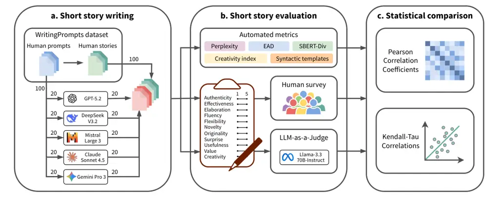
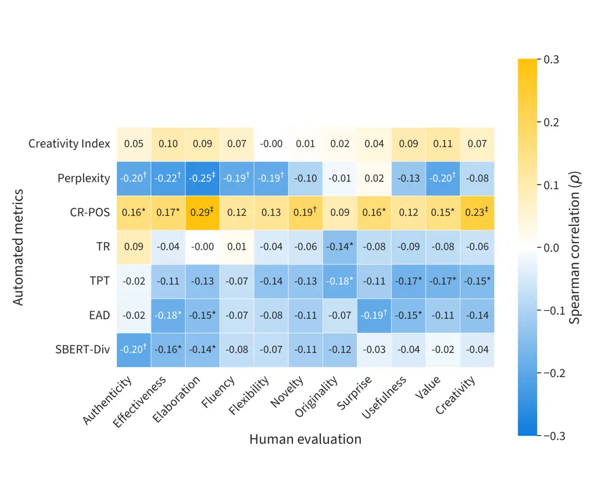
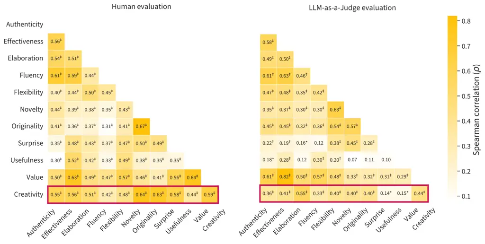
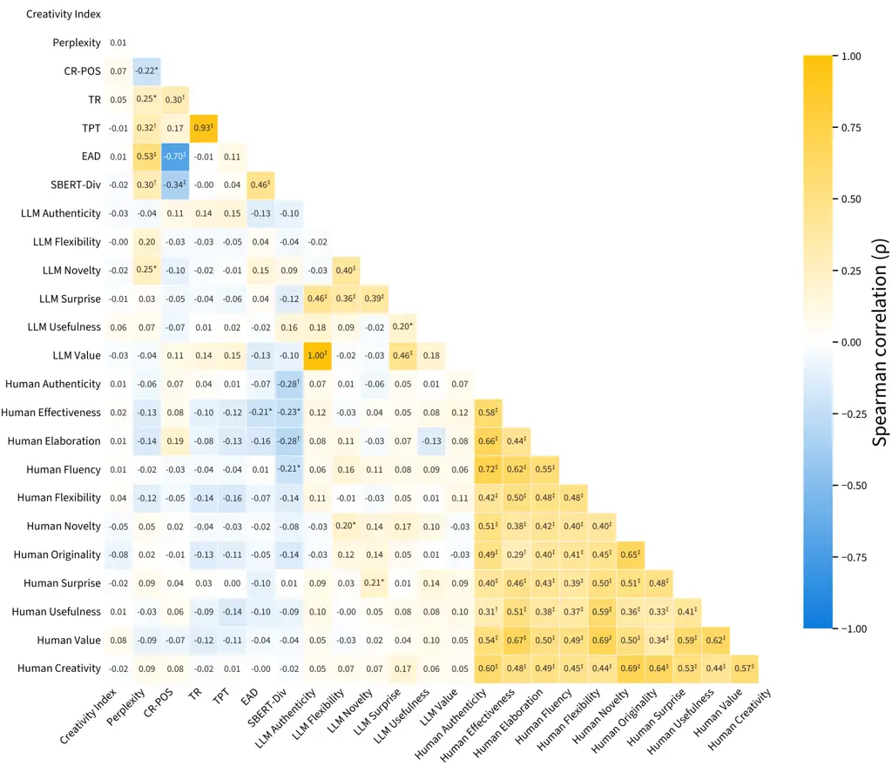
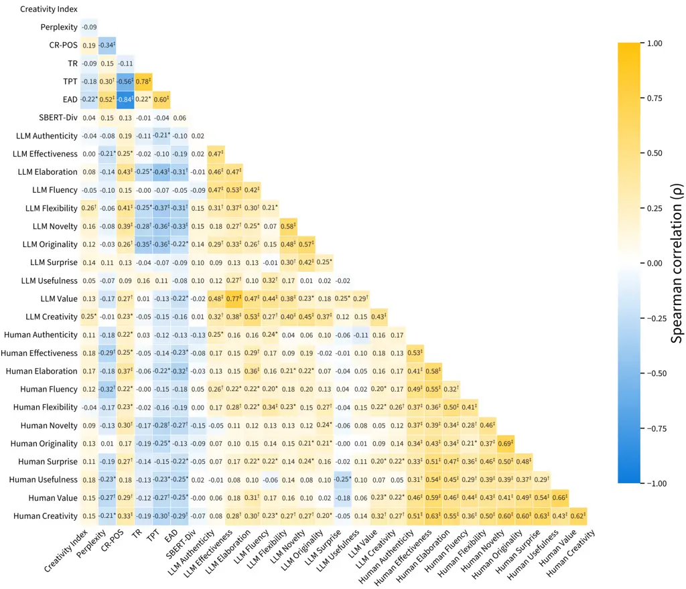

# The Limits of Automatic Evaluation of Creativity in Large Language Models

Alessandro Tutone Email: <alessandro.tutone@studio.unibo.it>
Affiliation: Department of Computer Science and Engineering, University
of Bologna, Bologna, Italy    Giorgio Franceschelli
Email: <giorgio.franceschelli@unibo.it> Affiliation: Department of
Computer Science and Engineering, University of Bologna, Bologna, Italy
   Mirco Musolesi Email: <m.musolesi@ucl.ac.uk> Affiliation: Department
of Computer Science and Engineering, University of Bologna, Bologna,
Italy Affiliation: Centre for Artificial Intelligence, Department of
Computer Science, University College London, London, United Kingdom

###### Abstract

Large Language Models (LLMs) are increasingly capable of generating text
that challenges human performance in domains requiring creativity, yet
evaluating creativity in LLM-generated content remains a significant
challenge. Here, we investigate whether current automatic evaluation
methods can reliably capture human judgments of creativity. We collect
human evaluations of human- and AI-generated short stories from the
WritingPrompts dataset across 11 dimensions of creativity, and compare
these judgments with automated objective metrics and LLM-as-a-Judge
evaluations. Our experiments reveal substantial misalignment between
automatic evaluations and human assessments. In particular, LLM-based
judges exhibit a systematic preference for AI-generated stories,
consistently favoring their stylistic characteristics over the
unpredictability and other qualities of human-authored texts.
Furthermore, correlation analyses show that widely used automatic
metrics exhibit near-zero alignment with human judgments across both
human- and AI-generated stories, suggesting that they fail to capture
important dimensions of creativity. These findings highlight fundamental
limitations in current approaches to the automatic evaluation of
creative text and underscore the difficulty of reducing the
multidimensional and subjective nature of creativity to computational
metrics.

###### keywords

Large Language Models, Creativity Evaluation, Natural Language
Generation, LLM-as-a-Judge

### Introduction

In recent years, Artificial Intelligence (AI) models have become
increasingly influential across a wide range of human activities,
reshaping applications from academic research to industry. Following the
public release of ChatGPT in 2022 OpenAI (2022), interest in generative
AI Foster (2023), once largely confined to specialised research
communities, has expanded rapidly. While initially focused primarily on
text generation, this field has evolved to encompass models capable of
synthesizing images Ramesh, Aditya and Pavlov, Mikhail and Goh, Gabriel
and Gray, Scott and Voss, Chelsea and Radford, Alec and Chen, Mark and
Sutskever, Ilya (2021); Ramesh et al. (2022), composing music Casini et
al. (2026), and writing stories Yuan et al. (2022); Gómez-Rodríguez and
Williams (2023). As computational resources scale, the capabilities of
these models continue to challenge human performance across increasingly
diverse domains.

Among the many properties large language models (LLMs) and generative AI
in general have been associated with, creativity is one of the most
disputed. While previously considered the most human quality Bergson
(1912), researchers are now increasingly debating the possibility that
machines are not only potentially creative but also sometimes as
creative as (or even more creative than) humans. From a philosophical
perspective, depending on the assumed definition of creativity, it is
indeed possible to reach contradictory conclusions. When only looking at
the observable properties of the generated product, i.e., whether it is
original and effective Runco and Jaeger (2012) or novel, surprising, and
valuable Boden (2004), LLM outputs can arguably be as creative as
humans’ Wang et al. (2024). However, when considering other, latent
perspectives, e.g., those related to the process, the creator, and its
environment Rhodes (1961), the conclusions are the exact opposite Runco
(2025). Because of this, analyses of artificial creativity should be
more nuanced Franceschelli and Musolesi (2026), and may consider
multi-level scales rather than binary outcomes Organisation for Economic
Co-operation and Development (2025). The same apparently contradictory
dichotomy can be observed in experimental findings as well, where,
depending on the specific evaluation settings, it is possible to arrive
at different results.

Indeed, how creativity can be evaluated in practice remains an open
question. First, creativity depends on the task at hand: while various
tests aim to assess general human divergent thinking abilities Guilford
(1967); Torrance (1966); Olson et al. (2021), they assume that such
abilities correlate with creativity, an assumption that remains unproven
not only for AI but also for humans Baer (1993). Second, creativity is
intrinsically subjective and depends on the observer’s prior knowledge,
skills, and preferences within a specific domain Katz and Giacommelli
(1982), making standardized, ground-truth-based metrics for evaluating
creativity particularly difficult to establish.

In particular, the evaluation methodologies adopted by prior research on
creativity and LLMs are highly fragmented. Human evaluation, while ideal
for capturing the subjective value, novelty, and surprise of a generated
artifact, is difficult to collect, does not enable straightforward
experimental validation and replication Belz et al. (2023), and depends
on evaluators’ skill level Davis (2024). Therefore, in addition to or in
place of human evaluation, the majority of studies adopt one or both of
two different strategies: reliance on quantitative metrics Ismayilzada
et al. (2025b), which are easy to compute and can capture several
aspects of generated text but work at a lower level of abstraction; or
adoption of the LLM-as-a-Judge paradigm Zheng et al. (2023), which can
better simulate human evaluation and allows for result reproduction, but
assume LLMs to have evaluative capabilities similar to humans’.

In this paper, we investigate whether current automatic evaluation
schemes are appropriate for assessing human and artificial creativity,
and the extent to which they correlate with human judgements of
creativity and its multiple dimensions. Specifically, we curate and
analyze a comparative dataset comprising 100 human-authored creative
texts from the WritingPrompts dataset Fan et al. (2018) and 100
LLM-generated texts. We then conduct an extensive survey to collect
human ratings of their creativity and 10 related concepts, alongside
ratings produced by an LLM-as-a-Judge framework for the same concepts
and scores from five commonly used quantitative metrics. Figure 1
summarizes our experimental setting.



Figure 1: Visual summary of our experimental pipeline. a. Short story
writing: We collected 100 human-written stories from WritingPrompts, and
we complemented them with an additional 100 stories generated by five
different state-of-the-art large language models. b. Short story
evaluation: This heterogeneous dataset was subject to three different
types of creativity evaluation: five automatically computed evaluation
metrics, i..e, perplexity, expectation-adjusted distinct (EAD)
$`n`$-grams, SentenceBERT embedding diversity (SBERT-Div), Creativity
Index, and a series of syntactic-template-based scores; qualitative
human survey on 11 dimensions of creativity; LLM-as-a-Judge ratings on
the same 11 dimensions. c. Statistical comparison: We compare all these
scores through appropriate correlation tests, which highlight the
limitations of automatic evaluation schemes in assessing creativity.

By comparing aggregate scores for human- and LLM-generated texts and
analyzing correlations between different metrics in the context of story
writing, we find that none of the automated evaluation methods,
including LLM-as-a-Judge scores, provides a reliable proxy for human
evaluation. The majority of automatically computed evaluation metrics
show negative or no correlation with human scores, while only the less
subjective creative dimension of elaboration exhibits a positive, albeit
weak, correlation with LLM judgments. Analyses at a finer granularity
suggest that this misalignment may arise because LLM judges primarily
consider apparent, surface-level properties of the text rather than the
broader spectrum of semantic dimensions considered by humans. Finally,
the LLM-as-a-Judge paradigm exhibits a strong bias in favor of
AI-generated stories, further limiting its suitability for automated
creativity assessment and highlighting the need for alternative
evaluation methods and strategies.

There already exist a few related works on the spurious, if not absent,
correlation between human evaluations and automatic metrics Lu et al.
(2026); Saakyan et al. (2026), as well as the self-preference bias of
LLM judges Panickssery et al. (2024); Thakur et al. (2025). We move one
step further and systematically compare such metrics on both human and
artificial artifacts, providing evidence of poor correlation for both,
suggesting where and why these issues arise, and carefully discussing
the implications of our findings for researchers in the field of LLMs.

### Results

#### Automatically computed evaluation metrics are not adequate to quantify creativity

We selected seven of the most widely adopted automatically computed
evaluation metrics for evaluating (dimensions of) creativity, namely,
Creativity Index Lu et al. (2025), perplexity Ismayilzada et al.
(2025a), Expectation-Adjusted Distinct (EAD) $`n`$-grams Liu et al.
(2022), SentenceBERT embedding cosine diversity (SBERT-Div) Kirk et al.
(2024), and three scores based on syntactic templates Shaib et al.
(2024), i.e., Compression Ratio of POS tags (CR-POS), Template Rate
(TR), and Templates-Per-Token (TPT). We investigated the extent to which
each metric correlates with subjective human evaluations of creativity
in short stories by computing pairwise correlations. We used Spearman’s
rank correlation coefficient ($`\rho`$), which captures monotonic
relationships between continuous automatically computed evaluation
metrics and ordinal human Likert scales. Figure 2 presents the resulting
correlation heatmap.



Figure 2: Correlation between automatically computed evaluation metrics
and human evaluation. Spearman correlation matrix between the seven
automatically computed evaluation metrics and the eleven dimensions from
human evaluation for both human-written and LLM-generated short stories.
Statistical significance is denoted by single-character typography: \*
($`p<.05`$), $`\dagger`$ ($`p<.01`$), and $`\ddagger`$ ($`p<.001`$).

As is apparent, automatically computed evaluation metrics show an
overall lack of strong alignment with human evaluations. The vast
majority of correlation coefficients fall within the $`[-0.2,0.2]`$
range, indicating very weak to negligible relationships. This suggests a
substantial disconnect between automated text evaluation and human
assessment of narrative creativity. Despite these generally weak
correlations, several notable trends emerge.

Paradoxically, the metric explicitly designed to quantify creativity,
i.e., Creativity Index, demonstrates almost no correlation with
human-evaluated Creativity ($`\rho=0.07`$). Furthermore, it fails to
exceed $`\rho=0.11`$ across any of the other ten subjective dimensions.
This finding highlights the difficulty of reducing a highly subjective
and complex construct such as creativity to rigid mathematical and
data-driven formulations of derivativeness.

Perplexity yields similarly weak associations, exhibiting consistently
weak negative correlations across almost all human-rated dimensions,
with the strongest correlations for Effectiveness ($`\rho=-0.23`$) and
Elaboration ($`\rho=-0.21`$). This indicates a slight tendency for
humans to assign higher ratings to texts with lower perplexity. From a
human reader’s perspective, highly unpredictable (high-perplexity) texts
may be perceived as disjointed or less effective, whereas more familiar
and predictable texts may be rewarded for their readability.

Analogous to Perplexity, which measures a model’s internal uncertainty,
SBERT-Div captures the degree of semantic divergence between sentences.
Its overall negative correlation with human creativity evaluations
suggests that greater semantic variation does not necessarily translate
into higher perceived creativity and may instead be detrimental when
distinct concepts are introduced without sufficient narrative
connection. A creatively successful story therefore appears to require a
balance between semantic diversity and thematic coherence, rather than
maximizing either in isolation.

Furthermore, both TPT and EAD exhibit consistent, albeit weak, negative
correlations with human evaluation metrics such as Surprise,
Originality, and Value. Although none of these correlations reach
statistical significance, their consistent direction may nevertheless
offer some suggestive insights into how these automatically computed
evaluation metrics relate to human perceptions of creativity. For TPT,
the negative correlation may indicate that texts characterized by
greater structural regularity and denser use of repetitive templates
tend to receive slightly lower ratings for creativity and surprise.
Conversely, since higher EAD reflects greater lexical diversity (i.e.,
fewer repeated words), its negative correlation may suggest that greater
lexical variation does not necessarily translate into higher perceived
creativity. One possible explanation is that excessive lexical variation
may reduce narrative or semantic cohesion, leading human evaluators to
perceive it less as genuine surprise or originality and more as a lack
of consistency in language use.

The strongest positive correlation in the matrix is observed between
CR-POS and human-evaluated Elaboration ($`\rho=0.29`$). Although this is
a weak association, it suggests that syntactic regularity may contribute
to the perception of elaboration. Because higher CR-POS values indicate
greater redundancy in syntactic structure, this result suggests that
texts with more repetitive and structurally regular patterns may be
perceived as more detailed or “elaborated”. One possible explanation is
that descriptive writing often employs parallel sentence structures and
recurring syntactic patterns to organize and convey information. Thus,
syntactic repetition may contribute to an impression of elaboration,
even when it does not necessarily correspond to greater substantive
content.

Overall, these correlations suggest that while specific syntactic
features, such as POS variance, may capture certain aspects of
human-perceived elaboration, automated statistical metrics have limited
ability to serve as proxies for human aesthetic judgments of creativity.

#### LLMs are strongly biased in favor of AI-generated stories

Having established the inadequacy of traditional statistical metrics, we
next investigated whether large language models (LLMs) align with human
judgments of creativity, and thus whether the “LLM-as-a-Judge”
paradigm Zheng et al. (2023) can serve as a proxy for human creativity
evaluation.

However, an initial analysis of the scores assigned by the LLM to human-
and LLM-written stories revealed a substantial misalignment with human
evaluations. As shown in Table 1 (left), human evaluators found the two
sets of texts to be largely indistinguishable in terms of quality, with
only Authenticity and Elaboration showing statistically significant
differences in favor of LLM-generated stories. In stark contrast, the
LLM-as-a-Judge evaluations exhibit a systematic self-preference bias.
Compared with the human evaluations, the LLM scores differ significantly
across all 11 dimensions, as detailed in Table 1 (right).

|               | Evaluated by Humans |                  |                   |     | Evaluated by LLM |                  |                    |
| ------------- | ------------------- | ---------------- | ----------------- | --- | ---------------- | ---------------- | ------------------ |
| Dimension     | Human Texts         | AI Texts         | p-value           |     | Human Texts      | AI Texts         | p-value            |
| Authenticity  | $`3.27\pm 0.07`$    | $`3.50\pm 0.09`$ | $`\mathbf{.025}`$ |     | $`4.42\pm 0.09`$ | $`4.97\pm 0.03`$ | $`\mathbf{<.001}`$ |
| Effectiveness | $`3.32\pm 0.08`$    | $`3.48\pm 0.09`$ | $`.239`$          |     | $`4.61\pm 0.06`$ | $`5.00\pm 0.00`$ | $`\mathbf{<.001}`$ |
| Elaboration   | $`3.17\pm 0.09`$    | $`3.54\pm 0.09`$ | $`\mathbf{.005}`$ |     | $`4.86\pm 0.04`$ | $`5.00\pm 0.00`$ | $`\mathbf{<.001}`$ |
| Fluency       | $`3.44\pm 0.09`$    | $`3.63\pm 0.09`$ | $`.191`$          |     | $`4.43\pm 0.07`$ | $`5.00\pm 0.00`$ | $`\mathbf{<.001}`$ |
| Flexibility   | $`3.04\pm 0.08`$    | $`3.23\pm 0.08`$ | $`.130`$          |     | $`4.34\pm 0.09`$ | $`4.98\pm 0.01`$ | $`\mathbf{<.001}`$ |
| Novelty       | $`3.03\pm 0.09`$    | $`3.18\pm 0.09`$ | $`.293`$          |     | $`4.20\pm 0.11`$ | $`4.90\pm 0.04`$ | $`\mathbf{<.001}`$ |
| Originality   | $`3.13\pm 0.09`$    | $`3.18\pm 0.09`$ | $`.845`$          |     | $`4.68\pm 0.06`$ | $`5.00\pm 0.00`$ | $`\mathbf{<.001}`$ |
| Surprise      | $`3.20\pm 0.09`$    | $`3.07\pm 0.09`$ | $`.271`$          |     | $`4.77\pm 0.06`$ | $`4.90\pm 0.05`$ | $`\mathbf{.013}`$  |
| Usefulness    | $`3.03\pm 0.08`$    | $`3.12\pm 0.09`$ | $`.542`$          |     | $`3.53\pm 0.17`$ | $`4.07\pm 0.17`$ | $`\mathbf{.004}`$  |
| Value         | $`2.90\pm 0.09`$    | $`3.08\pm 0.11`$ | $`.203`$          |     | $`4.65\pm 0.06`$ | $`5.00\pm 0.00`$ | $`\mathbf{<.001}`$ |
| Creativity    | $`3.16\pm 0.09`$    | $`3.27\pm 0.09`$ | $`.569`$          |     | $`4.90\pm 0.04`$ | $`5.00\pm 0.00`$ | $`\mathbf{.004}`$  |

Table 1: Human and LLM scores on human-authored and LLM-written stories.
Comparison of the 11 dimensions of creativity as evaluated by human and
LLM judges on stories authored by humans versus AI. Values are reported
as mean $`\pm`$ standard error. Statistical significance (p-values) of
the differences between AI- and human-authored stories is derived from
the Mann-Whitney U Test, and is reported in bold when significant
($`p<.05`$).

Furthermore, the LLM exhibits a pronounced ceiling effect, assigning
perfect scores to all LLM-generated texts across several dimensions,
including Effectiveness, Elaboration, Fluency, Originality, Value, and
Creativity. Thus, for these dimensions, the LLM assigns no variance to
texts generated by LLMs, even when they originate from different models.
In contrast, its evaluations of human-authored texts are both lower and
more variable. This marked asymmetry suggests a strong preference for
synthetic text and indicates that, in this setting, the LLM-as-a-Judge
approach may systematically favor outputs that resemble its own learned
linguistic and structural patterns.

Crucially, the entire evaluation process was strictly blind. Every text
presented to both the human and LLM evaluators was completely devoid of
source attribution or metadata; only the raw narrative text was
evaluated. This ensures that the observed human variance and the LLM’s
systematic self-preference were not driven by explicit source
information, but rather reflect differences in how the evaluators
responded to the texts themselves.

#### LLMs are unreliable judges of human creativity as well

While the LLM-as-a-Judge paradigm proved inadequate for evaluating
LLM-generated stories, it may still provide a useful automated approach
for evaluating the creativity of human-written texts, given the similar
variability of their scores. To quantify the alignment between machine
evaluations and human judgment, we applied Kendall’s rank correlation
coefficient ($`\tau_{b}`$), and we reported it together with a visual
comparison of human and LLM scores for the same stories in Figure 3.

Figure 3: Comparison between human evaluations and LLM judgments for
human-written stories. For each of the 11 subjective dimensions, we
report Kendall’s rank correlation coefficient ($`\tau`$) and its
$`p`$-value (above), together with paired boxplots showing scores
assigned to the same texts linked with straight lines.

The results provide evidence of a severe misalignment between human
evaluations and the LLM-as-a-Judge paradigm. Among the 11 subjective
dimensions, only Elaboration achieves a $`\tau_{b}`$ above 0.30,
indicating that the judge exhibits at most a modest rank association
with human evaluations.

For four of the evaluated dimensions (Effectiveness, Novelty, Surprise,
and Usefulness), the correlations do not reach statistical significance
($`p>0.05`$). This indicates that, for these dimensions, LLM-based
evaluations provide little evidence of predictive validity with respect
to human judgments. For instance, an LLM assigning a perfect 5.0 score
to a story for Surprise provides no statistically reliable basis for
predicting how a human evaluator will score the same text on that
dimension. Furthermore, Surprise displays a near-zero correlation
($`\tau_{b}=0.01`$, $`p=0.867`$), providing strong evidence that the
LLM’s assessment of narrative unpredictability is fundamentally
misaligned with the human experience of surprise.

Even among the seven statistically significant ($`p<0.05`$) dimensions,
the strength of the agreement remains remarkably weak. The highest
correlation observed in the entire study occurs for Elaboration
($`\tau_{b}=0.31`$, $`p<0.001`$). This dimension may be considered among
the more objective of the subjective metrics, as it is closely related
to measurable properties, such as text length and level of detail. The
LLM therefore demonstrates some capacity to recognize structurally
detailed texts; however, the substantially lower correlation for
Creativity ($`\tau_{b}=0.23`$) suggests a marked limitation in its
ability to capture the aesthetic or emotional qualities that make such
details creatively effective.

#### Inner and outer LLM uncertainties are inconsistent

Perplexity is often used as a measure of uncertainty and surprise Basu
et al. (2021), as it represents the exponential average unexpectedness
of each token under the model’s distribution. We investigated whether
this inner, implicit score correlates with the outer, explicit scores
generated using the LLM-as-a-Judge paradigm, and thus whether there is
consistency between inner and outer notions of uncertainty and
unexpectedness. For this reason, we computed the perplexity under the
same LLM used in the LLM-as-a-Judge paradigm and compared it with the
predicted scores.

Figure 4: Correlation between perplexity and LLM-as-a-Judge evaluations.
Spearman correlation between perplexity and the LLM-as-a-Judge
evaluations computed under the same LLM. We report the $`p`$-values next
to each bar. The chart only shows negative values on the $`x`$-axis
since no subjective dimension has a positive correlation with
perplexity.

As reported in Figure 4, our results show that they are severely
misaligned. In particular, perplexity has a negative correlation with
all 11 subjective dimensions. While this is expected for more
qualitative dimensions, such as fluency, effectiveness, and value, the
weak negative correlation with surprise and creativity, together with
the moderate negative correlation with originality and novelty,
highlights a profound separation between mechanistic, token-based
uncertainty and predicted, sentence-based unexpectedness.

#### The meaning of creativity differs between humans and LLMs

In the preceding sections, we have shown that automatic assessment
differs substantially from human assessment of creativity, as the two
are poorly correlated and sometimes measure entirely separate concepts.
To better understand this conceptual misalignment, we finally
investigated which dimensions contribute most to the overall notion of
creativity in both human and LLM subjective evaluations.



Figure 5: Correlation of subjective dimensions evaluated by humans and
LLM. Spearman correlation between different subjective dimensions when
evaluated by humans (left) and when evaluated by the LLM (right).
Correlations with the overall Creativity score are highlighted in red.
Statistical significance is denoted by single-character typography: \*
($`p<.05`$), $`\dagger`$ ($`p<.01`$), and $`\ddagger`$ ($`p<.001`$).

As reported in Figure 5, human evaluation of Creativity is linked to all
other 10 dimensions, but shows stronger correlations with Novelty,
Originality, Surprise, Value, Effectiveness, and Authenticity, i.e., the
key dimensions in Boden’s and Runco’s definitions of creativity Boden
(2004); Runco (2025). In contrast, LLM evaluation of Creativity
correlates less strongly with the other dimensions and shows no
correlation with Surprise or Usefulness. Moreover, its strongest
correlation is with Elaboration, highlighting a semantic misalignment
between how humans and LLMs understand creativity that may help explain
the inadequacy of automatic metrics for evaluating creativity. Notably,
the highest correlation among LLM-evaluated dimensions is between Value
and Effectiveness, which are also commonly connected in the creativity
literature Runco and Jaeger (2012). However, Value encompasses other
qualities as well: while the LLM-as-a-Judge paradigm appears to capture
more surface-level ones, such as Fluency, it shows little association
with more semantic dimensions, such as Usefulness, which instead
correlates with Value in human evaluations. Similarly, Novelty
correlates with Originality, but more strongly with Flexibility. These
patterns may again reflect a greater reliance of LLM evaluation on
superficial textual properties rather than on deeper semantic aspects of
creativity.

### Discussion

In this study, we carried out a comprehensive, multifaceted evaluation
to quantify the relationship between human and artificial creativity
assessment. Rather than isolating specific aspects of creativity,
relying solely on subjective human ratings, or depending entirely on
individual statistical proxies, our work adopted a holistic approach. We
investigated the viability of automated methods, specifically the
LLM-as-a-Judge paradigm and quantitative metrics such as the Creativity
Index, using a balanced comparative dataset of 100 human-authored and
100 AI-generated short stories.

By combining these automated statistical metrics with an extensive
baseline of subjective human judgments, we were able to systematically
study the alignment between machine and human assessments. This
comprehensive evaluation allowed us not only to measure these dimensions
individually but also to characterize the relationships between
quantitative metrics and human-perceived creativity. Ultimately, our
results revealed a substantial disconnect: LLM judges exhibited a strong
preference for machine-generated text and failed to reliably capture
deeper semantic aspects of human creativity. Similarly, automatically
computed evaluation metrics showed weak or no correlation with human and
LLM judgments, highlighting their limitations in capturing complex and
subjective dimensions such as narrative uncertainty and surprise.

More specifically, none of the widely adopted automatically computed
evaluation metrics used to evaluate creativity and its closely related
dimensions provided a sufficiently reliable proxy for human judgments.
The overall misalignment between these metrics and human perception
suggests a fundamental disconnect between quantitative text evaluation
and human appreciation of narrative creativity. These findings
demonstrate that current quantitative frameworks for measuring
creativity remain fundamentally limited in their ability to capture the
subjective and multifaceted nature of creativity. The mathematical
formulations proposed over the years nevertheless represent valuable
tools for analyzing stylistic and structural choices, as demonstrated by
the statistically significant correlation between the compression ratio
of POS tags (i.e., the degree of coherence and consistency in the use of
syntactic templates throughout a text) and human evaluations of
elaboration. Indeed, a recognizable and consistent writing style is a
defining characteristic of the work of many great novelists Leech and
Short (2007). However, using such automatically computed evaluation
metrics as a replacement for human aesthetic judgment should be
approached with caution, as they failed to capture the holistic and
inherently complex nuances of human storytelling. Consequently, these
findings underscore the need to critically re-examine the tasks for
which these automated tools are deployed, suggesting that their use may
be better suited to more objective, structurally focused contexts.
Similarly, researchers should exercise caution when adopting
automatically computed evaluation metrics to evaluate creative outputs
and actively consider human-in-the-loop strategies.

On the other hand, the LLM-as-a-Judge paradigm exhibited two main
issues. First, the LLM revealed a strong algorithmic bias in favor of
machine-generated narratives. Second, its scores completely failed to
correlate with human judgments regardless of the writer’s origin. After
further investigation, we found that this may stem from a significant
misalignment regarding the meaning of creativity: while human scores of
creativity correlated with its most prominent dimensions from the
literature (i.e., novelty, value, surprise, originality, and
effectiveness) Boden (2004); Runco and Jaeger (2012), LLM scores of
creativity correlated primarily with surface-level, syntactic properties
such as elaboration. Notably, this misalignment is even more apparent
when considering more profound, semantic properties such as usefulness,
novelty, and surprise. In addition, we found a substantial disconnect
between the extrinsic, predicted scores of surprise and originality and
the internal properties of the LLM commonly associated with them,
namely, its perplexity.

In general, this strong misalignment between human and LLM evaluations
highlights several critical risks, especially when coupled with the
tendency of LLMs to homogenize writing and reduce overall diversity over
time Anderson et al. (2024); Doshi and Hauser (2024); Kumar et al.
(2025); Moon et al. (2025). Relying on LLMs to prepare training data,
evaluate outputs, and fine-tune subsequent generations of models without
human supervision may amplify existing biases. This practice can create
a closed, self-reinforcing feedback loop in which models become
increasingly reliant on evaluations that may not reliably distinguish
the qualities of their algorithmic peers. Within the academic community,
this poses a potentially serious systemic risk: AI-based peer-review
systems and automated evaluators may favor LLM-generated or LLM-assisted
research papers over those authored entirely by human researchers. This
issue is not confined to the creative domain; rather, it represents a
broader systemic vulnerability. As described by Shumailov et
al. Shumailov et al. (2024), the recursive training of AI models on data
generated by other AI models can lead to “model collapse”. This
phenomenon can introduce irreversible degradation in the resulting
models, as successive generations progressively lose information about
the underlying distribution of human-generated data. Consequently,
models may lose the ability to reproduce rare concepts, outliers, and
nuanced stylistic variations.

If commercial AI developers and academic institutions continue to rely
on automated evaluators and synthetic data for non-objective tasks
without grounding them in genuine human preferences, the field risks
further homogenization of generative writing. This algorithmic echo
chamber could produce models that are increasingly optimized for
statistical regularity but less capable of capturing the aesthetic
diversity of human writing, potentially influencing the stylistic
preferences of human readers who rely on them. More broadly, it risks
contributing to an algorithmic definition of creativity: one that treats
the distinctive imperfections of human narratives as undesirable and
favors the stylistic uniformity of machine-generated text.

#### Limitations

While this study provides critical insights into the relationship
between artificial intelligence and creative writing and the challenges
of automating creativity evaluation, a few limitations must be
acknowledged. First, our analysis was restricted to a single task and a
single dataset, specifically, the WritingPrompts collection. The corpus
was limited to 200 texts, a necessary constraint due to the bottleneck
of human-in-the-loop evaluation; analyzing a larger subset of the
hundreds of thousands of available prompts would yield more
statistically robust results.

Second, our experimental design relied on a single large open-source LLM
to act as the automated judge, a decision necessitated by computational
resource constraints. Consequently, we could not examine whether
evaluative biases vary across different proprietary AI models (e.g.,
GPT-5 or Claude 4), which may be subject to self-preference biases to
different degrees. Finally, the AI-generated narratives evaluated in
this study were produced using the default generative parameters adopted
by the respective vendors. We did not explore variations in temperature,
sampling schemes (such as top-$`p`$ Holtzman et al. (2020) or
top-$`k`$ Fan et al. (2018)), or advanced prompt-engineering techniques,
nor did we isolate differences in writing and evaluative capabilities
between base foundation models and their instruction-tuned counterparts.

These limitations present clear avenues for future research. Subsequent
studies should expand this methodology across diverse text domains, such
as scientific writing, technical documentation, and journalistic
reporting, to determine whether the observed algorithmic biases and
structural dependencies persist beyond purely creative contexts. Future
experiments should also investigate how altering generation parameters
affects both the production and evaluation of narrative texts. Most
importantly, future work should move beyond merely identifying these
limitations toward actively developing new evaluative frameworks.
Building on the findings of this study, researchers should aim to
develop multidimensional and potentially multimodal evaluation metrics
that account for algorithmic biases and better capture the nuanced
realities of human reading.

#### Conclusions

Our research provides insights into the relationship between human and
machine creativity assessment, particularly into whether machines can
accurately evaluate the creativity of short narratives through automatic
quantitative metrics or the LLM-as-a-Judge paradigm. Our findings
revealed that automatically computed evaluation metrics are inadequate
proxies for evaluating human creativity. They showed near-zero
correlations with any of the 11 subjective dimensions evaluated by human
judges, demonstrating that rigid, token-based approaches largely fail to
capture the semantic and emotional qualities that human readers value.
LLMs proved to be misaligned evaluators as well. The pronounced presence
of a self-preference bias, together with a lack of correlation with the
most subjective human scores, makes the LLM-as-a-Judge paradigm
fundamentally unreliable for autonomous, human-free creativity
assessment. On a larger scale, this creates the risk of a closed,
self-reinforcing feedback loop in which models fail to objectively
assess their peers and penalize authentic human expression in favor of a
highly predictable, low-variance production standard. The nuances and
distinctive imperfections of human creations are profoundly complex and
difficult to articulate, even by humans themselves; therefore,
mathematically encoding them remains extremely challenging. Until
artificial systems can truly capture the richness of the human
experience they attempt to describe, creativity may remain a deeply
complex aspect of human cognition that current algorithms have yet to
fully “learn”.

### Methods

This study adopts a multi-stage experimental design. The pipeline is
structured to enable methodological triangulation by contrasting
statistical probability measures with human cognitive judgments.
Establishing correlations between these measures is crucial for
assessing the reliability of automated creativity evaluation.

#### Dataset composition

This study uses a balanced dataset of 200 stories, comprising 100
randomly selected human-generated and 100 machine-generated stories.
Both sets consist of texts paired with a unique writing prompt, which
serves as the creative premise upon which the fictional short story is
based. First, we populated the human-generated story partition by
randomly sampling 100 prompt–story pairs from the WritingPrompts
dataset Fan et al. (2018). The dataset comprises a large collection of
user-submitted prompts sourced from Reddit’s WritingPrompts forum, each
paired with a user-generated story responding to the corresponding
prompt. Then, we populated the machine-generated story partition by
randomly sampling a separate set of 100 prompts from the WritingPrompts
dataset and providing them as inputs to LLMs. More specifically, we
employed a diverse set of state-of-the-art models to ensure broad
representation: GPT-5.2 OpenAI (2025), DeepSeek-V3.2 DeepSeek-AI (2025),
Mistral Large 3 Mistral AI (2025), Claude Sonnet 4.5 Anthropic (2025),
and Gemini 3 Pro Doshi (2025). Each model was tasked with generating 20
stories, yielding a total of 100 machine-generated stories. The specific
generation prompts are provided in Supplementary Information 3.

While we preserved the source information for a posteriori analytical
purposes, all evaluations were conducted blindly, without identifiers
distinguishing human-generated from AI-generated stories, to ensure fair
comparisons and minimize potential biases.

#### Automatically computed evaluation metrics

To quantify the statistical and structural properties of the considered
texts, this study employs five distinct metrics commonly used to
automatically assess creativity or one of its main dimensions:
Creativity Index, Perplexity, Syntactic Templates, Expectation-Adjusted
Distinct $`n`$-grams, and Sentence-BERT Embedding Diversity. Each metric
evaluates the text at a specific granularity, from phrase-level lexical
choices to high-level narrative structures.

##### Creativity Index

To assess phrase-level originality, we utilize the Creativity Index (CI)
proposed by Lu et al. Lu et al. (2025). This metric measures the extent
to which a given text can be attributed to existing content on the web,
thereby quantifying the “derivative” nature of the writing.

The core component of this metric is the concept of $`L`$-uniqueness.
Formally, for a given length $`L`$, the $`L`$-uniqueness of a text
$`\mathbf{x}`$ is defined as the proportion of words $`w\in\mathbf{x}`$
that do not belong to any $`n`$-gram (with $`n\geq L`$) found in the
reference corpus $`C`$:

```math
\mathcal{U}_{L}(\mathbf{x})=\frac{|\{w\in\mathbf{x}\mid\forall g\in\text{ngrams}(\mathbf{x}):w\in g\land|g|\geq L\implies g\notin C\}|}{|\mathbf{x}|} \tag{1}
```

Intuitively, a higher $`L`$-uniqueness value indicates greater novelty
at the corresponding $`L`$-gram scale. The total CI is calculated by
aggregating these uniqueness scores across a range of $`n`$-gram
lengths, specifically within the bounds $`[a,b]`$:

```math
\text{CI}(\mathbf{x})=\sum_{L=a}^{b}\mathcal{U}_{L}(\mathbf{x}) \tag{2}
```

In our implementation, we set the bounds $`a=5`$ and $`b=12`$ and use
the RedPajama dataset Weber et al. (2024) as the reference corpus $`C`$,
aligning with the standard configuration established in the original
implementation of the metric Lu et al. (2025). To perform efficient
$`n`$-gram matching between our target texts and this massive corpus
(approximately 1.4 trillion tokens), we employ the Infini-gram
engine Liu et al. (2024). The entire process is orchestrated by the DJ
Search algorithm Lu et al. (2025), which efficiently retrieves the
verbatim $`n`$-gram matches required to compute the $`L`$-uniqueness
scores and, ultimately, the final CI.

##### Perplexity

To target the “surprise” factor of a text, we employ Perplexity (PPL), a
score that represents the uncertainty in the predictions of a language
model Lu et al. (2026). Formally, it quantifies the branching factor of
the model, i.e., the number of equally probable tokens that could follow
the current context. Lower perplexity indicates that the model is more
certain about the next token in a sequence, effectively narrowing down
the possibilities. However, it is crucial to note that statistical
confidence does not imply correctness; a model can exhibit low
perplexity (high certainty) while still generating factually incorrect
or hallucinated content Muhlgay et al. (2024).

Mathematically, given a probability model $`P`$ and a sequence of $`N`$
tokens $`\mathbf{x}=(t_{1},t_{2},\dots,t_{N})`$, perplexity is defined
as the exponential of the average negative log-likelihood:

```math
\text{PPL}(\mathbf{x})=\exp\left(-\frac{1}{N}\sum_{i=1}^{N}\ln P(t_{i}\mid t_{1},\dots,t_{i-1})\right). \tag{3}
```

A perplexity of 1 indicates that the model assigns a probability of 1.0
to all target tokens (i.e., the model has zero entropy). Conversely, a
value higher than 1 reflects a higher degree of uncertainty.
Intuitively, a perplexity of $`k`$ indicates that the model is as
uncertain as if it were choosing uniformly among $`k`$ equally likely
options. Thus, a very high value means that the model is uncertain about
which token(s) to expect or was expecting something completely
different.

In the context of creativity studies, perplexity can be seen as a proxy
for statistical conventionality Lu et al. (2026). Lower perplexity
indicates text that follows conventional statistical patterns and is
therefore more predictable, while higher perplexity suggests greater
unpredictability, a trait often associated with human stylistic
creativity Mitchell et al. (2023).

To compute this metric, our experimental pipeline utilizes the Meta
Llama-3-8B (Base) model. Unlike older architectures such as GPT-2,
Llama-3 Dubey et al. (2024) operates with a significantly larger
vocabulary (128k tokens) and a deeper semantic representation. This
provides a more accurate measure of linguistic plausibility for modern
generated text, ensuring a consistent statistical baseline for comparing
state-of-the-art LLMs against human authors.

##### Syntactic Templates

To evaluate the creativity of a text beyond lexical word choice, we
employ Syntactic Templates. By abstracting text into sequences of
Part-of-Speech (POS) tags (e.g., \[DET NOUN VERB DET ADJ NOUN\]), we can
evaluate the structural diversity of the narrative, i.e., how it is
constructed rather than what is said.

The extraction of syntactic templates follows the methodology proposed
by Shaib et al. Shaib et al. (2024). The core concept relies on
identifying abstract patterns that frequently repeat within a corpus. In
particular, a template is defined as follows:

> Given a sequence of tokens $`T=(t_{1},t_{2},...,t_{n})`$ and a
> function $`f`$ that computes an abstraction over $`T`$ (e.g.,
> part-of-speech tags), we define a template as a subsequence of
> abstractions over the tokens $`f(T)`$ that repeats at least $`\tau`$
> times in $`T`$.

In our implementation, we utilize the Natural Language Toolkit
(NLTK) Bird et al. (2009) to perform initial POS tagging, mapping each
token to its corresponding syntactic role. We then employ the diversity
library Shaib et al. (2025) to extract recurring patterns and compute
the diversity metrics.

Once the templates are extracted, we employ three distinct metrics to
quantify structural repetition:

- •
  Compression Ratio of POS Tags (CR-POS). It quantifies the $`n`$-gram
  diversity of the syntactic structure using a lossless compression
  algorithm (e.g., gzip). The underlying principle is that compression
  algorithms are optimized to detect and condense repeated sequences;
  therefore, highly repetitive structures will compress to a much
  smaller size than diverse ones. Shaib et al. Shaib et al. (2025)
  demonstrated that this ratio effectively captures lexical and
  structural $`n`$-gram repetition.

  CR-POS is computed over the sequence $`f(T)`$ of all POS tags within a
  single text $`T`$. The ratio is defined as:

  ```math
  \text{CR-POS}(T)=\frac{|f(T)|}{|g(f(T))|} \tag{4}
  ```

  where $`|\cdot|`$ denotes the size in bytes and $`g(\cdot)`$ is a
  lossless compression function.

  A higher CR-POS value implies that the text contains greater
  redundancy in its syntactic structure (lower diversity), as the
  algorithm was able to compress it more significantly. Conversely, a
  lower value indicates a more structurally varied narrative.

- •
  Template Rate (TR). To evaluate structural redundancy at the
  individual narrative level, we adapt the template extraction
  methodology to compute a token-level coverage rate. For each text, we
  extract the most frequently recurring syntactic $`n`$-grams (“common
  templates”). We then calculate the proportion of the text’s total
  tokens that belong to at least one frequent syntactic pattern Shaib et
  al. (2024).

  TR aims to quantify how frequently templates appear across the whole
  narrative. Mathematically, for a given text $`T`$ consisting of $`N`$
  tokens, let $`M`$ denote the set of tokens that are part of at least
  one “common template”. The TR is defined as:

  ```math
  \text{TR}(T)=\frac{|M|}{N} \tag{5}
  ```

  A high TR suggests that the model (or author) frequently falls back on
  standard, repetitive grammatical structures rather than constructing
  novel sentences.

- •
  Templates-Per-Token (TPT). In practice, one text can contain multiple
  templates, and longer texts tend to contain more templates. To account
  for differences in text length at the individual level, TPT measures
  the density of structural repetition within a single narrative Shaib
  et al. (2024).

  Similar to TR, we first extract the “common templates” for the
  specific text; then, we quantify the intensity of repetition by
  accounting for overlapping patterns. For each token in the text, we
  count the number of recurring template instances it participates in.
  Because templates are extracted using a sliding window, a single token
  might belong to multiple overlapping template matches. We sum these
  participation counts across all tokens and normalize by the total text
  length.

  Mathematically, for a text $`T`$ of $`N`$ tokens, let $`k_{j}`$ denote
  the number of identified template instances that encompass token
  $`j`$.

  The TPT is defined as:

  ```math
  \text{TPT}(T)=\frac{\sum_{j=1}^{N}k_{j}}{N} \tag{6}
  ```

  A higher TPT indicates a denser concentration of repetitive structures
  per unit of text, meaning that tokens are more frequently embedded
  within multiple predictable syntactic patterns.

##### Expectation-Adjusted Distinct $`N`$-Grams (EAD)

Evaluating the true diversity of generated text requires analyzing both
surface-level variation and semantic novelty. The standard Distinct
score Li et al. (2016) is widely used to measure lexical diversity and
is defined as $`N/C`$, where $`N`$ is the number of distinct tokens and
$`C`$ is the total number of tokens. However, it is also known to be
negatively correlated with text length, as longer texts naturally
contain more repeated words. To correct for this bias, the
Expectation-Adjusted Distinct $`n`$-grams (EAD) score Liu et al. (2022)
has been proposed. This metric normalizes the observed count of unique
tokens $`N`$ by its mathematical expectation. EAD is calculated as:

```math
\text{EAD}=\frac{N}{\mathbb{E}[N]}\qquad\text{where}\quad\mathbb{E}[N]=V\left[1-\left(\frac{V-1}{V}\right)^{C}\right]. \tag{7}
```

Here, $`V`$ is the total vocabulary size, and $`C`$ is the length of the
specific text being evaluated. By comparing the observed diversity with
the expected diversity of a random sampling process over a uniform
distribution of size $`V`$, EAD provides a robust, length-independent
measure of lexical richness.

A score close to 0 indicates that the text exhibits high lexical
redundancy, relying on a restricted subset of the available vocabulary.
Conversely, a score approaching 1 implies that the text exhibits a high
degree of lexical diversity relative to its length, effectively
utilizing a broad and varied distribution of tokens rather than
converging on high-frequency patterns.

##### Sentence BERT Embeddings Diversity (SBERT-Div)

To move beyond token-based matching and evaluate the conceptual
diversity of the text, we utilize Sentence BERT embeddings diversity
(SBERT-Div) Kirk et al. (2024). We measure the semantic diversity of a
text by calculating the complement of the pairwise cosine similarity
between the sentences composing the narrative.

For a given text $`T`$ consisting of $`K`$ sentences
$`S={s_{1},...,s_{K}}`$, we first compute the dense vector embedding
$`u_{i}=\text{SBERT}(s_{i})`$ for each sentence using a pre-trained
Sentence-BERT model. In particular, we employ the pre-trained
all-MiniLM-L6-v2 model Wang et al. (2020). While early SBERT
implementations relied on fine-tuned bert-base architectures Reimers and
Gurevych (2019), recent benchmarks demonstrate that the all-MiniLM
family offers a superior balance between computational efficiency and
semantic accuracy Muennighoff et al. (2023).

Then, we calculate the average semantic similarity $`\mu_{sim}`$ across
all unique sentence pairs to determine how semantically repetitive the
text is:

```math
\mu_{sim}=\frac{2}{K(K-1)}\sum_{1\leq i<j\leq K}\text{sim}(u_{i},u_{j}) \tag{8}
```

where the cosine similarity between two vectors is defined as:

```math
\text{sim}(u_{i},u_{j})=\frac{u_{i}\cdot u_{j}}{\|u_{i}\|\|u_{j}\|} \tag{9}
```

Finally, the SBERT-Div metric is defined as the complement of this
average similarity:

```math
\text{SBERT-Div}=1-\mu_{sim} \tag{10}
```

A score close to 0 indicates a highly repetitive narrative, where
sentences merely reiterate the same semantic concepts without advancing
the plot, while a score close to 1 indicates a highly disjointed
sequence of sentences that lack thematic connections, leading to an
incoherent story. Therefore, a creatively successful narrative is
expected to fall within an intermediate range, striking a delicate
balance between narrative diversity and thematic coherence.

#### Subjective metrics

While quantitative metrics provide reproducible statistical insights,
creativity is inherently a subjective phenomenon that relies on human
perception. To capture this nuance, we conduct a dual-track subjective
evaluation involving both human annotators and an LLM-as-a-Judge
approach. Crucially, both evaluations were conducted using a blind
protocol: neither the human participants nor the LLM judge was provided
with labels distinguishing human-authored texts from AI-generated ones.

To avoid the ambiguity of a single “Creativity” score, the evaluation
has been decomposed into 11 distinct dimensions. These dimensions were
strategically selected to cover a broad spectrum of theoretical
definitions of creativity. Specifically, the metrics are grounded in
established creativity literature, explicitly acknowledging Boden’s
triad of novelty, surprise, and value Boden (2004), as well as Runco’s
bipartite standard definition of originality and effectiveness Runco and
Jaeger (2012). Additional dimensions were included to capture other
prominent aspects of creativity, i.e., elaboration, fluency, and
flexibility Guilford (1967); authenticity Kharkhurin (2014); and
usefulness Stein (1953). Finally, we also considered an overall score of
creativity, which is useful for studying which dimensions correlate most
strongly with the general subjective perception of creativity. Each
dimension is rated on a 5-point Likert scale (1 = Poor, 5 = Excellent)
and is described as follows:

1.  \[itemsep=1pt\]
2.  1.  Authenticity: The perception of a genuine and personal voice. Does
        the text seem written with its own heartfelt style, or does it
        appear mechanical, artificial, or copied?
3.  2.  Effectiveness: The ability to achieve the narrative goal. Does the
        story entertain and satisfy the prompt in a complete and convincing
        manner?
4.  3.  Elaboration: The richness of details and depth of development. Does
        the text expand the main idea with vivid descriptions and
        complexity, rather than remaining superficial?
5.  4.  Fluency: The linguistic smoothness and ease of idea generation. Does
        the text read naturally without grammatical hiccups, with ideas
        flowing logically from one to another?
6.  5.  Flexibility: The variety of perspectives or themes. Does the text
        manage to connect different concepts, change viewpoints, or adapt to
        narrative constraints agilely?
7.  6.  Novelty: The degree of conceptual innovation. Is the core idea fresh
        and new, or is it a rehash of well-known and overused concepts?
8.  7.  Originality: The statistical rarity of the approach. Compared to
        other texts on the same topic, does this approach avoid clichés and
        commonplaces?
9.  8.  Surprise: The ability to astonish the reader. Does the content take
        an unexpected turn, introduce a plot twist, or break common
        expectations regarding the topic?
10. 9.  Usefulness: The relevance and applicability to the context. Is the
        text consistent with the initial request and does it function as a
        valid response to the prompt?
11. 10. Value: The intrinsic merit of the text. Is the reading experience
        enriching, interesting, or emotionally engaging? Does it possess a
        perceivable literary quality?
12. 11. Creativity (Overall): A holistic judgment on ingenuity and
        imagination. Has the author combined ideas uniquely to create a “wow
        factor” that distinguishes an inspired text from a tedious one?

##### LLM-as-a-Judge evaluation

To assess the feasibility of automating subjective creativity
evaluation, we employ the LLM-as-a-Judge approach Zheng et al. (2023),
utilizing meta-llama/Llama-3.3-70B-Instruct as the evaluator. While
proprietary models such as GPT-5.2 OpenAI (2025) or Claude Sonnet
4.5 Anthropic (2025) often exhibit marginally higher correlations with
human judgments in creative tasks Zheng et al. (2023), we select Llama
3.3 because it represents a state-of-the-art open-weight model, ensuring
a high-quality evaluation pipeline that is both reproducible and
transparent within standard computational limits Dubey et al. (2024).
The model was tasked with acting as an objective literary critic,
grading the texts according to the 11 definitions provided above.

A critical challenge in LLM-based evaluation is context contamination or
the “Halo Effect”, where a model’s judgment on one metric (e.g.,
Fluency) inadvertently influences its scoring of subsequent metrics
(e.g., Originality) within the same context window. Initially, we
experimented with a batched prompting strategy, instructing the model to
output scores for all 11 metrics in a single inference pass. However,
preliminary tests suggested that this approach led to high inter-metric
correlations, failing to capture the nuances between well-written but
derivative text (e.g., high Fluency, low Originality) and rough but
creative text (e.g., low Fluency, high Originality). To mitigate this
bias, we adopt an isolated evaluation strategy Liu et al. (2023) and
decompose the evaluation into independent inference calls. For every
text-metric pair, the model is initialized with a fresh context
containing only the system prompt (i.e., the role definition), the
definition of the single metric being evaluated, and the target text.

This ensures that the score for dimension $`a`$ is calculated
independently of the score for dimension $`b`$. In addition, to achieve
deterministic and reproducible outputs, we set the generation
temperature to 0.2 and the top-p parameter to 0.95, and we repeated the
entire process three times. The template used for these atomic
evaluations is provided in Supplementary Information 4. By enforcing
this separation, we aim to maximize the distinctiveness of each
creativity dimension and reduce the noise introduced by the model’s
internal biases.

##### Human evaluation protocol

To establish a “ground truth” for creativity, we deployed a custom web
interface to collect subjective judgments. To ensure a broad
representation of perspectives, the platform was distributed to a
heterogeneous group of evaluators. The participants ranged from domain
experts (e.g., professors and researchers) and university students
across various faculties to laypeople outside the academic sphere (e.g.,
individuals from diverse professional backgrounds). This sampling
strategy was intentionally designed to include individuals with varying
levels of AI experience, ensuring that the evaluation reflects not only
technical assessments but also the general public’s perception of
creativity.

Each participant was presented with one randomly selected story at a
time and asked to rate it according to a structured rubric. To
facilitate a broader evaluation, all narratives were made available in
both English and Italian. For the AI-generated stories, the respective
models were first prompted to generate the English version and
subsequently to provide the Italian translation. Conversely, the
human-authored stories were translated into Italian using Google Gemini
3 Pro Doshi (2025).

Upon completion of an evaluation, responses were anonymously recorded in
a cloud-based database. Alongside the scores, each entry automatically
logged the following session metadata: timestamp, session ID, text ID,
language, and authorship source (Human or LLM). Additionally, to enable
demographic analysis, we collected and recorded participants’ native
language, gender, age, education level, and self-reported AI expertise
(aggregated information about our pool of human evaluators can be found
in Supplementary Information 2). Participants retained full autonomy to
evaluate multiple texts or conclude the session at any point, ensuring a
voluntary and non-coercive testing environment.

### Data availability

All the generated and collected data used in this article are publicly
available at:
[https://github.com/pante31/LLM_Creativity.git](https://github.com/pante31/LLM_Creativity.git).
The original prompts and human-written short stories have been taken
from the WritingPrompts dataset Fan et al. (2018), which is publicly
available at:
[https://huggingface.co/datasets/euclaise/writingprompts](https://huggingface.co/datasets/euclaise/writingprompts).

### Code availability

To facilitate reproducibility and encourage further research, the
complete source code and evaluation scripts are publicly available at:
[https://github.com/pante31/LLM_Creativity.git](https://github.com/pante31/LLM_Creativity.git).

### 1 Extended correlation matrices

In addition to the overall correlation analysis presented in the Results
section, we provide the full correlation matrices stratified by text
provenance. Figure 6 shows the cross-correlation between subjective and
objective metrics for LLM-generated stories only. In contrast, Figure 7
presents the same analysis for human-authored stories.



Figure 6: Extended correlation matrix for LLM-generated stories.
Spearman correlation ($`\rho`$) between all automatically computed
evaluation metrics and subjective dimensions evaluated exclusively on
the subset of texts generated by Large Language Models. Metrics
exhibiting zero variance within this subset (such as constant maximum
scores given by the LLM-as-a-Judge) were excluded from the analysis.
Statistical significance is denoted by single-character typography: \*
($`p<.05`$), $`\dagger`$ ($`p<.01`$), and $`\ddagger`$ ($`p<.001`$).



Figure 7: Extended correlation matrix for human-authored stories.
Spearman correlation ($`\rho`$) between all automatically computed
evaluation metrics and subjective dimensions evaluated exclusively on
the subset of texts written by humans. Statistical significance is
denoted by single-character typography: \* ($`p<.05`$), $`\dagger`$
($`p<.01`$), and $`\ddagger`$ ($`p<.001`$).

While the general trend is as discussed in the main body, with no
machine-based metric showing a strong correlation with human judgments,
a comparison between Figures 6 and 7 reveals additional insights. In
particular, for LLM-generated stories, only SBERT-Div shows a
correlation higher than $`0.2`$ in absolute value, exhibiting a weak but
consistent negative correlation with human scores for authenticity,
effectiveness, elaboration, and fluency. Similarly, only perplexity
shows a very weak positive correlation with LLM-as-a-Judge scores. All
other correlations are negligible, further demonstrating the limitations
of automatic methods for assessing AI creativity.

On the contrary, while still lacking strong correlations, the results
for the human-authored stories are more interesting. Only the Creativity
Index and SBERT-Div show very weak or no correlation with human scores;
TR shows no correlation with the most qualitative dimensions and a weak
negative correlation with the others, especially originality,
creativity, and novelty. In contrast, CR-POS shows a positive
correlation with all dimensions, peaking at elaboration and creativity,
while Perplexity, TPT, and EAD show negative correlations with almost
all dimensions, peaking at fluency and effectiveness, novelty and
creativity, and elaboration and creativity, respectively. Similar
results are also apparent when comparing automatically computed
evaluation metrics with LLM-as-a-Judge scores.

### 2 Human survey statistics

As reported in the Methods section, human evaluations were gathered via
a custom-built web interface. In total, we collected 441 individual
evaluations from 115 unique participants. To ensure statistical
robustness, these evaluations were distributed across the entire
dataset, resulting in an average of 2.21 independent human ratings per
text. Before participation, we collected some background information to
assess the reliability and diversity of our human baseline, which was
stored in a fully anonymized manner. The demographic and linguistic
profile of the participants is summarized in Table 2. The collected
demographics indicate that our evaluator pool has a robust educational
background (with nearly 65% holding a university degree) and a
heterogeneous degree of familiarity with LLMs. This distribution ensures
that the subjective ratings reflect a highly balanced mix of expert and
general-user perspectives.

|                     |                        |               |                |
| ------------------- | ---------------------- | ------------- | -------------- |
| Demographic Feature | Category               | Count ($`N`$) | Percentage (%) |
| Gender              | Male                   | 68            | 59.1%          |
|                     | Female                 | 47            | 40.9%          |
| Age                 | 18–24                  | 31            | 27.0%          |
|                     | 25–34                  | 24            | 20.9%          |
|                     | 35–44                  | 7             | 6.1%           |
|                     | 45+                    | 53            | 46.1%          |
| Education Level     | Less than High School  | 10            | 8.7%           |
|                     | High School            | 30            | 26.1%          |
|                     | Bachelor’s Degree      | 21            | 18.3%          |
|                     | Master’s Degree        | 49            | 42.6%          |
|                     | PhD                    | 3             | 2.6%           |
|                     | Other                  | 2             | 1.7%           |
| Native Language     | Italian                | 105           | 91.3%          |
|                     | English                | 8             | 7.0%           |
|                     | Other                  | 2             | 1.7%           |
| LLM Experience      | Never used             | 25            | 21.7%          |
|                     | Tried out of curiosity | 8             | 7.0%           |
|                     | Occasionally           | 36            | 31.3%          |
|                     | Often                  | 26            | 22.6%          |
|                     | If not daily, almost   | 20            | 17.4%          |

Table 2: Statistics of human evaluators. Aggregated summary on the
demographic, education, linguistic, and LLM familiarity background of
the 115 human evaluators.

### 3 LLM generation prompt

To ensure reproducibility of the creative writing task, the following
prompt was employed to generate the dataset of AI-authored stories
across all five state-of-the-art models used, i.e., GPT-5.2,
DeepSeek-V3.2, Mistral Large 3, Claude Sonnet 4.5, and Gemini 3 Pro.
Specific constraints on formatting (Markdown) and length variation were
introduced to prevent the models from producing texts of nearly
identical length across generations (a common pitfall of repeatedly
querying the same base prompt).


### 4 LLM-as-a-Judge system instructions

The following interaction template was used to enforce the isolated
evaluation strategy described in the Methods section. It consists of a
fixed system prompt and a dynamic user prompt containing the definition
of the specific metric and the input text.


## References

- Anderson et al. (2024) B. R. Anderson, J. H. Shah, and M. Kreminski
  Homogenization Effects of Large Language Models on Human Creative
  Ideation. In Proceedings of the 16th Conference on Creativity &
  Cognition (C&C’24), Cited by: Discussion.
- Anthropic (2025) Anthropic Introducing claude sonnet 4.5. Note:
  [https://www.anthropic.com/news/claude-sonnet-4-5](https://www.anthropic.com/news/claude-sonnet-4-5)
  \[Accessed: 2026-08-20\] Cited by: Dataset composition, LLM-as-a-Judge
  evaluation.
- Baer (1993) J. Baer Creativity and divergent thinking: a task-specific
  approach. Psychology Press, New York. Cited by: Introduction.
- Basu et al. (2021) S. Basu, G. S. Ramachandran, N. S. Keskar,
  and L. R. Varshney Mirostat: A Neural Text Decoding Algorithm that
  Directly Controls Perplexity. In Proceedings of the 9th International
  Conference on Learning Representations (ICLR’21), Cited by: Inner and
  outer LLM uncertainties are inconsistent.
- Belz et al. (2023) A. Belz, C. Thomson, E. Reiter, and S. Mille
  Non-Repeatable Experiments and Non-Reproducible Results: The
  Reproducibility Crisis in Human Evaluation in NLP. In Findings of the
  Association for Computational Linguistics: ACL 2023, Cited by:
  Introduction.
- Bergson (1912) H. Bergson Creative evolution. MacMillan and Co.
  Limited, London. Cited by: Introduction.
- Bird et al. (2009) S. Bird, E. Loper, and E. Klein Natural language
  processing with python. O’Reilly Media Inc., Sebastopol. Cited by:
  Syntactic Templates.
- Boden (2004) M. A. Boden The creative mind: myths and mechanisms.
  Routledge, London. Cited by: Introduction, The meaning of creativity
  differs between humans and LLMs, Discussion, Subjective metrics.
- Casini et al. (2026) L. Casini, L. C. Vila, D. Dalmazzo, A. Kaila,
  and B. L. Sturm Data-Driven Analysis of Text-Conditioned AI-Generated
  Music: A Case Study with Suno and Udio. Transactions of the
  International Society for Music Information Retrieval 9. Cited by:
  Introduction.
- Davis (2024) E. Davis ChatGPT’s poetry Is Incompetent and Banal: a
  Discussion of (Porter and Machery, 2024). Note:
  [https://cs.nyu.edu/~davise/papers/GPT-Poetry.pdf](https://cs.nyu.edu/~davise/papers/GPT-Poetry.pdf)
  \[Accessed: 2026-07-20\] Cited by: Introduction.
- DeepSeek-AI (2025) DeepSeek-AI DeepSeek-V3.2: pushing the frontier of
  open large language models. Note: arXiv:2512.02556 \[cs.CL\] Cited by:
  Dataset composition.
- Doshi and Hauser (2024) A. R. Doshi and O. P. Hauser Generative AI
  Enhances Individual Creativity but Reduces the Collective Diversity of
  Novel Content. Science Advances 10 (28), pp. eadn5290. Cited by:
  Discussion.
- Doshi (2025) R. Doshi Gemini 3 pro: the frontier of vision ai. Note:
  [https://blog.google/innovation-and-ai/technology/developers-tools/gemini-3-pro-vision/](https://blog.google/innovation-and-ai/technology/developers-tools/gemini-3-pro-vision/)
  \[Accessed: 2026-08-20\] Cited by: Dataset composition, Human
  evaluation protocol.
- Dubey et al. (2024) A. Dubey, A. Jauhri, A. Pandey, A. Kadian, A.
  Al-Dahle, A. Letman, A. Mathur, A. Schelten, A. Yang, A. Fan, et al.
  The Llama 3 Herd of Models. Note: arXiv:2407.21783 Cited by:
  Perplexity, LLM-as-a-Judge evaluation.
- Fan et al. (2018) A. Fan, M. Lewis, and Y. Dauphin Hierarchical Neural
  Story Generation. In Proceedings of the 56th Annual Meeting of the
  Association for Computational Linguistics (ACL’18), Cited by:
  Introduction, Limitations, Dataset composition, Data availability.
- Foster (2023) D. Foster Generative deep learning. O’Reilly Media,
  Inc., Sebastopol. Cited by: Introduction.
- Franceschelli and Musolesi (2026) G. Franceschelli and M. Musolesi On
  the Creativity of AI Agents. Note: arXiv:2604.13242 Cited by:
  Introduction.
- Gómez-Rodríguez and Williams (2023) C. Gómez-Rodríguez and P. Williams
  A Confederacy of Models: a Comprehensive Evaluation of LLMs on
  Creative Writing. In Findings of the Association for Computational
  Linguistics: EMNLP 2023, Cited by: Introduction.
- Guilford (1967) J. P. Guilford Creativity: Yesterday, Today and
  Tomorrow. The Journal of Creative Behavior 1 (1), pp. 3–14. Cited by:
  Introduction, Subjective metrics.
- Holtzman et al. (2020) A. Holtzman, J. Buys, L. Du, M. Forbes, and Y.
  Choi The Curious Case of Neural Text Degeneration. In Proceedings of
  the 8th International Conference on Learning Representations
  (ICLR’20), Cited by: Limitations.
- Ismayilzada et al. (2025a) M. Ismayilzada, A. Laverghetta Jr., S. A.
  Luchini, R. Patel, A. Bosselut, L. V. D. Plas, and R. E. Beaty
  Creative Preference Optimization. In Findings of the Association for
  Computational Linguistics: EMNLP 2025, Cited by: Automatically
  computed evaluation metrics are not adequate to quantify creativity.
- Ismayilzada et al. (2025b) M. Ismayilzada, C. Stevenson, and L. van
  der Plas Evaluating Creative Short Story Generation in Humans and
  Large Language Models. In Proceedings of the 16th International
  Conference on Computational Creativity (ICCC’25), Cited by:
  Introduction.
- Katz and Giacommelli (1982) A. N. Katz and L. Giacommelli The
  subjective nature of creativity judgments. Bulletin of the Psychonomic
  Society 20 (1), pp. 17–20. Cited by: Introduction.
- Kharkhurin (2014) A. V. Kharkhurin Creativity.4in1: Four-Criterion
  Construct of Creativity. Creativity Research Journal 26 (3),
  pp. 338–352. Cited by: Subjective metrics.
- Kirk et al. (2024) R. Kirk, I. Mediratta, C. Nalmpantis, J.
  Luketina, E. Hambro, E. Grefenstette, and R. Raileanu Understanding
  the Effects of RLHF on LLM Generalisation and Diversity. In
  Proceedings of the 12th International Conference on Learning
  Representations (ICLR’24), Cited by: Automatically computed evaluation
  metrics are not adequate to quantify creativity, Sentence BERT
  Embeddings Diversity (SBERT-Div).
- Kumar et al. (2025) H. Kumar, J. Vincentius, E. Jordan, and A.
  Anderson Human Creativity in the Age of LLMs: Randomized Experiments
  on Divergent and Convergent Thinking. In Proceedings of the 43rd ACM
  CHI Conference on Human Factors in Computing Systems (CHI’25), Cited
  by: Discussion.
- Leech and Short (2007) G. Leech and M. Short Style in fiction: a
  linguistic introduction to english fictional prose. Pearson Education,
  Harlow. Cited by: Discussion.
- Li et al. (2016) J. Li, M. Galley, C. Brockett, J. Gao, and B. Dolan A
  Diversity-Promoting Objective Function for Neural Conversation Models.
  In Proceedings of the 15th Annual Conference of the North American
  Chapter of the Association for Computational Linguistics: Human
  Language Technologies (NAACL’16), Cited by: Expectation-Adjusted
  Distinct $`N`$-Grams (EAD).
- Liu et al. (2024) J. Liu, S. Min, L. Zettlemoyer, Y. Choi, and H.
  Hajishirzi Infini-gram: Scaling Unbounded n-gram Language Models to a
  Trillion Tokens. In Proceedings of the 1st Conference on Language
  Modeling (COLM’24), Cited by: Creativity Index.
- Liu et al. (2022) S. Liu, S. Sabour, Y. Zheng, P. Ke, X. Zhu, and M.
  Huang Rethinking and Refining the Distinct Metric. In Proceedings of
  the 60th Annual Meeting of the Association for Computational
  Linguistics (ACL’22), Cited by: Automatically computed evaluation
  metrics are not adequate to quantify creativity, Expectation-Adjusted
  Distinct $`N`$-Grams (EAD).
- Liu et al. (2023) Y. Liu, D. Iter, Y. Xu, S. Wang, R. Xu, and C. Zhu
  G-Eval: NLG Evaluation Using GPT-4 with Better Human Alignment. In
  Proceedings of the 27th Conference on Empirical Methods in Natural
  Language Processing (EMNLP’23), Cited by: LLM-as-a-Judge evaluation.
- Lu et al. (2026) L. Lu, M. Liu, P. C. Lu, Y. Tian, S. Sun, and N. Peng
  Rethinking Creativity Evaluation: A Critical Analysis of Existing
  Creativity Evaluations. In Proceedings of the 19th Conference of the
  European Chapter of the Association for Computational Linguistics
  (EACL’26), Cited by: Introduction, Perplexity, Perplexity.
- Lu et al. (2025) X. Lu, M. Sclar, S. Hallinan, N. Mireshghallah, J.
  Liu, S. Han, A. Ettinger, L. Jiang, K. Chandu, N. Dziri, and Y. Choi
  AI as Humanity’s Salieri: Quantifying Linguistic Creativity of
  Language Models via Systematic Attribution of Machine Text against Web
  Text. In Proceedings of the 13th International Conference on Learning
  Representations (ICLR’25), Cited by: Automatically computed evaluation
  metrics are not adequate to quantify creativity, Creativity Index,
  Creativity Index.
- Mistral AI (2025) Mistral AI Introducing Mistral 3. Note:
  [https://mistral.ai/news/mistral-3/](https://mistral.ai/news/mistral-3/)
  \[Accessed: 2026-08-20\] Cited by: Dataset composition.
- Mitchell et al. (2023) E. Mitchell, Y. Lee, A. Khazatsky, C. D.
  Manning, and C. Finn DetectGPT: Zero-Shot Machine-Generated Text
  Detection using Probability Curvature. In Proceedings of the 40th
  International Conference on Machine Learning (ICML’23), Cited by:
  Perplexity.
- Moon et al. (2025) K. Moon, A. E. Green, and K. Kushlev Homogenizing
  Effect of Large Language Models (LLMs) on Creative Diversity: An
  Empirical Comparison of Human and ChatGPT Writing. Computers in Human
  Behavior: Artificial Humans 6, pp. 100207. Cited by: Discussion.
- Muennighoff et al. (2023) N. Muennighoff, N. Tazi, L. Magne, and N.
  Reimers MTEB: Massive Text Embedding Benchmark. In Proceedings of the
  17th Conference of the European Chapter of the Association for
  Computational Linguistics (EACL’23), Cited by: Sentence BERT
  Embeddings Diversity (SBERT-Div).
- Muhlgay et al. (2024) D. Muhlgay, O. Ram, I. Magar, Y. Levine, N.
  Ratner, Y. Belinkov, O. Abend, K. Leyton-Brown, A. Shashua, and Y.
  Shoham Generating Benchmarks for Factuality Evaluation of Language
  Models. In Proceedings of the 18th Conference of the European Chapter
  of the Association for Computational Linguistics (EACL’24), Cited by:
  Perplexity.
- Olson et al. (2021) J. A. Olson, J. Nahas, D. Chmoulevitch, S. J.
  Cropper, and M. E. Webb Naming unrelated words predicts creativity.
  Proceedings of the National Academy of Sciences 118 (25),
  pp. e2022340118. Cited by: Introduction.
- OpenAI (2022) OpenAI Introducing ChatGPT. Note:
  [https://openai.com/blog/chatgpt](https://openai.com/blog/chatgpt)
  \[Accessed: 2026-08-20\] Cited by: Introduction.
- OpenAI (2025) OpenAI Introducing GPT-5.2. Note:
  [https://openai.com/index/introducing-gpt-5-2/](https://openai.com/index/introducing-gpt-5-2/)
  \[Accessed: 2026-08-20\] Cited by: Dataset composition, LLM-as-a-Judge
  evaluation.
- Organisation for Economic Co-operation and Development (2025)
  Organisation for Economic Co-operation and Development OECD ai
  capability indicators technical report. OECD Publishing, Paris. Cited
  by: Introduction.
- Panickssery et al. (2024) A. Panickssery, S. R. Bowman, and S. Feng
  LLM Evaluators Recognize and Favor Their Own Generations. In
  Proceedings of the 38th International Conference on Neural Information
  Processing Systems (NeurIPS’24), Cited by: Introduction.
- Ramesh et al. (2022) A. Ramesh, P. Dhariwal, A. Nichol, C. Chu, and M.
  Chen Hierarchical Text-Conditional Image Generation with CLIP Latents.
  Note: arXiv:2204.06125 Cited by: Introduction.
- Ramesh, Aditya and Pavlov, Mikhail and Goh, Gabriel and Gray, Scott
  and Voss, Chelsea and Radford, Alec and Chen, Mark and Sutskever,
  Ilya (2021) Ramesh, Aditya and Pavlov, Mikhail and Goh, Gabriel and
  Gray, Scott and Voss, Chelsea and Radford, Alec and Chen, Mark and
  Sutskever, Ilya Zero-shot text-to-image generation. In Proceedings of
  the 38th International Conference on Machine Learning (ICML’21), Cited
  by: Introduction.
- Reimers and Gurevych (2019) N. Reimers and I. Gurevych Sentence-BERT:
  sentence embeddings using Siamese BERT-networks. In Proceedings of the
  2019 Conference on Empirical Methods in Natural Language Processing
  and the 9th International Joint Conference on Natural Language
  Processing (EMNLP-IJCNLP’19), Cited by: Sentence BERT Embeddings
  Diversity (SBERT-Div).
- Rhodes (1961) M. Rhodes An Analysis of Creativity. The Phi Delta
  Kappan 42 (7). Cited by: Introduction.
- Runco and Jaeger (2012) M. A. Runco and G. J. Jaeger The Standard
  Definition of Creativity. Creativity Research Journal 24 (1),
  pp. 92–96. Cited by: Introduction, The meaning of creativity differs
  between humans and LLMs, Discussion, Subjective metrics.
- Runco (2025) M. A. Runco Updating the Standard Definition of
  Creativity to Account for the Artificial Creativity of AI. Creativity
  Research Journal 37 (1), pp. 1–5. Cited by: Introduction, The meaning
  of creativity differs between humans and LLMs.
- Saakyan et al. (2026) A. Saakyan, N. Kim, S. Muresan, and T.
  Chakrabarty Death of the Novel(ty): Beyond n-Gram Novelty as a Metric
  for Textual Creativity. In Proceedings of the 14th International
  Conference on Learning Representations (ICLR’26), Cited by:
  Introduction.
- Shaib et al. (2024) C. Shaib, Y. Elazar, J. J. Li, and B. C. Wallace
  Detection and Measurement of Syntactic Templates in Generated Text. In
  Proceedings of the 2024 Conference on Empirical Methods in Natural
  Language Processing (EMNLP’24), Cited by: Automatically computed
  evaluation metrics are not adequate to quantify creativity, 2nd item,
  3rd item, Syntactic Templates.
- Shaib et al. (2025) C. Shaib, V. S. Govindarajan, J. Barrow, J.
  Sun, A. Siu, B. C. Wallace, and A. Nenkova Standardizing the
  measurement of text diversity: a tool and comparative analysis. In
  Proceedings of the 14th International Joint Conference on Natural
  Language Processing and the 4th Conference of the Asia-Pacific Chapter
  of the Association for Computational Linguistics: System
  Demonstrations (IJCNLP-AACL’25), Cited by: 1st item, Syntactic
  Templates.
- Shumailov et al. (2024) I. Shumailov, Z. Shumaylov, Y. Zhao, N.
  Papernot, R. Anderson, and Y. Gal AI models collapse when trained on
  recursively generated data. Nature 631 (8022), pp. 755–759. Cited by:
  Discussion.
- Stein (1953) M. I. Stein Creativity and Culture. The Journal of
  Psychology 36 (2), pp. 311–322. Cited by: Subjective metrics.
- Thakur et al. (2025) A. S. Thakur, K. Choudhary, V. S. Ramayapally, S.
  Vaidyanathan, and D. Hupkes Judging the Judges: Evaluating Alignment
  and Vulnerabilities in LLMs-as-Judges. In Proceedings of the Fourth
  Workshop on Generation, Evaluation and Metrics (GEM$`{}^{2}`$’25),
  Cited by: Introduction.
- Torrance (1966) E. P. Torrance Torrance tests of creative thinking.
  Personnel Press, Lexington. Cited by: Introduction.
- Wang et al. (2024) H. Wang, J. Zou, M. Mozer, A. Goyal, A. Lamb, L.
  Zhang, W. J. Su, Z. Deng, M. Q. Xie, H. Brown, and K. Kawaguchi Can AI
  Be as Creative as Humans?. Note: arXiv:2401.01623 Cited by:
  Introduction.
- Wang et al. (2020) W. Wang, F. Wei, L. Dong, H. Bao, N. Yang, and M.
  Zhou MiniLM: Deep Self-Attention Distillation for Task-Agnostic
  Compression of Pre-Trained Transformers. In Proceedings of the 34th
  Conference on Neural Information Processing Systems (NeurIPS’20),
  Cited by: Sentence BERT Embeddings Diversity (SBERT-Div).
- Weber et al. (2024) M. Weber, D. Y. Fu, Q. G. Anthony, Y. Oren, S.
  Adams, A. Alexandrov, X. Lyu, H. Nguyen, X. Yao, V. Adams, B.
  Athiwaratkun, R. Chalamala, K. Chen, M. Ryabinin, T. Dao, P. Liang, C.
  Re, I. Rish, and C. Zhang RedPajama: an Open Dataset for Training
  Large Language Models. In Proceedings of the NeurIPS’24 Datasets and
  Benchmarks Track, Cited by: Creativity Index.
- Yuan et al. (2022) A. Yuan, A. Coenen, E. Reif, and D. Ippolito
  Wordcraft: Story Writing with Large Language Models. In Proceedings of
  the 27th International Conference on Intelligent User Interfaces
  (IUI’22), Cited by: Introduction.
- Zheng et al. (2023) L. Zheng, W. Chiang, Y. Sheng, S. Zhuang, Z.
  Wu, Y. Zhuang, Z. Lin, Z. Li, D. Li, E. P. Xing, H. Zhang, J. E.
  Gonzalez, and I. Stoica Judging LLM-as-a-Judge with MT-Bench and
  Chatbot Arena. In Proceedings of the 37th International Conference on
  Neural Information Processing Systems (NeurIPS’23), Cited by:
  Introduction, LLMs are strongly biased in favor of AI-generated
  stories, LLM-as-a-Judge evaluation.
