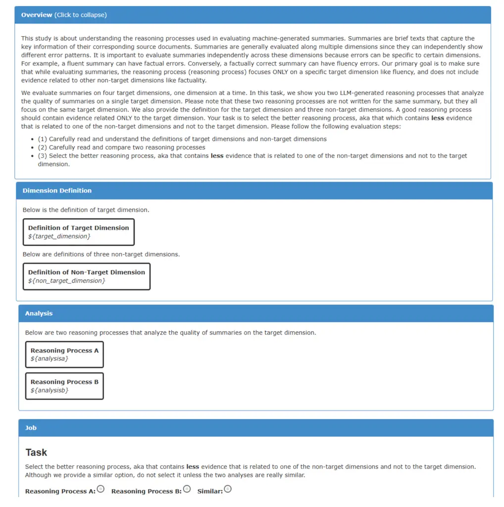
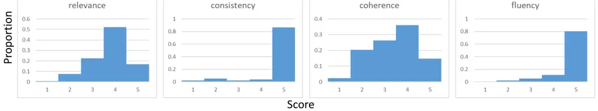

# Inter-dimension Dependence for Multi-Dimensional Evaluation of Open-Ended Text

Haoyuan Li Affiliation: University of North Carolina at Chapel Hill   
Snigdha Chaturvedi Affiliation: {haoyuanl, snigdha}@cs.unc.edu

###### Abstract

LLM-as-a-judge methods are widely used for evaluating the quality of
generated open-ended text. Such evaluations are generally
multi-dimensional, since the error patterns in texts can be different
for different dimensions. Therefore, reliable LLM judges should evaluate
each target dimension independently. To quantify the extent to which LLM
judges depend on non-target dimensions when evaluating a target
dimension, i.e., inter-dimension dependence, we propose CorrGap. To
measure this, CorrGap uses the difference in correlations between
LLM-predicted scores and ground truth scores across different groups of
texts. Using CorrGap, we show that inter-dimension dependence is
pervasive across LLM judges in open-ended text evaluation tasks. To
mitigate inter-dimension dependence, we propose DimCheck, a method that
iteratively removes unrelated evidence from COTs generated by LLM judges
in a step-wise way. We show that DimCheck mitigates inter-dimension
dependence and outperforms strong baselines across three LLMs and four
tasks. We also show that smaller trained LLMs can approximate larger
LLMs in DimCheck, with much lower inference costs.

## 1 Introduction

LLM-as-a-judge methods (Liu et al., 2023; Chiang and Lee, 2023; Kim
et al., 2024a) are widely used for evaluating generated open-ended text.
These methods assign either a single overall score to the text (Zheng
et al., 2023; Lambert et al., 2025) or multiple scores along multiple
dimensions. In the latter setting, referred to as multi-dimensional
evaluation, each dimension assesses a specific aspect of the text and
the text is generally evaluated along one dimension at a time. For
example, summaries are often evaluated across dimensions like relevance
to the input document(s), factuality and fluency (Fabbri et al., 2020).
Similarly, automatically generated narratives are evaluated on relevance
to the prompt, coherence, etc. This multi-dimensional evaluation is
preferable because open-ended texts can show different error patterns
for different dimensions (Hosking et al., 2024; Bao et al., 2026).
Aggregating these errors into a single overall score may overlook
important deficiencies since errors in different dimensions are not
directly comparable or interchangeable. For example, a fluent summary
with factual errors and a factually correct summary with fluency errors
can receive the same overall score, but reflect fundamentally different
error patterns. Multi-dimensional evaluation can effectively capture
these distinct error patterns and offer greater interpretability. In
these settings, it is important for LLM judges to evaluate each target
dimension independently, the evaluation may effectively collapse into a
single overall score, reducing the intended benefits of
multi-dimensional rewards.

|                                                                                                                                                                                                                                                                                                                                                                                                                                                                                                                         |
| ----------------------------------------------------------------------------------------------------------------------------------------------------------------------------------------------------------------------------------------------------------------------------------------------------------------------------------------------------------------------------------------------------------------------------------------------------------------------------------------------------------------------- |
| Target Dimension: Relevance                                                                                                                                                                                                                                                                                                                                                                                                                                                                                             |
| Non-target Dimension: Consistency, Coherence, Fluency                                                                                                                                                                                                                                                                                                                                                                                                                                                                   |
| The summary includes some important information such as Ze Maria’s representation of Brazil and his role as the third coach at Ceahlaul. However, it is missing key details about the timeline of events (e.g., being reinstated and then fired again) and the context of the club’s relegation threat. Additionally, the summary is somewhat disjointed and lacks a clear narrative flow. It also omits the reason for his second firing and the replacement by Vanya Radinovic. These omissions reduce the relevance. |

Table 1: An example COT generated by Llama3.3-70B-Instruct as a judge
when evaluating a summary on relevance (the target dimension). The text
in red is related to a non-target dimension, coherence, but not
relevance.

However, we hypothesize that LLM judges cannot always evaluate along
different dimensions independently. Tab. 1 shows the Chain-of-Thought
(COT) reasoning of an LLM judge when evaluating the relevance of a
summary (target dimension). It incorrectly depends on evidence related
to coherence, a non-target dimension(highlighted in red). To quantify
the extent to which LLM judges depend on non-target dimensions when
evaluating the text on a target dimension, i.e., inter-dimension
dependence, we propose CorrGap. CorrGap is a novel evaluation metric
based on the assumption that, if the LLM judge is not able to do
independent evaluations, i.e. inter-dimension dependence exists, the
judge’s score for the target dimension will be highly influenced by the
text’s quality on other dimensions. This will be especially damaging on
texts for which the ground truth score for the target dimension is very
different from the score for other dimensions. In other words, the LLM
judge will be especially incorrect on these texts.

We evaluate CorrGap in two different setups using three different LLM
judges and find it to be a reliable measure of inter-dimensional
dependence. Using CorrGap, we measure the inter-dimension dependence
with three evaluation frameworks using eight LLMs for four open-ended
text generation tasks. Across most settings, we observe significantly
higher CorrGap scores indicating pervasive inter-dimension dependence in
LLM judges.

To mitigate inter-dimension dependence, we present DimCheck that
analyzes the Chain-Of-Thought (COT) (Wei et al., 2022) generated by LLM
judges before rating. It iteratively removes unrelated evidence (such as
those highlighted in red in Tab. 1) from the original COT and performs
evaluation again conditioned on the modified COT.

We evaluate DimCheck by performing comprehensive experiments across
three LLMs and four tasks. The results show that DimCheck outperforms
other strong baselines. We further show that smaller LLMs can be trained
to approximate larger LLMs in DimCheck with reduced inference cost.

Our contributions are three-fold:

- •
  CorrGap, a metric that quantitatively evaluates inter-dimension
  dependence for multi-dimensional open-ended text evaluation;
- •
  Comprehensive experiments that show inter-dimension dependence is
  significant across evaluation frameworks and tasks;
- •
  DimCheck, a method designed to mitigate inter-dimension dependence by
  removing unrelated evidence from the original COT.

## 2 Related Work

Open-ended texts can show various error patterns (Hosking et al., 2024;
Bao et al., 2026). Therefore, they are generally evaluated along
multiple dimensions (Fabbri et al., 2020). Beyond evaluation,
multi-dimensional evaluation is also used to provide a comprehensive
reward signal during alignment by mutli-objective alighment (He and
Maghsudi, 2025; Yang et al., 2024) or detailed rubrics (Gunjal et al.,
2025; Huang et al., 2025).

LLM judges (Wang et al., 2023a; Fu et al., 2024) are widely used to
evaluate the quality of texts in a pointwise (Gao et al., 2023) or
pairwise way (Zheng et al., 2023). In this work, we focus on pointwise
evaluation. To improve the correlation between predicted and ground
truth scores, previous works model the uncertainty of predicted scores
(Liu et al., 2023), analyze the text and instruction before evaluation
(Chiang and Lee, 2023; Wu et al., 2025; Kim et al., 2024b), enable
interaction between agents (Chan et al., 2024; Kim et al., 2024a; Kumar
et al., 2025), or incorporate a more detailed rubric (Kim et al., 2023;
Lee et al., 2025a). Although showing high correlation, such LLM judges
can be susceptible to different types of biases (Ye et al., 2025) like
self-enhancement bias (Goyal et al., 2022) or verbosity bias (Zheng
et al., 2023). Existing studies typically measure such biases using
perturbation-based methods. These biases can be viewed as non-target
dimensions in our setting. However, perturbation-based evaluation
requires carefully designed modifications for each dimension and can be
difficult to construct for certain dimensions, such as relevance in
summarization. Instead, Xiao et al. (2023) show that LLM-predicted
scores for a target dimension can correlate more with ground truth
scores of non-target dimensions than with those of the target dimension
for summarization. This hints that LLM judges might not be able to
independently evaluate the target dimension. However, this
correlation-based analysis remains coarse-grained and qualitative. Even
if the predicted scores correlate more with the ground truth scores of
the target dimension, such correlations alone do not guarantee that the
evaluation of the target dimension is independent.

## 3 CorrGap

Multi-dimensional evaluation evaluate a set of texts $`T`$ along $`n`$
dimensions: $`d_{1},...,d_{n}`$. For a text $`t\in T`$, an LLM judge
assigns a score $`\hat{s}_{i,t}`$ and human annotators annotate a ground
truth score $`s_{i,t}`$ on each dimension $`d_{i}`$. We define
inter-dimension dependence as the extent to which the predicted score
$`\hat{s}_{i}`$ on the target dimension $`d_{i}`$ is influenced by the
non-target dimensions $`\{d_{k\neq i}\}`$

CorrGap is a metric designed for inter-dimension dependence motivated by
stratified analysis (Cochran, 1954). To understand the intuition of
CorrGap, consider the following two groups of texts. The first group,
the low-variance group, $`T^{i}_{l}`$, contains texts, $`t`$, whose
ground truth score $`s_{i,t}`$ on the target dimension, $`d_{i}`$, are
similar to the scores on other dimensions, $`\{s_{k\neq i,t}\}`$. The
other group, the high-variance group, $`T^{i}_{h}`$, contains texts
whose ground truth scores on the target dimension are different from
non-target dimensions. If an LLM judge cannot evaluate dimensions
independently, then its scores on the target dimension will be
influenced by other dimensions, making the predicted scores less
accurate. The accuracy will take a worse hit for the high than the
low-variance group, because in the high-variance group, the scores for
target dimensions should ideally be very different from the non-target
dimensions (so getting influenced by non-target dimensions will be
particularly problematic). CorrGap measures the LLM’s inability to do
independent evaluations by considering the difference in this accuracy
on the low- and high- variance groups, $`T^{i}_{l}`$ and $`T^{i}_{h}`$.
The accuracy is measured as the correlation of predicted scores with
ground-truth scores.

However, distributions of ground truth scores across dimensions can be
very different as in Fig. 4. Therefore, CorrGap measures the differences
between dimensions $`\Delta(t,d_{i})`$ using the percentile
$`s^{p}_{i,t}`$ of the score $`s_{i,t}`$ among all scores
$`\{s_{i,t^{\prime}},t^{\prime}\in T\}`$ instead of its raw value. To
construct the groups, for each text $`t\in T`$, CorrGap calculates the
differences in the percentiles of ground truth scores on the target
dimension $`d_{i}`$ and other dimensions:
$`\Delta(t,d_{i})=|s^{p}_{i,t}-mean(\{s^{p}_{k\neq i,t}\})|`$.

Only using differences in percentiles of ground truth scores
$`\Delta(t,d_{i})`$ to split texts may lead to two groups with markedly
different distributions of ground truth scores $`s_{i,t}`$ as in Tab. 15. This makes their correlations with LLM-predicted scores
$`\hat{s}_{i,t}`$ incomparable. For example, one group can be
concentrated around a certain value while the other spans a wider range.
In this case, the differences in correlation can arise from the
distribution difference rather than genuine inter-dimension dependence.
Therefore, CorrGap splits texts within each possible value of the ground
truth score $`s_{i,t}`$.¹¹ 1 If ground truth scores are continuous, we
can bin them. Specifically, for a possible ground truth score value
$`k`$, CorrGap considers the subset $`\{t|s_{i,t}=k,t\in T\}`$ and
splits it by the differences in the percentiles $`\Delta(t,d_{i})`$.
Texts with the top $`50`$% value of $`\Delta(t,d_{i})`$ are assigned to
the high-variance group $`T^{i}_{h}`$ and the remaining to the
low-variance group $`T^{i}_{l}`$.

For a dimension $`d_{i}`$, CorrGap is then defined as the difference in
correlations between LLM-predicted scores $`\hat{s}_{i}`$ and ground
truth scores $`s_{i}`$ across two groups $`T^{i}_{l}`$ and
$`T^{i}_{h}`$:

```math
\displaystyle CG_{i}=|corr(\{(s_{i,t},\hat{s}_{i,t})|t\in T^{i}_{l}\})
```

```math
\displaystyle-corr(\{(s_{i,t},\hat{s}_{i,t})|t\in T^{i}_{h}\})|. \tag{1}
```

If an LLM judge can independently evaluate texts on dimension $`d_{i}`$,
the correlation on groups $`T^{i}_{l}`$ and $`T^{i}_{h}`$ should be
similar, yielding a CorrGap value $`CG_{i}`$ close to zero. Conversely,
if the judge cannot do independent evaluation, correlations in the
high-variance group will be much lower than those in the low-variance
group. Therefore, the CorrGap value $`CG_{i}`$ will be higher. We show
that CorrGap is an accurate metric for inter-dimension dependence in Sec
.6.1 and show that inter-dimension dependence is pervasive for LLM
judges in Sec. 6.2.

## 4 DimCheck

Figure 1: Example workflow of DimCheck on a COT. The evidence which is
unrelated to the target dimension and removed by Dimcheck in the current
step is in red, evidence removed in all previous steps are with
strikethrough.

DimCheck is a method designed to reduce the inter-dimension dependence.
DimCheck builds upon the Analyze-Rate framework (Chiang and Lee, 2023),
where an LLM judge first generates a COT $`r_{i,t}`$, and then generates
a score $`\hat{s}_{i,t}`$ for the text $`t`$ on the target dimension
$`d_{i}`$. To reduce inter-dimension dependence, DimCheck instruct an
LLM to modify $`r_{i,t}`$ by removing evidence unrelated to the
dimension $`d_{i}`$. An example modification process by DimCheck is in
Fig. 1. The LLM judge then assigns a new score based on the modified
COT.

Removing unrelated evidence without considering other dimensions is
challenging, since the semantic boundaries of dimensions can be unclear
and overlapping. Therefore, DimCheck iteratively removes evidence
related to one non-target dimension $`d^{\prime}\in\{d_{k\neq i}\}`$ at
a time. For each iteration, the LLM is given evaluation The LLM is then
instructed to identify and remove evidence in the COT $`r_{i,t}`$ that
is related to $`d^{\prime}`$ but not $`d_{i}`$ without changing other
parts of the COT. If such evidence does not exist, the COT $`r_{i,t}`$
will remain unchanged. In rare cases, this process may remove the entire
content of COT $`r_{i,t}`$. When this occurs, DimCheck discards the
modification for that iteration, as Analyze-Rate requires a non-empty
COT for scoring. To ensure accurate interpretation of evaluation
dimensions and the COT $`r_{i,t}`$, DimCheck requires the model to think
step-by-step before generating the modified COT. This process is
repeated sequentially for each non-target dimension. The final modified
COT is denoted as $`r^{new}_{i,t}`$, which only includes evidence
related to the target dimension $`d_{i}`$. The prompt used by DimCheck
is in App. A.1.

For texts whose COTs are modified, DimCheck then keeps the evaluation
prompt unchanged and instructs the LLM judge to regenerate only the
score $`\hat{s}^{new}_{i,t}`$ for text $`t`$ on dimension $`d_{i}`$
conditioned on the modified COT $`r^{new}_{i,t}`$. For texts whose COTs
remain unchanged, DimCheck keeps the original score $`\hat{s}_{i,t}`$.
DimCheck‘s pseudo code is in Alg. 1.

1: Input: text supposed to be evaluated $`t`$; target dimension
$`d_{i}`$; non-target dimensions $`\{d_{k\neq i}\}`$

2: $`r_{i,t},\hat{s}_{i,t}=LLM_{judge}(t,d_{i})`$ $`\triangleright`$
generate the COT $`r_{i,t}`$ and score $`\hat{s}_{i,t}`$ on dimension
$`d_{i}`$

3: $`r^{new}_{i,t}=r_{i,t}`$; $`\hat{s}^{new}_{i,t}`$ =
$`\hat{s}_{i,t}`$

4: for $`d^{\prime}\in\{d_{k\neq i}\}`$ do

5:   $`r^{new}_{i,t}=EDIT(r^{new}_{i,t},d_{i},d^{\prime})`$
$`\triangleright`$ remove evidence related to $`d^{\prime}`$ but
unrelated to $`d_{i}`$ from the COT

6: end for

7: if $`r^{new}_{i,t}\neq r_{i,t}`$ then

8:   $`\hat{s}^{new}_{i,t}=LLM_{judge}(r^{new}_{i,t},t,d_{i})`$
$`\triangleright`$ assign a new score if COT is modified

9: end if

10: Return $`\hat{s}^{new}_{i,t}`$

Algorithm 1 Pseudo Code for DimCheck

## 5 Experimental Setup and Dataset

[TABLE]

Table 2: Datasets Overview. We show the task, number of evaluation
dimensions (# Dim.), number of inputs (#Inp.) and number of outputs per
input (#Out.).

The evaluation of inter-dimension dependence requires datasets with
human annotations on multiple dimensions. We use following datasets that
meet this requirement in diverse domains: (i) SummEval (Fabbri et al., 2020) for news summarization; (ii) Topical-Chat (Gopalakrishnan et al., 2019) for knowledge-grounded conversation; (iii) Hanna (Chhun et al., 2024) for narrative generation; (iv) OpinSummEval (Shen and Wan, 2023)
for opinion summarization. The statistics are in Table 2.

To evaluate inter-dimension dependence with CorrGap, we perform
experiments on seven LLMs from four families: Llama 3 (AI@Meta, 2024)
(Llama3.1-8b-Instruct, Llama3.3-70b-Instruct), Qwen 3 (Team, 2025b)
(Qwen3-14B, Qwen3-32B), Gemma3 (Team, 2025a) (gemma-3-12b-it,
gemma-3-27b-it), Ministral (Liu et al., 2026)
(Ministral-3-14B-Instruct-2512), GPT-5.4 (Singh et al., 2025)
(gpt-5.4-nano, gpt-5.4-mini). We also consider an LLM dedicated for
evaluation, M-Prometheus-14B (Pombal et al., 2025). During inference, we
adopt top-p sampling with $`p=0.9`$ and temperature of $`0.6`$ for all
LLMs. To evaluate whether the correlation difference between groups is
statistically significant, we use the permutation test (Pitman, 1937) by
randomly splitting all texts into two groups $`1000`$ times while
controlling the ground truth scores as in Sec.3. CorrGap values are
statistically significant when the correlation differences are
statistically significant.

To evaluate the performance of DimCheck, we perform experiments on
Llama3.3-70b-Instruct, Qwen3-32B, and gemma-3-27b-it with the same
inference hyperparameters as before. DimCheck uses the same LLM to
modify the reasoning process. When removing unrelated evidence from the
COT, DimCheck instructs Llama3.3-70b-Instruct and gemma-3-27b-it to
first think step-by-step before modifying COTs. For Qwen3-32B, DimCheck
enables the thinking mode. Implmentation details and computation cost
analysis are in App. A.1

## 6 Experiment

### 6.1 Evaluation of CorrGap

|             | Llama3.3-70b |          | Gemma3-27b |         | Qwen3-32b |          |
| ----------- | ------------ | -------- | ---------- | ------- | --------- | -------- |
|             | Fact.        | Analyze. | Fact.      | Analyze | Fact.     | Analyze. |
| CorrGap     | 5.9          | 20.5     | 5.6        | 12.0    | 5.0       | 22.4     |
| w/o control | 6.2          | 24.6     | 8.4        | 20.7    | 11.5      | 24.9     |

Table 3: Evaluation of CorrGap using FactScore (Fact.) and Analyze-Rate
(Analyze.) on the SummEval dataset. The correlation differences that are
statistically significant ($`p<0.05`$) are bolded. CorrGap correctly
identify FactScore as having low inter-dimension dependence.

Evaluating CorrGap is challenging since it cannot be evaluated by just
looking at each individual score and its COTs. Therefore, we evaluate
CorrGap via two evaluations.

The first evaluation considers an LLM judge especially constructed for a
specific target dimension and hence by design, would be minimally
influenced by other dimensions. If CorrGap is a good metric, it should
correctly identify this judge as having insignificant inter-dimension
dependence. An example of such a judge is FactScore (Min et al., 2023).
It measures consistency by decomposing summaries into atomic content
units and computing the proportion of units entailed by the input
document. Since the evaluation operates on atomic units rather than full
sentences, it is unlikely to be affected by coherence or fluency. It is
also less sensitive to relevance, since it only checks whether each unit
is supported by the document rather than whether it captures the main
content. For comparison, we consider a more general-purpose LLM judge
that is more likely to be influenced by other dimensions and use it for
consistency evaluation: Analyze-Rate. We compute CorrGap for both judges
with consistency as the target dimension on the SummEval dataset. We
also compare an ablation of CorrGap that does not control ground truth
scores during the split (CorrGap w/o control). Results across
Llama3.3-70b-Instruct, Qwen3-32B, and gemma-3-27b-it are in Tab. 3.

The results show that CorrGap for FactScore is not statistically
significant ($`p<0.05`$), whereas CorrGap for Analyze-Rate is
statistically significant ($`p>0.05`$) across all three LLMs. This
indicates that CorrGap correctly identifies FactScore as having low
inter-dimension dependence. In contrast, CorrGap w/o control is
statistically significant for FactScore with Gemma3-27B and Qwen3-32B.
It shows that controlling the distribution of ground truth scores is
necessary to avoid capturing spurious inter-dimension dependence.

| $`\gamma`$ | SummEval |        | Topical Chat |        | Hanna |        | OpinSumm. |        | Average |        |
| ---------- | -------- | ------ | ------------ | ------ | ----- | ------ | --------- | ------ | ------- | ------ |
|            | CG       | w/o c. | CG           | w/o c. | CG    | w/o c. | CG        | w/o c. | CG      | w/o c. |
| 100        | 0.0      | 9.1    | 0.0          | 0.0    | 0.0   | 0.0    | 0.5       | 0.9    | 0.1     | 2.5    |
| 67         | 0.0      | 0.1    | 0.0          | 0.1    | 0.0   | 0.0    | 5.0       | 6.0    | 1.3     | 1.6    |
| 33         | 0.8      | 2.3    | 3.5          | 6.1    | 0.0   | 0.1    | 14.6      | 18.9   | 4.7     | 6.8    |
| 0          | 23.8     | 12.9   | 23.9         | 20.0   | 23.2  | 21.3   | 24.3      | 24.8   | 23.8    | 19.8   |

Table 4: P-values of CorrGap (CG) and its variants without controlling
the ground truth scores (w/o c.) on synthetic scores with different
inter-dimension dependence ($`\gamma`$). The best-performing metric is
bolded. CorrGap accurately distinguishes between synthetic scores with
low or high inter-dimension dependence.

The second evaluation uses perturbed scores to test whether CorrGap can
distinguish between scores with low or high inter-dimension dependence.
We consider two perturbations. First, we perturb the ground truth score,
$`s_{i,t}`$, with random noise, so that the perturbed scores
$`\hat{s}^{r}_{i,t}`$ equals $`s_{i,t}+1`$, $`s_{i,t}`$, or
$`s_{i,t}-1`$ with equal probability (33% each). Second, we perturb
ground truth score $`s_{i,t}`$, with inter-dimension dependence. The
perturbed score $`\hat{s}^{d}_{i,t}`$ will be $`s_{i,t}+1`$ if the text
performs better on other dimensions than the target dimension, i.e.
$`mean(\{s^{p}_{k\neq i,t}\})>s^{p}_{i,t}`$, which uses percentile as in
Sec. 3. Otherwise, the perturbed score $`\hat{s}^{d}_{i,t}`$ will be
$`s_{i,t}-1`$. Perturbations that produce scores outside the valid range
are discarded. Perturbed scores are then constructed by mixing
$`\gamma\%`$ of ground truth scores with inter-dimension dependence
$`\hat{s}^{d}_{i}`$ with $`(100-\gamma)\%`$ of ground truth scores with
random noise $`\hat{s}^{r}_{i}`$. A good metric should show high
p-values when $`\gamma=0`$, indicating no inter-dimension dependence,
and small p-values when $`\gamma>0`$, indicating the existing
inter-dimension dependence. We report the average p-values across all
dimensions (in percentage) over 10 runs in Tab. 4.

From the table, we observe that CorrGap is not statistically significant
($`p>0.05`$) when $`\gamma=0`$ for all datasets and statistically
significant ($`p<0.05`$) when $`\gamma`$ is non-zero except for
OpinSummEval. The results show that CorrGap accurately distinguishes
between synthetic scores with low or high inter-dimension dependence.
Moreover, compared with CorrGap w/o control, CorrGap shows higher
p-values when $`\gamma=0`$ and lower p-values when $`\gamma>0`$. The
results show that controlling the distribution of ground truth scores is
essential for accurately measuring inter-dimension dependence.

The correlation differences measured by CorrGap can be caused by
inter-dimension dependence of human annotators who annotate the
ground-truth scores instead of LLM judges. To check this, we compare
inter-annotator agreement between the low- and high-variance groups. If
human annotators were strongly affected by inter-dimension dependence,
different annotators would likely be affected to different extents,
resulting in much lower agreement in the high-variance group. Therefore,
we report Randolph’s kappaRandolph (2005) for both groups in Tab. 5. We
find that inter-annotator agreement between two groups are similar,
showing that human annotators are less likely to be affected by
inter-dimension dependence.

|               | SummEval | Topical Chat | Hanna | OpinSummEval |
| ------------- | -------- | ------------ | ----- | ------------ |
| Low Variance  | 50.43    | 43.84        | 8.33  | 83.36        |
| High Variance | 50.58    | 45.24        | 8.50  | 81.02        |

Table 5: Inter-annotator agreements for ground-truth scores in low- and
high-variance groups. Similar inter-annotator agreements between two
groups show that ground-truth scores are less likely to be affected by
inter-dimension dependence.

### 6.2 Evaluating Inter-dimension Dependence with CorrGap

|               |                                     |                  |                   |                  |                  |                  |                  |                  |                  |                  |                     |
| ------------- | ----------------------------------- | ---------------- | ----------------- | ---------------- | ---------------- | ---------------- | ---------------- | ---------------- | ---------------- | ---------------- | ------------------- |
|               | SummEval\[4\]                       |                  | Topical Chat\[4\] |                  | Hanna\[6\]       |                  | OpinSumm.\[4\]   |                  | Avg.             |                  |                     |
|               | $`\tau\uparrow`$                    | CG$`\downarrow`$ | $`\tau\uparrow`$  | CG$`\downarrow`$ | $`\tau\uparrow`$ | CG$`\downarrow`$ | $`\tau\uparrow`$ | CG$`\downarrow`$ | $`\tau\uparrow`$ | CG$`\downarrow`$ | overall$`\uparrow`$ |
|               | G-Eval (Liu et al., 2023)           |                  |                   |                  |                  |                  |                  |                  |                  |                  |                     |
| Llama3.1-8b   | 32.7                                | 25.6(4)          | 41.7              | 9.2(2)           | 25.6             | 9.6(2)           | 29.6             | 12.4(0)          | 32.4             | 14.2             | 59.1                |
| Llama3.3-70b  | 25.9                                | 15.4(4)          | 34.1              | 11.6(2)          | 28.3             | 11.4(4)          | 33.9             | 23.6(3)          | 30.5             | 15.5             | 57.5                |
| Gemma3-12b    | 39.1                                | 22.4(4)          | 45.4              | 17.5(3)          | 18.0             | 7.1(2)           | 34.5             | 24.3(2)          | 34.3             | 17.8             | 58.2                |
| Gemma3-27b    | 44.2                                | 24.8(4)          | 44.1              | 12.9(3)          | 27.4             | 9.9(3)           | 37.2             | 25.6(2)          | 38.2             | 18.3             | 60.0                |
| Qwen3-14b     | 40.7                                | 25.8(4)          | 46.3              | 18.6(3)          | 26.5             | 12.0(5)          | 37.9             | 24.8(2)          | 37.9             | 20.3             | 58.8                |
| Qwen3-32b     | 39.4                                | 24.7(4)          | 47.8              | 13.2(3)          | 32.0             | 11.1(4)          | 33.6             | 17.9(2)          | 38.2             | 16.7             | 60.7                |
| Ministral-14b | 39.2                                | 24.7(4)          | 49.8              | 13.2(3)          | 26.8             | 18.7(5)          | 34.5             | 28.7(2)          | 37.6             | 21.3             | 58.1                |
|               | Analyze-rate (Chiang and Lee, 2023) |                  |                   |                  |                  |                  |                  |                  |                  |                  |                     |
| Llama3.1-8b   | 30.1                                | 23.9(4)          | 32.5              | 10.0(1)          | 22.8             | 7.8(3)           | 23.0             | 24.5(2)          | 27.1             | 16.6             | 55.3                |
| Llama3.3-70b  | 46.1                                | 30.0(4)          | 53.3              | 13.1(3)          | 34.6             | 11.3(3)          | 32.0             | 18.9(3)          | 41.5             | 18.3             | 61.6                |
| Gemma3-12b    | 42.8                                | 25.8(4)          | 46.3              | 9.0(1)           | 26.7             | 11.3(4)          | 33.7             | 21.0(2)          | 37.4             | 16.8             | 60.3                |
| Gemma3-27b    | 44.1                                | 26.3(4)          | 51.1              | 10.7(2)          | 28.7             | 11.4(3)          | 37.6             | 16.1(2)          | 40.4             | 16.1             | 62.1                |
| Qwen3-14b     | 42.2                                | 27.1(4)          | 51.7              | 14.6(3)          | 33.9             | 13.0(5)          | 36.0             | 20.1(1)          | 41.0             | 18.7             | 61.1                |
| Qwen3-32b     | 41.8                                | 25.3(4)          | 49.1              | 10.1(1)          | 34.3             | 11.7(4)          | 37.6             | 18.5(3)          | 40.7             | 16.4             | 62.1                |
| Ministral-14b | 36.7                                | 28.5(4)          | 48.6              | 17.2(4)          | 26.6             | 12.8(5)          | 31.8             | 28.2(2)          | 36.0             | 21.7             | 57.1                |
| GPT5.4-Nano   | 37.7                                | 22.6(4)          | 38.8              | 9.7(1)           | 29.5             | 8.9(3)           | 43.0             | 21.8(2)          | 37.2             | 15.7             | 60.8                |
| GPT5.4-Mini   | 47.6                                | 20.3(4)          | 50.6              | 9.0(1)           | 33.4             | 11.4(5)          | 41.8             | 19.5(3)          | 43.3             | 15.0             | 64.1                |
| M-Prom.-14b   | 28.9                                | 20.4(3)          | 37.6              | 12.7(1)          | 22.2             | 12.3(5)          | 16.4             | 11.3(1)          | 26.3             | 14.2             | 56.0                |
|               | Debate (Kim et al., 2024a)          |                  |                   |                  |                  |                  |                  |                  |                  |                  |                     |
| Llama3.1-8b   | 22.8                                | 18.8(4)          | 29.6              | 9.6(1)           | 18.4             | 5.8(1)           | 15.0             | 13.4(0)          | 21.4             | 11.9             | 54.8                |
| Llama3.3-70b  | 44.4                                | 29.7(4)          | 52.1              | 13.6(3)          | 33.4             | 12.0(4)          | 27.7             | 16.3(1)          | 39.4             | 17.9             | 60.7                |
| Gemma3-12b    | 34.9                                | 21.8(4)          | 33.6              | 9.0(1)           | 19.3             | 11.0(4)          | 19.4             | 22.6(2)          | 26.8             | 16.1             | 55.3                |
| Gemma3-27b    | 31.0                                | 18.0(4)          | 52.0              | 11.7(2)          | 25.1             | 12.3(5)          | 16.1             | 12.1(0)          | 31.0             | 13.5             | 58.8                |
| Qwen3-14b     | 40.6                                | 27.0(4)          | 52.7              | 13.6(3)          | 34.0             | 12.8(5)          | 35.0             | 23.2(1)          | 40.6             | 19.1             | 60.7                |
| Qwen3-32b     | 41.8                                | 23.5(4)          | 49.9              | 10.3(2)          | 30.8             | 11.9(4)          | 30.5             | 18.9(2)          | 38.2             | 16.2             | 61.0                |
| Ministral-14b | 19.1                                | 12.7(3)          | 23.7              | 11.9(0)          | 22.0             | 11.1(4)          | 18.8             | 21.2(1)          | 20.9             | 14.2             | 53.3                |

Table 6: Correlation ($`\tau`$), inter-dimension dependence ($`CG`$),
and number of dimensions whose inter-dimension dependence is
statistically significant (in brackets) for different evaluation
frameworks and LLMs. Inter-dimension dependence is pervasive.

In this section, we use CorrGap to measure the inter-dimension
dependence of different LLM-judges based evaluation frameworks. We
consider three evaluation frameworks: (i) G-Eval (Liu et al., 2023),
which directly generates a score (ii) Analyze-rate (Chiang and Lee,
2023), which first generates a COT before scoring; (iii) Debate (Kim
et al., 2024a), which generates scores by a debate between a grader and
a critic. We evaluate 10 LLMs across these frameworks. For M-Prom.-14B,
we evaluate only Analyze-Rate, as it is tuned specifically for this
framework. For GPT5.4, we also evaluate only Analyze-Rate because its
output distribution is unavailable and Debate incurs high inference
cost. Implementation details are in A.4. For each framework, we report
the average CorrGap ($`CG`$) across all dimensions, along with the
number of dimensions (in parentheses) with statistically significant
CorrGap ($`p<0.05`$). To measure judge accuracy, we report the average
Kendall’s tau ($`\tau`$) between predicted and ground-truth scores
across all dimensions. Following prior work (Liu et al., 2023; Chhun
et al., 2024; Shen and Wan, 2023), we use summary-level correlations for
SummEval and OpinSummEval, and sample-level correlations for Topical
Chat and Hanna. We also report an overall score, computed as the average
of the correlation and one minus CorrGap across all datasets. Results
are shown in Tab. 6.

From the table, we observe that all evaluation frameworks and LLMs have
dimensions whose CorrGap value are statistically significant, indicating
that inter-dimension dependence is pervasive. Moreover, for all
dimensions whose CorrGap values are statistically significant, the
correlations in the high-variance group are consistently lower than
those in the low-variance group, which meets our assumption in Sec. 3.

Among all evaluation frameworks and LLMs, GPT5.4-Mini with Analyze-Rate
shows the best overall performance. For smaller models (\<=14b
parameters), Qwen3-14b with Analyze-Rate shows the best overall
performance. For comparison between evaluation frameworks, Analyze-rate
generally shows the best overall performance except for Llama3.1-8b,
while Debate and G-Eval show comparable performance among different
LLMs. For comparison between LLMs, while larger LLMs generally show
higher correlations than smaller LLMs, larger LLMs do not necessarily
show lower CorrGap values than smaller models. The results show that
when evaluating LLM judges, it is important to consider CorrGap in
addition to correlation, as they show complimentary patterns.

We also analyze whether inter-dimension dependence varies across texts
of different quality levels. For each dimension, we split texts into
low- and high-quality groups based on their ground-truth scores. We find
that inter-dimension dependence is more severe for high-quality texts on
SummEval and Hanna, but more severe for low-quality texts on Topical
Chat. These results suggest that inter-dimension dependence varies
across quality levels. Full results for each LLM are shown in App. A.7.

We also analyze the CorrGap value for each dimension and find that
inter-dimension dependence is more severe for some dimensions as in
Table 19.

### 6.3 Evaluation of DimCheck

|                       |                  |                  |                   |                  |                  |                  |                  |                  |                  |                  |                     |
| --------------------- | ---------------- | ---------------- | ----------------- | ---------------- | ---------------- | ---------------- | ---------------- | ---------------- | ---------------- | ---------------- | ------------------- |
|                       | SummEval\[4\]    |                  | Topical Chat\[4\] |                  | Hanna\[6\]       |                  | OpinSumm.\[4\]   |                  | Avg.             |                  |                     |
|                       | $`\tau\uparrow`$ | CG$`\downarrow`$ | $`\tau\uparrow`$  | CG$`\downarrow`$ | $`\tau\uparrow`$ | CG$`\downarrow`$ | $`\tau\uparrow`$ | CG$`\downarrow`$ | $`\tau\uparrow`$ | CG$`\downarrow`$ | overall$`\uparrow`$ |
|                       | Llama3.3-70b     |                  |                   |                  |                  |                  |                  |                  |                  |                  |                     |
| Analyze-Rate          | 46.1             | 30.0(4)          | 53.3              | 13.1(3)          | 34.6             | 11.3(3)          | 32.0             | 18.9(3)          | 41.5             | 18.3             | 61.6                |
| Analyze-Rate+Other    | 45.1             | 30.5(4)          | 52.0              | 13.8(3)          | 35.9             | 12.6(3)          | 34.9             | 17.4(2)          | 42.0             | 18.6             | 61.7                |
| Analyze-Rate+Joint    | 41.4             | 28.6(4)          | 53.5              | 13.9(2)          | 37.2             | 13.7(6)          | 33.4             | 19.5(2)          | 41.4             | 18.9             | 61.2                |
| Self-consistency      | 47.3             | 28.3 (4)         | 52.7              | 14.3 (3)         | 35.5             | 13.2 (4)         | 34.6             | 19.3 (2)         | 42.5             | 18.8             | 61.9                |
| Self-reflection       | 46.1             | 29.3 (4)         | 52.3              | 13.6 (3)         | 32.5             | 12.9 (4)         | 28.8             | 18.9 (2)         | 39.9             | 18.7             | 60.6                |
| Checkeval             | 43.3             | 25.3 (4)         | 46.4              | 18.3 (2)         | \-               | \-               | \-               | \-               | \-               | \-               | \-                  |
| Analyze-Rate+DimCheck | 45.9             | 27.9(4)          | 54.1              | 12.5(3)          | 35.0             | 11.1(3)          | 33.2             | 14.1(1)          | 42.0             | 16.4             | 62.8                |
|                       | Gemma3-27b       |                  |                   |                  |                  |                  |                  |                  |                  |                  |                     |
| Analyze-Rate          | 44.1             | 26.3(4)          | 51.1              | 10.7(2)          | 28.7             | 11.4(3)          | 37.6             | 16.1(2)          | 40.4             | 16.1             | 62.1                |
| Analyze-Rate+Other    | 45.6             | 27.0(4)          | 49.9              | 12.6(2)          | 29.8             | 8.5(2)           | 38.0             | 17.2(2)          | 40.8             | 16.3             | 62.3                |
| Analyze-Rate+Joint    | 43.0             | 23.6(4)          | 47.6              | 12.8(1)          | 32.3             | 10.5(4)          | 35.7             | 14.1(1)          | 39.6             | 15.2             | 62.2                |
| Self-consistency      | 46.7             | 28.1 (4)         | 52.7              | 8.7 (1)          | 29.6             | 11.1 (5)         | 38.7             | 19.1 (1)         | 41.9             | 16.8             | 62.6                |
| Self-reflection       | 33.0             | 23.9 (4)         | 52.0              | 15.2 (3)         | 27.7             | 12.3 (5)         | 34.5             | 13.7 (3)         | 36.8             | 16.3             | 60.3                |
| Checkeval             | 38.8             | 22.5 (4)         | 42.2              | 12.2 (2)         | \-               | \-               | \-               | \-               | \-               | \-               | \-                  |
| Analyze-Rate+DimCheck | 42.9             | 22.3(4)          | 51.3              | 9.5(2)           | 29.2             | 10.1(3)          | 38.0             | 15.0(1)          | 40.3             | 14.2             | 63.1                |
|                       | Qwen3-32b        |                  |                   |                  |                  |                  |                  |                  |                  |                  |                     |
| Analyze-Rate          | 41.8             | 25.3(4)          | 49.1              | 10.1(1)          | 34.3             | 11.7(4)          | 37.6             | 18.5(3)          | 40.7             | 16.4             | 62.1                |
| Analyze-Rate+Other    | 41.0             | 27.6(4)          | 48.5              | 10.5(2)          | 35.6             | 9.4(3)           | 26.0             | 17.0(2)          | 37.8             | 16.1             | 60.8                |
| Analyze-Rate+Joint    | 42.2             | 29.1(4)          | 52.0              | 17.2(4)          | 34.1             | 14.2(5)          | 35.4             | 21.7(2)          | 40.9             | 20.5             | 60.2                |
| Self-consistency      | 43.4             | 27.3 (4)         | 50.5              | 10.9 (2)         | 35.8             | 12.2 (5)         | 35.2             | 17.5 (1)         | 41.3             | 17.0             | 62.1                |
| Self-reflection       | 37.3             | 26.2 (4)         | 50.1              | 10.6 (2)         | 33.2             | 13.6 (3)         | 33.0             | 12.7 (1)         | 38.4             | 15.8             | 61.3                |
| Checkeval             | 43.4             | 24.7 (4)         | 42.1              | 14.0 (1)         | \-               | \-               | \-               | \-               | \-               | \-               | \-                  |
| Analyze-Rate+DimCheck | 42.0             | 23.9(4)          | 49.9              | 8.5(1)           | 33.7             | 10.9(4)          | 35.9             | 12.2(1)          | 40.4             | 13.9             | 63.3                |

Table 7: Correlation ($`\tau`$), inter-dimension dependence
($`CG_{\tau}`$), and number of dimensions whose inter-dimension
dependence is statistically significant (in brackets) for methods on
reducing inter-dimension dependence. The best-performing method is
bolded. DimCheck shows the best overall performance.

In this section, we evaluate the performance of DimCheck on mitigating
inter-dimension dependence. Our baselines are (i) original Analyze-Rate
which shows the best overall score in Tab.6; (ii) Analyze-Rate with
evaluation instructions that explicitly state that scores should not be
influenced by any non-target dimensions (Analyze-Rate+Other); (iii)
Analyze-Rate that jointly evaluates all dimensions at once instead of
separately evaluating each dimension (Analyze-Rate+Joint) ; (iv)
Self-consistency Wang et al. (2023b), which randomly samples multiple
($`n=5`$) COTs and scores and the final score is the majority of sampled
scores; (v) Self-reflection Madaan et al. (2023), which iteratively
refine previous COTs and scores by checking whether it contains
unrelated evidence; (vi) CheckEval Lee et al. (2025b), which evaluates
each dimension using multiple Yes/No questions. Implementation details
of these baselines are in App. A.5. We report the results in Tab. 7.

From the table, we observe that DimCheck consistently shows lower
CorrGap values, comparable correlations with Analyze-Rate, and a higher
overall score. Other baselines do not bring consistent improvements. The
difference in overall scores between DimCheck and the second-best
performing method is statistically significant ($`p<0.05`$) using
bootstrapping test. The results show that DimCheck can mitigate the
inter-dimension dependence while retaining the accuracy of LLM judges.
We show example edited COTs and proportions of COTs edited by DimCheck
in App. A.2. We show the performance of DimCheck is stable using
different prompts in App. A.6. Besides, DimCheck shows the highest
correlation on the high-variance group as in Tab. 14.

### 6.4 Human Evaluation of DimCheck

To evaluate whether DimCheck can accurately identify COTs that contain
unrelated evidence, we perform a pairwise human evaluation. Each
evaluation sample contains a pair of COTs that focus on the same target
dimension: one identified by DimCheck as containing unrelated evidence
and the other not. For each sample, human annotators are instructed to
select which COTs contain less unrelated evidence. We then measure the
accuracy of DimCheck as the proportion of samples where a majority of
the human annotators agree with DimCheck’s identification. We randomly
sample $`10`$ samples from each of the SummEval and Topical dataset and
each of three LLMs used by DimCheck, resulting in $`60`$ samples in
total. Each sample is annotated by three annotators from Amazon MTurk.
Human evaluation’s details are in App. A.3.

Among $`60`$ samples, the Randolph’s Kappa (Randolph, 2005) between
three annotators is $`0.63`$, showing a substantial correlation. The
accuracy is $`95`$ percent for Llama3.3-70b, and $`85`$ percent for
Gemma3-27b and Qwen3-32b. The results show that DimCheck can accurately
identify COTs with unrelated evidence.

### 6.5 Ablation Study of DimCheck

|           |                  |                  |                  |                  |                  |                  |                  |                  |         |
| --------- | ---------------- | ---------------- | ---------------- | ---------------- | ---------------- | ---------------- | ---------------- | ---------------- | ------- |
|           | Llama3.3-70b     |                  | Gemma3-27b       |                  | Qwen3-32b        |                  | Avg.             |                  |         |
|           | $`\tau\uparrow`$ | CG$`\downarrow`$ | $`\tau\uparrow`$ | CG$`\downarrow`$ | $`\tau\uparrow`$ | CG$`\downarrow`$ | $`\tau\uparrow`$ | CG$`\downarrow`$ | overall |
| DimCheck  | 42.0             | 16.4             | 40.3             | 14.2             | 40.4             | 13.9             | 40.9             | 14.8             | 52.7    |
| w/1 step  | 42.0             | 16.3             | 40.4             | 15.6             | 40.3             | 15.6             | 40.9             | 15.8             | 52.2    |
| w/o other | 42.0             | 16.9             | 40.4             | 15.9             | 40.8             | 15.8             | 41.1             | 16.2             | 52.1    |
| w/o think | 41.7             | 16.6             | 40.1             | 15.5             | 40.8             | 15.1             | 40.9             | 15.7             | 52.3    |

Table 8: Average performance of DimCheck and its ablated variants across
datasets.

In this section, we compare DimCheck with the following ablations, which
instruct LLMs to remove evidence unrelated to the target dimension (i)
in a single step (w/1 step); (ii) without reference to any non-target
dimensions (w/o other); and (iii) without thinking (w/o think). We show
overall results across datasets in Tab. 8. Compared with ablations,
DimCheck achieves the best overall performance, indicating that all
design choices contribute to its effectiveness. Full results are shown
in Tab. 22.

### 6.6 Training Smaller LLMs for Efficient COT Editing

|              |                  |                  |                  |                  |                  |                  |                  |                  |         |
| ------------ | ---------------- | ---------------- | ---------------- | ---------------- | ---------------- | ---------------- | ---------------- | ---------------- | ------- |
|              | Llama3.3-70b     |                  | Gemma3-27b       |                  | Qwen3-32b        |                  | Avg.             |                  |         |
|              | $`\tau\uparrow`$ | CG$`\downarrow`$ | $`\tau\uparrow`$ | CG$`\downarrow`$ | $`\tau\uparrow`$ | CG$`\downarrow`$ | $`\tau\uparrow`$ | CG$`\downarrow`$ | overall |
| Analyze-Rate | 45.5             | 30.9             | 42.2             | 28.6             | 41.1             | 25.5             | 42.9             | 28.3             | 57.3    |
| +DimCheck    | 45.1             | 28.5             | 41.4             | 24.3             | 40.7             | 22.9             | 42.4             | 25.2             | 58.6    |
| w/1 step     | 43.8             | 28.9             | 41.2             | 26.4             | 41.2             | 24.8             | 42.1             | 26.7             | 57.7    |
| w/o think    | 43.0             | 30.6             | 42.9             | 29.3             | 41.7             | 25.5             | 42.5             | 28.4             | 57.0    |
| w/trained    | 45.0             | 29.8             | 41.9             | 24.3             | 41.2             | 24.9             | 42.7             | 26.3             | 58.2    |

Table 9: Performance of trained smaller LLMs to edit COTs (DimCheck
w/trained). DimCheck w/trained shows close overall performance to
DimCheck.

DimCheck’s design can lead to relatively high inference cost. To improve
the efficiency, we train a smaller LLM to edit the COT in a single step.
We perform experiments on the SummEval dataset since only this dataset’s
sample size is big enough for training and evaluation (50-50 split). We
train smaller LLMs using SFT on the COTs generated and edited by larger
LLMs within each LLM family. E.g., we perform SFT on
Llama3.1-8b-Instruct using COTs from Llama3.3-70b-Instruct. All LLMs are
trained for one epoch with a learning rate of 1e-4 and a batch size of 16. Implementation details are in App. A.8. The performance of using
trained smaller LLMs to edit COTs (DimCheck w/trained) and other
baselines on the test set is in Tab. 9.

From the table, we observe that DimCheck w/trained shows close overall
performance to DimCheck. It also outperforms DimCheck w/1 step and
DimCheck w/o think, which edits either COTs in a single step or without
thinking. The results show that a smaller trained LLM can achieve a
performance close to that of a larger LLM with reduced inference costs.

## 7 Conclusion

To quantify inter-dimension dependence of LLM judges, we propose CorrGap
based on correlation differences accross groups. We show that CorrGap
can reliably measure inter-dimension dependence and inter-dimension
dependence is pervasive across nine LLMs and four tasks. To mitigate
inter-dimension dependence, we propose DimCheck by iteratively removing
unrelated evidence from the COTs of LLM judges. Our experiments show
that DimCheck mitigates inter-dimension dependence and outperforms
strong baselines across three LLMs and four tasks.

## 8 Limitation

This work focuses on pointwise evaluation, where the LLM judges assign a
score to represent the quality of the generated text. While the
underlying notion of inter-dimension dependence may also arise in other
evaluation paradigms, such as pairwise preference judgments or listwise
evaluation, these settings involve different evaluation frameworks and
are beyond the scope of this work. Extending the analysis to broader
evaluation paradigms is an interesting direction for future research.

Besides, DimCheck is designed for LLM judges that explicitly generate a
COT before assigning a score. While this evaluation frameworks are
widely used, DimCheck is not directly applicable to methods that do not
generate COTs. Extending the approach to these settings is an
interesting direction for future work.

## 9 Ethics Statement

The datasets we use are all publicly available. All the models used in
this paper are publicly accessible. The inference and finetuning of
models are performed on four Nvidia A6000 or Nvidia L40 GPUs. We do not
annotate any data on our own.

We perform human evaluation experiments on Amazon Mechanical Turk. The
annotators were compensated at a rate of \$20 per hour. During the
evaluation, human annotators were not exposed to any sensitive or
explicit content.

We use LLMs to polish the writing of the paper.

## References

- AI@Meta (2024) AI@Meta. 2024. [Llama 3 model
  card](https://github.com/meta-llama/llama3/blob/main/MODEL_CARD.md).
- Bao et al. (2026) Han Bao, Yue Huang, Xiaoda Wang, Zheyuan Zhang,
  Yujun Zhou, Carl Yang, Xiangliang Zhang, and Yanfang Ye. 2026.
  Position: General alignment has hit a ceiling; edge alignment must be
  taken seriously. _arXiv preprint arXiv:2602.20042_.
- Chan et al. (2024) Chi-Min Chan, Weize Chen, Yusheng Su, Jianxuan Yu,
  Wei Xue, Shanghang Zhang, Jie Fu, and Zhiyuan Liu. 2024. Chateval:
  Towards better llm-based evaluators through multi-agent debate. In
  _The Twelfth International Conference on Learning Representations_.
- Chhun et al. (2024) Cyril Chhun, Fabian M. Suchanek, and Chloé
  Clavel. 2024. [Do language models enjoy their own stories? Prompting
  large language models for automatic story
  evaluation](https://doi.org/10.1162/tacl_a_00689). _Transactions of
  the Association for Computational Linguistics_, 12:1122–1142.
- Chiang and Lee (2023) Cheng-Han Chiang and Hung-yi Lee. 2023. A closer
  look into using large language models for automatic evaluation. In
  _Findings of the Association for Computational Linguistics: EMNLP
  2023_, pages 8928–8942.
- Cochran (1954) William G Cochran. 1954. The combination of estimates
  from different experiments. _Biometrics_, 10(1):101–129.
- Fabbri et al. (2020) Alexander R Fabbri, Wojciech Kryściński, Bryan
  McCann, Caiming Xiong, Richard Socher, and Dragomir Radev. 2020.
  Summeval: Re-evaluating summarization evaluation. _arXiv preprint
  arXiv:2007.12626_.
- Fu et al. (2024) Jinlan Fu, See Kiong Ng, Zhengbao Jiang, and Pengfei
  Liu. 2024. Gptscore: Evaluate as you desire. In _Proceedings of the
  2024 Conference of the North American Chapter of the Association for
  Computational Linguistics: Human Language Technologies (Volume 1: Long
  Papers)_, pages 6556–6576.
- Gao et al. (2023) Mingqi Gao, Jie Ruan, Renliang Sun, Xunjian Yin,
  Shiping Yang, and Xiaojun Wan. 2023. Human-like summarization
  evaluation with chatgpt. _arXiv preprint arXiv:2304.02554_.
- Gopalakrishnan et al. (2019) Karthik Gopalakrishnan, Behnam
  Hedayatnia, Qinlang Chen, Anna Gottardi, Sanjeev Kwatra, Anu
  Venkatesh, Raefer Gabriel, and Dilek Hakkani-Tür. 2019. [Topical-Chat:
  Towards Knowledge-Grounded Open-Domain
  Conversations](https://doi.org/10.21437/Interspeech.2019-3079). In
  _Proc. Interspeech 2019_, pages 1891–1895.
- Goyal et al. (2022) Tanya Goyal, Junyi Jessy Li, and Greg
  Durrett. 2022. News summarization and evaluation in the era of gpt-3.
  _arXiv preprint arXiv:2209.12356_.
- Gunjal et al. (2025) Anisha Gunjal, Anthony Wang, Elaine Lau, Vaskar
  Nath, Yunzhong He, Bing Liu, and Sean M Hendryx. 2025. Rubrics as
  rewards: Reinforcement learning beyond verifiable domains. In _NeurIPS
  2025 Workshop on Efficient Reasoning_.
- He and Maghsudi (2025) Qiang He and Setareh Maghsudi. 2025. Pareto
  multi-objective alignment for language models. In _Joint European
  Conference on Machine Learning and Knowledge Discovery in Databases_,
  pages 257–272. Springer.
- Hosking et al. (2024) Tom Hosking, Phil Blunsom, and Max
  Bartolo. 2024. Human feedback is not gold standard. In _The Twelfth
  International Conference on Learning Representations_.
- Hu et al. (2022) Edward J Hu, Yelong Shen, Phillip Wallis, Zeyuan
  Allen-Zhu, Yuanzhi Li, Shean Wang, Liang Wang, Weizhu Chen,
  et al. 2022. Lora: Low-rank adaptation of large language models.
  _Iclr_, 1(2):3.
- Huang et al. (2025) Zenan Huang, Yihong Zhuang, Guoshan Lu, Zeyu Qin,
  Haokai Xu, Tianyu Zhao, Ru Peng, Jiaqi Hu, Zhanming Shen, Xiaomeng Hu,
  et al. 2025. Reinforcement learning with rubric anchors. _arXiv
  preprint arXiv:2508.12790_.
- Kim et al. (2024a) Alex Kim, Keonwoo Kim, and Sangwon Yoon. 2024a.
  Debate: Devil’s advocate-based assessment and text evaluation. In
  _Findings of the Association for Computational Linguistics ACL 2024_,
  pages 1885–1897.
- Kim et al. (2023) Seungone Kim, Jamin Shin, Yejin Cho, Joel Jang,
  Shayne Longpre, Hwaran Lee, Sangdoo Yun, Seongjin Shin, Sungdong Kim,
  James Thorne, et al. 2023. Prometheus: Inducing fine-grained
  evaluation capability in language models. In _The Twelfth
  International Conference on Learning Representations_.
- Kim et al. (2024b) Seungone Kim, Juyoung Suk, Shayne Longpre,
  Bill Yuchen Lin, Jamin Shin, Sean Welleck, Graham Neubig, Moontae Lee,
  Kyungjae Lee, and Minjoon Seo. 2024b. [Prometheus 2: An open source
  language model specialized in evaluating other language
  models](https://doi.org/10.18653/v1/2024.emnlp-main.248). In
  _Proceedings of the 2024 Conference on Empirical Methods in Natural
  Language Processing_, pages 4334–4353, Miami, Florida, USA.
  Association for Computational Linguistics.
- Kumar et al. (2025) Sandeep Kumar, Abhijit A Nargund, and Vivek
  Sridhar. 2025. Courteval: A courtroom-based multi-agent evaluation
  framework. In _Findings of the Association for Computational
  Linguistics: ACL 2025_, pages 25875–25887.
- Lambert et al. (2025) Nathan Lambert, Valentina Pyatkin, Jacob
  Morrison, Lester James Validad Miranda, Bill Yuchen Lin, Khyathi
  Chandu, Nouha Dziri, Sachin Kumar, Tom Zick, Yejin Choi, et al. 2025.
  Rewardbench: Evaluating reward models for language modeling. In
  _Findings of the Association for Computational Linguistics: NAACL
  2025_, pages 1755–1797.
- Lee et al. (2025a) Yukyung Lee, Joonghoon Kim, Jaehee Kim, Hyowon Cho,
  Jaewook Kang, Pilsung Kang, and Najoung Kim. 2025a. Checkeval: A
  reliable llm-as-a-judge framework for evaluating text generation using
  checklists. In _Proceedings of the 2025 Conference on Empirical
  Methods in Natural Language Processing_, pages 15782–15809.
- Lee et al. (2025b) Yukyung Lee, JoongHoon Kim, Jaehee Kim, Hyowon Cho,
  Jaewook Kang, Pilsung Kang, and Najoung Kim. 2025b. [CheckEval: A
  reliable LLM-as-a-judge framework for evaluating text generation using
  checklists](https://doi.org/10.18653/v1/2025.emnlp-main.796). In
  _Proceedings of the 2025 Conference on Empirical Methods in Natural
  Language Processing_, pages 15771–15798, Suzhou, China. Association
  for Computational Linguistics.
- Liu et al. (2026) Alexander H Liu, Kartik Khandelwal, Sandeep
  Subramanian, Victor Jouault, Abhinav Rastogi, Adrien Sadé, Alan
  Jeffares, Albert Jiang, Alexandre Cahill, Alexandre Gavaudan,
  et al. 2026. Ministral 3. _arXiv preprint arXiv:2601.08584_.
- Liu et al. (2023) Yang Liu, Dan Iter, Yichong Xu, Shuohang Wang,
  Ruochen Xu, and Chenguang Zhu. 2023. G-eval: Nlg evaluation using
  gpt-4 with better human alignment. In _Proceedings of the 2023
  Conference on Empirical Methods in Natural Language Processing_, pages
  2511–2522.
- Madaan et al. (2023) Aman Madaan, Niket Tandon, Prakhar Gupta, Skyler
  Hallinan, Luyu Gao, Sarah Wiegreffe, Uri Alon, Nouha Dziri, Shrimai
  Prabhumoye, Yiming Yang, et al. 2023. Self-refine: Iterative
  refinement with self-feedback. _Advances in neural information
  processing systems_, 36:46534–46594.
- Min et al. (2023) Sewon Min, Kalpesh Krishna, Xinxi Lyu, Mike Lewis,
  Wen-tau Yih, Pang Koh, Mohit Iyyer, Luke Zettlemoyer, and Hannaneh
  Hajishirzi. 2023. Factscore: Fine-grained atomic evaluation of factual
  precision in long form text generation. In _Proceedings of the 2023
  Conference on Empirical Methods in Natural Language Processing_, pages
  12076–12100.
- Pitman (1937) Edwin JG Pitman. 1937. Significance tests which may be
  applied to samples from any populations. _Supplement to the Journal of
  the Royal Statistical Society_, 4(1):119–130.
- Pombal et al. (2025) José Pombal, Dongkeun Yoon, Patrick Fernandes,
  Ian Wu, Seungone Kim, Ricardo Rei, Graham Neubig, and Andre
  Martins. 2025. M-prometheus: A suite of open multilingual llm judges.
  In _Second Conference on Language Modeling_.
- Randolph (2005) Justus J Randolph. 2005. Free-marginal multirater
  kappa (multirater k \[free\]): An alternative to fleiss’
  fixed-marginal multirater kappa. _Online submission_.
- Shen and Wan (2023) Yuchen Shen and Xiaojun Wan. 2023. Opinsummeval:
  Revisiting automated evaluation for opinion summarization. _arXiv
  preprint arXiv:2310.18122_.
- Singh et al. (2025) Aaditya Singh, Adam Fry, Adam Perelman, Adam Tart,
  Adi Ganesh, Ahmed El-Kishky, Aidan McLaughlin, Aiden Low, AJ Ostrow,
  Akhila Ananthram, et al. 2025. Openai gpt-5 system card. _arXiv
  preprint arXiv:2601.03267_.
- Team (2025a) Gemma Team. 2025a. [Gemma
  3](https://goo.gle/Gemma3Report).
- Team (2025b) Qwen Team. 2025b. [Qwen3 technical
  report](https://arxiv.org/abs/2505.09388). _Preprint_,
  arXiv:2505.09388.
- Wang et al. (2023a) Jiaan Wang, Yunlong Liang, Fandong Meng, Zengkui
  Sun, Haoxiang Shi, Zhixu Li, Jinan Xu, Jianfeng Qu, and Jie Zhou.
  2023a. Is chatgpt a good nlg evaluator? a preliminary study. In
  _Proceedings of the 4th New Frontiers in Summarization Workshop_,
  pages 1–11.
- Wang et al. (2023b) Xuezhi Wang, Jason Wei, Dale Schuurmans, Quoc V
  Le, Ed H Chi, Sharan Narang, Aakanksha Chowdhery, and Denny Zhou.
  2023b. Self-consistency improves chain of thought reasoning in
  language models. In _The Eleventh International Conference on Learning
  Representations_.
- Wei et al. (2022) Jason Wei, Xuezhi Wang, Dale Schuurmans, Maarten
  Bosma, Fei Xia, Ed Chi, Quoc V Le, Denny Zhou, et al. 2022.
  Chain-of-thought prompting elicits reasoning in large language models.
  _Advances in neural information processing systems_, 35:24824–24837.
- Wu et al. (2025) Meng-Chen Wu, Md Mosharaf Hossain, Tess Wood,
  Shayan Ali Akbar, Si-Chi Chin, and Erwin Cornejo. 2025. [SEEval:
  Advancing LLM text evaluation efficiency and accuracy through
  self-explanation
  prompting](https://doi.org/10.18653/v1/2025.findings-naacl.411). In
  _Findings of the Association for Computational Linguistics: NAACL
  2025_, pages 7372–7383, Albuquerque, New Mexico. Association for
  Computational Linguistics.
- Xiao et al. (2023) Ziang Xiao, Susu Zhang, Vivian Lai, and Q Vera
  Liao. 2023. Evaluating evaluation metrics: A framework for analyzing
  nlg evaluation metrics using measurement theory. In _Proceedings of
  the 2023 Conference on Empirical Methods in Natural Language
  Processing_, pages 10967–10982.
- Yang et al. (2024) Rui Yang, Xiaoman Pan, Feng Luo, Shuang Qiu, Han
  Zhong, Dong Yu, and Jianshu Chen. 2024. Rewards-in-context:
  Multi-objective alignment of foundation models with dynamic preference
  adjustment. In _International Conference on Machine Learning_, pages
  56276–56297. PMLR.
- Ye et al. (2025) Jiayi Ye, Yanbo Wang, Yue Huang, Dongping Chen, Qihui
  Zhang, Nuno Moniz, Tian Gao, Werner Geyer, Chao Huang, Pin-Yu Chen,
  et al. 2025. Justice or prejudice? quantifying biases in
  llm-as-a-judge. In _International Conference on Learning
  Representations_.
- Zheng et al. (2023) Lianmin Zheng, Wei-Lin Chiang, Ying Sheng, Siyuan
  Zhuang, Zhanghao Wu, Yonghao Zhuang, Zi Lin, Zhuohan Li, Dacheng Li,
  Eric Xing, et al. 2023. Judging llm-as-a-judge with mt-bench and
  chatbot arena. _Advances in neural information processing systems_,
  36:46595–46623.

## Appendix A Appendix

|                       | SummEval | Topi. Chat | Hanna | OpinSumm. | Avg. |
| --------------------- | -------- | ---------- | ----- | --------- | ---- |
| Llama3.3-70b          |          |            |       |           |      |
| Analyze-Rate          | 29.9     | 47.1       | 29.0  | 25.4      | 32.8 |
| Analyze-Rate+Other    | 28.6     | 45.3       | 29.6  | 29.1      | 33.2 |
| Analyze-Rate+Joint    | 25.9     | 46.8       | 30.4  | 26.7      | 32.5 |
| Self-consistency      | 31.3     | 46.0       | 28.9  | 26.9      | 33.3 |
| Self-reflection       | 29.5     | 45.8       | 26.1  | 23.3      | 31.2 |
| CheckEval             | 27.0     | 37.9       |       |           |      |
| Analyze-Rate+DimCheck | 30.6     | 48.1       | 29.5  | 28.7      | 34.2 |
| Gemma3-27b            |          |            |       |           |      |
| Analyze-Rate          | 29.2     | 46.0       | 24.0  | 29.0      | 32.0 |
| Analyze-Rate+Other    | 29.6     | 43.9       | 26.1  | 29.3      | 32.2 |
| Analyze-Rate+Joint    | 29.2     | 43.3       | 27.9  | 28.0      | 32.1 |
| Self-consistency      | 29.3     | 47.5       | 24.9  | 29.2      | 32.7 |
| Self-reflection       | 19.6     | 44.6       | 21.4  | 27.7      | 28.3 |
| CheckEval             | 22.9     | 36.5       |       |           |      |
| Analyze-Rate+DimCheck | 30.0     | 46.8       | 25.2  | 29.6      | 32.9 |
| Qwen3-32b             |          |            |       |           |      |
| Analyze-Rate          | 28.4     | 45.4       | 28.5  | 27.8      | 32.5 |
| Analyze-Rate+Other    | 26.3     | 43.3       | 30.9  | 19.9      | 30.1 |
| Analyze-Rate+Joint    | 26.4     | 43.5       | 27.0  | 26.6      | 30.9 |
| Self-consistency      | 28.5     | 45.3       | 29.7  | 27.6      | 32.8 |
| Self-reflection       | 23.2     | 44.9       | 26.5  | 29.2      | 31.0 |
| CheckEval             | 28.2     | 35.0       |       |           |      |
| Analyze-Rate+DimCheck | 30.3     | 46.5       | 28.2  | 30.8      | 33.9 |

Table 10: Correlation between predicted and ground-truth scores on
high-variance groups for different methods. The best average correlation
across datasets is bolded. DimCheck shows the highest average
correlation among all methods.

### A.1 Implementation Details of DimCheck

|                                                                                                                                                                                                                                                                                                                                                                                                                                             |
| ------------------------------------------------------------------------------------------------------------------------------------------------------------------------------------------------------------------------------------------------------------------------------------------------------------------------------------------------------------------------------------------------------------------------------------------- |
| You will be given a reasoning process generated by an LLM judge that is instructed to evaluate a {output_type} on a target dimension. You will also be given evaluation instructions on the target dimension and a non-target dimension.                                                                                                                                                                                                    |
| Your task is to first check the reasoning process to find out whether it contains evidence that is closely related to the non-target dimension but not related to the target dimension. For this step, you should not consider any dimensions other than the given target dimension and non-target dimension.                                                                                                                               |
| If the reasoning process contains such evidence, you should remove all such evidence from the reasoning process. You should only make necessary modifications without changing other parts of the reasoning process. You should not add content that is not already presented in the original reasoning process. You should then return the modified reasoning process without extra comments. If all contents are removed, return ’EMPTY’. |
| If you do not find such evidence, return ’NO CHANGE’.                                                                                                                                                                                                                                                                                                                                                                                       |
| Reasoning Process:                                                                                                                                                                                                                                                                                                                                                                                                                          |
| {reasoning_process}                                                                                                                                                                                                                                                                                                                                                                                                                         |
| Evaluation instruction for the target dimension:                                                                                                                                                                                                                                                                                                                                                                                            |
| {evaluation_instruction_target}                                                                                                                                                                                                                                                                                                                                                                                                             |
| Evaluation instruction for the non-target dimension:                                                                                                                                                                                                                                                                                                                                                                                        |
| {evaluation_instruction_non_target}                                                                                                                                                                                                                                                                                                                                                                                                         |
| You should first think step-by-step and then return in the following format:                                                                                                                                                                                                                                                                                                                                                                |
| THINK: …                                                                                                                                                                                                                                                                                                                                                                                                                                    |
| ANSWER: modified reasoning process or ’EMPTY’ or ’NO CHANGE’                                                                                                                                                                                                                                                                                                                                                                                |

Table 11: Prompt used by DimCheck

We show the prompt used by DimCheck in Tab. 11. In the process of
DimCheck, we find LLMs can think endlessly without generating answers in
some rare cases. To mitigate this, we cap the maximum generation length
at $`2000`$ tokens. If the model fails to produce an answer within this
limit, DimCheck will restart the generation.

In our experiments, non-target dimensions are removed sequentially
following the order in which dimensions are introduced in the
corresponding dataset papers. Specifically, for the SummEval dataset,
the order is ’relevance’, ’consistency’, ’coherence’, and ’fluency’. For
the Topical Chat dataset, the order is ’engaging’, ’natural’,
’coherence’, and ’groundness’. For the Hanna dataset, the order is
’relevance’, ’coherence’, ’empathy’, ’surprise’, ’engagement’, and
’complexity’. For the OpinSummEval dataset, the order is ’aspect
relevance’, ’self coherence’, ’sentiment consistency’, and
’readability’. To test whether DimCheck is order-sensitive, we evaluate
DimCheck with Llama-3.3-70b using the random order (w/rand). We report
the results in the Tab. 12.

|                       |                  |                  |                   |                  |                  |                  |                  |                  |                  |                  |                     |
| --------------------- | ---------------- | ---------------- | ----------------- | ---------------- | ---------------- | ---------------- | ---------------- | ---------------- | ---------------- | ---------------- | ------------------- |
|                       | SummEval\[4\]    |                  | Topical Chat\[4\] |                  | Hanna\[6\]       |                  | OpinSumm.\[4\]   |                  | Avg.             |                  |                     |
|                       | $`\tau\uparrow`$ | CG$`\downarrow`$ | $`\tau\uparrow`$  | CG$`\downarrow`$ | $`\tau\uparrow`$ | CG$`\downarrow`$ | $`\tau\uparrow`$ | CG$`\downarrow`$ | $`\tau\uparrow`$ | CG$`\downarrow`$ | overall$`\uparrow`$ |
|                       | Llama3.3-70b     |                  |                   |                  |                  |                  |                  |                  |                  |                  |                     |
| Analyze-Rate+DimCheck | 45.9             | 27.9(4)          | 54.1              | 12.5(3)          | 35               | 11.1(3)          | 33.2             | 14.1(1)          | 42               | 16.4             | 62.8                |
| w/rand                | 45.2             | 27.3(4)          | 54.7              | 11.5(2)          | 35.2             | 10.9(3)          | 33.6             | 14.9(1)          | 42.2             | 16.1             | 63.0                |
|                       | Gemma3-27b       |                  |                   |                  |                  |                  |                  |                  |                  |                  |                     |
| Analyze-Rate+DimCheck | 42.9             | 22.3(4)          | 51.3              | 9.5(2)           | 29.2             | 10.1(3)          | 38               | 15.0(1)          | 40.3             | 14.2             | 63.1                |
| w/rand                | 42.1             | 19.9(4)          | 51.1              | 10.5(2)          | 29.1             | 10.9(3)          | 37.5             | 15.1(1)          | 39.9             | 14.1             | 62.9                |
|                       | Qwen3-32b        |                  |                   |                  |                  |                  |                  |                  |                  |                  |                     |
| Analyze-Rate+DimCheck | 42.0             | 23.9(4)          | 49.9              | 8.5(1)           | 33.7             | 10.9(4)          | 35.9             | 12.2(1)          | 40.4             | 13.9             | 63.3                |
| w/rand                | 42.0             | 24.7(4)          | 49.5              | 8.7(1)           | 33.5             | 10.6(4)          | 37.9             | 14.7(1)          | 40.7             | 14.7             | 63.1                |

Table 12: Correlation ($`\tau`$), inter-dimension dependence
($`CG_{\tau}`$), and number of dimensions whose inter-dimension
dependence is statistically significant (in brackets) for DimCheck and
its variant using random order to remove unrelated dimension. DimCheck’s
performance is stable with different prompts.

From the above table, we find that changing the order can have some
slight impact on each dataset, but the overall performance is stable,
and DimCheck w/rand still shows consistent improvement. These findings
suggest that DimCheck is not strongly sensitive to the order of
dimensions when removing unrelated evidence.

Using Llama-3.3-70B on 4 NVIDIA RTX 6000 Ada GPUs, Analyze-Rate requires
approximately 20 minutes to evaluate the SummEval dataset, while
inference-time DimCheck requires approximately 120 minutes to edit all
reasoning traces. To reduce this overhead, we train Llama-3.1-8B.
Running on a single RTX 6000 Ada GPU, the trained variant completes the
editing process in approximately 20 minutes, reducing the inference cost
substantially while maintaining the benefits of DimCheck.

### A.2 COTs Editted by DimCheck

Figure 2: Example COTs and scores edited by DimCheck. The evidence
removed by DimCheck is in red.

|              | SummEval |       | Topical-Chat |       | Hanna |       | OpinSumm |       | Average |       |
| ------------ | -------- | ----- | ------------ | ----- | ----- | ----- | -------- | ----- | ------- | ----- |
|              | COT      | Score | COT          | Score | COT   | Score | COT      | Score | COT     | Score |
| Llama3.3-70b | 46.3     | 8.8   | 53.4         | 3.7   | 60.7  | 3.3   | 63.9     | 15.9  | 56.1    | 7.9   |
| Gemma3-27b   | 84.1     | 14.1  | 66.0         | 3.6   | 89.6  | 5.7   | 96.3     | 16.3  | 84.0    | 9.9   |
| Qwen3-32b    | 54.4     | 11.4  | 65.9         | 2.6   | 78.3  | 6.9   | 59.8     | 12.1  | 64.6    | 8.2   |

Table 13: Proportion of COTs and scores edited by DimCheck.

We show example COTs edited by DimCheck and corresponding new scores in
Fig. 2. We also report the proportion of COTs edited by DimCheck and
proportion of changed score due to the edited COTs in Table. 13. As
shown in the table, a large proportion of COTs is edited by DimCheck. As
shown in Sec. 6.4, DimCheck can accurately identify COTs with unrelated
evidence. The results show that a large proportion of COTs indeed
contain unrelated evidence.

|               |              |      |              |      |       |      |           |      |         |      |
| ------------- | ------------ | ---- | ------------ | ---- | ----- | ---- | --------- | ---- | ------- | ---- |
|               | SummEval     |      | Topical Chat |      | Hanna |      | OpinSumm. |      | Average |      |
|               | low          | high | low          | high | low   | high | low       | high | low     | high |
|               | G-Eval       |      |              |      |       |      |           |      |         |      |
| Llama3.1-8b   | 9.5          | 23.1 | 19.8         | 10.0 | 8.8   | 7.9  | 9.9       | 6.2  | 12.0    | 11.8 |
| Llama3.3-70b  | 12.8         | 11.4 | 12.1         | 9.8  | 10.5  | 9.9  | 22.9      | 13.9 | 14.6    | 11.2 |
| Gemma3-12b    | 13.8         | 21.8 | 14.4         | 18.2 | 5.1   | 10.6 | 21.5      | 11.9 | 13.7    | 15.6 |
| Gemma3-27b    | 10.6         | 25.0 | 15.7         | 8.0  | 7.3   | 11.4 | 19.3      | 11.5 | 13.2    | 14.0 |
| Qwen3-14b     | 9.2          | 25.0 | 20.3         | 18.6 | 7.8   | 13.5 | 14.1      | 12.8 | 12.9    | 17.5 |
| Qwen3-32b     | 18.3         | 23.8 | 16.8         | 14.1 | 8.6   | 11.6 | 18.2      | 20.8 | 15.4    | 17.5 |
| Ministral-14b | 12.5         | 22.7 | 11.7         | 17.8 | 13.2  | 11.7 | 13.8      | 38.0 | 12.8    | 22.5 |
|               | Analyze-Rate |      |              |      |       |      |           |      |         |      |
| Llama3.1-8b   | 15.1         | 21.3 | 27.2         | 8.9  | 4.5   | 14.1 | 19.5      | 9.2  | 16.6    | 13.4 |
| Llama3.3-70b  | 10.6         | 32.2 | 16.0         | 15.5 | 9.7   | 14.9 | 14.1      | 23.9 | 12.6    | 21.6 |
| Gemma2-12b    | 13.4         | 26.2 | 19.4         | 9.5  | 6.5   | 12.9 | 15.4      | 24.2 | 13.7    | 18.2 |
| Gemma2-27b    | 10.5         | 30.1 | 14.3         | 3.8  | 9.4   | 10.7 | 18.8      | 26.4 | 13.2    | 17.7 |
| Qwen3-14b     | 13.2         | 28.2 | 13.0         | 18.8 | 10.3  | 16.8 | 21.0      | 21.0 | 14.3    | 21.2 |
| Qwen3-32b     | 10.8         | 24.0 | 28.1         | 8.7  | 9.8   | 15.7 | 11.7      | 25.9 | 15.1    | 18.6 |
| Ministral-14b | 20.0         | 24.5 | 10.2         | 15.3 | 6.2   | 13.2 | 17.0      | 23.8 | 13.4    | 19.2 |
| M-Prom.-14b   | 8.3          | 20.2 | 12.7         | 4.2  | 8.9   | 12.5 | 18.0      | 18.1 | 12.0    | 13.8 |
|               | Debate       |      |              |      |       |      |           |      |         |      |
| Llama3.1-8b   | 16.5         | 17.7 | 12.8         | 12.8 | 4.2   | 7.2  | 21.6      | 11.2 | 13.8    | 12.2 |
| Llama3.3-70b  | 8.7          | 30.6 | 8.9          | 8.9  | 8.6   | 13.5 | 10.2      | 17.8 | 9.1     | 17.7 |
| Gemma3-12b    | 6.5          | 18.7 | 15.2         | 8.6  | 10.3  | 6.1  | 20.6      | 27.0 | 13.1    | 15.1 |
| Gemma3-27b    | 5.1          | 22.1 | 12.2         | 5.1  | 8.6   | 14.9 | 11.9      | 15.3 | 9.5     | 14.3 |
| Qwen3-14b     | 17.0         | 27.3 | 14.4         | 18.6 | 10.4  | 14.2 | 16.7      | 18.7 | 14.6    | 19.7 |
| Qwen3-32b     | 16.2         | 22.4 | 21.4         | 11.8 | 9.5   | 10.4 | 25.4      | 23.7 | 18.1    | 17.1 |
| Ministral-14b | 5.2          | 9.7  | 12.3         | 16.0 | 10.3  | 11.3 | 33.0      | 7.5  | 15.2    | 11.1 |

Table 14: Inter-dimension dependence on low-quality and high-quality
groups. Inter-dimension dependence can vary across texts of different
quality levels.

### A.3 Implementation Detail of Human Evaluation



Figure 3: Interface for Human Evaluation

Each human evaluation sample is annotated by three annotators. The
annotators for human evaluation are recruited from Amazon Mechanical
Turk. The annotators should be from English-speaking countries, have HIT
Approval Rates greater than $`98\%`$ and number of HITS approved greater
than 1000. The annotators should also be MTurk masters. The interface of
human evaluation is shown in Fig. 3.

|             | SummEval | Topical-Chat | Hanna | OpinSummEval | Average |
| ----------- | -------- | ------------ | ----- | ------------ | ------- |
| w/ control  | 0.00     | 0.00         | 0.00  | 0.31         | 0.08    |
| w/o control | 1.51     | 0.11         | 0.09  | 1.00         | 0.68    |

Table 15: KL-divergence between the empirical distributions of
low-variance group and high-variance group for CorrGap. Without
controling, There can be big difference between the empirical
distributions.



Figure 4: Distribution of ground truth scores on different dimensions on
the SummEval dataset. Ground truth scores across dimensions have very
different distributions

### A.4 Implementation Details of LLM judges

The evaluation instructions of G-Eval and Analyze-Rate for SummEval and
Topical-Chat datasets are from Liu et al. (2023). The evaluation
instruction for Hanna dataset is based on the ‘Eval-Prompt 3’ which
includes the rubric from Chhun et al. (2024). The evaluation instruction
for OpinSummEval datasets are from Shen and Wan (2023). For debate, we
use the ‘plain’ version of the critic prompt from Kim et al. (2024a), as
we find it shows the best overall performance.

### A.5 Implementation Details of Baselines

For Analyze-Rate+Joint, we show evaluation instructions for all
dimensions and instruct LLMs to jointly predict scores for all dimension
while ensuring the evaluation of each dimension is independent. Its
prompt on the SummEval dataset is shown in Tab. 17. For
Analyze-Rate+other, we additionally provide the definition of other
dimensions and require the model’s prediction should not be affected by
these dimensions. Its prompt on the SummEval dataset for the relevance
dimension is shown in Tab. 17. For self-consistency, we use the same
prompt as Analyze-Rate but randomly sample COTs and scores for $`5`$
runs and use the majority of sampled scores as the final predicted
score. For CheckEval, we only report the performance on the SummEval and
Topical Chat datasets since it requires human-written seed questions for
each dimension and the original paper only performs experiments on these
two datasets. For self-reflection, we first run evaluation using the
same prompt as Analyze-Rate and we then use a critic to decide whether
the analysis and the score of the evaluation are affected by non-target
dimensions and refine the score accordingly. The prompt used for the
critic is shown in Tab. 23.

|                                                                                                                                                                                                                                                                                                                                                              |
| ------------------------------------------------------------------------------------------------------------------------------------------------------------------------------------------------------------------------------------------------------------------------------------------------------------------------------------------------------------ |
| You will be given one summary written for a source document.                                                                                                                                                                                                                                                                                                 |
| Your task is to rate the summary on one metric.                                                                                                                                                                                                                                                                                                              |
| Please make sure you read and understand these instructions carefully. Please keep this document open while reviewing, and refer to it as needed.Evaluation Criteria:                                                                                                                                                                                        |
| Relevance (1-5) - selection of important content from the source. The summary should receive high score if it include only important information from the source document. Please penalize summaries which contained redundancies and excess information.                                                                                                    |
| Evaluation Steps:                                                                                                                                                                                                                                                                                                                                            |
| 1. Read the summary and the source document carefully.                                                                                                                                                                                                                                                                                                       |
| 2. Compare the summary to the source documents and identify the main points of the source documents.                                                                                                                                                                                                                                                         |
| 3. Assess how well the summary covers the main points of the source documents, and how much irrelevant or redundant information it contains.                                                                                                                                                                                                                 |
| 4. Assign a relevance score from 1 to 5.                                                                                                                                                                                                                                                                                                                     |
| Your evaluation should not be based on the following criteria:                                                                                                                                                                                                                                                                                               |
| Coherence (1-5) - the collective quality of all sentences. We align this dimension with the DUC quality question of structure and coherence whereby "the summary should be well-structured and well-organized. The summary should not just be a heap of related information, but should build from sentence to a coherent body of information about a topic. |
| Fluency (1-5): the quality of the summary in terms of grammar, spelling, punctuation, word choice, and sentence structure. You should not consider capitalization when making evaluation.                                                                                                                                                                    |
| Consistency (1-5) - the factual alignment between the summary and the summarized source. The summary should receive high score if it contains only statements that are entailed by the source document. Please penalize summaries that contained hallucinated facts.                                                                                         |

Table 16: Prompt for Analyze-Rate+Other on the SummEval dataset for the
relevance dimension

|                                                                                                                                                                                                                                                                                                                                                              |
| ------------------------------------------------------------------------------------------------------------------------------------------------------------------------------------------------------------------------------------------------------------------------------------------------------------------------------------------------------------ |
| You will be given one summary written for a source document.                                                                                                                                                                                                                                                                                                 |
| Your task is to rate the summary on four metrics.                                                                                                                                                                                                                                                                                                            |
| Please make sure you read and understand these instructions carefully. Please keep this document open while reviewing, and refer to it as needed.                                                                                                                                                                                                            |
| You should evaluate each metric independently based on its corresponding criteria and evlauation steps.                                                                                                                                                                                                                                                      |
| Evaluation Criteria 1:                                                                                                                                                                                                                                                                                                                                       |
| Relevance (1-5) - selection of important content from the source. The summary should receive high score if it include only important information from the source document. Please penalize summaries which contained redundancies and excess information.                                                                                                    |
| Evaluation Steps 1:                                                                                                                                                                                                                                                                                                                                          |
| 1. Read the summary and the source document carefully.                                                                                                                                                                                                                                                                                                       |
| 2. Compare the summary to the source documents and identify the main points of the source documents.                                                                                                                                                                                                                                                         |
| 3. Assess how well the summary covers the main points of the source documents, and how much irrelevant or redundant information it contains.                                                                                                                                                                                                                 |
| 4. Generate an analysis of the summary and then assign a relevance score from 1 to 5.                                                                                                                                                                                                                                                                        |
| Evaluation Criteria 2:                                                                                                                                                                                                                                                                                                                                       |
| Consistency (1-5) - the factual alignment between the summary and the summarized source. The summary should receive high score if it contains only statements that are entailed by the source document. Please penalize summaries that contained hallucinated facts.                                                                                         |
| Evaluation Steps 2:                                                                                                                                                                                                                                                                                                                                          |
| 1. Read the news article carefully and identify the main facts and details it presents.                                                                                                                                                                                                                                                                      |
| 2. Read the summary and compare it to the article. Check if the summary contains any factual errors that are not supported by the article.                                                                                                                                                                                                                   |
| 3. Generate an analysis of the summary and then assign a score for consistency from 1 to 5. based on the Evaluation Criteria.                                                                                                                                                                                                                                |
| Evaluation Criteria 3:                                                                                                                                                                                                                                                                                                                                       |
| Coherence (1-5) - the collective quality of all sentences. We align this dimension with the DUC quality question of structure and coherence whereby "the summary should be well-structured and well-organized. The summary should not just be a heap of related information, but should build from sentence to a coherent body of information about a topic. |
| Evaluation Steps 3:                                                                                                                                                                                                                                                                                                                                          |
| 1. Read the news article carefully and identify the main topic and key points.                                                                                                                                                                                                                                                                               |
| 2. Read the summary and compare it to the news article. Check if the summary presents the key points in a clear and logical order.                                                                                                                                                                                                                           |
| 3. Generate an analyisis of the summary and then assign a score for coherence on a scale of 1 to 5, where 1 is the lowest and 5 is the highest based on the Evaluation Criteria.                                                                                                                                                                             |
| Evaluation Criteria 4:                                                                                                                                                                                                                                                                                                                                       |
| Fluency (1-5): the quality of the summary in terms of grammar, spelling, punctuation, word choice, and sentence structure. You should not consider capitalization when making evaluation.                                                                                                                                                                    |
| Evaluation Steps 4:                                                                                                                                                                                                                                                                                                                                          |
| 1. Read the summary carefully and identify errors that make it hard to understand or sound unnatural.                                                                                                                                                                                                                                                        |
| 2. Generate an analysis of the summary and then assign a score for fluency on a scale of 1 to 5, where 1 is the lowest and 5 is the highest based on the Evaluation Criteria.                                                                                                                                                                                |

Table 17: Prompt for Analyze-Rate+Joint on the SummEval dataset

|                                                                                                                                                                                                                                                                                                                                                                                                                                                                                |
| ------------------------------------------------------------------------------------------------------------------------------------------------------------------------------------------------------------------------------------------------------------------------------------------------------------------------------------------------------------------------------------------------------------------------------------------------------------------------------ |
| You will be given a reasoning process generated by an LLM judge that is instructed to evaluate a summary on a target dimension. You will also be given evaluation instructions on the target dimension and three non-target dimensions.                                                                                                                                                                                                                                        |
| Your task is to first check the reasoning process to find out whether it contains evidence that is closely related to any of the three non-target dimensions but not related to the target dimension. For this step, you should not consider any dimensions other than the given three non-target dimensions.                                                                                                                                                                  |
| If the reasoning process contains such evidence, you should remove all such evidence from the reasoning process. You should only make necessary modifications without changing other parts of the reasoning process. You should not add content that is not already presented in the original reasoning process. You should then return the modified reasoning process without extra comments. If you do not find such evidence or all contents are moved, return ’NO CHANGE’. |
| Reasoning Process:                                                                                                                                                                                                                                                                                                                                                                                                                                                             |
| {reasoning_process}                                                                                                                                                                                                                                                                                                                                                                                                                                                            |
| Evaluation instruction for the target dimension:                                                                                                                                                                                                                                                                                                                                                                                                                               |
| You will be given one summary written for a source document.                                                                                                                                                                                                                                                                                                                                                                                                                   |
| Your task is to rate the summary on one metric.                                                                                                                                                                                                                                                                                                                                                                                                                                |
| Please make sure you read and understand these instructions carefully. Please keep this document open while reviewing, and refer to it as needed.Evaluation Criteria:                                                                                                                                                                                                                                                                                                          |
| Relevance (1-5) - selection of important content from the source. The summary should receive high score if it include only important information from the source document. Please penalize summaries which contained redundancies and excess information.                                                                                                                                                                                                                      |
| Evaluation Steps:                                                                                                                                                                                                                                                                                                                                                                                                                                                              |
| 1. Read the summary and the source document carefully.                                                                                                                                                                                                                                                                                                                                                                                                                         |
| 2. Compare the summary to the source documents and identify the main points of the source documents.                                                                                                                                                                                                                                                                                                                                                                           |
| 3. Assess how well the summary covers the main points of the source documents, and how much irrelevant or redundant information it contains.                                                                                                                                                                                                                                                                                                                                   |
| 4. Generate an analysis of the summary and then assign a relevance score from 1 to 5.                                                                                                                                                                                                                                                                                                                                                                                          |
| Evaluation instruction for non-target dimension 1:                                                                                                                                                                                                                                                                                                                                                                                                                             |
| You will be given one summary written for a source document.                                                                                                                                                                                                                                                                                                                                                                                                                   |
| Your task is to rate the summary on one metric.                                                                                                                                                                                                                                                                                                                                                                                                                                |
| Please make sure you read and understand these instructions carefully. Please keep this document open while reviewing, and refer to it as needed.Evaluation Criteria:                                                                                                                                                                                                                                                                                                          |
| Consistency (1-5) - the factual alignment between the summary and the summarized source. The summary should receive high score if it contains only statements that are entailed by the source document. Please penalize summaries that contained hallucinated facts.                                                                                                                                                                                                           |
| Evaluation Steps:                                                                                                                                                                                                                                                                                                                                                                                                                                                              |
| 1. Read the news article carefully and identify the main facts and details it presents.                                                                                                                                                                                                                                                                                                                                                                                        |
| 2. Read the summary and compare it to the article. Check if the summary contains any factual errors that are not supported by the article.                                                                                                                                                                                                                                                                                                                                     |
| 3. Generate an analysis of the summary and then assign a score for consistency from 1 to 5. based on the Evaluation Criteria.                                                                                                                                                                                                                                                                                                                                                  |
| Evaluation instruction for non-target dimension 2:                                                                                                                                                                                                                                                                                                                                                                                                                             |
| You will be given one summary written for a source document.                                                                                                                                                                                                                                                                                                                                                                                                                   |
| Your task is to rate the summary on one metric.                                                                                                                                                                                                                                                                                                                                                                                                                                |
| Please make sure you read and understand these instructions carefully. Please keep this document open while reviewing, and refer to it as needed.Evaluation Criteria:                                                                                                                                                                                                                                                                                                          |
| Coherence (1-5) - the collective quality of all sentences. We align this dimension with the DUC quality question of structure and coherence whereby "the summary should be well-structured and well-organized. The summary should not just be a heap of related information, but should build from sentence to a coherent body of information about a topic.                                                                                                                   |
| Evaluation Steps:                                                                                                                                                                                                                                                                                                                                                                                                                                                              |
| 1. Read the news article carefully and identify the main topic and key points.                                                                                                                                                                                                                                                                                                                                                                                                 |
| 2. Read the summary and compare it to the news article. Check if the summary presents the key points in a clear and logical order.                                                                                                                                                                                                                                                                                                                                             |
| 3. Generate an analyisis of the summary and then assign a score for coherence on a scale of 1 to 5, where 1 is the lowest and 5 is the highest based on the Evaluation Criteria.                                                                                                                                                                                                                                                                                               |
| Evaluation instruction for non-target dimension 3:                                                                                                                                                                                                                                                                                                                                                                                                                             |
| You will be given one summary written for a source document.                                                                                                                                                                                                                                                                                                                                                                                                                   |
| Your task is to rate the summary on one metric.                                                                                                                                                                                                                                                                                                                                                                                                                                |
| Please make sure you read and understand these instructions carefully. Please keep this document open while reviewing, and refer to it as needed.Evaluation Criteria:                                                                                                                                                                                                                                                                                                          |
| Fluency (1-5): the quality of the summary in terms of grammar, spelling, punctuation, word choice, and sentence structure. You should not consider capitalization when making evaluation.                                                                                                                                                                                                                                                                                      |
| Evaluation Steps:                                                                                                                                                                                                                                                                                                                                                                                                                                                              |
| 1. Read the summary carefully and identify errors that make it hard to understand or sound unnatural.                                                                                                                                                                                                                                                                                                                                                                          |
| 2. Generate an analysis of the summary and then assign a score for fluency on a scale of 1 to 5, where 1 is the lowest and 5 is the highest based on the Evaluation Criteria.                                                                                                                                                                                                                                                                                                  |

Table 18: Prompt for SFT on the SummEval dataset

|              |                  |                |                       |             |            |            |
| ------------ | ---------------- | -------------- | --------------------- | ----------- | ---------- | ---------- |
|              | Relevance        | Consistency    | Coherence             | Fluency     |            |            |
| SummEval     | 22.4             | 20.5           | 31.8                  | 34.2        |            |            |
|              | Engaging         | Natural        | Coherence             | Groundness  |            |            |
| Topical Chat | 1.5              | 14.4           | 13.9                  | 12.0        |            |            |
|              | Relevance        | Coherence      | Empathy               | Surprise    | Engagement | Complexity |
| Hanna        | 5.2              | 5.4            | 5.6                   | 12.0        | 17.9       | 15.1       |
|              | Aspect Relevance | Self Coherence | Sentiment Consistency | Readability |            |            |
| OpinSummEval | 32.6             | 12.8           | 12.2                  | 13.8        |            |            |

Table 19: Average CorrGap when using Analyze-rate with
Llama-3.3-70B-Instruct, Gemma-3-27B-it, and Qwen3-32B for each
evaluation dimension. Different dimensions show very different CorrGap
values.

### A.6 Prompt Stability of DimCheck

|                       |                  |                  |                   |                  |                  |                  |                  |                  |                  |                  |                     |
| --------------------- | ---------------- | ---------------- | ----------------- | ---------------- | ---------------- | ---------------- | ---------------- | ---------------- | ---------------- | ---------------- | ------------------- |
|                       | SummEval\[4\]    |                  | Topical Chat\[4\] |                  | Hanna\[6\]       |                  | OpinSumm.\[4\]   |                  | Avg.             |                  |                     |
|                       | $`\tau\uparrow`$ | CG$`\downarrow`$ | $`\tau\uparrow`$  | CG$`\downarrow`$ | $`\tau\uparrow`$ | CG$`\downarrow`$ | $`\tau\uparrow`$ | CG$`\downarrow`$ | $`\tau\uparrow`$ | CG$`\downarrow`$ | overall$`\uparrow`$ |
|                       | Llama3.3-70b     |                  |                   |                  |                  |                  |                  |                  |                  |                  |                     |
| Analyze-Rate          | 46.1             | 30.0(4)          | 53.3              | 13.1(3)          | 34.6             | 11.3(3)          | 32.0             | 18.9(3)          | 41.5             | 18.3             | 61.6                |
| Analyze-Rate+Other    | 45.1             | 30.5(4)          | 52.0              | 13.8(3)          | 35.9             | 12.6(3)          | 34.9             | 17.4(2)          | 42.0             | 18.6             | 61.7                |
| Analyze-Rate+Joint    | 41.4             | 28.6(4)          | 53.5              | 13.9(2)          | 37.2             | 13.7(6)          | 33.4             | 19.5(2)          | 41.4             | 18.9             | 61.2                |
| Analyze-Rate+DimCheck | 45.9             | 27.9(4)          | 54.1              | 12.5(3)          | 35.0             | 11.1(3)          | 33.2             | 14.1(1)          | 42.0             | 16.4             | 62.8                |
| +DimCheck w/var.      | 45.2             | 28.4(4)          | 54.3              | 12.3(3)          | 35.4             | 10.4(3)          | 33.5             | 16.2(1)          | 42.1             | 16.8             | 62.6                |
|                       | Gemma3-27b       |                  |                   |                  |                  |                  |                  |                  |                  |                  |                     |
| Analyze-Rate          | 44.1             | 26.3(4)          | 51.1              | 10.7(2)          | 28.7             | 11.4(3)          | 37.6             | 16.1(2)          | 40.4             | 16.1             | 62.1                |
| Analyze-Rate+Other    | 45.6             | 27.0(4)          | 49.9              | 12.6(2)          | 29.8             | 8.5(2)           | 38.0             | 17.2(2)          | 40.8             | 16.3             | 62.3                |
| Analyze-Rate+Joint    | 43.0             | 23.6(4)          | 47.6              | 12.8(1)          | 32.3             | 10.5(4)          | 35.7             | 14.1(1)          | 39.6             | 15.2             | 62.2                |
| Analyze-Rate+DimCheck | 42.9             | 22.3(4)          | 51.3              | 9.5(2)           | 29.2             | 10.1(3)          | 38.0             | 15.0(1)          | 40.3             | 14.2             | 63.1                |
| +DimCheck w/var.      | 43.0             | 22.6(4)          | 51.4              | 9.1(2)           | 29.1             | 10.3(3)          | 37.0             | 14.7(1)          | 40.1             | 14.1             | 63.0                |
|                       | Qwen3-32b        |                  |                   |                  |                  |                  |                  |                  |                  |                  |                     |
| Analyze-Rate          | 41.8             | 25.3(4)          | 49.1              | 10.1(1)          | 34.3             | 11.7(4)          | 37.6             | 18.5(3)          | 40.7             | 16.4             | 62.1                |
| Analyze-Rate+Other    | 41.0             | 27.6(4)          | 48.5              | 10.5(2)          | 35.6             | 9.4(3)           | 26.0             | 17.0(2)          | 37.8             | 16.1             | 60.8                |
| Analyze-Rate+Joint    | 42.2             | 29.1(4)          | 52.0              | 17.2(4)          | 34.1             | 14.2(5)          | 35.4             | 21.7(2)          | 40.9             | 20.5             | 60.2                |
| Analyze-Rate+DimCheck | 42.0             | 23.9(4)          | 49.9              | 8.5(1)           | 33.7             | 10.9(4)          | 35.9             | 12.2(1)          | 40.4             | 13.9             | 63.3                |
| +DimCheck w/var.      | 41.8             | 25.0(4)          | 49.5              | 8.8(1)           | 34.0             | 10.9(4)          | 37.2             | 12.6(1)          | 40.6             | 14.3             | 63.1                |

Table 20: Correlation ($`\tau`$), inter-dimension dependence
($`CG_{\tau}`$), and number of dimensions whose inter-dimension
dependence is statistically significant (in brackets) for DimCheck and
its variant using different prompts. The best-performing method is
bolded. DimCheck’s performance is stable with different prompts.

|                                                                                                                                                                                                                                                                                                                                                                                                                                             |
| ------------------------------------------------------------------------------------------------------------------------------------------------------------------------------------------------------------------------------------------------------------------------------------------------------------------------------------------------------------------------------------------------------------------------------------------- |
| You will be given a reasoning process generated by an LLM judge that is instructed to evaluate a {output_type} on a target dimension. You will also be given evaluation instructions on the target dimension and a non-target dimension.                                                                                                                                                                                                    |
| Your task is to first check the reasoning process to identify evidence that is closely related to the non-target dimension but not related to the target dimension. For this step, you should not consider any dimensions other than the given target dimension and non-target dimension.                                                                                                                                                   |
| If you do not find such evidence, return ’NO CHANGE’.                                                                                                                                                                                                                                                                                                                                                                                       |
| If the reasoning process contains such evidence, you should remove all such evidence from the reasoning process. You should only make necessary modifications without changing other parts of the reasoning process. You should not add content that is not already presented in the original reasoning process. You should then return the modified reasoning process without extra comments. If all contents are removed, return ’EMPTY’. |
| Reasoning Process:                                                                                                                                                                                                                                                                                                                                                                                                                          |
| {reasoning_process}                                                                                                                                                                                                                                                                                                                                                                                                                         |
| Evaluation instruction for the target dimension:                                                                                                                                                                                                                                                                                                                                                                                            |
| {evaluation_instruction_target}                                                                                                                                                                                                                                                                                                                                                                                                             |
| Evaluation instruction for the non-target dimension:                                                                                                                                                                                                                                                                                                                                                                                        |
| {evaluation_instruction_non_target}                                                                                                                                                                                                                                                                                                                                                                                                         |
| You should first think step-by-step and then return in the following format:                                                                                                                                                                                                                                                                                                                                                                |
| THINK: …                                                                                                                                                                                                                                                                                                                                                                                                                                    |
| ANSWER: modified reasoning process or ’EMPTY’ or ’NO CHANGE’                                                                                                                                                                                                                                                                                                                                                                                |

Table 21: A variant prompt for DimCheck

To evaluate the prompt stability of DimCheck, we report its performance
on a variant prompt we previously tried (DimCheck w/var.). The variant
prompt is in Tab. 21. Compared with the prompt used by DimCheck shown in
Tab. 11, the variant prompt has different phrases and reverse the order
of some instructions. We report the results in Tab. 20.

From the table, we observe that the performance of DimCheck w/var. is
very close to DimCheck. Besides, the performance difference between
DimCheck w/var. and the best-performing other method is statistically
significant ($`p<0.05`$) using bootstrapping test. The results show that
DimCheck’s performance is stable with different prompts.

### A.7 Inter-Dimension Dependence for Different Scores

We analyze whether inter-dimension dependence varies across texts of
different quality levels. Specifically, for each dimension, we split all
texts into low-quality and high-quality groups based on whether their
ground-truth scores are low or high. The low-quality group contains
texts whose ground-truth scores are $`\leq 2`$ for the Topical Chat
dataset since its scoring range is 1 to 3 and $`\leq 3`$ for other
datasets since their scoring range is 1 to 5. The high-quality group
contains the remaining text. For this analysis, we do not consider the
groundingness dimension of the Topical Chat dataset due to its overly
coarse scoring range (0–1). For each group, we report the average
inter-dimension dependence measured by CorrGap across LLMs for each
evaluation framework in Tab. 14.

From the table, we find that inter-dimension dependence is more severe
on the high-quality groups on the SummEval and Hanna datasets while more
severe on the low-quality groups on the Topical Chat dataset. The
results show that inter-dimension dependence can vary across texts of
different quality levels.

|                    |                  |                  |                  |                  |                  |                  |                  |                  |                  |                  |                     |
| ------------------ | ---------------- | ---------------- | ---------------- | ---------------- | ---------------- | ---------------- | ---------------- | ---------------- | ---------------- | ---------------- | ------------------- |
|                    | SummEval         |                  | Topical Chat     |                  | Hanna            |                  | OpinSumm.        |                  | Avg.             |                  |                     |
|                    | $`\tau\uparrow`$ | CG$`\downarrow`$ | $`\tau\uparrow`$ | CG$`\downarrow`$ | $`\tau\uparrow`$ | CG$`\downarrow`$ | $`\tau\uparrow`$ | CG$`\downarrow`$ | $`\tau\uparrow`$ | CG$`\downarrow`$ | overall$`\uparrow`$ |
|                    | Llama3.3-70b     |                  |                  |                  |                  |                  |                  |                  |                  |                  |                     |
| DimCheck           | 45.9             | 27.9(4)          | 54.1             | 12.5(3)          | 35.0             | 11.1(3)          | 33.2             | 14.1(1)          | 42.0             | 16.4             | 62.8                |
| DimCheck w/1 step  | 45.2             | 28.5(4)          | 53.8             | 11.9(3)          | 34.9             | 10.2(3)          | 34.1             | 14.7(1)          | 42.0             | 16.3             | 62.8                |
| DimCheck w/o other | 46.0             | 29.3(4)          | 53.4             | 12.3(3)          | 35.0             | 10.7(3)          | 33.4             | 15.6(1)          | 42.0             | 16.9             | 62.5                |
| DimCheck w/o think | 44.2             | 28.1(4)          | 52.8             | 12.9(2)          | 34.9             | 10.0(3)          | 35.1             | 15.5(1)          | 41.7             | 16.6             | 62.5                |
|                    | Gemma3-27b       |                  |                  |                  |                  |                  |                  |                  |                  |                  |                     |
| DimCheck           | 42.9             | 22.3(4)          | 51.3             | 9.5(2)           | 29.2             | 10.1(3)          | 38.0             | 15.0(1)          | 40.3             | 14.2             | 63.1                |
| DimCheck w/1 step  | 43.0             | 24.1(4)          | 51.7             | 9.7(1)           | 29.5             | 10.2(3)          | 37.4             | 18.3(1)          | 40.4             | 15.6             | 62.4                |
| DimCheck w/o other | 43.9             | 24.5(4)          | 51.3             | 9.8(1)           | 28.8             | 11.3(3)          | 37.7             | 17.9(1)          | 40.4             | 15.9             | 62.3                |
| DimCheck w/o think | 44.4             | 25.6(4)          | 51.4             | 9.7(2)           | 28.3             | 11.2(3)          | 36.1             | 15.4(1)          | 40.1             | 15.5             | 62.3                |
|                    | Qwen3-32b        |                  |                  |                  |                  |                  |                  |                  |                  |                  |                     |
| DimCheck           | 42.0             | 23.9(4)          | 49.9             | 8.5(1)           | 33.7             | 10.9(4)          | 35.9             | 12.2(1)          | 40.4             | 13.9             | 63.3                |
| DimCheck w/1 step  | 41.7             | 24.4(4)          | 50.1             | 9.5(1)           | 33.7             | 11.5(4)          | 35.7             | 16.9(1)          | 40.3             | 15.6             | 62.4                |
| DimCheck w/o other | 40.9             | 25.9(4)          | 49.3             | 9.7(1)           | 34.4             | 10.9(3)          | 38.6             | 16.5(1)          | 40.8             | 15.8             | 62.5                |
| DimCheck w/o think | 42.0             | 26.4(4)          | 49.4             | 8.9(1)           | 34.4             | 11.2(3)          | 37.2             | 13.7(1)          | 40.8             | 15.1             | 62.8                |

Table 22: Correlation ($`\tau`$), inter-dimension dependence
($`CG_{\tau}`$), and number of dimensions whose inter-dimension
dependence is statistically significant (in brackets) for DimCheck and
its ablated variants. The best-performing method is bolded. DimCheck
outperforms all its ablated variants.

|                                                                                                                                                                                                                                                                                                                                                              |
| ------------------------------------------------------------------------------------------------------------------------------------------------------------------------------------------------------------------------------------------------------------------------------------------------------------------------------------------------------------ |
| You will be given one summary written for a source document.                                                                                                                                                                                                                                                                                                 |
| You will also be given your previous evaluations.                                                                                                                                                                                                                                                                                                            |
| Your task is to decide whether your previous evaluation is affected by other dimensions and refine your score if it is affected by other dimensions.                                                                                                                                                                                                         |
| Evaluation Criteria:                                                                                                                                                                                                                                                                                                                                         |
| Relevance (1-5) - selection of important content from the source. The summary should receive high score if it include only important information from the source document. Please penalize summaries which contained redundancies and excess information.                                                                                                    |
| Evaluation Steps:                                                                                                                                                                                                                                                                                                                                            |
| 1. Read the summary and the source document carefully.                                                                                                                                                                                                                                                                                                       |
| 2. Compare the summary to the source documents and identify the main points of the source documents.                                                                                                                                                                                                                                                         |
| 3. Assess how well the summary covers the main points of the source documents, and how much irrelevant or redundant information it contains.                                                                                                                                                                                                                 |
| 4. Assign a relevance score from 1 to 5.                                                                                                                                                                                                                                                                                                                     |
| Other Dimensions:                                                                                                                                                                                                                                                                                                                                            |
| Coherence (1-5) - the collective quality of all sentences. We align this dimension with the DUC quality question of structure and coherence whereby "the summary should be well-structured and well-organized. The summary should not just be a heap of related information, but should build from sentence to a coherent body of information about a topic. |
| Fluency (1-5): the quality of the summary in terms of grammar, spelling, punctuation, word choice, and sentence structure. You should not consider capitalization when making evaluation.                                                                                                                                                                    |
| Consistency (1-5) - the factual alignment between the summary and the summarized source. The summary should receive high score if it contains only statements that are entailed by the source document. Please penalize summaries that contained hallucinated facts.                                                                                         |

Table 23: Prompt for Self-Reflection on the SummEval dataset for the
relevance dimensions.

### A.8 Implementation Details of Training Smaller LLMs for Efficient COT Editing

We train models using the SFTTrainer from the TRL package with a
learning rate of 1e-4, batch size of 16, and one training epoch. We
additionally apply LoRA Hu et al. (2022) fine-tuning with rank 32 and
alpha 32, while using the default values of SFTTrainer for other
hyperparameters. The SFT instruction follows the DimCheck prompt format,
but additionally includes definitions of all non-target dimensions and
requires the model to directly generate the revised reasoning process
without COT as in Tab. 18.

As shown in Tab. 9, the trained version of DimCheck with smaller LLMs
shows performance close to the inference version using larger LLMs.
Furthermore, the trained approach significantly reduces inference cost.
For example, the trained Llama-3.1-8B-Instruct model running on a single
GPU reduces inference time by approximately 85% compared with the
inference-based version using Llama-3.3-70B-Instruct across four GPUs.
