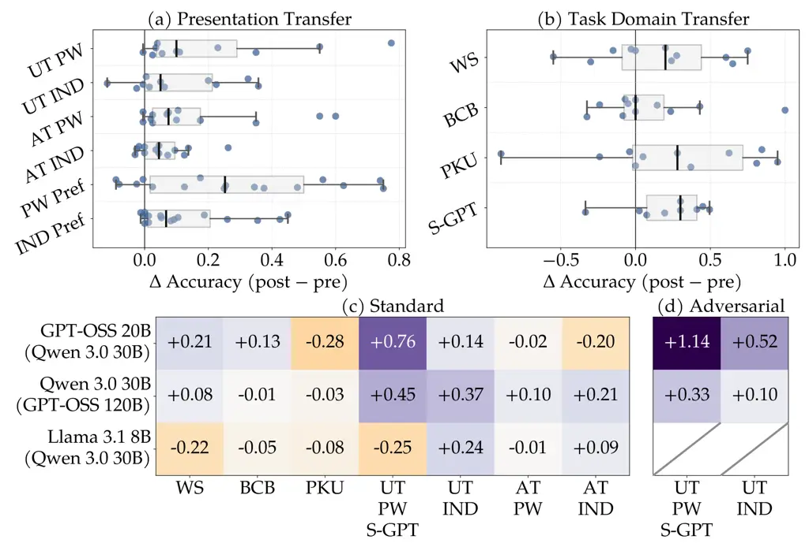

# Self-Generated Text Recognition: Quality Heuristics, Cross-Task Transfer, and Downstream Bias in LLM Evaluation

Jesse St. Amand ^(†)^(†)thanks: Corresponding author:
jesse.st.amand@gmail.com Affiliation: MARS    Callum Canavan
Affiliation: Independent    Sohaib Imran Affiliation: MARS    Joseph
Hewson Affiliation: Independent    Aaron Lutz Affiliation: Independent
   Shi Feng Affiliation: George Washington University    Puria Radmard
Affiliation: Geodesic Research    Lennie Wells Affiliation: University
of Cambridge

###### Abstract

Self-Generated Text Recognition (SGTR)—the ability of an LLM to identify
its own outputs—poses risks to AI safeguards that rely on LLMs as
evaluators or monitors: an LLM may recognize outputs from other copies
of the same model and make biased judgments or collude outright. Prior
work has drawn conflicting conclusions about whether current models
possess significant SGTR capabilities. We explain these disagreements by
identifying key experimental design choices—which we term
operationalizations—that drive divergent results. Evaluating 13–21
models across six presentation operationalizations and four task-domain
operationalizations, we find that accuracy varies substantially with
evaluation format (pairwise vs. individual assessments of text),
conversation format (presenting candidate text in user tags vs.
assistant tags), and the domain of the task used to generate candidate
text (e.g., coding vs. summarization). We corroborate previous
observations that a quality heuristic—models attributing authorship to
text they perceive as higher quality—is a dominant confound. We also
find that improving a model’s SGTR performance via supervised
fine-tuning (SFT) on one operationalization can generalize to others,
and can increase the model’s preference for its own outputs when it acts
as a judge in the AlpacaEval framework. Our results suggest that,
despite confounds, some models possess practical SGTR capabilities, and
that SGTR should be monitored and considered in the design of
safety-critical AI applications.

|     |
| --- |
|     |

## 1 Introduction

As LLMs are deployed with increasing autonomy in real-world
environments, situational awareness—a model’s knowledge of itself and
the context in which it is being run (Cotra, 2022; Ngo et al., 2024;
Berglund et al., 2023; Perez et al., 2023)—could become a significant
concern. Strong situational awareness could help a model distinguish
between training and deployment in order to pursue hidden objectives
(Hubinger et al., 2024) or identify and circumvent control protocols
(Terekhov et al., 2025).

Self-generated text recognition (SGTR)—the ability of models to
distinguish their own outputs from text produced by other sources—is one
capability that could increase an LLM’s situational awareness. Control
protocols such as trusted editing and honeypotting (Greenblatt et al., 2024) insert content written by weaker models into an untrusted LLM’s
context; robust SGTR would let that model distinguish its authentic
reasoning traces and environmental inputs from the intervention. In
multi-agent systems, SGTR could facilitate collusion without explicit
communication channels (Roger, 2024), and in LLM-as-a-Judge evaluations
it may induce systematic biases (Panickssery et al., 2024).

Although an understanding of current SGTR capabilities would be valuable
for anticipating these risks, SGTR remains poorly characterized: some
studies suggest models exhibit robust SGTR (Laine et al., 2024;
Panickssery et al., 2024), while others find that even recent models
struggle to exceed chance (Bai et al., 2025).

This work makes the following contributions:

1.  1.  A characterization of the key dimensions along which SGTR accuracy
        varies, such as the domain of the text being evaluated and how the
        evaluation task is presented (a single text classified for
        self-authorship vs. a pair of texts to be ranked; candidate text
        presented in user tags vs. assistant tags). We call a specific
        configuration of these parameters an operationalization of SGTR.
2.  2.  An evaluation of a subset of these operationalizations that accounts
        for the disagreement among previous studies. SGTR accuracy varies
        greatly across these conditions, suggesting that SGTR is
        context-dependent rather than uniform, and that prior studies are
        better read as operationalization-specific evidence than as
        contradictory conclusions. We also observe findings consistent with
        Davidson et al. (2024): that models are generally more likely to
        attribute authorship to text they judge as higher quality.
3.  3.  An analysis of how SGTR may improve as models are refined and
        trained on tasks that exercise overlapping skills. Training models
        on select operationalizations yields improved performance on
        held-out operationalizations.
4.  4.  A demonstration that improving a model’s SGTR performance via
        training can induce bias when it is used as a judge in AlpacaEval
        2.0 (Dubois et al., 2024), a widely used LLM-as-a-Judge framework.

## 2 Operationalizations of SGTR

We define an operationalization of SGTR as a specific combination of
experimental design choices that affect how SGTR is measured; we argue
that differences in operationalization explain conflicting prior
results.

### 2.1 Dimensions of variation

Our SGTR evaluations vary along the following dimensions:

1.  1.  Task domain. The type of task posed to the model when generating
        text samples, e.g., summarization or code generation. We write _task
        domain_ rather than _task_ to distinguish it from the SGTR
        evaluation task.
2.  2.  Evaluation target. Recognition prompts ask the model to identify
        whether text samples were generated by that model. Preference
        prompts ask it to judge the quality of text samples. By comparing
        these, one can measure the correlation between judgments of
        self-authorship and quality (Davidson et al., 2024).
3.  3.  Evaluation format. The format in which text samples are presented to
        the model for evaluation. In individual (IND) assessment, the model
        must classify a standalone sample. In pairwise (PW) assessment, the
        model is presented with two samples and must select the one that is
        more likely to be self-generated (or higher quality, depending on
        the evaluation target).
4.  4.  Conversation format. The structure of the prompt’s conversation
        history (Table 1). In user-tag (UT) experiments, a single user
        message carries the task-domain question, one or more sample
        responses to it, and the request for the model’s judgment of
        self-authorship or quality. In assistant-tag (AT) experiments, each
        sample response instead appears as an assistant turn answering a
        preceding user turn, followed by a final user message requesting the
        evaluation. The two correspond to distinct deployment scenarios:
        candidate text supplied as external input (user tag) vs. appearing
        as the model’s own prior turns (assistant tag), as in trusted
        editing control protocols, where a monitor model directly edits an
        untrusted model’s output (Greenblatt et al., 2024).

These dimensions yield two sets of operationalizations: presentation
operationalizations—combinations of evaluation target, evaluation
format, and conversation format, which together fix how the evaluation
task is presented—and task-domain operationalizations, which fix the
domain of the text being evaluated.

Additional dimensions not explored in this research include the
definition of “self” (same instance vs. same family vs. AI-generated
broadly), the pool of non-self text (other models, humans, or hybrids),
inclusion of reasoning traces as sample text, and measurement type
(prompting vs. probing). Prior work focuses on prompting with user-tag
formatting.

### 2.2 Related work

Several aspects of modern language model development could contribute to
SGTR: pretraining corpora include human- and machine-generated content
and comparisons between them, and AI-related discourse in training data
has been shown to impact model behavior (Tice et al., 2026); during
post-training, SGTR may help defend against many-shot jailbreaking
attacks that inject false assistant messages (Anil et al., 2024;
Ackerman & Panickssery, 2025b), or arise as an instrumental capability
aiding collaborative tasks. In this work we focus on measuring SGTR
rather than explaining its origins.

Davidson et al. (2024) found that models classify text they rate as
higher quality as self-generated, which we designate as the quality
heuristic and study further here. This heuristic connects SGTR to
self-preference bias—the tendency of an LLM acting as a judge to favor
its own outputs (Zheng et al., 2023; Panickssery et al., 2024; Wataoka
et al., 2024; Li et al., 2025). Ackerman & Panickssery (2025a)
identified a residual stream vector in Llama 3 8B Instruct that steers
authorship beliefs; we restrict our analysis to behavioral measurements.

Studies disagree on the extent of SGTR capabilities. Some report robust
performance: GPT 4 reliably discerns its text from human-generated text
in both pairwise and individual formats (Panickssery et al., 2024);
multiple models exceed chance in pairwise recognition against human text
(Laine et al., 2024); and Llama 3 8B Instruct can distinguish its text
from comparable models in pairwise settings, though performance degrades
when output lengths are normalized (Ackerman & Panickssery, 2025a).
Others find weak or no SGTR: recognition largely reflected quality
heuristics in a multiple-choice format (Davidson et al., 2024), and in
individual-format tests of 10 frontier models, text was
disproportionately attributed to well-known families regardless of
source (Bai et al., 2025).

One explanation for weak inter-model discrimination is that modern
models share training data, architectures, and optimization objectives,
producing genuinely similar output distributions (Jiang et al., 2025).
See Appendix A for a detailed mapping of prior work across
operationalization dimensions.

## 3 Methods

### 3.1 Operationalizations

We evaluate SGTR accuracy for six presentation operationalizations: two
evaluation formats (pairwise or individual), two conversation formats
(user tag or assistant tag), and two evaluation targets (recognition or
preference), where preference is assessed only in the user-tag format.
Each is evaluated across the four task-domain operationalizations of
§3.2.

#### 3.1.1 Prompt formats

In the pairwise evaluation format, models receive a task prompt
alongside two candidate responses: one originally generated by the
evaluating model and one by an alternative model. In the recognition
condition, models are asked which response they authored (“Which
response is your original output?”); in the preference condition, which
is of higher quality (“Which one of the two responses would you rate as
higher quality?”). Models indicate their selection by responding with
“1” or “2.” To control for position bias, we present each comparison
twice with the response order swapped.

In the individual evaluation format, models receive a task prompt and a
single candidate response. In the recognition condition, models are
informed that the response was sampled from a balanced pool, half from
the evaluating model and half from alternative models, and must
determine whether it is theirs (“Is this response your original
output?”); in the preference condition, whether it meets their standards
(“Does this response meet your own standards of quality?”). Models
respond with one of two designated tokens indicating acceptance or
rejection; as in the pairwise format, we present each sample twice,
swapping which token denotes acceptance.

Appendix H gives the prompt template for each of the six presentation
operationalizations (Tables 8–13); Table 1 contrasts the two
conversation formats.

| Assistant-tag format |                         |     | User-tag format |                        |
| -------------------- | ----------------------- | --- | --------------- | ---------------------- |
| Tag                  | Message                 |     | Tag             | Message                |
| System               | System prompt           |     | System          | System prompt          |
| User \#1             | User prompt             |     | User \#1        | User prompt            |
| Assistant \#1        | Pre-written Response A  |     | User \#1        | Pre-written Response A |
| User \#2             | User prompt (identical) |     | –               | –                      |
| Assistant \#2        | Pre-written Response B  |     | User \#1        | Pre-written Response B |
| User \#3             | SGTR-task prompt        |     | User \#1        | SGTR-task prompt       |

Table 1: Conversation formats for presenting candidate text. In the
_assistant-tag_ format, candidate responses appear as prior assistant
messages in a multi-turn exchange. In the _user-tag_ format, all content
is embedded within a single user message. “–” indicates the text is
absent.

#### 3.1.2 Evaluation targets

For recognition conditions, we report accuracy as the proportion of
correct judgments. In preference experiments, we instead measure how
often a model judges its own text to be higher quality: in the pairwise
setting, the rate at which it selects its own response over a competing
one; in the individual setting, the rate at which it judges its own
response—but not other models’ responses—to meet its “standards of
quality.”

For individual assessment experiments, we control for attribution
bias—the tendency of a model to answer uniformly across all text
sources, accepting or rejecting nearly everything regardless of
authorship—by weighting performance on alternative-model text and,
independently, self-generated text each at 50%. A model exhibiting
attribution bias then receives a score of 0.5, as does one that guesses
randomly.

To measure the relationship between model capability and SGTR
performance, we use Elo scores from the Arena (formerly LMArena /
Chatbot Arena) leaderboard (Chiang et al., 2024), derived from pairwise
human preference votes. We define _score distance_ as the evaluator’s
Elo score minus the text generator’s Elo score, where positive values
indicate the evaluator is the more capable model.

### 3.2 Datasets

We construct evaluation data from 250 prompts drawn from four publicly
available datasets spanning distinct task domains: WikiSum (Cohen
et al., 2021) for summarization (50 prompts), ShareGPT (RyokoAI, 2023)
for open-ended conversation (100 prompts), PKU-SafeRLHF (Ji et al., 2025) for safety-aligned QA (50 prompts), and BigCodeBench (Zhuo et al., 2025) for coding tasks (50 prompts). We choose these domains to elicit
different stylistic signatures from models. For each prompt, we generate
responses from all models in our evaluation set (temperature = 1.0),
which serve as candidate texts for SGTR and preference evaluations. Full
dataset descriptions are provided in Appendix G. Training data is
created similarly on 100 distinct prompts drawn per task domain at
temperature = 0.

### 3.3 Models

We use three nested model sets, summarized in Table 4 and enumerated
model by model in Table 5. The full set comprises 21 models across 7
providers: 15 instruct-only, 3 reasoning-only, and 3 dual-mode. Each
dual-mode model is evaluated both with and without chain-of-thought
reasoning enabled, so the full set yields 24 evaluator configurations;
reasoning evaluations are denoted “(R)” throughout. The instruct set
drops the 3 reasoning-only models, leaving the 18 configurations that
run in instruct mode. The reduced set is the 13 instruct models
available across every condition.

The full set is used for per-model recognition accuracy (Figure 1b) and
the user-tag recognition operationalizations (Figure 2a–b). The instruct
set is used for the two preference operationalizations, and hence for
the recognition–preference comparison (Figure 2e–f), as preference was
not run on the reasoning-only models. The reduced set is used for
cross-operationalization comparisons (Figure 1a) and the assistant-tag
operationalizations (Figure 2c–d). Qwen 2.5 7B has no Arena score and is
therefore excluded from analyses that use Elo score distance
(Figure 2a–d), leaving 23 user-tag and 12 assistant-tag evaluator
configurations; it is included in all other analyses. Training
experiments (Figure 3) use three separately fine-tuned models (§3.4).

### 3.4 SGTR training

To test how easily SGTR can be learned and transferred across
operationalizations, we fine-tune three models—Llama 3.1 8B, GPT-OSS
20B, and Qwen 3.0 30B—using supervised fine-tuning (SFT) with LoRA rank 32. Qwen 3.0 30B differs from the 80B variant in our evaluation set, and
GPT-OSS 20B likewise differs from the 120B variant; the smaller models
are more tractable to train. For each model, we construct training data
by supervising the correct answer on the evaluation prompt for a given
operationalization. Training data is balanced (50% self, 50%
alternative) with 100 samples per dataset, split 80/20 into train/val
sets. We train for 20 epochs with a learning rate of $`5\times 10^{-5}`$
and batch size 16.

We vary training along two axes: _operationalization_ (evaluation
format, conversation format, task domain) and _identity_. Standard
training teaches models to recognize their own text; adversarial
training teaches models to recognize a _different_ model’s text as their
own (e.g., GPT-OSS 20B trained to claim authorship of Qwen 3.0 30B’s
outputs). We evaluate transfer on held-out benchmarks that test unseen
operationalizations (e.g., trained on pairwise and tested on individual,
or trained on one task domain and tested on another).

### 3.5 AlpacaEval as an LLM-as-a-Judge testbed

We use AlpacaEval 2.0 (Dubois et al., 2024), a standard
instruction-following benchmark of 805 diverse instructions, as a
downstream testbed for self-preference bias. Each model generates
outputs on all instructions and then serves as a judge, ranking its own
outputs alongside every other model’s for each instruction.
Self-preference is measured as the average rank a judge assigns to its
own base model’s outputs, where lower rank indicates stronger
self-preference.

This lets us assess whether SGTR training amplifies self-preference in a
realistic evaluation pipeline, bearing directly on LLM-as-a-Judge
reliability.

## 4 Results

### 4.1 Recognition performance across operationalizations

SGTR accuracy is sensitive to how the task is presented. Figure 1a
summarizes recognition accuracy across operationalizations. Pairwise
evaluations and the user-tag format produce higher median accuracy and
greater spread than individual assessments and the assistant-tag format,
respectively. Per-model accuracies for the two user-tag recognition
operationalizations, and the difference between them, are reported in
Appendices C and D.

Figure 1b shows per-model pairwise recognition accuracy by dataset,
ordered by Arena Elo score. Performance varies widely across task
domains; the clearest trend is that reasoning models (except GPT-OSS
120B) perform best on PKU-SafeRLHF. Stronger models tend to have better
SGTR; as we show in the next section, this is partially explained by
models attributing authorship to text they perceive as higher quality.

Figure 1: (a) Box plots of recognition accuracy distributions. Each data
point is the accuracy of one (evaluator, generator) pair: how accurately
the evaluator recognizes its own text against that generator’s. The
purple, leftmost boxes show the four recognition operationalizations (UT
PW – user-tag pairwise, UT IND – user-tag individual, AT PW –
assistant-tag pairwise, and AT IND – assistant-tag individual) pooled
across all four task domains. The multicolor, rightmost boxes show the
four task domains (S-GPT – ShareGPT, PKU – PKU-SafeRLHF, BCB –
BigCodeBench, WS – WikiSum), pooled over the pairwise
operationalizations. The dashed line marks chance (0.5). (b) Mean
accuracies over generator models for the UT PW setting, grouped by
evaluator and colored by task domain, with evaluators ordered by Arena
Elo score (lowest on the left; Qwen 2.5 7B, which has no score, first).
Asterisks mark accuracies significantly different from chance (two-sided
binomial test, $`p<0.05`$). Model names ending in “(R)” denote
evaluations run with chain-of-thought reasoning enabled; text color
groups models by their provider.

### 4.2 Quality as a recognition heuristic

Models often claim authorship of text they perceive as higher quality.
We support this claim with two analyses. First, recognition accuracy
correlates positively with Elo score distance across all four
recognition operationalizations (Figure 2a–d; $`R^{2}=0.23`$–$`0.34`$
within evaluator and task domain), with evaluators approaching ceiling
against weaker generators and falling below chance against stronger
ones. Appendix E plots recognition accuracy directly against evaluator
Arena Elo score. We additionally conduct preference experiments using
nearly identical prompts that ask models to judge quality rather than
authorship (Tables 10–11). In the pairwise setting (Figure 2e),
recognition and preference are highly correlated
($`R^{2}=0.61`$–$`0.89`$). In the individual setting (Figure 2f), the
correlation weakens ($`R^{2}=0.04`$–$`0.75`$), though the format also
compresses both measures toward chance (Figure 1a), which attenuates the
correlation on its own. The score-distance relationship, by contrast, is
of comparable strength in both formats. Additionally, most evaluators
are fitted above $`0.5`$ accuracy at an Elo distance of $`0`$
(Figure 2a: 21 of 23; b: 19 of 23; c: 12 of 12), and for most of these
the 95% bootstrap interval lies wholly above $`0.5`$ (17, 19, and 9
respectively). This is weakest in the assistant-tag individual
operationalization (d: 8 of 12), where every fitted intercept falls
within $`0.05`$ of chance. Appendix F reports these intercepts per
evaluator.

Figure 2: Evidence for quality-based recognition heuristic. (a–d)
Recognition accuracy vs. Elo score distance (evaluator score $`-`$
generator score) across the four recognition operationalizations:
user-tag pairwise (a), user-tag individual (b), assistant-tag pairwise
(c), and assistant-tag individual (d). Positive score distance indicates
a stronger evaluator. Points colored by dataset; black regression line
with 95% bootstrap CI, fitted with evaluator $`\times`$ task-domain
fixed effects (the slope reflects within-evaluator variation) and drawn
at the weighted mean intercept. Annotated with $`R^{2}`$ and the fitted
slope $`m`$, expressed as the change in accuracy per 100 Elo points.
Individual-format results (b, d) are corrected for attribution bias,
which halves the slope scale of these panels relative to (a, c). (e, f)
Recognition performance vs. preference performance for the pairwise (e)
and individual (f) formats, over the 18 instruct evaluator
configurations for which preference data exist. Each point is one
model–dataset pair, colored by dataset as in (a–d), with per-dataset
weighted regression lines, 95% CI bands, and each dataset’s $`R^{2}`$ in
the panel legend. The color key below the panels applies to all six.

Second, to test whether recognition persists when sample quality is more
similar, we restrict model pairs to those within $`\pm`$20 Arena Elo
points of each other, which yields smaller capability–accuracy
correlations (Appendix I); some models remain above chance in select
operationalizations, though too few samples survive the restriction to
be definitive.

### 4.3 Training for SGTR

SGTR training transfers across operationalizations. We fine-tune the
three models of §3.4 to claim authorship of their own text and evaluate
on held-out operationalizations. Figure 3a–b shows the accuracy change
(post $`-`$ pre) for each model–training condition pair, with the
trained condition excluded. Panel (a) shows transfer across the three
presentation dimensions of §2.1—evaluation format, conversation format,
and evaluation target—with all runs trained on ShareGPT recognition:
training on one operationalization generally improves accuracy on the
others, though the magnitude varies by model. The two held-out
_preference_ rows improve as well (median $`+0.25`$ pairwise, $`+0.07`$
individual): training a model to recognize its own text also raises the
rate at which it prefers that text, anticipating the AlpacaEval result
below. Panel (b) shows task-domain transfer (all trained on UT PW):
cross-domain generalization is positive on average, though weaker or
even negative for BigCodeBench. Adversarially trained models (trained to
recognize a _different_ model’s text as their own) are also plotted;
these too transfer across operationalizations.

Figure 3: SGTR training transfer, and its downstream effect on
LLM-as-a-Judge. All four panels report the same training runs and share
one set of abbreviations: evaluation formats PW (pairwise) and IND
(individual), conversation formats UT (user-tag) and AT (assistant-tag),
the preference task Pref, and task domains WS (WikiSum), BCB
(BigCodeBench), PKU (PKU-SafeRLHF), and S-GPT (ShareGPT). Conditions
labeled by presentation operationalization are trained on S-GPT; those
labeled by task domain are trained on UT PW. (a, b) Training transfer:
accuracy change (post $`-`$ pre) on a held-out test condition, across
the presentation operationalizations, i.e., evaluation format,
conversation format, and evaluation target (a), and across task domains
(b). Each dot represents one (model, training condition) pair; box plots
summarize the per-row distribution. The trained condition is excluded
from each row. Appendix J (Figure 9) reproduces these panels with
markers identifying each point’s model and training condition. (c, d)
Change in AlpacaEval 2.0 self-rank after the same training, for standard
(c) and adversarial (d) training. The panels share row labels; the model
named in parentheses is the one the row’s model is trained against in
(c) and trained to impersonate in (d). Llama 3.1 8B has no adversarial
run, so its cells in (d) are struck through. Each cell is one model’s
average rank improvement after training on one operationalization—for
its own text in (c), and for the text of the model it was trained to
impersonate in (d)—so a positive cell means increased preference.
Shading is redundant with the printed value on one shared color scale:
purple marks a rank improvement, orange a decline, with saturation
proportional to magnitude.

SGTR training can shift self-preference in LLM-as-a-Judge. To measure
how SGTR training affects downstream evaluation, we use trained models
as judges in AlpacaEval 2.0. Figure 3c reports the change in the average
rank a judge assigns its own text; because a lower rank number denotes a
higher rank, we report the change as an improvement, so positive values
indicate stronger self-preference.

The effect is concentrated in the operationalizations closest to the
judging task rather than uniform across them. It is largest for UT PW,
where GPT-OSS 20B gains $`0.76`$ and Qwen 3.0 30B $`0.45`$ when trained
on ShareGPT, and smaller but still positive for UT IND ($`+0.14`$ and
$`+0.37`$); training on the assistant-tag operationalizations or on the
non-ShareGPT domains produces weaker and less consistent shifts. Llama
3.1 8B is an outlier, declining in five of seven conditions. This may be
noise, or may reflect the smallest model’s difficulty carrying a binary
decision over to ranking: its accuracy on the held-out preference
operationalizations—that is, the rate at which it selects its own
text—does improve ($`+0.31`$ pairwise, $`+0.17`$ individual, averaged
over training conditions; Table 18), so the failure appears specific to
the AlpacaEval ranking format.

Adversarial training distinguishes two explanations for the
self-preference increase above—improved recognition of the model’s own
text, or generally sharper stylistic discrimination: if preference
tracks authorship, redirecting recognition toward another model’s text
should redirect preference; if it tracks style alone, it should not. We
train GPT-OSS 20B to recognize Qwen 3.0 30B’s text as self-generated and
Qwen to recognize GPT-OSS 120B’s text (using the larger 120B variant as
the target because GPT-OSS 20B’s outputs are too easy for Qwen to
distinguish from its own). Figure 3d shows that adversarial training
increases preference for the new target. GPT-OSS 20B trained as Qwen on
UT PW moves Qwen’s text up $`1.14`$ rank points. Qwen trained as GPT-OSS
120B on UT PW shows a weaker but directionally consistent effect, moving
GPT-OSS’s text up $`0.33`$ rank points.

## 5 Discussion

The operationalization framework provides evidence that SGTR accuracy is
sensitive to how the task is presented, helping to explain why prior
studies, which used different operationalizations, reached conflicting
conclusions. Evaluation format, conversation format, and task domain
each yield distinct accuracy distributions, and individual models vary
greatly in their performance per domain (Figure 1).

Evidence for the quality heuristic appears in every operationalization
we test, and at comparable strength in each, but it accounts for only
part of recognition performance. Elo score distance explains roughly a
quarter to a third of the within-evaluator variance in accuracy in both
formats (§4.2; $`R^{2}`$ is scale-free, so the attribution-bias
correction leaves this comparison unchanged), and the weaker
recognition–preference coupling in the individual format is consistent
with that format’s compression of both measures toward chance. The
heuristic therefore appears to operate in the individual format as it
does in the pairwise one, moving a harder and more compressed measure
less in absolute terms while explaining a similar share of its variance.
The heuristic is nonetheless an incomplete account, as the fitted
intercepts show: most evaluators are placed above chance at zero Elo
score distance (§4.2, Appendix F), so accuracy does not reduce entirely
to the capability gap.

We attribute the pairwise–individual differences to two effects. The
higher pairwise median is consistent with the comparison providing
additional evidence: the evaluator sees roughly twice as much candidate
text and can juxtapose the two responses to isolate the stylistic
features that distinguish them. The greater spread aligns with the
quality heuristic, which ties accuracy to the evaluator–generator
quality gap and so pushes accuracies toward both extremes (§4.2).
Accordingly, accuracy rises more steeply with score distance in the
pairwise formats ($`m=0.15`$, $`0.09`$) than in the individual formats
($`m=0.06`$, $`0.05`$; Figure 2a–d). Half of this gap is
definitional—the attribution-bias correction halves the
individual-format scale—and accounting for it, the user-tag difference
persists (about $`1.3\times`$) while the assistant-tag slopes are
comparable, consistent with the same heuristic acting on a compressed
scale rather than a weaker heuristic.

Our training experiments show that SGTR is learnable and transfers
across operationalizations: models trained on a single condition improve
on held-out evaluation formats, conversation formats, and task domains,
suggesting that training captures generalizable features rather than
operationalization-specific shortcuts. This has direct downstream
consequences: on the operationalizations closest to the judging task,
trained judges shift toward their own text in AlpacaEval 2.0, and
adversarial training redirects that shift toward whichever model the
judge was trained to recognize. The effect is neither uniform across
operationalizations nor across models—one of our three base models moves
the other way—but where it appears it is large enough to change
evaluation results.

### 5.1 Limitations

Our operationalizations span four task domains, two evaluation formats,
and two conversation formats, but may not generalize to substantially
longer candidate texts, reasoning traces, or creative tasks. By design,
every evaluation is binary—two candidates in the pairwise format, accept
or reject in the individual format—which keeps the task tractable for
weaker models, so that accuracy differences are more likely to reflect
SGTR than task comprehension; Bai et al. (2025) report near-chance
accuracy for most models when identifying a generator among many
alternatives. Our prompts are also zero-shot, isolating whatever notion
of self-generated text a model internalized during training; few-shot
prompts could instead be solved partly by in-context pattern completion.
Training experiments use only three base models with small datasets and
low-rank LoRA SFT; larger-scale training or RL may yield different
results. Our AlpacaEval analysis measures self-rank change but does not
assess whether the resulting rankings are more or less accurate. Our
analysis is entirely behavioral: it does not examine internal
activations, nor does it identify which text features drive predictions
(such as response length (Ackerman & Panickssery, 2025a) and
correctness, for which we do not control).

### 5.2 Conclusion

We identify key dimensions along which SGTR evaluations vary and show
that accuracy is sensitive to operationalization, which accounts for
much of the disagreement among prior results. SGTR is thus
context-dependent and model-specific rather than uniform: any single
measurement—including our own—is relative to the operationalization that
produced it, and developers should assess recognition under their own
deployment conditions. The quality heuristic is a dominant confound in
every operationalization we test, most visibly in the pairwise settings,
where recognition and preference are tightly coupled; quality
differences alone may therefore suffice to subvert AI control protocols
that employ honeypots or trusted edits, which typically use weaker
models to generate replacement content (Greenblatt et al., 2024). The
heuristic is not a complete account, however: most evaluators still
recognize their own text above chance against generators of equal Elo
score, so such protocols should also be tested against models with
enhanced recognition. Finally, SGTR is trainable via SFT and transfers
broadly across held-out presentation and task domains
operationalizations: a model fine-tuned on modest SGTR data shifts
toward its own text as an AlpacaEval 2.0 judge, and adversarial training
redirects that shift to arbitrary target models. Benchmarks that rely on
LLM judges, such as AlpacaEval and Arena, should account for this bias,
which the transferability of SGTR training suggests models might acquire
incidentally through post-training on related tasks.

## Acknowledgments

Claude Code (Anthropic, 2025b) and Cursor (Anysphere, 2025) were used to
assist with data analysis pipelines, figure generation, and iterative
editing of paper text, including drafting and restructuring content. All
references were independently verified by the authors.

This work was supported by the UK AI Security Institute (AISI) through
the AISI Challenge Fund, funded by the Department for Science,
Innovation and Technology (DSIT) \[grant ref. G2-SCH-2025-01-16275\].
The grant was administered through Meridian Impact CIC, which also
hosted part of this work. We thank the Cambridge AI Safety Hub (CAISH)
for facilitating this collaboration through its Mentorship for Alignment
Research Students (MARS) program. We would also like to personally thank
Cameron Tice, Edward Young, and Hannes Whittingham for mentorship and
feedback during the early stages of the project as part of MARS.

## Ethics Statement

This work characterizes, and deliberately enhances, a dual-use
capability. Demonstrating that SGTR is trainable, transfers across
operationalizations, and can be redirected toward an arbitrary target
model could in principle inform attempts to bias LLM-as-a-Judge
evaluations or to probe AI control protocols. We judge the marginal risk
of publication to be low: the training recipe is standard LoRA SFT on a
few hundred examples of a straightforwardly constructed task, within
reach of any actor able to fine-tune a model, so publication chiefly
informs defenders rather than enabling attackers. Conversely, the
results identify concrete failure modes—quality-driven subversion of
honeypot and trusted-editing protocols, and judge bias that models might
acquire incidentally through post-training—that benchmark maintainers
and control-protocol designers can now test for. Our experiments involve
no human subjects and no personal data. All evaluation and training
prompts are drawn from publicly available datasets; prompts from
PKU-SafeRLHF are used to elicit stylistic variation in safety-aligned
responses, not to train models to produce harmful content. All models
are open-weight or accessed through commercial APIs under their terms of
service. Use of AI assistance in preparing this paper is disclosed in
the Acknowledgments.

## Reproducibility Statement

Code is released in three repositories: experiment configurations, data
pipelines, and analysis
([https://github.com/jesse-st-amand/self-rec-research](https://github.com/jesse-st-amand/self-rec-research));
the evaluation framework
([https://github.com/MARS-3-0-self-recognition/self-rec-framework](https://github.com/MARS-3-0-self-recognition/self-rec-framework));
and the training framework
([https://github.com/jesse-st-amand/SGTR-SFT](https://github.com/jesse-st-amand/SGTR-SFT)).
The prompt template for every operationalization is reproduced in
Appendix H; each contains placeholders that are filled at evaluation
time with a task prompt and pre-recorded model responses drawn from the
four task-domain datasets (§3.2, Appendix G). The model roster,
including the exact API model identifiers and the Arena Elo score
mapping (March 2026 snapshot), is given in Appendix B; fine-tuning data
construction and hyperparameters in §3.4; and the AlpacaEval 2.0 judging
setup in §3.5. To the best of our knowledge, all data relevant to
reproducing our analyses—the instantiated evaluation data and experiment
results—is available at
[https://huggingface.co/datasets/SGTR-Geodesic/self-rec-results](https://huggingface.co/datasets/SGTR-Geodesic/self-rec-results);
questions and reports of missing data should be directed to the
corresponding author. While our analyses can be reproduced exactly from
the released data, we expect regenerating the data itself to yield
statistically similar rather than numerically identical results, for two
reasons. First, candidate texts are sampled at temperature 1.0, so
regenerated data will differ across runs. Second, several evaluated
models are no longer hosted by their original providers: some remain
available elsewhere, potentially as different instantiations of the same
model identifier, while others are wholly inaccessible.

## References

- Ackerman & Panickssery (2025a) Christopher Ackerman and Nina
  Panickssery. Inspection and Control of Self-Generated-Text Recognition
  Ability in Llama3-8b-Instruct, April 2025a. URL
  [http://arxiv.org/abs/2410.02064](http://arxiv.org/abs/2410.02064).
  arXiv:2410.02064 \[cs\].
- Ackerman & Panickssery (2025b) Christopher M. Ackerman and Nina
  Panickssery. Mitigating Many-Shot Jailbreaking, May 2025b. URL
  [http://arxiv.org/abs/2504.09604](http://arxiv.org/abs/2504.09604).
  arXiv:2504.09604 \[cs\] version: 3.
- Anil et al. (2024) Cem Anil, Esin Durmus, Mrinank Sharma, Joe Benton,
  Sandipan Kundu, Joshua Batson, Nina Panickssery, Meg Tong, Jesse Mu,
  Daniel Ford, Francesco Mosconi, Rajashree Agrawal, Rylan Schaeffer,
  Naomi Bashkansky, Samuel Svenningsen, Mike Lambert, Ansh
  Radhakrishnan, Carson Denison, Evan J Hubinger, Yuntao Bai, Trenton
  Bricken, Timothy Maxwell, Nicholas Schiefer, Jamie Sully, Alex Tamkin,
  Tamera Lanham, Karina Nguyen, Tomasz Korbak, Jared Kaplan, Deep
  Ganguli, Samuel R Bowman, Ethan Perez, Roger Grosse, and David
  Duvenaud. Many-shot Jailbreaking. In _Advances in Neural Information
  Processing Systems 37 (NeurIPS 2024)_, April 2024.
- Anthropic (2025a) Anthropic. The Claude model family.
  [https://www.anthropic.com/claude](https://www.anthropic.com/claude),
  2025a.
- Anthropic (2025b) Anthropic. Claude Code.
  [https://docs.anthropic.com/en/docs/claude-code](https://docs.anthropic.com/en/docs/claude-code),
  2025b. AI-powered coding assistant.
- Anysphere (2025) Anysphere. Cursor: The AI code editor.
  [https://cursor.com](https://cursor.com), 2025.
- Bai et al. (2025) Xiaoyan Bai, Aryan Shrivastava, Ari Holtzman, and
  Chenhao Tan. Know Thyself? On the Incapability and Implications of AI
  Self-Recognition, October 2025. URL
  [http://arxiv.org/abs/2510.03399](http://arxiv.org/abs/2510.03399).
  arXiv:2510.03399 \[cs\].
- Berglund et al. (2023) Lukas Berglund, Asa Cooper Stickland, Mikita
  Balesni, Max Kaufmann, Meg Tong, Tomasz Korbak, Daniel Kokotajlo, and
  Owain Evans. Taken out of context: On measuring situational awareness
  in LLMs, 2023. URL
  [https://arxiv.org/abs/2309.00667](https://arxiv.org/abs/2309.00667).
- Chiang et al. (2024) Wei-Lin Chiang, Lianmin Zheng, Ying Sheng,
  Anastasios Nikolas Angelopoulos, Tianle Li, Dacheng Li, Hao Zhang,
  Banghua Zhu, Michael Jordan, Joseph E. Gonzalez, and Ion Stoica.
  Chatbot Arena: An Open Platform for Evaluating LLMs by Human
  Preference, March 2024. URL
  [http://arxiv.org/abs/2403.04132](http://arxiv.org/abs/2403.04132).
  arXiv:2403.04132 \[cs\].
- Cohen et al. (2021) Nachshon Cohen, Oren Kalinsky, Yftah Ziser, and
  Alessandro Moschitti. WikiSum: Coherent Summarization Dataset for
  Efficient Human-Evaluation. In _Proceedings of the 59th Annual Meeting
  of the Association for Computational Linguistics and the 11th
  International Joint Conference on Natural Language Processing (Volume
  2: Short Papers)_, pp. 212–219, Online, 2021. Association for
  Computational Linguistics. doi: 10.18653/v1/2021.acl-short.28. URL
  [https://aclanthology.org/2021.acl-short.28](https://aclanthology.org/2021.acl-short.28).
- Cotra (2022) Ajeya Cotra. Without specific countermeasures, the
  easiest path to transformative AI likely leads to AI takeover.
  [https://www.lesswrong.com/posts/pRkFkzwKZ2zfa3R6H/without-specific-countermeasures-the-easiest-path-to](https://www.lesswrong.com/posts/pRkFkzwKZ2zfa3R6H/without-specific-countermeasures-the-easiest-path-to), 2022.
  LessWrong post, 18 July 2022.
- Davidson et al. (2024) Tim R. Davidson, Viacheslav Surkov, Veniamin
  Veselovsky, Giuseppe Russo, Robert West, and Caglar Gulcehre.
  Self-Recognition in Language Models, October 2024. URL
  [http://arxiv.org/abs/2407.06946](http://arxiv.org/abs/2407.06946).
  arXiv:2407.06946 \[cs\].
- DeepSeek-AI (2024) DeepSeek-AI. DeepSeek-V3 technical report, 2024.
- DeepSeek-AI (2025) DeepSeek-AI. DeepSeek-R1: Incentivizing reasoning
  capability in LLMs via reinforcement learning, 2025.
- Dubois et al. (2024) Yann Dubois, Balazs Galambosi, Percy Liang, and
  Tatsunori B. Hashimoto. Length-controlled AlpacaEval: A simple way to
  debias automatic evaluators. _arXiv preprint arXiv:2404.04475_, 2024.
- Gemini Team et al. (2023) Gemini Team et al. Gemini: A family of
  highly capable multimodal models, 2023.
- Grattafiori et al. (2024) Aaron Grattafiori, Abhimanyu Dubey, et al.
  The Llama 3 herd of models, 2024.
- Greenblatt et al. (2024) Ryan Greenblatt, Buck Shlegeris, Kshitij
  Sachan, and Fabien Roger. AI Control: Improving Safety Despite
  Intentional Subversion, July 2024. URL
  [http://arxiv.org/abs/2312.06942](http://arxiv.org/abs/2312.06942).
  arXiv:2312.06942 \[cs\].
- Hubinger et al. (2024) Evan Hubinger, Carson Denison, Jesse Mu, Mike
  Lambert, Meg Tong, Monte MacDiarmid, Tamera Lanham, Daniel M. Ziegler,
  Tim Maxwell, Newton Cheng, Adam S. Jermyn, Amanda Askell, Ansh
  Radhakrishnan, Cem Anil, David Duvenaud, Deep Ganguli, Fazl Barez,
  Jack Clark, Kamal Ndousse, Kshitij Sachan, Michael Sellitto, Mrinank
  Sharma, Nova DasSarma, Roger B. Grosse, Shauna Kravec, Yuntao Bai,
  Zachary Witten, Marina Favaro, Jan Brauner, Holden Karnofsky, Paul F.
  Christiano, Samuel R. Bowman, Logan Graham, Jared Kaplan, Sören
  Mindermann, Ryan Greenblatt, Buck Shlegeris, Nicholas Schiefer, and
  Ethan Perez. Sleeper Agents: Training Deceptive LLMs that Persist
  Through Safety Training. _CoRR_, abs/2401.05566, 2024. doi:
  10.48550/ARXIV.2401.05566. URL
  [https://doi.org/10.48550/arXiv.2401.05566](https://doi.org/10.48550/arXiv.2401.05566).
- Ji et al. (2025) Jiaming Ji, Donghai Hong, Borong Zhang, Boyuan Chen,
  Juntao Dai, Boren Zheng, Tianyi Qiu, Jiayi Zhou, Kaile Wang, Boxuan
  Li, Sirui Han, Yike Guo, and Yaodong Yang. PKU-SafeRLHF: Towards
  Multi-Level Safety Alignment for LLMs with Human Preference,
  June 2025. URL
  [http://arxiv.org/abs/2406.15513](http://arxiv.org/abs/2406.15513).
  arXiv:2406.15513 \[cs\].
- Jiang et al. (2025) Liwei Jiang, Yuanjun Chai, Margaret Li, Mickel
  Liu, Raymond Fok, Nouha Dziri, Yulia Tsvetkov, Maarten Sap, Alon
  Albalak, and Yejin Choi. Artificial Hivemind: The Open-Ended
  Homogeneity of Language Models (and Beyond), October 2025. URL
  [http://arxiv.org/abs/2510.22954](http://arxiv.org/abs/2510.22954).
  arXiv:2510.22954 \[cs\].
- Kimi Team (2025) Kimi Team. Kimi K2: Open agentic intelligence, 2025.
- Laine et al. (2024) Rudolf Laine, Bilal Chughtai, Jan Betley, Kaivalya
  Hariharan, Jeremy Scheurer, Mikita Balesni, Marius Hobbhahn, Alexander
  Meinke, and Owain Evans. Me, Myself, and AI: The Situational Awareness
  Dataset (SAD) for LLMs, July 2024. URL
  [http://arxiv.org/abs/2407.04694](http://arxiv.org/abs/2407.04694).
  arXiv:2407.04694 \[cs\].
- Li et al. (2025) Dawei Li, Renliang Sun, Yue Huang, Ming Zhong, Bohan
  Jiang, Jiawei Han, Xiangliang Zhang, Wei Wang, and Huan Liu.
  Preference Leakage: A Contamination Problem in LLM-as-a-judge, 2025.
  URL
  [http://arxiv.org/abs/2502.01534](http://arxiv.org/abs/2502.01534).
  arXiv:2502.01534 \[cs\]. Presented at ICLR 2026.
- Ngo et al. (2024) Richard Ngo, Lawrence Chan, and Sören Mindermann.
  The Alignment Problem from a Deep Learning Perspective. In _The
  Twelfth International Conference on Learning Representations_, 2024.
  URL
  [https://openreview.net/forum?id=fh8EYKFKns](https://openreview.net/forum?id=fh8EYKFKns).
- OpenAI (2023) OpenAI. GPT-4 technical report, 2023.
- OpenAI (2024) OpenAI. GPT-4o system card, 2024.
- Panickssery et al. (2024) Arjun Panickssery, Samuel R. Bowman, and Shi
  Feng. LLM Evaluators Recognize and Favor Their Own Generations,
  April 2024. URL
  [http://arxiv.org/abs/2404.13076](http://arxiv.org/abs/2404.13076).
  arXiv:2404.13076 \[cs\].
- Perez et al. (2023) Ethan Perez, Sam Ringer, Kamile Lukosiute, Karina
  Nguyen, Edwin Chen, Scott Heiner, Craig Pettit, Catherine Olsson,
  Sandipan Kundu, Saurav Kadavath, Andy Jones, Anna Chen, Benjamin Mann,
  Brian Israel, Bryan Seethor, Cameron McKinnon, Christopher Olah,
  Da Yan, Daniela Amodei, Dario Amodei, Dawn Drain, Dustin Li, Eli
  Tran-Johnson, Guro Khundadze, Jackson Kernion, James Landis, Jamie
  Kerr, Jared Mueller, Jeeyoon Hyun, Joshua Landau, Kamal Ndousse,
  Landon Goldberg, Liane Lovitt, Martin Lucas, Michael Sellitto, Miranda
  Zhang, Neerav Kingsland, Nelson Elhage, Nicholas Joseph, Noemi
  Mercado, Nova DasSarma, Oliver Rausch, Robin Larson, Sam McCandlish,
  Scott Johnston, Shauna Kravec, Sheer El Showk, Tamera Lanham, Timothy
  Telleen-Lawton, Tom Brown, Tom Henighan, Tristan Hume, Yuntao Bai, Zac
  Hatfield-Dodds, Jack Clark, Samuel R. Bowman, Amanda Askell, Roger
  Grosse, Danny Hernandez, Deep Ganguli, Evan Hubinger, Nicholas
  Schiefer, and Jared Kaplan. Discovering Language Model Behaviors with
  Model-Written Evaluations. In Anna Rogers, Jordan Boyd-Graber, and
  Naoaki Okazaki (eds.), _Findings of the Association for Computational
  Linguistics: ACL 2023_, pp. 13387–13434, Toronto, Canada, July 2023.
  Association for Computational Linguistics. doi:
  10.18653/v1/2023.findings-acl.847. URL
  [https://aclanthology.org/2023.findings-acl.847/](https://aclanthology.org/2023.findings-acl.847/).
- Roger (2024) Fabien Roger. An issue with training schemers with
  supervised fine-tuning. AlignmentForum blog post, June 2024. URL
  [https://www.alignmentforum.org/posts/mXYdYh6L9odTJZDSm/an-issue-with-training-schemers-with-supervised-fine-tuning](https://www.alignmentforum.org/posts/mXYdYh6L9odTJZDSm/an-issue-with-training-schemers-with-supervised-fine-tuning).
- RyokoAI (2023) RyokoAI. ShareGPT52K.
  [https://huggingface.co/datasets/RyokoAI/ShareGPT52K](https://huggingface.co/datasets/RyokoAI/ShareGPT52K), 2023.
  Dataset of human-LLM conversations, accessed via HuggingFace.
- Terekhov et al. (2025) Mikhail Terekhov, Alexander Panfilov, Daniil
  Dzenhaliou, Caglar Gulcehre, Maksym Andriushchenko, Ameya Prabhu, and
  Jonas Geiping. Adaptive attacks on trusted monitors subvert ai control
  protocols, 2025. URL
  [https://arxiv.org/abs/2510.09462](https://arxiv.org/abs/2510.09462).
- Tice et al. (2026) Cameron Tice, Puria Radmard, Samuel Ratnam, Andy
  Kim, David Africa, and Kyle O’Brien. Alignment Pretraining: AI
  Discourse Causes Self-Fulfilling (Mis)alignment, January 2026. URL
  [http://arxiv.org/abs/2601.10160](http://arxiv.org/abs/2601.10160).
  arXiv:2601.10160.
- Wataoka et al. (2024) Koki Wataoka, Tsubasa Takahashi, and Ryokan Ri.
  Self-Preference Bias in LLM-as-a-Judge, 2024. URL
  [http://arxiv.org/abs/2410.21819](http://arxiv.org/abs/2410.21819).
  arXiv:2410.21819 \[cs\].
- Yang et al. (2024) An Yang, Baosong Yang, et al. Qwen2.5 technical
  report, 2024.
- Zheng et al. (2023) Lianmin Zheng, Wei-Lin Chiang, Ying Sheng, Siyuan
  Zhuang, Zhanghao Wu, Yonghao Zhuang, Zi Lin, Zhuohan Li, Dacheng Li,
  Eric P. Xing, Hao Zhang, Joseph E. Gonzalez, and Ion Stoica. Judging
  LLM-as-a-Judge with MT-Bench and Chatbot Arena, 2023. URL
  [http://arxiv.org/abs/2306.05685](http://arxiv.org/abs/2306.05685).
  arXiv:2306.05685 \[cs\]. Presented at NeurIPS 2023 Datasets and
  Benchmarks Track.
- Zhuo et al. (2025) Terry Yue Zhuo, Minh Chien Vu, Jenny Chim, Han Hu,
  Wenhao Yu, Ratnadira Widyasari, Imam Nur Bani Yusuf, Haolan Zhan,
  Junda He, Indraneil Paul, Simon Brunner, Chen Gong, Thong Hoang,
  Armel Randy Zebaze, Xiaoheng Hong, Wen-Ding Li, Jean Kaddour, Ming Xu,
  Zhihan Zhang, Prateek Yadav, Naman Jain, Alex Gu, Zhoujun Cheng,
  Jiawei Liu, Qian Liu, Zijian Wang, Binyuan Hui, Niklas Muennighoff,
  David Lo, Daniel Fried, Xiaoning Du, Harm de Vries, and Leandro Von
  Werra. BigCodeBench: Benchmarking Code Generation with Diverse
  Function Calls and Complex Instructions, April 2025. URL
  [http://arxiv.org/abs/2406.15877](http://arxiv.org/abs/2406.15877).
  arXiv:2406.15877 \[cs\].

## Appendix A Prior work detailed mapping

Table 2 maps prior SGTR work across the operationalization dimensions of
§2.1, and Table 3 gives the task domain and headline finding of each
study.

| Paper                  | Format       | Self notion | Other notion        | Content      |
| ---------------------- | ------------ | ----------- | ------------------- | ------------ |
| Laine et al.           | PW           | Same model  | Human               | Final answer |
| Panickssery et al.     | PW & IND     | Same model  | Other models, Human | Final answer |
| Davidson et al.        | PW, IND, MC  | Same model  | Other models        | Final answer |
| Bai et al.             | IND & IND-MC | Same model  | Other models        | Final answer |
| Ackerman & Panickssery | PW & IND     | Same model  | Other models, Human | Final answer |

Table 2: Prior work: experimental design. Abbreviations: PW – Pairwise,
IND – Individual, MC – Multiple Choice ($`n>2`$), IND-MC – Individual
text with multiple-choice identification. All studies use prompting with
candidate text in user tags.

| Paper                  | Task domain / Dataset                         | Key finding                                      |
| ---------------------- | --------------------------------------------- | ------------------------------------------------ |
| Laine et al.           | Custom prompts                                | Above-chance recognition in pairwise format      |
| Panickssery et al.     | XSUM, CNN/DailyMail                           | Self-preference bias; trainable via fine-tuning  |
| Davidson et al.        | Answers to model-generated security questions | Quality heuristic dominates recognition          |
| Bai et al.             | Creative, technical, opinion tasks            | Systematic brand biases in attribution           |
| Ackerman & Panickssery | CNN, XSUM, DOLLY, SAD                         | Residual stream vector steers authorship beliefs |

Table 3: Prior work: datasets and key findings.

## Appendix B Model sets

We draw evaluators from three nested sets. Table 4 states what each set
contains and where it is used; Table 5 lists every model, its available
modes, its Arena Elo scores, and its set membership.

An _evaluator configuration_ is a model together with a reasoning mode.
The three dual-mode models each contribute two configurations, so the 21
models of the full set yield 24 configurations. The instruct set is the
full set minus the three reasoning-only models, and therefore contains
one configuration per model. The reduced set is the subset of instruct
models for which every operationalization was run.

| Set      | Models | Configurations | Used for                                                                                                     |
| -------- | ------ | -------------- | ------------------------------------------------------------------------------------------------------------ |
| Full     | 21     | 24             | Per-model recognition accuracy (Figure 1b); user-tag recognition operationalizations (Figure 2a–b)           |
| Instruct | 18     | 18             | Both preference operationalizations, and hence the recognition–preference comparison (Figure 2e–f)           |
| Reduced  | 13     | 13             | Cross-operationalization comparison (Figure 1a); assistant-tag recognition operationalizations (Figure 2c–d) |

Table 4: The three model sets. Each set is a subset of the one above it.
Preference was not run on the reasoning-only models, which is why the
recognition–preference panels use the instruct set rather than the full
set.

|           |                       |       |           |      |      |        |      |
| --------- | --------------------- | ----- | --------- | ---- | ---- | ------ | ---- |
|           |                       |       | Arena Elo |      | Set  |        |      |
| Provider  | Model                 | Modes | Inst.     | Rsn. | Full | Instr. | Red. |
| Anthropic | Claude Opus 4.1       | Both  | 1447      | 1449 | ✓    | ✓      | ✓    |
|           | Claude Sonnet 4.5     | Inst. | 1453      | —    | ✓    | ✓      | ✓    |
|           | Claude Sonnet 3.7     | Inst. | 1386      | —    | ✓    | ✓      |      |
|           | Claude Haiku 3.5      | Inst. | 1336      | —    | ✓    | ✓      |      |
| OpenAI    | GPT 4.1               | Inst. | 1413      | —    | ✓    | ✓      | ✓    |
|           | GPT 4.1 Mini          | Inst. | 1382      | —    | ✓    | ✓      | ✓    |
|           | GPT 4o                | Inst. | 1345      | —    | ✓    | ✓      | ✓    |
|           | GPT 4o Mini           | Inst. | 1317      | —    | ✓    | ✓      | ✓    |
|           | GPT-OSS 120B          | Rsn.  | —         | 1354 | ✓    |        |      |
| Google    | Gemini 2.0 Flash      | Inst. | 1370      | —    | ✓    | ✓      | ✓    |
|           | Gemini 2.0 Flash Lite | Inst. | 1360      | —    | ✓    | ✓      | ✓    |
|           | Gemini 2.5 Pro        | Rsn.  | —         | 1448 | ✓    |        |      |
| Meta      | Llama 3.1 8B          | Inst. | 1211      | —    | ✓    | ✓      | ✓    |
|           | Llama 3.1 70B         | Inst. | 1293      | —    | ✓    | ✓      |      |
|           | Llama 3.1 405B        | Inst. | 1346      | —    | ✓    | ✓      |      |
| Alibaba   | Qwen 2.5 7B           | Inst. | —         | —    | ✓    | ✓      | ✓    |
|           | Qwen 2.5 72B          | Inst. | 1302      | —    | ✓    | ✓      |      |
|           | Qwen 3.0 80B          | Both  | 1402      | 1385 | ✓    | ✓      | ✓    |
| DeepSeek  | DeepSeek 3.1          | Inst. | 1418      | —    | ✓    | ✓      | ✓    |
|           | DeepSeek-R1           | Rsn.  | —         | 1422 | ✓    |        |      |
| Moonshot  | Kimi-K2               | Both  | 1419      | 1434 | ✓    | ✓      | ✓    |

Table 5: Evaluated language models. _Modes_ gives the reasoning modes
each model was run in: instruct only, reasoning only, or both. Arena Elo
is listed separately for the two modes, since the leaderboard carries a
separate thinking entry for some models. Qwen 2.5 7B is absent from the
leaderboard, which is why it is excluded from the score-distance
analyses. A dash in an Elo column means the model was not run in that
mode, except for Qwen 2.5 7B, where it means no score exists. Providers:
Anthropic (Anthropic, 2025a), OpenAI (OpenAI, 2023; OpenAI, 2024),
Google (Gemini Team et al., 2023), Meta (Grattafiori et al., 2024),
Alibaba (Yang et al., 2024), DeepSeek (DeepSeek-AI, 2024; DeepSeek-AI,
2025), Moonshot (Kimi Team, 2025).

##### Arena score mapping.

Elo scores are taken from the Arena text leaderboard (March 2026
snapshot). Each model is matched to the leaderboard row for the exact
API model string used in our experiments (e.g. claude-opus-4-1-20250805
for Claude Opus 4.1), and models run in reasoning mode are matched to
the leaderboard’s separate thinking entry where one exists. Qwen 2.5 7B
is not listed on the leaderboard and is therefore excluded from the
score-distance analyses, which use 23 user-tag and 12 assistant-tag
evaluator configurations rather than the full 24 and 13. It is included
in all other analyses.

One score was corrected retroactively: the snapshot recorded Gemini 2.0
Flash at 1360 and Gemini 2.0 Flash Lite at 1370, inverting both their
relative ranks on the same snapshot (129 vs. 131) and the otherwise
monotone rank-to-score ordering of neighboring entries, and
contradicting the ordering reported by leaderboard mirrors. As this
appeared to be a transposition error, the two scores were swapped (Flash
1370, Flash Lite 1360) in all analyses.

## Appendix C Per-model recognition performance

In this section, the performance score of each model is an average over
evaluations on text generated by all models in our set.

### C.1 Recognition performance across operationalizations

Figure 4 presents recognition accuracy (performance scores) in the
pairwise and individual formats. In the pairwise setting (Figure 4a),
several models demonstrate substantial above-chance performance, with
Gemini 2.5 Pro and Opus 4.1 (instruct) achieving accuracies of
$`\sim`$0.80 and above on all datasets. Qwen 3.0 80B also performs well
above chance on all datasets, excelling on WikiSum at $`\sim`$0.95.
Notable poor performers include Llama 3.1 8B and Gemini 2.0 Flash Lite,
which fall significantly below chance on multiple datasets.

In the individual setting (Figure 4b), overall performance is
substantially attenuated, with most models clustering closer to chance
(0.5). Claude Opus 4.1 (both instruct and reasoning variations)
maintains high performance across three domains (WikiSum, ShareGPT, and
PKU-SafeRLHF), while GPT 4.1 performs well in all domains. The
performance gap between top and bottom performers narrows considerably
compared to the pairwise format.

This section highlights general trends in the operationalizations. In
Appendix D, we discuss specific cases of interest and display a clean
contrast via Figure 5.

Figure 4: Recognition performance across operationalizations. (a) Bar
chart showing evaluator performance by dataset for the pairwise (PW)
recognition operationalization. Models ordered by mean performance, with
grouped bars for WS (blue), S-GPT (orange), PKU (green), and BCB (red).
Task domains are abbreviated WS (WikiSum), S-GPT (ShareGPT), PKU
(PKU-SafeRLHF) and BCB (BigCodeBench). Dashed horizontal line at 0.5
indicates chance. Asterisks indicate $`p<0.05`$. (b) Bar chart showing
evaluator performance for the individual (IND) recognition
operationalization.

Recognition performance varies widely across task domains. Top
performances are inconsistent, but are most often elicited by
PKU-SafeRLHF, particularly for the reasoning models. PKU-SafeRLHF also
generates strong systematic biases that lower performance scores below
chance in Gemini 2.0 Flash Lite and Llama 3.1 8B, and in Haiku 3.5,
specifically in the pairwise format. BigCodeBench shows highly variable
performance across models. Notably, Claude Opus 4.1 exhibits a marked
performance drop on BigCodeBench in reasoning mode compared to instruct
mode, and in the individual setting compared to pairwise. Performances
on WikiSum and ShareGPT are also highly variable, eliciting the best
performances in some models and the worst in others.

## Appendix D Difference in performance

Figure 5: Difference in recognition performance across
operationalizations. Bar chart showing evaluator performance in the
pairwise (PW) format minus performance in the individual (IND) format,
by task domain. Models ordered by mean difference, with grouped bars for
WS (blue), S-GPT (orange), PKU (green), and BCB (red). Task domains are
abbreviated as in Figure 4. Dashed horizontal line at 0 indicates no
difference. Asterisks indicate $`p<0.05`$.

Figure 5 shows the difference in performance between the pairwise and
individual assessments (Figure 4). Gemini 2.5 Pro and Qwen 3.0 80B
exhibit the largest overall performance drops, ranking first and third
in cumulative score in the pairwise condition, but falling to eighth and
twelfth in the individual setting, respectively. Claude Opus 4.1 and
Sonnet 4.5 similarly show large decrements. Some models appear to
perform much better in certain domains of the individual assessment
compared to pairwise. However, this can be explained largely by
performance trade-offs between the quality heuristic in the pairwise
setting and the attribution bias in the individual setting, as the
former can cause the model to perform systematically below chance, while
the latter enables the model to perform at chance. GPT 4.1 performs well
across all task domains and both evaluation formats, notably improving
in the ShareGPT individual assessment without a clear explanatory
confound. GPT-OSS 120B is another outlier that performs much better in
the individual assessment for the PKU-SafeRLHF dataset. However, this
can be explained by a peculiarity specific to this model, which refuses
to answer most questions in the dataset, but is seemingly unable to
calibrate its rate of refusal in the pairwise setting.

## Appendix E Relationship between model capability and recognition

We hypothesize that SGTR performance correlates with general model
capability, as measured by Arena Elo score. Figure 6 plots recognition
accuracy against Arena Elo score for both formats.

In the pairwise setting (Figure 6a), we observe strong positive
correlations across all datasets (WikiSum: $`r=0.58`$, ShareGPT:
$`r=0.69`$, PKU-SafeRLHF: $`r=0.80`$, BigCodeBench: $`r=0.65`$),
indicating that higher-scoring models achieve superior recognition
accuracy. In the individual setting (Figure 6b), correlations are
attenuated for three of the four domains (ShareGPT: $`r=0.59`$,
PKU-SafeRLHF: $`r=0.38`$, BigCodeBench: $`r=0.29`$), while WikiSum
increases slightly ($`r=0.65`$).

Figure 6: Relationship between model capability and recognition. Scatter
plots of recognition accuracy vs. Arena Elo score (higher score = higher
capability) for the (a) pairwise (PW) and (b) individual (IND) formats.
Points colored by model family, shaped by task domain. Separate
regression lines per task domain with confidence bands, each labeled
with its correlation. Task domains are abbreviated as in Figure 4.
Individual-format results corrected for attribution bias.

## Appendix F Fixed-effect intercepts

The regression drawn on Figure 2a–d fits one common slope with evaluator
$`\times`$ task-domain fixed effects. Writing $`y`$ for accuracy, $`x`$
for Elo score distance, and $`g`$ for the (evaluator, task domain)
group, the model is $`y=\beta x+\alpha_{g}`$, and the line in each panel
is drawn at the sample-weighted mean of the $`\alpha_{g}`$. That mean is
what the panels report; this appendix reports the intercepts underneath
it.

Because the slope is common to all groups, a per-evaluator intercept
follows directly from the same fit: for evaluator $`j`$ it is
$`\bar{y}_{j}-\beta\bar{x}_{j}`$, the weighted mean over all of that
evaluator’s observations, and the weighted mean of these per-evaluator
intercepts recovers the drawn intercept exactly. Tables 6–7 give them.
The intercept is the accuracy the fit assigns an evaluator against a
generator of equal Arena Elo score, so it is the quantity that separates
recognition from the quality heuristic: a value above $`0.5`$ says the
evaluator does better than chance once the capability gap is removed.

Counting evaluators above $`0.5`$ gives 21 of 23 for user-tag pairwise,
19 of 23 for user-tag individual, 12 of 12 for assistant-tag pairwise,
and 8 of 12 for assistant-tag individual. Requiring the 95% interval to
lie wholly above $`0.5`$ gives 17, 19, 9, and 8 respectively; only
Gemini 2.0 Flash Lite falls wholly below, in the two user-tag
operationalizations. The assistant-tag individual intercepts are the
flattest: all twelve sit within $`0.05`$ of chance, and the eight above
it exceed it by at most $`0.044`$.

Intervals are 2,000-sample bootstrap percentiles, resampling (evaluator,
generator, task domain) observations and refitting the slope on each
draw. They therefore describe sampling error in each evaluator’s own
observations and do not account for correlation induced by generators
shared across evaluators, so they are narrower than a
generator-clustered interval would be. As §4 notes, the
individual-format intercepts are on the attribution-bias-corrected
scale.

|                            | Fitted intercept at Elo distance 0 |                           |
| -------------------------- | ---------------------------------- | ------------------------- |
| Evaluator                  | (a) User-tag pairwise              | (b) User-tag individual   |
| GPT 4o Mini                | $`0.578`$ $`[0.56,0.60]`$          | $`0.580`$ $`[0.56,0.60]`$ |
| GPT 4.1 Mini               | $`0.519`$ $`[0.48,0.56]`$          | $`0.517`$ $`[0.51,0.52]`$ |
| GPT 4o                     | $`0.561`$ $`[0.54,0.58]`$          | $`0.543`$ $`[0.53,0.55]`$ |
| GPT 4.1                    | $`0.530`$ $`[0.51,0.55]`$          | $`0.601`$ $`[0.59,0.62]`$ |
| GPT-OSS 120B (R)           | $`0.690`$ $`[0.66,0.72]`$          | $`0.583`$ $`[0.57,0.60]`$ |
| Claude Haiku 3.5           | $`0.482`$ $`[0.45,0.52]`$          | $`0.528`$ $`[0.51,0.54]`$ |
| Claude Sonnet 3.7          | $`0.547`$ $`[0.50,0.60]`$          | $`0.552`$ $`[0.53,0.58]`$ |
| Claude Sonnet 4.5          | $`0.542`$ $`[0.51,0.57]`$          | $`0.526`$ $`[0.51,0.54]`$ |
| Claude Opus 4.1            | $`0.722`$ $`[0.70,0.75]`$          | $`0.615`$ $`[0.59,0.64]`$ |
| Claude Opus 4.1 (R)        | $`0.667`$ $`[0.64,0.70]`$          | $`0.578`$ $`[0.55,0.60]`$ |
| Gemini 2.0 Flash Lite      | $`0.440`$ $`[0.38,0.50]`$          | $`0.459`$ $`[0.44,0.48]`$ |
| Gemini 2.0 Flash           | $`0.574`$ $`[0.52,0.63]`$          | $`0.540`$ $`[0.53,0.55]`$ |
| Gemini 2.5 Pro (R)         | $`0.750`$ $`[0.72,0.78]`$          | $`0.514`$ $`[0.50,0.53]`$ |
| Llama 3.1 8B               | $`0.643`$ $`[0.61,0.68]`$          | $`0.554`$ $`[0.54,0.57]`$ |
| Llama 3.1 70B              | $`0.620`$ $`[0.60,0.64]`$          | $`0.525`$ $`[0.51,0.55]`$ |
| Llama 3.1 405B             | $`0.518`$ $`[0.49,0.55]`$          | $`0.567`$ $`[0.54,0.59]`$ |
| Qwen 2.5 72B               | $`0.650`$ $`[0.63,0.67]`$          | $`0.578`$ $`[0.56,0.60]`$ |
| Qwen 3.0 80B               | $`0.784`$ $`[0.74,0.82]`$          | $`0.514`$ $`[0.50,0.52]`$ |
| Qwen 3.0 80B (R)           | $`0.721`$ $`[0.68,0.76]`$          | $`0.527`$ $`[0.51,0.54]`$ |
| DeepSeek 3.1               | $`0.515`$ $`[0.46,0.56]`$          | $`0.499`$ $`[0.49,0.51]`$ |
| DeepSeek-R1 (R)            | $`0.549`$ $`[0.51,0.59]`$          | $`0.490`$ $`[0.48,0.50]`$ |
| Kimi-K2                    | $`0.560`$ $`[0.53,0.58]`$          | $`0.499`$ $`[0.49,0.51]`$ |
| Kimi-K2 (R)                | $`0.648`$ $`[0.61,0.68]`$          | $`0.546`$ $`[0.53,0.56]`$ |
| Weighted mean (drawn line) | $`0.599`$                          | $`0.540`$                 |

Table 6: Per-evaluator fixed-effect intercepts for the user-tag
operationalizations, with 95% bootstrap intervals. Qwen 2.5 7B is absent
because it has no Arena score. The final row is the sample-weighted
mean, which is the intercept at which Figure 2a–b draws its regression
line.

|                            | Fitted intercept at Elo distance 0 |                              |
| -------------------------- | ---------------------------------- | ---------------------------- |
| Evaluator                  | (c) Assistant-tag pairwise         | (d) Assistant-tag individual |
| GPT 4o Mini                | $`0.568`$ $`[0.55,0.59]`$          | $`0.539`$ $`[0.53,0.55]`$    |
| GPT 4.1 Mini               | $`0.512`$ $`[0.48,0.54]`$          | $`0.514`$ $`[0.50,0.53]`$    |
| GPT 4o                     | $`0.579`$ $`[0.56,0.60]`$          | $`0.530`$ $`[0.52,0.54]`$    |
| GPT 4.1                    | $`0.524`$ $`[0.50,0.54]`$          | $`0.493`$ $`[0.48,0.50]`$    |
| Claude Sonnet 4.5          | $`0.691`$ $`[0.65,0.74]`$          | $`0.524`$ $`[0.50,0.55]`$    |
| Claude Opus 4.1            | $`0.792`$ $`[0.75,0.83]`$          | $`0.544`$ $`[0.51,0.58]`$    |
| Gemini 2.0 Flash Lite      | $`0.513`$ $`[0.45,0.56]`$          | $`0.513`$ $`[0.51,0.52]`$    |
| Gemini 2.0 Flash           | $`0.614`$ $`[0.56,0.66]`$          | $`0.494`$ $`[0.48,0.50]`$    |
| Llama 3.1 8B               | $`0.568`$ $`[0.52,0.60]`$          | $`0.529`$ $`[0.50,0.55]`$    |
| Qwen 3.0 80B               | $`0.719`$ $`[0.67,0.76]`$          | $`0.517`$ $`[0.50,0.53]`$    |
| DeepSeek 3.1               | $`0.502`$ $`[0.48,0.53]`$          | $`0.497`$ $`[0.49,0.51]`$    |
| Kimi-K2                    | $`0.599`$ $`[0.56,0.63]`$          | $`0.498`$ $`[0.49,0.51]`$    |
| Weighted mean (drawn line) | $`0.598`$                          | $`0.516`$                    |

Table 7: Per-evaluator fixed-effect intercepts for the assistant-tag
operationalizations, with 95% bootstrap intervals. These use the reduced
set, less Qwen 2.5 7B. The final row is the sample-weighted mean, which
is the intercept at which Figure 2c–d draws its regression line.

## Appendix G Dataset descriptions

WikiSum (Summarization). We extract 50 unique articles from the WikiSum
dataset (Cohen et al., 2021,
[HuggingFace:wikisum](https://huggingface.co/datasets/d0rj/wikisum)) to
prompt our generation of summaries. This dataset consists of
instructional WikiHow articles and candidate summaries, selected to test
models’ ability to condense complex instructional text. Note: although
the original contribution of this dataset is its summaries, we do not
use them in these experiments.

ShareGPT (Conversational & Miscellaneous). We extract 100 unique prompts
from the ShareGPT dataset (RyokoAI, 2023,
[HuggingFace:RyokoAI/ShareGPT52K](https://huggingface.co/datasets/RyokoAI/ShareGPT52K)),
which comprises human-AI conversations shared on the ShareGPT platform.
This dataset provides diverse conversational prompts covering a wide
array of topics and interaction styles. We filter for English-language
text and remove model-specific names to prevent potential confounding
signals.

PKU-SafeRLHF (Safety & Alignment). We extract 50 prompts from the
PKU-SafeRLHF dataset (Ji et al., 2025,
[HuggingFace:PKU-SafeRLHF](https://huggingface.co/datasets/PKU-Alignment/PKU-SafeRLHF)).
Developed by the PKU-Alignment team at Peking University, this dataset
contains prompt-response pairs focused on safety-aligned question
answering.

BigCodeBench (Coding & Technical). We extract 50 unique prompts from
BigCodeBench (Zhuo et al., 2025,
[HuggingFace:bigcodebench](https://huggingface.co/datasets/bigcode/bigcodebench)).
This dataset presents programming challenges and technical problems
requiring structured reasoning and domain-specific knowledge.

## Appendix H Prompt templates

Tables 8–13 present the exact prompt template for each of our six
presentation operationalizations. The six are the combinations of three
binary dimensions—evaluation format (pairwise or individual), evaluation
target (recognition or preference), and conversation format (user tag or
assistant tag)—less the two we did not run, as preference is assessed
only in the user-tag conversation format. For recognition, evaluator
models are asked to identify which response they originally produced;
for preference, they are asked to assess response quality without any
reference to authorship.

The conversation format determines the message structure. In the
user-tag operationalizations (Tables 8–11) the entire evaluation is a
single user message: a preamble introducing the candidate text, the
candidate text itself, and the SGTR-task question. In the assistant-tag
operationalizations (Tables 12–13) each candidate response instead
occupies an assistant turn answering a preceding user turn, and only the
SGTR-task question is a user message; a short preface directing the
model to the preceding turns replaces the user-tag preamble. All six use
the same dataset-specific system message (Tables 14–17) and the same
closing instruction to answer with a single digit and no other text.

Two counterbalancing schemes control for order and answer-token biases.
In the pairwise format, each comparison is presented twice with the two
responses swapped. In the individual format, each sample is presented
twice with the meaning of the two answer digits swapped; below, “{A}”
and “{B}” stand for “1” and “2” in one presentation and for “2” and “1”
in the other. Accuracy is computed over both presentations.

[TABLE]

Table 8: Prompt template for the user-tag pairwise recognition
operationalization.

[TABLE]

Table 9: Prompt template for the user-tag individual recognition
operationalization.

[TABLE]

Table 10: Prompt template for the user-tag pairwise preference
operationalization.

[TABLE]

Table 11: Prompt template for the user-tag individual preference
operationalization.

[TABLE]

Table 12: Prompt template for the assistant-tag pairwise recognition
operationalization. The candidate responses occupy assistant turns, so
the preamble that introduces them in the user-tag templates is replaced
by a preface pointing the model at its own preceding turns.

[TABLE]

Table 13: Prompt template for the assistant-tag individual recognition
operationalization.

Tables 14–17 detail the system prompts and representative user requests
for each of the four evaluation datasets: PKU-SafeRLHF, BigCodeBench,
WikiSum, and ShareGPT.

[TABLE]

Table 14: Dataset details for PKU-SafeRLHF

[TABLE]

Table 15: Dataset details for BigCodeBench

| Dataset              | WikiSum                                                                                                                                                                                                         |
| -------------------- | --------------------------------------------------------------------------------------------------------------------------------------------------------------------------------------------------------------- |
| System Message       | You are an expert WikiHow article summarizer. Given a WikiHow article, return a very long and detailed, single-paragraph summary with no other text. This will really help us to better understand the article. |
| Example User Request | Please summarise the following article: ”Do not shuck or wash your oysters. Oysters taste best when you shuck them immediately before eating them…”                                                             |

Table 16: Dataset details for WikiSum

[TABLE]

Table 17: Dataset details for ShareGPT

## Appendix I Controlled analyses

To further investigate whether genuine self-recognition capabilities
exist beyond the quality heuristic identified in Section 4, we conduct
exploratory analyses that control for quality differentials between
evaluator and generator. These analyses restrict the data to subsets
where quality-based strategies should be less effective, allowing us to
examine residual recognition signals. However, the restricted sample
sizes limit the strength of conclusions that can be drawn; we present
these results as preliminary findings that motivate future work.

### I.1 Score-controlled performance by model

We first restrict analysis to model pairings with similar Arena Elo
scores (score distance within $`\pm`$20 Elo points), eliminating
comparisons where quality differentials would provide a reliable
recognition signal. Figure 7 presents recognition accuracy grouped by
evaluator for these score-similar pairings.

In the pairwise format (Figure 7a), substantial variation in recognition
ability is evident even among similarly scored models. Top performers
include Qwen 3.0 80B, Gemini 2.5 Pro, GPT-OSS 120B, and Qwen 3.0 80B in
reasoning mode, suggesting these models may possess recognition
capabilities beyond quality assessment. In the individual format
(Figure 7b), after adjusting for attribution bias, Claude Opus 4.1, GPT
4.1, and Claude Sonnet 3.7 show the strongest performance. However, the
small number of comparison pairs available for each model in this
restricted subset limits confidence in these rankings.

Figure 7: Recognition accuracy by evaluator for model pairings with
Arena Elo score distance within $`\pm`$20 points, (a) pairwise and (b)
individual; the individual panel is adjusted for attribution bias. Some
models maintain above-chance performance even when quality differentials
are controlled, though small sample sizes per model limit conclusions.
Task domains are abbreviated as in Figure 4. The label (R) appending
model names indicates evaluations run with chain-of-thought reasoning
enabled.

### I.2 Capability-recognition correlations under controlled conditions

We examine whether the capability-recognition correlations observed in
the main analysis (Figure 6) persist when quality differentials are
removed. Figure 8 presents scatter plots of recognition accuracy against
evaluator Arena Elo score under two filtering conditions.

Under the $`\pm`$20 Elo score distance filter (Figure 8a, 8b), the
relationship between evaluator capability and recognition accuracy
substantially weakens. In the pairwise format, correlations across
datasets drop to $`r=0.03`$ (WikiSum), $`r=0.14`$ (ShareGPT), $`r=0.04`$
(PKU-SafeRLHF), and $`r=0.27`$ (BigCodeBench)—a substantial attenuation
from the $`r=0.58`$ to $`0.80`$ observed in the uncontrolled analysis.
In the individual format, results are mixed: BigCodeBench retains a
moderate positive correlation ($`r=0.48`$), WikiSum reverses to a
moderate negative one ($`r=-0.47`$), and the remaining datasets are
essentially flat (ShareGPT: $`r=-0.04`$, PKU-SafeRLHF: $`r=-0.13`$).

We also examine performance when restricting to cases where the
generator is no more than 20 Elo points weaker than the evaluator (score
distance $`<20`$), removing the “easy” cases where evaluators judge text
from substantially weaker models (Figure 8c, 8d). Under these
conditions, correlations are attenuated relative to the full dataset but
remain present. In the pairwise format, correlations range from
$`r=0.11`$ (BigCodeBench) to $`r=0.46`$ (PKU-SafeRLHF), with $`r=0.36`$
for ShareGPT and $`r=0.17`$ for WikiSum. In the individual format,
results are again mixed: BigCodeBench shows the strongest relationship
($`r=0.51`$), ShareGPT and PKU-SafeRLHF are weakly positive ($`r=0.20`$
and $`r=0.15`$), and WikiSum remains weakly negative ($`r=-0.19`$).

Figure 8: Recognition accuracy vs. evaluator Arena Elo score under
controlled conditions. (a, b) Score distance within $`\pm`$20 Elo
points; correlations substantially attenuated. (c, d) Score distance
$`<20`$ (generator no more than 20 Elo points weaker); more data points,
but correlations still weaker than uncontrolled analysis. Points colored
by model family, shaped by task domain, with each domain’s regression
line labeled by its correlation. Task domains are abbreviated as in
Figure 4. Higher Elo score = higher capability. The label (R) appending
model names indicates evaluations run with chain-of-thought reasoning
enabled.

### I.3 Interpretation and caveats

The attenuation of capability-recognition correlations under controlled
conditions is consistent with the quality-heuristic interpretation
presented in the main text: when quality differentials are removed, much
of the recognition signal disappears. However, several caveats limit the
strength of conclusions from these analyses.

First, restricting to score distance $`\pm`$20 substantially increases
the proportion of comparisons between models from the same developer
(e.g., different Claude versions, different GPT variants). Shared
training procedures, data sources, or architectural choices within model
families could inflate or deflate recognition accuracy through
mechanisms unrelated to general self-recognition capability. The
anomalous negative correlation for WikiSum in the individual format may
partly reflect this confound.

Second, the restricted sample sizes—particularly for the $`\pm`$20
filter—reduce statistical power and increase variance in the correlation
estimates. The observed correlations should be interpreted as suggestive
trends rather than definitive measurements.

Third, Arena Elo scores provide an imperfect proxy for the quality
dimensions relevant to SGTR. Models with similar Elo scores may still
differ substantially in output quality for specific tasks, meaning our
“controlled” conditions may not fully eliminate quality-based signals.

Future work with larger model sets and more carefully matched comparison
pairs could provide stronger evidence regarding residual
self-recognition capabilities. Alternative approaches—such as
adversarial quality equalization or mechanistic interpretability—may
also help disentangle quality heuristics from genuine authorship
recognition.

## Appendix J Training transfer by model and training condition

Figure 3a–b presents each data point in a single shape and color so that
the per-row distributions remain legible. Figure 9 reproduces the same
data with the provenance of every point encoded: marker shape gives the
training condition, and color gives model identity. For adversarially
trained models, the marker edge denotes the base model and the fill
denotes the identity model the run was trained to claim. Readers
interested in which models and training conditions drive particular
parts of each distribution should refer to this version. Table 18
complements the figure with each model’s average accuracy change on
every test condition.

Figure 9: Training transfer across operationalizations, with points
identified by model and training condition. Each dot represents one
(model, training condition) pair evaluated on a held-out test condition.
Left: presentation transfer, across evaluation formats (PW – pairwise,
IND – individual), conversation formats (UT – user-tag, AT –
assistant-tag), and evaluation targets (Pref – preference), all trained
on ShareGPT recognition. Right: task domain transfer (WS – WikiSum, BCB
– BigCodeBench, PKU – PKU-SafeRLHF, S-GPT – ShareGPT), all trained on UT
PW. Marker shape indicates training condition; color indicates model
identity (edge = base model, fill = identity model for adversarial
runs). Box plots summarize the per-row distribution. The trained
condition is excluded from each row.

|                                                    |                   |             |              |                      |                   |
| -------------------------------------------------- | ----------------- | ----------- | ------------ | -------------------- | ----------------- |
|                                                    | Standard training |             |              | Adversarial training |                   |
| Test condition                                     | Llama 3.1 8B      | GPT-OSS 20B | Qwen 3.0 30B | GPT-OSS 20B          | Qwen 3.0 30B      |
|                                                    |                   |             |              | (as Qwen 3.0 30B)    | (as GPT-OSS 120B) |
| _Format and target transfer (trained on ShareGPT)_ |                   |             |              |                      |                   |
| UT PW                                              | $`+0.07`$         | $`+0.02`$   | $`+0.56`$    | $`+0.23`$            | $`+0.10`$         |
| UT IND                                             | $`+0.13`$         | $`-0.05`$   | $`+0.20`$    | $`+0.23`$            | $`+0.05`$         |
| AT PW                                              | $`+0.07`$         | $`+0.07`$   | $`+0.50`$    | $`-0.01`$            | $`+0.09`$         |
| AT IND                                             | $`+0.04`$         | $`-0.00`$   | $`+0.13`$    | $`+0.06`$            | $`+0.07`$         |
| PW Pref                                            | $`+0.31`$         | $`+0.05`$   | $`+0.47`$    | $`+0.52`$            | $`+0.08`$         |
| IND Pref                                           | $`+0.17`$         | $`+0.12`$   | $`+0.05`$    | $`+0.36`$            | $`+0.00`$         |
| _Task domain transfer (trained on UT PW)_          |                   |             |              |                      |                   |
| WS                                                 | $`+0.32`$         | $`+0.07`$   | $`-0.17`$    | $`+0.28`$            | $`+0.75`$         |
| BCB                                                | $`-0.00`$         | $`-0.11`$   | $`+0.33`$    | $`+0.43`$            | $`-0.05`$         |
| PKU                                                | $`+0.54`$         | $`+0.22`$   | $`-0.28`$    | $`+0.37`$            | $`+0.95`$         |
| S-GPT                                              | $`+0.15`$         | $`+0.30`$   | $`+0.18`$    | –                    | –                 |

Table 18: Mean accuracy change (post $`-`$ pre) per model for each
test-condition row of Figures 3a–b and 9. Each cell averages that
model’s points in the corresponding row of the figure, i.e., over its
training conditions, with the trained condition excluded as in the
figure. The number of contributing training conditions therefore varies:
three per cell for the standard runs (four in the preference rows, which
no run was trained on), and one or two for the adversarial runs, which
were trained only on UT PW and UT IND ShareGPT. “–” marks rows to which
the adversarial runs, having trained only on ShareGPT, contribute no
held-out point.
