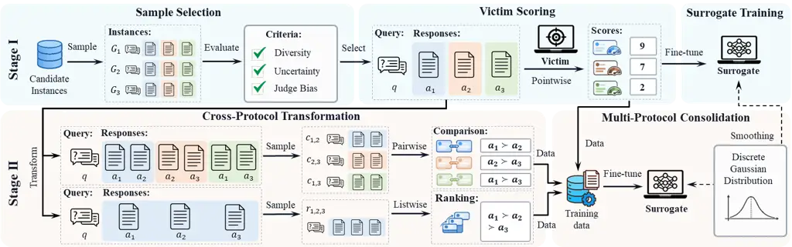

\tl_set:Ne\tcboxmath

tcboxmath \tl_set:Ne\tcbhighmathtcbhighmath

# JudgeStealer: Extracting LLM Judging Capabilities across Evaluation Protocols

Chen Chen Affiliation: {chen.chen, xueluan.gong, yuhang.zheng,
kwokyan.lam}@ntu.edu.sg    Yaolin Chen Affiliation: Nanyang
Technological University, Wuhan University Affiliation: {2023302181047,
2023302181211, 2024302183015, qianwang}@whu.edu.cn    Xuehan Sun
Affiliation: Nanyang Technological University, Wuhan University
Affiliation: {2023302181047, 2023302181211, 2024302183015,
qianwang}@whu.edu.cn    Juan Lin Affiliation: Nanyang Technological
University, Wuhan University Affiliation: {2023302181047, 2023302181211,
2024302183015, qianwang}@whu.edu.cn    Xueluan Gong ^(†)^(†)thanks:
Corresponding author Affiliation: {chen.chen, xueluan.gong,
yuhang.zheng, kwokyan.lam}@ntu.edu.sg    Yuhang Zheng
Affiliation: {chen.chen, xueluan.gong, yuhang.zheng,
kwokyan.lam}@ntu.edu.sg    Qian Wang Affiliation: Nanyang Technological
University, Wuhan University Affiliation: {2023302181047, 2023302181211,
2024302183015, qianwang}@whu.edu.cn    Kwok-Yan Lam
Affiliation: {chen.chen, xueluan.gong, yuhang.zheng,
kwokyan.lam}@ntu.edu.sg

###### Abstract

Large language model (LLM) judges are increasingly used across various
evaluation scenarios, making their judgment capabilities valuable
intellectual property. However, black-box access exposes these
capabilities to model extraction attacks. Existing extraction methods do
not specifically target LLM judges and provide limited support for
multiple evaluation protocols under restricted query budgets. In this
study, we propose JudgeStealer, the first query-efficient model
extraction framework for replicating judging capabilities across
pointwise scoring, pairwise comparison, and listwise ranking protocols.
JudgeStealer exploits the strong cross-protocol agreement to acquire
pointwise scores and transform them into pairwise and listwise
supervisions without additional victim queries. To capture informative
judge patterns and improve query efficiency, JudgeStealer dynamically
selects pointwise inputs based on semantic diversity, predictive
uncertainty, and potential judge biases. It further applies score
smoothing and multi-protocol review to preserve the ordinal structure of
scores and mitigate catastrophic forgetting during surrogate adaptation.
Extensive experiments on state-of-the-art LLM-as-a-judge and reward
models show that JudgeStealer consistently outperforms existing
extraction baselines, achieving up to 73.3%, 87.0%, and 71.6% accuracy
for pointwise, pairwise, and listwise evaluation, respectively.
JudgeStealer also remains effective across different surrogate model
scales, adaptation strategies, and reasoning settings. Moreover,
JudgeStealer demonstrates robustness against representative extraction
defenses.

## 1 Introduction

|                         |            |         |                  |                    |               |                 |                |                                                            |                                                            |                |                |                |
| ----------------------- | ---------- | ------- | ---------------- | ------------------ | ------------- | --------------- | -------------- | ---------------------------------------------------------- | ---------------------------------------------------------- | -------------- | -------------- | -------------- |
| Method                  | Attack^(†) |         | Victim Model^(‡) |                    |               | Agnosticism^(§) |                | Performance^(∗)                                            |                                                            | Robustness^(¶) |                |                |
|                         | Data       | Surface | Domain           | Close-weight       | Open-weight   | Architecture    | Logits         | Low budget                                                 | Normal budget                                              | OT             | OP             | AD             |
| KnockoffNet \[33\]      | Nat.       | Func.   | CNN              | –                  | $`\sim`$138M  | $`\checkmark`$  | $`\checkmark`$ | –                                                          | –                                                          | –              | $`\checkmark`$ | –              |
| Activethief \[35\]      | Nat.       | Func.   | CNN/RNN          | –                  | $`\sim`$1.18M | $`\checkmark`$  | $`\checkmark`$ | –                                                          | –                                                          | –              | $`\checkmark`$ | $`\checkmark`$ |
| Inversenet \[9\]        | Syn.       | Func.   | CNN              | –                  | $`\sim`$0.7M  | $`\checkmark`$  | $`\checkmark`$ | –                                                          | –                                                          | –              | $`\checkmark`$ | $`\checkmark`$ |
| DataFree \[42\]         | Syn.       | Func.   | CNN              | –                  | $`\sim`$180M  | $`\checkmark`$  | $`\times`$     | –                                                          | –                                                          | –              | $`\times`$     | –              |
| Maze \[18\]             | Syn.       | Func.   | CNN              | –                  | $`\sim`$0.27M | $`\checkmark`$  | $`\times`$     | –                                                          | –                                                          | –              | $`\times`$     | –              |
| D-DAE \[6\]             | Nat.&Syn.  | Func.   | CNN              | –                  | $`\sim`$138M  | $`\checkmark`$  | $`\times`$     | –                                                          | –                                                          | –              | $`\checkmark`$ | –              |
| Augmenting \[10\]       | Nat.&Syn.  | Func.   | CNN              | –                  | $`\sim`$138M  | $`\checkmark`$  | $`\times`$     | –                                                          | –                                                          | –              | $`\checkmark`$ | –              |
| Depth extraction \[8\]  | Nat.&Syn.  | Comp.   | CNN              | –                  | $`\sim`$168M  | $`\checkmark`$  | $`\times`$     | –                                                          | –                                                          | –              | $`\checkmark`$ | –              |
| Hyperparameter \[43\]   | Nat.&Syn.  | Comp.   | SVM/DNN          | –                  | $`\sim`$1.33M | $`\checkmark`$  | $`\times`$     | –                                                          | –                                                          | –              | $`\checkmark`$ | $`\checkmark`$ |
| Killing \[4\]           | Nat.       | Func.   | PLM              | –                  | $`\sim`$340M  | $`\checkmark`$  | $`\times`$     | –                                                          | –                                                          | –              | $`\checkmark`$ | –              |
| Model extraction \[13\] | Nat.       | Func.   | PLM              | –                  | $`\sim`$340M  | $`\checkmark`$  | $`\times`$     | –                                                          | –                                                          | –              | –              | $`\checkmark`$ |
| Thieves \[21\]          | Nat.&Syn.  | Func.   | PLM              | –                  | $`\sim`$340M  | $`\checkmark`$  | $`\checkmark`$ | –                                                          | –                                                          | –              | $`\checkmark`$ | $`\checkmark`$ |
| LLM-FIN \[32\]          | Nat.       | Comp.   | Edge LLM         | –                  | $`\sim`$770M  | $`\times`$      | $`\times`$     | –                                                          | –                                                          | –              | $`\checkmark`$ | –              |
| Extracting \[27\]       | Nat.       | Func.   | LLM              | GPT-3.5            | –             | $`\checkmark`$  | $`\checkmark`$ | –                                                          | –                                                          | –              | –              | –              |
| Model Leeching \[2\]    | Nat.       | Func.   | LLM              | GPT-3.5            | –             | $`\checkmark`$  | $`\checkmark`$ |  |  | –              | $`\checkmark`$ | –              |
| Lion \[16\]             | Syn.       | Func.   | LLM              | GPT-3.5            | –             | $`\checkmark`$  | $`\checkmark`$ |  |  | –              | –              | –              |
| LoRD \[28\]             | Nat.       | Func.   | LLM              | GPT-3.5/4/4o       | 70B           | $`\checkmark`$  | $`\times`$     |  |  | $`\checkmark`$ | $`\checkmark`$ | –              |
| Ours                    | Nat.&Syn.  | Func.   | LLM              | GPT-5.4/Sonnet-4.5 | 1.6T          | $`\checkmark`$  | $`\checkmark`$ | $`\CIRCLE`$                                                |  | $`\checkmark`$ | $`\checkmark`$ | $`\checkmark`$ |

- •
  $`\dagger`$ Attack. Data denotes query type. Nat. and Syn. are natural
  and synthetic data, respectively. Surface denotes the extraction
  target. Func. is functionality and Comp. is model-component.
- •
  $`\ddagger`$ Victim Model. Domain denotes the model family of the
  victim. Close-weight and Open-weight denote the strongest proprietary
  and open-source victim evaluated in each work.
- •
  $`\mathsection`$ Agnosticism. Architecture indicates the attack is
  agnostic to the victim model architecture, and Logits denotes the
  attack is independent of victim logits or probability outputs.

  $`\ast`$ Performance. Low budget ($`{\scriptstyle\sim}300`$ queries),
  :
  $`Acc_{\pm 1}<30\%`$,
  :
  $`30\%\leq Acc_{\pm 1}<50\%`$,
  :
  $`50\%\leq Acc_{\pm 1}`$; Normal budget ($`{\scriptstyle\sim}2000`$
  queries),
  :
  $`30\%\leq Acc_{\pm 1}<60\%`$,
  :
  $`60\%\leq Acc_{\pm 1}`$.

  $`\lx@paragraphsign`$ Robustness. The robustness against defense
  methods. OT, OP, and AD denote ownership tracing, output perturbation,
  and anomaly detection, respectively. – denotes “not evaluated”.

Table 1: A comprehensive comparison of state-of-the-art model extraction
attacks.

Large language models (LLMs) have increasingly been extended with
specialized capabilities, such as coding and content evaluation,
supporting their deployment across diverse real-world applications \[23,
24\]. Developing such capabilities requires substantial resources, which
makes them valuable intellectual property. To protect such capabilities,
LLM service providers often expose them through accessible black-box
interfaces, such as APIs. However, black-box access also introduces
fundamental security risks: an adversary may repeatedly query the
service and reproduce its behavior in a locally controlled model \[41\].
Such functionality stealing enables adversaries to bypass the original
service provider, potentially causing significant economic losses.

Among the diverse capabilities of LLMs, content evaluation has become an
important and broadly reusable functionality, with applications across
at least three domains. First, LLM-as-a-Judge is widely adopted to
evaluate open-ended model outputs, providing a scalable alternative to
costly human annotation for model evaluation and benchmarking\[50, 26\].
Second, Reward Models supply feedback signals for LLM alignment methods
such as reinforcement learning from human feedback (RLHF) \[34\]. Since
these signals serve as supervision during optimization, their quality
can substantially influence the behavior and performance of the
resulting policy. Third, downstream safety and moderation applications,
including guardrail systems \[15\] and toxicity evaluators¹¹ 1
[https://perspectiveapi.com/](https://perspectiveapi.com/), also rely on
model-based judgment to support automated safety evaluation. Therefore,
replicating this judgment functionality transfers a valuable asset for
the development and deployment of downstream LLM applications.

Recent studies have focused on model extraction attacks (MEAs), which
use natural \[33, 35\] or synthetic queries \[42, 18\] to replicate
task-specific functionality \[33, 35, 9, 4, 6\] or model components \[8,
43, 32, 3\]. Despite substantial progress, existing studies exhibit
several limitations, as summarized in Table 1. First, the MEA literature
is dominated by attacks against conventional deep neural networks, with
only a limited number of studies focusing on LLMs \[3, 2, 27, 28\].
Moreover, to the best of our knowledge, none specifically investigates
the extraction of evaluation capabilities from LLM judges. Second,
several approaches assume prior knowledge of the victim architecture
\[32\] or require access to logits and internal states. These
assumptions limit applicability to realistic API settings where only
hard labels are available \[18, 6, 10, 8, 43, 4\]. Third, prior
evaluations primarily consider earlier proprietary APIs, relatively
small-scale models, or simulated victims, leaving recent large-scale
models and modern proprietary services insufficiently explored. Finally,
the effectiveness of existing attacks often degrades under low query
budgets, and their robustness to practical defenses has not been
sufficiently demonstrated.

Extracting judging capabilities from LLMs is particularly challenging.
Specifically, LLM judgments can take different forms, which can be
broadly categorized into three evaluation protocols: pointwise scoring,
pairwise comparison, and listwise ranking, each providing a distinct
form of supervision \[22, 45\]. A straightforward strategy is to extract
each protocol independently. However, this strategy makes it difficult
to achieve consistently strong performance across protocols. More
importantly, separately querying the victim for each protocol incurs
substantial query costs, limiting extraction efficiency under restricted
query budgets. To this end, we propose JudgeStealer, the first model
extraction framework designed to replicate the judging capabilities of
black-box LLMs across multiple evaluation protocols. JudgeStealer
addresses the following key challenges:

_C1. How to jointly support multiple evaluation protocols?_

JudgeStealer identifies high evaluation agreement across protocols,
where judgments derived from pointwise scores closely align with direct
pairwise comparison and listwise rankings. JudgeStealer exploits this
observation to extract cross-protocol LLM judgments. Specifically,
JudgeStealer first acquires fine-grained pointwise supervisions and then
transforms the collected scores into pairwise comparisons and listwise
rankings. The original and transformed data are jointly used to
construct a surrogate model. This strategy supports multiple protocols
within a unified framework while substantially improving query
efficiency.

_C2. How to identify informative pointwise inputs?_

Under a limited query budget, selecting informative inputs is also
critical to extraction efficiency. JudgeStealer introduces a dynamic
input-selection mechanism that jointly captures semantic diversity,
predictive uncertainty, and potential judge biases. These signals are
aggregated into a selection score, and candidates with the highest
scores are prioritized for querying the victim model. The selection
scores are computed based on its latest surrogate state, enabling more
accurate estimation of input informativeness.

_C3. How to effectively adapt a multi-protocol surrogate?_

Since supervision for different protocols becomes available
progressively, sequential adaptation may lead to catastrophic forgetting
of previously acquired judgment behavior. JudgeStealer addresses this
issue with a review strategy that revisits earlier pointwise supervision
while incorporating newly constructed pairwise and listwise data. In
addition, it applies an adaptive smoothing mechanism over the pointwise
score space to regularize surrogate predictions and preserves the
relative structure among neighboring evaluation scores.

We conduct extensive experiments on both proprietary and open-source
LLM-as-a-judge models, including GPT-5.4, Claude Sonnet 4.5,
Qwen3-235B-A22B, and DeepSeek V4 Pro, as well as a dedicated reward
model, UniRRM. Across two instruction-following datasets and different
surrogate models, JudgeStealer outperforms existing baselines, achieving
up to 73.3%, 87.0%, and 71.6% accuracy for pointwise, pairwise, and
listwise evaluation, respectively. Further experiments demonstrate that
JudgeStealer remains effective across different surrogate model scales,
adaptation strategies, and reasoning settings. We also evaluate
JudgeStealer against representative defenses, including anomaly
detection, anti-distillation perturbation, and ownership tracing. The
results demonstrate its practical robustness against these defense
settings.

To conclude, we make the following contributions:

- •
  We present JudgeStealer, the first model extraction framework for
  replicating LLM judging capabilities across pointwise scoring,
  pairwise comparison, and listwise ranking under black-box access.
- •
  We develop a query-efficient extraction pipeline that combines dynamic
  informative-input selection, cross-protocol transformation, score
  smoothing, and multi-protocol review to construct a unified surrogate
  judge.
- •
  We conduct extensive experiments across proprietary and open-source
  LLM-as-a-judge and reward models. The results demonstrate strong
  extraction performance across evaluation protocols, model scales, and
  adaptation strategies, while remaining effective against
  representative defenses.

## 2 Background

### 2.1 LLM-Based Judging

LLM-based judgments can be obtained through either a prompted evaluator
or a learned reward function. Although they produce judgments
differently, both can provide pointwise scores, pairwise preferences,
and listwise rankings.

LLM-as-a-Judge. LLM-as-a-Judge uses an LLM to assess candidate responses
according to evaluation instructions given in the prompt \[37\]. The
prompt typically includes the user query, one or more candidate
responses, evaluation criteria, and optional context such as a reference
answer. In pointwise evaluation, the judge assigns a score to a single
response. In pairwise evaluation, it compares two responses and
identifies the better one, possibly allowing a tie. In listwise
evaluation, it orders a set of responses from best to worst. The
judgment may consist of only the final score or preference, or may also
include a textual explanation. Since the criteria are supplied at
inference time, a prompted judge can be used across different evaluation
tasks, although its outputs may remain sensitive to prompt wording,
response order, and decoding randomness.

Reward Model. A reward model learns a scalar function $`R_{\phi}(q,a)`$
from preference data, where $`q`$ is the query and $`a`$ is a candidate
response. Given a preferred response $`a^{+}`$ and a rejected response
$`a^{-}`$, a common training objective is

```math
\mathcal{L}_{\mathrm{RM}}=-\mathbb{E}_{(q,a^{+},a^{-})}\log\sigma\!\left(R_{\phi}(q,a^{+})-R_{\phi}(q,a^{-})\right), \tag{1}
```

which encourages the preferred response to receive a higher reward.
Reward models are commonly used in RLHF to provide feedback for policy
optimization \[7, 34\]. At inference time, the learned reward can be
used directly for pointwise evaluation, while comparing or sorting the
rewards produces pairwise preferences or listwise rankings. Unlike a
prompted judge, a reward model usually provides no textual explanation,
and its evaluation criteria are determined by its training data.

### 2.2 Model Extraction Attacks

Model extraction (a.k.a. model stealing) aims to obtain a _surrogate_
model that approximates a victim model accessible only through an
API \[10, 11, 4, 13, 21\]. Early model-extraction studies primarily
targeted image classification models \[35, 9, 6\], with only limited
works targeting LLMs. Existing model extraction against LLM can be
divided into two categories, i.e., functionality extraction and
parameter/architecture extraction.

Functionality Extraction. Functionality extraction aims to obtain a
_surrogate_ model $`G_{\phi}`$ whose input-output behavior closely
matches that of a black-box victim model $`F`$. For example, Birch et
al. \[2\] proposed Model Leeching, a cost-effective functionality
extraction attack that distills a black-box LLM’s task-specific behavior
(e.g., ChatGPT-3.5-Turbo) into a smaller local model. The attacker
crafts a task-specific prompt template to generate queries, collects
victim responses to form an imitation dataset $`\mathcal{D}_{F}`$, and
fine-tunes a compact model (e.g., RoBERTa-Large) on $`\mathcal{D}_{F}`$
to match the victim on the target task. Following the query-and-distill
paradigm, Li et al. \[27\] examined extracting specialized code
abilities from black-box LLM APIs. They generate code-task queries under
different schemes (zero-shot, in-context, and zero-shot CoT), apply
response checks to filter low-quality outputs, and fine-tune
medium-sized code backbones (e.g., CodeBERT/CodeT5) on the collected
prompt–output pairs to obtain an imitation model. Recently, Liang et al.
\[28\] proposed LoRD for alignment-aware extraction of RLHF-aligned
LLMs. Instead of MLE distillation that directly maximizes the likelihood
of the victim’s exact responses, LoRD treats the victim output as a
local guide, constructs preferred vs. non-preferred samples in its
neighborhood, and optimizes a policy-gradient objective to maximize
their probability gap, improving query efficiency and offering stronger
resilience to output watermarks.

Component Extraction. In contrast to functionality extraction, component
extraction aims to recover internal model components, such as weights or
architectural designs. This threat is particularly salient for
edge-deployed models (e.g., smartphones and IoT devices), where
attackers may obtain physical access \[49, 30\].

Carlini et al. \[3\] proposed stealing the complete embedding projection
layer of a transformer language model. The key idea is to exploit the
fact that the last linear map from hidden states to vocabulary logits is
low-rank. Nazari et al. \[32\] proposed LLM-FIN, an LLM fingerprinting
attack that infers the architectural identity (i.e., model family) of an
edge-deployed LLM. The attacker passively collects side-channel resource
traces, primarily RAM/memory-usage patterns (and optionally CPU/GPU
loads) from an edge device while the LLM runs (e.g., via system
monitoring such as tegrastats on NVIDIA Jetson), then uses a supervised
time-series classifier trained offline on labeled traces from known
model families to predict the architecture family of the unknown victim
model.

### 2.3 Model Extraction Defenses

Output-perturbation defenses. There are _few_ LLM-extraction defenses
based purely on output perturbation. Most LLM APIs return only
_free-form text_ (no full probability vectors), leaving limited room to
perturb outputs without harming quality. Although not designed
specifically for LLMs, *ModelGuard* \[39\] offers a principled blueprint
for output-perturbation defenses. It formulates perturbation as a
utility-constrained optimization problem and provides an
information-theoretic defense that remains robust against _adaptive_
extractors by reducing the recoverable information in the returned
outputs. When an LLM API exposes auxiliary signals (e.g., top-$`k`$
logprobs/logits or embeddings), this blueprint can be instantiated by
perturbing these signals (e.g., clipping, randomized rounding, or
calibrated noise) while keeping the primary text response unchanged.

Watermarking and ownership tracing. Watermarking mainly supports
attribution rather than preventing imitation, where providers embed
detectable signals into generated text or service outputs and later
verify ownership from a suspected stolen model \[20\]. Pang et al.
proposed *ModelShield* \[36\], a plug-and-play black-box watermarking
defense for LMaaS. It uses _self-watermarking_ by prepending a system
instruction that prompts the victim LLM to insert watermark words with
minimal quality impact. Ownership is verified by scoring outputs for
watermark-word presence and applying hypothesis testing (e.g., a
one-sided $`t`$-test with a $`p`$-value threshold). For
_Embedding-as-a-Service_ (EaaS), Wang et al. propose *GuardEmb* \[44\],
which perturbs embeddings for inputs containing selected special tokens
and trains a verifier to distinguish watermarked from clean embeddings
while preserving utility. A stolen embedding model trained on such
outputs inherits the watermark, enabling infringement verification
through targeted queries.

Query Detection. Query-detection defenses monitor API traffic to
identify suspicious extraction behaviors before the attacker collects
enough input-output pairs \[29\]. Compared with output perturbation and
watermarking, dedicated query-detection defenses for LLM extraction are
still limited; most ideas are adapted from traditional ML
model-extraction defenses. For example, *PRADA* \[17\] records the
incoming query sequence for each client and, for every new query,
measures its distance to previous queries that receive the same
predicted label. Benign users are expected to submit natural queries
whose distance distribution is approximately normal, whereas extraction
attacks often generate synthetic or systematically selected queries that
distort this distribution. PRADA therefore applies a normality test to
the query-distance distribution and raises an alarm when the deviation
is sufficiently large. *SEAT* \[48\] further learns a similarity encoder
to detect extraction-like query sequences, especially when attackers
submit many highly similar or structured queries.

## 3 Threat Model

Attacker Scenario. We consider an LLM service that provides proprietary
content evaluation functionality. The victim may be a dedicated reward
model or a general-purpose LLM whose judging capability can be invoked
via user prompts. We assume the attacker is a malicious user of the
service who repeatedly queries the victim to collect its response.

Attacker’s Capability. We consider a black-box setting, where the
attacker submits queries to the victim and observes only the outputs
through the service interface. The attacker has no access to the
victim’s internal information, including its training data,
architecture, model parameters, and output logits. We further assume
that the attacker can train a local surrogate model and may use publicly
available or synthetically generated data to construct candidate
queries. We do not assume any knowledge of the victim model family or
the data used to develop its evaluation capability.

Attacker’s Goal. A successful extraction attack on judging capability
should satisfy three objectives.

- •
  _Attack Effectiveness._ The extracted surrogate should faithfully
  reproduce the victim’s judging behavior across different inputs and
  evaluation protocols, including pointwise, pairwise, and listwise
  evaluation.
- •
  _Attack Efficiency._ An effective attack should maximize the
  information obtained from each victim interaction and reduce the
  number of queries required to construct a surrogate model due to the
  costs and rate limits imposed by victims.
- •
  _Attack Stealthiness._ The query process should resemble normal usage
  and avoid exposing recognizable extraction patterns, such as abnormal
  query distributions or excessive repetition, to the service provider.

## 4 Methodology

### 4.1 Overview

Figure 1: Cross-protocol Agreement.

Intuition. In our model extraction setting, we consider an LLM-based
judging system that supports multiple evaluation protocols, including
pointwise scoring, pairwise comparison, and listwise ranking. While
these settings are different in their input structures and output
formats, we hypothesize that their judgments are guided by a shared
underlying evaluation criterion for assessing response quality. We
empirically examine this hypothesis across multiple victim models,
datasets, and evaluation settings by transforming pointwise scores into
pairwise and listwise judgments and measuring their agreement with
direct victim outputs. As shown in Figure 1, the average agreement
reaches $`88.70\%`$, $`88.67\%`$, and $`94.95\%`$ for
pointwise–pairwise, pointwise–listwise, and pairwise–listwise
comparisons, respectively, demonstrating strong cross-protocol
consistency across these capable LLM judges. Moreover, this consistency
generally increases with judge capability, where weaker judges exhibit
lower cross-protocol agreement, and stronger judges maintain
substantially more consistent evaluation behavior, as shown in Figure 8.
This trend suggests that such consistency may constitute an important
component of robust judging capability. Importantly, this property is
exploitable for our multi-protocol model extraction, particularly under
limited query budgets. If different protocols largely reflect the same
underlying evaluation criterion, querying the victim separately under
every protocol becomes unnecessary. Motivated by this observation,
JudgeStealer acquires informative pointwise supervision and transforms
it into corresponding pairwise and listwise training signals without
additional victim queries. Consequently, victim supervision can be
reused across protocols, enabling joint improvement in multi-protocol
extraction performance while substantially increasing query efficiency.



Figure 2: Overview of JudgeStealer. In Stage I, JudgeStealer identifies
informative instances, submits them to the victim under the pointwise
protocol, and trains an initial surrogate model. In Stage II, the
pointwise supervision is transformed into pairwise and listwise data,
which are used to train the surrogate model. A smoothing mechanism is
applied in both stages.

Workflow. Figure 2 presents the overall workflow of JudgeStealer, which
comprises two stages. In Stage I, the attacker begins with a pool
$`\mathcal{G}`$ of multi-response candidate instances and introduces a
dynamic selection mechanism to identify informative instances based on
the current state of the surrogate model $`M_{\phi}`$, parameterized by
$`\phi`$. This mechanism jointly evaluates semantic diversity,
predictive uncertainty, and potential judging bias. For the selected
instance $`G`$, the attacker submits each query–response pair
$`(q,a_{i})\in G`$ to the victim under the pointwise protocol and
collects the returned scores $`y_{i}`$ as supervision. These labeled
samples constitute the pointwise scoring dataset $`\mathcal{S}`$, which
is used to train an initial surrogate model $`M_{\phi}`$. Stage II
exploits cross-protocol agreement to extend the collected supervision
without submitting additional victim queries. Specifically, the
pointwise scores are transformed into the pairwise comparison dataset
$`\mathcal{C}`$ and the listwise ranking dataset $`\mathcal{R}`$,
respectively. These samples are used to surrogate model adaptation, and
subsequently combined with the original pointwise data to construct a
multi-protocol training set for surrogate model consolidation. To
mitigate the influence of overconfident supervision, JudgeStealer
further incorporates an adaptive smoothing mechanism using a Gaussian
prior over the score space.

### 4.2 Stage I: Pointwise Score Extraction

JudgeStealer builds on the cross-protocol agreement of LLM judges, where
supervision obtained under one evaluation protocol can be transformed
into training signals for other protocols. Among the three protocols,
pointwise scores provide the most fine-grained and versatile
supervision. Specifically, given scores for multiple responses to the
same query, pairwise comparison can be inferred by comparing their
scores, while listwise rankings can be constructed by ordering the
responses accordingly. However, the reverse transformation is ambiguous.
We therefore adopt pointwise scoring as the primary querying protocol.

#### 4.2.1 Sample Selection

JudgeStealer first collect a set of unlabeled candidate instances
$`\mathcal{G}`$, where each instance $`G\in\mathcal{G}`$ consists of a
user query $`q`$ and a set of corresponding responses
$`A=\{a_{i}\}_{i=1}^{n}`$. Equivalently, each instance $`G`$ can be
represented as a collection of query-response pairs, i.e.,
$`G=\{(q,a_{i})\}_{i=1}^{n}`$. To effectively identify informative
instances under a limited query budget, we introduce an iterative
selection mechanism. At iteration $`t\in\{1,2,\dots,T\}`$, JudgeStealer
maintains a set of previously selected instances
$`\mathcal{G}_{<t}\subset\mathcal{G}`$. We evaluate the remaining
candidate $`G\in\mathcal{G}\setminus\mathcal{G}_{<t}`$ using three
signals, i.e., semantic diversity $`D(G)`$, predictive uncertainty
$`U(G)`$, and potential judge biases $`B(G)`$. These signals are
aggregated into a selection score $`\Gamma(G)`$, and the highest-scoring
candidates are selected to form the current query batch
$`\mathcal{G}_{t}`$.

Semantic Diversity. The selected instances should cover different
regions of the judge’s input space rather than repeatedly querying
semantically similar content. To this end, JudgeStealer adopts a
distance-based selection method with density filtering. For each
candidate instance $`G`$, we first compute its representation

```math
z_{G}=\frac{1}{n}\sum_{i=1}^{n}f_{\mathrm{emb}}(q,a_{i}),\quad(q,a_{i})\in G, \tag{2}
```

where $`f_{\mathrm{emb}}`$ denotes a text embedding model. Given
$`\mathcal{G}_{<t}`$, the diversity value is defined as:

```math
D(G)=\min_{H\in\mathcal{G}_{<t}}d(z_{G},z_{H}), \tag{3}
```

where $`d(\cdot,\cdot)`$ denotes cosine distance. A larger $`D(G)`$
indicates that $`G`$ covers a semantic region that is insufficiently
represented by the previously selected instances. However, this
distance-only strategy may prioritize isolated outliers that are not
representative of the underlying data distribution. We therefore
introduce a local-density estimate:

```math
\rho(G)=\left(\frac{1}{k}\sum_{H\in\mathcal{N}_{k}(G)}d\!\left(z_{G},z_{H}\right)+\epsilon\right)^{-1},\textbf{} \tag{4}
```

where $`\mathcal{N}_{k}(\cdot)`$ denotes $`k`$ nearest neighbours of
$`G`$, and $`\epsilon`$ is small constant for numerical stability.
Candidates whose $`\rho(G)`$ fall within the lowest 10% of the candidate
pool are excluded from selection.

Predictive Uncertainty. Informative instances are expected to be at the
decision boundary and exhibit high predictive uncertainty on the
surrogate model $`M_{\phi}`$. Given a sample $`(q,a_{i})\in G`$ and
score space $`\mathcal{Y}`$, the surrogate model produces a probability
distribution
$`\mathbf{p}_{i}=M_{\phi}\!\left(\cdot\mid\mathsf{P}_{s},q,a_{i}\right)`$,
where $`\mathsf{P}_{s}`$ denotes the prompt for pointwise scoring. We
quantify the uncertainty using the normalized entropy of
$`\mathbf{p}_{i}`$:

```math
U(G)=\frac{1}{n\log|\mathcal{Y}|}\sum_{i=1}^{n}\operatorname{Ent}(\mathbf{p}_{i}). \tag{5}
```

where $`\operatorname{Ent}(\cdot)`$ denotes the Shannon Entropy²² 2 The
Shannon entropy is defined as
$`\operatorname{Ent}(\mathbf{p}_{i})=-\sum_{y\in\mathcal{Y}}\mathbf{p}_{i}(y)\log\mathbf{p}_{i}(y)`$..
Higher entropy indicates greater predictive uncertainty, which suggests
the victim label is more likely to provide high-value supervision.

Judge Biases. JudgeStealer also prioritizes candidates that can expose
systematic biases in the surrogate judge \[50\]. We examine two common
forms of judge bias, i.e., verbosity bias and position bias. To assess
verbosity bias, we maintain a collection of neutral and non-informative
prefixes $`\mathcal{W}`$. They are introduced to increase the response
length without affecting its underlying quality. For a candidate $`G`$,
we first select the prefix whose representation is most similar to
$`z_{G}`$

```math
w^{\star}=\arg\max_{w\in\mathcal{W}}\operatorname{CosSim}(f_{\mathrm{emb}}(w),z_{G}), \tag{6}
```

where $`\operatorname{CosSim(\cdot,\cdot)}`$ denotes cosine similarity.
We then prepend $`w^{\star}`$ to each response $`a_{i}`$ to obtain the
extended response $`a_{i}^{+}=w^{\star}\oplus a_{i}`$, where $`\oplus`$
denotes text concatenation. The surrogate model produces output
distribution for both the original response
$`\mathbf{p}_{i}=M_{\phi}\!\left(\cdot\mid\mathsf{P}_{s},q,a_{i}\right)`$
and the extended responses
$`\mathbf{p}_{i}^{+}=M_{\phi}\!\left(\cdot\mid\mathsf{P}_{s},q,a_{i}^{+}\right)`$,
which are subsequently used to quantify the sensitivity of $`G`$ to
verbosity

```math
B_{\mathrm{v}}(G)=\frac{1}{n|\mathcal{Y}|}\sum_{i=1}^{n}\max\left(0,\sum_{y\in\mathcal{Y}}y\,(\mathbf{p}_{i}^{+}(y)-\mathbf{p}_{i}(y))\right). \tag{7}
```

To assess position bias, we evaluate each response pair $`a_{j}`$ and
$`a_{k}`$ under both orders. The surrogate model produces the
corresponding output distributions as
$`\mathbf{p}_{j,k}=M_{\phi}\!\left(\cdot\mid\mathsf{P}_{c},q,a_{j},a_{k}\right)`$
and
$`\mathbf{p}_{k,j}=M_{\phi}\!\left(\cdot\mid\mathsf{P}_{c},q,a_{k},a_{j}\right),`$
where $`\mathsf{P}_{c}`$ denotes the pairwise-comparison prompt. The
position-bias score is defined as

```math
B_{\mathrm{p}}(G)=\frac{1}{n(n-1)}\sum_{j=1}^{n}\sum_{\begin{subarray}{c}k=1\\
k\neq j\end{subarray}}^{n}D_{\mathrm{KL}}\left(\mathbf{p}_{j,k}\;\middle\|\;\mathbf{p}_{k,j}\right), \tag{8}
```

where $`D_{\mathrm{KL}}(\cdot,\cdot)`$ is the KL divergence between two
distributions. These two signals are averaged into judge bias score.

```math
B(G)=\,\frac{B_{\mathrm{v}}(G)+\,B_{\mathrm{p}}(G)}{2}. \tag{9}
```

Overall Selection Score. Finally, we obtain the overall score:

```math
\Gamma(G)=\lambda_{1}\,D(G)+\lambda_{2}\,U(G)+\lambda_{3}\,B(G), \tag{10}
```

where $`\lambda_{1},\lambda_{2},\lambda_{3}\geq 0`$ control the
contributions of the three components. To avoid the cost of evaluating
all remaining candidates, at iteration $`t`$, JudgeStealer first samples
a candidate subset
$`\widetilde{\mathcal{G}_{t}}\subset\mathcal{G}\setminus\mathcal{G}_{<t}`$
and then selects the $`K`$ instances with the highest scores:

```math
\mathcal{G}_{t}=\underset{G\in\widetilde{\mathcal{G}}_{t}}{\operatorname{TopK}}\;\Gamma(G). \tag{11}
```

During the first few iterations, we skip the selection mechanism and
randomly sample instances to initialize $`\mathcal{G}_{<t}`$.

#### 4.2.2 Victim Scoring

Given the selected batch $`\mathcal{G}_{t}`$, JudgeStealer queries the
victim judge and consumes the corresponding query budget. Specifically,
for each $`G\in\mathcal{G}_{t}`$, we submit every query-response pair
$`(q,a_{i})\in G`$ under the pointwise evaluation protocol, and obtains
the score returned by the victim model $`M_{v}`$:

```math
y_{i}=M_{v}(\mathsf{P}_{s},q,a_{i}),\quad y_{i}\in\mathcal{Y}. \tag{12}
```

When the API additionally provides a Chain-of-Thought (CoT) explanation,
we retain it only as auxiliary metadata and use the scalar score as the
primary supervision signal.

The resulting victim-labeled instance is represented as
$`G^{*}=\{(q,a_{i},y_{i})\}_{i=1}^{n}`$, which yields $`n`$ pointwise
samples

```math
s_{i}=(q,a_{i},y_{i}). \tag{13}
```

These samples form the pointwise dataset $`\mathcal{S}_{t}`$ at
iteration $`t`$ and are accumulated into the overall dataset
$`\mathcal{S}\leftarrow\mathcal{S}\cup\mathcal{S}_{t}`$. $`\mathcal{S}`$
will be subsequently used to construct pairwise and listwise
supervision, and train the surrogate judge in Stage II.

Input :  Unlabeled candidate pool $`\mathcal{G}`$; victim $`M_{v}`$;
initial surrogate $`M_{\phi}`$; pointwise prompt $`\mathbf{P}_{s}`$;
batch size $`K`$; number of nearest neighbors $`k`$; selection weights
$`(\lambda_{1},\lambda_{2},\lambda_{3})`$.

Output :  Pointwise dataset $`\mathcal{S}`$; updated surrogate judge
$`M_{\phi}`$.

1 Initialize $`\mathcal{S}\leftarrow\emptyset`$ and
$`\mathcal{G}_{<1}\leftarrow\emptyset`$

2 for _$`t=1,2,\ldots`$ while the remaining budget is sufficient_ do

      3 Sample a candidate subset
$`\widetilde{\mathcal{G}}_{t}\subseteq\mathcal{G}\setminus\mathcal{G}_{<t}`$

      4 foreach _$`G\in\widetilde{\mathcal{G}}_{t}`$_ do

           5 Compute the instance representation $`z_{G}`$

           6 Estimate the local density $`\rho(G)`$

           7 if _$`G`$ is not excluded by density filtering_ then

                8 Compute diversity $`D(G)`$ (omit it when
$`\mathcal{G}_{<t}=\emptyset`$)

                9 Compute predictive uncertainty $`U(G)`$ using
$`M_{\phi}`$

                10 Compute bias scores $`B(G)`$

                11
$`\Gamma(G)\leftarrow\lambda_{1}D(G)+\lambda_{2}U(G)+\lambda_{3}B(G)`$

      12
$`\mathcal{G}_{t}\leftarrow\operatorname{TopK}_{G\in\widetilde{\mathcal{G}}_{t}}\Gamma(G)`$

      13 Initialize $`\mathcal{S}_{t}\leftarrow\emptyset`$

      14 foreach _$`G=\{(q,a_{i})\}_{i=1}^{n}\in\mathcal{G}_{t}`$_ do

           15 for _$`i=1`$ to $`n`$_ do

                16 $`y_{i}\leftarrow M_{v}(\mathbf{P}_{s},q,a_{i})`$

                17
$`\mathcal{S}_{t}\leftarrow\mathcal{S}_{t}\cup\{(q,a_{i},y_{i})\}`$

      18 $`\mathcal{S}\leftarrow\mathcal{S}\cup\mathcal{S}_{t}`$

      19 Update $`M_{\phi}`$ on $`\mathcal{S}_{t}`$ by minimizing
$`\mathcal{L}_{\mathrm{point}}(\phi)`$ with Gaussian-smoothed targets

      20
$`\mathcal{G}_{<t+1}\leftarrow\mathcal{G}_{<t}\cup\mathcal{G}_{t}`$

      21 Update the remaining query budget

22 return _$`\mathcal{S},M_{\phi}`$_

Algorithm 1 Stage I: Pointwise Score Extraction

#### 4.2.3 Surrogate Training

JudgeStealer uses the pointwise dataset $`\mathcal{S}_{t}`$ obtained at
iteration $`t`$ to update the surrogate model, without performing
cross-protocol transformation at this moment. We adopt this strategy for
two main reasons. First, the selection mechanism relies on the
surrogate’s predictive distribution. Therefore, updating the surrogate
after each iteration ensures that subsequent selection decisions reflect
the latest victim supervision. Second, transforming the currently
available pointwise scores into pairwise and listwise labels would
generate multiple highly correlated training samples from the same set
of queries and responses. Introducing these samples during the early
iterations may overemphasize a small number of instances and cause the
surrogate to overfit to redundant supervision. Accordingly, we first
train the surrogate on the victim-labeled pointwise data as a stable
warm-up stage before applying multi-protocol surrogate adaptation.

Moreover, scoring labels exhibit an inherent ordinal structure: scores
closer to the victim-assigned label should generally receive higher
probabilities than more distant ones. However, standard one-hot
supervision does not encode this ordinal structure, which prevents the
surrogate from preserving such a locality pattern among scores. To
incorporate this prior, we smooth the hard one-hot target with a
discrete Gaussian distribution centered at the victim-assigned score.
Specifically, for a sample $`(q,a,y)\in\mathcal{S}_{t}`$, the target
distribution is defined as

```math
\widetilde{\mathbf{e}}_{y}=(1-\lambda)\mathbf{e}_{y}+\lambda\mathbf{g}_{y}, \tag{14}
```

where $`\mathbf{e}_{y}`$ denotes the one-hot distribution that assigns
probability 1 to $`y`$ and 0 to all other scores. $`\mathbf{g}_{y}`$
denotes the probability mass function of a discrete Gaussian
distribution over the score space centered at $`y`$ \[19\].
$`\lambda\in[0,1]`$ controls the smoothing strength. In our setting,
$`\lambda`$ is trainable, which enables an adaptive smoothing mechanism
during training.

Accordingly, we optimize the surrogate model $`M_{\phi}`$ using the
cross-entropy loss:

```math
\mathcal{L}_{\mathrm{point}}(\phi)=\frac{1}{|\mathcal{S}_{t}|}\sum_{(q,a,y)\in\mathcal{S}_{t}}\mathrm{CE}\!\left(\widetilde{\mathbf{e}}_{y},\,\mathbf{p}\right), \tag{15}
```

where $`\mathbf{p}=M_{\phi}\left(\cdot\mid\mathsf{P}_{c},q,a\right)`$
denotes the score distribution predicted by the surrogate model.
$`\operatorname{CE}(\cdot,\cdot)`$ denotes the cross-entropy between the
target and predicted distributions.

### 4.3 Stage II: Multi-Protocol Extension

At this stage, JudgeStealer further extends the extracted judging
capability across evaluation protocols. It first transforms the
collected pointwise scores into corresponding pairwise comparisons and
listwise rankings, and then integrates all three forms of supervision
into a multi-protocol training dataset. Starting from the surrogate
obtained in Stage I, JudgeStealer adapts the model using the transformed
supervision and subsequently performs a consolidation procedure over the
multi-protocol dataset. Importantly, this stage requires no additional
queries to the victim model.

#### 4.3.1 Cross-Protocol Transformation

Pairwise Sample Construction. Given a victim-labeled pointwise instance
$`G^{\star}=\left\{(q,a_{i},y_{i})\right\}_{i=1}^{n}`$, JudgeStealer
samples two responses $`a_{j}`$ and $`a_{k}`$, where
$`1\leq j<k\leq n`$, and infer their pairwise comparison by comparing
the corresponding pointwise scores:

```math
y_{j,k}=\begin{cases}a_{j}\succ a_{k},&y_{j}>y_{k},\\
a_{j}\prec a_{k},&y_{j}<y_{k},\\
a_{k}=a_{j},&y_{j}=y_{k},\end{cases} \tag{16}
```

where $`\succ`$, $`\prec`$, $`\sim`$ denote superiority, inferiority,
and a tie, respectively. The resulting pairwise training sample is

```math
c_{j,k}=\left(q_{i},a_{j},a_{k},y_{j,k}\right). \tag{17}
```

An victim-labeled instance with $`n`$ responses yields at most
$`\binom{n}{2}=n(n-1)/2`$ distinct response pairs. JudgeStealer samples
$`n_{c}`$ of these pairs from each instance and aggregates the resulting
samples into the pairwise comparison dataset $`\mathcal{C}`$.

Listwise Sample Construction. To construct listwise supervision,
JudgeStealer draws a subset of $`n_{l}`$ responses from each
victim-labeled pointwise instance
$`G^{\star}=\left\{(q,a_{i},y_{i})\right\}_{i=1}^{n}`$. Let
$`\mathcal{I}=\{j_{1},j_{2},\dots,j_{n_{l}}\}`$ denote the indices of
the sampled responses, where $`j_{*}\in\{1,2,\dots,n\}`$. The resulting
subset is denoted by
$`G^{\star}_{\mathcal{I}}=\left\{(q,a_{j_{r}},y_{j_{r}})\right\}_{r=1}^{n_{l}}`$.
JudgeStealer then ranks these responses in descending order according to
their pointwise scores. Specifically, let $`\pi`$ denote a permutation
of the indices in $`\mathcal{I}`$ satisfying
$`y_{\pi(1)}\geq y_{\pi(2)}\geq\cdots\geq y_{\pi(n_{l})}.`$ The
corresponding listwise label is represented as

```math
y_{I}=a_{\pi(1)}\succeq a_{\pi(2)}\succeq\cdots\succeq a_{\pi(n_{l})}. \tag{18}
```

where $`\succ`$ indicates that the preceding response is ranked no lower
than the following response. If two responses receive the same pointwise
score, they are assigned the same ranking position. The corresponding
listwise training sample is

```math
r_{\mathcal{I}}=\left(q,A_{\mathcal{I}},y_{\mathcal{I}}\right). \tag{19}
```

where $`A_{\mathcal{I}}=\{a_{j_{r}}\}_{r=1}^{n_{l}}`$. Each pointwise
instance can yield at most $`\binom{n}{n_{l}}`$ distinct listwise
samples. JudgeStealer samples $`n_{r}`$ of these combinations and
collect them into the listwise ranking dataset $`\mathcal{R}`$.

#### 4.3.2 Progressive Multi-Protocol Training

After obtaining the pointwise dataset $`\mathcal{S}`$ in Stage I and
constructing the pairwise and listwise datasets $`\mathcal{C}`$ and
$`\mathcal{R}`$ through cross-protocol transformation, JudgeStealer
progressively adapts the surrogate to all three evaluation protocols.

Input :  Victim-labeled pointwise dataset $`\mathcal{S}`$; surrogate
judge $`M_{\phi}`$; number of sampled pairwise instances $`n_{c}`$;
number of responses per listwise instance $`n_{l}`$; number of sampled
listwise instances $`n_{r}`$.

Output :  Pairwise dataset $`\mathcal{C}`$; listwise dataset
$`\mathcal{R}`$; updated surrogate judge $`M_{\phi}`$.

1 Initialize $`\mathcal{C}\leftarrow\emptyset`$ and
$`\mathcal{R}\leftarrow\emptyset`$

2 foreach _victim-labeled instance
$`G^{\star}=\{(q,a_{i},y_{i})\}_{i=1}^{n}`$_ do

      3 Sample $`n_{c}`$ distinct response pairs from $`G^{\star}`$

      4 foreach _sampled response pair $`(a_{j},a_{k})`$_ do

           5
$`y_{j,k}\leftarrow\begin{cases}a_{j}\succ a_{k},&y_{j}>y_{k},\\
a_{j}\prec a_{k},&y_{j}<y_{k},\\
a_{j}\sim a_{k},&y_{j}=y_{k};\end{cases}`$

           6 $`c_{j,k}\leftarrow(q,a_{j},a_{k},y_{j,k})`$

           7 $`\mathcal{C}\leftarrow\mathcal{C}\cup\{c_{j,k}\}`$

      8 for _$`r=1`$ to $`n_{r}`$_ do

           9 Sample an index set
$`\mathcal{I}=\{j_{1},j_{2},\ldots,j_{n_{l}}\}\subseteq\{1,2,\ldots,n\}`$

           10
$`A_{\mathcal{I}}\leftarrow\{a_{j_{1}},a_{j_{2}},\ldots,a_{j_{n_{l}}}\}`$

           11 Find a permutation $`\pi`$ such that
$`y_{\pi(1)}\geq y_{\pi(2)}\geq\cdots\geq y_{\pi(n_{l})}`$

           12
$`y_{\mathcal{I}}\leftarrow a_{\pi(1)}\succeq a_{\pi(2)}\succeq\cdots\succeq a_{\pi(n_{l})}`$

           13
$`r_{\mathcal{I}}\leftarrow(q,A_{\mathcal{I}},y_{\mathcal{I}})`$

           14
$`\mathcal{R}\leftarrow\mathcal{R}\cup\{r_{\mathcal{I}}\}`$

15 Update $`M_{\phi}`$ on $`\mathcal{C}`$ by minimizing
$`\mathcal{L}_{\mathrm{pair}}(\phi)`$

16 Update $`M_{\phi}`$ on $`\mathcal{R}`$ by minimizing
$`\mathcal{L}_{\mathrm{list}}(\phi)`$

17 Construct the multi-protocol training dataset
$`\mathcal{T}\leftarrow\mathcal{S}\cup\mathcal{C}\cup\mathcal{R}`$

18 Update $`M_{\phi}`$ on $`\mathcal{T}`$ by minimizing
$`\mathcal{L}_{\mathrm{con}}(\phi)`$

19 return _$`\mathcal{C},\mathcal{R},M_{\phi}`$_

Algorithm 2 Stage II: Multi-Protocol Expansion

Pairwise and Listwise Adaptation. We adapt the surrogate to pairwise and
listwise protocols. Specifically, the surrogate $`M_{\phi}`$ is
fine-tuned on the two forms of supervision separately to ensure that
both newly introduced protocols receive sufficient training. The
corresponding objectives are

```math
\mathcal{L}_{\mathrm{pair}}(\phi)=-\frac{1}{|\mathcal{C}|}\sum_{(q,a_{j},a_{k},y_{j,k})\in\mathcal{C}}\log\;M_{\phi}(y_{j,k}\mid\mathsf{P}_{c},q,a_{j},a_{k}), \tag{20}
```

```math
\mathcal{L}_{\mathrm{list}}(\phi)=-\frac{1}{|\mathcal{R}|}\sum_{(q,A_{I},y_{I})\in\mathcal{R}}\log\;M_{\phi}(y_{I}\mid\mathsf{P}_{r},q,A_{I}). \tag{21}
```

$`\mathsf{P}_{c}`$ and $`\mathsf{P}_{r}`$ denote the pairwise-comparison
and listwise-ranking prompt, respectively.

Multi-Protocol Consolidation. Sequential adaptation may induce
catastrophic forgetting \[31\], where subsequent adaptation on pairwise
or listwise supervision can overwrite the pointwise evaluation behavior
acquired in Stage I. To avoid this, we introduce a multi-protocol
consolidation strategy. Specifically, we construct a unified training
set $`\mathcal{T}=\mathcal{S}\cup\mathcal{C}\cup\mathcal{R}`$, which is
used to jointly fine-tune the surrogate. The consolidation objective is

```math
\mathcal{L}_{\mathrm{con}}(\phi)=\alpha_{\mathrm{point}}\mathcal{L}_{\mathrm{point}}(\phi)+\alpha_{\mathrm{pair}}\mathcal{L}_{\mathrm{pair}}(\phi)+\alpha_{\mathrm{list}}\mathcal{L}_{\mathrm{list}}(\phi). \tag{22}
```

where $`\alpha_{*}`$ are relative sizes of the corresponding datasets,
i.e., $`\alpha_{\mathrm{point}}=|\mathcal{S}|/|\mathcal{T}|`$,
$`\alpha_{\mathrm{pair}}=|\mathcal{C}|/|\mathcal{T}|`$, and
$`\alpha_{\mathrm{list}}=|\mathcal{R}|/|\mathcal{T}|`$

## 5 Experiments

### 5.1 Experiment Setup

Datasets. We use two instruction-following datasets, i.e., Alpaca and
GPT4All, to construct the candidate instances. Alpaca contains 52K
instruction-response pairs generated using the self-instruct framework
and covers a broad range of general-purpose tasks \[40\]. GPT4All
contains 437K curated prompts collected from publicly available datasets
with corresponding responses generated by GPT-3.5-Turbo \[1\]. We
extract the instructions and prompts from these datasets as judging
queries and sample outputs from 25 LLMs as candidate responses. The
model list is shown in the Appendix.

Victim Model. We consider both proprietary and open-source models as
victims in the LLM-as-a-judge setting. The proprietary victims include
GPT-5.4³³ 3
[https://developers.openai.com/api/docs/models/gpt-5.4](https://developers.openai.com/api/docs/models/gpt-5.4)
and Claude Sonnet 4.5⁴⁴ 4
[https://www.anthropic.com/claude/sonnet](https://www.anthropic.com/claude/sonnet),
while the open-source victims include Qwen3-235B-A22B \[47\] and
DeepSeek V4 Pro \[46\]. For pointwise evaluation, these victims are
prompted to provide an integer score from 1 to 10. For pairwise
evaluation, they select the preferred response from two candidates,
while for listwise evaluation, they rank a set of candidate responses.
Additionally, we include UniRRM⁵⁵ 5
[https://huggingface.co/SUSTech-NLP/UniRRM-8B](https://huggingface.co/SUSTech-NLP/UniRRM-8B),
a dedicated reward model, as the victim. UniRRM produces a continuous
score from 1 to 5 for pointwise evaluation, selects the preferred
response for pairwise evaluation, and identifies the best response from
a candidate set for listwise evaluation.

Surrogate Models. We use Llama-3.2-1B-Instruct \[12\] and Qwen3-1.7B
\[47\] as the surrogate model in the main experiments. To study the
effect of surrogate capacity and adaptation strategy, we further
evaluate Qwen3 models at multiple scales: Qwen3-0.6B, 1.7B, 4B, 8B, 14B
and 32B. For each scale, we consider both full fine-tuning and LoRA
adaptation \[14\].

Baselines. We compare JudgeStealer with three extraction baselines,
i.e., Vanilla, LoRD, and Lion. The Vanilla baseline randomly samples
instances across all protocols, queries the victim for supervision, and
trains the surrogate model on the victim-labeled instances. LoRD
improves model extraction by using victim-model responses as implicit
rewards for reinforcement-based surrogate training \[28\]. Lion employs
adversarial knowledge distillation to iteratively identify and generate
challenging instructions for improving surrogate model imitation \[16\].
Proxy-KD introduces an intermediate white-box proxy model aligned with
the black-box victim and distills its soft output distributions into the
surrogate \[5\].

Additional details of response generation models, victim models,
evaluation metrics, protocol-specific prompts, and implementation
settings are provided in the Appendix.

### 5.2 Experimental Results

|                   |         |          |                 |                         |                   |                 |                 |                   |                 |                         |                   |                 |                 |                   |
| ----------------- | ------- | -------- | --------------- | ----------------------- | ----------------- | --------------- | --------------- | ----------------- | --------------- | ----------------------- | ----------------- | --------------- | --------------- | ----------------- |
| Victim Model      | Dataset | Method   | Qwen3-1.7B      |                         |                   |                 |                 |                   | Llama-3.2-1B    |                         |                   |                 |                 |                   |
|                   |         |          | Pointwise       |                         |                   | Pairwise        | Listwise        |                   | Pointwise       |                         |                   | Pairwise        | Listwise        |                   |
|                   |         |          | $`Acc\uparrow`$ | $`Acc_{\pm 1}\uparrow`$ | $`MAE\downarrow`$ | $`Acc\uparrow`$ | $`Acc\uparrow`$ | $`MAE\downarrow`$ | $`Acc\uparrow`$ | $`Acc_{\pm 1}\uparrow`$ | $`MAE\downarrow`$ | $`Acc\uparrow`$ | $`Acc\uparrow`$ | $`MAE\downarrow`$ |
| GPT-5.4           | Alpaca  | Vanilla  | 0.2500          | 0.4865                  | 2.4430            | 0.5633          | 0.6300          | 0.3052            | 0.1895          | 0.4180                  | 2.7800            | 0.6482          | 0.3855          | 0.5770            |
|                   |         | Lion     | 0.1110          | 0.3190                  | 2.5889            | 0.3740          | 0.3590          | 0.4792            | 0.2045          | 0.4595                  | 3.1732            | 0.3635          | 0.0945          | 0.6941            |
|                   |         | LoRD     | 0.1470          | 0.1700                  | 2.7975            | 0.4680          | 0.1530          | 0.8775            | 0.2005          | 0.4590                  | 2.9910            | 0.4340          | 0.1430          | 0.9133            |
|                   |         | Proxy-KD | 0.3005          | 0.4512                  | 2.5155            | 0.6240          | 0.3165          | 0.5340            | 0.2218          | 0.2985                  | 2.5887            | 0.4190          | 0.1670          | 0.7256            |
|                   |         | Ours     | 0.3830          | 0.5905                  | 1.7755            | 0.7707          | 0.6345          | 0.3000            | 0.3080          | 0.4825                  | 2.3850            | 0.7362          | 0.3875          | 0.5510            |
|                   | GPT4All | Vanilla  | 0.2078          | 0.3844                  | 2.5989            | 0.4233          | 0.6280          | 0.3027            | 0.2322          | 0.4533                  | 2.4089            | 0.7000          | 0.3457          | 0.5800            |
|                   |         | Lion     | 0.0697          | 0.2885                  | 2.8582            | 0.4813          | 0.2075          | 0.5768            | 0.1538          | 0.3997                  | 2.7769            | 0.3073          | 0.0610          | 0.8844            |
|                   |         | LoRD     | 0.0240          | 0.1540                  | 5.3845            | 0.4685          | 0.2300          | 0.7582            | 0.1770          | 0.2000                  | 2.8790            | 0.4930          | 0.1365          | 0.8957            |
|                   |         | Proxy-KD | 0.1512          | 0.3678                  | 2.8675            | 0.4838          | 0.1320          | 0.6220            | 0.1535          | 0.4153                  | 2.7212            | 0.5620          | 0.1605          | 0.8745            |
|                   |         | Ours     | 0.3611          | 0.6100                  | 1.6111            | 0.7833          | 0.6350          | 0.2950            | 0.3189          | 0.5700                  | 1.9189            | 0.7579          | 0.4470          | 0.4633            |
| Claude Sonnet 4.5 | Alpaca  | Vanilla  | 0.2530          | 0.5570                  | 1.9260            | 0.7885          | 0.4960          | 0.4815            | 0.2440          | 0.4720                  | 2.5030            | 0.7535          | 0.4850          | 0.4542            |
|                   |         | Lion     | 0.0735          | 0.4220                  | 2.3792            | 0.3020          | 0.2020          | 0.5683            | 0.2025          | 0.3475                  | 2.2354            | 0.5020          | 0.1830          | 0.7581            |
|                   |         | LoRD     | 0.1815          | 0.3980                  | 2.2255            | 0.5165          | 0.1295          | 0.9123            | 0.1295          | 0.3265                  | 2.8115            | 0.0190          | 0.0690          | 0.7960            |
|                   |         | Proxy-KD | 0.3040          | 0.5062                  | 1.7951            | 0.6358          | 0.3470          | 0.4739            | 0.2135          | 0.3777                  | 2.3674            | 0.4040          | 0.1895          | 0.7393            |
|                   |         | Ours     | 0.3830          | 0.6000                  | 1.4770            | 0.7623          | 0.5360          | 0.4615            | 0.3130          | 0.5280                  | 1.9110            | 0.7405          | 0.4855          | 0.4537            |
|                   | GPT4All | Vanilla  | 0.3756          | 0.5767                  | 1.6889            | 0.7720          | 0.6473          | 0.2767            | 0.3389          | 0.5444                  | 1.9011            | 0.7118          | 0.4403          | 0.4729            |
|                   |         | Lion     | 0.1345          | 0.3865                  | 2.3028            | 0.3960          | 0.2945          | 0.6097            | 0.1800          | 0.2445                  | 2.3857            | 0.4785          | 0.1540          | 0.8894            |
|                   |         | LoRD     | 0.1427          | 0.2532                  | 4.1747            | 0.5728          | 0.1190          | 0.9107            | 0.1527          | 0.3990                  | 2.8043            | 0.4958          | 0.1090          | 0.8230            |
|                   |         | Proxy-KD | 0.2407          | 0.4705                  | 1.9183            | 0.4805          | 0.1500          | 0.5963            | 0.1893          | 0.4147                  | 2.3211            | 0.5488          | 0.1650          | 0.8632            |
|                   |         | Ours     | 0.4500          | 0.6700                  | 1.2211            | 0.8128          | 0.6027          | 0.2971            | 0.3967          | 0.6067                  | 1.4656            | 0.8110          | 0.4663          | 0.4218            |
| Qwen3- 235B-22B   | Alpaca  | Vanilla  | 0.3400          | 0.6200                  | 1.3133            | 0.8267          | 0.5933          | 0.3156            | 0.2133          | 0.5533                  | 1.8667            | 0.7667          | 0.4567          | 0.4244            |
|                   |         | Lion     | 0.0425          | 0.3860                  | 2.0510            | 0.4185          | 0.1730          | 0.4774            | 0.1695          | 0.3385                  | 2.0808            | 0.5035          | 0.1509          | 0.7483            |
|                   |         | LoRD     | 0.2311          | 0.5411                  | 2.2600            | 0.5000          | 0.1833          | 0.8400            | 0.2133          | 0.5033                  | 2.2522            | 0.5017          | 0.1033          | 0.8878            |
|                   |         | Proxy-KD | 0.2957          | 0.5361                  | 1.8516            | 0.6674          | 0.3543          | 0.4352            | 0.2760          | 0.4508                  | 1.8244            | 0.5888          | 0.1543          | 0.8147            |
|                   |         | Ours     | 0.3933          | 0.6733                  | 1.2733            | 0.8378          | 0.6233          | 0.2500            | 0.3533          | 0.5600                  | 1.5800            | 0.8078          | 0.4933          | 0.4211            |
|                   | GPT4All | Vanilla  | 0.3000          | 0.5733                  | 1.7867            | 0.7944          | 0.7000          | 0.2233            | 0.1867          | 0.4267                  | 2.5800            | 0.7589          | 0.5633          | 0.3400            |
|                   |         | Lion     | 0.0820          | 0.3595                  | 2.0085            | 0.4580          | 0.1220          | 0.5132            | 0.1270          | 0.2430                  | 2.7759            | 0.5030          | 0.0745          | 0.7967            |
|                   |         | LoRD     | 0.2133          | 0.4733                  | 2.6533            | 0.4717          | 0.1833          | 0.8211            | 0.1878          | 0.4267                  | 3.0156            | 0.5017          | 0.1367          | 0.9156            |
|                   |         | Proxy-KD | 0.2082          | 0.4890                  | 1.8928            | 0.4902          | 0.1636          | 0.5108            | 0.2034          | 0.4041                  | 2.3590            | 0.5316          | 0.1643          | 0.8600            |
|                   |         | Ours     | 0.3533          | 0.6400                  | 1.5133            | 0.8578          | 0.7100          | 0.2222            | 0.2800          | 0.5467                  | 1.6467            | 0.8422          | 0.5933          | 0.3089            |
| DeepSeek V4 Pro   | Alpaca  | Vanilla  | 0.3467          | 0.5867                  | 2.0200            | 0.8256          | 0.5767          | 0.2856            | 0.2467          | 0.3533                  | 3.2400            | 0.8267          | 0.4533          | 0.4322            |
|                   |         | Lion     | 0.1080          | 0.4335                  | 2.6245            | 0.3990          | 0.1560          | 0.4842            | 0.2120          | 0.3370                  | 2.6687            | 0.5435          | 0.1505          | 0.8049            |
|                   |         | LoRD     | 0.1744          | 0.2778                  | 4.4067            | 0.5617          | 0.0733          | 0.8867            | 0.1011          | 0.4789                  | 3.4322            | 0.5617          | 0.1667          | 0.8967            |
|                   |         | Proxy-KD | 0.4261          | 0.5524                  | 2.2419            | 0.6806          | 0.3150          | 0.4571            | 0.3185          | 0.4455                  | 2.7900            | 0.6038          | 0.1570          | 0.8166            |
|                   |         | Ours     | 0.5000          | 0.5933                  | 1.8533            | 0.8500          | 0.6233          | 0.2811            | 0.4533          | 0.5867                  | 2.0200            | 0.8356          | 0.5000          | 0.3811            |
|                   | GPT4All | Vanilla  | 0.2800          | 0.5600                  | 2.3267            | 0.8289          | 0.7000          | 0.2111            | 0.3333          | 0.5133                  | 2.6000            | 0.7922          | 0.5467          | 0.3222            |
|                   |         | Lion     | 0.1025          | 0.4180                  | 2.5093            | 0.4680          | 0.1035          | 0.5505            | 0.1025          | 0.2565                  | 2.6354            | 0.5075          | 0.0700          | 0.8374            |
|                   |         | LoRD     | 0.2178          | 0.4533                  | 3.0778            | 0.5017          | 0.2067          | 0.7833            | 0.1533          | 0.4411                  | 3.5467            | 0.5017          | 0.1900          | 0.8622            |
|                   |         | Proxy-KD | 0.3133          | 0.4665                  | 2.2292            | 0.4435          | 0.1636          | 0.5284            | 0.2153          | 0.4003                  | 2.5459            | 0.5480          | 0.1664          | 0.8618            |
|                   |         | Ours     | 0.5400          | 0.7333                  | 1.3267            | 0.8700          | 0.7167          | 0.2067            | 0.4533          | 0.6333                  | 1.7467            | 0.8567          | 0.5700          | 0.3422            |

Table 2: Experimental results across different datasets, surrogate and
victim models.

#### 5.2.1 LLM-as-a-Judge

We first evaluate JudgeStealer under the LLM-as-a-Judge setting, where
the victim LLM is prompted to produce discrete evaluation outcomes in
textual form.

Main Results. The results are reported in Table 2. Overall, JudgeStealer
outperforms the baselines in $`475`$ out of $`480`$ metric-level
comparisons, exhibiting consistently strong extraction performance
across victims, surrogates, and datasets.

The advantage of JudgeStealer holds for both proprietary and open-source
victim judges. For GPT-5, using Qwen3-1.7B as the surrogate on Alpaca,
JudgeStealer outperform the strongest baseline from $`0.4865`$ to
$`0.5905`$ at pointwise $`Acc_{\pm 1}`$, from $`0.6240`$ to $`0.7707`$
pairwise $`Acc`$, and from $`0.6300`$ to $`0.6345`$ at listwise $`Acc`$.
Similar improvements are observed on GPT4All, where pointwise $`MAE`$
drops from $`2.5989`$ to $`1.6111`$, while pairwise $`Acc`$ increases
from $`0.4838`$ to $`0.7833`$. JudgeStealer also shows strong
performance against Claude Sonnet 4.5. With Llama-3.2-1B-Instruct on
GPT4All, pairwise accuracy increases $`0.0992`$ ($`0.7118`$ vs
$`0.8110`$) while listwise $`MAE`$ reduces $`0.0511`$ ($`0.4729`$ vs
$`0.4218`$). This trend extends to open-source victims. Against
Qwen3-235B-A22B, the extracted surrogate achieves $`0.8578`$ pairwise
$`Acc`$ and $`0.7100`$ listwise $`Acc`$ on GPT4All with Qwen3-1.7B.
Particularly large gains are observed for DeepSeek-V4-Pro: on GTP4All,
pointwise $`Acc`$ achieves a relative improvement of 93% (0.2800 vs
0.5400), and $`MAE`$ 43% (2.3267 to 1.3267). These results demonstrate
that JudgeStealer generalizes across victim judges with different model
families, scales, and accessibility.

On the evaluation protocol dimensions, JudgeStealer demonstrates more
balanced performance compared with the baselines. Under pointwise
evaluation, JudgeStealer consistently achieves higher $`Acc`$, with an
average improvement of $`0.094`$ across all settings. Despite relying
only on synthesized supervision for the pairwise and listwise protocols,
JudgeStealer also outperforms the strongest baselines, with only a few
marginal exceptions. Averaged across all settings, pairwise and listwise
$`Acc`$ improve by $`0.064`$ and $`0.024`$, respectively. These results
indicate that JudgeStealer avoids over-optimizing for a single protocol,
as observed in baselines such as Proxy-KD. Overall, JudgeStealer
effectively transfers supervision among protocols, and collectively
enhances their extraction performance.

Figure 3: Model scale and training strategy evaluation.

Results across Surrogate Model Scale. Since the main experiments in
Table 2 employ 1-2B surrogate models, we further discuss the
effectiveness of JudgeStealer on larger surrogates. Specifically, we
evaluate the Qwen3 family ranging from 0.6B to 32B parameters, as
reported in Figure 3 and Table 8 (Appendix). Overall, increasing the
surrogate model size generally enhances extraction performance on both
Alpaca and GPT4All, with particularly pronounced improvement under
pointwise and listwise evaluation. Pairwise also generally improves with
model scale, although the gains become smaller once the surrogate
reaches 4B parameters. This may be because pairwise evaluation provides
relatively coarse supervision in the form of preferences between
responses, making its performance easier to saturate at smaller model
scales and leaving less room for improvement as model capacity
increases. These results demonstrate that JudgeStealer effectively
benefits from the capacity of larger surrogate models and scales well
across a broad range of model sizes.

Results across Training Strategies. Since our main experiments adopt
LoRA for surrogate adaptation, we further evaluate JudgeStealer under
full fine-tuning, with the results reported in Figure 3 and Table 8
(Appendix). Overall, both adaptation strategies achieve comparable
extraction performance across model scales and evaluation protocols,
demonstrating that JudgeStealer generalizes well across different
fine-tuning methods. Given its substantially lower computational cost
while maintaining competitive extraction performance, we adopt LoRA in
the remaining experiments.

Results across Reasoning Settings. We further evaluate JudgeStealer
under the Chain-of-thought (CoT) setting, where the victim provides a
reasoning trace before the final judgment. Specifically, the victim’s
pointwise outputs, including both reasoning and scores, are used as
pointwise supervision. For the other protocols, we use Qwen3-8B to
generate corresponding reasoning traces based on the original input and
transformed labels, which together form the supervision for pairwise and
listwise protocols. We conduct experiments with GPT-5.4 as the victim
and report the results in Table 3. JudgeStealer consistently outperforms
Vanilla across all protocols. For example, with Qwen3-1.7B on Alpaca,
JudgeStealer improves pointwise $`Acc_{\pm 1}`$ by $`0.0604`$, pairwise
$`Acc`$ by $`0.0250`$, and listwise $`Acc`$ by $`0.0894`$ over Vanilla.
As a result, JudgeStealer remains effective under CoT-based judgment
settings.

|         |         |                 |                         |                   |                 |                 |                   |                 |                         |                   |                 |                 |                   |
| ------- | ------- | --------------- | ----------------------- | ----------------- | --------------- | --------------- | ----------------- | --------------- | ----------------------- | ----------------- | --------------- | --------------- | ----------------- |
| Dataset | Method  | Llama-3.2-1B    |                         |                   |                 |                 |                   | Qwen3-1.7B      |                         |                   |                 |                 |                   |
|         |         | Pointwise       |                         |                   | Pairwise        | Listwise        |                   | Pointwise       |                         |                   | Pairwise        | Listwise        |                   |
|         |         | $`Acc\uparrow`$ | $`Acc_{\pm 1}\uparrow`$ | $`MAE\downarrow`$ | $`Acc\uparrow`$ | $`Acc\uparrow`$ | $`MAE\downarrow`$ | $`Acc\uparrow`$ | $`Acc_{\pm 1}\uparrow`$ | $`MAE\downarrow`$ | $`Acc\uparrow`$ | $`Acc\uparrow`$ | $`MAE\downarrow`$ |
| Alpaca  | Vanilla | 0.2748          | 0.5461                  | 2.0435            | 0.8291          | 0.6439          | 0.3089            | 0.3283          | 0.5839                  | 1.6474            | 0.8520          | 0.6200          | 0.3422            |
|         | Ours    | 0.3326          | 0.5670                  | 1.6737            | 0.8620          | 0.6506          | 0.3033            | 0.3698          | 0.6443                  | 1.5139            | 0.8770          | 0.7094          | 0.2422            |
| GPT4All | Vanilla | 0.2657          | 0.5409                  | 2.0724            | 0.8326          | 0.6500          | 0.3033            | 0.2735          | 0.5120                  | 2.3428            | 0.8754          | 0.7344          | 0.2176            |
|         | Ours    | 0.3930          | 0.6669                  | 1.4035            | 0.8796          | 0.7533          | 0.2056            | 0.3852          | 0.6669                  | 1.3880            | 0.8857          | 0.7478          | 0.2057            |

Table 3: Evaluation results on Chain-of-thought (CoT) reasoning
settings.

#### 5.2.2 Reward Model

|                 |          |                   |                 |                     |
| --------------- | -------- | ----------------- | --------------- | ------------------- |
| Surrogate Model | Method   | $`MAE\downarrow`$ | $`Acc\uparrow`$ | $`Acc@Top\uparrow`$ |
| Qwen3-1.7B      | Vanilla  | 1.0567            | 0.7667          | 0.7400              |
|                 | Lion     | 0.6478            | 0.7770          | 0.7575              |
|                 | LoRD     | 0.7364            | 0.6180          | 0.5203              |
|                 | Proxy-KD | 0.7506            | 0.5860          | 0.6495              |
|                 | Ours     | 0.6354            | 0.8356          | 0.7967              |
| Llama-3.2-1B    | Vanilla  | 1.0566            | 0.6622          | 0.6000              |
|                 | Lion     | 0.8959            | 0.6870          | 0.5055              |
|                 | LoRD     | 0.9426            | 0.6340          | 0.6923              |
|                 | Proxy-KD | 0.8820            | 0.6175          | 0.4795              |
|                 | Ours     | 0.8609            | 0.7655          | 0.7000              |

Table 4: Evaluation results of reward models.

We further evaluate JudgeStealer on UniRRM, a dedicated reward model, to
examine whether its extraction capability generalizes beyond
LLM-as-a-judge. Table 4 demonstrates the results on Alpaca, where
JudgeStealer consistently achieves the strongest extraction performance
across pointwise, pairwise, and listwise protocols. With Qwen3-1.7B as
the surrogate, JudgeStealer achieves a pointwise $`MAE`$ of $`0.6354`$,
pairwise $`Acc`$ of $`0.8356`$, and listwise $`Acc@Top`$ of $`0.7967`$,
outperforming the strongest baselines by $`1.9\%`$, $`7.5\%`$, and
$`5.2\%`$, respectively. The advantage also extends to
Llama-3.2-1B-Instruct, where the corresponding results reach $`0.8609`$,
$`0.7655`$, and $`0.7000`$. These results suggest that the underlying
evaluation criteria exploited by our cross-protocol extraction also
extend to dedicated reward models.

### 5.3 Ablation Study

We conduct an ablation study to evaluate the contribution of each
component in JudgeStealer. The experiments use Qwen3-1.7B as the
surrogate and GPT-5.4 as the victim, with the results reported in Table
5 and Figure 4.

|                                |                                                     |                  |                         |                   |                  |                  |                   |                  |                         |                   |                  |                  |                   |
| ------------------------------ | --------------------------------------------------- | ---------------- | ----------------------- | ----------------- | ---------------- | ---------------- | ----------------- | ---------------- | ----------------------- | ----------------- | ---------------- | ---------------- | ----------------- |
| No.                            | Setting                                             | Alpaca           |                         |                   |                  |                  |                   | GPT4All          |                         |                   |                  |                  |                   |
|                                |                                                     | Pointwise        |                         |                   | Pairwise         | Listwise         |                   | Pointwise        |                         |                   | Pairwise         | Listwise         |                   |
|                                |                                                     | $`Acc\uparrow`$  | $`Acc_{\pm 1}\uparrow`$ | $`MAE\downarrow`$ | $`Acc\uparrow`$  | $`Acc\uparrow`$  | $`MAE\downarrow`$ | $`Acc\uparrow`$  | $`Acc_{\pm 1}\uparrow`$ | $`MAE\downarrow`$ | $`Acc\uparrow`$  | $`Acc\uparrow`$  | $`MAE\downarrow`$ |
| –                              | Full Setting (Ours)                                 | 0.383            | 0.591                   | 1.776             | 0.771            | 0.634            | 0.300             | 0.361            | 0.610                   | 1.611             | 0.783            | 0.635            | 0.295             |
| _Sample Selection Mechanism_   |                                                     |                  |                         |                   |                  |                  |                   |                  |                         |                   |                  |                  |                   |
| 1                              | $`D\checkmark\,\cdot\,U\checkmark\,\cdot\,B\times`$ | 0.371($`-.012`$) | 0.587($`-.004`$)        | 1.827($`+.052`$)  | 0.766($`-.005`$) | 0.612($`-.022`$) | 0.309($`+.009`$)  | 0.346($`-.015`$) | 0.586($`-.024`$)        | 1.622($`+.011`$)  | 0.783($`+.000`$) | 0.623($`-.012`$) | 0.303($`+.008`$)  |
| 2                              | $`D\checkmark\,\cdot\,U\times\,\cdot\,B\checkmark`$ | 0.371($`-.012`$) | 0.575($`-.015`$)        | 1.858($`+.083`$)  | 0.764($`-.006`$) | 0.610($`-.025`$) | 0.313($`+.013`$)  | 0.351($`-.010`$) | 0.581($`-.029`$)        | 1.733($`+.122`$)  | 0.783($`+.000`$) | 0.618($`-.017`$) | 0.303($`+.008`$)  |
| 3                              | $`D\times\,\cdot\,U\checkmark\,\cdot\,B\checkmark`$ | 0.371($`-.012`$) | 0.567($`-.024`$)        | 1.824($`+.049`$)  | 0.769($`-.001`$) | 0.626($`-.008`$) | 0.306($`+.006`$)  | 0.350($`-.011`$) | 0.588($`-.022`$)        | 1.612($`+.001`$)  | 0.773($`-.011`$) | 0.608($`-.027`$) | 0.311($`+.016`$)  |
| 4                              | $`D\checkmark\,\cdot\,U\times\,\cdot\,B\times`$     | 0.368($`-.015`$) | 0.566($`-.025`$)        | 1.861($`+.085`$)  | 0.773($`+.002`$) | 0.636($`+.002`$) | 0.289($`-.011`$)  | 0.356($`-.005`$) | 0.579($`-.031`$)        | 1.746($`+.135`$)  | 0.781($`-.002`$) | 0.628($`-.007`$) | 0.296($`+.001`$)  |
| 5                              | $`D\times\,\cdot\,U\checkmark\,\cdot\,B\times`$     | 0.367($`-.016`$) | 0.582($`-.009`$)        | 1.841($`+.065`$)  | 0.772($`+.002`$) | 0.625($`-.010`$) | 0.303($`+.004`$)  | 0.343($`-.018`$) | 0.567($`-.043`$)        | 1.798($`+.187`$)  | 0.780($`-.003`$) | 0.615($`-.020`$) | 0.303($`+.008`$)  |
| 6                              | $`D\times\,\cdot\,U\times\,\cdot\,B\checkmark`$     | 0.380($`-.004`$) | 0.584($`-.007`$)        | 1.812($`+.037`$)  | 0.774($`+.004`$) | 0.610($`-.025`$) | 0.317($`+.017`$)  | 0.354($`-.007`$) | 0.568($`-.042`$)        | 1.699($`+.088`$)  | 0.782($`-.001`$) | 0.614($`-.021`$) | 0.302($`+.007`$)  |
| 7                              | $`D\times\,\cdot\,U\times\,\cdot\,B\times`$         | 0.374($`-.009`$) | 0.572($`-.019`$)        | 1.835($`+.059`$)  | 0.758($`-.013`$) | 0.630($`-.004`$) | 0.315($`+.015`$)  | 0.349($`-.012`$) | 0.582($`-.028`$)        | 1.686($`+.074`$)  | 0.740($`-.043`$) | 0.634($`-.001`$) | 0.308($`+.013`$)  |
| _Adaptive Smoothing Mechanism_ |                                                     |                  |                         |                   |                  |                  |                   |                  |                         |                   |                  |                  |                   |
| 8                              | Fixed $`\alpha=0.00`$                               | 0.365($`-.018`$) | 0.580($`-.011`$)        | 1.871($`+.096`$)  | 0.761($`-.009`$) | 0.593($`-.042`$) | 0.322($`+.022`$)  | 0.351($`-.010`$) | 0.559($`-.051`$)        | 1.753($`+.142`$)  | 0.776($`-.007`$) | 0.602($`-.033`$) | 0.314($`+.019`$)  |
| 9                              | Fixed $`\alpha=0.01`$                               | 0.379($`-.004`$) | 0.583($`-.007`$)        | 1.795($`+.019`$)  | 0.771($`+.000`$) | 0.600($`-.035`$) | 0.321($`+.021`$)  | 0.356($`-.005`$) | 0.563($`-.047`$)        | 1.697($`+.086`$)  | 0.781($`-.002`$) | 0.625($`-.010`$) | 0.296($`+.001`$)  |
| 10                             | Fixed $`\alpha=0.05`$                               | 0.368($`-.015`$) | 0.583($`-.008`$)        | 1.855($`+.079`$)  | 0.774($`+.004`$) | 0.619($`-.016`$) | 0.305($`+.005`$)  | 0.347($`-.014`$) | 0.563($`-.047`$)        | 1.758($`+.147`$)  | 0.776($`-.007`$) | 0.616($`-.019`$) | 0.301($`+.006`$)  |
| 11                             | Fixed $`\alpha=0.10`$                               | 0.369($`-.013`$) | 0.583($`-.007`$)        | 1.853($`+.077`$)  | 0.763($`-.007`$) | 0.600($`-.035`$) | 0.318($`+.018`$)  | 0.352($`-.009`$) | 0.576($`-.034`$)        | 1.733($`+.122`$)  | 0.778($`-.005`$) | 0.620($`-.015`$) | 0.307($`+.012`$)  |
| 12                             | Fixed $`\alpha=0.20`$                               | 0.364($`-.018`$) | 0.582($`-.009`$)        | 1.881($`+.105`$)  | 0.765($`-.005`$) | 0.605($`-.029`$) | 0.315($`+.015`$)  | 0.360($`-.001`$) | 0.609($`-.001`$)        | 1.679($`+.068`$)  | 0.778($`-.005`$) | 0.591($`-.044`$) | 0.326($`+.031`$)  |
| _Consolidation Mechanism_      |                                                     |                  |                         |                   |                  |                  |                   |                  |                         |                   |                  |                  |                   |
| 13                             | w/o Consolidation                                   | 0.273($`-.111`$) | 0.496($`-.094`$)        | 2.414($`+.638`$)  | 0.761($`-.010`$) | 0.596($`-.039`$) | 0.328($`+.028`$)  | 0.240($`-.121`$) | 0.504($`-.106`$)        | 2.449($`+.838`$)  | 0.772($`-.011`$) | 0.581($`-.054`$) | 0.337($`+.042`$)  |

Table 5: Ablation studies. JudgeStealer employs full setting with
$`D\checkmark\,\cdot\,U\checkmark\,\cdot\,B\checkmark`$, Adaptive
Smoothing and Consolidation.

Impact of the Sample Selection Mechanism. We first examine the
contribution of the three signals used for sample selection, i.e.,
semantic diversity $`D`$, predictive uncertainty $`U`$, and potential
judge biases $`B`$. The ablation study includes all possible
combinations of these signals. The full setting outperforms the other
variants across datasets, evaluation protocols, and metrics (Table 5,
Lines 1–7). Specifically, the three signals exhibit complementary
effects, as removing any of them generally leads to performance
degradation. For example, under the bias-only setting, listwise $`Acc`$
decreases by 0.025 and 0.021 on Alpaca and GPT4All, respectively,
compared with the full setting. Although some variants yield marginally
higher pairwise and listwise performance on Alpaca (Line 4), such
improvements do not generalize to GPT4All. Moreover, disabling all three
signals results in more substantial degradation. Under the no-selection
setting on GPT4All (Line 7), pairwise $`Acc`$ drops from $`0.783`$ to
$`0.740`$, while pointwise decreases $`Acc_{\pm 1}`$ from $`0.610`$ to
$`0.582`$. This decline is likely due to the less informative and even
redundant instances potentially introduced by random sampling, which
reduces the utility of the victim supervision. Accordingly, the instance
selection mechanism with $`D`$, $`U`$, and $`B`$ components enables
JudgeStealer to effectively deliver reliable performance.

Impact of the Adaptive Smoothing Mechanism. We further investigate the
effect of the adaptive smoothing mechanism by comparing it with standard
one-hot supervision, i.e., $`\alpha=0`$, and fixed smoothing strength
ranging from $`0.01`$ to $`0.2`$. As shown in Table 5 (Lines 8–12),
adaptive smoothing achieves stronger overall performance than the other
settings. Specifically, removing smoothing entirely (Line 8) causes
substantial degradation, including reductions in listwise $`Acc`$ from
$`0.634`$ to $`0.593`$ on Alpaca and from $`0.635`$ to $`0.602`$ on
GPT4All. Meanwhile, fixed smoothing strengths partially alleviate this
degradation, but the optimal strength varies considerably across metrics
and datasets. For example, ($`\alpha=0.05`$) produces the highest
pairwise $`Acc`$ $`0.774`$ on Alpaca, while reduces pointwise
$`Acc_{\pm}1`$ on GPT4All by $`0.047`$, from $`0.610`$ to $`0.563`$
(Line 10). However, identifying an optimal value would require costly
hyperparameter search. In contrast, the adaptive smoothing adopted by
JudgeStealer avoids such tuning through dynamically adjusting the
strength and provides more stable extraction performance.

Impact of the Consolidation Mechanism. We examine the contribution of
the multi-protocol consolidation mechanism by removing it after the
sequential adaptation. As shown in Table 5 (Line 13), removing
consolidation significantly lowers the judging performance, particularly
under pointwise evaluation. On Alpaca, pointwise $`Acc`$ decreases by
$`28.7\%`$, while $`MAE`$ increases by $`35.9\%`$. The degradation is
even greater on GPT4All, where pointwise $`Acc`$ drops by $`33.5\%`$ and
$`MAE`$ increases by $`52.0\%`$. Under the pairwise evaluation, the
performance also deteriorates, though the effect is relatively modest.
Interestingly, despite being the final protocol during sequential
training, listwise evaluation also benefits from consolidation. This may
arise for two reasons. First, consolidation exposes the surrogate to
additional training on the listwise data, further reinforcing the
listwise judging behavior. Second, joint optimization over all three
protocols may strengthen their shared underlying judging criteria and
enhance cross-protocol generalization.

Figure 4: Performance on different query budgets.

Impact of Query Budget. We finally investigate the impact of the query
budget on extraction performance. The budget is defined as the
percentage of candidate instances selected from the entire candidate
pool for querying the victim, and we vary it from 0.5% to 10%. As shown
in Figure 4, JudgeStealer already achieves strong performance under an
extremely limited budget of $`0.5\%`$, with pointwise $`Acc_{\pm 1}`$
reaching approximately $`50\%`$ and pairwise $`Acc`$ exceeding $`70\%`$.
Increasing the query budget further improves the performance on both
Alpaca and GPT4All across all three evaluation protocols. Compared with
pointwise results, pairwise and listwise performance benefits more from
larger budgets. This may be because these protocols rely more on
learning relative relationships among responses, which requires
supervision covering a broader range of response combinations. These
results demonstrate that JudgeStealer scales effectively with available
query resources while retaining strong extraction capability under
highly restricted budgets.

We further conduct an ablation study for the cross-protocol
transformation mechanism in the Appendix.

## 6 Robustness against Defense Methods

### 6.1 Anomaly Detection

We first evaluate JudgeStealer against anomaly detection strategies.
Following the setting in \[17\], each incoming input is encoded into an
embedding using a sentence encoder⁶⁶ 6
[https://huggingface.co/sentence-transformers/all-mpnet-base-v2](https://huggingface.co/sentence-transformers/all-mpnet-base-v2),
and selectively retained in a set of representative historical inputs.
For each new input, the defender computes its Euclidean distance to the
stored inputs and records the minimum distance to construct a distance
distribution. The Shapiro-Wilk test \[38\] is applied to assess the
normality $`W`$ of this distribution. A user is flagged as suspicious
when the normality statistic $`W`$ falls below a threshold $`\tau_{W}`$,
which is determined by the benign input sequences.

The results of Llama-3.2-1B-Instruct and Qwen3-1.7B on Alpaca are
reported in Table 10 (Appendix). For both models, the $`W`$ values
obtained from JudgeStealer queries are clearly above the threshold
$`\tau_{W}`$, which indicates that JudgeStealer successfully evades the
anomaly detector \[38\]. This is likely due to the query selection
process, which jointly considers the query diversity $`D(G)`$ and local
density $`\rho(G)`$ to avoid overly clustered inputs. Consequently, the
distance distribution of JudgeStealer closely resembles that of benign
user inputs, making the attack stealthier to detect.

|              |             |           |                 |         |          |          |
| ------------ | ----------- | --------- | --------------- | ------- | -------- | -------- |
| Model        | Method      | Pointwise |                 |         | Pairwise | Listwise |
|              |             | $`ACC`$   | $`ACC_{\pm 1}`$ | $`MAE`$ | $`ACC`$  | $`ACC`$  |
| Qwen3-1.7B   | w/o defense | 0.499     | 0.737           | 1.2165  | 0.803    | 0.538    |
|              | w/ defense  | 0.498     | 0.730           | 1.2465  | 0.801    | 0.531    |
| Llama-3.2-1B | w/o defense | 0.362     | 0.692           | 1.7205  | 0.730    | 0.426    |
|              | w/ defense  | 0.360     | 0.688           | 1.7450  | 0.723    | 0.411    |

Table 6: Evaluation against anti-distillation defense.

### 6.2 Anti-Distillation Perturbation

We further evaluate the robustness of JudgeStealer against
anti-distillation defenses. We implement a defense that modifies the
victim model to perturb its output distribution \[25\]. Specifically,
the defense introduces a fixed proxy student model to approximate a
potential distillation attacker and adversarially fine-tune only the
victim’s LM head while keeping the remaining parameters frozen. The
training objective combines a supervised fine-tuning loss that preserves
the victim’s task utility with an adversarial loss that maximizes the KL
divergence between the output distributions of the victim and proxy
student models.

The results in Table 6 show that JudgeStealer preserves the normal
judging quality of the defended model. For Qwen3-1.7B, the defended
model slightly reduces pointwise, pairwise, and listwise $`Acc`$ by only
$`0.001`$, $`0.002`$, and $`0.007`$. Similarly, a small impact is
observed for Llama-3.2-1B-Instruct. These results indicate that the
anti-distillation defense has limited influence on JudgeStealer.

### 6.3 Ownership Tracing

The ownership tracing defense provides post-hoc evidence of model
extraction by embedding an invisible watermark into the victim’s
outputs. We implement a statistical watermark based on a
context-dependent vocabulary partitioning, which divides candidate
tokens into a green list and non-green list and biases generation toward
green tokens \[20\]. A surrogate distilled from these outputs may
inherit this preference. The defender can then query a suspicious model
and compute the $`Z`$-score to measure the green-token deviation for
watermark detection. An average $`Z`$-score above 4 indicates the
presence of watermarks \[20\].

We use the Qwen3-32B model as the victim model and inject the watermark
into its outputs. As shown in Table 11 (appendix), the victim model
exhibits a statistically detectable watermark, with an average
$`Z`$-score of $`6.917`$. In contrast, the extracted Qwen3-1.7B and
Llama-3.2-1B-Instruct surrogates show no significant watermark
inheritance, with $`Z`$-scores of $`-0.219`$ and $`-0.256`$,
respectively. These values are only slightly higher than those obtained
under the corresponding no-defense settings $`-1.017`$ and $`-1.108`$.
Overall, the watermark transfers weakly to the extracted surrogates and
does not yield a statistically detectable signal under our pipeline.

## 7 Conclusion

We present JudgeStealer, the first model extraction framework for
replicating LLM judging capabilities across pointwise scoring, pairwise
comparison, and listwise ranking under black-box access. JudgeStealer
exploits the strong agreement across evaluation protocols by acquiring
fine-grained pointwise supervision and transforming it into pairwise and
listwise signals without additional victim queries. To improve
extraction efficiency and performance, it further incorporates dynamic
informative-instance selection, adaptive smoothing, and multi-protocol
consolidation. Extensive experiments across proprietary and open-source
LLM-as-a-Judge models and reward models demonstrate that JudgeStealer
consistently outperforms existing extraction baselines across all three
evaluation protocols. Its effectiveness is further preserved across
different surrogate model scales, adaptation strategies, and reasoning
settings, while remaining robust against representative extraction
defenses. These findings reveal that LLM judging capabilities can be
effectively replicated with limited black-box supervision and highlight
the need for stronger protections for increasingly valuable model-based
evaluation services.

## Ethical Considerations

This work studies whether the judging capability of LLM-based evaluators
can be extracted through black-box access. This is ethically important
because such judges are used in evaluation, alignment, and safety
moderation; if they can be copied, providers may lose intellectual
property and downstream safeguards may be weakened. At the same time,
studying this risk helps the community measure the vulnerability and
design more effective defenses.

Stakeholders. The main stakeholders are model/API providers, attackers,
and ordinary users. Model/API providers may suffer intellectual-property
loss if proprietary judging capabilities are copied. Attackers may
misuse extraction methods to build unauthorized surrogate judges or
weaken safety and moderation services. Ordinary users may also be
affected indirectly. If model/API providers respond to extraction risks
with stricter access controls, heavier monitoring, output perturbation,
or higher prices, benign users may experience reduced service quality,
privacy concerns, or higher usage costs.

Experimental scope, data, and privacy. Our study is limited to black-box
functionality extraction using standard victim interfaces. We only
observe outputs exposed by the interface and do not attempt to recover
parameters, hidden prompts, logits, training data, credentials, service
logs, or infrastructure details. For proprietary judges, we report only
aggregate measurements and do not bypass authentication, evade rate
limits, or attack service infrastructure. The experiments use public
instruction-following datasets, including Alpaca and GPT4All, to
construct judging instances. We conduct no human-subject study and
collect no private user data or personally identifiable information. Any
derived artifacts will be checked for accidental identifiers before
release.

Misuse mitigation. We will release artifacts sufficient to validate the
paper’s claims, but not in a form that serves as a turnkey extraction
tool for commercial judging services. The public artifact will support
reproduction on open-source judges and reward models. We will exclude
commercial-service credentials, raw proprietary query logs,
provider-specific large-scale querying scripts, and surrogate
checkpoints distilled from proprietary judges.

## Open Science

Artifact access. We will make the artifact repository publicly available
upon acceptance.

Code. The repository will include the implementation of JudgeStealer,
including query selection, pointwise extraction, adaptive smoothing,
pairwise/listwise construction, multi-protocol training, and evaluation
scripts. It will also include prompts, configuration files, random
seeds, defense-evaluation scripts, and scripts for reproducing the main
results.

Data. We will provide scripts to download and preprocess Alpaca and
GPT4All and to construct the judging instances. When redistribution is
allowed, we will include derived open-source labels and splits;
otherwise, we will provide reconstruction scripts.

Omissions. We will not release commercial API credentials, proprietary
model outputs that cannot be redistributed, or checkpoints imitating
proprietary judges. Open-source experiments will be reproducible
end-to-end; proprietary-victim experiments depend on service
availability and terms.

## References

- \[1\] Y. Anand, Z. Nussbaum, A. Treat, A. Miller, R. Guo, B.
  Schmidt, B. Duderstadt, and A. Mulyar (2023) GPT4All: an ecosystem of
  open source compressed language models. In Proceedings of the 3rd
  Workshop for Natural Language Processing Open Source Software (NLP-OSS
  2023), pp. 59–64. Cited by: §5.1.
- \[2\] L. Birch, W. Hackett, S. Trawicki, N. Suri, and P.
  Garraghan (2023) Model leeching: an extraction attack targeting llms.
  arXiv preprint arXiv:2309.10544. Cited by: Table 1, §1, §2.2.
- \[3\] N. Carlini, D. Paleka, K. D. Dvijotham, T. Steinke, J.
  Hayase, A. F. Cooper, K. Lee, M. Jagielski, M. Nasr, A. Conmy, et
  al. (2024) Stealing part of a production language model. arXiv
  preprint arXiv:2403.06634. Cited by: §1, §2.2.
- \[4\] C. Chen, X. He, L. Lyu, and F. Wu (2021) Killing one bird with
  two stones: model extraction and attribute inference attacks against
  bert-based apis. arXiv preprint arXiv:2105.10909. Cited by: Table 1,
  §1, §2.2.
- \[5\] H. Chen, R. Chen, Y. Yi, X. Quan, C. Li, M. Yan, and J.
  Zhang (2024) Knowledge distillation of black-box large language
  models. arXiv preprint arXiv:2401.07013. Cited by: §5.1.
- \[6\] Y. Chen, R. Guan, X. Gong, J. Dong, and M. Xue (2023) D-dae:
  defense-penetrating model extraction attacks. In IEEE Symposium on
  Security and Privacy, pp. 382–399. Cited by: Table 1, §1, §2.2.
- \[7\] P. F. Christiano, J. Leike, T. Brown, M. Martic, S. Legg, and D.
  Amodei (2017) Deep reinforcement learning from human preferences.
  Advances in Neural Information Processing Systems 30. Cited by: §2.1.
- \[8\] V. Duddu, D. Samanta, D. V. Rao, and V. E. Balas (2018) Stealing
  neural networks via timing side channels. arXiv preprint
  arXiv:1812.11720. Cited by: Table 1, §1.
- \[9\] X. Gong, Y. Chen, W. Yang, G. Mei, and Q. Wang (2021)
  InverseNet: augmenting model extraction attacks with training data
  inversion.. In International Joint Conference on Artificial
  Intelligence, pp. 2439–2447. Cited by: Table 1, §1, §2.2.
- \[10\] X. Gong, S. Li, Y. Chen, M. Li, R. Wei, Q. Wang, and K.
  Lam (2024) Augmenting model extraction attacks against
  disruption-based defenses. IEEE Transactions on Information Forensics
  and Security 20, pp. 531–546. Cited by: Table 1, §1, §2.2.
- \[11\] X. Gong, Q. Wang, Y. Chen, W. Yang, and X. Jiang (2021) Model
  extraction attacks and defenses on cloud-based machine learning
  models. IEEE Communications Magazine 58 (12), pp. 83–89. Cited by:
  §2.2.
- \[12\] A. Grattafiori, A. Dubey, A. Jauhri, A. Pandey, A. Kadian, A.
  Al-Dahle, A. Letman, A. Mathur, A. Schelten, A. Vaughan, et al. (2024)
  The llama 3 herd of models. arXiv preprint arXiv:2407.21783. Cited by:
  §5.1.
- \[13\] X. He, L. Lyu, Q. Xu, and L. Sun (2021) Model extraction and
  adversarial transferability, your bert is vulnerable!. In Conference
  of the North American Chapter of the Association for Computational
  Linguistics: Human Language Technologies, pp. 2006–2012. Cited by:
  Table 1, §2.2.
- \[14\] E. J. Hu, Y. Shen, P. Wallis, Z. Allen-Zhu, Y. Li, S. Wang, L.
  Wang, and W. Chen (2021) Lora: low-rank adaptation of large language
  models. arXiv preprint arXiv:2106.09685. Cited by: §5.1.
- \[15\] H. Inan, K. Upasani, J. Chi, R. Rungta, K. Iyer, Y. Mao, M.
  Tontchev, Q. Hu, B. Fuller, D. Testuggine, et al. (2023) Llama guard:
  llm-based input-output safeguard for human-ai conversations. arXiv
  preprint arXiv:2312.06674. Cited by: §1.
- \[16\] Y. Jiang, C. Chan, M. Chen, and W. Wang (2023) Lion:
  adversarial distillation of proprietary large language models. In
  Proceedings of the 2023 Conference on Empirical Methods in Natural
  Language Processing, pp. 3134–3154. Cited by: Table 1, §5.1.
- \[17\] M. Juuti, S. Szyller, S. Marchal, and N. Asokan (2019) PRADA:
  protecting against dnn model stealing attacks. In IEEE European
  Symposium on Security and Privacy (EuroS&P), pp. 512–527. Cited by:
  §2.3, §6.1.
- \[18\] S. Kariyappa, A. Prakash, and M. K. Qureshi (2021) Maze:
  data-free model stealing attack using zeroth-order gradient
  estimation. In IEEE/CVF Conference on Computer Vision and Pattern
  Recognition, pp. 13814–13823. Cited by: Table 1, §1.
- \[19\] A. W. Kemp (1997) Characterizations of a discrete normal
  distribution. Journal of Statistical Planning and Inference 63 (2),
  pp. 223–229. Cited by: §4.2.3.
- \[20\] J. Kirchenbauer, J. Geiping, Y. Wen, J. Katz, I. Miers, and T.
  Goldstein (2023) A watermark for large language models. In
  International conference on machine learning, pp. 17061–17084. Cited
  by: §2.3, §6.3.
- \[21\] K. Krishna, G. S. Tomar, A. P. Parikh, N. Papernot, and M.
  Iyyer (2019) Thieves on sesame street! model extraction of bert-based
  apis. arXiv preprint arXiv:1910.12366. Cited by: Table 1, §2.2.
- \[22\] H. Li, Q. Dong, J. Chen, H. Su, Y. Zhou, Q. Ai, Z. Ye, and Y.
  Liu LLMs-as-judges: a comprehensive survey on llm-based evaluation
  methods (2024). arXiv preprint arXiv:2412.05579. Cited by: §1.
- \[23\] J. Li, Y. Gao, Y. Yang, Y. Bai, X. Zhou, Y. Li, H. Sun, Y.
  Liu, X. Si, Y. Ye, et al. (2025) Fundamental capabilities and
  applications of large language models: a survey. ACM Computing Surveys
  58 (2), pp. 1–42. Cited by: §1.
- \[24\] J. Li, Y. Yang, Y. Bai, X. Zhou, Y. Li, H. Sun, Y. Liu, X.
  Si, Y. Ye, Y. Wu, et al. (2024) Fundamental capabilities of large
  language models and their applications in domain scenarios: a survey.
  In Proceedings of the 62nd Annual Meeting of the Association for
  Computational Linguistics (Volume 1: Long Papers), pp. 11116–11141.
  Cited by: §1.
- \[25\] P. Li, Z. Tan, M. Zhang, H. Qu, H. Liu, and T. Chen (2025)
  Doge: defensive output generation for llm protection against knowledge
  distillation. arXiv preprint arXiv:2505.19504. Cited by: §6.2.
- \[26\] X. Li, T. Zhang, Y. Dubois, R. Taori, I. Gulrajani, C.
  Guestrin, P. Liang, and T. B. Hashimoto (2023) Alpacaeval: an
  automatic evaluator of instruction-following models. Cited by: §1.
- \[27\] Z. Li, C. Wang, P. Ma, C. Liu, S. Wang, D. Wu, C. Gao, and Y.
  Liu (2024) On extracting specialized code abilities from large
  language models: a feasibility study. In IEEE/ACM 46th International
  Conference on Software Engineering, pp. 1–13. Cited by: Table 1, §1,
  §2.2.
- \[28\] Z. Liang, Q. Ye, Y. Wang, S. Zhang, Y. Xiao, R. Li, J. Xu,
  and H. Hu (2025) “Yes, my lord.” guiding language model extraction
  with locality reinforced distillation. In Annual Meeting of the
  Association for Computational Linguistics, pp. 1441–1465. Cited by:
  Table 1, §1, §2.2, §5.1.
- \[29\] S. Liu, Q. Guo, and Y. Dong (2026) An embarrassingly simple
  detector for model extraction attacks in large language model api
  traffic. arXiv preprint arXiv:2606.05725. Cited by: §2.3.
- \[30\] Y. Liu, J. Jia, H. Liu, and N. Z. Gong (2022) Stolenencoder:
  stealing pre-trained encoders in self-supervised learning. In ACM
  SIGSAC Conference on Computer and Communications Security,
  pp. 2115–2128. Cited by: §2.2.
- \[31\] M. McCloskey and N. J. Cohen (1989) Catastrophic interference
  in connectionist networks: the sequential learning problem. In
  Psychology of learning and motivation, Vol. 24, pp. 109–165. Cited by:
  §4.3.2.
- \[32\] N. Nazari, F. Xiang, C. Fang, H. M. Makrani, A. Puri, K.
  Patwari, H. Sayadi, S. Rafatirad, C. Chuah, and H. Homayoun (2024)
  Llm-fin: large language models fingerprinting attack on edge devices.
  In 2024 25th International Symposium on Quality Electronic Design
  (ISQED), pp. 1–6. Cited by: Table 1, §1, §2.2.
- \[33\] T. Orekondy, B. Schiele, and M. Fritz (2019) Knockoff nets:
  stealing functionality of black-box models. In IEEE/CVF Conference on
  Computer Vision and Pattern Recognition, pp. 4954–4963. Cited by:
  Table 1, §1.
- \[34\] L. Ouyang, J. Wu, X. Jiang, D. Almeida, C. Wainwright, P.
  Mishkin, C. Zhang, S. Agarwal, K. Slama, A. Ray, et al. (2022)
  Training language models to follow instructions with human feedback.
  Advances in Neural Information Processing Systems 35, pp. 27730–27744.
  Cited by: §1, §2.1.
- \[35\] S. Pal, Y. Gupta, A. Shukla, A. Kanade, S. Shevade, and V.
  Ganapathy (2020) ACTIVETHIEF: model extraction using active learning
  and unannotated public data. Cited by: Table 1, §1, §2.2.
- \[36\] K. Pang, T. Qi, C. Wu, M. Bai, M. Jiang, and Y. Huang (2025)
  ModelShield: adaptive and robust watermark against model extraction
  attack. IEEE Transactions on Information Forensics and Security 20,
  pp. 1767–1782. Cited by: §2.3.
- \[37\] R. S. Raju, S. Jain, B. Li, J. L. Li, and U. Thakker (2024)
  Constructing domain-specific evaluation sets for llm-as-a-judge. In
  Workshop on Customizable NLP: Progress and Challenges in Customizing
  NLP for a Domain, Application, Group, or Individual, pp. 167–181.
  Cited by: §2.1.
- \[38\] S. S. Shapiro and M. B. Wilk (1965) An analysis of variance
  test for normality (complete samples). Biometrika 52 (3-4),
  pp. 591–611. Cited by: §6.1, §6.1.
- \[39\] M. Tang, A. Dai, L. DiValentin, A. Ding, A. Hass, N. Z.
  Gong, Y. Chen, et al. (2024)
  $`\{`$modelguard$`\}`$:$`\{`$information-Theoretic$`\}`$ defense
  against model extraction attacks. In USENIX Security Symposium,
  pp. 5305–5322. Cited by: §2.3.
- \[40\] R. Taori, I. Gulrajani, T. Zhang, Y. Dubois, X. Li, C.
  Guestrin, P. Liang, and T. B. Hashimoto (2023) Stanford alpaca: an
  instruction-following llama model. GitHub. Note:
  [https://github.com/tatsu-lab/stanford_alpaca](https://github.com/tatsu-lab/stanford_alpaca)
  Cited by: §5.1.
- \[41\] F. Tramèr, F. Zhang, A. Juels, M. K. Reiter, and T.
  Ristenpart (2016) Stealing machine learning models via prediction
  APIs. In USENIX Security Symposium, pp. 601–618. Cited by: §1.
- \[42\] J. Truong, P. Maini, R. J. Walls, and N. Papernot (2021)
  Data-free model extraction. In IEEE/CVF Conference on Computer Vision
  and Pattern Recognition, pp. 4771–4780. Cited by: Table 1, §1.
- \[43\] B. Wang and N. Z. Gong (2018) Stealing hyperparameters in
  machine learning. In IEEE Symposium on Security and Privacy,
  pp. 36–52. Cited by: Table 1, §1.
- \[44\] L. Wang and M. Cheng (2024) Guardemb: dynamic watermark for
  safeguarding large language model embedding service against model
  stealing attack. In Findings of the Association for Computational
  Linguistics: EMNLP 2024, pp. 7518–7534. Cited by: §2.3.
- \[45\] V. Wang, M. J. Zhang, and E. Choi Improving llm-as-a-judge
  inference with the judgment distribution, 2025. URL https://arxiv.
  org/abs/2503.03064. Cited by: §1.
- \[46\] A. Xu, B. Lin, B. Xue, B. Wang, B. Xu, B. Wu, B. Zhang, C.
  Lin, C. Dong, C. Ling, et al. (2026) Deepseek-v4: towards highly
  efficient million-token context intelligence. arXiv preprint
  arXiv:2606.19348. Cited by: §5.1.
- \[47\] A. Yang, A. Li, B. Yang, B. Zhang, B. Hui, B. Zheng, B. Yu, C.
  Gao, C. Huang, C. Lv, et al. (2025) Qwen3 technical report. arXiv
  preprint arXiv:2505.09388. Cited by: §5.1, §5.1.
- \[48\] Z. Zhang, Y. Chen, and D. Wagner (2021) SEAT: similarity
  encoder by adversarial training for detecting model extraction attack
  queries. In ACM Workshop on Artificial Intelligence and Security,
  pp. 37–48. Cited by: §2.3.
- \[49\] K. Zhao, L. Li, K. Ding, N. Z. Gong, Y. Zhao, and Y.
  Dong (2025) A survey on model extraction attacks and defenses for
  large language models. In ACM SIGKDD Conference on Knowledge Discovery
  and Data Mining, pp. 6227–6236. Cited by: §2.2.
- \[50\] L. Zheng, W. Chiang, Y. Sheng, S. Zhuang, Z. Wu, Y. Zhuang, Z.
  Lin, Z. Li, D. Li, E. Xing, et al. (2023) Judging llm-as-a-judge with
  mt-bench and chatbot arena. Advances in neural information processing
  systems 36, pp. 46595–46623. Cited by: §1, §4.2.1.

## Appendix A Additional Experiment Setup

### A.1 Datasets

Query Construction. We construct the candidate instance pools using
queries from Alpaca and GPT4All. For GPT-5.4 as the victim, we sample
18K queries from Alpaca and GPT4All, while for Claude Sonnet 4.5 as the
victim, we sample 10K queries from each dataset. For all other
victim–dataset combinations, we sample 2K queries.

Candidate Response Construction. To construct multi-response judging
instances, we employ a pool of 25 LLMs from diverse model families as
response generators, as listed in Table 7. For each query, we randomly
sample three models from this pool and obtain one response from each
model, forming an instance $`G=\{(q,a_{i})\}_{i=1}^{3}`$. We use the
default decoding configuration provided by each model or API. These
response generators are introduced to increase diversity in response
content and quality while reducing reliance on any single model family.

Victim Judgment Collection Construction. To reduce the communication
overhead and latency caused by querying remote victim APIs during
experiments, we collect the victim judgments for all constructed
instances in advance. During subsequent experiments, these pre-collected
results are loaded to simulate victim interactions. This setup aims to
ensure that all methods receive identical victim supervision while
avoiding repeated API calls.

|                              |                                                             |              |               |
| ---------------------------- | ----------------------------------------------------------- | ------------ | ------------- |
| LLMs                         | Versions                                                    | Availability | Access        |
| _Response Generation Models_ |                                                             |              |               |
| GPT                          | GPT-4.1, GPT-4o                                             | Proprietary  | OpenAI API    |
| Claude                       | Sonnet 4.5                                                  | Proprietary  | Anthropic API |
| Amazon Nova                  | Nova Micro, Lite, Nova 2 Lite                               | Proprietary  | AWS Bedrock   |
| Llama                        | Llama 3.1 Instruct 8B, 70B                                  | Open-source  | AWS Bedrock   |
| Nvidia                       | Nemotron Nano 9B, 12B                                       | Open-source  | AWS Bedrock   |
| Gemma                        | Gemma 3 4B, 12B, 27B, 3n-E4B                                | Open-source  | Together AI   |
| GPT-OSS                      | GPT-OSS-20B                                                 | Open-source  | Together AI   |
| Qwen                         | Qwen 3 0.6B, 1.7B, 4B, Qwen 2.5 7B, Qwen 2 1.5B             | Open-source  | Together AI   |
| Mistral                      | Ministral 3B, 8B, Mistral 7B, Mistral 8x7B, Voxtral Mini 3B | Open-source  | AWS Bedrock   |
| _Victim Models_              |                                                             |              |               |
| GPT                          | GPT-5.4                                                     | Proprietary  | OpenAI API    |
| Claude                       | Sonnet 4.5                                                  | Proprietary  | Anthropic API |
| Qwen                         | Qwen3-235B-A22B                                             | Open-source  | Together AI   |
| Deepseek                     | Deepseek-V4-Pro                                             | Open-source  | Together AI   |
| UniRRM                       | UniRRM-8B                                                   | Open-source  | Local Hosting |

Table 7: Target LLM agents and the judge model.

### A.2 Evaluation Metrics

#### A.2.1 LLM-as-a-Judge Setting

In the LLM-as-a-Judge setting, we evaluate the performance of the
extracted surrogate model using the following metrics.

Pointwise Metrics. For pointwise evaluation, we report three metrics,
i.e., $`Acc`$, $`Acc_{\pm 1}`$, and $`MAE`$. Given the pointwise test
set
$`\mathcal{S}_{\mathrm{test}}=\{(q^{(i)},a^{(i)},y^{(i)})\}_{i=1}^{N}`$,
$`Acc`$ measures the proportion of instances for which the surrogate
score $`\hat{y}^{(i)}`$ exactly reproduces the victim score $`y^{(i)}`$:

```math
Acc=\frac{1}{N}\sum_{i=1}^{N}\mathbb{I}\left(\hat{y}^{(i)}=y^{(i)}\right), \tag{23}
```

where $`\mathbb{I}(\cdot)`$ denotes the indicator function.

Since pointwise scores are ordinal, an exact match may be overly
restrictive when the predicted score differs only slightly from the
victim score. We therefore additionally report within-one accuracy
($`Acc_{\pm 1}`$), which regards a prediction as correct if its absolute
deviation from the victim score is at most one:

```math
Acc_{\pm 1}=\frac{1}{N}\sum_{i=1}^{N}\mathbb{I}\left(\left|\hat{y}^{(i)}-y^{(i)}\right|\leq 1\right). \tag{24}
```

We further report Mean Absolute Error (MAE) to quantify the magnitude of
score deviation:

```math
MAE=\frac{1}{N}\sum_{i=1}^{N}\left|\hat{y}^{(i)}-y^{(i)}\right|. \tag{25}
```

Higher $`Acc`$ and $`Acc_{\pm 1}`$, and lower $`MAE`$, indicate stronger
reproduction of the victim’s pointwise scoring behavior.

Pairwise Metric. For pairwise evaluation, we use $`Acc`$ to measure
preference agreement between the victim and surrogate models. Given the
pairwise test set
$`\mathcal{C}_{\mathrm{test}}=\{(q^{(i)},a_{j}^{(i)},a_{k}^{(i)},y_{j,k}^{(i)})\}_{i=1}^{N}`$,
the preference agreement is:

```math
Acc=\frac{1}{N}\sum_{i=1}^{N}\mathbb{I}\left(\hat{y}^{(i)}_{j,k}=y^{(i)}_{j,k}\right). \tag{26}
```

Listwise Metrics. For listwise evaluation, we report $`Acc`$ and
$`R\text{-}MAE`$. Given a listwise test set
$`\mathcal{R}_{\mathrm{test}}=\{(q^{(i)},A^{(i)}_{\mathcal{I}},y^{(i)}_{\mathcal{I}})\}_{i=1}^{N}`$,
let $`r_{I}^{(i)}(a)`$ and $`\hat{r}_{I}^{(i)}(a)`$ denote its ranking
positions of a response $`a\in A_{I}^{(i)}`$ assigned by the victim and
surrogate models, respectively. $`Acc`$ measures the exact match between
the surrogate and victim rankings over all responses.

```math
Acc=\frac{1}{N}\sum_{i=1}^{N}\mathbb{I}\left(\forall a\in A_{I}^{(i)}:\hat{r}_{I}^{(i)}(a)=r_{I}^{(i)}(a)\right). \tag{27}
```

$`R\text{-}MAE`$ measures the average absolute deviation in ranking
positions on all responses:

```math
R\text{-}MAE=\frac{1}{N|\mathcal{I}|}\sum_{i=1}^{N}\sum_{a\in A_{I}^{(i)}}\left|\hat{r}_{I}^{(i)}(a)-r_{I}^{(i)}(a)\right|. \tag{28}
```

Higher Acc and lower $`R\text{-}MAE`$ indicate stronger agreement with
the victim’s listwise ranking behavior.

#### A.2.2 Reward Model Setting

Since reward models produce continuous scores under pointwise
evaluation, the matching metrics $`Acc`$ and $`Acc_{\pm 1}`$ are not
applicable. We therefore only report $`MAE`$ for the pointwise protocol.
For pairwise evaluation, we follow the same setting as LLM-as-a-Judge
and report $`Acc`$ based on preference agreement. For listwise
evaluation, the reward model selects the best response from the
candidates by default. Accordingly, we follow this and report
$`Acc@Top`$, which measures whether the surrogate identifies the same
best response as the victim. Specifically, given a listwise test set
$`\mathcal{R}_{\mathrm{test}}=\{(q^{(i)},A^{(i)}_{\mathcal{I}},y^{(i)}_{\mathcal{I}})\}_{i=1}^{N}`$,
let $`a_{I}^{*(i)}`$ and $`\hat{a}_{I}^{*(i)}`$ denote the best
responses selected by the victim and surrogate from $`A_{I}^{(i)}`$,
respectively. We compute

```math
Acc@Top=\frac{1}{N}\sum_{i=1}^{N}\mathbb{I}\left(\hat{a}_{I}^{*(i)}=a_{I}^{*(i)}\right). \tag{29}
```

## Appendix B Evaluation Prompt Templates

We provide the evaluation prompt templates used in our experiments. The
pointwise, pairwise and listwise prompt templates are presented in
Figure 5, 6, and 7, respectively.


Figure 5: Prompt template for pointwise evaluation.


Figure 6: Prompt template for pairwise evaluation.


Figure 7: Prompt template for listwise evaluation.

## Appendix C Implementation Details

|                 |                 |                         |                   |                 |                 |                   |                 |                         |                   |                 |                 |                   |
| --------------- | --------------- | ----------------------- | ----------------- | --------------- | --------------- | ----------------- | --------------- | ----------------------- | ----------------- | --------------- | --------------- | ----------------- |
| Surrogate Model | Alpaca          |                         |                   |                 |                 |                   | GPT4All         |                         |                   |                 |                 |                   |
|                 | Pointwise       |                         |                   | Pairwise        | Listwise        |                   | Pointwise       |                         |                   | Pairwise        | Listwise        |                   |
|                 | $`Acc\uparrow`$ | $`Acc_{\pm 1}\uparrow`$ | $`MAE\downarrow`$ | $`Acc\uparrow`$ | $`Acc\uparrow`$ | $`MAE\downarrow`$ | $`Acc\uparrow`$ | $`Acc_{\pm 1}\uparrow`$ | $`MAE\downarrow`$ | $`Acc\uparrow`$ | $`Acc\uparrow`$ | $`MAE\downarrow`$ |
| Qwen3-0.6B      | 0.3410          | 0.5235                  | 2.2005            | 0.8016          | 0.5295          | 0.3911            | 0.2811          | 0.5122                  | 2.3100            | 0.7761          | 0.5627          | 0.3557            |
| Qwen3-0.6B LoRA | 0.2995          | 0.4960                  | 2.4135            | 0.8037          | 0.5250          | 0.4023            | 0.2744          | 0.5011                  | 2.3400            | 0.7782          | 0.5530          | 0.3683            |
| Qwen3-1.7B      | 0.3965          | 0.5690                  | 1.8170            | 0.7810          | 0.6250          | 0.2956            | 0.3644          | 0.6010                  | 1.6778            | 0.7717          | 0.6057          | 0.3087            |
| Qwen3-1.7B LoRA | 0.3830          | 0.5905                  | 1.8200            | 0.7692          | 0.6105          | 0.3143            | 0.3389          | 0.5711                  | 1.6767            | 0.7743          | 0.5890          | 0.3253            |
| Qwen3-4B        | 0.4480          | 0.6650                  | 1.3780            | 0.8826          | 0.6915          | 0.2328            | 0.4367          | 0.6433                  | 1.4000            | 0.8736          | 0.7150          | 0.2090            |
| Qwen3-4B LoRA   | 0.4335          | 0.6580                  | 1.4035            | 0.8777          | 0.6875          | 0.2343            | 0.4144          | 0.6578                  | 1.3944            | 0.8640          | 0.7157          | 0.2127            |
| Qwen3-8B        | 0.4570          | 0.6875                  | 1.2495            | 0.8835          | 0.7180          | 0.2108            | 0.4289          | 0.6833                  | 1.2567            | 0.8711          | 0.7483          | 0.1723            |
| Qwen3-8B LoRA   | 0.4540          | 0.6855                  | 1.2845            | 0.8848          | 0.7135          | 0.2113            | 0.4233          | 0.6622                  | 1.3022            | 0.8797          | 0.7493          | 0.1797            |
| Qwen3-14B       | 0.4560          | 0.6540                  | 1.3550            | 0.8700          | 0.7525          | 0.1815            | 0.4388          | 0.6622                  | 1.1233            | 0.8074          | 0.7697          | 0.1657            |
| Qwen3-14B LoRA  | 0.4990          | 0.7265                  | 1.1150            | 0.8863          | 0.7410          | 0.1878            | 0.4755          | 0.7011                  | 1.1233            | 0.8563          | 0.7677          | 0.1657            |
| Qwen3-32B       | 0.4696          | 0.7350                  | 1.1324            | 0.9070          | 0.7821          | 1.1589            | 0.4492          | 0.7423                  | 0.9840            | 0.8620          | 0.8042          | 0.1382            |
| Qwen3-32B LoRA  | 0.4980          | 0.7275                  | 1.0850            | 0.9035          | 0.7770          | 0.1633            | 0.4844          | 0.7344                  | 1.0090            | 0.8567          | 0.8007          | 0.1404            |

Table 8: Results of surrogate models across model scales and adaptation
strategies.

Unless otherwise specified, we adapt the surrogate models using LoRA
with 4-bit model loading. We employ AdamW optimizer with a learning rate
of $`1\times 10^{-4}`$, a cosine learning-rate schedule with $`10\%`$
warmup, a per-device batch size of 1, gradient accumulation over 16
steps, and a maximum sequence length of 4096. We set the LoRA rank to 8,
the scaling factor to 16, and the dropout rate to 0.05, and apply the
adapters to the query, key, value, and output projection modules. For
the full fine-tuning experiments, we reduce the learning rate to
$`1\times 10^{-5}`$ while retaining the same batch configuration. In the
sample-selection module, the weights for semantic diversity
$`\lambda_{1}`$, predictive uncertainty $`\lambda_{2}`$, and judge bias
$`\lambda_{3}`$ are set to $`1.0`$, $`0.25`$, and $`1.0`$, respectively.
We initialize $`\mathcal{G}_{<t}`$ using random sampling with 80
instances and subsequently select $`K=20`$ instances per iteration from
a candidate subset of $`|\widetilde{\mathcal{G}_{t}}|=100`$ instances.
Semantic embedding is computed using BAAI/bge-small-en-v1.5⁷⁷ 7
[https://huggingface.co/BAAI/bge-small-en-v1.5](https://huggingface.co/BAAI/bge-small-en-v1.5)
with CLS pooling and L2-normalized representations. For adaptive score
smoothing, we use a discrete Gaussian with $`\sigma=1.0`$, initialize
the trainable smoothing coefficient at 0.10, and optimize it with a
learning rate of $`5\times 10^{-6}`$. For the cross-protocol
transformation, we set the sampling parameters to
$`n_{c}=n_{l}=n_{r}=3`$. Our experiments are conducted using Python
3.14.6 on a 384-core Intel(R) Xeon(R) 6972P CPU and NVIDIA H200 NVL PCIe
GPU machine, running on Ubuntu 22.04.5 LTS.

## Appendix D Additional Experiment Results

|         |                |                 |                         |                   |                 |                 |                   |
| ------- | -------------- | --------------- | ----------------------- | ----------------- | --------------- | --------------- | ----------------- |
| Dataset | Setting        | Pointwise       |                         |                   | Pairwise        | Listwise        |                   |
|         |                | $`Acc\uparrow`$ | $`Acc_{\pm 1}\uparrow`$ | $`MAE\downarrow`$ | $`Acc\uparrow`$ | $`Acc\uparrow`$ | $`MAE\downarrow`$ |
| Alpaca  | Pointwise only | 0.325           | 0.544                   | 1.883             | 0.171           | 0.235           | 0.634             |
|         | Pairwise only  | 0.025           | 0.289                   | 3.139             | 0.832           | 0.374           | 0.471             |
|         | Listwise only  | 0.123           | 0.401                   | 2.629             | 0.637           | 0.696           | 0.240             |
|         | JudgeStealer   | 0.383           | 0.591                   | 1.776             | 0.771           | 0.634           | 0.300             |
| GPT4All | Pointwise only | 0.315           | 0.572                   | 1.661             | 0.446           | 0.180           | 0.765             |
|         | Pairwise only  | 0.146           | 0.343                   | 3.267             | 0.753           | 0.342           | 0.558             |
|         | Listwise only  | 0.067           | 0.301                   | 3.192             | 0.647           | 0.633           | 0.296             |
|         | JudgeStealer   | 0.361           | 0.610                   | 1.611             | 0.783           | 0.635           | 0.295             |

Table 9: Ablation study of cross-protocol transformation.

Impact of Cross-Protocol Transformation. We further investigate whether
allocating the entire query budget to a single evaluation protocol can
provide better protocol-specific extraction performance. Specifically,
we compare JudgeStealer with pointwise-only, pairwise-only, and
listwise-only settings, where each setting randomly samples independent
query–response instances and spends the full budget of 600 victim
queries exclusively on the corresponding protocol. As shown in Table 9,
JudgeStealer consistently outperforms the pointwise-only setting across
all pointwise metrics on both datasets. Although pointwise-only can
cover a more diverse set of inputs because it does not require multiple
responses for each query, its supervision is restricted to a single
protocol. In contrast, learning pairwise and listwise behaviors enables
JudgeStealer to further reinforce the shared underlying evaluation
criterion, which in turn improves pointwise judging. Similar
cross-protocol benefits are observed for pairwise and listwise
evaluation. On Alpaca, JudgeStealer remains competitive with
pairwise-only, while on GPT4All it even achieves higher pairwise
accuracy (0.783 vs. 0.753), despite never querying the victim under the
pairwise protocol. Likewise, its listwise performance closely approaches
listwise-only on Alpaca and slightly surpasses it on GPT4All. These
results further support the existence of a shared evaluation criterion
across protocols and demonstrate that JudgeStealer can effectively
exploit this structure to jointly improve multiple judging capabilities,
in some cases even outperforming protocol-specific training under the
same query budget.

Figure 8: Cross-protocol agreement on less capable judges.

More Cross-protocol Agreement. We further analyze cross-protocol
agreement on less capable judges using models from the Qwen3 family,
with the results reported in Figure 8. For smaller models, agreement
across pointwise, pairwise, and listwise protocols remains relatively
low, suggesting that a consistent underlying evaluation criterion is not
yet clearly established. As model scale and judging capability increase,
however, all three forms of cross-protocol agreement improve steadily,
reaching nearly 90% for Qwen3-235B-A22B. This trend indicates a strong
association between judging capability and cross-protocol agreement:
more capable judges tend to exhibit more consistent evaluation behavior
across different protocols. From a model-extraction perspective, this
relationship further strengthens the practical threat considered in
JudgeStealer. High-capability judges are typically more valuable
extraction targets, yet their stronger cross-protocol agreement also
provides greater opportunity to reuse supervision across protocols,
thereby facilitating query-efficient extraction. Conversely, although
weaker judges exhibit lower agreement and are therefore less vulnerable
to such cross-protocol exploitation, their limited judging capability
also makes them less attractive targets for model extraction.

Runtime Analysis. We further report the runtime breakdown of
JudgeStealer to characterize its computational overhead. Using Alpaca
with Qwen3-1.7B under a query budget of 600, the complete extraction
pipeline requires 65 min 34 s. The sample selection mechanism takes 15
min 16 s (23.28%) of the total runtime, while Stage I pointwise training
requires 5 min 05 s (7.76%). In Stage II, pairwise and listwise
adaptation take 8 min 58 s (13.68%) and 9 min 01 s (13.74%),
respectively. The final multi-protocol consolidation accounts for the
largest portion of the runtime, requiring 27 min 15 s (41.54%).

|                    |              |                    |
| ------------------ | ------------ | ------------------ |
|    Model           |    $`W`$     |    $`\tau_{W}`$    |
|    Llama-3.2-1B    |    0.9370    |    0.9223          |
|    Qwen3-1.7B      |    0.9240    |    0.9223          |

Table 10: Evaluation against the anomaly detector.

|           |              |              |              |
| --------- | ------------ | ------------ | ------------ |
| Role      | Model        | Method       | Avg. Z-score |
| Victim    | Qwen3-32B    | Watermarked  | 6.9173       |
| Surrogate | Qwen3-1.7B   | No defense   | -1.0170      |
|           |              | With defense | -0.2191      |
|           | Llama-3.2-1B | No defense   | -1.1081      |
|           |              | With defense | -0.2559      |

Table 11: Evaluation against ownership tracing defense.

More Detailed Results. We present the full results of surrogate models
across model scales and adaptation strategies in Table 8. We present the
results of JudgeStealer against anomaly detection and ownership tracing
in Table 10 and 11, respectively.
