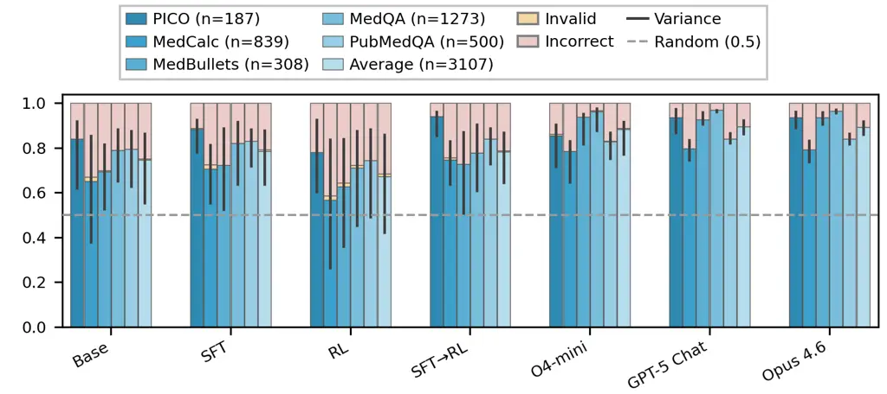
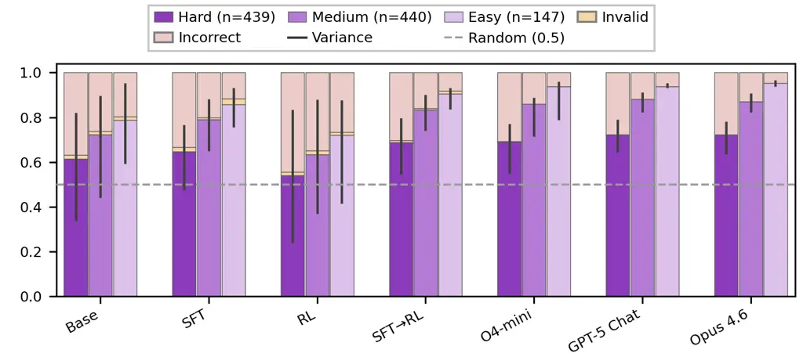

\workshoptitle

First Workshop on Reliable Evaluation for Language Models (JUDGe)

# Beyond Correctness: Validity-Oriented Evaluation of Biomedical LLM JudgesThanks: This work was largely carried out while the author was employed at IQVIA.

Rodrigo de Oliveira Affiliation: Independent Researcher, London, UK
Email: [rdeoliveira.phd@gmail.com](mailto:)    Federico Pittino
Affiliation: IQVIA, Barcelona, Spain
Email: [federico.pittino@iqvia.com](mailto:)    James Gwinnutt
Affiliation: IQVIA, Reading, UK
Email: [james.gwinnutt@iqvia.com](mailto:)    Jay Nanavati
Affiliation: IQVIA, Cambridge, UK
Email: [jay.nanavati@iqvia.com](mailto:)

###### Abstract

We propose a scalable, validity-oriented pipeline for evaluating
biomedical LLM judges when high-quality human judgments are scarce.
First, we augment existing human-labelled biomedical benchmarks with
deterministic, metric-grounded mutations that produce auditable
preference pairs. Second, we evaluate judges beyond aggregate
correctness using three deployment-relevant dimensions: correctness
against metric-derived gold labels, robustness under repeated stochastic
sampling, and compliance with the requested output format. We use this
pipeline to assess Llama-3.1-8B-Instruct under four regimes: (1) *base*,
using the instruct model as is; (2) *SFT*, distillation-based supervised
fine-tuning only; (3) *RL*, GRPO-based reinforcement learning only; and
(4) *SFT$`\rightarrow`$RL*, SFT followed by RL. The base and
single-stage regimes struggle on structured medical discrimination such
as PICO extraction and clinical calculations, whereas
SFT$`\rightarrow`$RL performs best across correctness, compliance, and
robustness; gains concentrate on decomposable tasks (PICO, MedCalc), at
times matching or outperforming frontier models.

## 1 Introduction

LLM-as-a-judge is increasingly used to scale evaluation beyond human
ratings \[1\]. In high-stakes settings such as healthcare, however,
judges must remain valid in real-world use. Biomedical applications—from
structured extraction and clinical summarization \[2\] to clinical
interviews \[3\] and exam-style question answering \[4, 5\]—require
fine-grained discrimination of PICO spans, calculation steps, and subtle
distractors.

Most existing work treats agreement with human or expert judgments as
the primary quality indicator \[1, 6, 7\], giving less attention to
operational failures. A disagreement may reflect a substantive error,
but may also arise from verdict instability or a non-parseable
response \[8, 9\]. We therefore introduce a three-axis protocol
measuring criterion-linked correctness, robustness, and compliance, and
ask:


We compare small and frontier judges across biomedical tasks. Frontier
models provide a strong ceiling, but fine-tuning small models may offer
a more cost-effective route to specialized evaluators. Recent work
trains thinking judges with supervised fine-tuning or reinforcement
learning \[10, 11, 12, 13, 14, 15\], typically via GRPO \[16\]; we
therefore ask:


Training and evaluating these judges requires preference data–i.e. pairs
of chosen/rejected responses–that would be costly to obtain through new
human-rating campaigns. We therefore follow the approach of
deterministic synthetic-data generation with verifiable ground
truth \[17, 2, 3, 4, 5\]. In real-world pipelines, strong generators
often produce very good responses, thereby increasing the difficulty for
LLM judges: it is arguably easier to tell a good from a bad response,
than a good from a great response. As such, it is highly desirable to
adjust the difficulty of synthetic pairs at the point of generation,
motivating our final question:


Thus, our contributions are three-fold:

1.  1.  A three-axis, validity-oriented evaluation protocol for biomedical
        LLM judges, combining criterion-linked correctness with robustness
        under resampling and compliance.
2.  2.  A deterministic and scalable method for augmenting biomedical
        benchmarks with auditable, metric-grounded synthetic preference data
        for judge training and evaluation.
3.  3.  Finally, an empirical study of four distinct training regimes of
        small LLMs using the proposed protocol and augmented data.

## 2 Method

### 2.1 Biomedical tasks

We train and evaluate on five biomedical tasks¹¹ 1 PICO —
[https://huggingface.co/datasets/bigbio/ebm_pico](https://huggingface.co/datasets/bigbio/ebm_pico);
MedCalc —
[https://huggingface.co/datasets/ncbi/MedCalc-Bench-v1.2](https://huggingface.co/datasets/ncbi/MedCalc-Bench-v1.2);
MedBullets —
[https://huggingface.co/datasets/super-dainiu/medagents-benchmark](https://huggingface.co/datasets/super-dainiu/medagents-benchmark);
MedQA —
[https://huggingface.co/datasets/super-dainiu/medagents-benchmark](https://huggingface.co/datasets/super-dainiu/medagents-benchmark);
PubMedQA —
[https://huggingface.co/datasets/super-dainiu/medagents-benchmark](https://huggingface.co/datasets/super-dainiu/medagents-benchmark).
grouped into two families by response structure. _Decomposable_
tasks—PICO span extraction and MedCalc—require judging partially correct
outputs: whether extracted trial elements or clinical calculations are
right. _Atomic_ tasks—MedBullets, MedQA, and PubMedQA—require judging
all-or-nothing exam-style answers where one option is fully correct.

### 2.2 Synthetic data generation

Every preference label is traceable to ground truth and a task metric.
Algorithms 1 and 2 in Appendix A implement candidate generation, pair
selection, and the suite-specific operator $`o`$ and metric $`m`$ for
each benchmark. For each source example with clinical text $`x`$ and
ground truth $`y`$, a task-specific mutation operator $`o`$ generates
$`K`$ candidate responses:

```math
\{c_{1},\ldots,c_{K}\}=o(x,y). \tag{1}
```

On PICO, $`o`$ adds or deletes spans; on MedCalc, it perturbs numeric
inputs; on atomic tasks, it substitutes multiple-choice options
(Appendix A).

Each candidate is scored against ground truth and ranked by quality
(Algorithm 1):

```math
s_{k}=m(c_{k},y), \tag{2}
```

Here, $`m`$ is macro-F1 on PICO, MSE on MedCalc, and binary correctness
on atomic tasks.

From the ranked pool, preprocessing selects one valid chosen–rejected
pair per source example (Algorithm 2). Each retained _pair_ is presented
in slots $`A`$ and $`B`$ with gold verdict $`l\in\{A,B\}`$ naming the
preferred slot:

```math
l=\begin{cases}A&\text{if }s_{A}>s_{B},\\
B&\text{otherwise},\end{cases} \tag{3}
```

where $`s_{A}`$ and $`s_{B}`$ are the candidate scores. On decomposable
tasks, _pairs_ are drawn from the ranking with integer rank gap

```math
\delta=j-i, \tag{4}
```

where $`i<j`$ are the rank positions (smaller $`\delta`$ = harder
_pair_); we stratify decomposable pairs into three per-example
$`\delta`$ tertiles and drop pairs whose scores are too close. On atomic
tasks, _pairs_ contrast correct and incorrect options without rank-gap
stratification.

#### SFT data.

A frontier teacher (Claude Opus 4.6²² 2
[https://www-cdn.anthropic.com/14e4fb01875d2a69f646fa5e574dea2b1c0ff7b5.pdf](https://www-cdn.anthropic.com/14e4fb01875d2a69f646fa5e574dea2b1c0ff7b5.pdf))
samples judge generation $`g`$, which receives a deterministic quality
score $`Q`$:

```math
Q(g,l)=f_{\mathrm{fmt}}(g)+f_{\mathrm{parse}}(g)+f_{\mathrm{align}}(g,l)\in\{0,1,2,3\}, \tag{5}
```

where $`f_{\mathrm{fmt}}`$ and $`f_{\mathrm{parse}}`$ require valid J1
judge format and a parseable verdict or score. The SFT corpus distills
both pairwise verdict and pointwise score prompts from the same pairs.
For pairwise examples, $`f_{\mathrm{align}}{=}1`$ iff the teacher’s A/B
verdict matches the metric-derived gold verdict $`l`$. For pointwise
examples, the teacher scores each candidate in a preference pair
independently; $`f_{\mathrm{align}}{=}1`$ iff its score on the chosen
candidate exceeds its score on the rejected candidate.

#### RL data.

RL uses the same pairs and gold verdicts to provide verifiable J1-style
rewards \[10\]; no teacher completions are stored. Because judges are
sensitive to candidate order \[1\], we randomly swap slots during
training and evaluation.

The pipeline scales with existing benchmarks rather than new rating
campaigns, and its fixed operators and metrics make every pair auditable
and replayable.

### 2.3 Training

All experiments use Llama-3.1-8B-Instruct on synthetic pairs from the
five-suite pipeline: $`{\sim}`$27K training preference pairs for RL and
SFT$`\rightarrow`$RL, and $`{\sim}`$48K distilled teacher completions
with $`Q{=}3`$ (pairwise and pointwise) for SFT; $`{\sim}`$3K pairs are
held out for meta-evaluation (§ 2.4). Judge prompt templates are in
Appendix B. We implement SFT and RL with Hugging Face’s TRL package³³ 3
[https://huggingface.co/docs/trl](https://huggingface.co/docs/trl). We
compare four regimes:

- •
  Base. The Llama-3.1-8B-Instruct checkpoint is used as is, without
  additional training.
- •
  SFT. Supervised fine-tuning on distilled teacher prompt–completion
  pairs that pass the maximum quality filter ($`Q{=}3`$), mixing
  pairwise and pointwise judge modes. The model is trained with
  completion-only cross-entropy on teacher completions; prompt tokens
  are masked from the loss.
- •
  RL. Pairwise judge reinforcement learning from the instruct
  checkpoint, without teacher completions, following J1 \[10\] with
  verifiable pairwise rewards optimized with GRPO \[16\]. On each
  preference pair the student samples a judge completion; the reward is
  $`1`$ when the parsed A/B verdict matches the gold verdict $`l`$, and
  $`0`$ otherwise.
- •
  SFT$`\rightarrow`$RL. The SFT checkpoint is further tuned with the
  same pairwise RL stage on the same preference pairs and reward.

All tuning stages use LoRA adapters ($`r{=}16`$, $`\alpha{=}32`$) on
attention and MLP projections. SFT runs for 3 epochs with learning rate
$`2\times 10^{-5}`$, per-device batch size 2, and 8-step gradient
accumulation on one NVIDIA A100 GPU. RL runs for 1 epoch with learning
rate $`1\times 10^{-6}`$, five rollouts per prompt, and KL coefficient
$`\beta{=}0.01`$ (J1 defaults for 8B models) on eight NVIDIA H100 GPUs.

### 2.4 Meta-evaluation

We meta-evaluate every checkpoint in pairwise mode on a held-out split
($`{\sim}`$3K comparisons across five tasks), judging each comparison
three times with stochastic decoding
($`\texttt{num\_repetitions}{=}3`$). Correctness is agreement with the
metric-derived gold verdict $`l`$ from Eqs. (3)–(4); we additionally
report robustness under resampling and compliance when the judge errs.
Related work studies bias, consistency, or multi-criterion assessment
separately \[8, 9, 18, 2\]; we combine correctness with two
deployment-oriented diagnostics under one verifiable protocol.

Untuned frontier APIs---O4-mini⁴⁴ 4
[https://developers.openai.com/api/docs/models/o4-mini](https://developers.openai.com/api/docs/models/o4-mini),
GPT-5 Chat⁵⁵ 5
[https://developers.openai.com/api/docs/models/gpt-5-chat-latest](https://developers.openai.com/api/docs/models/gpt-5-chat-latest),
and Opus 4.6⁰⁰footnotemark: 0 —serve as strong baselines.

#### Correctness.

Pairwise correctness is majority vote over the three parsed A/B
verdicts. We slice it by response type—decomposable (PICO, MedCalc)
versus atomic QA—and, for decomposable tasks, by three rank-gap
tertiles. This is the axis used in most prior judge benchmarks \[1, 6,
7\].

#### Robustness.

A robust judge should produce the same rating under repeated stochastic
decoding. For each comparison we derive majority-vote, all-sample, and
any-sample correctness. Let $`a_{\mathrm{maj}}`$, $`a_{\mathrm{all}}`$,
and $`a_{\mathrm{any}}`$ denote their dataset means. We report verdict
variance as the mean whisker span

```math
v=\bigl|a_{\mathrm{any}}-a_{\mathrm{all}}\bigr|, \tag{6}
```

averaged across datasets (equivalently, the gap between lenient any-vote
and strict all-vote correctness); lower $`v`$ indicates less
flip-flopping under resampling. This measures resampling robustness
without human re-annotation, analogous in aim to Sage \[9\] but defined
on repeated verdicts over fixed gold preferences.

#### Compliance.

We separate substantive discrimination errors from format failures. For
each comparison we partition outcomes into parseable wrong verdicts
(_legitimate errors_) and completions without a parseable A/B verdict
(_invalid responses_). This matters operationally because a
non-compliant judge cannot be consumed by an automated pipeline.
Compliance failure is the invalid share among all errors,

```math
\rho=\frac{n_{\mathrm{invalid}}}{n_{\mathrm{invalid}}+n_{\mathrm{legitimate}}}, \tag{7}
```

with lower $`\rho`$ indicating that mistakes are more often
wrong-but-parseable judgments than brittle non-responses. Unlike
bias-stress benchmarks that perturb inputs \[8\], this axis measures
compliance conditional on error—whether a wrong judge still returns an
actionable verdict.

Together, the axes assess criterion-linked correctness, reproducibility,
and actionable output.

## 3 Results



Figure 1: Response rates (correct, invalid, and incorrect) by dataset.
Each dataset compares base, tuned, and frontier judge models ($`n`$ in
legend). Variance whiskers show robustness of correct response rate
(Eq. (6)). Exact values in Appendix C.



Figure 2: Response rates (correct, invalid, and incorrect) by rank-gap
difficulty. Decomposable items only (PICO + MedCalc), stratified by
Hard, Medium, and Easy tertiles of $`\delta`$ per source example (hard =
smallest gaps; $`n`$ in legend). Variance whiskers show robustness of
correct response rate (Eq. (6)). Exact values in Appendix C.


Figure 1 shows that not every disagreement is a legitimate judging
error: some failures are operational, arising from verdict instability
under resampling or from non-parseable responses. Among trained regimes,
SFT$`\rightarrow`$RL reduces the average invalid-response share to
$`1.6\%`$ versus $`3.6\%`$ for RL, while its verdict variance is
$`0.05`$ versus $`0.08`$ for base; the exact values are reported in
Tables 4 and 3. Thus, operational failures are measurable and
non-negligible, but can be reduced through training.


Applying the validity-oriented evaluation protocol (§ 2.4),
SFT$`\rightarrow`$RL beats all other trained regimes on correctness,
compliance, and robustness. SFT$`\rightarrow`$RL achieves the highest
average correctness (0.81 pairwise correctness; Figure 1). Gains
concentrate on decomposable items (+0.09 on PICO and MedCalc) rather
than atomic QA (+0.02). Applying RL directly to the base model without
SFT is harmful ($`-`$0.06 versus base), which suggests biomedical judge
RL needs a domain prior. On individual suites, SFT$`\rightarrow`$RL
matches or beats frontier judges on PICO and PubMedQA, but frontier
models still lead on average and clearly dominate atomic multiple-choice
discrimination. Thus, for small biomedical judges, training order
matters: RL benefits from the domain prior established by SFT.


On decomposable tasks, rank-gap tertiles successfully model difficulty:
pairwise correctness increases monotonically from hard to easy bins
(Figure 2; e.g., teach-then-incentivising: 0.69 $`\rightarrow`$ 0.83
$`\rightarrow`$ 0.90). SFT$`\rightarrow`$RL gains hold at every tertile,
including close-call pairs in the hardest tier. Thus, deterministic
preference construction can make synthetic evaluation more realistic by
exposing judges to calibrated close-call comparisons.

## 4 Limitations

First, our experiments use one base model, Llama-3.1-8B-Instruct. We
also attempted Qwen models, but many generations were non-compliant when
using Hugging Face’s TRL package; reporting correctness or compliance
figures from those runs would therefore be misleading, so we omit them.

Second, hardware constraints limited our study to an 8B model. Larger
models, such as 70B checkpoints, may behave differently and are an
important direction for future work.

Third, our synthetic data pipeline is correctness-centric: it
deterministically injects errors into otherwise grounded responses. The
same machinery could be extended to safety-centric stress tests by
deterministically injecting dangerous content into rejected responses,
either instead of or alongside ordinary correctness errors.

Finally, we are aware that post-hoc calibration can improve
trustworthiness in biomedical language-model applications \[17\], but we
have not yet tested calibration methods for LLM judges.

## 5 Related work

Recent work trains generative judges with RL on synthetic preferences
and verifiable rewards \[10, 11, 12, 13, 14\], typically via
GRPO \[16\]. We do not propose a new optimizer; we transfer J1 \[10\] to
biomedicine and test whether domain SFT should precede RL. General judge
benchmarks \[6, 1, 7\] and tuned evaluators such as GLIDER \[15\]
standardize open-domain chat and reasoning; our study is domain-specific
and explicitly contrasts decomposable structured tasks, where partial
correctness matters \[17\], with atomic QA. Biomedical and clinical
judging \[3, 2, 18, 19\] remains largely prompting- or SFT-based rather
than pairwise judge RL \[10\].

Prior work pursues complementary judge-assessment axes: EvalBiasBench
stress-tests robustness to superficial biases \[8\]; Sage measures local
and global preference consistency without human gold \[9\]; and
YESciEval and clinical-judge studies employ multi-rubric or validated
instruments \[18, 2\]. These lines of work typically target different
settings and remain separate from tuning studies. We contribute a
three-dimensional, validity-oriented evaluation protocol (correctness,
robustness, compliance) on fully verifiable, metric-derived biomedical
preferences. To our knowledge, no prior work combines domain SFT, RL
judge tuning, and systematic pairwise meta-evaluation along these axes
across structured biomedical tasks with metric-derived reference labels.

## 6 Conclusion

In this study, we introduce a validity-oriented pipeline combining
metric-grounded synthetic preferences with correctness, robustness, and
compliance. We use it to compare four regimes across five biomedical
benchmarks and to examine difficulty in partially correct tasks.

We answer RQ1 by showing that operational failures are distinct from
legitimate judging errors: among trained regimes, SFT$`\rightarrow`$RL
reduces the average invalid-response share to $`1.6\%`$ versus $`3.6\%`$
for RL, while its verdict variance is $`0.05`$ versus $`0.08`$ for base.
These measures show why judge evaluation should extend beyond
correctness alone.

We answer RQ2 by finding that SFT$`\rightarrow`$RL is the strongest
tested regime across correctness, robustness, and compliance. Its gains
concentrate on decomposable tasks, reaching $`0.84`$ versus $`0.75`$ for
base, while direct RL from the base model is harmful; frontier models
nevertheless remain stronger on average, especially on atomic question
answering.

We answer RQ3 affirmatively: on decomposable tasks, pairwise correctness
rises monotonically across rank-gap tertiles, from $`0.69`$ in the
hardest bin to $`0.90`$ in the easiest for SFT$`\rightarrow`$RL, with
its gains holding at every difficulty level. This supports using
deterministic, metric-grounded pairs to study the close-call comparisons
that arise when strong generators produce similarly good candidates.

Together, these results show how auditable preference data and
multidimensional evaluation can make small biomedical LLM judges more
reliable and operationally useful.

## References

- \[1\] L. Zheng, W. Chiang, Y. Sheng, S. Zhuang, Z. Wu, Y. Zhuang, Z.
  Lin, Z. Li, D. Li, E. P. Xing, H. Zhang, J. E. Gonzalez, and I.
  Stoica (2023) Judging LLM-as-a-judge with MT-Bench and chatbot arena.
  In Neural Information Processing Systems, External Links:
  [Link](https://mlanthology.org/neurips/2023/zheng2023neurips-judging/),
  2306.05685 Cited by: §1, §1, §2.2, §2.4, §5.
- \[2\] E. Croxford, Y. Gao, E. First, N. Pellegrino, M. Schnier, J.
  Caskey, M. Oguss, G. Wills, G. Chen, D. Dligach, M. M. Churpek, A.
  Mayampurath, F. Liao, C. Goswami, K. K. Wong, B. W. Patterson, and M.
  Afshar (2025) Evaluating clinical AI summaries with large language
  models as judges. npj Digital Medicine 8 (1), pp. 640. External Links:
  [Document](https://dx.doi.org/10.1038/s41746-025-02005-2),
  [Link](https://www.nature.com/articles/s41746-025-02005-2) Cited by:
  §1, §1, §2.4, §5, §5.
- \[3\] J. Chen, Z. Wei, W. Zhang, Y. Hu, and Q. Zhang (2025) CliniChat:
  a multi-source knowledge-driven framework for clinical interview
  dialogue reconstruction and evaluation. arXiv preprint
  arXiv:2504.10418. External Links:
  [Link](https://arxiv.org/abs/2504.10418) Cited by: §1, §1, §5.
- \[4\] D. Jin, E. Pan, N. Oufattole, W. Weng, H. Fang, and P.
  Szolovits (2021) What disease does this patient have? a large-scale
  open domain question answering dataset from medical exams. Applied
  Sciences 11 (14), pp. 6421. External Links:
  [Document](https://dx.doi.org/10.3390/app11146421),
  [Link](https://www.mdpi.com/2076-3417/11/14/6421) Cited by: §1, §1.
- \[5\] A. Nentidis, G. Katsimpras, A. Krithara, M. Krallinger, M.
  Rodríguez-Ortega, E. Rodriguez-López, N. Loukachevitch, A.
  Sakhovskiy, E. Tutubalina, D. Dimitriadis, G. Tsoumakas, G.
  Giannakoulas, A. Bekiaridou, A. Samaras, G. M. D. Nunzio, N. Ferro, S.
  Marchesin, M. Martinelli, G. Silvello, and G. Paliouras (2025)
  Overview of BioASQ 2025: the thirteenth BioASQ challenge on
  large-scale biomedical semantic indexing and question answering. In
  Experimental IR Meets Multilinguality, Multimodality, and Interaction,
  pp. 173–198. External Links:
  [Document](https://dx.doi.org/10.1007/978-3-032-04354-2%5F12),
  [Link](https://link.springer.com/chapter/10.1007/978-3-032-04354-2_12),
  ISBN 978-3-032-04354-2 Cited by: §1, §1.
- \[6\] N. Lambert, V. Pyatkin, J. Morrison, L. Miranda, B. Y. Lin, K.
  Chandu, N. Dziri, S. Kumar, T. Zick, Y. Choi, N. A. Smith, and H.
  Hajishirzi (2025) RewardBench: evaluating reward models for language
  modeling. In Findings of the Association for Computational
  Linguistics: NAACL 2025, L. Chiruzzo, A. Ritter, and L. Wang (Eds.),
  Albuquerque, New Mexico, pp. 1755–1797. External Links:
  [Document](https://dx.doi.org/10.18653/v1/2025.findings-naacl.96),
  [Link](https://aclanthology.org/2025.findings-naacl.96/), ISBN
  979-8-89176-195-7, 2403.13787 Cited by: §1, §2.4, §5.
- \[7\] S. Tan, S. Zhuang, K. Montgomery, W. Y. Tang, A. Cuadron, C.
  Wang, R. A. Popa, and I. Stoica (2025) JudgeBench: a benchmark for
  evaluating LLM-based judges. In International Conference on Learning
  Representations, External Links:
  [Link](https://mlanthology.org/iclr/2025/tan2025iclr-judgebench/),
  2410.12784 Cited by: §1, §2.4, §5.
- \[8\] J. Park, S. Jwa, M. Ren, D. Kim, and S. Choi (2024) OffsetBias:
  leveraging debiased data for tuning evaluators. In Findings of the
  Association for Computational Linguistics: EMNLP 2024, Miami, Florida,
  USA, pp. 1043–1067. External Links:
  [Document](https://dx.doi.org/10.18653/v1/2024.findings-emnlp.57),
  [Link](https://aclanthology.org/2024.findings-emnlp.57/), 2407.06551
  Cited by: §1, §2.4, §2.4, §5.
- \[9\] Y. Feng, S. Wang, Z. Cheng, Y. Wan, and D. Chen (2025) Are we on
  the right way to assessing LLM-as-a-judge?. arXiv preprint
  arXiv:2512.16041. External Links:
  [Link](https://arxiv.org/abs/2512.16041) Cited by: §1, §2.4, §2.4, §5.
- \[10\] C. Whitehouse, T. Wang, P. Yu, X. Li, J. Weston, I. Kulikov,
  and S. Saha (2026) J1: incentivizing thinking in LLM-as-a-judge via
  reinforcement learning. In International Conference on Learning
  Representations, External Links:
  [Link](https://mlanthology.org/iclr/2026/whitehouse2026iclr-j1/),
  2505.10320 Cited by: Appendix B, §1, 3rd item, §2.2, §5.
- \[11\] A. Xu, Y. Zhou, X. Nguyen, C. Xiong, and S. Joty (2026) J4R:
  learning to judge with equivalent initial state group relative policy
  optimization. In Proceedings of the 64th Annual Meeting of the
  Association for Computational Linguistics (Volume 1: Long Papers), M.
  Liakata, V. P. Moreira, J. Zhang, and D. Jurgens (Eds.), San Diego,
  California, United States, pp. 1492–1511. External Links:
  [Document](https://dx.doi.org/10.18653/v1/2026.acl-long.67),
  [Link](https://aclanthology.org/2026.acl-long.67/), ISBN
  979-8-89176-390-6, 2505.13346 Cited by: §1, §5.
- \[12\] H. Huang, Y. He, H. Zhou, R. Zhang, W. Liu, W. Wang, J. Liu,
  and W. Su (2026) Think-J: learning to think for generative
  LLM-as-a-judge. In Proceedings of the AAAI Conference on Artificial
  Intelligence, Vol. 40, pp. 31158–31166. External Links:
  [Document](https://dx.doi.org/10.1609/aaai.v40i37.40377),
  [Link](https://ojs.aaai.org/index.php/AAAI/article/view/40377),
  2505.14268 Cited by: §1, §5.
- \[13\] N. Chen, Z. Hu, Q. Zou, J. Wu, Q. Wang, B. Hooi, and B.
  He (2025) JudgeLRM: large reasoning models as a judge. arXiv preprint
  arXiv:2504.00050. External Links:
  [Link](https://arxiv.org/abs/2504.00050) Cited by: §1, §5.
- \[14\] X. Chen, G. Li, Z. Wang, B. Jin, C. Qian, Y. Wang, H. Wang, Y.
  Zhang, D. Zhang, T. Zhang, H. Tong, and H. Ji (2026) RM-R1: reward
  modeling as reasoning. In International Conference on Learning
  Representations, External Links:
  [Link](https://mlanthology.org/iclr/2026/chen2026iclr-rmr1/),
  2505.02387 Cited by: §1, §5.
- \[15\] D. Deshpande, S. S. Ravi, S. C. Wang, B. Mielczarek, A.
  Kannappan, and R. Qian (2024) GLIDER: grading LLM interactions and
  decisions using explainable ranking. arXiv preprint arXiv:2412.14140.
  External Links: [Link](https://arxiv.org/abs/2412.14140) Cited by: §1,
  §5.
- \[16\] Z. Shao, P. Wang, Q. Zhu, R. Xu, J. Song, X. Bi, H. Zhang, M.
  Zhang, Y. K. Li, Y. Wu, and D. Guo (2024) DeepSeekMath: pushing the
  limits of mathematical reasoning in open language models. arXiv
  preprint arXiv:2402.03300. External Links:
  [Link](https://arxiv.org/abs/2402.03300) Cited by: §1, 3rd item, §5.
- \[17\] R. de Oliveira, M. Garber, J. M. Gwinnutt, E. Rashidi, J. (.
  Hwang, W. Gilmour, J. Nanavati, K. Zine El Abidine, and C. D.
  Mack (2025) A study of calibration as a measurement of trustworthiness
  of large language models in biomedical natural language processing.
  JAMIA Open 8 (4), pp. ooaf058. External Links:
  [Document](https://dx.doi.org/10.1093/jamiaopen/ooaf058),
  [Link](https://academic.oup.com/jamiaopen/article/8/4/ooaf058/8196848)
  Cited by: §1, §4, §5.
- \[18\] J. D’Souza, H. Babaei Giglou, and Q. Münch (2025) YESciEval:
  robust LLM-as-a-judge for scientific question answering. In
  Proceedings of the 63rd Annual Meeting of the Association for
  Computational Linguistics (Volume 1: Long Papers), W. Che, J.
  Nabende, E. Shutova, and M. T. Pilehvar (Eds.), Vienna, Austria,
  pp. 13749–13783. External Links:
  [Document](https://dx.doi.org/10.18653/v1/2025.acl-long.675),
  [Link](https://aclanthology.org/2025.acl-long.675/), ISBN
  979-8-89176-251-0, 2505.14279 Cited by: §2.4, §5, §5.
- \[19\] Z. Wang, H. Li, D. Huang, H. Kim, C. Shin, and A. M.
  Rahmani (2025) HealthQ: unveiling questioning capabilities of LLM
  chains in healthcare conversations. Smart Health 36, pp. 100570.
  External Links:
  [Document](https://dx.doi.org/10.1016/j.smhl.2025.100570),
  [Link](https://doi.org/10.1016/j.smhl.2025.100570) Cited by: §5.
- \[20\] Q. McNemar (1947) Note on the sampling error of the difference
  between correlated proportions or percentages. Psychometrika 12 (2),
  pp. 153–157. External Links:
  [Document](https://dx.doi.org/10.1007/BF02295996) Cited by: Table 2.

## Appendix

## Appendix A Synthetic data generation

This section details the synthetic pairwise pipeline from §2.2. For each
source example with clinical text $`x`$ and ground truth $`y`$, a
task-specific mutation operator $`o`$ proposes $`K`$ candidate
responses, each candidate is scored against $`y`$ with a suite-specific
metric $`m`$, and the pool is ranked by decreasing quality (ascending
mean squared error on MedCalc). More formally:


The same pipeline applies to all benchmark suites; the distinction among
them reduces to the shape of $`y`$, which dictates $`o`$ and $`m`$
(Table 1). Decomposable tasks (PICO, MedCalc) carry structured or
numeric ground truth and later use rank-gap stratification when forming
pairs; atomic multiple-choice tasks use boolean correctness and contrast
one correct against one incorrect candidate. MedQA and PubMedQA follow
the same atomic operator and metric as MedBullets; one QA example below
suffices to illustrate that family.

| Suite    | Type         | $`y`$                 | $`o`$                  | $`m`$          | $`s_{k}`$            |
| -------- | ------------ | --------------------- | ---------------------- | -------------- | -------------------- |
| PICO     | Decomposable | Span sets (P/I/C/O)   | Add/delete spans       | macro-F1 exact | $`[0,1]\uparrow`$    |
| MedCalc  | Decomposable | Scalar (clearance)    | Perturb formula inputs | MSE            | $`\geq 0\downarrow`$ |
| QA tasks | Atomic       | Multiple-choice label | Swap wrong option      | boolean        | $`\{0,1\}`$          |

Table 1: Task-specific operators, metrics, and ground-truth types
(Algorithms 1 and 2). MedQA and PubMedQA use the same atomic row as
MedBullets.

Once candidates are ranked, Algorithm 2 bins all valid chosen–rejected
pairs for a source example. $`\delta`$-bin boundaries depend on $`K`$
and the number of bins $`N`$ (even splits of rank gaps in
$`\{1,\ldots,K{-}1\}`$; we use $`N{=}3`$ tertiles); scores enter only
via the gap threshold $`\tau{=}0.05`$. On atomic tasks
($`m{=}\mathrm{boolean}`$), every pair contrasts $`C[1]`$ with one lower
rank and is placed in a single bin; on decomposable tasks, each rank gap
$`\delta`$ fixes its bin $`b`$ before any candidate index is visited,
and scores only gate whether a pair is kept ($`|S[i]-S[j]|>\tau`$). Each
stored tuple is $`(\mathit{chosen},\mathit{rejected})`$, where each side
is a triple $`(i,C[i],S[i])`$ recording rank index, candidate, and
score. Downstream preprocessing then draws one training example per
source from these bins. More formally:


Algorithm 2 organizes all valid preference pairs into
difficulty-stratified bins; exact training examples are then selected by
drawing one tuple per source and balancing underrepresented bins across
the corpus (fixed random seed for reproducibility). When training
prompts are assembled, the chosen and rejected candidates are randomly
assigned to slots $`A`$ and $`B`$ (50% swap rate), again under a fixed
seed, so gold verdicts from Eq. (3) remain reproducible.

Below we illustrate the full pipeline with one worked example per
family: PICO, MedCalc, and MedBullets as the representative atomic QA
task.

### A.1 [PICO](https://huggingface.co/datasets/bigbio/ebm_pico)

Split=test, ID=10070173.

Source text $`x`$:


Ground truth $`y`$:


Candidate $`A`$:


Candidate $`B`$:


Scoring with macro-F1 exact match $`m`$ against $`y`$:

Macro-F1 exact match lowercases spans and strips punctuation before
testing equality, then scores set overlap per PICO key. For each key
$`k\in\{P,I,C,O\}`$, treat $`\mathcal{Y}_{k}`$ and the candidate spans
$`\mathcal{C}_{k}`$ as sets; count TP, FP, and FN, then
$`P_{k}=\mathrm{TP}/(\mathrm{TP}+\mathrm{FP})`$,
$`R_{k}=\mathrm{TP}/(\mathrm{TP}+\mathrm{FN})`$, and
$`F1_{k}=2P_{k}R_{k}/(P_{k}+R_{k})`$.

Candidate $`A`$:

- •
  $`P`$: $`\mathrm{TP}{=}1`$, $`\mathrm{FP}{=}2`$, $`\mathrm{FN}{=}6`$
  $`\Rightarrow`$ $`P{=}0.33`$, $`R{=}0.14`$, $`F1{=}0.20`$
- •
  $`I`$: $`\mathrm{TP}{=}1`$, $`\mathrm{FP}{=}2`$, $`\mathrm{FN}{=}6`$
  $`\Rightarrow`$ $`P{=}0.33`$, $`R{=}0.14`$, $`F1{=}0.20`$
- •
  $`C`$: $`\mathrm{TP}{=}0`$, $`\mathrm{FP}{=}3`$, $`\mathrm{FN}{=}0`$
  $`\Rightarrow`$ $`P{=}0.00`$, $`R{=}0.00`$, $`F1{=}0.00`$
- •
  $`O`$: $`\mathrm{TP}{=}8`$, $`\mathrm{FP}{=}6`$, $`\mathrm{FN}{=}3`$
  $`\Rightarrow`$ $`P{=}0.57`$, $`R{=}0.73`$, $`F1{=}0.64`$

$`{\color[rgb]{0.082,0.3945,0.7539}m}(A,{\color[rgb]{0.4258,0.2969,0.2539}y})=\frac{1}{4}\sum_{k}F1_{k}=0.26`$.

Candidate $`B`$:

- •
  $`P`$: $`\mathrm{TP}{=}1`$, $`\mathrm{FP}{=}2`$, $`\mathrm{FN}{=}6`$
  $`\Rightarrow`$ $`P{=}0.33`$, $`R{=}0.14`$, $`F1{=}0.20`$
- •
  $`I`$: $`\mathrm{TP}{=}0`$, $`\mathrm{FP}{=}3`$, $`\mathrm{FN}{=}7`$
  $`\Rightarrow`$ $`P{=}0.00`$, $`R{=}0.00`$, $`F1{=}0.00`$
- •
  $`C`$: $`\mathrm{TP}{=}0`$, $`\mathrm{FP}{=}3`$, $`\mathrm{FN}{=}0`$
  $`\Rightarrow`$ $`P{=}0.00`$, $`R{=}0.00`$, $`F1{=}0.00`$
- •
  $`O`$: $`\mathrm{TP}{=}8`$, $`\mathrm{FP}{=}6`$, $`\mathrm{FN}{=}3`$
  $`\Rightarrow`$ $`P{=}0.57`$, $`R{=}0.73`$, $`F1{=}0.64`$

$`{\color[rgb]{0.082,0.3945,0.7539}m}(B,{\color[rgb]{0.4258,0.2969,0.2539}y})=0.21`$.

Pair:

Chosen: $`A`$ ($`s=0.26`$); Rejected: $`B`$ ($`s=0.21`$).

### A.2 [MedCalc](https://huggingface.co/datasets/ncbi/MedCalc-Bench-v1.2)

Split=test, ID=8.

Source text $`x`$:


Ground truth $`y`$:


Candidate $`A`$:


Candidate $`B`$:


Scoring with MSE $`m`$ against $`y`$:

Cockcroft–Gault:

CrCl(age, sex, adjusted_body_weight_kg, serum_creatinine_mg_dL) =  
 ((140 - age) \* adjusted_body_weight_kg \* (1 if sex == ’male’ else
0.85))  
 / (serum_creatinine_mg_dL \* 72)

$`{\color[rgb]{0.082,0.3945,0.7539}m}(c,{\color[rgb]{0.4258,0.2969,0.2539}y})=\mathrm{mean}\bigl((\mathrm{CrCl}(c)-{\color[rgb]{0.4258,0.2969,0.2539}y})^{2}\bigr)`$,
with a single scalar clearance target.

Candidate $`A`$:

CrCl(71, "male", 52.7, 1.42)  
 = ((140 - 71) \* 52.7 \* 1) / (1.42 \* 72)  
 = 35.57

$`{\color[rgb]{0.082,0.3945,0.7539}m}(A,{\color[rgb]{0.4258,0.2969,0.2539}y})=\mathrm{mean}\bigl((35.57-35.33)^{2}\bigr)=\mathrm{mean}(0.23^{2})=0.054`$.

Candidate $`B`$:

CrCl(71, "male", 52.35, 1.42)  
 = ((140 - 71) \* 52.35 \* 1) / (1.42 \* 72)  
 = 35.33

$`{\color[rgb]{0.082,0.3945,0.7539}m}(B,{\color[rgb]{0.4258,0.2969,0.2539}y})=\mathrm{mean}\bigl((35.33-35.33)^{2}\bigr)=0.0`$.

Pair:

Chosen: $`B`$ ($`s=0.0`$); Rejected: $`A`$ ($`s=0.054`$).

### A.3 [MedBullets](https://huggingface.co/datasets/super-dainiu/medagents-benchmark)

Split=MedBullets/train, ID=0.

Source text $`x`$:


Ground truth $`y`$:


Candidate $`A`$:


Candidate $`B`$:


Scoring with boolean correctness $`m`$ against $`y`$:

$`{\color[rgb]{0.082,0.3945,0.7539}m}(c,{\color[rgb]{0.4258,0.2969,0.2539}y})=1.0`$
if $`c`$ exactly matches $`{\color[rgb]{0.4258,0.2969,0.2539}y}`$, else
$`0.0`$.

Candidate $`A`$:
$`{\color[rgb]{0.082,0.3945,0.7539}m}(A,{\color[rgb]{0.4258,0.2969,0.2539}y})=1.0`$
if $`c{=}{\color[rgb]{0.4258,0.2969,0.2539}y}`$ else $`0.0=1.0`$.

Candidate $`B`$:
$`{\color[rgb]{0.082,0.3945,0.7539}m}(B,{\color[rgb]{0.4258,0.2969,0.2539}y})=1.0`$
if $`c{=}{\color[rgb]{0.4258,0.2969,0.2539}y}`$ else $`0.0=0.0`$.

Pair:

Chosen: $`A`$ ($`s=1.0`$); Rejected: $`B`$ ($`s=0.0`$).

## Appendix B Prompt templates

The prompts below are adapted from the J1 \[10\] thinking seed
templates. We reuse them throughout the pipeline: when generating
distillation data for SFT, when tuning with SFT or RL, and finally when
meta-evaluating. Every judge prompt has a system message:


and a user message composed conceptually of four blocks: 1) _format
instructions_, 2) _task instructions_ (also called “rubric”), 3) _source
text_, and 4) _candidate response(s)_. The exact contents of the user
message template vary by judge mode, since we need different format
instructions for pairwise or pointwise, and by task, as task
instructions are idiosyncratic. We detail each below.

### B.1 Pairwise


where:

- •
  {instruction} — task instructions (or “rubric”) from §B.3 (PICO,
  MedCalc, or QA).
- •
  {text} — source passage for the example (e.g., abstract, clinical
  note, or exam stem), from the task benchmark via §2.2.
- •
  {response_A} — candidate output in slot $`A`$ of a preference pair,
  from the mutation operator in §2.2 (worked examples in Appendix A);
  slot assignment varies across training batches to mitigate position
  bias.
- •
  {response_B} — candidate output in slot $`B`$, same provenance as
  {response_A}.

### B.2 Pointwise


where:

- •
  {instruction} — task instructions (or “rubric”) from §B.3 (PICO,
  MedCalc, or QA).
- •
  {text} — source passage for the example, same provenance as in the
  pairwise template.
- •
  {response} — a single candidate output from §2.2, presented one at a
  time for pointwise judging (or in distillation rows).

### B.3 Task instructions

#### PICO


#### MedCalc


where:

- •
  {calculator} — name of the selected MedCalc-Bench formula for this
  example (from the benchmark metadata).
- •
  {formula} — mathematical definition of that formula (from the
  benchmark’s formula catalog).
- •
  {formula_inputs} — variable definitions and units required by the
  formula.
- •
  {out_format} — required output format for the substituted,
  Python-evaluable formula string.

#### QA (MedQA, MedBullets, PubMedQA)


## Appendix C Detailed results

Figure 1 summarizes pairwise judging correctness, robustness, and
compliance; Tables 2, 3, and 4 report the exact per-suite values.
Figure 2 summarizes rank-gap difficulty on decomposable items; Table 5
reports the exact per-tertile values.

|                             | base | SFT            | RL                 | SFT$`\rightarrow`$RL | O4-mini | GPT-5 | Opus 4.6 |
| --------------------------- | ---- | -------------- | ------------------ | -------------------- | ------- | ----- | -------- |
| Decomposable ($`n{=}1026`$) | 0.75 | 0.79\* (+0.04) | 0.67\* ($`-`$0.08) | 0.84\* (+0.09)       | 0.82    | 0.87  | 0.86     |
| PICO ($`n{=}187`$)          | 0.84 | 0.88 (+0.04)   | 0.78 ($`-`$0.06)   | 0.94\* (+0.10)       | 0.86    | 0.94  | 0.94     |
| MedCalc ($`n{=}839`$)       | 0.65 | 0.71\* (+0.06) | 0.57\* ($`-`$0.08) | 0.75\* (+0.10)       | 0.79    | 0.80  | 0.79     |
| Atomic ($`n{=}2081`$)       | 0.76 | 0.79\* (+0.03) | 0.69\* ($`-`$0.07) | 0.78 (+0.02)         | 0.91    | 0.91  | 0.91     |
| MedBullets ($`n{=}308`$)    | 0.69 | 0.72 (+0.03)   | 0.63\* ($`-`$0.06) | 0.73 (+0.04)         | 0.94    | 0.93  | 0.94     |
| MedQA ($`n{=}1273`$)        | 0.79 | 0.82\* (+0.03) | 0.71\* ($`-`$0.08) | 0.78 ($`-`$0.01)     | 0.96    | 0.97  | 0.96     |
| PubMedQA ($`n{=}500`$)      | 0.79 | 0.83\* (+0.04) | 0.74\* ($`-`$0.05) | 0.84\* (+0.05)       | 0.83    | 0.84  | 0.84     |
| Avg                         | 0.75 | 0.79\* (+0.04) | 0.69\* ($`-`$0.06) | 0.81\* (+0.06)       | 0.87    | 0.89  | 0.89     |

Table 2: Pairwise judging correctness with rows labeled Decomposable and
Atomic as unweighted family means, indented rows as individual
benchmarks, Avg as the unweighted mean across all five suites, Bold as
best-in-class among Llama-8B or frontier columns, underlined bold as
overall row best, and asterisk as McNemar significance \[20\] vs.
baseline ($`p<0.05`$).

|                          | base | SFT              | RL               | SFT$`\rightarrow`$RL | O4-mini | GPT-5 | Opus 4.6 |
| ------------------------ | ---- | ---------------- | ---------------- | -------------------- | ------- | ----- | -------- |
| PICO ($`n{=}187`$)       | 0.14 | 0.06 ($`-`$0.08) | 0.03 ($`-`$0.11) | 0.06 ($`-`$0.08)     | 0.09    | 0.03  | 0.02     |
| MedCalc ($`n{=}839`$)    | 0.07 | 0.05 ($`-`$0.02) | 0.03 ($`-`$0.04) | 0.02 ($`-`$0.05)     | 0.10    | 0.01  | 0.02     |
| MedBullets ($`n{=}308`$) | 0.05 | 0.04 ($`-`$0.01) | 0.06 (+0.01)     | 0.07 (+0.02)         | 0.11    | 0.01  | 0.01     |
| MedQA ($`n{=}1273`$)     | 0.04 | 0.09 (+0.05)     | 0.09 (+0.05)     | 0.04 (+0.00)         | 0.07    | 0.01  | 0.00     |
| PubMedQA ($`n{=}500`$)   | 0.08 | 0.06 ($`-`$0.03) | 0.11 (+0.03)     | 0.06 ($`-`$0.02)     | 0.03    | 0.01  | 0.00     |
| Avg                      | 0.08 | 0.06 ($`-`$0.02) | 0.07 ($`-`$0.01) | 0.05 ($`-`$0.03)     | 0.08    | 0.01  | 0.01     |

Table 3: Verdict variance is the mean $`|\mathrm{high}-\mathrm{low}|`$
across datasets over majority-vote and any-/all-sample correctness rates
(lower is better), with the same columns and formatting as Table 2.

|                          | base | SFT             | RL              | SFT$`\rightarrow`$RL | O4-mini | GPT-5 | Opus 4.6 |
| ------------------------ | ---- | --------------- | --------------- | -------------------- | ------- | ----- | -------- |
| PICO ($`n{=}187`$)       | 0.0% | 4.5% (+4.5)     | 0.0% (+0.0)     | 0.0% (+0.0)          | 3.7%    | 0.0%  | 0.0%     |
| MedCalc ($`n{=}839`$)    | 5.5% | 6.5% (+1.0)     | 4.7% ($`-`$0.8) | 4.2% ($`-`$1.3)      | 0.0%    | 0.0%  | 0.0%     |
| MedBullets ($`n{=}308`$) | 1.1% | 0.0% ($`-`$1.1) | 4.3% (+3.2)     | 0.0% ($`-`$1.1)      | 0.0%    | 0.0%  | 0.0%     |
| MedQA ($`n{=}1273`$)     | 0.4% | 0.9% (+0.5)     | 3.8% (+3.4)     | 0.7% (+0.3)          | 12.8%   | 0.0%  | 0.0%     |
| PubMedQA ($`n{=}500`$)   | 0.0% | 0.0% (+0.0)     | 0.0% (+0.0)     | 0.0% (+0.0)          | 1.2%    | 0.0%  | 0.0%     |
| Avg                      | 2.3% | 2.8% (+0.5)     | 3.6% (+1.3)     | 1.6% ($`-`$0.7)      | 2.2%    | 0.0%  | 0.0%     |

Table 4: Invalid-response share is invalid / (invalid + legitimate
errors), lower is better, with the same columns and formatting as
Table 2.

|                      | base | SFT            | RL                 | SFT$`\rightarrow`$RL | O4-mini | GPT-5 | Opus 4.6 |
| -------------------- | ---- | -------------- | ------------------ | -------------------- | ------- | ----- | -------- |
| Hard ($`n{=}439`$)   | 0.62 | 0.65 (+0.03)   | 0.54\* ($`-`$0.08) | 0.69\* (+0.07)       | 0.69    | 0.72  | 0.72     |
| Medium ($`n{=}440`$) | 0.72 | 0.79\* (+0.07) | 0.63\* ($`-`$0.09) | 0.83\* (+0.11)       | 0.86    | 0.88  | 0.87     |
| Easy ($`n{=}147`$)   | 0.79 | 0.86 (+0.07)   | 0.72 ($`-`$0.07)   | 0.90\* (+0.11)       | 0.94    | 0.94  | 0.95     |

Table 5: Rank-gap difficulty on decomposable items (PICO + MedCalc),
where Hard / Medium / Easy are three tertiles of $`\delta`$ per source
example with boundaries over $`[1,K{-}1]`$ that depend on that example’s
candidate count $`K`$ (hard = smallest gaps), not fixed absolute
integers across tasks, using the same columns and formatting as Table 2.
