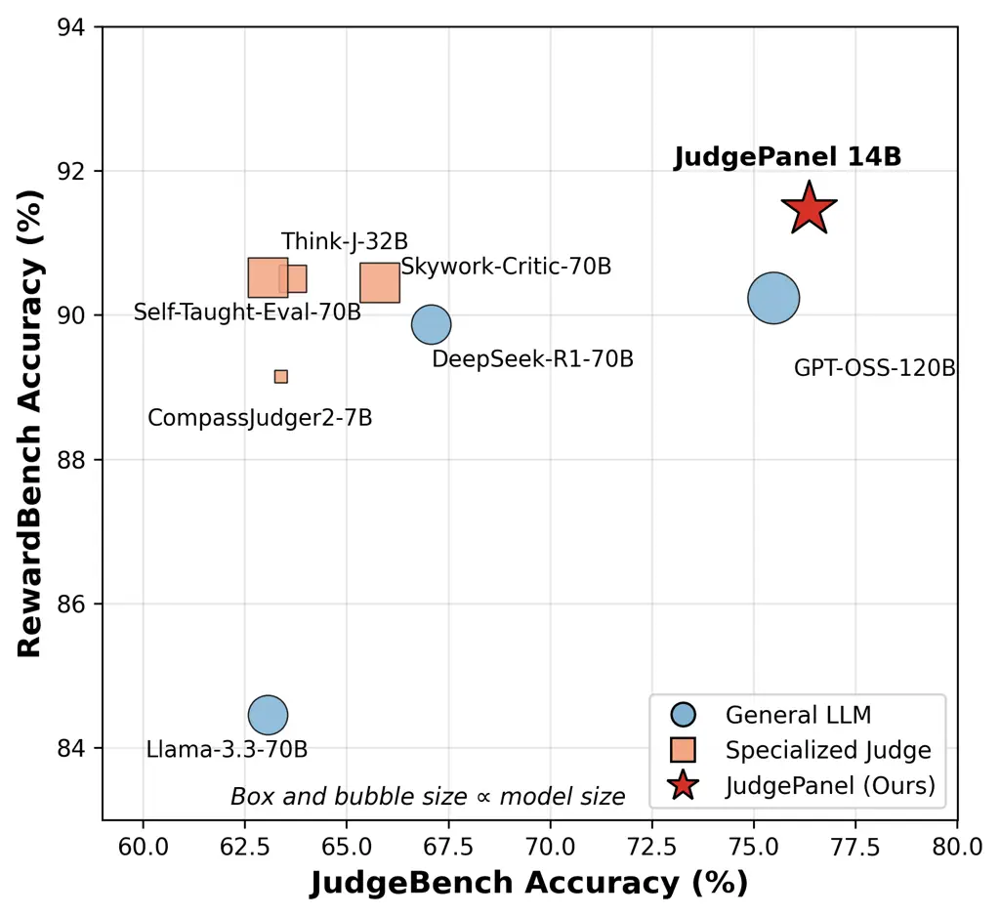
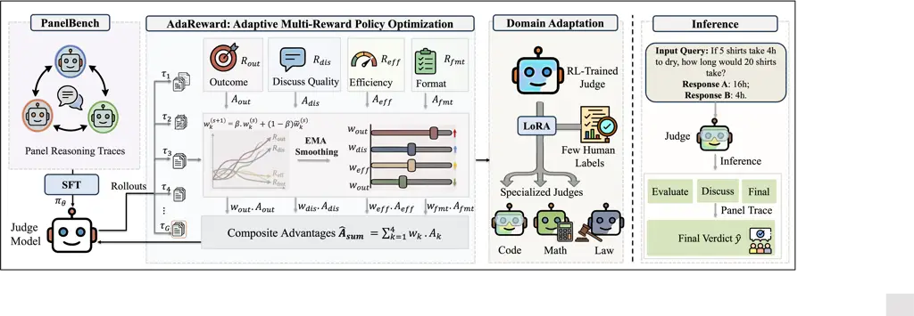
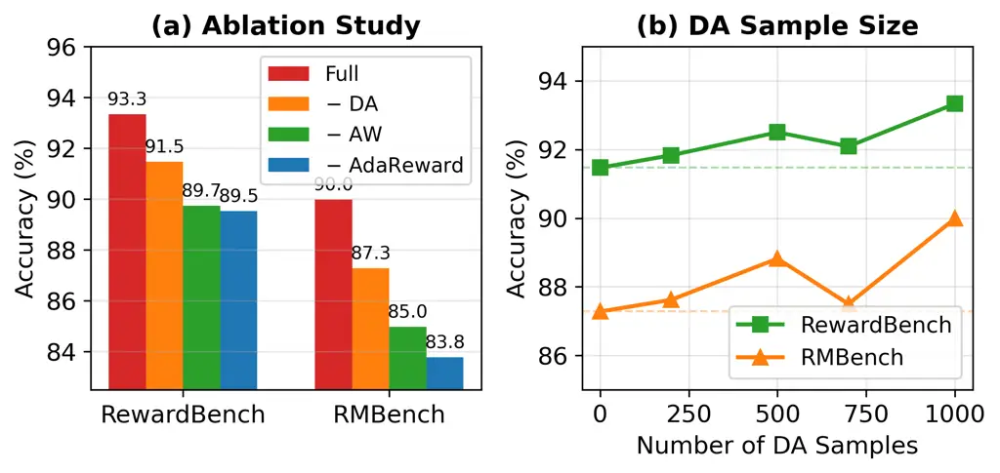

# JudgePanel: A Compact Judge with Panel Deliberation via Adaptive Multi-Reward Reinforcement Learning

Yiyue Qian ^(†)^(†)thanks: Equal contribution.
Email: [iamyiyue@amazon.com](mailto:)    Shinan
Zhang^(†)^(†)footnotemark: Email: [shinanz@amazon.com](mailto:)    Huan
Song Email: [huanso@amazon.com](mailto:)    Hannah Marlowe Affiliation: 
AWS Generative AI Innovation Center, USA
Email: [marloweh@amazon.com](mailto:)

###### Abstract

The LLM-as-a-Judge paradigm has emerged as a scalable alternative to
human evaluation. However, single-model judges are limited by their
inherent model biases, while multi-agent evaluation protocols that
mitigate this through diverse deliberation are prohibitively expensive
at inference time. To this end, we propose JudgePanel, which equips a
compact Judge model with multi-agent Panel deliberation capability.
Specifically, we first train on panel deliberation traces from an
ensemble of strong evaluators, capturing structured patterns of
discussion, disagreement, and resolution. To further improve judgment
quality beyond SFT, we introduce AdaReward, an adaptive multi-reward RL
algorithm that dynamically rebalances reward component weights as
different objectives saturate at different rates during RL training. For
practical deployment, we further design a lightweight domain
specialization module for rapid adaptation to new evaluation domains
with few hundred labeled samples. As a result, (i) Novel: the first
framework to equip a single compact judge with multi-agent panel
deliberation capability at single-model inference cost; (ii) Effective &
Reliable: JudgePanel with a 14B backbone outperforms judge-specialized
models up to 70B across four evaluation benchmarks, demonstrates strong
position consistency, and rapidly specializes to new domains with few
hundred samples.

## 1 Introduction



Figure 1: JudgeBench vs. RewardBench accuracy. Existing models show
inconsistent cross-dataset performance, while JudgePanel achieves the
best on both.

As large language models (LLMs) continue to advance, reliably evaluating
their outputs has become increasingly challenging due to the high cost
and limited scalability of human evaluation Clark et al. (2021);
Karpinska et al. (2021); Qian et al. (2025). The LLM-as-a-Judge
paradigm, where LLMs generate chain-of-thought reasoning before
producing a verdict, has emerged as a promising alternative Zheng et al.
(2023); Kim et al. (2024); Saha et al. (2024). However, single-model
judges are inherently limited by their model biases stemming from
training data and optimization, leading to systematic evaluation biases
and inconsistent judgments across domains Chen et al. (2024); Wang et
al. (2024b).

To mitigate these biases, recent work employs multi-agent evaluation
protocols where multiple LLMs assess, discuss disagreements, and
converge on a consensus Qian et al. (2026b); Chan et al. (2024); Saha et
al. (2024). While effective at reducing individual model biases through
diverse perspectives, such protocols require deploying multiple large
models with multi-round inference, making them prohibitively expensive
for large-scale deployment. This raises a natural question: can we train
a single compact model that reasons like a panel of experts?

To this end, we propose JudgePanel, which equips a compact Judge model
with multi-agent Panel deliberation capability. We first construct panel
deliberation traces, capturing structured patterns of discussion,
disagreement, and resolution. By training a compact model on these
traces via SFT, we equip it with panel deliberation at single-model
inference cost. However, SFT relies on pattern imitation rather than
deep reasoning Chen et al. (2025), limiting the model to reproducing the
quality of its training traces without the ability to generalize beyond
them. To address this, we apply multi-reward RL that jointly optimizes
judgment quality from multiple perspectives, such as format compliance,
discussion quality, and outcome correctness. Yet in multi-reward
training, different components learn at different rates: format
compliance saturates early while outcome correctness requires sustained
optimization, and fixed weights cannot capture this dynamic. We
therefore propose AdaReward, an adaptive weight learner that dynamically
rebalances reward components during RL training, creating a
curriculum-like effect without manual tuning. Furthermore, as
illustrated in Figure 1, even well-trained judges show inconsistent
performance across evaluation domains. Specialized judge models excel on
some benchmarks while underperforming on others. For practical
deployment, we design a lightweight domain specialization module that
rapidly adapts the judge to new domains with a few hundred labeled
samples.

We summarize our contributions as follows:

- •
  Novel Framework: We propose JudgePanel, the first to equip a single
  compact judge with panel deliberation capability via adaptive
  multi-reward RL, achieving multi-agent reasoning quality at
  single-model inference cost.
- •
  AdaReward: We introduce an adaptive multi-reward RL algorithm that
  dynamically rebalances reward component weights during RL training,
  shifting focus from saturated components to those still providing
  useful signals.
- •
  State-of-the-Art Performance: JudgePanel with a 14B backbone
  outperforms larger judge-specialized models (i.e., 70B) across four
  evaluation benchmarks, demonstrates strong position consistency, and
  rapidly specializes to new domains with few hundred samples.



Figure 2: The overall framework of JudgePanel: (a) PanelBench: A panel
evaluation through multi-round discussion to produce panel deliberation
traces for training a judge model $`\pi_{\theta}`$ via SFT. (b)
AdaReward: The judge generates rollouts scored by four reward
components. An EMA-based adaptive weight learner dynamically rebalances
reward weights, producing composite advantages for policy updates. (c)
Domain Adaptation: The RL-trained judge is specialized to new domains
via LoRA fine-tuning on a few hundred human-labeled samples. (d)
Inference: At deployment, the compact judge generates a full panel
deliberation trace at single-model inference cost.

## 2 Preliminary

LLM-as-a-Judge. Given an evaluation input $`x_{i}`$ (e.g., an
instruction with candidate responses), an LLM-as-a-Judge
$`\pi_{\theta}`$ generates a reasoning trace $`t_{i}`$ followed by a
verdict $`\hat{y}_{i}`$. During RL training, we sample $`G`$ rollouts
$`\{\tau_{i,j}\}_{j=1}^{G}`$ from the reference policy
$`\pi_{\text{ref}}`$, where each rollout
$`\tau_{i,j}=(t_{i,j},\hat{y}_{i,j})`$ contains a reasoning trace and
predicted verdict.

Group reward-Decoupled Normalization Policy Optimization (GDPO). To
optimize judge with $`K`$ reward functions $`\{R_{k}\}_{k=1}^{K}`$,
inspired by GDPO Liu et al. (2026a), which resolves the reward signal
collapse of standard Group Relative Policy Optimization (GRPO) Shao et
al. (2024) by normalizing each reward before aggregation, we employ GDPO
as our base RL algorithm. GDPO computes per-reward advantages
$`A_{k}^{(i,j)}=({R_{k}(\tau_{i,j})-\text{mean}_{j}\{R_{k}\}})/{\text{std}_{j}\{R_{k}\}}`$
and aggregates them as:

```math
\displaystyle A_{\text{sum}}^{(i,j)} \displaystyle=\sum_{k=1}^{K}w_{k}\cdot A_{k}^{(i,j)},
```

```math
\displaystyle\hat{A}_{\text{sum}}^{(i,j)} \displaystyle=\frac{A_{\text{sum}}^{(i,j)}-\text{mean}_{\text{batch}}\{A_{\text{sum}}\}}{\text{std}_{\text{batch}}\{A_{\text{sum}}\}},\vskip-1.4457pt \tag{1}
```

with fixed weights $`\{w_{k}\}`$. The policy is optimized via a clipped
surrogate objective $`{\mathcal{J}}_{\text{GDPO}}(\theta)`$.

## 3 JudgePanel: Panel Deliberation via Adaptive Multi-Reward RL

As illustrated in Figure 2, JudgePanel is a three-stage framework: (i)
Panel Deliberation, which generates collaborative evaluation traces for
model training; (ii) AdaReward, an adaptive reward weight learner for
multi-reward RL training; and (iii) Lightweight Domain Specialization,
which specializes the judge to new domains with hundred samples via LoRA
training.

### 3.1 Panel Deliberation via Multi-Agent Collaboration

Existing LLM-as-a-Judge approaches Whitehouse et al. (2026); Huang et
al. (2026); Saha et al. (2025); Zhang et al. (2025) rely on a single
model to generate synthetic training data, creating a reasoning
diversity bottleneck that misses the multi-model collaborative
deliberation characteristic of high-quality human evaluation. To
overcome this, following the similar mechanism of CollabEval Qian et al.
(2026b), we obtain the reasoning traces samples from Chatbot Arena
dataset Chiang et al. (2024), a large-scale collection of real user
conversations with deployed LLMs.


Figure 3: Simplified three-stage panel reasoning trace.

As illustrated in Figure 3, the panel follows a three-phase protocol:
(i) Independent Evaluation: each agent independently produces a
structured evaluation $`e_{i}^{(m)}`$, verdict $`v_{i}^{(m)}`$, and
confidence $`c_{i}^{(m)}`$; (ii) Multi-Round Discussion: triggered when
no consensus is reached, evaluators review the full history and provide
updated assessments with explicit agreements, disagreements, and revised
reasoning; and (iii) Final Judgment: when discussion fails to converge
or reaches $`d_{\max}`$ rounds, a final judge $`\pi^{(\text{final})}`$
analyzes the complete history and produces the verdict $`\hat{y}_{i}`$.
We retain only samples where the panel verdict matches the ground-truth
label $`y_{i}`$, yielding $`{\sim}`$8,700 correct panel traces for
training. By training on these collaborative traces, the compact judge
model (i.e., 14B) acquires panel deliberation capabilities, which learns
to generate independent evaluation, disagreement identification,
deliberation, and consensus.

### 3.2 AdaReward: Adaptive Multi-Reward Policy Optimization

As established in Section 2, GDPO resolves the reward signal collapse
problem inherent in GRPO’s multi-reward optimization by decoupling
per-reward normalization. However, GDPO combines the normalized
advantages with fixed weights $`\{w_{k}\}`$ in Equation 1 that remain
constant throughout training. In judge training, we observe that reward
components exhibit vastly different convergence dynamics. For instance,
format compliance saturates quickly at around 50 steps, while outcome
correctness, discussion quality, and efficiency are learning throughout
training. To this end, we propose AdaReward, an adaptive weight learner
that dynamically learns reward component weights based on their training
progress.

#### 3.2.1 Multi-Aspect Reward Design

We design $`K=4`$ reward functions that jointly capture both judgment
correctness and reasoning quality. Each reward $`R_{k}(\tau_{i,j})`$
evaluates an aspect of the panel deliberation trace $`\tau_{i,j}`$. The
detailed scoring of each reward is described in Appendix A.

Fine-Grained Outcome Reward $`R_{\text{out}}`$. Rather than a binary
correct/incorrect reward, we design a graded outcome reward that
diagnoses where the reasoning went wrong: whether the error originated
in the initial evaluation, was introduced during discussion, or occurred
at the final judgment stage. It provides richer signal than binary
rewards.

Discussion Quality Reward $`R_{\text{dis}}`$. This reward measures
whether the multi-round discussion produces genuine deliberation and
whether speakers actually revise their positions based on others’
arguments, rather than merely restating their evaluations. Crucially,
this reward evaluates the quality of the deliberation process itself,
rewarding genuine position changes that lead to correct outcomes rather
than cosmetic flips.

Efficiency Reward $`R_{\text{eff}}`$. This reward evaluates whether the
model’s decision to engage in or skip discussion was beneficial,
rewarding efficient consensus and penalizing harmful deliberation.
$`R_{\text{eff}}`$ explicitly conditions on correctness: the strongest
penalty targets cases where discussion flipped a correct initial
majority to a wrong final verdict, directly discouraging
counterproductive deliberation.

Format Compliance Reward $`R_{\text{fmt}}`$. This reward ensures the
generated trace follows the multi-agent collaboration structure
(required section tags, $`M`$ speakers with complete evaluation fields,
proper discussion structure), which is essential for parsing and
calculating the other rewards correctly.

#### 3.2.2 Adaptive Weighting via EMA Learner

With the four reward components defined, we now address the core
limitation of fixed-weight aggregation in existing RL methods. In GDPO
(Equation 1), the composite advantage is
$`A_{\text{sum}}^{(i,j)}=\sum_{k=1}^{K}w_{k}\cdot A_{k}^{(i,j)}`$ with
constant $`w_{k}`$. When a component $`k`$ saturates (i.e.,
$`V_{k}\triangleq\mathbb{E}[(A_{k}^{(i,j)})^{2}]\approx 0`$), all
rollouts receive nearly identical rewards for that component, providing
no useful learning signal after GDPO’s per-reward normalization. With
fixed weights, when a component saturates, (e.g., $`R_{\text{dis}}`$),
its contribution to the composite advantage vanishes, but its weight
cannot be redistributed to harder components (e.g., $`R_{\text{out}}`$
and $`R_{\text{eff}}`$) that still provide learning signals.

EMA-Based Adaptive Weight Learner. Our key idea is to adjust each weight
proportionally to how far its reward is from a target score, pushing
harder on lagging components and easing off on saturated ones.
Specifically, we define an gap signal
$`\delta_{k}^{(s)}=\rho_{k}-\bar{R}_{k}^{(s)}`$ measuring the gap
between the target $`\rho_{k}`$ and the current batch-average reward
$`\bar{R}_{k}^{(s)}`$ for component $`k`$ at step $`s`$. The weight
update uses asymmetric scaling: when a component falls behind its target
($`\delta_{k}>0`$), its weight increases aggressively; when it exceeds
the target ($`\delta_{k}\leq 0`$), the weight decreases conservatively.
Concretely, we first compute a target weight $`\tilde{w}_{k}^{(s)}`$:

```math
\tilde{w}_{k}^{(s)}=w_{k}^{(s)}\cdot\begin{cases}1+\alpha^{+}\cdot\delta_{k}^{(s)}&\text{if }\delta_{k}^{(s)}>0\;\;\text{(below target)}\\
1+\alpha^{-}\cdot\delta_{k}^{(s)}&\text{if }\delta_{k}^{(s)}\leq 0\;\;\text{(above target)},\end{cases} \tag{2}
```

where $`\alpha^{+}>\alpha^{-}`$ ensures faster recovery for
underperforming components than decay for well-performing ones. The
target weight is then clipped to $`[w_{k}^{\min},w_{k}^{\max}]`$ before
updates (Eq. 3), ensuring no single component dominates or vanishes
regardless of the gap magnitude. The final weight is updated via
exponential moving average (EMA):

```math
w_{k}^{(s+1)}=\beta\cdot w_{k}^{(s)}+(1-\beta)\cdot\tilde{w}_{k}^{(s)}, \tag{3}
```

where $`\beta\in(0,1)`$ controls the adaptation speed (lower $`\beta`$
means faster response to new targets). Weights are updated every
$`\Delta`$ steps, balancing responsiveness (frequent updates) against
stability (allowing the policy to learn from current weights before
rebalancing).

Intuition. Fixed weights apply constant correction regardless of how far
each reward is from its target, while AdaReward’s correction magnitude
scales with the gap $`\delta_{k}`$, pushing harder when far from target
and easing off when close. This creates a curriculum-like effect: as
easy components (e.g., $`R_{\text{fmt}}`$) reach their targets, the
learner reallocates weight to harder components (e.g.,
$`R_{\text{out}}`$) where $`\delta_{k}`$ remains large.

Furthermore, Table 3(f) shows that adaptive weights outperforms fixed
weights.

Full AdaReward Objective. Combining the decoupled normalization with the
adaptive weights, the AdaReward objective is formulated as:

```math
\displaystyle{\mathcal{J}}_{\text{Ada}}(\theta)=\mathbb{E}_{\begin{subarray}{c}x_{i}\sim{\mathcal{D}},\,\{\tau_{i,j}\}_{j=1}^{G}\sim\pi_{\text{ref}}\end{subarray}}\Bigg[\frac{1}{G}\sum_{j=1}^{G}\frac{1}{|\tau_{i,j}|}\sum_{l=1}^{|\tau_{i,j}|}
```

```math
\displaystyle\min\!\big(r_{l}(\theta)\,\hat{A}_{\text{sum}}^{(i,j,s)},\,\text{clip}(r_{l}(\theta),1{-}\varepsilon,1{+}\varepsilon)\,\hat{A}_{\text{sum}}^{(i,j,s)}\big)\Bigg], \tag{4}
```

where
$`r_{l}(\theta)=\frac{\pi_{\theta}(\tau_{i,j}^{l}\mid x_{i},\tau_{i,j}^{<l})}{\pi_{\text{ref}}(\tau_{i,j}^{l}\mid x_{i},\tau_{i,j}^{<l})}`$
is the importance sampling ratio at token position $`l`$.
$`\hat{A}_{\text{sum}}^{(i,j,s)}`$ is the batch-normalized composite
advantage computed using the time-varying weights $`\{w_{k}^{(s)}\}`$ at
step $`s`$.

### 3.3 Lightweight Domain Specialization

As shown in Figure 1, even well-trained judges exhibit inconsistent
performance across different evaluation domains. These judge-specialized
models trained on narrow distributions struggle to generalize. For
instance, Skywork-Critic-70B Liu et al. (2026b) performs well on
RewardBench but poorly on JudgeBench. In real-world deployment,
different use cases demand different domain expertise, yet existing
approaches do not provide a mechanism for rapid specialization. This
motivates a lightweight mechanism for rapid domain specialization
without retraining from scratch.

Our key insight is that a practitioner can quickly curate a small set of
human-labeled samples (e.g., 200–500) for a new evaluation domain, then
apply the panel protocol (Section 3.1) to automatically generate
domain-specific panel deliberation traces from these labels.

We further fine-tune the RL-trained judge using LoRA Hu et al. (2021) on
these traces. LoRA is chosen over full fine-tuning to preserve general
deliberation capabilities acquired during RL while efficiently injecting
domain-specific knowledge with minimal parameters.

The full training pipeline of JudgePanel is summarized in Appendix
Algorithm 1, and all hyperparameters settings are provided in
Appendix C.1.

## 4 Experiments

|                   |                             |            |             |         |       |                         |
| ----------------- | --------------------------- | ---------- | ----------- | ------- | ----- | ----------------------- |
| Type              | Model                       | JudgeBench | RewardBench | RMBench | PPE   | Avg. Rank$`\downarrow`$ |
| General LLM       | Qwen2.5-7B-Instruct         | 57.66      | 78.81       | 65.69   | 38.14 | 11.0                    |
|                   | DeepSeek-R1-8B              | 56.56      | 76.25       | 74.97   | 37.89 | 10.2                    |
|                   | Llama-3.3-70B               | 63.06      | 84.46       | 73.55   | 41.67 | 7.6                     |
|                   | DeepSeek-R1-70B             | 67.08      | 89.87       | 85.17   | 42.89 | 3.8                     |
| Specialized Judge | JudgeLRM-3B^( RL)           | 60.00      | 64.09       | 58.58   | 36.00 | 12.8                    |
|                   | JudgeLRM-7B^( RL)           | 55.84      | 76.28       | 66.54   | 37.80 | 12.2                    |
|                   | CompassJudger2-7B^( SFT+RL) | 63.39      | 89.15       | 75.33   | 40.26 | 6.2                     |
|                   | ArmoRM-8B^( SFT)            | 55.81      | 88.44       | 69.23   | 37.26 | 11.2                    |
|                   | DeepSeek-GRM-27B^( SFT+RL)  | 56.46      | 79.19       | 69.19   | 38.31 | 10.5                    |
|                   | Think-J-32B^( SFT+RL)       | 63.68      | 90.50       | 79.80   | 40.15 | 5.2                     |
|                   | Self-Taught-Eval-70B^( SFT) | 63.06      | 90.52       | 74.64   | 41.71 | 5.4                     |
|                   | Skywork-Critic-70B^( SFT)   | 65.81      | 90.45       | 74.50   | 40.49 | 5.8                     |
| Ours              | Qwen3-14B (main)            | 74.45      | 91.33       | 87.54   | 45.61 | 2.0                     |
|                   | Qwen3-14B (w/ DA)           | 77.93      | 93.33       | 89.99   | 46.69 | 1.0                     |

Table 1: Accuracy performance (%) comparison among general LLMs and
judge-specialized models on JudgeBench, RewardBench, RMBench, and PPE.
Avg. Rank is the mean rank across all four benchmarks (lower is better).
The bolded numbers are the best results and the underlined numbers
indicate the runner-up results.

### 4.1 Datasets and Baseline Models

PanelBench. Following the panel protocol (Section 3.1), we construct
PanelBench from Chatbot Arena Chiang et al. (2024) (20K pairwise samples
with human labels). After filtering out incorrect verdicts, we retain
8,500 panel deliberation traces for SFT and RL training. Mention that,
PanelBench contains no overlapping input queries or responses with any
evaluation benchmark test set or domain adaptation data.

Benchmarks. We evaluate on four established judge benchmarks (details in
Appendix C.2): (1) JudgeBench (JB) Tan et al. (2025): 620 challenging
pairs across knowledge, reasoning, math, and coding;
(2) RewardBench (RB) Lambert et al. (2025): 2,985 prompt-chosen-rejected
trios; (3) RMBench (RM) Liu et al. (2025a): 3,981 samples testing
sensitivity to subtle content differences; (4) PPE Frick et al. (2025):
16,038 multilingual pairwise preference samples.

Domain Specialization Data. To simulate real-world deployment, we
generate DA data from related but independent datasets for each
benchmark. As some DA source datasets only provide ground-truth labels
without preference pairs, we use Qwen2.5-72B-Instruct Yang et al. (2025)
to generate incorrect responses, constructing pairwise preference
samples. We then run our panel protocol on these pairs, retaining
200–500 correctly predicted samples per benchmark for LoRA adaptation
(details in Appendix C.2).

Baselines. We compare against (1) General LLMs: Qwen2.5-7B-Instruct Yang
et al. (2025), DeepSeek-R1-8B Guo et al. (2025),
Llama-3.3-70B Grattafiori et al. (2024),
DeepSeek-R1-Distill-Llama-70B Shao et al. (2024); and
(2) Judge-specialized models: JudgeLRM-3B/7B^(RL) Chen et al. (2025),
CompassJudger2-7B^(SFT+RL) Zhang et al. (2025), ArmoRM-8B^(SFT) Wang et
al. (2024a), DeepSeek-GRM-27B^(SFT+RL) Yang et al. (2024),
Think-J-32B^(SFT+RL) Huang et al. (2026),
Self-Taught-Eval-70B^(SFT) Wang et al. (2024c),
Skywork-Critic-70B^(SFT) Liu et al. (2026b).

Our Models. We train JudgePanel using Qwen3-14B Yang et al. (2025) with
three stages: SFT on PanelBench, AdaReward RL, and LoRA domain
adaptation. For fair comparison, we provide all baseline and our model
parsed accuracy as the performance results in this paper. The detailed
hyper-parameters for each stage are in Appendix C.1.

### 4.2 Main Results

|                   |                             |            |             |             |             |         |             |       |             |
| ----------------- | --------------------------- | ---------- | ----------- | ----------- | ----------- | ------- | ----------- | ----- | ----------- |
| Type              | Model                       | JudgeBench |             | RewardBench |             | RMBench |             | PPE   |             |
|                   |                             | Cons.      | Stable Acc. | Cons.       | Stable Acc. | Cons.   | Stable Acc. | Cons. | Stable Acc. |
| General LLM       | Llama-3.3-70B               | 68.87      | 46.94       | 88.51       | 79.77       | 77.24   | 62.35       | 74.45 | 34.78       |
|                   | DeepSeek-R1-70B             | 71.95      | 52.97       | 91.73       | 85.86       | 86.82   | 79.05       | 73.57 | 34.66       |
| Specialized Judge | CompassJudger2-7B^( SFT+RL) | 75.16      | 49.68       | 93.53       | 88.94       | 78.60   | 65.11       | 72.41 | 34.93       |
|                   | Self-Taught-Eval-70B^( SFT) | 70.48      | 47.74       | 89.71       | 85.52       | 76.82   | 62.53       | 74.16 | 33.87       |
|                   | Skywork-Critic-70B^( SFT)   | 79.35      | 54.68       | 92.73       | 88.94       | 80.83   | 65.54       | 71.43 | 35.13       |
| Ours              | Qwen3-14B (main)            | 82.61      | 67.98       | 92.35       | 89.21       | 89.82   | 89.54       | 75.32 | 35.45       |
|                   | Qwen3-14B (w/ DA)           | 83.61      | 69.61       | 94.82       | 90.00       | 90.46   | 89.78       | 77.30 | 36.62       |

Table 2: Position consistency and stable accuracy analysis (selected
models). Cons. (%,$`\uparrow`$): percentage of samples where verdicts
correctly track swaps. Stable Acc. (%,$`\uparrow`$): percentage of
samples correctly predicted in both orderings.

Effectiveness. Table 1 reports the accuracy performance on four
benchmarks. We highlight the following key findings:
(i) Judge-specialized models do not consistently outperform general
LLMs; Even large judge-specialized models such as Skywork-Critic-70B and
Self-Taught-Eval-70B fail to maintain consistently strong performance
across all benchmarks, confirming the cross-domain generalization
challenge identified in Figure 1. (ii) RL-only judges underperform
SFT-based judges at comparable sizes, indicating RL alone without
quality SFT initialization is insufficient. (iii) JudgePanel with domain
adaptation achieves the highest average rank, outperforming all baseline
models with much bigger size. (iv) Without DA, JudgePanel already
surpasses all baselines and judge-specialized models. We note that
domain adaptation is a general technique applicable to any model; we
report both settings for completeness. We would also discuss the effects
of domain adaption samples on the model performance later.

Reliability. Table 2 presents position consistency and stable accuracy
analysis on selected strong baselines. We can found out most
judge-specialized models suffer from positional bias. JudgePanel
achieves the highest consistency and stable accuracy on all benchmarks,
surpassing all 70B models despite being 5 $`\times`$ smaller. This
confirms that panel deliberation, which requires evaluating from
multiple perspectives before reaching a verdict, encourages
content-grounded evaluation that is robust to input ordering.

\(a\) Generated Panel Trace Quality. Metric RB RM Constructive Change
(%,$`\uparrow`$) 91.0 85.7 Jaccard Distance ($`\uparrow`$) 0.629 0.639
4-gram Overlap (%,$`\downarrow`$) 14.4 15.5 Avg. Rounds 1.71 1.64

\(b\) Multi-Agent Protocol vs. JudgePanel vs. Think-J. Multi-Agent
JudgePanel Think-J RewardBench 94.54 91.33 90.50 PPE 46.28 45.61 40.15
Parameters 260B 14B 32B Latency (n=100) 2.9 min 1.5 min 1.0 min

\(c\) Label Only vs. Single COT vs. Voting vs. Panel Trace. Training
Data RB RM Label Only (SFT) 87.84 76.26 Single COT (SFT) 88.14 77.64
Majority Voting (SFT) 88.50 78.56 Panel Trace (Our SFT) 89.53 83.77

\(d\) Backbone Agnostic. Model RB RM Qwen3-32B (base) 88.21 74.52
Qwen3-32B (JudgePanel) 92.23 89.24 Qwen3-14B (base) 86.24 72.25
Qwen3-14B (JudgePanel) 91.33 87.54

\(e\) Reward Component Ablation. Reward Setting RB RM w/o Discussion
Quality 88.24 84.74 w/o Efficiency 88.64 85.16 w/o Format Compliance
89.01 85.58 Full (ours) 91.33 87.54

\(f\) GDPO vs. GRPO. RL Strategy RB RM GRPO (fixed weights) 87.45 83.98
GRPO (adaptive weights) 89.98 85.64 GDPO (fixed weights) 89.74 84.98
GDPO (adaptive, ours) 91.33 87.54

Table 3: JudgePanel analysis. The highlighted row in gray is our method.
RB = RewardBench, RM = RMBench.

### 4.3 Ablation and Analysis



Figure 4: (a) Progressive ablation on RewardBench and RMBench. (b) DA
sample size analysis; dashed lines indicate JudgePanel w/o DA.

Component Ablation and Reward Ablation Study. To validate each
component, Figure 4(a) shows progressive ablation on RewardBench and
RMBench. Removing DA ($`-`$DA) drops performance by 1.86/2.71,
confirming domain specialization is beneficial. Further replacing
adaptive weights with fixed weights ($`-`$AW) causes an additional
1.73/2.30 drop, and removing RL entirely ($`-`$AdaReward, SFT only)
widens the gap to 3.80/6.22 below the full system. Table 3(e) further
shows that each reward component is essential: removing Discussion
Quality ($`-`$3.09/$`-`$2.8) or Efficiency ($`-`$2.69/$`-`$2.38) each
causes notable degradation, and removing Format Compliance also hurts,
confirming that all four rewards capture distinct aspects of panel
deliberation quality. To further verify the effectiveness of AdaReward,
Table 3(f) shows our adaptive reward module leads to better final
accuracy: GDPO with adaptive weights outperforms both GRPO and GDPO with
fixed weights.

Panel Deliberation Analysis. To examine whether JudgePanel genuinely
deliberates rather than mimicking format, Table 3(a) measures four
metrics on RewardBench and RMBench: Constructive Change Rate
(91.0%/85.7%) is far above the $`\sim`$50% random baseline, showing vote
changes lead to correct answers; Jaccard Distance (0.629/0.639) confirms
diverse reasoning across speakers; 4-gram Overlap (14.4%/15.5%)
indicates discussion introduces novel content rather than repeating
initial evaluations; and Average Rounds (1.71/1.64) shows the model
adaptively engages in deliberation when needed (detailed metric
definitions in Appendix C.3).

Beyond quality, we compare against the multi-agent protocol
(CollabEval Qian et al. (2026b)) as the quality ceiling and Think-J as a
representative COT baseline. Table 3(b) shows JudgePanel (14B) achieves
91.33/45.61 on RB/PPE, approaching the multi-agent protocol
(94.54/46.28) at half the latency (1.5 vs. 2.9 min for 100 samples).
Think-J-32B achieves lower latency (1.0 min) but with lower accuracy
(90.50/40.15), demonstrating that panel deliberation provides a better
accuracy-efficiency tradeoff than single-model COT.

To isolate the data contribution, Table 3(c) compares four SFT
strategies on the same Qwen3-14B backbone: Panel Trace SFT outperforms
Label Only, Single COT, and Majority Voting (independent evaluations
without discussion), demonstrating that multi-round deliberation
provides richer supervision than either single-model reasoning or simple
multi-perspective aggregation (qualitative examples in Appendix D).

Generalizability. To verify JudgePanel is not tied to a specific
backbone, Table 3(d) shows applying it to Qwen3-32B yields +4.02/+14.72
on RB/RM, comparable to Qwen3-14B gains (+5.09/+15.32), confirming
practitioners can select the backbone that fits their compute budget.
For domain specialization, Figure 4(b) shows even 200 samples yield
gains over the no-DA baseline, with diminishing returns beyond 500,
making it practical for deployment where large-scale annotation is
costly.

## 5 Related Work

LLM-as-a-Judge. As LLM is becoming increasingly powerful, more
LLM-related applications are emerging Xue et al. (2026); Ma et al.
(2026b); Ma et al. (2026a); Song et al. (2025); Ma et al. (2025).
LLM-as-a-Judge, employing LLMs as automated evaluators Zheng et al.
(2023); Kim et al. (2024), has been widely used recently in these
applications Qian et al. (2026a); Li et al. (2025). However,
general-purpose LLMs suffer from systematic biases Chen et al. (2024);
Wang et al. (2024b), motivating dedicated judge training. SFT-based
approaches such as Self-Taught Evaluators Wang et al. (2024c),
Skywork-Critic Liu et al. (2026b), ArmoRM Wang et al. (2024a), and
DeepSeek-GRM Liu et al. (2025b) train judges through synthetic data
curation, but rely on pattern memorization rather than flexible
reasoning Chen et al. (2025). Among RL-based approaches, JudgeLRM Chen
et al. (2025) demonstrates that judgment is inherently
reasoning-intensive; Think-J Huang et al. (2026) proposes judgment
thinking initialization followed by GRPO-based optimization;
CompassJudger-2 Zhang et al. (2025) combines task-driven data curation
with verifiable rewards; and J1 Whitehouse et al. (2026) introduces
consistency-based rewards both response orders, though neither code nor
checkpoints have been publicly released. CollabEval Qian et al. (2026b)
demonstrates that multi-agent collaboration improves evaluation quality
but requires deploying multiple large models at inference time. Inspired
by this, we aim to train a compact model that internalizes multi-agent
deliberation capability via adaptive multi-reward RL, eliminating the
cost of multi-model deployment.

Multi-Reward RL Optimization. Recent LLM training increasingly
incorporates multiple reward signals, such as correctness + format
compliance Chen et al. (2025). GDPO Liu et al. (2026a) identifies that
GRPO suffers from reward signal collapse in multi-reward settings and
proposes decoupled per-reward normalization. Lu et al. Lu et al. (2026)
propose dynamic reward weighting using hypervolume-guided adaptation and
gradient-based weight optimization to explore Pareto fronts. However,
these approaches either use fixed weights Aggarwal and Welleck (2025);
Chen et al. (2025), require manual reward function conditioning Liu et
al. (2026a), or need expensive per-objective gradient computation Lu et
al. (2026). Our AdaReward uses a lightweight learner that requires only
scalar reward statistics, making it computationally cheap while
achieving adaptive behavior.

## 6 Conclusion

In this work, we propose JudgePanel, a novel framework that equips a
single compact judge model with multi-agent panel deliberation
capability via adaptive multi-reward RL. Through extensive experiments
on four established judge benchmarks, we demonstrate that JudgePanel
(14B) consistently outperforms judge-specialized models (up to 70B),
while maintaining strong position consistency. Furthermore, it also
enables rapid specialization to new evaluation tasks with few hundred
samples, demonstrating its practicality for real-world deployment. We
believe JudgePanel provides an effective and scalable solution for
practitioners who need reliable, domain-specific evaluation capabilities
without the overhead of deploying large-scale models or multi-agent
systems in production.

## Limitations

Inference Token Cost. Due to the multi-agent reasoning trace, JudgePanel
generates more tokens per evaluation than standard COT-based judges. The
panel structure (independent evaluation round, discussion rounds, and
final judgment) inherently requires longer outputs to simulate
multi-speaker deliberation. However, as shown in Table 3(b), JudgePanel
still achieves competitive latency (1.5 min vs. 1.0 min for Think-J on
100 samples) while outperforming COT-based Think-J in accuracy (91.33
vs. 90.50 on RewardBench, 45.61 vs. 40.15 on PPE) with a smaller model
(14B vs. 32B). The accuracy gains justify the additional token cost for
applications where judgment quality is prioritized over throughput.

Domain Specialization Pipeline. While JudgePanel can quickly adapt to
new domains with as few as 200 labeled samples, the current domain
specialization pipeline still requires running the panel protocol on
these labeled samples to generate reasoning traces for LoRA fine-tuning.
This introduces a dependency on the panel models during the
specialization phase. Exploring more efficient domain specialization
strategies, such as directly fine-tuning on verdict labels without trace
generation, applying few-shot learning to the trained JudgePanel, or
using the trained JudgePanel itself to generate specialization traces,
is a promising direction for future research.

## References

- Aggarwal and Welleck (2025) P. Aggarwal and S. Welleck L1: controlling
  how long a reasoning model thinks with reinforcement learning. arXiv
  preprint arXiv:2503.04697. Cited by: §5.
- Chan et al. (2024) C. Chan, W. Chen, Y. Su, J. Yu, W. Xue, S.
  Zhang, J. Fu, and Z. Liu Chateval: towards better llm-based evaluators
  through multi-agent debate. In ICLR, Vol. 2024, pp. 9079–9093. Cited
  by: §1.
- Chen et al. (2024) G. H. Chen, S. Chen, Z. Liu, F. Jiang, and B. Wang
  Humans or llms as the judge? a study on judgement bias. In EMNLP,
  pp. 8301–8327. Cited by: §1, §5.
- Chen et al. (2025) N. Chen, Z. Hu, Q. Zou, J. Wu, Q. Wang, B. Hooi,
  and B. He Judgelrm: large reasoning models as a judge. arXiv preprint
  arXiv:2504.00050. Cited by: §1, §4.1, §5, §5.
- Chiang et al. (2024) W. Chiang, L. Zheng, Y. Sheng, A. N.
  Angelopoulos, T. Li, D. Li, B. Zhu, H. Zhang, M. I. Jordan, J. E.
  Gonzalez, et al. Chatbot arena: an open platform for evaluating llms
  by human preference. In ICML, pp. 8359–8388. Cited by: §3.1, §4.1.
- Clark et al. (2021) E. Clark, T. August, S. Serrano, N. Haduong, S.
  Gururangan, and N. A. Smith All that’s ‘human’is not gold: evaluating
  human evaluation of generated text. In ACL-IJCNLP, pp. 7282–7296.
  Cited by: §1.
- Frick et al. (2025) E. Frick, T. Li, C. Chen, W. Chiang, A.
  Angelopoulos, J. Jiao, B. Zhu, J. E. Gonzalez, and I. Stoica How to
  evaluate reward models for rlhf. In ICLR, Vol. 2025, pp. 18128–18163.
  Cited by: §C.2, §4.1.
- Grattafiori et al. (2024) A. Grattafiori, A. Dubey, A. Jauhri, A.
  Pandey, A. Kadian, A. Al-Dahle, A. Letman, A. Mathur, A. Schelten, A.
  Vaughan, et al. The llama 3 herd of models. arXiv preprint
  arXiv:2407.21783. Cited by: §4.1.
- Guo et al. (2025) D. Guo, D. Yang, H. Zhang, J. Song, P. Wang, Q.
  Zhu, R. Xu, R. Zhang, S. Ma, X. Bi, et al. Deepseek-r1: incentivizing
  reasoning capability in llms via reinforcement learning. arXiv
  preprint arXiv:2501.12948. Cited by: §4.1.
- Hu et al. (2021) E. J. Hu, Y. Shen, P. Wallis, Z. Allen-Zhu, Y. Li, S.
  Wang, L. Wang, and W. Chen Lora: low-rank adaptation of large language
  models. arXiv preprint arXiv:2106.09685. Cited by: §3.3.
- Huang et al. (2026) H. Huang, Y. He, H. Zhou, R. Zhang, W. Liu, W.
  Wang, J. Liu, and W. Su Think-j: learning to think for generative
  llm-as-a-judge. In AAAI, Vol. 40, pp. 31158–31166. Cited by: §3.1,
  §4.1, §5.
- Karpinska et al. (2021) M. Karpinska, N. Akoury, and M. Iyyer The
  perils of using mechanical turk to evaluate open-ended text
  generation. In EMNLP, pp. 1265–1285. Cited by: §1.
- Kim et al. (2024) S. Kim, J. Shin, J. Jang, S. Longpre, H. Lee, S.
  Yun, R. Shin, S. Kim, J. Thorne, M. Seo, et al. Prometheus: inducing
  fine-grained evaluation capability in language models. In ICLR, Vol.
  2024, pp. 29927–29962. Cited by: §1, §5.
- Lambert et al. (2025) N. Lambert, V. Pyatkin, J. Morrison, L.
  Miranda, B. Y. Lin, K. Chandu, N. Dziri, S. Kumar, T. Zick, Y. Choi,
  et al. Rewardbench: evaluating reward models for language modeling. In
  Findings of the Association for Computational Linguistics: NAACL 2025,
  pp. 1755–1797. Cited by: §C.2, §4.1.
- Li et al. (2025) H. Li, S. You, F. Di Palo, Y. Qian, and A. Jain
  Verification-guided context optimization for tool calling via
  hierarchical llms-as-editors. arXiv preprint arXiv:2512.13860. Cited
  by: §5.
- Liu et al. (2026a) S. Liu, X. Dong, X. Lu, S. Diao, P. Belcak, M.
  Liu, M. Chen, H. Yin, Y. F. Wang, K. Cheng, et al. Gdpo: group
  reward-decoupled normalization policy optimization for multi-reward rl
  optimization. arXiv preprint arXiv:2601.05242. Cited by: §2, §5.
- Liu et al. (2025a) Y. Liu, Z. Yao, R. Min, Y. Cao, L. Hou, and J. Li
  Rm-bench: benchmarking reward models of language models with subtlety
  and style. In ICLR, Vol. 2025, pp. 44323–44355. Cited by: §C.2, §4.1.
- Liu et al. (2026b) Y. Liu, L. Zeng, Y. Xiao, J. He, J. Liu, C.
  Wang, R. Yan, W. Shen, F. Zhang, J. Xu, et al. Skywork-reward-v2:
  scaling preference data curation via human-ai synergy. In ICLR, Vol.
  2026, pp. 133805–133838. Cited by: §3.3, §4.1, §5.
- Liu et al. (2025b) Z. Liu, P. Wang, R. Xu, S. Ma, C. Ruan, P. Li, Y.
  Liu, and Y. Wu Inference-time scaling for generalist reward modeling.
  arXiv preprint arXiv:2504.02495. Cited by: §5.
- Lu et al. (2026) Y. Lu, Z. Wang, S. Li, X. Liu, C. Yu, Q. Yin, Z.
  Shi, Z. Zhang, and M. Jiang Learning to optimize multi-objective
  alignment through dynamic reward weighting. Transactions of the
  Association for Computational Linguistics 14, pp. 1051–1073. Cited by:
  §5.
- Ma et al. (2026a) T. Ma, Y. Qian, Y. Li, Z. Wang, Y. Ding, Z.
  Zhang, Y. Liang, C. Zhang, and Y. Ye Non-monotonic autoregressive
  sequence model. In ICLR, Cited by: §5.
- Ma et al. (2025) T. Ma, Y. Qian, Z. Wang, Z. Zhang, C. Zhang, and Y.
  Ye LLM-empowered class imbalanced graph prompt learning for online
  drug trafficking detection. In Findings of the Association for
  Computational Linguistics: ACL 2025, pp. 14095–14114. Cited by: §5.
- Ma et al. (2026b) T. Ma, Y. Qian, Z. Zhang, Z. Wang, X. Qian, F.
  Bai, Y. Ding, X. Luo, S. Zhang, K. Murugesan, et al. Autodata: a
  multi-agent system for open web data collection. In NeurIPS, Vol. 38,
  pp. 173416–173448. Cited by: §5.
- Qian et al. (2025) Y. Qian, S. Zhang, L. Chen, D. Socolinsky, N.
  Sokhandan, S. Cui, D. Chen, and S. Sathyanarayana Enhancing e-commerce
  representation learning via hypergraph contrastive learning and
  interpretable llm-driven analysis. In Companion Proceedings of the ACM
  on Web Conference 2025, pp. 2512–2520. Cited by: §1.
- Qian et al. (2026a) Y. Qian, S. Zhang, H. Song, N. Sokhandan, H.
  Marlowe, and D. Socolinsky Brick-dicl: dynamic in-context learning for
  automated brick schema classification. arXiv preprint
  arXiv:2606.17637. Cited by: §5.
- Qian et al. (2026b) Y. Qian, S. Zhang, Y. Zhou, H. Ding, D.
  Socolinsky, and Y. Zhang CollabEval: enhancing llm-as-a-judge via
  multi-agent collaboration. arXiv preprint arXiv:2603.00993. Cited by:
  §1, §3.1, §4.3, §5.
- Saha et al. (2024) S. Saha, O. Levy, A. Celikyilmaz, M. Bansal, J.
  Weston, and X. Li Branch-solve-merge improves large language model
  evaluation and generation. In NAACL, pp. 8352–8370. Cited by: §1, §1.
- Saha et al. (2025) S. Saha, X. Li, M. Ghazvininejad, J. Weston, and T.
  Wang Learning to plan & reason for evaluation with
  thinking-llm-as-a-judge. arXiv preprint arXiv:2501.18099. Cited by:
  §3.1.
- Shao et al. (2024) Z. Shao, P. Wang, Q. Zhu, R. Xu, J. Song, X. Bi, H.
  Zhang, M. Zhang, Y. Li, Y. Wu, et al. Deepseekmath: pushing the limits
  of mathematical reasoning in open language models. arXiv preprint
  arXiv:2402.03300. Cited by: §2, §4.1.
- Song et al. (2025) H. Song, D. Razdan, Y. Qian, A. G. Chowdhury, P.
  Patwa, A. Chadha, S. Zhang, S. Keshava, and H. Marlowe Learning from
  generalization patterns: an evaluation-driven approach to enhanced
  data augmentation for fine-tuning small language models. arXiv
  preprint arXiv:2510.18143. Cited by: §5.
- Tan et al. (2025) S. Tan, S. Zhuang, K. Montgomery, W. Tang, A.
  Cuadron, C. Wang, R. Popa, and I. Stoica Judgebench: a benchmark for
  evaluating llm-based judges. In ICLR, Vol. 2025, pp. 63277–63303.
  Cited by: §C.2, §4.1.
- Wang et al. (2024a) H. Wang, W. Xiong, T. Xie, H. Zhao, and T. Zhang
  Interpretable preferences via multi-objective reward modeling and
  mixture-of-experts. In EMNLP, pp. 10582–10592. Cited by: §4.1, §5.
- Wang et al. (2024b) P. Wang, L. Li, L. Chen, Z. Cai, D. Zhu, B.
  Lin, Y. Cao, L. Kong, Q. Liu, T. Liu, et al. Large language models are
  not fair evaluators. In ACL, pp. 9440–9450. Cited by: §1, §5.
- Wang et al. (2024c) T. Wang, I. Kulikov, O. Golovneva, P. Yu, W.
  Yuan, J. Dwivedi-Yu, R. Y. Pang, M. Fazel-Zarandi, J. Weston, and X.
  Li Self-taught evaluators. arXiv preprint arXiv:2408.02666. Cited by:
  §4.1, §5.
- Whitehouse et al. (2026) C. Whitehouse, T. Wang, P. Yu, X. Li, J. E.
  Weston, I. Kulikov, and S. Saha J1: incentivizing thinking in
  llm-as-a-judge via reinforcement learning. In ICLR, Vol. 2026,
  pp. 10397–10420. Cited by: Appendix A, §3.1, §5.
- Xue et al. (2026) R. Xue, R. Wang, Y. Wang, Y. Cui, Y. Qian, P.
  Vaddamanu, H. Song, and H. Marlowe Inference-time model steering via
  predictive-state intervention: a survey. Cited by: §5.
- Yang et al. (2025) A. Yang, A. Li, B. Yang, B. Zhang, B. Hui, B.
  Zheng, B. Yu, C. Gao, C. Huang, C. Lv, et al. Qwen3 technical report.
  arXiv preprint arXiv:2505.09388. Cited by: §4.1, §4.1, §4.1.
- Yang et al. (2024) R. Yang, R. Ding, Y. Lin, H. Zhang, and T. Zhang
  Regularizing hidden states enables learning generalizable reward model
  for llms. In NeurIPS, Vol. 37, pp. 62279–62309. Cited by: §4.1.
- Zhang et al. (2025) T. Zhang, M. Cao, A. Lam, S. Zhang, and K. Chen
  CompassJudger-2: towards generalist judge model via verifiable
  rewards. arXiv preprint arXiv:2507.09104. Cited by: Appendix A, §3.1,
  §4.1, §5.
- Zheng et al. (2023) L. Zheng, W. Chiang, Y. Sheng, S. Zhuang, Z.
  Wu, Y. Zhuang, Z. Lin, Z. Li, D. Li, E. Xing, et al. Judging
  llm-as-a-judge with mt-bench and chatbot arena. In NeurIPS, Vol. 36,
  pp. 46595–46623. Cited by: §1, §5.
- Zheng et al. (2025) Y. Zheng, J. Lu, S. Wang, Z. Feng, D. Kuang, Y.
  Xiong, and R. Zhang Easyr1: an efficient, scalable, multi-modality rl
  training framework. Cited by: §C.1.
- Zheng et al. (2024) Y. Zheng, R. Zhang, J. Zhang, Y. Ye, and Z. Luo
  Llamafactory: unified efficient fine-tuning of 100+ language models.
  In Proceedings of the 62nd annual meeting of the association for
  computational linguistics (volume 3: system demonstrations),
  pp. 400–410. Cited by: §C.1.

## Appendix

This appendix provides supplementary material for the main paper.
Appendix A details the reward function scoring. Appendix B lists the
full training framework. Appendix C presents experiment details
including hyperparameters, benchmarks, and evaluation metrics.
Appendix D provides qualitative case examples.

## Appendix A Reward Function Details

We design $`K=4`$ reward functions that jointly capture both judgment
correctness and reasoning process quality. Unlike existing approaches
that use a single binary outcome reward Whitehouse et al. (2026); Zhang
et al. (2025), our multi-aspect design provides fine-grained learning
signals: $`R_{\text{out}}`$ diagnoses where errors originate in the
reasoning chain; $`R_{\text{dis}}`$ ensures genuine deliberation
independent of outcome; $`R_{\text{eff}}`$ penalizes counterproductive
discussion that corrupts correct initial judgments; and
$`R_{\text{fmt}}`$ enforces the structural format necessary for the
other rewards to be computed. Together, these rewards create
complementary training signals that cannot be captured by any single
reward function.

Fine-Grained Outcome Reward $`R_{\text{out}}`$. Rather than a binary
correct/incorrect signal, this reward diagnoses where the reasoning went
wrong: whether the error originated in the initial evaluation, was
introduced during discussion, or occurred at the final judgment stage.
This provides partial credit when the panel was on the right track. Let
$`\hat{y}_{i}`$ denote the final verdict, $`y_{i}`$ the ground truth,
$`{\bm{v}}_{\text{init}}=\{v_{i}^{(1)},\ldots,v_{i}^{(M)}\}`$ the
initial speaker verdicts, and $`{\bm{v}}_{\text{last}}`$ the verdicts
from the last stage before the final result. $`\text{maj}(\cdot)`$
denotes the majority verdict.

```math
R_{\text{out}}(\tau_{i,j}){=}\begin{cases}1.0&\hat{y}_{i}{=}y_{i},\\
0.7&\hat{y}_{i}{\neq}y_{i},\,\text{maj}({\bm{v}}_{\text{last}}){=}y_{i},\\
0.5&\hat{y}_{i}{\neq}y_{i},\,\text{maj}({\bm{v}}_{\text{init}}){=}y_{i},\\
0.3&\hat{y}_{i}{\neq}y_{i},\,y_{i}{\in}{\bm{v}}_{\text{init}},\\
0.0&\text{otherwise}.\end{cases} \tag{5}
```

Discussion Quality Reward $`R_{\text{dis}}`$. This reward measures
whether the multi-round discussion produces genuine deliberation that
contributes to correct outcomes. Let $`d`$ denote the number of
discussion rounds and $`\Delta_{\text{score}}`$ indicate whether any
speaker changed their verdict:

```math
r_{\mathrm{disc}}=\begin{cases}1.0&d=0,\ \text{unanimous},\ \hat{y}=y,\\
0.0&d=0,\ \text{unanimous},\ \hat{y}\neq y,\\
0.2&d=0,\ \lnot\,\text{unanimous (initial split)},\\
0.2&d>0,\ \mathbf{v}^{(d)}\ \text{unparseable},\\
1.0&d>0,\ \Delta_{\mathrm{score}},\ \hat{y}=y,\\
0.3&d>0,\ \Delta_{\mathrm{score}},\ \hat{y}\neq y,\\
0.3&d>0,\ \lnot\,\Delta_{\mathrm{score}}.\end{cases} \tag{6}
```

Intuitively, the two extreme signals are the unanimous no-discussion
cases: a panel that already agrees and is right ($`1.0`$) needs no
deliberation, while a confidently-wrong consensus ($`0.0`$) is maximally
penalized. When the panel is split but skips discussion ($`d=0`$, not
unanimous), it receives a low $`0.2`$ for failing to deliberate. Once
discussion occurs ($`d>0`$), the panel earns the full $`1.0`$ only when
scores actually change and the final verdict is correct, rewarding
productive revision; a discussion that changes scores but stays wrong,
or that merely restates positions without any change, both receive
$`0.3`$. The residual $`0.2`$ covers rounds whose scores cannot be
parsed.

Efficiency Reward $`R_{\text{eff}}`$. This reward evaluates whether the
model’s decision to engage in or skip discussion was beneficial to the
final outcome. The strongest penalty ($`-0.3`$) targets the most harmful
failure: when initial speakers had the correct majority but discussion
corrupted it, directly discouraging counterproductive deliberation.

```math
R_{\text{eff}}(\tau_{i,j})=\begin{cases}1.0&\hat{y}_{i}{=}y_{i},\,\text{unanimous},\,d{=}0,\\
0.8&\hat{y}_{i}{=}y_{i},\,\text{discussion corrected},\\
0.3&\hat{y}_{i}{=}y_{i},\,\text{otherwise},\\
-0.3&\hat{y}_{i}{\neq}y_{i},\,\text{flipped correct},\\
0.0&\hat{y}_{i}{\neq}y_{i},\,\text{otherwise}.\end{cases} \tag{7}
```

Format Compliance Reward $`R_{\text{fmt}}`$. Computed as a weighted sum
of binary checks for: (i) required section tags (e.g., \[Initial
Evaluation\], \[Final Evaluation Result\]), (ii) presence of $`M`$
speakers with complete evaluation fields (strengths/weaknesses,
per-criterion scores, justification, confidence), and (iii) proper
discussion and final judge structure when present.

## Appendix B Algorithm

Algorithm 1 summarizes the complete JudgePanel training pipeline,
including panel data construction, SFT, AdaReward reinforcement learning
with adaptive weight updates, and lightweight domain specialization.

1: Base model $`\pi_{\theta_{0}}`$; panel model $`{\mathcal{P}}`$; arena
data $`{\mathcal{D}}_{\text{arena}}`$; rewards $`\{R_{k}\}_{k=1}^{K}`$;
targets $`\{\rho_{k}\}`$

2: Domain-specialized judge $`\pi_{\theta}`$

3: Stage 1: Panel Data Construction (§3.1)

4: Run panel protocol on $`{\mathcal{D}}_{\text{arena}}`$; retain
correct traces $`\to{\mathcal{D}}_{\text{panel}}`$

5: Stage 2: SFT

6: Fine-tune $`\pi_{\theta}`$ on $`{\mathcal{D}}_{\text{panel}}`$

7: Stage 3: AdaReward RL (§3.2)

8: for step $`s=1,\ldots,S`$ do

9:   Sample rollouts, compute rewards $`\{R_{k}(\tau_{i,j})\}`$

10:   Compute $`\hat{A}_{\text{sum}}^{(i,j,s)}`$ via adaptive weights

11:   Update $`\pi_{\theta}`$ via $`{\mathcal{J}}_{\text{Ada}}`$ (Eq. 4)

12:   if $`s\mod\Delta=0`$ then

13:    Update weights viaEq. 2–3

14:   end if

15: end for

16: Stage 4: Domain Specialization (§3.3)

17: LoRA fine-tune on domain-specific panel traces (200–500 samples)

18: return $`\pi_{\theta}`$

Algorithm 1 JudgePanel: Training Pipeline

## Appendix C Experiment Details

This section provides implementation details for reproducing our
results, including training hyperparameters for all three stages,
benchmark descriptions, domain specialization data sources, and
evaluation metric definitions.

### C.1 Hyper-Parameters

For SFT, we use LlamaFactory ¹¹ 1
[http://github.com/hiyouga/LlamaFactory](http://github.com/hiyouga/LlamaFactory) Zheng
et al. (2024) train for 3 epochs with learning rate $`1\times 10^{-6}`$,
patience 10, cosine schedule, batch size 32, and max sequence length
8,192. For AdaReward RL, we train for 5 epochs with $`G{=}8`$ rollouts
per prompt, learning rate $`5\times 10^{-7}`$, clip ratio
$`\varepsilon{=}0.2`$, and KL penalty $`0.08`$. The adaptive learner
uses: initial weights $`w_{\text{out}}^{(0)}{=}5.0`$,
$`w_{\text{disc}}^{(0)}{=}2.0`$, $`w_{\text{fmt}}^{(0)}{=}2.0`$,
$`w_{\text{eff}}^{(0)}{=}2.0`$, targets $`\rho_{\text{out}}{=}0.95`$,
$`\rho_{\text{dis}}{=}0.85`$, $`\rho_{\text{eff}}{=}0.85`$,
$`\rho_{\text{fmt}}{=}0.99`$, scaling $`\alpha^{+}{=}0.5`$,
$`\alpha^{-}{=}0.1`$, momentum $`\beta{=}0.3`$, bounds $`[3,10]`$ for
outcome and $`[1,4]`$ for other rewards, and update interval
$`\Delta{=}5`$. For DA, we apply LoRA ($`r{=}16`$, $`\alpha{=}32`$) with
learning rate $`1\times 10^{-4}`$ and early stop with patient 10 for 3
epochs on domain-specific samples. All experiments are conducted on
8$`\times`$ NVIDIA H200 (143GB) GPUs using EasyR1²² 2
[https://github.com/hiyouga/EasyR1](https://github.com/hiyouga/EasyR1) Zheng
et al. (2025) for the implementation of GDPO and GRPO. SFT training
takes approximately 2 hours, RL training takes approximately 22 hours,
and LoRA DA takes approximately 5 minutes per task.

### C.2 Benchmark and DA Data Details

Benchmarks. (1) JudgeBench Tan et al. (2025): 620 challenging response
pairs spanning knowledge, reasoning, math, and coding, evaluated by
objective correctness. (2) RewardBench Lambert et al. (2025): 2,985
prompt-chosen-rejected trios covering chat, reasoning, and safety.
(3) RMBench Liu et al. (2025a): 3,981 samples testing reward model
sensitivity to subtle content differences and resistance to style
biases. (4) PPE Frick et al. (2025): 16,038 samples evaluating pairwise
preference alignment across 12 domains with multilingual coverage. For
fair comparison, all models use parsed accuracy, computed as correct
predictions divided by total samples excluding unparseable outputs.

### C.3 Evaluation Metric Definitions

Avg. Rank (Table 1): For each benchmark, models are ranked by accuracy
(rank 1 = highest). Avg. Rank is the mean rank across all four
benchmarks (lower is better).

Consistency (Table 2): The percentage of samples where the model’s
verdict correctly tracks position swaps, i.e., if the model prefers
Response A in the original order, it should prefer Response B when the
order is swapped.

Stable Accuracy (Table 2): The percentage of samples correctly predicted
in both orderings, measuring position-invariant judgment quality.

Constructive Change Rate (Table 3a): Among samples where at least one
speaker changes their vote during discussion, the percentage that end up
with the correct final answer. Formally:
$`|\{\text{vote changed}\cap\text{final correct}\}|/|\{\text{vote changed}\}|`$.
A rate near 50% indicates random changes; significantly above 50%
indicates deliberation is functional.

Jaccard Distance (Table 3a, speaker-level, $`\uparrow`$): Computed as
$`1-|T_{i}\cap T_{j}|/|T_{i}\cup T_{j}|`$ over character 3-grams between
each pair of speakers within the same round, then averaged across all
pairs. Higher values indicate speakers use more distinct phrasing and
reasoning paths.

4-gram Overlap (Table 3a, phase-level, $`\downarrow`$): The fraction of
word 4-grams in discussion rounds that also appear in the initial round:
$`|N_{\text{disc}}\cap N_{\text{init}}|/|N_{\text{disc}}|`$. Lower
values indicate discussion introduces novel content rather than
repeating prior reasoning.

Average Rounds (Table 3a): The mean number of discussion rounds
generated per sample. The model should adaptively engage in discussion
only when speakers initially disagree.

## Appendix D Case Examples

We provide qualitative examples comparing panel trace generation with
single-model COT generation on the same evaluation task, illustrating
how multi-agent deliberation enables disagreement resolution that
single-model reasoning cannot achieve.

### D.1 Single COT Think Trace

Below is a single-model COT thinking trace generated by Qwen model on
the same coding evaluation task, following the format of independent
evaluation of a single speaker. Without multi-agent discussion, the
model arrives at an incorrect verdict.


### D.2 Panel Trace Example

Below is a full panel reasoning trace generated by our multi-agent
protocol on the same coding evaluation task. In contrast to the single
COT above, the panel protocol enables disagreement resolution: Speaker 2
initially favors model_a (similar to the single COT reasoning), but
after hearing Speaker 1’s argument about Python’s bin() behavior on
negatives during discussion, revises to model_b. All three speakers then
reach consensus with maximum confidence—demonstrating how multi-agent
deliberation corrects individual reasoning errors.


