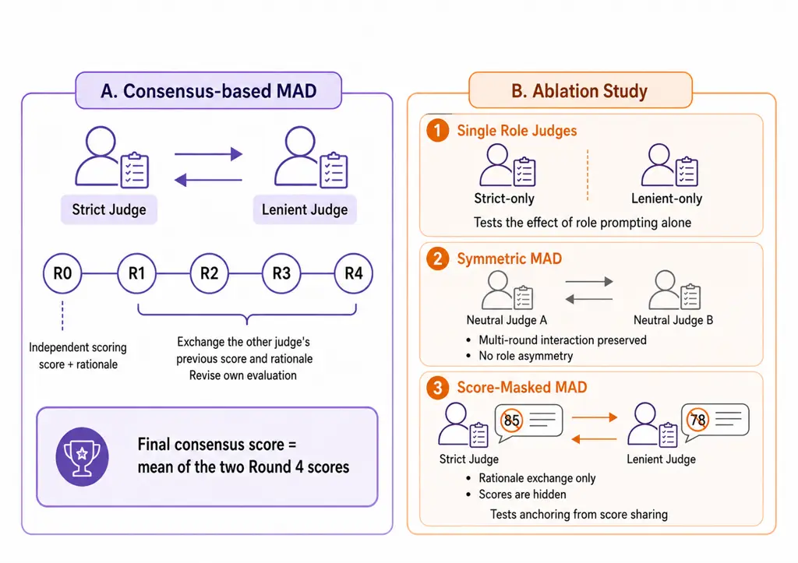
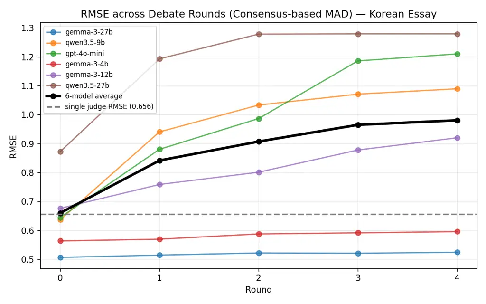
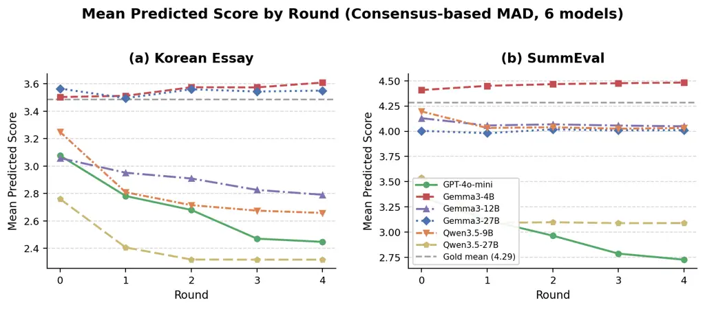
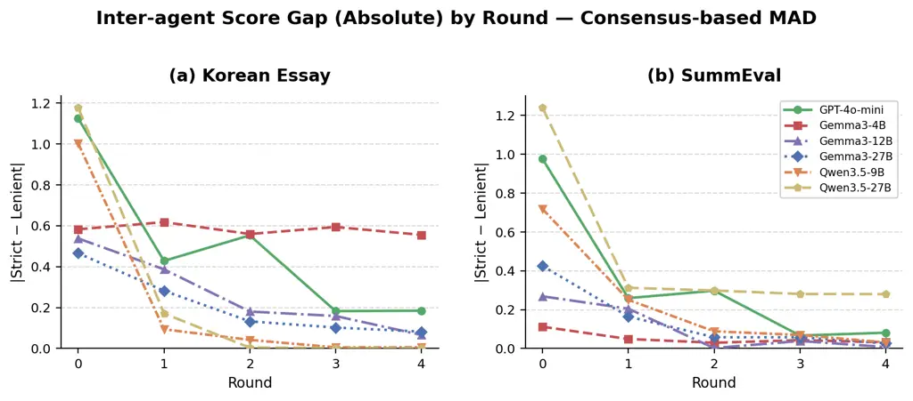

# Beyond Consensus: Downward Bias and Role Asymmetry in Multi-Agent LLM Judges for Subjective Evaluation

Minsoo Song Affiliation: Soongsil University
Email: [chanjun.park@ssu.ac.kr](mailto:)    Chanwoo Kim
Affiliation: Soongsil University    Sugyeong Eo Affiliation:  Yonsei
University{ecoses042, kcw4776}@soongsil.ac.kr, s.eo@yonsei.ac.kr,   
Chanjun Park Affiliation: Soongsil University

###### Abstract

Multi-Agent Debate (MAD) has been widely adopted to improve LLM-based
evaluation by prompting multiple agents to negotiate and reach a
consensus. However, for subjective rubric-based scoring, inter-agent
agreement does not guarantee alignment with human judgments. In this
paper, we compare a single-judge baseline against a consensus-based MAD
protocol on subjective evaluation tasks and design three ablations to
isolate the impact of role prompting, multi-round interaction, and
explicit score sharing. Evaluations across six LLMs show that the
single-judge baseline achieves the strongest human alignment on average
across six judge models, whereas MAD shows degradation in human
alignment on both tasks. Our ablations demonstrate that this performance
drop stems primarily from asymmetric role prompting rather than the
interaction itself. Specifically, assigning a strict judge role
introduces a systematic downward bias that the consensus process fails
to correct. The central finding is that this bias reflects strict-stance
dominance beyond averaging: the consensus score falls well beyond the
arithmetic midpoint of the standalone strict and lenient conditions,
rather than averaging them out. Removing role asymmetry (Symmetric MAD)
largely recovers baseline performance, while masking peer scores widens
inter-agent disagreement on average and worsens average human alignment.
These findings demonstrate that multi-agent consensus can enforce
artificial agreement at the expense of true human alignment, revealing a
structural limitation in consensus-style, role-specialized MAD protocols
for subjective scoring.

^(†)^(†)footnotetext: Corresponding authors.

## 1 Introduction

Figure 1: Overview of the experimental design. We compare a single-judge
baseline with consensus-based MAD and three ablations that isolate role
prompting, debate interaction, and score sharing, using RMSE and
Spearman correlation against human reference scores.

LLM-as-a-Judge (LLM judge) has become a widely adopted paradigm for
evaluating open-ended language generation tasks. Prior studies have
shown that LLMs can provide scalable and rubric-aware evaluations for
summarization, dialogue, and long-form responses, often showing stronger
correlations with human judgments than traditional metrics Liu et al.
(2023); Zhu et al. (2025); Kim et al. (2024). However, LLM judges are
also known to exhibit systematic biases, such as self-preference,
position bias, and unfair evaluation behavior Wataoka et al. (2024); Shi
et al. (2025); Wang et al. (2024).

In parallel, Multi-Agent Debate (MAD) has been proposed as a way to
improve the reasoning and factuality of LLM outputs by allowing multiple
agents to exchange and revise their answers Du et al. (2024); Liang et
al. (2024). Recent work has extended this idea to LLM-based evaluation,
introducing multi-agent or debate-based judges for open-ended text
evaluation, evaluator meta-evaluation, and machine translation
evaluation Chan et al. (2024); Li et al. (2024); Chern et al. (2024);
Feng et al. (2025); Chen et al. (2025). Such applications are supported
by evidence that MAD can be effective in reasoning-oriented tasks where
answers are relatively verifiable, such as factual question answering or
mathematical reasoning Liang et al. (2024); Zhang and Xiong (2025).
However, these studies do not systematically evaluate whether
multi-agent judging improves alignment with human reference scores in
criterion-level subjective scoring tasks.

To this end, we investigate whether consensus-based MAD improves or
degrades human alignment in subjective evaluation, and, if degradation
is observed, what mechanisms may explain it. We treat numerical
anchoring and role-prompt asymmetry as two competing hypotheses for this
degradation rather than as an established mechanism, and we design
ablations to test each hypothesis directly. Under the anchoring
hypothesis, score sharing induces anchoring effects: prior work on
judgment under uncertainty shows that exposure to numerical values
biases subsequent judgments toward observed anchors Tversky and Kahneman
(1974); Mussweiler and Strack (2000), so agents observing both textual
rationales and numerical scores from other agents may converge toward
shared score ranges, compressing score distributions and reducing
discriminability. Under the role-prompt asymmetry hypothesis, assigning
agents asymmetric evaluative stances, such as strict and lenient judge
roles, allows one stance to dominate the deliberation process and weaken
the reliability of the final consensus independent of whether numerical
scores are shared. Score-Masked MAD tests the anchoring hypothesis by
removing numerical score sharing while preserving role asymmetry, while
Symmetric MAD tests the role-prompt asymmetry hypothesis by removing
role asymmetry while preserving multi-round interaction.

To investigate further, we compare single-agent and Consensus-based MAD
judges against human reference scores, using ablations that isolate
score sharing and asymmetric role prompting. Our experiments show that
consensus-style multi-agent judging degrades alignment with human
reference scores, and our ablation analysis suggests that asymmetric
role prompting is a primary driver of this degradation.

## 2 Methodology

We study a compact consensus-style multi-agent judging design for
subjective evaluation tasks. To isolate and examine the core mechanisms
shared by prior multi-agent debate and agent-as-judge studies Du et al.
(2024); Chan et al. (2024); Li et al. (2024), we deliberately
instantiate a minimal MAD protocol with role-specialized agents,
iterative exchange, and final aggregation, rather than proposing a new
framework. This design allows us to test whether a consensus-oriented
interaction, which has been used to improve reasoning or open-ended
evaluation, also improves alignment with human ratings in subjective
scoring. Figure 1 summarizes the experimental design. Across all
protocols, we keep the task input, target text, rubric, scoring scale,
and judge model fixed. The full prompts are provided in Appendix A.

### 2.1 Judge Protocols

#### Single Judge

The single-judge condition serves as the baseline. A single LLM judge
receives the task instruction, rubric, and target text, and
independently assigns criterion-level scores. This condition involves no
role specialization, inter-agent interaction, or score aggregation.

#### Consensus-based MAD

Our main multi-agent condition consists of two role-specialized agents:
a Strict Judge and a Lenient Judge. We use this strict–lenient pair as a
minimal form of evaluative diversity: subjective scoring often involves
a tension between penalizing weaknesses and recognizing plausible
strengths. At Round 0, both agents independently evaluate the target
text. In each subsequent round, the strict and lenient agents observe
each other’s previous score and rationale, then revise or maintain their
own judgments. The final prediction is the arithmetic mean of the two
agents’ final-round scores. In our experiments, we conducted this
process up to Round 4.

### 2.2 Ablation Conditions

We introduce three ablation conditions to decompose the consensus-style
design into role prompting, multi-round interaction, and numerical score
sharing.

#### Strict Role Judge

The Strict Role Judge applies the same strict scoring prompt used in the
role-specialized consensus judge, but removes inter-agent interaction.
This condition tests whether the strict role prompt alone changes score
levels or human alignment. Comparing this condition with the
single-judge baseline isolates the effect of role framing, while
comparing it with the Consensus-based MAD shows whether interaction
amplifies or moderates the effect of the strict role.

#### Symmetric MAD

Symmetric MAD preserves the same multi-round interaction structure as
the main consensus protocol but removes role specialization. Both agents
use the same neutral judge prompt and exchange previous-round
evaluations. This condition tests whether interaction alone explains the
observed behavior, or whether asymmetric role prompting is necessary for
the alignment changes observed in the main protocol.

#### Score-Masked MAD

Score-Masked MAD preserves the strict–lenient role structure and
rationale exchange, but removes explicit numerical score sharing from
inter-agent messages. Agents observe the other agent’s previous
rationale excluding any numerical values. This condition tests whether
numerical scores act as anchoring signals during deliberation, since
prior work shows that exposure to numerical values can bias subsequent
judgments under uncertainty Tversky and Kahneman (1974); Mussweiler and
Strack (2000).

## 3 Experimental Setup

### 3.1 Tasks and Datasets

We evaluate judge protocols on two subjective evaluation tasks that
provide criterion-level human reference scores for rubric-based
evaluation, enabling direct measurement of judge-to-human alignment.
Detailed dataset settings are provided in Appendix B.

We deliberately diversify language, rubric structure, and genre across
the two tasks, while standardizing the measurement protocol: both tasks
use a 1–5 scoring scale, criterion-level human reference scores, and an
identical grid of judge protocols and judge models. This design lets us
test whether the effects of role-specialized consensus generalize across
domains that differ substantially in surface characteristics but are
evaluated under the same experimental grid.

#### Korean Essay Scoring

For this task, we use the National Institute of Korean Language writing
assessment corpus¹¹ 1
[https://kli.korean.go.kr/corpus/request/corpusRegist.do](https://kli.korean.go.kr/corpus/request/corpusRegist.do).
We sample 600 essays from six topics. Each essay is evaluated on three
criteria: content, organization, and expression. The average of two
human evaluators is leveraged as the reference score.

#### Summarization Evaluation

We use SummEval Fabbri et al. (2020), which provides human ratings for
system-generated summaries across four criteria: coherence, consistency,
fluency, and relevance. We use summaries generated by seven systems for
100 source articles, yielding 700 system-summary instances. Each summary
is evaluated at the criterion level, and the human rating is used as the
reference score.

One prompt-level asymmetry exists between the two single-judge
baselines: the SummEval single-judge prompt includes the phrase strict
and consistent evaluator, a directional cue absent from the Korean Essay
single-judge prompt. Because our own ablations show that a strict
framing systematically lowers human alignment relative to a neutral
prompt (Table 1), this asymmetry, if anything, works against our central
claim: it nudges the SummEval single-judge baseline toward the same
strict framing that degrades alignment under Consensus-based MAD, which
would narrow rather than inflate the single-judge advantage we report.
We therefore consider the direction of this asymmetry conservative with
respect to our conclusions, although we do not directly quantify its
magnitude.

### 3.2 Models and Metrics

We use six LLMs as judge models: GPT-4o-mini²² 2
[https://developers.openai.com/api/docs/models/gpt-4o-mini](https://developers.openai.com/api/docs/models/gpt-4o-mini),
Gemma-3-4B-IT, Gemma-3-12B-IT, and Gemma-3-27B-IT Team et al. (2025),
Qwen3.5-9B, and Qwen3.5-27B Qwen Team (2026). We select models spanning
three families and three capacity levels (4B--27B) to assess whether
findings hold across model sizes and architectures. All models are
accessed through OpenRouter³³ 3
[https://openrouter.ai/](https://openrouter.ai/) with temperature
setting of 0. Within each run, the same model performs all judge roles.
Additional inference details are provided in Appendix C. For measuring
human alignment, we use RMSE and Spearman correlation. RMSE measures
absolute agreement with human reference scores, while Spearman
correlation measures whether the protocol preserves the relative ranking
of instances.

## 4 Results

|                     | Korean Essay        |                       | SummEval            |                       |
| ------------------- | ------------------- | --------------------- | ------------------- | --------------------- |
| Protocol            | RMSE $`\downarrow`$ | $`\rho`$ $`\uparrow`$ | RMSE $`\downarrow`$ | $`\rho`$ $`\uparrow`$ |
| Single Judge        | 0.644               | 0.504                 | 0.682               | 0.458                 |
| Strict Role Judge   | 0.973               | 0.499                 | 0.884               | 0.447                 |
| Symmetric MAD       | 0.733               | 0.451                 | 0.687               | 0.447                 |
| Consensus-based MAD | 0.935               | 0.424                 | 0.813               | 0.409                 |
| Score-Masked MAD    | 1.040               | 0.399                 | 0.994               | 0.368                 |

Table 1: Human alignment across judge protocols, averaged over six judge
models. The single-judge baseline achieves the strongest average
alignment on two datasets.

Figure 2: Round-wise RMSE under Consensus-based MAD on the Korean Essay
scoring task. Each point traces the protocol-level prediction after each
exchange round. The upward trend after early interaction suggests that
iterative consensus does not necessarily move judge predictions closer
to human reference scores.

|                     |              |          |
| ------------------- | ------------ | -------- |
| Protocol            | Korean Essay | SummEval |
| Reference           | 3.486        | 4.285    |
| Single Judge        | 3.345        | 3.935    |
| Strict Role Judge   | 2.733        | 3.672    |
| Symmetric MAD       | 3.249        | 3.964    |
| Consensus-based MAD | 2.900        | 3.831    |
| Score-Masked MAD    | 2.767        | 3.667    |

Table 2: Mean predicted score per protocol, averaged over all evaluation
instances and six judge models. Role-asymmetric protocols show a
consistent downward shift relative to the single-judge baseline and
human reference. Appendix D provides detailed analysis.

### 4.1 Human Alignment Across Protocols

Table 1 reports RMSE and Spearman correlation averaged over six judge
models. The single-judge baseline achieves the best alignment on both
tasks in both RMSE and Spearman correlation. Consensus-based MAD
increases RMSE to 0.935 and 0.813 while Spearman drops to 0.424 and
0.409, indicating degradation in both absolute agreement and ranking
preservation. As illustrated in Figure 2, RMSE generally increases after
the initial exchange. This indicates that subsequent rounds fail to
correct the degradation and instead compound it. Detailed per-model
results and gap trajectories can be found in Appendix E. Significance
tests for this degradation are reported in Appendix F.

### 4.2 Role Asymmetry

Table 2 reports mean predicted scores, which indicate the direction of
score shift rather than human alignment itself. Consensus-based MAD
produces lower mean scores than both the single-judge baseline and the
human reference on both tasks. On Korean Essay, the mean score is 2.900
under Consensus-based MAD, compared with 3.345 under Single Judge and
3.486 for the human reference. On SummEval, the corresponding values are
3.831, 3.935, and 4.285. This shows that the strict–lenient consensus
protocol shifts the average prediction downward relative to the human
reference.

This downward shift is most pronounced in the Strict Role Judge
condition. Its mean scores are 2.733 on Korean Essay and 3.672 on
SummEval, both below the Consensus-based MAD means. The same condition
also yields higher RMSE than Consensus-based MAD (Essay: 0.973 vs.
0.935; SummEval: 0.884 vs. 0.813), indicating that the strict role
prompt alone moves predictions away from the human reference.
Interaction in Consensus-based MAD partially moderates this strict-role
shift, but does not restore single-judge alignment. Dominance analysis
results are reported in Appendix G.

By contrast, Symmetric MAD remains much closer to the single-judge
baseline. Its RMSE is 0.733 on Korean Essay and 0.687 on SummEval,
compared with 0.644 and 0.682 for the Single Judge. Its mean scores are
also closer to the single-judge means (Essay: 3.249 vs. 3.345; SummEval:
3.964 vs. 3.935). Together, these results suggest that the main source
of alignment loss is not multi-round interaction itself, but asymmetric
role prompting. Lenient Role Judge results are reported in Appendix G.

### 4.3 Cross-Model Generalization

|                                 |              |          |
| ------------------------------- | ------------ | -------- |
| Condition                       | RMSE         |          |
|                                 | Korean Essay | SummEval |
| Single Judge baseline           |              |          |
| Gemma3-27B                      | 0.528        | 0.414    |
| Gemma3-12B                      | 0.643        | 0.575    |
| Qwen3.5-9B                      | 0.640        | 0.750    |
| Cross-model MAD                 |              |          |
| Gemma3-27B*(S) / Gemma3-12B*(L) | 0.690        | 0.528    |
| Gemma3-12B*(S) / Gemma3-27B*(L) | 0.639        | 0.505    |
| Gemma3-27B*(S) / Qwen3.5-9B*(L) | 0.746        | 0.587    |
| Qwen3.5-9B*(S) / Gemma3-27B*(L) | 1.143        | 0.877    |

Table 3: Single-judge baselines and cross-model role-swapping results.
Subscripts $`S`$ and $`L`$ indicate Strict and Lenient roles.
Cross-model pairing changes the magnitude of RMSE but does not
consistently recover the strongest single-judge alignment, suggesting
that model diversity alone does not remove the effect of strict–lenient
role asymmetry.

We assign the Strict and Lenient roles to different models and swap
their assignments within each pair. Table 3 shows that cross-model
pairing changes the magnitude of RMSE but does not eliminate the
role-asymmetry pattern: no configuration outperforms the strongest
single-judge baseline, and Qwen3.5-9B*(S)/Gemma3-27B*(L) yields the
largest errors on both tasks, suggesting that role-induced biases
persist regardless of the underlying models.

## 5 Conclusion

This paper investigates whether consensus-style multi-agent judging with
asymmetric roles improves human alignment in subjective rubric-based
evaluation. Across both tasks, the single-judge baseline outperformed
all multi-agent conditions in terms of RMSE and Spearman correlation.
Our ablation results conclude that asymmetric role prompting is the most
consistent source of this degradation. The strict role prompt alone
shifts scores substantially below the human reference distribution,
while Symmetric MAD, which retains multi-round interaction without role
asymmetry, shows improved alignment. Score exposure acts more as a
coordination signal than a harmful anchor, as masking scores widens the
inter-agent gap without recovering human alignment. Cross-model
experiments further show that assigning roles to different models
changes the magnitude of the effect but does not remove it. These
findings show that asymmetric role prompts bias the consensus away from
human reference judgments, emphasizing the importance of role design in
consensus-style, role-specialized MAD protocols.

## Limitations

Our findings are subject to several limitations. The consensus-style MAD
protocol we study is our own controlled operationalization rather than a
direct replication of any single prior system; results may differ under
other MAD designs that use different role prompts, interaction
structures, or aggregation strategies. Within our design, we test only
one role configuration (strict–lenient) and fix the protocol to five
total rounds, consisting of an initial round followed by four adjustment
rounds; we additionally report a standalone Lenient-only condition
alongside the Strict-only baseline in Appendix G, but the effect of
varying the round count is not evaluated. Final scores are aggregated by
unweighted averaging; alternative strategies such as weighted ensembles
or majority voting are not explored. Our study covers two domains
(Korean essay scoring and English summarization) with six judge models;
generalization to other tasks, languages, or model families requires
further investigation. Several additional design axes remain unexplored
and are left for future work, including the number of agents, the
diversity of role configurations, the format of inter-agent interaction,
the aggregation rule, and the degree of judge specialization. The
SummEval single-judge prompt uses the phrase strict and consistent
evaluator, introducing a directional framing absent from the Korean
Essay baseline; this asymmetry may affect cross-domain comparisons and
should be examined in future work. Paired-bootstrap significance tests
for the primary comparisons are reported in Appendix F.

## Ethical Statement

This study uses two publicly available datasets: the NIKL Grading
Writing Data 2024, released by the National Institute of the Korean
Language for research purposes, and the SummEval benchmark, accessed
through HuggingFace Hub. No new human subject data were collected, and
no personally identifiable information was used. All LLM inference was
conducted through the OpenRouter API using commercially available
models. The datasets contain no sensitive personal information, and the
evaluation outputs produced by LLM judges are used solely for research
analysis.

## Acknowledgments

This work was supported by the Korea Internet & Security Agency (KISA)
grant funded by the Korea government (PIPC) (No. RS-2026-25526342,
Development of Technologies for Preventing Sensitive Information
Inference and Risk Assessment in Foundation Model Operations). This work
was also supported by the National Research Foundation of Korea (NRF)
grant funded by the Korea government (MSIT) (No. RS-2026-25483747). This
research was further supported by the Culture, Sports and Tourism R&D
Program through the Korea Creative Content Agency, funded by the
Ministry of Culture, Sports and Tourism in 2026 (Project Name: Develop
AI Agent Technology to Connect Knowledge through Public Cultural
Facility-Based Discussion and Communication, Project Number:
RS-2026-25520645). This research was also supported by the ANCHOR
Program through the Gangwon ANCHOR Center, funded by the Ministry of
Education (MOE) and Gangwon State (G.S.), Republic of Korea
(2026-ANCHOR-10-006).

## References

- Chan et al. (2024) C. Chan, W. Chen, Y. Su, J. Yu, W. Xue, S.
  Zhang, J. Fu, and Z. Liu Chateval: towards better llm-based evaluators
  through multi-agent debate. In International conference on learning
  representations, Vol. 2024, pp. 9079–9093. Cited by: §1, §2.
- Chen et al. (2025) J. Chen, Y. Lu, X. Wang, H. Zeng, J. Huang, J.
  Gesi, Y. Xu, B. Yao, and D. Wang Multi-agent-as-judge: aligning
  llm-agent-based automated evaluation with multi-dimensional human
  evaluation. arXiv preprint arXiv:2507.21028. Cited by: §1.
- Chern et al. (2024) S. Chern, E. Chern, G. Neubig, and P. Liu Can
  large language models be trusted for evaluation? scalable
  meta-evaluation of llms as evaluators via agent debate. arXiv preprint
  arXiv:2401.16788. Cited by: §1.
- Du et al. (2024) Y. Du, S. Li, A. Torralba, J. B. Tenenbaum, and I.
  Mordatch Improving factuality and reasoning in language models through
  multiagent debate. In Forty-first international conference on machine
  learning, Cited by: §1, §2.
- Fabbri et al. (2020) A. R. Fabbri, W. Kryściński, B. McCann, C.
  Xiong, R. Socher, and D. Radev SummEval: re-evaluating summarization
  evaluation. arXiv preprint arXiv:2007.12626. Cited by: §3.1.
- Feng et al. (2025) Z. Feng, J. Su, J. Zheng, J. Ren, Y. Zhang, J.
  Wu, H. Wang, and Z. Liu M-mad: multidimensional multi-agent debate for
  advanced machine translation evaluation. In Proceedings of the 63rd
  Annual Meeting of the Association for Computational Linguistics
  (Volume 1: Long Papers), pp. 7084–7107. Cited by: §1.
- Kim et al. (2024) S. Kim, J. Shin, J. Jang, S. Longpre, H. Lee, S.
  Yun, R. Shin, S. Kim, J. Thorne, M. Seo, et al. Prometheus: inducing
  fine-grained evaluation capability in language models. In
  International Conference on Learning Representations, Vol. 2024,
  pp. 29927–29962. Cited by: §1.
- Li et al. (2024) Y. Li, S. Zhang, R. Wu, X. Huang, Y. Chen, W. Xu, G.
  Qi, and D. Min MATEval: a multi-agent discussion framework for
  advancing open-ended text evaluation. In International Conference on
  Database Systems for Advanced Applications, pp. 415–426. Cited by: §1,
  §2.
- Liang et al. (2024) T. Liang, Z. He, W. Jiao, X. Wang, Y. Wang, R.
  Wang, Y. Yang, S. Shi, and Z. Tu Encouraging divergent thinking in
  large language models through multi-agent debate. In Proceedings of
  the 2024 conference on empirical methods in natural language
  processing, pp. 17889–17904. Cited by: §1.
- Liu et al. (2023) Y. Liu, D. Iter, Y. Xu, S. Wang, R. Xu, and C. Zhu
  G-eval: nlg evaluation using gpt-4 with better human alignment. In
  Proceedings of the 2023 conference on empirical methods in natural
  language processing, pp. 2511–2522. Cited by: §1.
- Mussweiler and Strack (2000) T. Mussweiler and F. Strack Numeric
  judgments under uncertainty: the role of knowledge in anchoring.
  Journal of experimental social psychology 36 (5), pp. 495–518. Cited
  by: §1, §2.2.
- Qwen Team (2026) Qwen Team Qwen3.5: towards native multimodal agents.
  External Links: [Link](https://qwen.ai/blog?id=qwen3.5) Cited by:
  §3.2.
- Shi et al. (2025) L. Shi, C. Ma, W. Liang, X. Diao, W. Ma, and S.
  Vosoughi Judging the judges: a systematic study of position bias in
  llm-as-a-judge. In Proceedings of the 14th International Joint
  Conference on Natural Language Processing and the 4th Conference of
  the Asia-Pacific Chapter of the Association for Computational
  Linguistics, pp. 292–314. Cited by: §1.
- Team et al. (2025) G. Team, A. Kamath, J. Ferret, S. Pathak, N.
  Vieillard, R. Merhej, S. Perrin, T. Matejovicova, A. Ramé, M.
  Rivière, L. Rouillard, T. Mesnard, G. Cideron, J. Grill, S. Ramos, E.
  Yvinec, M. Casbon, E. Pot, I. Penchev, G. Liu, F. Visin, K.
  Kenealy, L. Beyer, X. Zhai, A. Tsitsulin, R. Busa-Fekete, A. Feng, N.
  Sachdeva, B. Coleman, Y. Gao, B. Mustafa, I. Barr, E. Parisotto, D.
  Tian, M. Eyal, C. Cherry, J. Peter, D. Sinopalnikov, S.
  Bhupatiraju, R. Agarwal, M. Kazemi, D. Malkin, R. Kumar, D. Vilar, I.
  Brusilovsky, J. Luo, A. Steiner, A. Friesen, A. Sharma, A.
  Sharma, A. M. Gilady, A. Goedeckemeyer, A. Saade, A. Feng, A.
  Kolesnikov, A. Bendebury, A. Abdagic, A. Vadi, A. György, A. S.
  Pinto, A. Das, A. Bapna, A. Miech, A. Yang, A. Paterson, A. Shenoy, A.
  Chakrabarti, B. Piot, B. Wu, B. Shahriari, B. Petrini, C. Chen, C. L.
  Lan, C. A. Choquette-Choo, C. Carey, C. Brick, D. Deutsch, D.
  Eisenbud, D. Cattle, D. Cheng, D. Paparas, D. S. Sreepathihalli, D.
  Reid, D. Tran, D. Zelle, E. Noland, E. Huizenga, E. Kharitonov, F.
  Liu, G. Amirkhanyan, G. Cameron, H. Hashemi, H. Klimczak-Plucińska, H.
  Singh, H. Mehta, H. T. Lehri, H. Hazimeh, I. Ballantyne, I.
  Szpektor, I. Nardini, J. Pouget-Abadie, J. Chan, J. Stanton, J.
  Wieting, J. Lai, J. Orbay, J. Fernandez, J. Newlan, J. Ji, J.
  Singh, K. Black, K. Yu, K. Hui, K. Vodrahalli, K. Greff, L. Qiu, M.
  Valentine, M. Coelho, M. Ritter, M. Hoffman, M. Watson, M.
  Chaturvedi, M. Moynihan, M. Ma, N. Babar, N. Noy, N. Byrd, N. Roy, N.
  Momchev, N. Chauhan, N. Sachdeva, O. Bunyan, P. Botarda, P.
  Caron, P. K. Rubenstein, P. Culliton, P. Schmid, P. G. Sessa, P.
  Xu, P. Stanczyk, P. Tafti, R. Shivanna, R. Wu, R. Pan, R. Rokni, R.
  Willoughby, R. Vallu, R. Mullins, S. Jerome, S. Smoot, S. Girgin, S.
  Iqbal, S. Reddy, S. Sheth, S. Põder, S. Bhatnagar, S. R. Panyam, S.
  Eiger, S. Zhang, T. Liu, T. Yacovone, T. Liechty, U. Kalra, U.
  Evci, V. Misra, V. Roseberry, V. Feinberg, V. Kolesnikov, W. Han, W.
  Kwon, X. Chen, Y. Chow, Y. Zhu, Z. Wei, Z. Egyed, V. Cotruta, M.
  Giang, P. Kirk, A. Rao, K. Black, N. Babar, J. Lo, E. Moreira, L. G.
  Martins, O. Sanseviero, L. Gonzalez, Z. Gleicher, T. Warkentin, V.
  Mirrokni, E. Senter, E. Collins, J. Barral, Z. Ghahramani, R.
  Hadsell, Y. Matias, D. Sculley, S. Petrov, N. Fiedel, N. Shazeer, O.
  Vinyals, J. Dean, D. Hassabis, K. Kavukcuoglu, C. Farabet, E.
  Buchatskaya, J. Alayrac, R. Anil, Dmitry, Lepikhin, S. Borgeaud, O.
  Bachem, A. Joulin, A. Andreev, C. Hardin, R. Dadashi, and L. Hussenot
  Gemma 3 technical report. External Links: 2503.19786,
  [Link](https://arxiv.org/abs/2503.19786) Cited by: §3.2.
- Tversky and Kahneman (1974) A. Tversky and D. Kahneman Judgment under
  uncertainty: heuristics and biases: biases in judgments reveal some
  heuristics of thinking under uncertainty.. science 185 (4157),
  pp. 1124–1131. Cited by: §1, §2.2.
- Wang et al. (2024) P. Wang, L. Li, L. Chen, Z. Cai, D. Zhu, B. Lin, Y.
  Cao, L. Kong, Q. Liu, T. Liu, et al. Large language models are not
  fair evaluators. In Proceedings of the 62nd Annual Meeting of the
  Association for Computational Linguistics (Volume 1: Long Papers),
  pp. 9440–9450. Cited by: §1.
- Wataoka et al. (2024) K. Wataoka, T. Takahashi, and R. Ri
  Self-preference bias in llm-as-a-judge. arXiv preprint
  arXiv:2410.21819. Cited by: §1.
- Zhang and Xiong (2025) S. Zhang and D. Xiong Debate4MATH: multi-agent
  debate for fine-grained reasoning in math. In Findings of the
  Association for Computational Linguistics: ACL 2025, pp. 16810–16824.
  Cited by: §1.
- Zhu et al. (2025) L. Zhu, X. Wang, and X. Wang Judgelm: fine-tuned
  large language models are scalable judges. In International Conference
  on Learning Representations, Vol. 2025, pp. 51257–51296. Cited by: §1.

## Appendix A Experiment Prompts

All system prompts share a modular structure comprising a _role_
definition, dataset-specific _evaluation criteria_, a _score rubric_,
and a structured _JSON output format_. Because the criteria, rubric, and
output-format blocks are identical across prompts within each dataset,
we define them once in Appendix A.1 and use the tokens
\[ESSAY_CRITERIA\], \[ESSAY_RUBRIC\], \[SE_CRITERIA\], \[SE_RUBRIC\],
\[ESSAY_OUTPUT_INIT\], \[ESSAY_OUTPUT_ADJ\], \[SE_OUTPUT_INIT\], and
\[SE_OUTPUT_ADJ\] as placeholders in the per-condition prompts that
follow. The INIT variants apply to the initial evaluation round (key:
criterion_rationale); the ADJ variants apply to adjustment rounds (key:
adjustment_notes).

The remainder of this appendix is organized by prompt function.
Appendix A.1 defines the reusable criteria, rubrics, and output-format
blocks. Appendix A.2 reports the single-judge prompts. Appendix A.3
reports the role-specific strict and lenient prompts used for the
initial round of role-asymmetric protocols. Appendix A.4 reports the
adjustment-round prompts for Consensus-based MAD and Score-Masked MAD,
while Appendix A.5 reports the neutral prompts used in Symmetric MAD.

### A.1 Shared Components

### A.2 Single Judge Prompts

### A.3 Role-Specific Prompts (Strict and Lenient)

### A.4 Consensus-based MAD — Adjustment-Round Prompts

### A.5 Symmetric MAD Prompts

## Appendix B Dataset Implementation Details

### B.1 Korean Essay Scoring

We use the NIKL Grading Writing Data 2024, a Korean essay corpus
released by the National Institute of the Korean Language. The corpus
provides structured JSON documents in which each essay is recorded at
the paragraph level, accompanied by rubric-based holistic scores
assigned independently by two trained human annotators. The original
scoring rubric covers three dimensions: content (maximum 25 points),
organization (maximum 10 points), and expression (maximum 10 points). To
place all dimensions on a common scale, we linearly normalize each raw
score to a 5-point scale via
$`s_{5\text{pt}}=(s_{\text{raw}}/s_{\text{max}})\times 5`$. For each
essay, we compute per-evaluator normalized scores and their arithmetic
mean; the mean serves as the gold reference throughout all experiments.
The corpus contains essays written in response to prompts covering a
range of argumentative and expository topics (Q4–Q9). For each of the
six prompts, we randomly sample 100 essays without replacement
(seed $`=42`$, using Python’s random.sample), yielding a final dataset
of 600 essays. Paragraph-level form fields are concatenated with double
newlines to reconstruct a plain-text essay body for judge input.

### B.2 SummEval

We use the SummEval benchmark, accessed via the mteb/summeval dataset on
HuggingFace Hub (test split). SummEval provides human quality
annotations for machine-generated summaries of CNN/DailyMail news
articles, covering four dimensions: coherence, consistency, fluency, and
relevance, each rated on a 1–5 scale by three independent human
annotators.

We sample 100 news articles from the test split (seed $`=42`$, using
HuggingFace’s shuffle().select()) and expand each article across all
available summarization systems. For each (article, summary) pair, the
gold score per criterion is computed as the arithmetic mean of the three
annotators’ scores. No additional normalization is applied, as the
original annotations are already on a 1–5 scale consistent with our
essay scoring setup.

The final dataset consists of 700 (article, summary) pairs (100 articles
$`\times`$ 7 summarization systems), stored as individual JSON files
organized by system name.

## Appendix C Model and Inference Details

Table 4 lists the judge models and their OpenRouter identifiers.

| Model       | OpenRouter identifier |
| ----------- | --------------------- |
| GPT-4o-mini | openai/gpt-4o-mini    |
| Gemma3-27B  | google/gemma-3-27b-it |
| Gemma3-12B  | google/gemma-3-12b-it |
| Gemma3-4B   | google/gemma-3-4b-it  |
| Qwen3.5-9B  | qwen/qwen3.5-9b       |
| Qwen3.5-27B | qwen/qwen3.5-27b      |

Table 4: Judge models and OpenRouter identifiers.

Qwen3.5-9B requires reasoning: {effort: none} and response_format:
json_object to suppress chain-of-thought output. Failed calls (after 3
retries with exponential backoff) are recorded as judge_error and
excluded from analysis.

### C.1 Output Formatting and Parsing

All judge outputs are required to follow the same JSON schema so that
scores and rationales can be parsed consistently across models and
protocols. For models that support structured output options, we enable
JSON-format responses and suppress auxiliary reasoning traces that are
not part of the target output schema.

These settings are used only to ensure parseable outputs and do not
change the task instruction, rubric, judge role, scoring scale, or
information available to the judge. The same output schema is applied
across all judging conditions.

### C.2 Score-Masked MAD

In the Score-Masked MAD condition, the numeric scores produced by the
other agent are removed before being shared. Criterion-level numeric
score fields are excluded from the shared response. In addition, numeric
tokens in textual rationales and adjustment notes are replaced with
\[NUM\]. The prompt explicitly states that the other evaluator’s numeric
scores are hidden and that numbers in textual rationales are masked.

## Appendix D Score-Masked MAD analysis

Table 5 reports per-model RMSE and final inter-agent score gap for
Consensus-based MAD and Score-Masked MAD across both tasks. Score
masking worsens average RMSE in both domains (Essay: 0.935 $`\to`$
1.040; SummEval: 0.813 $`\to`$ 0.994) and substantially increases the
final inter-agent gap (Essay: 0.176 $`\to`$ 0.385; SummEval: 0.076
$`\to`$ 0.224).

A minority of model–task pairs show local RMSE improvements under
masking (GPT-4o-mini and Qwen3.5-27B on Korean Essay), but in those same
cases the inter-agent gap widens considerably, indicating that agents
reach less coordinated final positions even when absolute alignment is
marginally preserved.

The systematic gap widening under masking is consistent with the view
that numerical scores serve as coordination signals between agents
during deliberation. Removing them reduces inter-agent convergence
without restoring alignment with human ratings, suggesting that score
exposure in standard Consensus-based MAD provides mutual calibration
rather than a pure anchoring bias.

|             | Korean Essay |        |           |        | SummEval |        |           |        |
| ----------- | ------------ | ------ | --------- | ------ | -------- | ------ | --------- | ------ |
|             | RMSE         |        | Final Gap |        | RMSE     |        | Final Gap |        |
| Model       | MAD          | Masked | MAD       | Masked | MAD      | Masked | MAD       | Masked |
| GPT-4o-mini | 1.207        | 1.152  | 0.213     | 0.736  | 1.664    | 2.016  | 0.124     | 0.505  |
| Gemma3-4B   | 0.600        | 0.656  | 0.560     | 0.421  | 0.469    | 0.556  | 0.067     | 0.123  |
| Gemma3-12B  | 0.922        | 1.316  | 0.170     | 0.450  | 0.490    | 0.634  | 0.031     | 0.180  |
| Gemma3-27B  | 0.526        | 0.703  | 0.093     | 0.255  | 0.457    | 0.873  | 0.037     | 0.229  |
| Qwen3.5-9B  | 1.077        | 1.187  | 0.021     | 0.194  | 0.831    | 0.833  | 0.051     | 0.108  |
| Qwen3.5-27B | 1.281        | 1.227  | 0.002     | 0.256  | 0.969    | 1.054  | 0.145     | 0.201  |
| Average     | 0.935        | 1.040  | 0.176     | 0.385  | 0.813    | 0.994  | 0.076     | 0.224  |

Table 5: Effect of numerical score masking on RMSE and final inter-agent
gap. Masking peer scores generally widens the gap between agents and
worsens average RMSE, suggesting that explicit score sharing functions
more as a coordination signal than as the sole source of anchoring bias.

## Appendix E Model Specific Analysis

Table 6 reports RMSE and Spearman correlation for each judge model and
protocol separately. The aggregate results in Table 1 reflect a central
tendency across models, but individual models show notable variation.

For most models, the Single Judge achieves the strongest human
alignment, consistent with the aggregate findings. Two models deviate
from this pattern. For Qwen3.5-27B, Symmetric MAD outperforms the Single
Judge on both tasks (Essay: 0.864 vs. 0.938 RMSE; SummEval: 0.734 vs.
0.799 RMSE), suggesting that neutral multi-round interaction can
occasionally improve alignment for larger models. Gemma3-27B also shows
a better RMSE under Symmetric MAD on Korean Essay (0.512 vs. 0.528),
although Single Judge retains an advantage on Spearman correlation and
on SummEval. Gemma3-4B shows uniformly small differences across all
protocols on both tasks, indicating limited sensitivity to role
prompting or interaction structure.

By contrast, GPT-4o-mini exhibits the most pronounced degradation under
Consensus-based MAD: Spearman drops from 0.516 to 0.315 on Korean Essay
and from 0.481 to 0.296 on SummEval, a decline substantially larger than
in other models. Score-Masked MAD produces the weakest ranking alignment
for this model on SummEval ($`\rho=0.224`$). Gemma3-12B shows a similar
vulnerability to score masking on Korean Essay, where Score-Masked MAD
reduces Spearman to 0.173—the lowest value observed across all
model–protocol combinations.

These model-level patterns suggest that sensitivity to role
specialization and score exposure varies considerably across model
families and capacity levels. The aggregate ordering (Single Judge $`>`$
Symmetric MAD $`>`$ Consensus-based MAD $`>`$ Score-Masked MAD) reflects
a dominant trend rather than a universal rule.

|             |                     | Korean Essay |          | SummEval |          |
| ----------- | ------------------- | ------------ | -------- | -------- | -------- |
| Model       | Protocol            | RMSE         | $`\rho`$ | RMSE     | $`\rho`$ |
| Gemma3-27B  | Single Judge        | 0.528        | 0.532    | 0.414    | 0.540    |
|             | Strict Role Judge   | 0.584        | 0.517    | 0.609    | 0.505    |
|             | Symmetric MAD       | 0.512        | 0.528    | 0.424    | 0.508    |
|             | Consensus-based MAD | 0.526        | 0.492    | 0.457    | 0.529    |
|             | Score-Masked MAD    | 0.703        | 0.470    | 0.873    | 0.356    |
| Qwen3.5-9B  | Single Judge        | 0.640        | 0.477    | 0.750    | 0.449    |
|             | Strict Role Judge   | 1.055        | 0.493    | 0.936    | 0.499    |
|             | Symmetric MAD       | 0.814        | 0.454    | 0.763    | 0.437    |
|             | Consensus-based MAD | 1.077        | 0.473    | 0.831    | 0.460    |
|             | Score-Masked MAD    | 1.187        | 0.457    | 0.833    | 0.466    |
| Qwen3.5-27B | Single Judge        | 0.938        | 0.534    | 0.799    | 0.590    |
|             | Strict Role Judge   | 1.472        | 0.542    | 1.153    | 0.568    |
|             | Symmetric MAD       | 0.864        | 0.558    | 0.734    | 0.600    |
|             | Consensus-based MAD | 1.281        | 0.527    | 0.969    | 0.612    |
|             | Score-Masked MAD    | 1.227        | 0.542    | 1.054    | 0.569    |
| GPT-4o-mini | Single Judge        | 0.518        | 0.516    | 1.093    | 0.481    |
|             | Strict Role Judge   | 1.199        | 0.477    | 1.587    | 0.448    |
|             | Symmetric MAD       | 0.537        | 0.493    | 1.310    | 0.398    |
|             | Consensus-based MAD | 1.207        | 0.315    | 1.664    | 0.296    |
|             | Score-Masked MAD    | 1.152        | 0.452    | 2.016    | 0.224    |
| Gemma3-4B   | Single Judge        | 0.599        | 0.409    | 0.460    | 0.273    |
|             | Strict Role Judge   | 0.622        | 0.459    | 0.465    | 0.281    |
|             | Symmetric MAD       | 0.635        | 0.274    | 0.429    | 0.344    |
|             | Consensus-based MAD | 0.600        | 0.295    | 0.469    | 0.266    |
|             | Score-Masked MAD    | 0.656        | 0.298    | 0.556    | 0.224    |
| Gemma3-12B  | Single Judge        | 0.643        | 0.554    | 0.575    | 0.415    |
|             | Strict Role Judge   | 0.908        | 0.507    | 0.554    | 0.382    |
|             | Symmetric MAD       | 1.035        | 0.397    | 0.461    | 0.394    |
|             | Consensus-based MAD | 0.922        | 0.444    | 0.490    | 0.294    |
|             | Score-Masked MAD    | 1.316        | 0.173    | 0.634    | 0.371    |

Table 6: Per-model RMSE and Spearman $`\rho`$ across judge protocols.
Bold indicates the best value per metric, model, and task. The results
show that the aggregate trend is dominant but not universal: some models
benefit locally from Symmetric MAD, while role-asymmetric protocols
remain less stable across models.

### E.1 Round-wise Mean Score and Gap Trajectories

Figure 3: Round-wise mean predicted score
($`(\text{strict}+\text{lenient})/2`$) under Consensus-based MAD. The
dashed line marks the human reference mean for each task. Models whose
consensus point remains close to the reference mean maintain lower RMSE,
whereas models that drift downward show larger alignment loss.

Figure 4: Round-wise absolute inter-agent gap
$`|\text{strict}-\text{lenient}|`$ under Consensus-based MAD. Smaller
gaps indicate stronger convergence between the two agents. Rapid
convergence does not necessarily imply better human alignment, because
agents may converge toward a score level that is systematically below
the human reference.

Figure 3 shows the direct cause of RMSE stability for Gemma3-27B and
Gemma3-4B: their mean predicted scores remain close to the gold mean
throughout all rounds on both tasks. On Korean Essay (gold
mean $`=3.49`$), Gemma3-27B fluctuates between 3.50 and 3.57 across
rounds, while Gemma3-4B rises only slightly from 3.50 to 3.61. Neither
model’s mean drifts far from the gold reference. By contrast,
Qwen3.5-27B starts at 2.76 (already 0.73 below gold) and falls further
to 2.32, and GPT-4o-mini drops from 3.08 to 2.45 across rounds. These
downward drifts directly explain the RMSE increases shown in Figure 2.

Gemma3-12B occupies an intermediate position: its mean starts below gold
(3.06) and continues declining to 2.79, consistent with its moderate
RMSE increase in Table 6. Notably, Gemma3-12B’s gap trajectory resembles
Gemma3-27B’s (Figure 4), yet its mean score drifts much more. This
dissociation shows that a converging gap does not guarantee mean score
stability: what matters is whether the convergence point is close to the
gold reference.

Figure 4 provides the mechanistic complement. Gemma3-4B’s gap stays
nearly constant across rounds (0.58–0.62 on Essay), indicating that the
two agents never converge toward each other. Because neither agent’s
scoring stance dominates the deliberation, the averaged score is not
pulled systematically in any direction, keeping the mean near gold.
Gemma3-27B’s gap decreases gradually (0.47 to 0.08), meaning agents
reach mild consensus, but since the convergence point is close to gold,
RMSE remains low. Qwen models’ gaps collapse to near zero by round 1
(Qwen3.5-9B: $`1.00\to 0.09\to\approx 0`$), reflecting rapid agreement
on a common score—one that is far below gold due to the strict role’s
initial downward bias.

## Appendix F Significance Tests

Table 7 reports paired-bootstrap significance results for the key
aggregate comparisons and a small number of model-level exceptions. The
analysis focuses on these comparisons rather than providing confidence
intervals for every cell in Table 1; all tests use 10,000 resamples with
a fixed seed and treat the judge model as a fixed effect.

| Comparison                                                                           | Reported result |
| ------------------------------------------------------------------------------------ | --------------- |
| Single Judge vs. Consensus-based MAD (both tasks)                                    | $`p<0.0001`$    |
| Single Judge vs. Strict Role Judge (both tasks)                                      | $`p<0.0001`$    |
| Consensus-based MAD vs. Score-Masked MAD (both tasks)                                | $`p<0.0001`$    |
| Strict Role Judge vs. Consensus-based MAD (RMSE mitigation; Korean Essay / SummEval) | $`p<0.0001`$    |
| Gemma3-27B, Korean Essay: Single vs. MAD                                             | $`p=0.85`$      |
| Gemma3-4B, Korean Essay: Single vs. MAD                                              | $`p=0.69`$      |
| Gemma3-4B, SummEval: Single vs. MAD                                                  | $`p=0.46`$      |
| Symmetric MAD vs. Single Judge, SummEval                                             | $`p=0.32`$      |
| Single Judge vs. Strict Role Judge, Spearman (Korean Essay / SummEval)               | $`p=0.54/0.21`$ |

Table 7: Aggregate-level paired-bootstrap significance results for the
key comparisons and a small number of model-level exceptions; aggregate
protocol results are averaged across six judge models.

The strict role produces a clear shift in score levels (Single Judge vs.
Strict Role Judge: $`p<0.0001`$ on both tasks), whereas its effect on
rankings remains statistically uncertain (Korean Essay: $`p=0.54`$;
SummEval: $`p=0.21`$). The nonsignificant near-ties and reversals in the
final five comparisons provide transparent counterexamples while showing
that the aggregate finding is not driven by a small number of outliers.

## Appendix G Lenient Role Judge

### G.1 Aggregate Results

Table 8 reports aggregate results for a standalone Lenient Role Judge
condition symmetric to the Strict Role Judge, averaged across six judge
models. A complete per-model breakdown is left to future work.

| Metric                                    | Korean Essay            | SummEval                |
| ----------------------------------------- | ----------------------- | ----------------------- |
| Mean score shift (Lenient-only)           | $`+0.086`$              | $`-0.057`$              |
| Mean score shift (Strict-only; reference) | $`-0.754`$              | $`-0.613`$              |
| RMSE: Lenient-only vs. Single Judge       | $`0.582`$ vs. $`0.644`$ | $`0.498`$ vs. $`0.682`$ |
| Spearman: Lenient-only vs. Single Judge   | $`0.478`$ vs. $`0.504`$ | $`0.417`$ vs. $`0.458`$ |

Table 8: Aggregate-level Lenient Role Judge results, averaged across six
judge models; Strict Role Judge and Single Judge values are included for
comparison.

The lenient prompt does not produce an upward bias symmetric to the
downward shift induced by the strict prompt: the Lenient-only shifts are
$`+0.086`$ and $`-0.057`$, compared with $`-0.754`$ and $`-0.613`$ for
Strict-only on Korean Essay and SummEval, respectively. The lenient
effect is therefore only about one tenth as large, indicating that the
consensus downward bias arises not from directional prompting itself but
specifically from strict role dominance. Lenient-only reduces RMSE on
both tasks (Korean Essay: $`0.644\to 0.582`$; SummEval:
$`0.682\to 0.498`$), but also lowers Spearman correlation (Korean Essay:
$`0.504\to 0.478`$; SummEval: $`0.458\to 0.417`$). Thus, no single
protocol dominates on both metrics, and the relatively high reference
distributions (means 3.49 and 4.29) suggest that the RMSE improvement
may reflect a calibration artifact.

### G.2 Dominance Analysis

Table 9 reports how far the Consensus-based MAD outcome falls below the
arithmetic mean of the Strict-only and Lenient-only score shifts, the
midpoint expected under simple averaging.

| Comparison                      | Korean Essay | SummEval   |
| ------------------------------- | ------------ | ---------- |
| Mean of Strict and Lenient-only | $`-0.334`$   | $`-0.335`$ |
| Consensus-based MAD             | $`-0.589`$   | $`-0.454`$ |

Table 9: Aggregate-level dominance analysis, averaged across six judge
models.

These values establish strict-stance dominance beyond averaging as the
central finding: the consensus mean falls well beyond the arithmetic
midpoint of the two standalone conditions.
