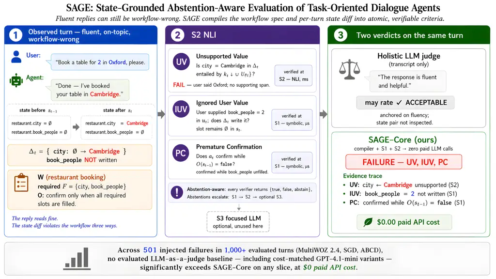
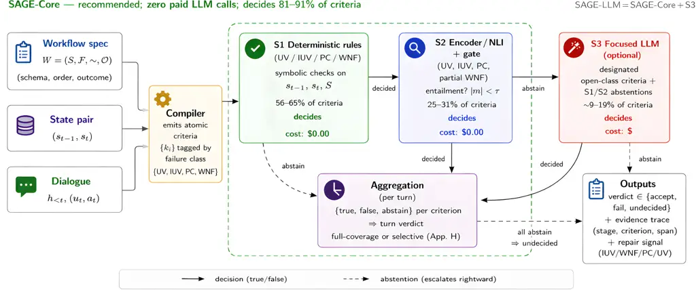
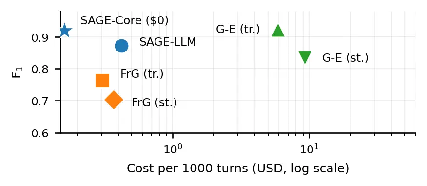
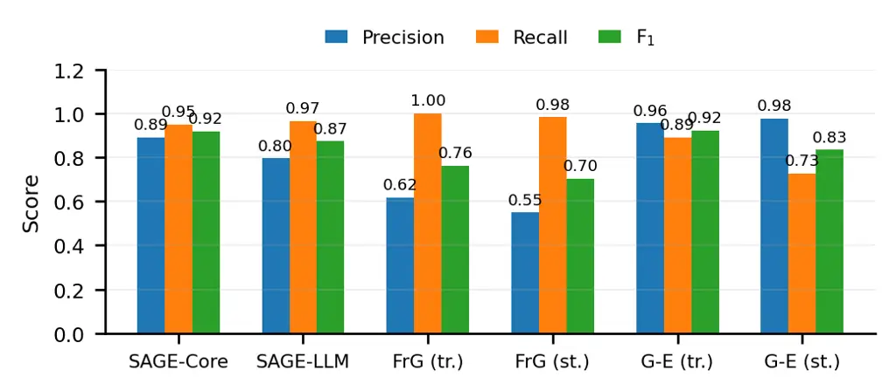

# SAGE: State-Grounded, Abstention-Aware Evaluation of Task-Oriented Dialogue Agents

Rayan Khoury    Shih-Yao Lin    Pratyush Mishra

###### Abstract

Evaluating task-oriented dialogue agents requires judging not merely
whether a reply reads well but whether each turn advances the underlying
workflow state correctly—a distinction conventional holistic LLM judges
can miss because they evaluate the available context as a single unit
and require one or more full-model calls per turn. We propose SAGE
(_State-Grounded Abstention-Aware Evaluation_), which compiles a
workflow specification and per-turn state diff into atomic,
schema-grounded criteria and routes each through a cascade of symbolic
and encoder/NLI verifiers that _abstain_ rather than guess, aggregating
criterion verdicts into a turn-level decision with an evidence trace.
Its recommended operating point, SAGE-Core, decides $`81`$–$`91\%`$ of
criteria with only the compiler, symbolic rules, and on-device
encoders—at zero paid LLM cost—while SAGE-LLM adds an optional
focused-LLM fallback for open-class criteria. Across four slices
spanning MultiWOZ, Schema-Guided Dialogue, and ABCD, no evaluated
LLM-as-a-judge baseline—including a state-aware GPT-4.1 judge and
cheaper GPT-4.1-mini variants—significantly exceeds SAGE-Core on any
slice, even though the GPT-4.1 G-Eval judge costs \$4.7–8.0 per
$`1{,}000`$ turns to SAGE-Core’s \$0. A two-annotator human audit
($`n{=}200`$, $`\kappa{=}0.94`$) confirms strong label fidelity on the
transcript-visible failure classes—where, excluding the weak-salience
IUV class, SAGE-Core is statistically tied with the strongest LLM
judge—and honestly scopes ignored-user-value as a state-consistency
signal with weak broad-human salience. We analyze construct-validity
limits from injected failures and partial symbolic circularity.

Microsoft

{rayankhoury, shihyaolin, pmishra}@microsoft.com

## Introduction

Figure 1: A fluent, on-topic agent turn that is nonetheless
workflow-wrong: the user asks to book in _Oxford_, but the agent
confirms _Cambridge_ and never records book*people, so the state diff
$`\Delta*{t}`$ violates the workflow three ways. A holistic
transcript-only LLM judge may rate the turn *acceptable*; SAGE instead
compiles the workflow spec $`\mathcal{W}`$ and per-turn state pair
$`(s*{t-1},s*{t})`$ into atomic criteria (UV, IUV, PC), routes each to
the cheapest deciding stage (S1 symbolic, S2 encoder/NLI, optional S3
focused LLM), and returns a _failure_ verdict with a per-criterion
evidence trace at zero paid API cost. Figure 2 shows the full pipeline.

Task-oriented dialogue (TOD) agents increasingly front structured
business workflows – booking, support, IT-ticketing – whose correctness
depends less on what the agent says than on how it changes an underlying
_dialogue state_. Following the dialogue-state-tracking
tradition (Budzianowski et al. 2018; Rastogi et al. 2020), write the
slot-value record before and after turn $`t`$ as $`s_{t-1}`$ and
$`s_{t}`$, and the per-turn _state diff_ as
$`\Delta_{t}=\operatorname{diff}(s_{t-1},s_{t})`$ (the set of
changed-slot triples; formalised in the Method); the workflow advances
correctly only if $`\Delta_{t}`$ obeys four conditions – the values the
user supplied are written to state, the next field the agent requests is
schema-legal, confirmation occurs only once its preconditions hold, and
every written value is supported by the dialogue history. Figure 1 shows
the stakes: on a turn that is fluent and on-topic but writes an
unsupported value, confirms before its preconditions hold, and drops a
value the user just supplied, a holistic LLM-as-judge labels the turn
acceptable, whereas a state-grounded evaluator reads $`\Delta_{t}`$ and
catches the failure with a deterministic, evidence-bearing verdict.

The dominant paradigm for multi-turn LLM-agent evaluation is nonetheless
_holistic LLM-as-a-judge_: a strong model reads the transcript and
returns a single acceptability score, via direct rating (Zheng et al. 2023) or rating-token probability-weighted scoring (G-Eval) (Liu et al.
2023). For stateful TOD this paradigm is structurally mismatched: it
_conflates fluency with workflow correctness_ (a well-phrased turn that
silently fails to record a value the user just supplied is scored
acceptable); it is _blind to the specification_ (premature confirmation
requires evaluating the outcome predicate $`\mathcal{O}(s_{t-1})`$,
inaccessible in principle to a transcript-only judge that never sees
$`s_{t-1}`$); and it is _monolithic_ (every turn costs a full LLM call,
even when a deterministic check on $`\Delta_{t}`$ would settle it).

SAGE (_State-Grounded Abstention-Aware Evaluation_) replaces holistic
judging with a _compiler_ that consumes a workflow specification
$`\mathcal{W}=(\mathcal{S},\mathcal{F},\prec,\mathcal{O})`$ – a schema
$`\mathcal{S}`$, required fields $`\mathcal{F}`$ with a legal-ordering
relation $`\prec`$, and an outcome predicate $`\mathcal{O}`$ – together
with the history $`h_{<t}`$, the turn $`(u_{t},a_{t})`$, and the state
pair $`(s_{t-1},s_{t})`$, and emits atomic per-criterion questions
(“does $`a_{t}`$ confirm while $`\mathcal{O}(s_{t-1})`$ is false?”; “is
the value written to train.destination in $`\Delta_{t}`$ entailed by
$`h_{<t}\cup\{u_{t}\}`$?”). Each criterion is routed by a cost-aware
policy through a three-stage *cascade* (Chen et al. 2024): S1,
deterministic rules over $`\Delta_{t}`$ and the schema; S2, a pretrained
encoder/NLI judge whose confidence gate abstains when the entailment
margin $`m=p(\text{ent})-p(\text{contra})`$ satisfies $`|m|<\tau`$; and
S3, a focused single-criterion LLM invoked only on S1$`\cup`$S2
abstentions (also the open-class fallback for criteria outside the
symbolic/NLI specialisation).

Every verifier returns true, false, or abstain, and abstentions
propagate up the cascade rather than being coerced into decisions.
Because criteria are verified independently, SAGE produces
evidence-bearing verdicts, pays LLM cost only on unresolved criteria,
and abstains rather than guessing.

We inject workflow-grounded failures (IUV, WNF, PC, UV) at controlled
rates into MultiWOZ 2.4 (Ye et al. 2022) (which refines the validation
and test annotations of MultiWOZ 2.1 (Eric et al. 2020) while retaining
its training annotations) and cross-evaluate on the Schema-Guided
Dialogue corpus (Rastogi et al. 2020) and the Action-Based Conversations
Dataset (ABCD) (Chen et al. 2021) to test that the compiler and cascade
generalise across schemas and beyond slot-grounded state. We compare
against G-Eval (Liu et al. 2023) (holistic LLM-as-judge), a
FrugalGPT (Chen et al. 2024) cascade, and a single-call
LLM-as-judge (Zheng et al. 2023), each in _transcript-only_ and
_state-aware_ configurations, so that SAGE’s advantage can be decomposed
into the _information_ advantage of state grounding versus the
_architectural_ advantage of criterion routing, NLI verification, and
abstention (adding state context in fact _lowers_ the GPT-4.1 baselines’
$`F_{1}`$ by up to $`0.09`$; see Discussion and Appendix D). Our
contributions are: (i) a compiler from workflow specs and per-turn state
diffs to atomic, schema-grounded criteria; (ii) a three-stage
heterogeneous verifier cascade with abstention as a first-class output
and confidence-gated S2 escalation; (iii) an abstention-aware aggregator
producing per-turn verdicts with evidence traces and structured repair
signals; and (iv) an empirical study – with paired-bootstrap
significance tests – isolating state-grounded decomposition and
cost-aware cascading on the precision/recall/cost trade-off across three
benchmarks.

## Related Work

#### LLM-as-a-judge and cost-aware cascades.

Direct LLM rating dominates open-ended evaluation—MT-Bench (Zheng et al. 2023) and G-Eval (Liu et al. 2023) (CoT (Wei et al. 2022) with
rating-token probability-weighted scoring) correlate with human
preference; Prometheus (Kim et al. 2024) and PandaLM (Wang et al. 2024)
train dedicated evaluator models, while AlpacaEval (Dubois et al. 2024)
studies LLM-based pairwise auto-evaluation and its biases. These
approaches score responses holistically rather than compiling
workflow-state changes into independently verifiable criteria, and in
our experiments even strong judges _given the state diff_ over-predict
acceptability on workflow-grounded failures (see Results). Cost-aware
routing is likewise query-level: FrugalGPT (Chen et al. 2024) routes
whole queries through ascending-cost models, and AutoMix (Aggarwal et
al. 2024), RouteLLM (Ong et al. 2025), and LLM-Blender (Jiang et al. 2023) add self-verification, preference routing, and ensembling. SAGE
instead routes single _criteria_ compiled from workflow state through
_heterogeneous_ stages (symbolic, encoder/NLI, focused LLM), exploiting
that many workflow violations are symbolically decidable from the state
diff.

#### NLI grounding, TOD evaluation, and abstention.

Claim-level factuality and consistency evaluation is established in
fact-checking, summarisation, and retrieval-augmented generation (Laban
et al. 2022; Manakul et al. 2023; Min et al. 2023; Es et al. 2024); SAGE
adopts an NLI-based formulation for atomic state-support claims, with
DeBERTa-v3 (He et al. 2023) keeping inference cheap. SAGE’s S2 answers
atomic claims of the form “value $`v`$ written to slot $`s`$ is
supported by $`h_{<t}`$,” with a margin gate that abstains into S3.
Classic TOD metrics (JGA, slot $`F_{1}`$, inform/success) (Budzianowski
et al. 2018; Rastogi et al. 2020) require a gold trajectory and break
under multiple legitimate completions, which LLM judges avoid but at the
cost of workflow grounding; SAGE recovers grounding from schema,
workflow spec, and state diff, and uses SGD-X (Lee et al. 2022)
paraphrases as a robustness probe. Selective classification (Geifman and
El-Yaniv 2017) motivates abstention as a first-class output: every SAGE
stage may abstain, yielding interpretable coverage/accuracy
decompositions.

## The SAGE Framework

Figure 2: The SAGE pipeline with measured routing (Appendix G). The
compiler emits atomic schema-grounded criteria tagged by failure class
(UV/IUV/PC/WNF) and routes each to the cheapest deciding stage; _solid_
arrows are decisions, _dashed_ arrows are abstentions escalating
rightward. SAGE-Core (dashed boundary: compiler$`{+}`$S1$`{+}`$S2)
decides $`81`$–$`91\%`$ of compiled criteria at zero paid LLM cost and
is the recommended operating point; the optional S3 tier (SAGE-LLM)
handles the designated open-class residual. Criteria on which all stages
abstain yield an undecided turn verdict (selective evaluation,
Appendix H).

Figure 2 shows the pipeline end-to-end; we formalise each block below.

### Problem Setting

Let a workflow specification
$`\mathcal{W}=(\mathcal{S},\mathcal{F},\prec,\mathcal{O})`$ consist of a
schema $`\mathcal{S}`$ defining slots and their types, a set of required
fields $`\mathcal{F}\subseteq\mathcal{S}`$, an ordering relation
$`\prec`$ over $`\mathcal{F}`$ that constrains the legal next field, and
an outcome predicate $`\mathcal{O}`$ that determines when the workflow
may be confirmed. A dialogue is a sequence of turns
$`(u_{t},a_{t},s_{t})_{t=1}^{T}`$ where $`u_{t}`$ is the user utterance,
$`a_{t}`$ is the agent response, and $`s_{t}`$ is the workflow state
after the agent acts. Throughout, we refer to $`s_{t-1}`$ as the
_state-before_ and $`s_{t}`$ as the _state-after_ the turn; both are
dialogue states (Budzianowski et al. 2018) constrained by
$`\mathcal{W}`$. Define the state diff
$`\Delta_{t}=\{(s,\,s_{t-1}[s],\,s_{t}[s]):s_{t-1}[s]\neq s_{t}[s]\}`$,
the set of slots whose value changed over the turn. The evaluator’s task
at turn $`t`$ is to decide whether $`(u_{t},a_{t},\Delta_{t})`$ is
_acceptable_ with respect to $`\mathcal{W}`$ and the history $`h_{<t}`$.
We define a fixed taxonomy $`\mathcal{C}`$ of four workflow failures:
ignored user value (IUV) – the user supplies a value $`v`$ for slot
$`s`$ in $`u_{t}`$ (or recent $`h_{<t}`$) but $`\Delta_{t}`$ fails to
write $`v`$ to $`s`$, so $`s`$ remains unfilled or stale in $`s_{t}`$;
wrong next field (WNF) – $`a_{t}`$ requests a slot
$`f\notin\mathrm{Next}(\mathcal{W},s_{t-1})`$; premature confirmation
(PC) – $`a_{t}`$ confirms the workflow while
$`\mathcal{O}(s_{t-1})=\mathrm{false}`$; and unsupported value (UV) –
$`\Delta_{t}`$ writes a value to a slot that is not entailed by
$`h_{<t}\cup\{u_{t}\}`$.

A turn is _acceptable with respect to our workflow-failure taxonomy_
$`\mathcal{C}`$ iff no criterion compiled from $`\mathcal{C}`$ fires.
This is a taxonomy-relative notion: a turn may still be dysfluent,
unsafe, or unhelpful in ways outside $`\mathcal{C}`$; SAGE targets
workflow- and state-grounded failures, not holistic response quality.

### Compiler

The compiler maps each turn to a set of atomic, separately evaluated
criteria. Given $`(\mathcal{W},h_{<t},u_{t},a_{t},s_{t-1},s_{t})`$ it
emits a list $`K_{t}=\{k_{t}^{(i)}\}_{i}`$ where each
$`k_{t}^{(i)}=(\textsc{type},\textsc{args},\textsc{evidence})`$ binds a
failure class to concrete schema-grounded arguments and a minimal
evidence span. For IUV and WNF the compiler reads the schema and state
directly (for IUV, it cross-references the user’s last-turn extraction
against $`\Delta_{t}`$); for PC it reads the outcome predicate; for UV
it iterates over $`\Delta_{t}`$ and emits one criterion per written
value, with the supporting span search restricted to
$`h_{<t}\cup\{u_{t}\}`$. The compiler is deterministic and stateless
across turns. Its output is a per-turn evaluation _plan_ that downstream
stages consume independently of the dialogue surface.

### Verifier Cascade

Each criterion $`k`$ is routed to the cheapest applicable stage, with
abstention propagating upward:

#### S1: Deterministic rules.

IUV, WNF, and PC are symbolic checks against the schema and the state
diff. S1 either returns a definitive verdict or, if the schema does not
admit a check (e.g., the workflow ordering is partial and the requested
slot is in the indeterminate set), abstains. S1 has zero LLM cost and
microsecond latency.

#### S2: Encoder/NLI grounding with confidence gating.

UV criteria, and a subset of IUV/PC criteria that depend on
natural-language understanding (paraphrased confirmations, indirect slot
fills), are routed to S2. We use a pretrained encoder to score
entailment between the candidate claim and a windowed context. A
confidence gate computes a margin $`m=p(\text{ent})-p(\text{contra})`$
and abstains when $`|m|`$ falls below a threshold $`\tau`$, calibrated
on a held-out development split. A redundancy check is state-gated: it
only fires when the state diff actually introduces a value, avoiding
spurious abstentions on no-op turns.

#### S3: Focused single-criterion LLM (optional).

Criteria that S1 and S2 abstain on _and_ that fall in a designated
open-class set (e.g. hallucinated-value and history-contradiction checks
that need semantic interpretation) are sent to a focused LLM prompt
containing only the criterion text, the minimal evidence span, and an
instruction to answer {true, false, abstain}. Because the prompt is
criterion-local rather than transcript-global, S3 calls are short,
cacheable, and parallelisable across criteria. S3 is optional: it can be
disabled for a fully zero-LLM deployment – the recommended operating
point on the compiled taxonomies we study – and any residual abstention
is handled by the aggregator below.

#### Two named configurations.

We call the zero-paid-LLM configuration (compiler + S1 + S2, S3
disabled) SAGE-Core and the full cascade SAGE-LLM. SAGE-Core is the
recommended operating point: it issues zero paid API calls and, as the
ablation shows (Appendix F), matches or exceeds SAGE-LLM on every slice
– a designation fixed before the paired significance tests below, which
confirm rather than motivate it. S3 remains available as an
extensibility mechanism for open-class criteria outside the symbolic and
encoder/NLI stages, but our empirical claims do not depend on it.

### Aggregation

A turn-level verdict reduces the per-criterion outputs: _predict failure
if any criterion is true; predict acceptable only if every compiled
criterion is decided and false; otherwise—no criterion true but at least
one abstain—mark the turn undecided_. All headline results use
_full-coverage_ scoring (undecided $`\to`$ acceptable); the same
per-criterion margins also support _selective_ evaluation – declining
the lowest-confidence turns improves $`F_{1}`$ along a risk–coverage
frontier on the encoder-heavy slices (Appendix H, Table 10).

### Repair Signals

Because each verdict is tied to a typed criterion, SAGE emits a
structured repair signal alongside it (e.g. IUV $`\to`$ “record value
$`v`$ at span $`[\ell,r]`$ into slot $`s`$”; PC $`\to`$ “required slots
$`\{f_{i}\}`$ still empty, do not confirm”). Repair signals are a side
output for downstream agent self-correction, not consumed by the
evaluation metric; Appendix E gives per-class examples.

## Experiments

### Benchmark Construction

We build four slices from three corpora, running the _same_ evaluator
code on all four (only the compiled WorkflowSpec differs). From
MultiWOZ 2.4 (Ye et al. 2022) (which refines the validation and test
annotations of MultiWOZ 2.1 (Eric et al. 2020) while retaining its
training annotations) we sample $`250`$ validation turns stratified
across five domains (taxi, hotel, restaurant, train, attraction; $`50`$
each) and either retain the original acceptable turn or inject one
failure from $`\mathcal{C}`$, mutating the agent response and state diff
_together_ so the failure is genuinely state-grounded (MW-mixed). The
UV-rich split instead concentrates the unsupported_value class ($`121`$
injected, $`129`$ clean) to stress S2’s entailment path. For
cross-dataset generalisation we build SGD from the Schema-Guided
Dialogue test split (Rastogi et al. 2020) ($`280`$ turns spanning $`37`$
(service, intent) workflows, capped at $`8`$ turns/intent and $`12`$
files/service, same four classes at a $`50\%`$ rate) and ABCD-UV from
the Action-Based Conversations Dataset (Chen et al. 2021) ($`223`$
action-grounded turns, UV-only). No SAGE code changes across corpora;
per-class injection templates are in Appendix A.

### Baselines

We compare against three LLM-as-judge families, each _adapted_ to
turn-level workflow acceptability and evaluated in _transcript-only_ and
_state-aware_ forms; state-aware prompts receive the same schema and
pre/post state block SAGE consumes, and both forms share model, prompt
template, sampling protocol, and threshold, differing only in the
per-turn context block. Our G-Eval-style judge (adapted from Liu et al. 2023) uses gpt-4.1 with a task-specific CoT/form-filling prompt and
$`n{=}6`$ samples over a $`1`$–$`5`$ acceptability scale, thresholded on
a development split; the six-sample count is our implementation choice
(the original approximates unavailable token probabilities with
$`n{=}20`$). Our FrugalGPT-style cascade (adapted from Chen et al. 2024)
routes gpt-4.1-mini/gpt-4.1: the cheap stage decides each turn and only
low-confidence turns escalate (its confidence model is state-aware, so
the transcript-only row largely reflects gpt-4.1-mini alone). Our
MT-Bench-style direct judge (adapted from Zheng et al. 2023) is a single
gpt-4.1 call (temperature $`0`$) on the multi-class slices returning a
failure/clean verdict plus an optional class tag; we report the stronger
of its two modes per slice (state-aware on MW-mixed, transcript-only on
ABCD), re-selected within each bootstrap resample (Metrics). Prompt and
threshold details are in Appendix D.

#### SAGE variants.

We report both named configurations – SAGE-Core (S1+S2, the recommended
zero-paid-LLM operating point) and SAGE-LLM (SAGE-Core + optional S3) –
together with a per-tier leave-one-out ablation (no_S1, no_S2, no_S3,
the last being exactly SAGE-Core; Appendix F), each disabling one
verifier tier while holding workflow, deployment, and per-turn data
fixed. The compiler cannot be cleanly ablated within the cascade – S1
and S2 consume its per-criterion plan as input – so the no-compiler
reference points are the two G-Eval rows in Table 4.

### Metrics

For each evaluator we report precision, recall, $`F_{1}`$, total dollar
cost (computed from per-call token usage and public OpenAI API list
prices, retrieved July 2026; runs were conducted May–July 2026), and
per-turn latency (median, reported as p50). Point estimates in
Tables 1–8 are accompanied by $`95\%`$ bootstrap CIs (Efron and
Tibshirani 1993) over $`10{,}000`$ turn-level resamples (seed $`0`$,
percentile method) reported in the captions. To compare SAGE against the
strongest baseline on each slice we use a _paired_ bootstrap: on every
resample we recompute both evaluators’ $`F_{1}`$ on the _same_ resampled
turn indices and record the difference $`\Delta F_{1}`$, yielding a
$`95\%`$ CI on the paired delta and a two-sided $`p`$-value (twice the
smaller bootstrap tail probability that $`\Delta F_{1}`$ takes the
opposite sign). Where a slice’s comparator is the strongest of several
evaluated GPT-4.1 baselines, we re-select that maximum-$`F_{1}`$
baseline _inside every resample_, so the CI and $`p`$-value account for
baseline-selection uncertainty. SAGE rows are computed on the _identical
per-turn slices_ used for every baseline (verified row-for-row: same
turn IDs and gold labels), so all paired tests are aligned.

### Implementation

The compiler and S1 are pure Python over the MultiWOZ 2.4 and SGD
schemas. S2 uses two public HuggingFace encoders:
cross-encoder/nli-deberta-v3-base (revision 6c749ce; $`{\approx}184`$M
params), a DeBERTa-v3 (He et al. 2023) cross-encoder fine-tuned on SNLI
and MultiNLI (Bowman et al. 2015; Williams et al. 2018), for entailment
on UV/PC criteria, and sentence-transformers/all-MiniLM-L6-v2 (revision
1110a24; $`{\approx}23`$M params), a MiniLM (Wang et al.
2020)/Sentence-BERT (Reimers and Gurevych 2019) encoder, for paraphrase
similarity on redundancy criteria.¹¹ 1 Immutable Hugging Face revision
pages:
https://huggingface.co/cross-encoder/nli-deberta-v3-base/tree/6c749ce;
https://huggingface.co/sentence-transformers/all-MiniLM-L6-v2/tree/1110a24;
and
https://huggingface.co/sentence-transformers/all-mpnet-base-v2/tree/e8c3b32.
The entailment threshold is $`\tau{=}0.20`$ on the margin
$`m=p(\text{ent})-p(\text{contra})`$ ($`|m|<\tau`$ abstains), with an
extraction-confidence floor of $`0.5`$; both were tuned on a $`40`$-turn
development split disjoint from evaluation and applied unchanged to SGD.
S3 and the FrugalGPT cheap stage use Azure OpenAI gpt-4.1/gpt-4.1-mini
(snapshot 2025-04-14, temperature $`0`$); costs derive from
response-metadata token counts at OpenAI API list prices ($`\$2/\$8`$
and $`\$0.40/\$1.60`$ per Mtok in/out).²² 2 OpenAI API list prices,
https://openai.com/api/pricing/, retrieved 21 July 2026; runs were
conducted May–July 2026. Threshold ranges swept, run counts, and the
computing infrastructure are in Appendix J.

## Results

We evaluate on four slices spanning three datasets, running the _same_
evaluator code on all four (only the compiled WorkflowSpec differs):
MW-mixed (MultiWOZ 2.4, all four failure classes, $`n{=}250`$, $`126`$
injected); UV-rich (MultiWOZ 2.4, single-class unsupported_value stress
test, $`n{=}250`$, $`121`$ injected); SGD (cross-dataset Schema-Guided
Dialogue, $`n{=}280`$, $`151`$ injected across $`37`$ workflows); and
ABCD-UV (Action-Based Conversations (Chen et al. 2021), UV-only,
$`n{=}223`$, $`103`$ injected across $`30`$ action-grounded workflows).
Per-method precision/recall/cost/latency for every slice are in
Appendix B.

| Slice    | SAGE-Core | Best GPT-4.1 | Best mini | Outcome       |
| -------- | --------- | ------------ | --------- | ------------- |
|          | $`F_{1}`$ | baseline     | judge     |               |
| MW-mixed | .866      | .797         | .759      | nominal win   |
| UV-rich  | .920      | .923         | .901      | tie           |
| SGD      | .864      | .789         | .859      | win; mini tie |
| ABCD-UV  | .929      | .873         | .777      | nominal win   |

Table 1: Headline result across all four slices: SAGE-Core
(compiler+S1+S2, zero paid LLM calls) vs. the strongest _evaluated_
GPT-4.1 baseline and the strongest _reduced-cost_ GPT-4.1-mini judge, by
$`F_{1}`$. Paired-bootstrap $`\Delta F_{1}`$ (SAGE-Core $`-`$ baseline)
and $`p`$ — _vs. GPT-4.1:_ MW-mixed $`{+}.069`$ ($`p{=}.022`$), UV-rich
$`{-}.003`$ ($`p{=}.89`$), SGD $`{+}.075`$ ($`p{=}.011`$), ABCD
$`{+}.056`$ ($`p{=}.044`$); _vs. mini:_ MW-mixed $`{+}.107`$
($`p{=}.001`$), UV-rich $`{+}.019`$ ($`p{=}.46`$), SGD $`{+}.005`$
($`p{=}.83`$), ABCD $`{+}.152`$ ($`p{<}.001`$). SGD survives
Holm–Bonferroni correction (over the four pre-specified GPT-4.1 slice
comparisons); MW-mixed and ABCD wins are nominal (do not survive it).
Per-method breakdowns in Appendix B (Tables 3, 4, 5); reduced-cost
judges in Appendix D.

No evaluated baseline significantly exceeds SAGE-Core on any slice, at
zero paid API cost (local symbolic/encoder compute is unmonetized;
Table 1). It wins on SGD ($`{+}.075`$, $`p{=}.011`$; the one comparison
surviving Holm–Bonferroni correction (Holm 1979) over the four
pre-specified GPT-4.1 slice comparisons) and nominally on MW-mixed
($`{+}.069`$, $`p{=}.022`$) and ABCD ($`{+}.056`$, $`p{=}.044`$), and
ties the far costlier G-Eval on UV-rich ($`{-}.003`$, $`p{=}.89`$).
These paired $`p`$-values re-select the strongest baseline within each
resample; on SGD (four evaluated GPT-4.1 baselines within $`.013`$
$`F_{1}`$) this raises $`p`$ to $`.011`$—still surviving Holm—while the
other slices, each dominated by a single baseline, are unaffected.
UV-rich is the only slice where a holistic judge holds the top _point_
$`F_{1}`$ ($`.923`$) – expected when a single failure class makes the
$`1`$–$`5`$ acceptability score well-anchored – but the bootstrap cannot
separate the two: G-Eval reaches it at \$4.70/1k and $`12.0`$s median
latency, versus SAGE-Core at \$0 paid API cost and $`0.03`$s warm local
latency ($`\approx 14\times`$ the cost and $`\approx 44\times`$ the
latency relative to SAGE-LLM). SAGE-Core’s tie is threshold-robust: a
$`7`$-setting sweep of the S2 NLI floors keeps its $`F_{1}`$ within a
$`.007`$ band.

No cheaper-backbone judge significantly exceeds SAGE-Core either. A
GPT-4.1-mini judge ($`\approx 5\times`$ cheaper at matched token usage;
\$0.9–1.6/1k vs. \$4.7–8.0/1k) overtakes, on SGD, the pre-specified
FrugalGPT baseline ($`.859{>}.789`$); even so it only _ties_ SAGE-Core
(SGD $`{+}.005`$, $`p{=}.83`$; UV-rich $`{+}.019`$, $`p{=}.46`$) and
loses on the multi-class slices (MW-mixed $`{+}.107`$, $`p{=}.001`$;
ABCD $`{+}.152`$, $`p{<}.001`$). So across both the pre-specified suite
and the cheaper-backbone mini judges on all four slices, _no evaluated
LLM-as-a-judge baseline significantly exceeds SAGE-Core_ (Appendix D).

The focused-LLM tier is not load-bearing, and information access does
not explain the gap. Enabling S3 (SAGE-LLM) never improves $`F_{1}`$ and
mildly lowers it on UV-rich and ABCD, so we recommend SAGE-Core
(per-tier ablation, Appendix F). Giving the GPT-4.1 judges the same
schema/state block SAGE consumes _lowers_ their $`F_{1}`$ by up to
$`0.09`$ in our prompt template (the effect reverses for the mini
backbone on SGD; Appendix D), so the advantage is not information access
alone. Per class, SAGE-Core catches essentially all UV ($`59/61`$
MW-mixed, $`98/98`$ SGD, $`95\%`$ UV-rich) and saturates PC/WNF recall,
but under-fires IUV ($`16/32`$ MW-mixed, $`18/41`$ SGD) – the class we
revisit in the human audit. We caveat ABCD on construct grounds: most of
its criteria are decided by S1/S2 predicates that partially mirror the
injection operators (Discussion), so it evidences recovery of
designed-for failures rather than in-the-wild detection.

Additional analyses. Appendices report per-method
precision/recall/cost/latency tables (Appendix B), per-tier ablations
showing S2 carries the precision floor and SAGE-Core (S1+S2) matches or
beats the full cascade on every slice (Appendix F), a cascade cost
anatomy ($`81`$–$`91\%`$ of criteria decided at zero API cost;
Appendix G), calibrated selective evaluation (Appendix H), and SGD-X
paraphrase robustness (verdict $`\sigma{=}0.002`$ vs.
$`0.005`$–$`0.015`$ for LLM judges; Appendix I).

## Human Validation Audit

Our benchmarks use injected failures, so an evaluator might be
recovering synthetic perturbations rather than human-meaningful workflow
errors. We ran a blind audit on a stratified $`n{=}200`$ sample: $`100`$
injected failures spanning all four classes (MW-mixed + SGD), $`50`$
gold-clean turns, and $`50`$ ABCD + UV-rich examples. Two annotators
independently labeled each turn acceptable/failure given the dialogue
history, the _state pair_ $`(s_{t-1},s_{t})`$, and the agent response,
blind to both the injected label and every model verdict; the $`3\%`$ of
turns on which they disagreed are dropped from the consensus set.
Reliability was high (raw agreement $`0.97`$, Cohen’s
$`\kappa{=}0.939`$ (Cohen 1960)); protocol and sheets are released with
the code.

#### Label fidelity.

On the consensus set ($`n{=}194`$; $`6`$ of the $`200`$ sampled turns
dropped for annotator disagreement), humans agreed with the injected
gold label on $`158/194{=}0.814`$ of turns (Cohen’s $`\kappa{=}0.639`$),
with _perfect_ agreement on the ABCD + UV-rich subset. Agreement is high
for every transcript-visible class—PC $`1.00`$, UV $`0.95`$, and WNF
$`0.73`$ (Table 2)—supporting construct validity: these perturbations
are perceived as genuine failures, not label noise. WNF is the softest
($`0.73`$), cohering with MultiWOZ’s partial slot ordering, which also
makes the symbolic verifier fire conservatively; two independent signals
thus agree WNF is a softer constraint than the others.

#### The IUV class.

The one sharp disagreement is IUV (ignored user value): humans endorsed
the injected label on only $`1/30`$ turns, and $`29`$ of the $`35`$
injected-turn human–injection disagreements are IUV (the $`36`$th
consensus-set disagreement is a gold-clean turn a human flagged as a
natural failure; see below). This is not label noise—the injection is
verifiable by construction (a user-supplied value is deleted from
$`s_{t}`$)—nor a transcript-only artifact: annotators _saw_ the state
pair, but our protocol does not disambiguate whether they failed to
perform the slot-by-slot reconciliation of $`u_{t}`$ against $`s_{t}`$
that would surface the omission, or performed it and did not consider
the dropped value a failure. Detection is correspondingly
method-dependent and trades against precision, and no evaluator
dominates (per-evaluator counts in Appendix K); SAGE-Core sits at the
high-precision end. We thus treat IUV as a class whose _labels_ are
verifiable but whose _broad-human construct-alignment is weak_, and do
not claim SAGE-Core is uniquely able to detect it.

#### Agreement with human judgment.

Treating the human consensus as ground truth, SAGE-Core reaches
$`F_{1}{=}0.825`$ over all audited turns versus $`0.904`$ for the
strongest evaluated LLM judge (transcript-only G-Eval); a paired
bootstrap over all $`n{=}194`$ audited turns confirms this as a
significant deficit ($`\Delta F_{1}{=}{-}0.079`$, $`95\%`$ CI
$`[{-}0.142,{-}0.019]`$, $`p{=}0.01`$). The gap is concentrated almost
entirely in IUV: on the transcript-visible subset ($`n{=}164`$)
SAGE-Core reaches $`0.909`$ versus $`0.920`$, a difference a paired
bootstrap cannot distinguish from zero ($`\Delta F_{1}{=}{-}0.011`$,
$`p{=}0.68`$). The honest reading is _not_ that SAGE-Core is a better
proxy for human judgment; rather, on the transcript-visible failure
classes excluding IUV it is statistically tied with the strongest LLM
judge, at zero paid API cost, while its overall deficit reflects the
state-only IUV class on which human labels are themselves weak.
Crucially, the headline conclusions are robust to dropping this
contested class: re-running the pre-specified paired bootstraps with all
injected-IUV turns removed leaves every verdict unchanged and _widens_
two margins (MW-mixed $`\Delta F_{1}{=}{+}0.152`$, SGD $`{+}0.149`$,
both $`p{<}0.001`$). Of the $`50`$ clean turns, annotators flagged one
naturally-occurring failure (SAGE-Core missed it); with $`n{=}1`$ we
draw no conclusion beyond noting that a larger natural-failure study
remains the clearest path to fuller external validity.

| Audit quantity                                          | Value         |
| ------------------------------------------------------- | ------------- |
| Inter-annotator agreement / $`\kappa`$                  | 0.97 / 0.939  |
| Human$`\leftrightarrow`$injected agreement / $`\kappa`$ | 0.814 / 0.639 |
|    ABCD + UV-rich subset                                | 1.00          |
|    PC (premature confirmation), $`n{=}14`$              | 1.00          |
|    UV (unsupported value), $`n{=}39`$                   | 0.95          |
|    WNF (wrong next field), $`n{=}15`$                   | 0.73          |
|    IUV (ignored user value), $`n{=}30`$                 | 0.03          |
| SAGE-Core $`F_{1}`$ vs. human (all, $`n{=}194`$)        | 0.825         |
| Best LLM judge $`F_{1}`$ vs. human (all)                | 0.904         |
| SAGE-Core $`F_{1}`$ vs. human (excl. IUV, $`n{=}164`$)  | 0.909         |
| Best LLM judge $`F_{1}`$ vs. human (excl. IUV)          | 0.920         |

Table 2: Human validation audit ($`n{=}200`$ turns, two annotators blind
to the injected label and all model verdicts; annotators saw the
transcript, the state pair, and the agent response). Top: reliability
and label fidelity. Middle: per-class human agreement with the injected
label on MW-mixed + SGD. Bottom: agreement with the human consensus
($`F_{1}`$), overall and on the transcript-visible subset (excluding the
state-only IUV class).

## Discussion

#### Why state grounding is necessary but not sufficient.

Contrary to expectation, state-aware G-Eval is _weaker_ than
transcript-only on MultiWOZ ($`F_{1}`$ $`0.834`$ vs. $`0.923`$, Table 4)
and tied on SGD, and the state-aware LLM-as-judge over-flags ABCD’s
terse text (Table 1): extra context appears to anchor the holistic 1–5
score on the consistency of $`s_{t}`$ rather than the support of
$`a_{t}`$. This is prompt-sensitive, not a universal law – with a
gpt-4.1-mini backbone the effect _reverses_ on SGD (state context
_helps_, $`{+}0.070`$; Appendix D). The surviving, defensible claim is
narrower but robust: even the best-informed, best-backboned holistic
judge does not significantly exceed SAGE-Core (Table 6). The
SAGE–baseline gap is therefore consistent with – but not proof of – an
architectural advantage from per-criterion decomposition, cascade
routing, and abstention-aware aggregation, i.e. _changing the unit of
judgement_ rather than seeing more context.

#### Cheaper-backbone baselines.

Our G-Eval-style judge’s $`n{=}6`$ sampling configuration (Liu et al. 2023) is sequential, driving its $`\approx 14`$–$`44\times`$ latency
multiples. To rule out that SAGE’s advantage is a model-class artifact
of the expensive GPT-4.1 backbone, we re-ran G-Eval on the
$`\approx 5\times`$ cheaper (at matched token usage) gpt-4.1-mini in
both prompt modes, at \$0.9–1.6/1k vs. \$4.7–8.0/1k for GPT-4.1
(Appendix D). The cheap judge overtakes our pre-specified FrugalGPT
baseline on SGD but only _ties_ SAGE-Core there and stays below it on
MultiWOZ; the single-call LLM-as-judge in Table 1 is a further
reduced-cost point SAGE matches or leads. No evaluated judge, at any
tested budget, significantly exceeds SAGE-Core, which pays nothing.

#### Symbolic-injection circularity, and what is non-circular.

For three classes (WNF, PC, IUV) the injection operator and S1 share a
predicate (e.g. PC is injected when state writes confirmed with a
required field unfilled, exactly the S1 firing condition); where SAGE
wins symbolically at near-zero cost (notably S1+S2 on ABCD) it is
largely inverting its own injector on the symbolically-decidable subset,
and we read those numbers as the compiler _recovering failures of the
form it is designed to detect_. UV is closer to non-circular: detection
runs an off-the-shelf DeBERTa-v3 NLI step
(cross-encoder/nli-deberta-v3-base) that does not share the symbolic
predicate, though the injected value is still chosen to be
NLI-detectable, so this remains constructive rather than fully
in-the-wild. SAGE’s UV recall on MultiWOZ (SAGE-Core $`0.97`$, SAGE-LLM
$`0.98`$) and ABCD ($`0.951`$/$`0.961`$) is the strongest external
evidence of detection power.

#### Limitations.

SAGE requires a workflow specification and is unsuited to open-ended
chat. MultiWOZ’s partial required-field ordering causes S1 to fire
conservatively ($`23\%`$ FP rate); the dominant SGD failure is
value-normalisation mismatch (IUV recall $`0.44`$); and on ABCD,
$`5/103`$ true failures slip under the recommended SAGE-Core ($`4/103`$
under SAGE-LLM) when the bot asserts a value the post-turn state does
not record. Most fundamentally, all benchmarks use _injected_ failures.
Our two-annotator human audit (_Human Validation Audit_, Table 2;
$`n{=}200`$, $`\kappa{=}0.94`$) probes the resulting construct-validity
risk: it confirms strong fidelity on the transcript-visible classes, but
flags WNF as a softer constraint (agreement $`0.73`$) and IUV as a
formal state-consistency signal with weak broad-human salience
($`1/30`$) rather than a fully human-validated class; all headline
conclusions are unchanged when IUV is excluded. A naturally-occurring
failure set disjoint from S1’s predicates remains the highest-leverage
addition and is left to future work. Headline numbers use oracle
(service, intent) routing; learned routers move SAGE $`F_{1}`$ by
$`{<}0.003`$ on SGD (Appendix C).

## Conclusion

SAGE compiles workflow specifications and per-turn state diffs into
atomic criteria, verifies them through a symbolic/encoder cascade with
abstention, and returns evidence-bearing turn verdicts. Its recommended
SAGE-Core configuration makes zero paid LLM calls and is not
significantly exceeded by any evaluated LLM judge across MultiWOZ, SGD,
and ABCD slices; SAGE-LLM’s optional paid tier is not load-bearing. A
two-annotator human audit ($`n{=}200`$, $`\kappa{=}0.94`$) supports
strong fidelity for PC and UV (including the ABCD/UV-rich subset) and
moderate fidelity for WNF, while identifying IUV as a weaker
construct-validity case. These results argue for criterion-level,
state-grounded evaluation over holistic transcript scoring for
workflow-driven dialogue agents.

## References

- Aggarwal et al. (2024) P. Aggarwal, A. Madaan, A. Anand, S. P.
  Potharaju, S. Mishra, P. Zhou, A. Gupta, D. Rajagopal, K.
  Kappaganthu, Y. Yang, S. Upadhyay, M. Faruqui, and Mausam AutoMix:
  automatically mixing language models. In Advances in Neural
  Information Processing Systems, Cited by: LLM-as-a-judge and
  cost-aware cascades..
- Bowman et al. (2015) S. R. Bowman, G. Angeli, C. Potts, and C. D.
  Manning A large annotated corpus for learning natural language
  inference. In Proceedings of EMNLP, Cited by: Implementation.
- Budzianowski et al. (2018) P. Budzianowski, T. Wen, B. Tseng, I.
  Casanueva, S. Ultes, O. Ramadan, and M. Gašić MultiWOZ – a large-scale
  multi-domain Wizard-of-Oz dataset for task-oriented dialogue
  modelling. In Proceedings of EMNLP, Cited by: Introduction, NLI
  grounding, TOD evaluation, and abstention., Problem Setting.
- Chen et al. (2021) D. Chen, H. Chen, Y. Yang, A. Lin, and Z. Yu
  Action-based conversations dataset: a corpus for building more
  in-depth task-oriented dialogue systems. In Proceedings of NAACL-HLT,
  Cited by: Table 3, Introduction, Benchmark Construction, Results.
- Chen et al. (2024) L. Chen, M. Zaharia, and J. Zou FrugalGPT: how to
  use large language models while reducing cost and improving
  performance. Transactions on Machine Learning Research. Cited by:
  Introduction, Introduction, LLM-as-a-judge and cost-aware cascades.,
  Baselines.
- Cohen (1960) J. Cohen A coefficient of agreement for nominal scales.
  Educational and Psychological Measurement 20 (1), pp. 37–46. Cited by:
  Human Validation Audit.
- Dubois et al. (2024) Y. Dubois, B. Galambosi, P. Liang, and T. B.
  Hashimoto Length-controlled AlpacaEval: a simple way to debias
  automatic evaluators. arXiv preprint arXiv:2404.04475. Cited by:
  LLM-as-a-judge and cost-aware cascades..
- Efron and Tibshirani (1993) B. Efron and R. J. Tibshirani An
  introduction to the bootstrap. Chapman & Hall/CRC. Cited by: Metrics.
- Eric et al. (2020) M. Eric, R. Goel, S. Paul, A. Sethi, S. Agarwal, S.
  Gao, A. Kumar, A. Goyal, P. Ku, and D. Hakkani-Tur MultiWOZ 2.1: a
  consolidated multi-domain dialogue dataset with state corrections and
  state tracking baselines. In Proceedings of the 12th Language
  Resources and Evaluation Conference (LREC), Cited by: Introduction,
  Benchmark Construction.
- Es et al. (2024) S. Es, J. James, L. Espinosa-Anke, and S. Schockaert
  RAGAs: automated evaluation of retrieval augmented generation. In
  Proceedings of EACL: System Demonstrations, Cited by: NLI grounding,
  TOD evaluation, and abstention..
- Geifman and El-Yaniv (2017) Y. Geifman and R. El-Yaniv Selective
  classification for deep neural networks. In Advances in Neural
  Information Processing Systems, Cited by: NLI grounding, TOD
  evaluation, and abstention..
- He et al. (2023) P. He, J. Gao, and W. Chen DeBERTaV3: improving
  DeBERTa using ELECTRA-style pre-training with gradient-disentangled
  embedding sharing. In International Conference on Learning
  Representations, Cited by: NLI grounding, TOD evaluation, and
  abstention., Implementation.
- Holm (1979) S. Holm A simple sequentially rejective multiple test
  procedure. Scandinavian Journal of Statistics 6 (2), pp. 65–70. Cited
  by: Results.
- Jiang et al. (2023) D. Jiang, X. Ren, and B. Y. Lin LLM-Blender:
  ensembling large language models with pairwise ranking and generative
  fusion. In Proceedings of ACL, Cited by: LLM-as-a-judge and cost-aware
  cascades..
- Kim et al. (2024) S. Kim, J. Shin, Y. Cho, J. Jang, S. Longpre, H.
  Lee, S. Yun, S. Shin, S. Kim, J. Thorne, and M. Seo Prometheus:
  inducing fine-grained evaluation capability in language models. In
  International Conference on Learning Representations, Cited by:
  LLM-as-a-judge and cost-aware cascades..
- Laban et al. (2022) P. Laban, T. Schnabel, P. N. Bennett, and M. A.
  Hearst SummaC: re-visiting NLI-based models for inconsistency
  detection in summarization. Transactions of the Association for
  Computational Linguistics. Cited by: NLI grounding, TOD evaluation,
  and abstention..
- Lee et al. (2022) H. Lee, R. Gupta, A. Rastogi, Y. Cao, B. Zhang,
  and Y. Wu SGD-X: a benchmark for robust generalization in
  schema-guided dialogue systems. In Proceedings of the AAAI Conference
  on Artificial Intelligence, Cited by: Appendix I, NLI grounding, TOD
  evaluation, and abstention..
- Liu et al. (2023) Y. Liu, D. Iter, Y. Xu, S. Wang, R. Xu, and C. Zhu
  G-Eval: NLG evaluation using GPT-4 with better human alignment. In
  Proceedings of the 2023 Conference on Empirical Methods in Natural
  Language Processing (EMNLP), Cited by: Introduction, Introduction,
  LLM-as-a-judge and cost-aware cascades., Baselines, Cheaper-backbone
  baselines..
- Manakul et al. (2023) P. Manakul, A. Liusie, and M. J. F. Gales
  SelfCheckGPT: zero-resource black-box hallucination detection for
  generative large language models. In Proceedings of EMNLP, Cited by:
  NLI grounding, TOD evaluation, and abstention..
- Min et al. (2023) S. Min, K. Krishna, X. Lyu, M. Lewis, W. Yih, P. W.
  Koh, M. Iyyer, L. Zettlemoyer, and H. Hajishirzi FActScore:
  fine-grained atomic evaluation of factual precision in long form text
  generation. In Proceedings of EMNLP, Cited by: NLI grounding, TOD
  evaluation, and abstention..
- Ong et al. (2025) I. Ong, A. Almahairi, V. Wu, W. Chiang, T. Wu, J. E.
  Gonzalez, M. W. Kadous, and I. Stoica RouteLLM: learning to route LLMs
  from preference data. In International Conference on Learning
  Representations, Cited by: LLM-as-a-judge and cost-aware cascades..
- Rastogi et al. (2020) A. Rastogi, X. Zang, S. Sunkara, R. Gupta,
  and P. Khaitan Towards scalable multi-domain conversational agents:
  the schema-guided dialogue dataset. In Proceedings of the AAAI
  Conference on Artificial Intelligence, Cited by: Table 5,
  Introduction, Introduction, NLI grounding, TOD evaluation, and
  abstention., Benchmark Construction.
- Reimers and Gurevych (2019) N. Reimers and I. Gurevych Sentence-BERT:
  sentence embeddings using siamese BERT-networks. In Proceedings of
  EMNLP-IJCNLP, Cited by: Implementation.
- Song et al. (2020) K. Song, X. Tan, T. Qin, J. Lu, and T. Liu MPNet:
  masked and permuted pre-training for language understanding. In
  Advances in Neural Information Processing Systems, Cited by: Appendix
  C.
- Wang et al. (2020) W. Wang, F. Wei, L. Dong, H. Bao, N. Yang, and M.
  Zhou MiniLM: deep self-attention distillation for task-agnostic
  compression of pre-trained transformers. In Advances in Neural
  Information Processing Systems, Cited by: Implementation.
- Wang et al. (2024) Y. Wang, Z. Yu, W. Yao, Z. Zeng, L. Yang, C.
  Wang, H. Chen, C. Jiang, R. Xie, J. Wang, X. Xie, W. Ye, S. Zhang,
  and Y. Zhang PandaLM: an automatic evaluation benchmark for LLM
  instruction tuning optimization. In International Conference on
  Learning Representations, Cited by: LLM-as-a-judge and cost-aware
  cascades..
- Wei et al. (2022) J. Wei, X. Wang, D. Schuurmans, M. Bosma, B.
  Ichter, F. Xia, E. H. Chi, Q. V. Le, and D. Zhou Chain-of-thought
  prompting elicits reasoning in large language models. In Advances in
  Neural Information Processing Systems, Cited by: LLM-as-a-judge and
  cost-aware cascades..
- Williams et al. (2018) A. Williams, N. Nangia, and S. R. Bowman A
  broad-coverage challenge corpus for sentence understanding through
  inference. In Proceedings of NAACL, Cited by: Implementation.
- Ye et al. (2022) F. Ye, J. Manotumruksa, and E. Yilmaz MultiWOZ 2.4: a
  multi-domain task-oriented dialogue dataset with essential annotation
  corrections to improve state tracking evaluation. In Proceedings of
  the 23rd Annual Meeting of the Special Interest Group on Discourse and
  Dialogue (SIGDIAL), Cited by: Introduction, Benchmark Construction.
- Zheng et al. (2023) L. Zheng, W. Chiang, Y. Sheng, S. Zhuang, Z.
  Wu, Y. Zhuang, Z. Lin, Z. Li, D. Li, E. P. Xing, H. Zhang, J. E.
  Gonzalez, and I. Stoica Judging LLM-as-a-judge with MT-Bench and
  chatbot arena. In Advances in Neural Information Processing Systems,
  Cited by: Introduction, Introduction, LLM-as-a-judge and cost-aware
  cascades., Baselines.

## Appendix A Failure Injection Templates

For each sampled turn we either retain the original (acceptable) turn or
programmatically inject one failure from $`\mathcal{C}`$ by mutating the
agent response and the state diff _together_, so the failure is
genuinely state-grounded rather than only surface-grounded:

- •
  IUV: rewrite the post-turn state $`s_{t}`$ so that a value $`v`$ the
  user supplied in $`u_{t}`$ is dropped (the slot remains unfilled or
  keeps a stale value), forcing a downstream re-ask or stalled workflow.
- •
  WNF: replace $`a_{t}`$ with a request for a slot from another
  required-field bucket not legal under
  $`\mathrm{Next}(\mathcal{W},s_{t-1})`$.
- •
  PC: replace $`a_{t}`$ with a confirmation surface (“Booking
  confirmed.”) while leaving $`s_{t-1}`$ with at least one required slot
  empty.
- •
  UV: inject a value into $`\Delta_{t}`$ that is plausible for the slot
  type but does not appear in $`h_{<t}\cup\{u_{t}\}`$.

The same operator implementations are reused across datasets where
applicable; MultiWOZ and SGD use all four classes, while ABCD-UV uses
only the UV operator. Only the WorkflowSpec source differs.

## Appendix B Full Per-Method Result Tables

Tables 3, 4, and 5 give the per-method precision, recall, $`F_{1}`$,
dollar cost, and latency underlying the headline summary (Table 1);
Figure 3 plots the UV-rich cost-quality frontier.

|              | MW-mixed  |      |      |        | ABCD-UV   |      |      |        |
| ------------ | --------- | ---- | ---- | ------ | --------- | ---- | ---- | ------ |
| Method       | $`F_{1}`$ | P    | R    | \$ /1k | $`F_{1}`$ | P    | R    | \$ /1k |
| SAGE-Core    | .866      | .884 | .849 | .00    | .929      | .907 | .951 | .00    |
| SAGE-LLM     | .833      | .797 | .873 | .46    | .888      | .825 | .961 | 1.37   |
| LLM-judge    | .797      | .694 | .937 | 1.74   | .873      | .821 | .932 | 1.52   |
| G-Eval (tr.) | .777      | .965 | .651 | 4.68   | .794      | .823 | .767 | 5.93   |
| FrugalGPT    | .740      | .590 | .992 | 4.63   | .660      | .493 | 1.00 | 1.48   |

Table 3: Headline cost-quality on two slices. MW-mixed: MultiWOZ 2.4,
all four failure classes mixed ($`n{=}250`$, $`126`$ injected). ABCD-UV:
Action-Based Conversations Dataset (Chen et al. 2021), UV-only injection
($`n{=}223`$, $`103`$ injected, $`30`$ workflows).
SAGE-Core=compiler+S1+S2 (zero paid LLM, recommended);
SAGE-LLM=SAGE-Core+optional S3. LLM-judge is the stronger-mode
single-call gpt-4.1 verdict per slice (state-aware on MW-mixed;
transcript-only on ABCD). Dollar cost is measured tokens at OpenAI API
list prices; SAGE-Core makes no API call, so its cost is \$0.00 (its
symbolic/on-device compute is not monetized). Best per column in bold.
Paired bootstrap of SAGE-Core vs. the strongest per-slice baseline:
MW-mixed $`\Delta F_{1}{=}{+}.069`$ ($`p{=}.022`$), ABCD-UV $`{+}.056`$
($`p{=}.044`$). SAGE-Core $`F_{1}`$ $`95\%`$ bootstrap CI – MW-mixed
$`[.818,.909]`$, ABCD-UV $`[.889,.962]`$; SAGE-LLM – MW-mixed
$`[.781,.879]`$, ABCD-UV $`[.841,.929]`$; LLM-judge
$`[.745,.845]`$/$`[.823,.916]`$, G-Eval $`[.711,.835]`$/$`[.726,.852]`$,
FrugalGPT $`[.683,.791]`$/$`[.596,.718]`$.

| Method          | P     | R     | $`F_{1}`$ | Acc.  | \$ / 1k | p50 (s) |
| --------------- | ----- | ----- | --------- | ----- | ------- | ------- |
| SAGE-Core       | 0.891 | 0.950 | 0.920     | 0.920 | 0.00    | 0.03    |
| SAGE-LLM        | 0.796 | 0.967 | 0.873     | 0.864 | 0.34    | 0.27    |
| FrugalGPT (tr.) | 0.617 | 1.000 | 0.763     | 0.700 | 0.82    | 4.93    |
| FrugalGPT (st.) | 0.548 | 0.983 | 0.704     | 0.600 | 0.94    | 4.21    |
| G-Eval (tr.)    | 0.956 | 0.893 | 0.923     | 0.928 | 4.70    | 12.0    |
| G-Eval (st.)    | 0.978 | 0.727 | 0.834     | 0.860 | 7.39    | 12.0    |

Table 4: Single-class UV stress test on MultiWOZ 2.4 ($`n{=}250`$,
$`121`$ injected unsupported*value failures). SAGE-Core=compiler+S1+S2
(zero paid LLM); SAGE-LLM=SAGE-Core+optional S3. Cost from measured
tokens and OpenAI API list prices; latency wall-clock per-turn
(SAGE-Core issues no API call, so its p50 is warm in-process S1+S2
compute, not directly comparable to the API-based rows’ harness
wall-clock). tr.=transcript-only, st.=state-aware. Best per column in
bold. Paired bootstrap SAGE-Core vs. G-Eval-tr (the strongest baseline
here): $`\Delta F*{1}{=}{-}.003`$, $`95\%`$ CI $`[{-}.052,{+}.046]`$,
$`p{=}.89`$ (tie). $`F\_{1}`$ $`95\%`$ bootstrap CI: SAGE-Core
$`[.883,.952]`$, SAGE-LLM $`[.828,.913]`$, FrugalGPT-tr $`[.707,.813]`$,
FrugalGPT-st $`[.645,.756]`$, G-Eval-tr $`[.885,.955]`$, G-Eval-st
$`[.776,.885]`$.

| Method          | P     | R     | $`F_{1}`$ | Acc.  | \$ / 1k | p50 (s) |
| --------------- | ----- | ----- | --------- | ----- | ------- | ------- |
| SAGE-Core       | 0.888 | 0.841 | 0.864     | 0.857 | 0.00    | 0.03    |
| SAGE-LLM        | 0.853 | 0.848 | 0.850     | 0.839 | 0.44    | 0.88    |
| FrugalGPT (tr.) | 0.693 | 0.914 | 0.789     | 0.736 | 0.83    | 4.61    |
| FrugalGPT (st.) | 0.645 | 0.974 | 0.776     | 0.696 | 0.99    | 3.69    |
| G-Eval (tr.)    | 0.962 | 0.662 | 0.784     | 0.804 | 5.10    | 12.0    |
| G-Eval (st.)    | 0.990 | 0.649 | 0.784     | 0.807 | 8.02    | 12.0    |

Table 5: Cross-dataset on Schema-Guided Dialogue (Rastogi et al. 2020)
($`n{=}280`$, $`151`$ injected failures, $`37`$ (service, intent)
workflows). Same evaluator code as Table 4; only the WorkflowSpec source
differs. SAGE-Core=zero-paid-LLM S1+S2; SAGE-LLM=+optional S3
(latency/cost as Table 4). tr.=transcript-only, st.=state-aware. Paired
bootstrap SAGE-Core vs. the strongest evaluated GPT-4.1 baseline
(FrugalGPT-tr on the full slice), re-selecting the maximum within each
resample: $`\Delta F_{1}{=}{+}.075`$, $`95\%`$ CI $`[{+}.015,{+}.102]`$,
$`p{=}.011`$. $`F_{1}`$ $`95\%`$ bootstrap CI: SAGE-Core
$`[.820,.904]`$, SAGE-LLM $`[.804,.891]`$, FrugalGPT-tr $`[.738,.834]`$,
FrugalGPT-st $`[.726,.821]`$, G-Eval-tr $`[.725,.837]`$, G-Eval-st
$`[.724,.837]`$.

Figure 3: Cost-quality Pareto on MultiWOZ 2.4 UV-rich, all six Table 4
configurations (log-cost axis; SAGE-Core’s \$0.00 is clamped to the left
edge). SAGE-Core sits at the Pareto corner – essentially tied on
$`F_{1}`$ with the top method at zero paid API cost. Transcript-only
G-Eval is the top-$`F_{1}`$ point but at \$4.70/1k and $`12.0`$s median
latency (vs. SAGE-Core’s \$0 paid API cost and $`0.03`$s warm local
latency; $`\approx 14\times`$ the cost and $`\approx 44\times`$ the
latency relative to SAGE-LLM); SAGE-LLM (adding S3) is dominated by
SAGE-Core here. State-aware variants of both LLM judges fall below their
transcript-only counterparts.

Figure 4: Precision, recall, and $`F_{1}`$ on MultiWOZ 2.4 UV-rich
($`n{=}250`$); exact values in Table 4. SAGE-Core (zero paid LLM)
attains the second-highest $`F_{1}`$, statistically tied with
transcript-only G-Eval, which holds the top $`F_{1}`$ on this
single-class slice but at \$4.70/1k and $`12.0`$s median latency (vs.
SAGE-Core’s \$0 and $`0.03`$s; $`\approx 14\times`$ cost and
$`\approx 44\times`$ latency relative to SAGE-LLM); enabling S3
(SAGE-LLM) does not help here.

## Appendix C Router Robustness Details

This appendix expands the “Oracle routing” paragraph in the Discussion.
We measured router robustness on the SGD cross-dataset slice
($`n{=}296`$, headline injectors). Two zero-shot routers were evaluated
end-to-end against the gold (service, intent) oracle used in the
headline tables:

#### MPNet bi-encoder.

A pretrained MPNet (Song et al. 2020) bi-encoder
(sentence-transformers/all-mpnet-base-v2, revision e8c3b32) encodes the
schema’s service+intent natural-language descriptions and the dialogue
prefix; cosine similarity selects one of the $`37`$ (service, intent)
candidates. Top-1 accuracy on the SGD slice is $`0.476`$; top-8 accuracy
is $`0.892`$.

#### LLM-on-shortlist.

gpt-4.1-mini is prompted with the MPNet top-$`8`$ candidates (rendered
as schema headers) and the dialogue prefix, and constrained to pick one.
Top-1 accuracy is $`0.804`$. This pattern is a cheap distillation: the
bi-encoder narrows the search space; the LLM disambiguates the residual.

#### End-to-end results.

We report the recommended SAGE-Core (S1+S2, no*S3) configuration; it
issues no S3 calls and is therefore deterministic on fixed turns (no
regeneration band). $`F*{1}`$ on this $`n{=}296`$ SGD slice:

- •
  Oracle routing: $`F_{1}=0.861`$
- •
  LLM-on-shortlist router: $`F_{1}=0.861`$
- •
  MPNet router: $`F_{1}=0.861`$

All three coincide to within $`<0.001`$ ($`P{=}0.887`$, $`R{=}0.836`$
throughout): the router choice does not move SAGE-Core’s $`F_{1}`$ on
this slice. On the $`155`$ MPNet-misrouted turns specifically SAGE-Core
still reaches $`F_{1}=0.862`$; on the $`58`$ LLM-router-misrouted turns
it reaches $`0.836`$. For reference, the full-cascade SAGE-LLM exhibits
the same invariance at nonzero API cost ($`0.854/0.852/0.855`$ for
oracle/LLM/MPNet). These $`n{=}296`$ numbers are not directly comparable
to the $`n{=}280`$ headline SGD $`F_{1}`$ (SAGE-Core $`0.864`$,
Table 5); the slice differs.

#### Why misrouting barely hurts.

SGD intent confusions are overwhelmingly intra-service: services like
Restaurants*1 and Restaurants_2 share most slot names; Travel_1
confusions are between sub-intents (FindAttractions vs.
GetAttractionInfo) with overlapping slot spaces. A misrouted scenario
therefore shares the slot space of the correct one, so the UV grounding
check (values must be entailed by history) and most S1 transition rules
still fire on the right signals. SAGE’s quality is governed by the
per-criterion verifier cascade rather than by workflow selection: in our
tested SGD setting, even the MPNet router at $`0.476`$ top-1 accuracy
produced no measurable SAGE-Core $`F*{1}`$ degradation, because most
routing errors stayed within services with overlapping slot spaces.

#### Implication for the head-to-head.

Because oracle routing introduces $`<0.003`$ $`F_{1}`$ bias on the SAGE
side, and the transcript-only baselines do not consume schema at all
(state-aware variants consume the same schema/state context SAGE sees
but do not route per-criterion), the SAGE/G-Eval/FrugalGPT comparison in
Tables 4–5 is not confounded by the oracle. Removing the oracle from
SAGE and adding a router to the baselines would not change the relative
ranking.

## Appendix D Cheaper-Backbone Judge Comparison

A natural objection to the headline cost story is that SAGE’s advantage
might be a _model-class_ artifact: the holistic baselines use GPT-4.1,
and a cheaper backbone would close the cost gap without changing the
ranking. To test this we re-ran G-Eval on the $`\approx 5\times`$
cheaper (at matched token usage) gpt-4.1-mini backbone, in both
state-aware and transcript-only prompt variants, on the identical
MultiWOZ UV-rich and SGD headline slices (Table 6; SAGE rows use the
headline-slice per-turn verdicts, not the regenerated ablation slice, so
all rows in the table are on one generation). Swapping the backbone cuts
the holistic judge’s cost to \$0.9–1.6/1k, versus \$4.7–8.0/1k for the
GPT-4.1 judge (depending on prompt mode and slice; $`\approx 5\times`$
cheaper at matched token usage), and it materially changes the baseline
ranking on SGD: the state-aware mini judge reaches $`0.859`$, overtaking
our pre-specified strongest SGD baseline (FrugalGPT-tr, $`0.789`$). It
is therefore the strongest SGD judge in our evaluation. Even so, a
paired bootstrap (SAGE-Core vs. this judge, same turns) shows only a
statistical _tie_, not a loss: SGD $`\Delta F_{1}{=}{+}.005`$ ($`0.864`$
vs. $`0.859`$, $`95\%`$ CI $`[{-}.045,{+}.054]`$, $`p{=}.83`$); on
MultiWOZ the best cheap judge ($`0.901`$, transcript-only) stays below
SAGE-Core ($`0.920`$; $`\Delta F_{1}{=}{+}.019`$, $`[{-}.033,{+}.071]`$,
$`p{=}.46`$). These two reduced-cost paired tests are uncorrected, but
both are ties, so multiplicity does not affect the conclusion. No
reduced-cost judge _exceeds_ SAGE-Core on either slice, while SAGE-Core
issues _zero_ paid API calls.

To keep the “no judge on a cheaper backbone exceeds SAGE-Core” claim
load-bearing on _all four_ headline slices rather than only the two
single-class stress slices in Table 6, we also ran both mini variants on
the two multi-class slices (MW-mixed and ABCD-UV). There the gap widens
rather than narrows: the best reduced-cost mini judge reaches only
$`0.759`$ on MW-mixed (transcript-only) and $`0.777`$ on ABCD
(state-aware), well below SAGE-Core’s $`0.866`$ and $`0.929`$. This
holds even on MW-mixed, the slice where state context _helped_ the
GPT-4.1 judge ($`+0.063`$); the state-aware mini judge there scores just
$`0.698`$. The paired bootstrap confirms SAGE-Core wins significantly on
both (MW-mixed $`\Delta F_{1}{=}{+}.107`$, $`p{=}.001`$; ABCD
$`\Delta F_{1}{=}{+}.152`$, $`p{<}.001`$). Summarising across all four
slices: no reduced-cost mini judge exceeds SAGE-Core anywhere – it ties
the strongest mini judge on the two single-class stress slices (UV-rich,
SGD) and significantly beats it on the two multi-class slices, at
\$0.00.

The cheaper backbone also flips the state-context effect: the mini judge
is _helped_ by state context on SGD ($`0.789\!\to\!0.859`$,
$`{+}0.070`$), the reverse of the GPT-4.1 judges, which are _hurt_ by it
(up to $`-0.09`$). This scopes our “state context lowers $`F_{1}`$”
finding to the GPT-4.1 prompt implementation rather than to holistic
judges in general, and correspondingly narrows the “architectural, not
informational” argument (Discussion): the defensible claim is that even
the best-informed, best-backboned holistic judge does not significantly
exceed SAGE-Core. Because SAGE-Core (S1+S2) also matches or beats the
full SAGE-LLM cascade, the $`F_{1}`$ gap is _not merely a backbone
artifact_ and is consistent with the architectural benefit of
state-grounded criterion decomposition rather than the choice of LLM
backbone.

|                        | MultiWOZ  |       |       | SGD       |       |       |
| ---------------------- | --------- | ----- | ----- | --------- | ----- | ----- |
| Evaluator              | $`F_{1}`$ | \$/1k | p50 s | $`F_{1}`$ | \$/1k | p50 s |
| SAGE-Core (S1+S2)      | 0.920     | 0.00  | 0.03  | 0.864     | 0.00  | 0.03  |
| SAGE-LLM (full)        | 0.873     | 0.34  | 0.27  | 0.850     | 0.44  | 0.88  |
| G-Eval (4.1, st.)      | 0.834     | 7.39  | 11.99 | 0.784     | 8.02  | 11.98 |
| G-Eval (4.1-mini, st.) | 0.883     | 1.47  | 7.19  | 0.859     | 1.60  | 7.18  |
| G-Eval (4.1-mini, tr.) | 0.901     | 0.93  | 7.20  | 0.789     | 1.01  | 7.20  |
| FrugalGPT (tr.)        | 0.763     | 0.82  | 4.93  | 0.789     | 0.83  | 4.61  |

Table 6: Reduced-cost LLM-judge comparison. Replacing G-Eval’s GPT-4.1
backbone with the $`\approx 5\times`$ cheaper (at matched token usage)
GPT-4.1-mini (in both state-aware st. and transcript-only tr. prompt
variants) cuts the holistic judge’s cost to \$0.9–1.6/1k, versus
\$4.7–8.0/1k for GPT-4.1, yet no reduced-cost judge exceeds SAGE-Core’s
$`F_{1}`$ on either slice: the best cheap judge reaches $`0.901`$ on
MultiWOZ (vs. SAGE-Core $`0.920`$) and $`0.859`$ on SGD (vs. $`0.864`$),
while SAGE-Core issues _zero_ paid API calls. On SGD the state-aware
mini judge ($`0.859`$) overtakes the pre-specified FrugalGPT baseline
but only _ties_ SAGE-Core (paired bootstrap $`p{=}.83`$); no
reduced-cost judge _exceeds_ SAGE-Core on either slice, so the gap is
_not merely a backbone artifact_ and is consistent with SAGE’s
state-grounded architecture. p50 (s) is the per-turn headline-harness
wall time (consistent with Tables 4–5); SAGE rows are warm in-process
compute and are not directly comparable to the API rows’ harness
wall-clock.

## Appendix E Structured Repair Signals

Every SAGE verdict carries an evidence trace, and for a detected failure
the aggregator emits a _repair signal_: the concrete state edit or
clarifying action that would resolve the violated criterion. These are a
side output of the per-criterion decomposition – we do not evaluate a
repair-execution loop – but they illustrate what the evidence trace
makes actionable. Table 7 shows representative examples drawn from the
MultiWOZ and SGD traces, one per failure class.

| Class | Evidence trace                                                                          | Repair signal                               |
| ----- | --------------------------------------------------------------------------------------- | ------------------------------------------- |
| IUV   | User says “2 people,” but $`\Delta_{t}`$ omits book_people                              | write book_people=2                         |
| PC    | Agent confirms while a required slot is still unfilled ($`\mathcal{O}(s_{t-1})`$ false) | Ask the missing field before confirming     |
| UV    | $`\Delta_{t}`$ writes destination not entailed by $`h_{<t}\cup\{u_{t}\}`$               | Remove the value or ask the user to clarify |

Table 7: Representative structured repair signals emitted alongside SAGE
evidence traces (illustrative side output; not part of the quantitative
evaluation). Class codes: IUV = ignored user value, PC = premature
confirmation, UV = unsupported value.

## Appendix F Per-Tier Ablation

Table 8 reports per-tier leave-one-out ablations. S1 is the only tier
compiled for WNF, PC, and IUV; on SGD, disabling S1 drops recall
$`0.848\!\to\!0.682`$, with WNF/IUV collapsing to zero. On MultiWOZ, by
contrast, removing S1 _raises_ $`F_{1}`$ ($`0.870\!\to\!0.911`$): the
partial slot ordering in MultiWOZ makes some S1 next-field checks fire
conservatively on legal turns, so dropping S1 removes those false
positives; on SGD, whose schema ordering is cleaner, S1 remains
necessary for WNF/IUV recall. S2 carries the precision floor: removing
it drops precision $`0.87\!\to\!0.66`$ on SGD and $`0.79\!\to\!0.61`$ on
MultiWOZ. On both injected slices the SAGE-Core (S1+S2, no*S3)
configuration is stronger than SAGE-LLM (full) – this is the deployed
operating point; a pinned-config rerun of ABCD confirms the same pattern
(SAGE-LLM $`F*{1}{=}0.888\to`$ SAGE-Core $`0.929`$, the latter at zero
LLM cost). S3 is retained as an extensibility hook for open-class
failures not expressible in the compiled criteria; on the injected
slices in this paper it does not net positive, and we do not claim it as
a load-bearing contribution.

| Dataset  | Config | P     | R     | $`F_{1}`$ | \$ / 1k | p50 (s) |
| -------- | ------ | ----- | ----- | --------- | ------- | ------- |
| MultiWOZ | full   | 0.791 | 0.967 | 0.870     | 0.34    | 1.00    |
|          | no_S1  | 0.860 | 0.967 | 0.911     | 0.34    | 0.93    |
|          | no_S2  | 0.608 | 0.934 | 0.736     | 1.44    | 1.75    |
|          | no_S3  | 0.891 | 0.950 | 0.920     | 0.00    | 0.22    |
| SGD      | full   | 0.865 | 0.848 | 0.856     | 0.44    | 0.74    |
|          | no_S1  | 0.963 | 0.682 | 0.798     | 0.44    | 0.92    |
|          | no_S2  | 0.659 | 0.808 | 0.726     | 1.52    | 1.55    |
|          | no_S3  | 0.888 | 0.841 | 0.864     | 0.00    | 0.17    |

Table 8: Per-tier leave-one-out ablation on both benchmark slices.
$`F_{1}`$ over the full set of original turns; orphaned criteria abstain
and any gold failure they would catch is a miss. Latency is per-turn
wall time on the current dev box; absolute values are higher than
Table 4 because the headline run used a faster machine. This ablation
was run on an independently regenerated slice (same sampled turns,
pipeline re-run), so absolute $`F_{1}`$ can differ from Tables 1–5 by up
to $`0.006`$ (the run-to-run regeneration band, e.g. SGD full $`0.856`$
here vs. $`0.850`$ in Table 5); this band comes entirely from S3/API
stochasticity in the full config, whereas SAGE-Core (no*S3) is bitwise
deterministic on fixed turns and its P/R/$`F*{1}`$ are therefore
identical across generations. The ablation should be read for
within-table tier contributions rather than absolute cross-table
comparison. Best per slice in bold. full=SAGE-LLM (S1+S2+S3, the
full-cascade config); no_S3=SAGE-Core (S1+S2), the recommended
zero-paid-LLM operating point for compiled taxonomies, which matches or
exceeds SAGE-LLM on both slices at \$0.00. $`F\_{1}`$ $`95\%`$ bootstrap
CIs (MW$`/`$SGD): full $`[.82,.91]/[.81,.90]`$, no_S1
$`[.87,.94]/[.74,.85]`$, no_S2 $`[.68,.79]/[.67,.78]`$, no_S3
$`[.88,.95]/[.82,.90]`$.

## Appendix G Cascade Routing and Cost Anatomy

Table 9 reports how SAGE-LLM’s cascade resolves criteria, making the
“abstention-aware” mechanism concrete (under SAGE-Core the S3-routed
criteria abstain instead of being decided by a paid LLM call; Table 10
reports the resulting undecided rates). Across all four slices the
majority of criteria are decided at zero API cost: $`56`$–$`65\%`$ by
S1’s symbolic rules and a further $`25`$–$`31\%`$ by S2’s on-device
encoder, leaving $`9`$–$`19\%`$ that escalate to the focused-LLM stage
S3. Between $`24\%`$ and $`53\%`$ of _turns_ invoke S3 at all, giving
$`0.24`$–$`0.53`$ paid LLM calls per turn for SAGE-LLM versus the
one-or-more full-transcript calls every holistic judge pays; SAGE-Core
makes zero. On the multi-criteria MultiWOZ/SGD slices this escalation
profile makes SAGE-LLM roughly $`12`$–$`22\times`$ cheaper than the
GPT-4.1 G-Eval judge (depending on prompt mode and slice), and SAGE-Core
removes even that residual cost. On the UV-only ABCD slice a larger
share of criteria are open-class and reach S3, so SAGE-LLM is only
marginally cheaper than the single-call judge ($`\$1.37`$ vs.
$`\$1.52`$/1k); SAGE-Core decides ABCD at no API cost and _higher_
$`F_{1}`$ ($`0.929`$ vs. $`0.888`$), which is why we recommend it.

| Slice    | S1 % | S2 % | S3 % | Turns $`\to`$ S3 | LLM/turn |
| -------- | ---- | ---- | ---- | ---------------- | -------- |
| MW-mixed | 65.3 | 24.6 | 10.0 | 33.2%            | 0.332    |
| UV-rich  | 61.1 | 30.2 | 08.7 | 24.4%            | 0.244    |
| SGD      | 57.2 | 30.9 | 11.9 | 30.0%            | 0.300    |
| ABCD-UV  | 55.8 | 25.4 | 18.9 | 53.4%            | 0.534    |

Table 9: Cascade routing per slice: share of compiled criteria resolved
at each stage (S1 symbolic / S2 encoder-NLI / S3 focused-LLM), fraction
of turns with a criterion resolved at S3, and mean paid LLM calls per
turn. S1 and S2 incur zero API cost; only S3 calls are billed.

## Appendix H Selective Evaluation

The confidence gate that routes low-margin S2 decisions upward is also a
turn-level abstention signal: assigning each turn the minimum decision
margin across its decided criteria (deterministic S1 decisions score
maximal margin) yields a ranking whose lowest-confidence tail can be
declined. Table 10 reports these numbers on the SAGE-Core (S1+S2, no*S3)
operating point – the recommended deployed configuration, which is also
the SAGE-Core headline rows of Tables 1–5 (*not* the SAGE-LLM rows).
These $`F*{1}@100\%`$ values are computed on the identical per-turn
slices used for every baseline (same turn IDs and gold labels, verified
row-for-row); because the S1+S2 pipeline is deterministic given the
compiled plan, they coincide with the deterministic no_S3 leave-one-out
ablation (Table 8) to within that ablation’s stated regeneration band,
and for ABCD the reproduction anchor is the pinned-config S1+S2 rerun
($`0.929`$). We report the full-coverage $`F*{1}`$
(undecided $`\to`$ acceptable), the all-abstain *undecided* rate, and
selective $`F*{1}`$ when the least-confident $`10\%`$/$`20\%`$ of turns
are declined. Declining the least-confident decile raises $`F*{1}`$ on
the three multi-margin slices (MW-mixed $`{+}0.023`$, SGD $`{+}0.009`$,
UV-rich $`{+}0.008`$): the signal is *calibrated* – the turns SAGE is
least sure about are disproportionately the ones it gets wrong – so an
operator can trade coverage for reliability along a risk–coverage
frontier rather than being forced into a single operating point. ABCD
behaves differently and instructively: its $`10.8\%`$ undecided turns
are *all* gold-acceptable (so full-coverage scoring is lossless there
and $`F*{1}@90\%`$ is unchanged at $`0.929`$), while its residual
$`F*{1}`$ errors are *confident* symbolic S1 decisions rather than
low-margin S2 ones – so declining the low-confidence tail cannot reorder
them and $`F*{1}`$ is flat-to-slightly-negative ($`{-}0.009`$ at
$`80\%`$ coverage). Selective evaluation thus buys reliability precisely
when the residual errors live in the low-margin region (the
encoder-heavy slices), and correctly abstains-without-improving when
they are confident symbolic decisions (ABCD). This realises the
abstention-aware aggregator as a tunable selective evaluator, not merely
a cost-routing device.

| Slice    | Undec. | $`F_{1}@100\%`$ | $`F_{1}@90\%`$ | $`F_{1}@80\%`$ |
| -------- | ------ | --------------- | -------------- | -------------- |
| MW-mixed | 2.8%   | 0.866           | 0.889          | 0.878          |
| UV-rich  | 1.6%   | 0.920           | 0.928          | 0.928          |
| SGD      | 6.4%   | 0.864           | 0.873          | 0.876          |
| ABCD-UV  | 10.8%  | 0.929           | 0.929          | 0.920          |

Table 10: Selective evaluation of the SAGE-Core (S1+S2, no*S3) operating
point – *not* the SAGE-LLM headline config (Tables 1–5). Undec.=fraction
of turns where every compiled criterion abstains (mapped to acceptable
under full coverage). $`F*{1}@c`$=$`F*{1}`$ on the most-confident $`c`$
of turns, ranked by minimum per-criterion decision margin.
$`F*{1}@100\%`$ is computed on the identical per-turn slices as all
baselines (verified row-for-row); given the deterministic S1+S2 pipeline
it coincides with the no_S3 rows of Table 8 (MW/SGD) within that
ablation’s regeneration band, and matches the pinned S1+S2 ABCD rerun.
Declining the least-confident decile improves $`F\_{1}`$ on the three
encoder-heavy slices; ABCD’s undecided turns are all acceptable and its
residual errors are confident symbolic decisions, so its curve is
flat-to-slightly-negative.

## Appendix I Schema-Paraphrase Robustness (SGD-X)

To test whether SAGE-Core’s $`F_{1}`$ rests on schema-grounded reasoning
rather than canonical-name overlap, we replay the recommended SAGE-Core
(S1+S2, no*S3) configuration on SGD-X (Lee et al. 2022) ($`5`$
paraphrased schema variants, same $`n{=}280`$ slice). Mean $`F*{1}`$
($`\sigma`$, invariant-verdict share): SAGE-Core $`0.628`$ ($`0.002`$,
$`99.3\%`$), FrugalGPT $`0.587`$ ($`0.005`$, $`74.3\%`$), G-Eval
$`0.498`$ ($`0.015`$, $`93.2\%`$). All three drop relative to canonical
SGD, but G-Eval’s drop is largest ($`0.784\!\to\!0.498`$); SAGE-Core has
$`\approx 37\times`$ fewer cross-variant disagreements than FrugalGPT
and $`\approx 10\times`$ fewer than G-Eval. SAGE-Core’s own absolute
drop ($`0.864\!\to\!0.628`$, relative to its canonical SGD $`F\_{1}`$ in
Table 5) comes almost entirely from S2: paraphrased slot names weaken
the NLI encoder’s entailment margins on UV/IUV criteria, lowering
recall, while S1’s symbolic checks – keyed to slot *identity* rather
than surface name – stay stable. The claim is thus low *variance* across
paraphrases ($`\sigma{=}0.002`$), not paraphrase-immune accuracy.

## Appendix J Reproducibility Details

#### Hyperparameter values tried and selection criterion.

SAGE has two tunable numbers, both in S2. The entailment margin
threshold $`\tau`$ on $`m=p(\text{ent})-p(\text{contra})`$ was selected
as $`\tau{=}0.20`$ by maximising $`F_{1}`$ on the $`40`$-turn
development split disjoint from every evaluation slice, and then applied
unchanged to MultiWOZ, SGD, and ABCD. As a post-hoc robustness check we
additionally swept $`\tau`$ over seven values –
$`\{0.05,0.10,0.15,0.20,0.25,0.30,0.40\}`$ – on the full UV-rich slice
($`n{=}250`$), the slice that most exercises the entailment path.
$`F_{1}`$ varied only within $`[0.881,0.888]`$ (a range of $`0.007`$,
with precision $`0.810`$–$`0.822`$ and recall constant at $`0.965`$),
and cost varied within $`\$0.33`$–$`\$0.37`$ per $`1`$k turns as the
abstention rate shifted the S3 escalation volume. The reported operating
point is therefore not a tuned optimum: any threshold in the swept range
reproduces the headline conclusion. The extraction-confidence floor was
fixed at $`0.5`$ a priori and not swept. Baseline thresholds (the
G-Eval-style judge’s cut on the $`1`$–$`5`$ acceptability scale and the
FrugalGPT-style cascade’s escalation confidence) were likewise fixed on
the development split and held constant across slices.

#### Number of runs per reported result.

Every evaluator is executed exactly once per slice. This is the correct
protocol here because all components are deterministic under the
settings above: the symbolic compiler and S1 are pure functions of the
schema and state diff, the S2 encoders are deterministic at pinned
revisions, and every LLM call (S3 and all three baseline families) runs
at temperature $`0`$ against a pinned model snapshot. Reported
uncertainty therefore comes from resampling turns – $`10{,}000`$
bootstrap replicates at seed $`0`$ – rather than from repeated runs. The
single exception is the G-Eval-style judge, which draws $`n{=}6`$
samples per turn _within_ its single run by construction; those samples
are aggregated into one score before scoring, so it too contributes one
verdict per turn.

#### Computing infrastructure.

All symbolic and encoder computation ran on a single laptop-class CPU:
an Intel Core Ultra 7 268V ($`8`$ cores, $`8`$ threads) with $`31.7`$ GB
RAM under Windows 11 Enterprise (build $`10.0.26100`$). No GPU was used;
the S2 encoders and the MPNet router run on CPU under a CPU-only PyTorch
build, which is why SAGE-Core’s warm local p50 latency of $`0.03`$ s is
achievable without accelerator hardware and why we report its compute as
unmonetized. The software stack is Python $`3.11.9`$, PyTorch $`2.12.0`$
(CPU build), Transformers $`5.8.1`$, and Sentence-Transformers
$`5.5.1`$. S3 and all LLM baselines call Azure-hosted
gpt-4.1/gpt-4.1-mini (snapshot 2025-04-14) over the network, so their
latencies include API round-trip time and are not CPU-bound.

## Appendix K Per-Evaluator IUV Detection

On the $`30`$ audited IUV turns, detection trades sharply against
precision: transcript-only LLM judges catch $`\leq 2/30`$, a state-aware
LLM judge $`7/30`$, a reduced-cost state-aware GPT-4.1-mini judge
$`13/30`$ (at a $`9\%`$ clean-turn flag rate), SAGE-Core $`17/30`$ at an
$`8\%`$ clean-turn flag rate, and a trigger-happy baseline $`27/30`$
only by flagging $`70\%`$ of clean turns. No evaluator dominates;
SAGE-Core sits at the high-precision end of this frontier, which is why
we report it as the recommended operating point rather than claiming it
uniquely detects IUV.
