# Post-hoc Alignment of LLM-judges to Human Judgment Distribution

Sebastian Steindl Affiliation: Amazon, Barcelona, Spain    Nikos
Voskarides Affiliation: Amazon, Barcelona, Spain    Alberto Gasparin
Affiliation: Amazon, Berlin,
Germany{sebstei,nvvoskar,marchegg}@amazon.es, albgas@amazon.de    Diego
Marcheggiani Affiliation: Amazon, Barcelona, Spain

###### Abstract

The LLM-as-a-judge (LLMaJ) framework offers a cost-effective and
reproducible solution for automatic evaluation. However, current
evaluation practices typically compare LLMaJ judgments against
aggregated ground-truth labels, overlooking the valuable information
contained in Human Label Variation (HLV). Inspired by an increasing line
of work that proposes to leverage HLV, we systematically study LLMaJ
performance on predicting both a single, aggregated ground truth
_hard-label_ and unaggregated _soft-labels_ that represent Human
Judgment Distributions (HJD). Our results across five diverse datasets
reveal that while LLMs achieve near human-level performance at
_hard-label_ prediction on most tasks, they exhibit poor performance
when predicting _soft-labels_. To address this limitation, we propose
NAPHA (eNtropy-Aware Post-Hoc Alignment), a simple yet effective
lightweight post-hoc alignment method that matches the LLM distribution
to the HJD by first assigning an instance to a discrete entropy class
and then routing it to specialized, trained alignment models. We find
that NAPHA consistently improves _soft-labels_ prediction across base
LLM models and datasets, with particularly strong gains on high-entropy
instances where capturing diverse human perspectives is most critical.
We also show via oracle experiments that improving entropy class
prediction can substantially enhance NAPHA’s practical effectiveness.

## 1 Introduction

Human labels are generally accepted as the gold-standard in NLP
evaluation Clark et al. (2021). During dataset construction, researchers
oftentimes collect multiple annotations per instance using experts or
crowd-workers Raykar et al. (2010); Fabbri et al. (2021). Annotations
are typically aggregated into a single ground truth label with some
function, e.g., the mean, mode, or maximum. This process of aggregating
annotations eliminates disagreement in favor of having a single ground
truth. In fact, low disagreement among annotators is commonly used to
suggest high annotation quality Clark et al. (2023), sometimes leading
to a harmonization step, where annotators re-annotate instances they
disagreed on Fabbri et al. (2021).


Figure 1: Example (id: r2-0011275) from the DynaSent dataset Potts et
al. (2021). The sentence begins with adjectives that are mostly
negatively connoted, but ends on a positive note. This shift in
expressed sentiment leads to relatively high disagreement among the five
annotators; it is unclear whether the ending is meant to be ironic or
not.

Recent work has questioned the assumption that a single ground truth
label invariably exists de Marneffe et al. (2012); Plank et al. (2014);
Aroyo and Welty (2015); Pavlick and Kwiatkowski (2019). This has
culminated in a line of work that proposes not to eliminate, but instead
leverage HLV (HLV) in annotations Plank (2022); Cabitza et al. (2023).
Figure 1 shows an example of how plausible HLV can manifest in human
annotations. The HLV paradigm is based on the idea that different labels
can be simultaneously correct, as they represent different annotator
backgrounds or task ambiguity Plank (2022); Cabitza et al. (2023). Thus,
in many tasks, such as toxicity detection or sentiment classification,
there can be irreconcilable variation as a form of aleatoric uncertainty
in the annotations Plank (2022); Cabitza et al. (2023). This occurs even
for supposedly objective tasks, such as those in the medical domain
Schaekermann et al. (2019); Cabitza et al. (2019). Leveraging HLV in
annotations can therefore: i) better reflect reality of irreconcilable
variation, uncertainty and decision making Cabitza et al. (2023), ii)
improve fairness by considering minority positions Noble (2012); Baan et
al. (2024), and even iii) achieve better performance and generalization
Washington et al. (2021); Uma et al. (2020); Peterson et al. (2019); Uma
et al. (2021).

Recently, LLMaJ (LLMaJ) has emerged as a promising framework for
cost-effective and reproducible automatic evaluation Gao et al. (2025).
As we move towards leveraging HLV, automatic evaluation in this context
becomes increasingly important. Therefore, in this paper, we investigate
the capabilities of state-of-the-art LLMaJ models to produce the
aggregated ground truth _hard-label_, and the _soft-labels_ ground
truth, i.e., the HJD (HJD) in the context of HLV.

We conduct our study on five datasets that represent typical NLG (NLG)
and classification tasks. We find that, while LLMaJ achieve near
human-level performance on _hard-label_ prediction on some tasks, it
performs poorly on _soft-labels_ prediction. To address this limitation,
we propose NAPHA (eNtropy-Aware Post-Hoc Alignment), a simple yet
effective lightweight post-hoc alignment method that, given the
_soft-labels_ predictions of a given instance, first assigns the
instance to a discrete entropy class and then routes it to specialized,
trained alignment models. We demonstrate that NAPHA consistently
improves _soft-labels_ prediction across models and datasets. NAPHA can
be applied in scenarios where the user expects that different human
perspectives could lead to multiple labels being true at the same time,
most notably subjective tasks.

Our work is complementary to Elangovan et al. (2025), who demonstrate
that in scenarios of significant HLV, LLMaJ can reach the same
correlation to the human annotations as the human-to-human comparison.
They argue that this is misleading, as it is a consequence of the human
disagreement. In our work, we instead follow the paradigm of HLV: we
consider disagreement as a valuable signal and thus propose NAPHA as a
technical solution to improve the capability of LLMaJ to predict the
_soft-labels_.

In summary, our contributions are:

- •
  We investigate the performance of LLMaJ using state-of-the-art LLMs
  for predicting _hard-label_ and _soft-labels_ on a broad range of
  tasks.
- •
  We showcase that, by default, LLMaJ can accurately predict the
  _hard-label_ at human-level performance, but not the _soft-labels_. We
  validate this finding on multiple datasets with several
  state-of-the-art LLMs.
- •
  We propose NAPHA, a post-hoc alignment method that improves
  _soft-labels_ prediction compared to the base LLMaJ models across
  models and datasets. Through extensive experimentation, oracle studies
  and ablations we demonstrate NAPHA’s performance and identify
  potential for further improvements.

## 2 Background and Related Work

### 2.1 Automatic Evaluation and LLMaJ

AutoEval (AutoEval) focuses on creating evaluation algorithms that can
alleviate annotation cost and improve reproducibility Gao et al. (2025).
Early attempts include metrics such as ROUGE Lin (2004) and later
BERTScore Zhang et al. (2020), which have low correlation with human
annotations Gehrmann et al. (2023). Recently, the LLMaJ framework Zheng
et al. (2023b); Wang et al. (2023) has gained considerable attention. By
using a prompt-engineered LLM (LLM) as the evaluation function, one can
obtain reproducible, cheap judgments, that have shown better alignment
to human annotations than prior automatic metrics Liu et al. (2024); Lee
et al. (2025).

### 2.2 Human Label Variation (HLV)

The terms HLV Plank (2022) and perspectivism Cabitza et al. (2023)
describe a paradigm in which the existence of irreconcilable
disagreement in annotations is accepted and even attempted to
leverage Weber-Genzel et al. (2024); Hong et al. (2025); Ramponi et al.
(2025); Gruber et al. (2025); Chen et al. (2025).¹¹ 1 We use the term
HLV throughout this paper. As such, it is also related to the call for
pluralistic model alignment by Sorensen et al. (2024). In their
taxonomy, our study falls into the category of distributionally
pluralistic models. A common way to consider HLV is by using
soft-labels, i.e., a distribution across the possible labels, instead of
a single-ground truth, which we adopt in our work.

In general, not all HLV is valid, since annotation errors can still
exist in this context and thus lead to label noise. Discerning between
noise and valid HLV is not straightforward, but an active research
question Klie et al. (2023); Weber and Plank (2023); Ivey et al. (2025);
Nahum et al. (2025). Our focus is not on disentangling error from valid
variation, and we thus consider all HLV in the datasets to be valid. By
attempting to consider all opinions deriving from human annotations,
leveraging HLV becomes important in relation to efforts towards
accounting for diversity in terms of background and culture Santurkar et
al. (2023); Kotek et al. (2023); Mukherjee et al. (2023); DURMUS et al.
(2024); Adilazuarda et al. (2024); Liu et al. (2025).

### 2.3 Calibration Methods

The problem of calibration, which describes the process of aligning the
model prediction with its accuracy, has previously been treated by
methods that assume access to the model architecture Cho and Youn
(2024); Tao et al. (2025). In the field of computer vision,
parameterized temperature scaling Tomani et al. (2022) has been proposed
as an evolution of standard temperature scaling. For language models, it
has been discussed, e.g., by Jiang et al. (2021) and Zheng et al.
(2023a). Strictly speaking, the post-hoc alignment of the LLM-judge to
the HJD is not a calibration problem, since this distribution does not
reflect uncertainty of choosing one class, but that different classes
can be true at the same time. Therefore, the model uncertainty would
instead be the uncertainty about the distribution. Thus, while our work
relates to calibration literature, we instead focus on the alignment to
the HJD, regardless of the model’s uncertainty.

## 3 Problem Statement

Let $`T`$ be an evaluation task with a set of $`n`$ possible discrete
labels $`\mathcal{A}=\{a_{1},\dots,a_{n}\}`$. An example evaluation task
$`T`$ is to classify the coherence of a single generated text into one
of $`n`$ grades. A dataset instance is created by collecting $`m`$ human
labels for $`T`$: $`\mathbf{r}=(r_{1},\dots,r_{m})`$ with all
$`r_{i}\in\mathcal{A}`$.

We study two evaluation settings. In the first setting, we obtain a
ground truth _hard-label_ $`y`$ by combining the human labels
$`\mathbf{r}`$ using an aggregation function $`agg(\cdot)`$, which can
be majority-voting or the mean. In this setting, a predicted
_hard-label_ $`\hat{y}`$ is evaluated against the ground truth
_hard-label_ $`y`$ using the F1-score or a correlation metric across
instances.

The second evaluation setting considers HLV, which is the focus of this
work. Here, we obtain ground truth _soft-labels_ by using a categorical
distribution $`\mathbf{y}=(y_{1},\dots,y_{n})`$ that represents the
probability over the possible discrete labels $`\mathcal{A}`$. We
estimate y via maximum likelihood using the observed human labels
$`\mathbf{r}`$. In this setting, the predicted _soft-labels_
$`\mathbf{\hat{y}}`$ are evaluated against the ground truth
_soft-labels_ using a distance metric
$`dist(\mathbf{\hat{y}},\mathbf{y})`$.²² 2 We discuss evaluation metrics
in more detail in Section 5.2.

## 4 Predicting _soft-labels_

In this section we first describe base LLMaJ models for predicting
_soft-labels_ that do not use explicit alignment to HJD (Section 4.1),
and then describe NAPHA, our proposed post-hoc alignment method that
builds on top of the base models (Section 4.2). Note that, for the more
commonly used setting of predicting a _hard-label_, we use standard
LLMaJ with a prompt constructed for each specific task.³³ 3 Prompts are
provided in Appendix J.

### 4.1 Base LLMaJ Models

We study three different ways for predicting the _soft-labels_
$`\mathbf{\hat{y}}`$ with an LLM, to which we refer as the base models.

Our first base model builds on the SimulatedAnnotators (SimAnn) Jung et
al. (2025) approach; it samples a response multiple times from the LLM
to predict the soft labels $`\mathbf{\hat{y}}`$. Also, to increase
output diversity, we set the temperature to $`t=1`$ and provide
different ICL (ICL) examples in every run Brown et al. (2020); Sanh et
al. (2022); Dong et al. (2024). We use ten simulated annotators with
five ICL examples each.

Next, we investigate base models that directly prompt the LLM to predict
the *soft-labels* Mielke et al. (2022); Xiong et al. (2024); Geng et al.
(2024). We construct two base models: one with _hard-label_ ICL examples
in the prompt, which we name SLP-HE (Soft Label Prediction with Hard
label examples), and one with _soft-labels_ ICL examples in the prompt,
which we name SLP-SE (Soft Label Prediction with Soft label Examples).
We provide more details in Appendix J.

### 4.2 Post-hoc alignment with NAPHA

Figure 2: Visualization of NAPHA. The base model LLMaJ predicts
_soft-labels_ for a given instance. Then, the Entropy Classifier outputs
an entropy class that is used to route the predicted _soft-labels_ to
the corresponding alignment model specialized in that entropy class,
which in turn outputs the final (aligned) predicted _soft-labels_.

As we will show in Section 6, independently of which base model is used,
LLMs perform poorly at predicting _soft-labels_. To mitigate this
problem, we propose eNtropy-Aware Post-Hoc Alignment (NAPHA), a simple
yet effective post-hoc alignment method that operates on top of a base
LLMaJ model. A theoretical motivation of our approach is described in
Appendix A.

Motivated by the observation that LLM-HJD mis-alignment patterns differ
substantially across entropy strata, NAPHA first assigns an instance to
a discrete entropy class given prediction $`\hat{\mathbf{y}}`$, which
was obtained by the base model. Subsequently, depending on the predicted
entropy class $`c`$, NAPHA routes $`\hat{\mathbf{y}}`$ to the
corresponding trained alignment model $`M_{c}`$. The output of $`M`$ is
the final (aligned) _soft-labels_ prediction. We illustrate the
inference pipeline in Figure 2.

Next we describe NAPHA in more detail. Given the predicted _soft-labels_
$`\mathbf{\hat{y}}`$ obtained by the base model, we first compute the
Shannon entropy over each instance in a dataset:
$`H(\mathbf{\hat{y}})=-\sum_{j=1}^{n}\hat{y}_{j}\log\hat{y}_{j}`$. Then,
we assign each instance to an entropy class $`c`$ based on the entropy
terciles:

```math
c=\begin{cases}\text{low}&\text{if }H(\hat{\mathbf{y}})\leq Q_{1}\\
\text{medium}&\text{if }Q_{1}<H(\hat{\mathbf{y}})\leq Q_{2}\\
\text{high}&\text{if }H(\hat{\mathbf{y}})>Q_{2}\end{cases}
```

where $`Q_{1}`$ and $`Q_{2}`$ are the first and second terciles of the
entropy distribution in a dataset, respectively, and
$`c\in\{\text{low},\text{medium},\text{high}\}`$.⁴⁴ 4 Preliminary
experiments with using only two entropy classes (low and high) did not
lead to performance improvements.

In order to account for the fact that LLM mis-alignment patterns differ
substantially across entropy strata, we train one specialized alignment
model per entropy class $`c`$. Thus, after assigning an entropy class to
an instance, we route its predicted _soft-labels_ to one of the
specialized alignment models according to their assigned entropy class
$`c`$. We define the alignment models as follows:

```math
M(c,\cdot)=\begin{cases}M_{\text{low}}(\cdot)&\text{if }c=\text{low}\\
M_{\text{medium}}(\cdot)&\text{if }c=\text{medium}\\
M_{\text{high}}(\cdot)&\text{if }c=\text{high}\end{cases}
```

The alignment models take the predicted _soft-labels_
$`\mathbf{\hat{y}}`$ as input and apply a non-linear transformation on
them. They are trained to better match the ground-truth _soft-labels_:
$`\mathbf{y}=M(c,\hat{\mathbf{y}})`$. As we will show in Section  6.4,
NAPHA does not need a large amount of training data to improve
performance.

The entropy class of each instance is decided by binning the
_soft-labels_ predictions into three entropy classes based on their
entropy $`H`$.⁵⁵ 5 Preliminary experiments on prompting for entropy
classes showed no benefit over calculating the entropy-level based on
the predicted _soft-labels_. We thus only focus on the latter case. In
Section 6.2 we discuss results when using the oracle entropy class,
which is obtained by calculating the entropy on the ground truth
_soft-labels_, which we consider as an upper bound for NAPHA.

In stratifying instances based on their entropy, our approach is similar
in spirit with Jolly et al. (2021) and also implements the
recommendation by Elangovan et al. (2025) to stratify LLM predictions by
human uncertainty. We highlight that NAPHA does not require access to
LLM internals but only to the output tokens.

##### Training NAPHA alignment models

NAPHA alignment models are lightweight and add negligible computational
overhead. They are built on a simple MLP (MLP) architecture that
consists of a single hidden layer with a ReLU activation. The dimension
of both the input and output layers is $`n`$ (the number of possible
discrete labels $`\mathcal{A}`$), and the dimension of the hidden layer
is $`n\times 2`$. We apply a softmax function to the output layer, which
allows us to treat the outputs as probabilities. We employ KL-divergence
as the loss function and apply weight decay regularization. Note that we
compared to different calibration methods as alignment models, none of
which outperformed the MLP architecture: a linear transformation,
temperature scaling Guo et al. (2017), Dirichlet calibration Kull et al.
(2019) and Parameterized Temperature Scaling Tomani et al. (2022) (see
Table 14).

## 5 Experimental Setup

### 5.1 Datasets

In order to study model performance in the context of HLV, we use five
datasets on different subjective evaluation tasks, which either have
score-based output (e.g., 1-5) or selection-based output (i.e.,
classification) Li et al. (2025). All datasets have multiple human
annotations per sample, and different sources of HLV (discussed in
Appendix C):

SummEval Fabbri et al. (2021)  
A news summarization dataset; each instance is annotated by three
experts on multiple criteria.

TopicalChat Gopalakrishnan et al. (2019)  
A human-human conversation dataset with annotations for next utterances,
each annotated by three crowd-workers on multiple criteria.

ChaosNLI Nie et al. (2020)  
An NLI (NLI) dataset constructed by re-annotating high-disagreement SNLI
Bowman et al. (2015) samples. Each sample has 100 crowd-worker
annotations.

DynaSent Potts et al. (2021)  
A sentiment classification dataset (positive/negative/neutral). We use
the more challenging “round 2” adversarial subset.

Anecdotes Lourie et al. (2021)  
A Reddit dataset with ethical “who is in the wrong” questions.
Annotations are extracted from votes; we use instances with $`\geq`$15
votes.

For computational efficiency, we limit the DynaSent and Anecdotes to
1500 examples each. To study how annotator disagreement affects
LLM-judge performance, we stratify sampling by disagreement level: we
calculate binary entropy across soft-labels and sample 500 examples from
each quantile (low, medium, and high). For all datasets, we report main
results with a 20/80 train/test split to reflect realistic limited data
availability for training the alignment model.⁶⁶ 6 We observe consistent
trends when using different splits, as shown in Table 13 in Appendix F.

### 5.2 Evaluation Metrics

##### Metrics for predicting the _hard-label_

For ChaosNLI, Anecdotes and DynaSent, the ground-truth _hard-label_ is
defined as the majority label. We estimate the average human performance
by sampling the human prediction according to the label distribution and
comparing it to the majority label. We measure the alignment to the
_hard-label_ as the macro-average F1-score. For the ordinal rating tasks
SummEval and TopicalChat, we follow common practice and define the
_hard-label_ as the average rating. We report correlation as measured by
Kendall’s $`\tau`$, and the Advantage Probability (AP) from the alt-test
Calderon et al. (2025). We estimate human performance by modifying the
bootstrapping approach from Bavaresco et al. (2025) to a leave-one-out
bootstrapping; we use this to estimate the average correlation from one
annotator to the leave-one-out _hard-label_. More details are given in
Appendix G.

##### Metrics for predicting _soft-labels_

In order to measure the distance between the ground truth and predicted
soft-labels, we use the Distribution Calibration Error (DistCE), which
expresses the maximum discrepancy in probability between the human and
model-predicted soft-label distribution, over all possible events Baan
et al. (2022). We also use the Jensen-Shannon Distance (JSD) Endres and
Schindelin (2003).

### 5.3 Implementation Details

Prior work links model size to soft-label quality Madaan et al. (2025),
with mixed distillation results Chen et al. (2024). Thus, our main
results are focused on a state-of-the-art closed-weights LLM,
Claude-4-Sonnet Anthropic (2025).⁷⁷ 7 Note that, even though access to
logits or internal model state is not always possible for closed-weights
LLMs Geng et al. (2024), NAPHA can be used both with closed-weights and
open-weights LLMs. We also provide results with GPT-OSS-120B Agarwal et
al. (2025) and Qwen3-32B Yang et al. (2025) in Appendix H, where we show
that the choice of the LLM does not change the main conclusions. We
perform one LLM inference run with temperature $`t=0`$. Main results are
reported as the mean and standard error derived from the 95% confidence
interval over 20 independent post-hoc alignment runs to measure the
stability of the post-hoc alignment with NAPHA.

## 6 Results and Discussion

### 6.1 Predicting the _hard-label_

Tables 1 and 2 show that, overall, the LLMaJ performs close to
human-level when predicting hard labels, across all datasets.⁸⁸ 8 The
average human performance is estimated by repetitively sampling a
prediction based on the _soft-labels_. On the ChaosNLI dataset the LLMaJ
outperforms the average human annotator, achieving an F1 score of 0.99,
0.81 and 0.61 for low, medium, and high entropy, compared to the human
0.93, 0.74, 0.53. The Anecdotes dataset is more challenging: the LLM
achieves 0.48, 0.48, 0.34 compared to the human 0.50, 0.42, 0.35.

On SummEval, a gap remains between human and LLM performance: the
average LLM Kendall’s $`\tau`$ is 0.480 compared to the human score of
0.542. This likely reflects the dataset creators’ efforts to minimize
annotator disagreement. Higher disagreement makes it easier for LLMs to
achieve human-level performance, as humans are more likely to deviate
from the majority label Elangovan et al. (2025).

|           | Low $`H`$ |       | Medium $`H`$ |       | High $`H`$ |       |
| --------- | --------- | ----- | ------------ | ----- | ---------- | ----- |
| Dataset   | LLM       | Human | LLM          | Human | LLM        | Human |
| ChaosNLI  | 0.99      | 0.93  | 0.81         | 0.74  | 0.61       | 0.53  |
| Anecdotes | 0.48      | 0.50  | 0.48         | 0.42  | 0.34       | 0.35  |
| DynaSent  | 0.95      | 1.00  | 0.81         | 0.80  | 0.40       | 0.43  |

Table 1: Macro-Average F1 Scores for _hard-label_ predictions from
Claude-4 and humans, stratified by entropy class.

| Dataset     | Predictions | Coherence             |                 | Fluency               |       | Relevance             |       | Consistency           |                 | Average               |                 |
| ----------- | ----------- | --------------------- | --------------- | --------------------- | ----- | --------------------- | ----- | --------------------- | --------------- | --------------------- | --------------- |
|             |             | $`\tau`$ $`\uparrow`$ | AP $`\uparrow`$ | $`\tau`$ $`\uparrow`$ | AP    | $`\tau`$ $`\uparrow`$ | AP    | $`\tau`$ $`\uparrow`$ | AP $`\uparrow`$ | $`\tau`$ $`\uparrow`$ | AP $`\uparrow`$ |
| SummEval    | LLM         | 0.488                 | 0.759           | 0.397                 | 0.233 | 0.401                 | 0.684 | 0.635                 | 0.874           | 0.480                 | 0.638           |
|             | Humans      | 0.503                 | \-              | 0.559                 | \-    | 0.381                 | \-    | 0.726                 | \-              | 0.542                 | \-              |
|             |             | Naturalness           |                 | Coherence             |       | Engagingness          |       | Groundedness          |                 | Average               |                 |
| TopicalChat | LLM         | 0.554                 | 0.794           | 0.634                 | 0.887 | 0.598                 | 0.824 | 0.756                 | 0.972           | 0.636                 | 0.870           |
|             | Humans      | 0.435                 | \-              | 0.528                 | \-    | 0.544                 | \-    | 0.731                 | \-              | 0.559                 | \-              |

Table 2: Results on _hard-label_ prediction from Claude-4 for the
SummEval and TopicalChat dataset. Reporting Kendall’s $`\tau`$ and AP
Calderon et al. (2025). The $`\tau`$ values for the Human performance
are obtained via Leave-one-out bootstrapping (cf. Appendix G).

### 6.2 Predicting _soft-labels_

|             |                       |        |                   |                   |        |                   |                   |        |                   |                   |
| ----------- | --------------------- | ------ | ----------------- | ----------------- | ------ | ----------------- | ----------------- | ------ | ----------------- | ----------------- |
| Dataset     | Base model            | SLP-HE |                   |                   | SLP-SE |                   |                   | SimAnn |                   |                   |
|             | Alignment             | \-     | NAPHA             | NAPHA             | \-     | NAPHA             | NAPHA             | \-     | NAPHA             | NAPHA             |
|             | Entropy Label Routing | \-     | predicted         | oracle            | \-     | predicted         | oracle            | \-     | predicted         | oracle            |
| Anecdotes   | DistCE $`\downarrow`$ | 0.299  | $`0.271`$ (0.001) | $`0.175`$ (0.002) | 0.299  | $`0.272`$ (0.002) | $`0.172`$ (0.001) | 0.325  | $`0.293`$ (0.001) | $`0.172`$ (0.001) |
|             | JSD $`\downarrow`$    | 0.326  | $`0.292`$ (0.001) | $`0.227`$ (0.002) | 0.326  | $`0.294`$ (0.001) | $`0.224`$ (0.001) | 0.385  | $`0.308`$ (0.001) | $`0.225`$ (0.001) |
| ChaosNLI    | DistCE $`\downarrow`$ | 0.221  | $`0.187`$ (0.002) | $`0.158`$ (0.002) | 0.200  | $`0.174`$ (0.001) | $`0.153`$ (0.002) | 0.247  | $`0.190`$ (0.002) | $`0.144`$ (0.001) |
|             | JSD $`\downarrow`$    | 0.259  | $`0.213`$ (0.001) | $`0.194`$ (0.001) | 0.230  | $`0.198`$ (0.001) | $`0.186`$ (0.002) | 0.305  | $`0.216`$ (0.001) | $`0.181`$ (0.001) |
| DynaSent    | DistCE $`\downarrow`$ | 0.268  | $`0.263`$ (0.003) | $`0.158`$ (0.002) | 0.272  | $`0.265`$ (0.002) | $`0.172`$ (0.004) | 0.296  | $`0.294`$ (0.002) | $`0.158`$ (0.004) |
|             | JSD $`\downarrow`$    | 0.313  | $`0.306`$ (0.002) | $`0.236`$ (0.002) | 0.330  | $`0.305`$ (0.001) | $`0.249`$ (0.003) | 0.367  | $`0.323`$ (0.001) | $`0.238`$ (0.003) |
| SummEval    | DistCE $`\downarrow`$ | 0.433  | 0.303             | 0.262             | 0.371  | 0.303             | 0.263             | 0.562  | 0.305             | 0.258             |
|             | JSD $`\downarrow`$    | 0.465  | 0.356             | 0.334             | 0.453  | 0.358             | 0.335             | 0.560  | 0.360             | 0.332             |
| TopicalChat | DistCE $`\downarrow`$ | 0.363  | 0.349             | 0.301             | 0.374  | 0.363             | 0.312             | 0.374  | 0.349             | 0.282             |
|             | JSD $`\downarrow`$    | 0.404  | 0.376             | 0.356             | 0.424  | 0.385             | 0.363             | 0.433  | 0.375             | 0.342             |

Table 3: Results on soft-label prediction across all entropy classes. We
report mean and standard error from 20 runs. For SummEval and
TopicalChat we show the average across all evaluation criteria and thus
do not show the standard error. Note that the oracle entropy class is
generally unavailable but we use it as an upper bound in performance.
Detailed results can be found in Appendix D.

|                                                             |                                                             |                                                             |
| ----------------------------------------------------------- | ----------------------------------------------------------- | ----------------------------------------------------------- |
| 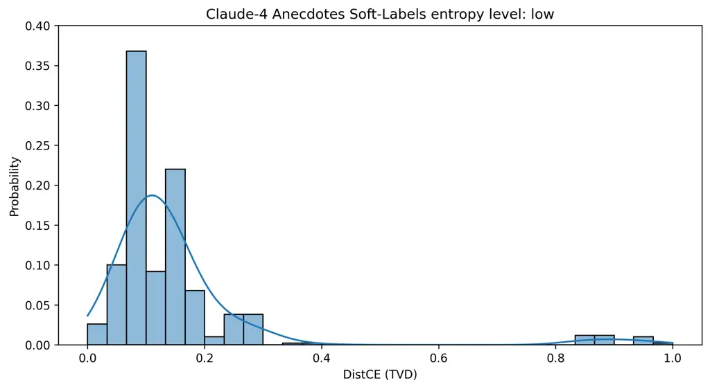 | 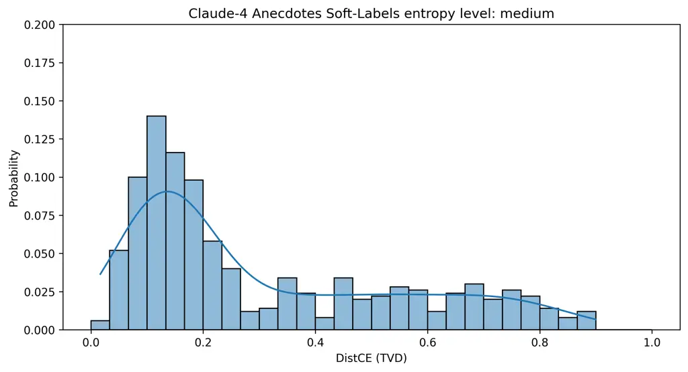 | 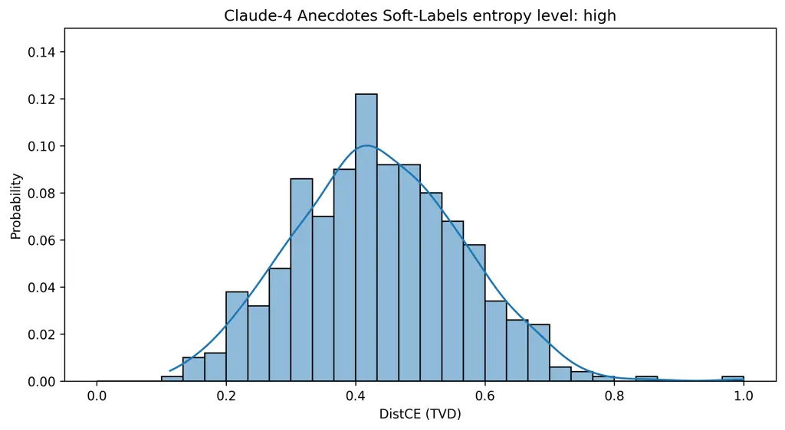 |
| \(a\) low $`H`$                                             | \(b\) medium $`H`$                                          | \(c\) high $`H`$                                            |
| 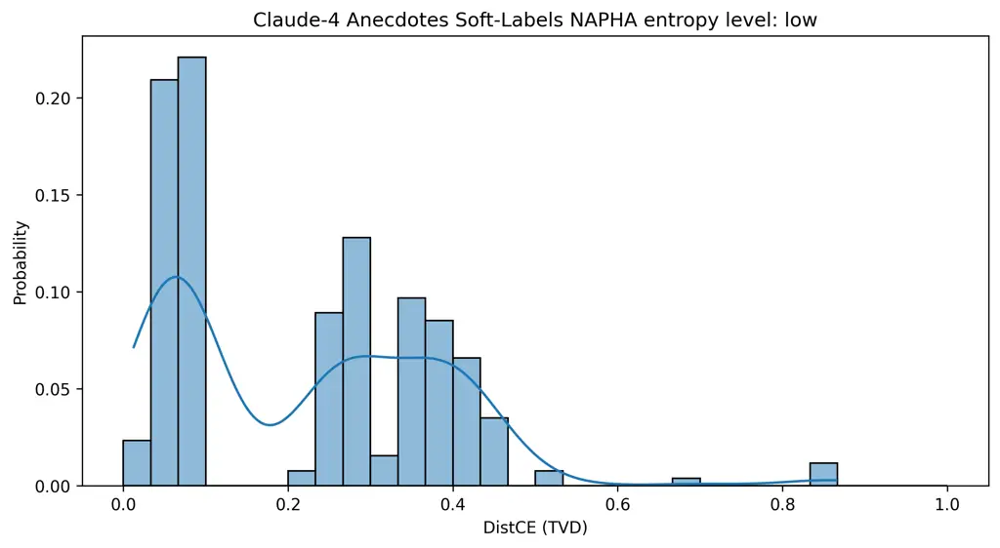 | 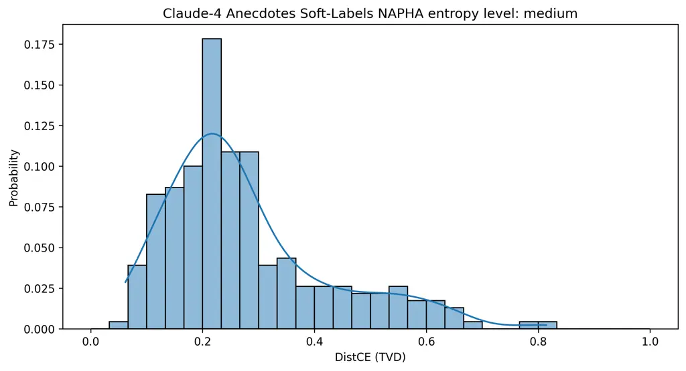 | 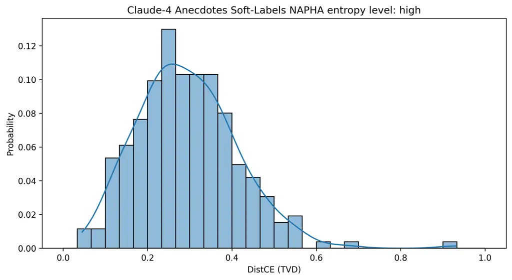 |
| \(d\) low $`H`$                                             | \(e\) medium $`H`$                                          | \(f\) high $`H`$                                            |

Figure 3: Histogram plots of the DistCE metric on the Anecdotes dataset
with 30 bins for low, medium and high entropy ($`H`$). The plots in the
top row show Soft-Label prediction (hard ICL) without NAPHA, and the
ones at the bottom row after applying NAPHA. We see that the probability
mass shifts to the left, i.e. to better DistCE values, and tails get
shorter, which is desirable.

#### 6.2.1 Overall performance

Table 3 shows _soft-labels_ prediction performance in the context of HLV
across different base models (SLP-HE, SLP-SE, SimAnn), with or without
using NAPHA. We highlight that we observe small standard errors across
our results, which suggests that our estimates are statistically robust.

First, we see that, NAPHA improves performance when used to calibrate
predictions on top of base models. This result is consistent across base
models and datasets. Indicatively, when we apply NAPHA to SLP-SE, the
DistCE metric (the lower the better) decreases from 0.299 to 0.272 for
the Anecdotes dataset, from 0.200 to 0.174 on ChaosNLI, and from 0.272
to 0.265 on DynaSent. The JSD metric behaves in the same manner.

Importantly, we see large improvement in the oracle setting, which means
using the oracle entropy class label for routing an instance to one of
the three alignment models, instead of predicting the entropy class
label.⁹⁹ 9 We discuss the implications of this in the next section. In
this setting, NAPHA achieves a DistCE of 0.172 on Anecdotes, 0.153 on
ChaosNLI, and 0.172 on DynaSent, all of which are substantial
improvements over using the predicted entropy class labels. As can be
seen in Table 14, none of the other alignment models (Linear
Transformation, Temperature Scaling, Dirichlet Calibration, and
Parameterized Temperature Scaling) outperform ours.

We also calculate upper bound human performance on the datasets we
consider as in Baan et al. (2022). We report the results in Table 5 in
Appendix B, where we see that these datasets have different levels of
complexity. Contrasting Table 5 and Table 3, we can conclude that NAPHA
approximates human performance on the Anecdotes and DynaSent datasets,
but still lacks behind on the rest of the datasets, where there is a lot
room for improvement in future work.

#### 6.2.2 Performance per entropy class

|            |           |                | Average               |                    | Low $`H`$             |                    | Medium $`H`$          |                    | High $`H`$            |                    |
| ---------- | --------- | -------------- | --------------------- | ------------------ | --------------------- | ------------------ | --------------------- | ------------------ | --------------------- | ------------------ |
| Base model | Alignment | Entropy Labels | DistCE $`\downarrow`$ | JSD $`\downarrow`$ | DistCE $`\downarrow`$ | JSD $`\downarrow`$ | DistCE $`\downarrow`$ | JSD $`\downarrow`$ | DistCE $`\downarrow`$ | JSD $`\downarrow`$ |
| SLP-HE     | \-        | \-             | 0.299                 | 0.326              | 0.155                 | 0.250              | 0.308                 | 0.350              | 0.435                 | 0.366              |
|            | NAPHA     | predicted      | $`0.271`$ (0.001)     | $`0.292`$ (0.001)  | $`0.228`$ (0.004)     | $`0.299`$ (0.003)  | $`0.295`$ (0.002)     | $`0.313`$ (0.002)  | $`0.292`$ (0.004)     | $`0.263`$ (0.003)  |
|            | NAPHA     | oracle         | $`0.175`$ (0.002)     | $`0.227`$ (0.002)  | $`0.040`$ (0.004)     | $`0.129`$ (0.005)  | $`0.274`$ (0.002)     | $`0.305`$ (0.002)  | $`0.210`$ (0.001)     | $`0.212`$ (0.001)  |
| SLP-SE     | \-        | \-             | 0.299                 | 0.326              | 0.196                 | 0.279              | 0.311                 | 0.352              | 0.388                 | 0.341              |
|            | NAPHA     | predicted      | $`0.272`$ (0.002)     | $`0.294`$ (0.001)  | $`0.226`$ (0.004)     | $`0.295`$ (0.003)  | $`0.290`$ (0.002)     | $`0.316`$ (0.002)  | $`0.299`$ (0.003)     | $`0.269`$ (0.002)  |
|            | NAPHA     | oracle         | $`0.172`$ (0.001)     | $`0.224`$ (0.001)  | $`0.034`$ (0.003)     | $`0.119`$ (0.003)  | $`0.274`$ (0.002)     | $`0.304`$ (0.001)  | $`0.209`$ (0.001)     | $`0.211`$ (0.001)  |
| SimAnn     | none      | none           | 0.325                 | 0.385              | 0.053                 | 0.163              | 0.375                 | 0.413              | 0.550                 | 0.497              |
|            | NAPHA     | predicted      | $`0.293`$ (0.001)     | $`0.308`$ (0.001)  | $`0.271`$ (0.006)     | $`0.321`$ (0.004)  | $`0.277`$ (0.002)     | $`0.313`$ (0.001)  | $`0.330`$ (0.005)     | $`0.289`$ (0.004)  |
|            | NAPHA     | oracle         | $`0.172`$ (0.001)     | $`0.225`$ (0.001)  | $`0.035`$ (0.003)     | $`0.120`$ (0.005)  | $`0.273`$ (0.002)     | $`0.304`$ (0.001)  | $`0.209`$ (0.001)     | $`0.211`$ (0.001)  |

Table 4: Results on soft-label prediction per entropy class for the
Anecdotes dataset. We report mean and standard error from 20 runs.
Results on the per entropy class are shown in Appendix D.

We show performance on each dataset per entropy class in Tables 4, 6, 7,
8, and 9. For the base model without NAPHA, soft-label prediction
worsens with increasing entropy (evidenced by DistCE and JSD).¹⁰¹⁰ 10
This is particularly prevalent for the SimAnn base model Jung et al.
(2025), which, due to its design and the relative stability of its
predictions, performs much better on the low entropy class and much
worse on high entropy cases w.r.t the other two base models. While high
entropy is often seen as labeling uncertainty, in HLV it can signal
valid, diverse perspectives. Thus, even if each annotator is certain,
population-level entropy can be high. Considering these perspectives is
the most desirable, and thus, good alignment is particularly important.
Indeed, NAPHA consistently improves performance on these high entropy
instances.

While overall alignment improved with NAPHA compared to just using the
base models, alignment in the low entropy class became worse. This
suggests that LLMs are by default better aligned on instances with low
entropy soft-labels than on high entropy instances. We attribute this
effect to incorrect entropy label routing in NAPHA, as this effect
disappears when we use oracle entropy labels. A simple but practical
mitigation strategy for this downside of NAPHA is to not apply the
method to the low entropy stratum. In fact, NAPHA can achieve very good
alignment using oracle entropy classes, as seen in Figure 4 in
Appendix E. This shows that as entropy class assignment improves (which
is arguably a simpler task than predicting the _soft-labels_
themselves), alignment to soft-labels using NAPHA will be further
improved.¹¹¹¹ 11 We find that LLMs do not perform well at predicting the
oracle entropy class using standard prompting, as shown in Tab. 10 in
the Appendix. Note that it is unclear how hard the task of predicting
the entropy class is for humans; studying this is an interesting
direction for future work.

NAPHA improves performance on medium entropy instances relative to the
base models. However, the improvement is less pronounced than for high
entropy instances, despite medium entropy cases showing similar absolute
distances to soft-label distributions. This can be explained by the fact
that the entropy is maximal for uniform distributions (high entropy
class). Thus, in cases where _soft-labels_ are (close to) a uniform
distribution, the straightforward solution of assigning equal likelihood
to every entropy class will achieve good performance. In contrast,
predicting that an instance belongs to the medium entropy class is more
challenging; this would require predicting that annotator votes are
split between a subset of labels (e.g., 2/5 labels get a similar number
of votes).

Finally, Figure 3 further illustrates the behavior of the DistCE
distance metric when applying NAPHA on top of base models. We observe
that, when we apply NAPHA, the probability mass shifts to the left, i.e.
towards lower distances, which is the desired behavior. This is
especially evident in the high entropy class. For the low and medium
entropy classes, we observe shorter distribution tails, which indicates
better alignment.

### 6.3 Qualitative Analysis

Since we use a chain-of-thought inducing statement in our prompts, we
can analyze the model’s reasoning traces qualitatively. From this we
found that the reasoning traces mostly do not consider alternative
cultural perspectives, where the same behavior might be interpreted
differently by humans. Also, we found that the model can default to a
conflict-averse, mediating nobody is wrong mode, whereas humans have
polarized opinions. Appendix I shows and discusses two case-studies from
the Anecdotes dataset.

### 6.4 Ablations

##### Do separate alignment models per entropy class help?

In Table 11 we show results of post-hoc alignment when we only use a
single alignment model instead of a separate alignment model per
predicted entropy class as in NAPHA. Performance is comparable to using
different alignment models per entropy class but deteriorates on low
entropy cases. Importantly, without separate classifiers per entropy
class, we cannot achieve the potential improvements that NAPHA enables
when routing would be improved (see Section 6.2.2).

##### Does using oracle entropy class labels during training help?

Since NAPHA needs the oracle (ground truth) _soft-labels_ for training
the alignment model, we can in principle use them instead of the
predicted ones also during training time and only use the predicted ones
at test time. However, since the prediction of entropy classes is
inaccurate, using oracle entropy labels during training does not bring
improvements (see Table 12).

##### How much training data does NAPHA need?

Table 13 shows the performance when using different amounts of training
data for NAPHA. We find that performance stabilizes at 10% of training
data, which shows that NAPHA does not need a lot of human labels to
improve alignment.

## 7 Conclusion and Future Work

This study demonstrates that LLMaJ achieves close to human-level
performance on _hard-label_ prediction tasks across evaluated datasets.
However, our results show that the transition from _hard-label_ to
_soft-labels_ prediction reveals significant limitations in current
LLMaJ, exposing its inability to adequately capture HLV. This is
particularly relevant in scenarios where different human perspectives
could lead to multiple labels being true simultaneously, most notably
subjective tasks. To address this, we proposed NAPHA, a post-hoc
alignment method for _soft-labels_ prediction that provides consistent
improvements across all base models and datasets. We observed
substantial gains for high entropy instances, where capturing diverse
human perspectives is most critical. Furthermore, our oracle entropy
class experiments revealed that as entropy class assignment improves,
NAPHA’s effectiveness and practical applicability will increase. Also,
NAPHA can be extended to consider white-box access to models, e.g. by
leveraging the distribution of logits across the possible labels.

More generally, future work should advance HLV approaches in two key
areas. For model development, enabling HLV might include fundamental
changes to training regimes, where LLMs are rewarded the most for
correctly representing pluralism. For data collection, it is important
to be able to disentangle human annotation error from valid HLV. To this
end, beyond collecting labels from multiple human annotators, one should
also collect explanations and confidence indications Chen et al. (2025)
as well as metadata such as sociodemographic information Sorensen et al.
(2025), which might be used to improve soft-label predictions.

## Limitations

While our study revealed interesting findings regarding the performance
of LLMaJ on predicting _soft-labels_, and how to improve it with
alignment methods, it is not without limitations. First, the
_soft-labels_ for three out of the five used datasets is sparse, due to
low number of annotators (less than 6). However, datasets with large
number of annotators are rare, and expensive to collect, and thus using
three to five annotators for human annotation is common practice. It is
unclear how many annotators are needed to get a fair estimate of the
_soft-labels_. Our method uses the model’s predicted label distribution
for routing, instead of a separate uncertainty estimate. This may
conflate model uncertainty with the predicted human disagreement, and
cannot be disentangled with the current design. Also, the way we sample
the Anecdotes and DynaSent subsets is not according to their natural
entropy-distribution. Instead, we explicitly construct a setting where
the entropy classes are balanced, to get more detailed insights into the
influence of entropy on the alignment. Note that for the three other
datasets, we use them as-is, thus also preserving the natural
entropy-distribution. Moreover, since we calculate the entropy
statistics across the training dataset, single instances can be
misclassified. We can thus not ensure consistent improvement for every
instance, but only show improvement across the entropy-stratum- and
dataset-level. Next, even when using open-weight models, we treat them
as if we only had closed-weight access. We do not test the potential
benefits from accessing model internals, which can be studied in future
work. Lastly, we did not perform hyperparameter tuning or tried to
optimize the neural network architecture of our alignment models,
focusing instead on showcasing the potential of NAPHA with a lightweight
approach.

## References

- Adilazuarda et al. (2024) M. F. Adilazuarda, S. Mukherjee, P.
  Lavania, S. S. Singh, A. F. Aji, J. O’Neill, A. Modi, and M. Choudhury
  Towards measuring and modeling “culture” in LLMs: a survey. In
  Proceedings of the 2024 Conference on Empirical Methods in Natural
  Language Processing, Y. Al-Onaizan, M. Bansal, and Y. Chen (Eds.),
  Miami, Florida, USA, pp. 15763–15784. External Links:
  [Link](https://aclanthology.org/2024.emnlp-main.882/),
  [Document](https://dx.doi.org/10.18653/v1/2024.emnlp-main.882) Cited
  by: §2.2.
- Agarwal et al. (2025) S. Agarwal, L. Ahmad, J. Ai, S. Altman, A.
  Applebaum, E. Arbus, R. K. Arora, Y. Bai, B. Baker, H. Bao, et al.
  Gpt-oss-120b & gpt-oss-20b model card. arXiv preprint
  arXiv:2508.10925. Cited by: Appendix H, §5.3.
- Anthropic (2025) Anthropic Introducing Claude 4 — anthropic.com. Note:
  [https://www.anthropic.com/news/claude-4](https://www.anthropic.com/news/claude-4)\[Accessed
  15-12-2025\] Cited by: §5.3.
- Aroyo and Welty (2015) L. Aroyo and C. Welty Truth is a lie: crowd
  truth and the seven myths of human annotation. AI Magazine 36 (1),
  pp. 15–24. External Links:
  [Document](https://dx.doi.org/https%3A//doi.org/10.1609/aimag.v36i1.2564),
  [Link](https://onlinelibrary.wiley.com/doi/abs/10.1609/aimag.v36i1.2564),
  https://onlinelibrary.wiley.com/doi/pdf/10.1609/aimag.v36i1.2564 Cited
  by: §1.
- Baan et al. (2022) J. Baan, W. Aziz, B. Plank, and R. Fernandez Stop
  measuring calibration when humans disagree. In Proceedings of the 2022
  Conference on Empirical Methods in Natural Language Processing, Y.
  Goldberg, Z. Kozareva, and Y. Zhang (Eds.), Abu Dhabi, United Arab
  Emirates, pp. 1892–1915. External Links:
  [Link](https://aclanthology.org/2022.emnlp-main.124/),
  [Document](https://dx.doi.org/10.18653/v1/2022.emnlp-main.124) Cited
  by: §5.2, §6.2.1.
- Baan et al. (2024) J. Baan, R. Fernández, B. Plank, and W. Aziz
  Interpreting predictive probabilities: model confidence or human label
  variation?. In Proceedings of the 18th Conference of the European
  Chapter of the Association for Computational Linguistics (Volume 2:
  Short Papers), Y. Graham and M. Purver (Eds.), St. Julian’s, Malta,
  pp. 268–277. External Links:
  [Link](https://aclanthology.org/2024.eacl-short.24/),
  [Document](https://dx.doi.org/10.18653/v1/2024.eacl-short.24) Cited
  by: §1.
- Bavaresco et al. (2025) A. Bavaresco, R. Bernardi, L. Bertolazzi, D.
  Elliott, R. Fernández, A. Gatt, E. Ghaleb, M. Giulianelli, M.
  Hanna, A. Koller, A. Martins, P. Mondorf, V. Neplenbroek, S.
  Pezzelle, B. Plank, D. Schlangen, A. Suglia, A. K. Surikuchi, E.
  Takmaz, and A. Testoni LLMs instead of human judges? a large scale
  empirical study across 20 NLP evaluation tasks. In Proceedings of the
  63rd Annual Meeting of the Association for Computational Linguistics
  (Volume 2: Short Papers), W. Che, J. Nabende, E. Shutova, and M. T.
  Pilehvar (Eds.), Vienna, Austria, pp. 238–255. External Links:
  [Link](https://aclanthology.org/2025.acl-short.20/),
  [Document](https://dx.doi.org/10.18653/v1/2025.acl-short.20), ISBN
  979-8-89176-252-7 Cited by: Appendix G, §5.2.
- Bowman et al. (2015) S. R. Bowman, G. Angeli, C. Potts, and C. D.
  Manning A large annotated corpus for learning natural language
  inference. In Proceedings of the 2015 Conference on Empirical Methods
  in Natural Language Processing, L. Màrquez, C. Callison-Burch, and J.
  Su (Eds.), Lisbon, Portugal, pp. 632–642. External Links:
  [Link](https://aclanthology.org/D15-1075/),
  [Document](https://dx.doi.org/10.18653/v1/D15-1075) Cited by: item
  ChaosNLI ( ) .
- Brown et al. (2020) T. Brown, B. Mann, N. Ryder, M. Subbiah, J. D.
  Kaplan, P. Dhariwal, A. Neelakantan, P. Shyam, G. Sastry, A. Askell,
  et al. Language models are few-shot learners. Advances in neural
  information processing systems 33, pp. 1877–1901. Cited by: §4.1.
- Cabitza et al. (2023) F. Cabitza, A. Campagner, and V. Basile Toward a
  perspectivist turn in ground truthing for predictive computing.
  Proceedings of the AAAI Conference on Artificial Intelligence 37 (6),
  pp. 6860–6868. External Links:
  [Link](https://ojs.aaai.org/index.php/AAAI/article/view/25840),
  [Document](https://dx.doi.org/10.1609/aaai.v37i6.25840) Cited by: §1,
  §2.2.
- Cabitza et al. (2019) F. Cabitza, A. Locoro, C. Alderighi, R.
  Rasoini, D. Compagnone, and P. Berjano The elephant in the record: on
  the multiplicity of data recording work. Health informatics journal 25
  (3), pp. 475–490. Cited by: §1.
- Calderon et al. (2025) N. Calderon, R. Reichart, and R. Dror The
  alternative annotator test for LLM-as-a-judge: how to statistically
  justify replacing human annotators with LLMs. In Proceedings of the
  63rd Annual Meeting of the Association for Computational Linguistics
  (Volume 1: Long Papers), W. Che, J. Nabende, E. Shutova, and M. T.
  Pilehvar (Eds.), Vienna, Austria, pp. 16051–16081. External Links:
  [Link](https://aclanthology.org/2025.acl-long.782/),
  [Document](https://dx.doi.org/10.18653/v1/2025.acl-long.782), ISBN
  979-8-89176-251-0 Cited by: Appendix G, §5.2, Table 2.
- Chen et al. (2025) B. Chen, Y. J. Liu, A. Korhonen, and B. Plank
  Threading the needle: reweaving chain-of-thought reasoning to explain
  human label variation. In Proceedings of the 2025 Conference on
  Empirical Methods in Natural Language Processing, C.
  Christodoulopoulos, T. Chakraborty, C. Rose, and V. Peng (Eds.),
  Suzhou, China, pp. 33111–33135. External Links:
  [Link](https://aclanthology.org/2025.emnlp-main.1682/),
  [Document](https://dx.doi.org/10.18653/v1/2025.emnlp-main.1682), ISBN
  979-8-89176-332-6 Cited by: §2.2, §7.
- Chen et al. (2024) B. Chen, X. Wang, S. Peng, R. Litschko, A.
  Korhonen, and B. Plank “Seeing the big through the small”: can LLMs
  approximate human judgment distributions on NLI from a few
  explanations?. In Findings of the Association for Computational
  Linguistics: EMNLP 2024, Y. Al-Onaizan, M. Bansal, and Y. Chen (Eds.),
  Miami, Florida, USA, pp. 14396–14419. External Links:
  [Link](https://aclanthology.org/2024.findings-emnlp.842/),
  [Document](https://dx.doi.org/10.18653/v1/2024.findings-emnlp.842)
  Cited by: §5.3.
- Cho and Youn (2024) G. Cho and C. Youn Tilt and average: geometric
  adjustment of the last layer for recalibration. In Proceedings of the
  41st International Conference on Machine Learning, ICML’24. Cited by:
  §2.3.
- Clark et al. (2021) E. Clark, T. August, S. Serrano, N. Haduong, S.
  Gururangan, and N. A. Smith All that’s ‘human’ is not gold: evaluating
  human evaluation of generated text. In Proceedings of the 59th Annual
  Meeting of the Association for Computational Linguistics and the 11th
  International Joint Conference on Natural Language Processing (Volume
  1: Long Papers), C. Zong, F. Xia, W. Li, and R. Navigli (Eds.),
  Online, pp. 7282–7296. External Links:
  [Link](https://aclanthology.org/2021.acl-long.565/),
  [Document](https://dx.doi.org/10.18653/v1/2021.acl-long.565) Cited by:
  §1.
- Clark et al. (2023) E. Clark, S. Rijhwani, S. Gehrmann, J. Maynez, R.
  Aharoni, V. Nikolaev, T. Sellam, A. Siddhant, D. Das, and A. Parikh
  SEAHORSE: a multilingual, multifaceted dataset for summarization
  evaluation. In Proceedings of the 2023 Conference on Empirical Methods
  in Natural Language Processing, H. Bouamor, J. Pino, and K. Bali
  (Eds.), Singapore, pp. 9397–9413. External Links:
  [Link](https://aclanthology.org/2023.emnlp-main.584/),
  [Document](https://dx.doi.org/10.18653/v1/2023.emnlp-main.584) Cited
  by: §1.
- de Marneffe et al. (2012) M. de Marneffe, C. D. Manning, and C. Potts
  Did it happen? the pragmatic complexity of veridicality assessment.
  Computational Linguistics 38 (2), pp. 301–333. External Links:
  [Link](https://aclanthology.org/J12-2003/),
  [Document](https://dx.doi.org/10.1162/COLI%5Fa%5F00097) Cited by: §1.
- Dong et al. (2024) Q. Dong, L. Li, D. Dai, C. Zheng, J. Ma, R. Li, H.
  Xia, J. Xu, Z. Wu, B. Chang, X. Sun, L. Li, and Z. Sui A survey on
  in-context learning. In Proceedings of the 2024 Conference on
  Empirical Methods in Natural Language Processing, Y. Al-Onaizan, M.
  Bansal, and Y. Chen (Eds.), Miami, Florida, USA, pp. 1107–1128.
  External Links: [Link](https://aclanthology.org/2024.emnlp-main.64/),
  [Document](https://dx.doi.org/10.18653/v1/2024.emnlp-main.64) Cited
  by: §4.1.
- DURMUS et al. (2024) E. DURMUS, K. Nguyen, T. Liao, N. Schiefer, A.
  Askell, A. Bakhtin, C. Chen, Z. Hatfield-Dodds, D. Hernandez, N.
  Joseph, L. Lovitt, S. McCandlish, O. Sikder, A. Tamkin, J. Thamkul, J.
  Kaplan, J. Clark, and D. Ganguli Towards measuring the representation
  of subjective global opinions in language models. In First Conference
  on Language Modeling, External Links:
  [Link](https://openreview.net/forum?id=zl16jLb91v) Cited by: §2.2.
- Elangovan et al. (2025) A. Elangovan, L. Xu, J. Ko, M. Elyasi, L.
  Liu, S. B. Bodapati, and D. Roth Beyond correlation: the impact of
  human uncertainty in measuring the effectiveness of automatic
  evaluation and LLM-as-a-judge. In The Thirteenth International
  Conference on Learning Representations, External Links:
  [Link](https://openreview.net/forum?id=E8gYIrbP00) Cited by: §1, §4.2,
  §6.1.
- Endres and Schindelin (2003) D.M. Endres and J.E. Schindelin A new
  metric for probability distributions. IEEE Transactions on Information
  Theory 49 (7), pp. 1858–1860. External Links:
  [Document](https://dx.doi.org/10.1109/TIT.2003.813506) Cited by: §5.2.
- Fabbri et al. (2021) A. R. Fabbri, W. Kryściński, B. McCann, C.
  Xiong, R. Socher, and D. Radev SummEval: re-evaluating summarization
  evaluation. Transactions of the Association for Computational
  Linguistics 9, pp. 391–409. External Links:
  [Link](https://aclanthology.org/2021.tacl-1.24/),
  [Document](https://dx.doi.org/10.1162/tacl%5Fa%5F00373) Cited by: §1,
  item SummEval ( ) , item SummEval ( ) .
- Gao et al. (2025) M. Gao, X. Hu, X. Yin, J. Ruan, X. Pu, and X. Wan
  LLM-based nlg evaluation: current status and challenges. Computational
  Linguistics 51 (2), pp. 661–687. External Links: ISSN 0891-2017,
  [Document](https://dx.doi.org/10.1162/coli%5Fa%5F00561),
  [Link](https://doi.org/10.1162/coli_a_00561),
  https://direct.mit.edu/coli/article-pdf/51/2/661/2513169/coli_a_00561.pdf
  Cited by: §1, §2.1.
- Gehrmann et al. (2023) S. Gehrmann, E. Clark, and T. Sellam Repairing
  the cracked foundation: a survey of obstacles in evaluation practices
  for generated text. Journal of Artificial Intelligence Research 77,
  pp. 103–166. Cited by: §2.1.
- Geng et al. (2024) J. Geng, F. Cai, Y. Wang, H. Koeppl, P. Nakov,
  and I. Gurevych A survey of confidence estimation and calibration in
  large language models. In Proceedings of the 2024 Conference of the
  North American Chapter of the Association for Computational
  Linguistics: Human Language Technologies (Volume 1: Long Papers), K.
  Duh, H. Gomez, and S. Bethard (Eds.), Mexico City, Mexico,
  pp. 6577–6595. External Links:
  [Link](https://aclanthology.org/2024.naacl-long.366/),
  [Document](https://dx.doi.org/10.18653/v1/2024.naacl-long.366) Cited
  by: §4.1, footnote 7.
- Gopalakrishnan et al. (2019) K. Gopalakrishnan, B. Hedayatnia, Q.
  Chen, A. Gottardi, S. Kwatra, A. Venkatesh, R. Gabriel, and D.
  Hakkani-Tür Topical-Chat: Towards Knowledge-Grounded Open-Domain
  Conversations. In Proc. Interspeech 2019, pp. 1891–1895. External
  Links: [Document](https://dx.doi.org/10.21437/Interspeech.2019-3079),
  [Link](http://dx.doi.org/10.21437/Interspeech.2019-3079) Cited by:
  item TopicalChat ( ) , item TopicalChat ( ) .
- Gruber et al. (2025) C. Gruber, H. Alber, B. Bischl, G. Kauermann, B.
  Plank, and M. Aßenmacher Revisiting active learning under (human)
  label variation. In Proceedings of the The 4th Workshop on
  Perspectivist Approaches to NLP, G. Abercrombie, V. Basile, S.
  Frenda, S. Tonelli, and S. Dudy (Eds.), Suzhou, China, pp. 75–86.
  External Links:
  [Link](https://aclanthology.org/2025.nlperspectives-1.7/),
  [Document](https://dx.doi.org/10.18653/v1/2025.nlperspectives-1.7),
  ISBN 979-8-89176-350-0 Cited by: §2.2.
- Guo et al. (2017) C. Guo, G. Pleiss, Y. Sun, and K. Q. Weinberger On
  calibration of modern neural networks. In International conference on
  machine learning, pp. 1321–1330. Cited by: Appendix F, §4.2.
- Hong et al. (2025) P. Hong, B. Chen, S. Peng, M. de Marneffe, and B.
  Plank LiTEx: a linguistic taxonomy of explanations for understanding
  within-label variation in natural language inference. In Proceedings
  of the 2025 Conference on Empirical Methods in Natural Language
  Processing, C. Christodoulopoulos, T. Chakraborty, C. Rose, and V.
  Peng (Eds.), Suzhou, China, pp. 34065–34085. External Links:
  [Link](https://aclanthology.org/2025.emnlp-main.1728/),
  [Document](https://dx.doi.org/10.18653/v1/2025.emnlp-main.1728), ISBN
  979-8-89176-332-6 Cited by: §2.2.
- Ivey et al. (2025) J. Ivey, S. Gauch, and D. Jurgens NUTMEG:
  separating signal from noise in annotator disagreement. In Proceedings
  of the 2025 Conference on Empirical Methods in Natural Language
  Processing, C. Christodoulopoulos, T. Chakraborty, C. Rose, and V.
  Peng (Eds.), Suzhou, China, pp. 2874–2887. External Links:
  [Link](https://aclanthology.org/2025.emnlp-main.144/),
  [Document](https://dx.doi.org/10.18653/v1/2025.emnlp-main.144), ISBN
  979-8-89176-332-6 Cited by: §2.2.
- Jacobs et al. (1991) R. A. Jacobs, M. I. Jordan, S. J. Nowlan,
  and G. E. Hinton Adaptive mixtures of local experts. Neural
  computation 3 (1), pp. 79–87. Cited by: Appendix A.
- Jiang et al. (2021) Z. Jiang, J. Araki, H. Ding, and G. Neubig How can
  we know when language models know? on the calibration of language
  models for question answering. Transactions of the Association for
  Computational Linguistics 9, pp. 962–977. External Links:
  [Link](https://aclanthology.org/2021.tacl-1.57/),
  [Document](https://dx.doi.org/10.1162/tacl%5Fa%5F00407) Cited by:
  §2.3.
- Jolly et al. (2021) S. Jolly, S. Pezzelle, and M. Nabi EaSe: a
  diagnostic tool for VQA based on answer diversity. In Proceedings of
  the 2021 Conference of the North American Chapter of the Association
  for Computational Linguistics: Human Language Technologies, K.
  Toutanova, A. Rumshisky, L. Zettlemoyer, D. Hakkani-Tur, I.
  Beltagy, S. Bethard, R. Cotterell, T. Chakraborty, and Y. Zhou (Eds.),
  Online, pp. 2407–2414. External Links:
  [Link](https://aclanthology.org/2021.naacl-main.192/),
  [Document](https://dx.doi.org/10.18653/v1/2021.naacl-main.192) Cited
  by: §4.2.
- Jung et al. (2025) J. Jung, F. Brahman, and Y. Choi Trust or escalate:
  LLM judges with provable guarantees for human agreement. In The
  Thirteenth International Conference on Learning Representations,
  External Links: [Link](https://openreview.net/forum?id=UHPnqSTBPO)
  Cited by: §4.1, footnote 10.
- Klie et al. (2023) J. Klie, B. Webber, and I. Gurevych Annotation
  error detection: analyzing the past and present for a more coherent
  future. Computational Linguistics 49 (1), pp. 157–198. External Links:
  ISSN 0891-2017,
  [Document](https://dx.doi.org/10.1162/coli%5Fa%5F00464),
  [Link](https://doi.org/10.1162/coli_a_00464),
  https://direct.mit.edu/coli/article-pdf/49/1/157/2068980/coli_a_00464.pdf
  Cited by: §2.2.
- Kotek et al. (2023) H. Kotek, R. Dockum, and D. Sun Gender bias and
  stereotypes in large language models. In Proceedings of the ACM
  collective intelligence conference, pp. 12–24. Cited by: §2.2.
- Kull et al. (2019) M. Kull, M. Perello Nieto, M. Kängsepp, T. Silva
  Filho, H. Song, and P. Flach Beyond temperature scaling: obtaining
  well-calibrated multi-class probabilities with dirichlet calibration.
  Advances in neural information processing systems 32. Cited by:
  Appendix F, §4.2.
- Lee et al. (2025) Y. Lee, J. Kim, J. Kim, H. Cho, J. Kang, P. Kang,
  and N. Kim CheckEval: a reliable LLM-as-a-judge framework for
  evaluating text generation using checklists. In Proceedings of the
  2025 Conference on Empirical Methods in Natural Language
  Processing, C. Christodoulopoulos, T. Chakraborty, C. Rose, and V.
  Peng (Eds.), Suzhou, China, pp. 15771–15798. External Links:
  [Link](https://aclanthology.org/2025.emnlp-main.796/),
  [Document](https://dx.doi.org/10.18653/v1/2025.emnlp-main.796), ISBN
  979-8-89176-332-6 Cited by: §2.1.
- Li et al. (2025) D. Li, B. Jiang, L. Huang, A. Beigi, C. Zhao, Z.
  Tan, A. Bhattacharjee, Y. Jiang, C. Chen, T. Wu, K. Shu, L. Cheng,
  and H. Liu From generation to judgment: opportunities and challenges
  of LLM-as-a-judge. In Proceedings of the 2025 Conference on Empirical
  Methods in Natural Language Processing, C. Christodoulopoulos, T.
  Chakraborty, C. Rose, and V. Peng (Eds.), Suzhou, China,
  pp. 2757–2791. External Links:
  [Link](https://aclanthology.org/2025.emnlp-main.138/),
  [Document](https://dx.doi.org/10.18653/v1/2025.emnlp-main.138), ISBN
  979-8-89176-332-6 Cited by: §5.1.
- Lin (2004) C. Lin ROUGE: a package for automatic evaluation of
  summaries. In Text Summarization Branches Out, Barcelona, Spain,
  pp. 74–81. External Links: [Link](https://aclanthology.org/W04-1013/)
  Cited by: §2.1.
- Liu et al. (2025) C. C. Liu, I. Gurevych, and A. Korhonen Culturally
  aware and adapted NLP: a taxonomy and a survey of the state of the
  art. Transactions of the Association for Computational Linguistics 13,
  pp. 652–689. External Links:
  [Link](https://aclanthology.org/2025.tacl-1.31/),
  [Document](https://dx.doi.org/10.1162/tacl%5Fa%5F00760) Cited by:
  §2.2.
- Liu et al. (2024) Y. Liu, T. Yang, S. Huang, Z. Zhang, H. Huang, F.
  Wei, W. Deng, F. Sun, and Q. Zhang HD-eval: aligning large language
  model evaluators through hierarchical criteria decomposition. In
  Proceedings of the 62nd Annual Meeting of the Association for
  Computational Linguistics (Volume 1: Long Papers), L. Ku, A. Martins,
  and V. Srikumar (Eds.), Bangkok, Thailand, pp. 7641–7660. External
  Links: [Link](https://aclanthology.org/2024.acl-long.413/),
  [Document](https://dx.doi.org/10.18653/v1/2024.acl-long.413) Cited by:
  §2.1.
- Lourie et al. (2021) N. Lourie, R. Le Bras, and Y. Choi SCRUPLES: a
  corpus of community ethical judgments on 32,000 real-life anecdotes.
  Proceedings of the AAAI Conference on Artificial Intelligence 35 (15),
  pp. 13470–13479. External Links:
  [Link](https://ojs.aaai.org/index.php/AAAI/article/view/17589),
  [Document](https://dx.doi.org/10.1609/aaai.v35i15.17589) Cited by:
  item Anecdotes ( ) , item Anecdotes ( ) .
- Madaan et al. (2025) L. Madaan, D. Esiobu, P. Stenetorp, B. Plank,
  and D. Hupkes Lost in inference: rediscovering the role of natural
  language inference for large language models. In Proceedings of the
  2025 Conference of the Nations of the Americas Chapter of the
  Association for Computational Linguistics: Human Language Technologies
  (Volume 1: Long Papers), L. Chiruzzo, A. Ritter, and L. Wang (Eds.),
  Albuquerque, New Mexico, pp. 9229–9242. External Links:
  [Link](https://aclanthology.org/2025.naacl-long.466/),
  [Document](https://dx.doi.org/10.18653/v1/2025.naacl-long.466), ISBN
  979-8-89176-189-6 Cited by: §5.3.
- Mielke et al. (2022) S. J. Mielke, A. Szlam, E. Dinan, and Y. Boureau
  Reducing conversational agents’ overconfidence through linguistic
  calibration. Transactions of the Association for Computational
  Linguistics 10, pp. 857–872. External Links:
  [Link](https://aclanthology.org/2022.tacl-1.50/),
  [Document](https://dx.doi.org/10.1162/tacl%5Fa%5F00494) Cited by:
  §4.1.
- Mukherjee et al. (2023) A. Mukherjee, C. Raj, Z. Zhu, and A.
  Anastasopoulos Global Voices, local biases: socio-cultural prejudices
  across languages. In Proceedings of the 2023 Conference on Empirical
  Methods in Natural Language Processing, H. Bouamor, J. Pino, and K.
  Bali (Eds.), Singapore, pp. 15828–15845. External Links:
  [Link](https://aclanthology.org/2023.emnlp-main.981/),
  [Document](https://dx.doi.org/10.18653/v1/2023.emnlp-main.981) Cited
  by: §2.2.
- Nahum et al. (2025) O. Nahum, N. Calderon, O. Keller, I. Szpektor,
  and R. Reichart Are LLMs better than reported? detecting label errors
  and mitigating their effect on model performance. In Proceedings of
  the 2025 Conference on Empirical Methods in Natural Language
  Processing, C. Christodoulopoulos, T. Chakraborty, C. Rose, and V.
  Peng (Eds.), Suzhou, China, pp. 26782–26809. External Links:
  [Link](https://aclanthology.org/2025.emnlp-main.1360/),
  [Document](https://dx.doi.org/10.18653/v1/2025.emnlp-main.1360), ISBN
  979-8-89176-332-6 Cited by: §2.2.
- Nie et al. (2020) Y. Nie, X. Zhou, and M. Bansal What can we learn
  from collective human opinions on natural language inference data?. In
  Proceedings of the 2020 Conference on Empirical Methods in Natural
  Language Processing (EMNLP), B. Webber, T. Cohn, Y. He, and Y. Liu
  (Eds.), Online, pp. 9131–9143. External Links:
  [Link](https://aclanthology.org/2020.emnlp-main.734/),
  [Document](https://dx.doi.org/10.18653/v1/2020.emnlp-main.734) Cited
  by: item ChaosNLI ( ) , item ChaosNLI ( ) .
- Noble (2012) J. A. Noble Minority voices of crowdsourcing: why we
  should pay attention to every member of the crowd. In proceedings of
  the ACM 2012 conference on computer supported cooperative work
  companion, pp. 179–182. Cited by: §1.
- Pavlick and Kwiatkowski (2019) E. Pavlick and T. Kwiatkowski Inherent
  disagreements in human textual inferences. Transactions of the
  Association for Computational Linguistics 7, pp. 677–694. External
  Links: [Link](https://aclanthology.org/Q19-1043/),
  [Document](https://dx.doi.org/10.1162/tacl%5Fa%5F00293) Cited by: §1.
- Peterson et al. (2019) J. C. Peterson, R. M. Battleday, T. L.
  Griffiths, and O. Russakovsky Human uncertainty makes classification
  more robust. In Proceedings of the IEEE/CVF international conference
  on computer vision, pp. 9617–9626. Cited by: §1.
- Plank et al. (2014) B. Plank, D. Hovy, and A. Søgaard Linguistically
  debatable or just plain wrong?. In Proceedings of the 52nd Annual
  Meeting of the Association for Computational Linguistics (Volume 2:
  Short Papers), K. Toutanova and H. Wu (Eds.), Baltimore, Maryland,
  pp. 507–511. External Links:
  [Link](https://aclanthology.org/P14-2083/),
  [Document](https://dx.doi.org/10.3115/v1/P14-2083) Cited by: §1.
- Plank (2022) B. Plank The “problem” of human label variation: on
  ground truth in data, modeling and evaluation. In Proceedings of the
  2022 Conference on Empirical Methods in Natural Language
  Processing, Y. Goldberg, Z. Kozareva, and Y. Zhang (Eds.), Abu Dhabi,
  United Arab Emirates, pp. 10671–10682. External Links:
  [Link](https://aclanthology.org/2022.emnlp-main.731/),
  [Document](https://dx.doi.org/10.18653/v1/2022.emnlp-main.731) Cited
  by: §1, §2.2.
- Potts et al. (2021) C. Potts, Z. Wu, A. Geiger, and D. Kiela DynaSent:
  a dynamic benchmark for sentiment analysis. In Proceedings of the 59th
  Annual Meeting of the Association for Computational Linguistics and
  the 11th International Joint Conference on Natural Language Processing
  (Volume 1: Long Papers), C. Zong, F. Xia, W. Li, and R. Navigli
  (Eds.), Online, pp. 2388–2404. External Links:
  [Link](https://aclanthology.org/2021.acl-long.186/),
  [Document](https://dx.doi.org/10.18653/v1/2021.acl-long.186) Cited by:
  Figure 1, item DynaSent ( ) , item DynaSent ( ) .
- Ramponi et al. (2025) A. Ramponi, A. Daffara, and S. Tonelli
  Fine-grained fallacy detection with human label variation. In
  Proceedings of the 2025 Conference of the Nations of the Americas
  Chapter of the Association for Computational Linguistics: Human
  Language Technologies (Volume 1: Long Papers), L. Chiruzzo, A. Ritter,
  and L. Wang (Eds.), Albuquerque, New Mexico, pp. 762–784. External
  Links: [Link](https://aclanthology.org/2025.naacl-long.34/),
  [Document](https://dx.doi.org/10.18653/v1/2025.naacl-long.34), ISBN
  979-8-89176-189-6 Cited by: §2.2.
- Raykar et al. (2010) V. C. Raykar, S. Yu, L. H. Zhao, G. H.
  Valadez, C. Florin, L. Bogoni, and L. Moy Learning from crowds..
  Journal of machine learning research 11 (4). Cited by: §1.
- Sanh et al. (2022) V. Sanh, A. Webson, C. Raffel, S. Bach, L.
  Sutawika, Z. Alyafeai, A. Chaffin, A. Stiegler, A. Raja, M. Dey, M. S.
  Bari, C. Xu, U. Thakker, S. S. Sharma, E. Szczechla, T. Kim, G.
  Chhablani, N. Nayak, D. Datta, J. Chang, M. T. Jiang, H. Wang, M.
  Manica, S. Shen, Z. X. Yong, H. Pandey, R. Bawden, T. Wang, T.
  Neeraj, J. Rozen, A. Sharma, A. Santilli, T. Fevry, J. A. Fries, R.
  Teehan, T. L. Scao, S. Biderman, L. Gao, T. Wolf, and A. M. Rush
  Multitask prompted training enables zero-shot task generalization. In
  International Conference on Learning Representations, External Links:
  [Link](https://openreview.net/forum?id=9Vrb9D0WI4) Cited by: §4.1.
- Santurkar et al. (2023) S. Santurkar, E. Durmus, F. Ladhak, C. Lee, P.
  Liang, and T. Hashimoto Whose opinions do language models reflect?. In
  International Conference on Machine Learning, pp. 29971–30004. Cited
  by: §2.2.
- Schaekermann et al. (2019) M. Schaekermann, G. Beaton, M. Habib, A.
  Lim, K. Larson, and E. Law Understanding expert disagreement in
  medical data analysis through structured adjudication. Proceedings of
  the ACM on Human-Computer Interaction 3 (CSCW), pp. 1–23. Cited by:
  §1.
- Sorensen et al. (2025) T. Sorensen, P. Mishra, R. Patel, M. H.
  Tessler, M. A. Bakker, G. Evans, I. Gabriel, N. Goodman, and V. Rieser
  Value profiles for encoding human variation. In Proceedings of the
  2025 Conference on Empirical Methods in Natural Language
  Processing, C. Christodoulopoulos, T. Chakraborty, C. Rose, and V.
  Peng (Eds.), Suzhou, China, pp. 2047–2095. External Links:
  [Link](https://aclanthology.org/2025.emnlp-main.106/),
  [Document](https://dx.doi.org/10.18653/v1/2025.emnlp-main.106), ISBN
  979-8-89176-332-6 Cited by: §7.
- Sorensen et al. (2024) T. Sorensen, J. Moore, J. Fisher, M. Gordon, N.
  Mireshghallah, C. M. Rytting, A. Ye, L. Jiang, X. Lu, N. Dziri, T.
  Althoff, and Y. Choi Position: a roadmap to pluralistic alignment. In
  Proceedings of the 41st International Conference on Machine Learning,
  ICML’24. Cited by: §2.2.
- Tao et al. (2025) L. Tao, M. Dong, and C. Xu Feature clipping for
  uncertainty calibration. In Proceedings of the AAAI Conference on
  Artificial Intelligence, Vol. 39, pp. 20841–20849. Cited by: §2.3.
- Tomani et al. (2022) C. Tomani, D. Cremers, and F. Buettner
  Parameterized temperature scaling for boosting the expressive power in
  post-hoc uncertainty calibration. In European conference on computer
  vision, pp. 555–569. Cited by: §2.3, §4.2.
- Uma et al. (2020) A. Uma, T. Fornaciari, D. Hovy, S. Paun, B. Plank,
  and M. Poesio A case for soft loss functions. In Proceedings of the
  AAAI Conference on Human Computation and Crowdsourcing, Vol. 8,
  pp. 173–177. Cited by: §1.
- Uma et al. (2021) A. N. Uma, T. Fornaciari, D. Hovy, S. Paun, B.
  Plank, and M. Poesio Learning from disagreement: a survey. Journal of
  Artificial Intelligence Research 72, pp. 1385–1470. Cited by: §1.
- Wang et al. (2023) J. Wang, Y. Liang, F. Meng, Z. Sun, H. Shi, Z.
  Li, J. Xu, J. Qu, and J. Zhou Is ChatGPT a good NLG evaluator? a
  preliminary study. In Proceedings of the 4th New Frontiers in
  Summarization Workshop, Y. Dong, W. Xiao, L. Wang, F. Liu, and G.
  Carenini (Eds.), Singapore, pp. 1–11. External Links:
  [Link](https://aclanthology.org/2023.newsum-1.1/),
  [Document](https://dx.doi.org/10.18653/v1/2023.newsum-1.1) Cited by:
  §2.1.
- Washington et al. (2021) P. Washington, H. Kalantarian, J. Kent, A.
  Husic, A. Kline, E. Leblanc, C. Hou, C. Mutlu, K. Dunlap, Y. Penev, et
  al. Training affective computer vision models by crowdsourcing
  soft-target labels. Cognitive computation 13 (5), pp. 1363–1373. Cited
  by: §1.
- Weber and Plank (2023) L. Weber and B. Plank ActiveAED: a human in the
  loop improves annotation error detection. In Findings of the
  Association for Computational Linguistics: ACL 2023, A. Rogers, J.
  Boyd-Graber, and N. Okazaki (Eds.), Toronto, Canada, pp. 8834–8845.
  External Links:
  [Link](https://aclanthology.org/2023.findings-acl.562/),
  [Document](https://dx.doi.org/10.18653/v1/2023.findings-acl.562) Cited
  by: §2.2.
- Weber-Genzel et al. (2024) L. Weber-Genzel, S. Peng, M. De Marneffe,
  and B. Plank VariErr NLI: separating annotation error from human label
  variation. In Proceedings of the 62nd Annual Meeting of the
  Association for Computational Linguistics (Volume 1: Long Papers), L.
  Ku, A. Martins, and V. Srikumar (Eds.), Bangkok, Thailand,
  pp. 2256–2269. External Links:
  [Link](https://aclanthology.org/2024.acl-long.123/),
  [Document](https://dx.doi.org/10.18653/v1/2024.acl-long.123) Cited by:
  §2.2.
- Xiong et al. (2024) M. Xiong, Z. Hu, X. Lu, Y. LI, J. Fu, J. He,
  and B. Hooi Can LLMs express their uncertainty? an empirical
  evaluation of confidence elicitation in LLMs. In The Twelfth
  International Conference on Learning Representations, External Links:
  [Link](https://openreview.net/forum?id=gjeQKFxFpZ) Cited by: §4.1.
- Yang et al. (2025) A. Yang, A. Li, B. Yang, B. Zhang, B. Hui, B.
  Zheng, B. Yu, C. Gao, C. Huang, C. Lv, et al. Qwen3 technical report.
  arXiv preprint arXiv:2505.09388. Cited by: Appendix H, §5.3.
- Zhang et al. (2020) T. Zhang, V. Kishore, F. Wu, K. Q. Weinberger,
  and Y. Artzi BERTScore: evaluating text generation with bert. In
  International Conference on Learning Representations, External Links:
  [Link](https://openreview.net/forum?id=SkeHuCVFDr) Cited by: §2.1.
- Zheng et al. (2023a) C. Zheng, H. Zhou, F. Meng, J. Zhou, and M. Huang
  Large language models are not robust multiple choice selectors. arXiv
  preprint arXiv:2309.03882. Cited by: §2.3.
- Zheng et al. (2023b) L. Zheng, W. Chiang, Y. Sheng, S. Zhuang, Z.
  Wu, Y. Zhuang, Z. Lin, Z. Li, D. Li, E. Xing, H. Zhang, J. E.
  Gonzalez, and I. Stoica Judging llm-as-a-judge with mt-bench and
  chatbot arena. In Advances in Neural Information Processing
  Systems, A. Oh, T. Naumann, A. Globerson, K. Saenko, M. Hardt, and S.
  Levine (Eds.), Vol. 36, pp. 46595–46623. External Links:
  [Link](https://proceedings.neurips.cc/paper_files/paper/2023/file/91f18a1287b398d378ef22505bf41832-Paper-Datasets_and_Benchmarks.pdf)
  Cited by: §2.1.

## Appendix A Theoretical Formalization of NAPHA

To establish the theoretical foundation of the NAPHA framework, we
formalize the alignment of LLMs to the HJD as a partitioned optimization
problem.

Problem Definition and Objective. Let an instance be evaluated over
$`n`$ possible discrete labels. The aggregated human annotations form a
ground-truth probability distribution $`y\in[0,1]^{n}`$, where
$`\sum_{j=1}^{n}y_{j}=1`$. The base LLM outputs an initial soft-label
prediction $`\hat{y}\in[0,1]^{n}`$. Our experiments found this to be
poorly aligned with the ground-truth.

The goal of post-hoc alignment is to learn a mapping function
$`M_{\phi}`$ (parameterized by weights $`\phi`$) that transforms the
initial prediction $`\hat{y}`$ into a aligned distribution
$`\hat{y}_{cal}=M_{\phi}(\hat{y})`$ that closely approximates $`y`$.

To measure the distance between the target distribution $`y`$ and the
aligned distribution $`\hat{y}_{cal}`$, we utilize the Kullback-Leibler
(KL) divergence:

```math
D_{KL}(y\parallel\hat{y}_{cal})=\sum_{j=1}^{n}y_{j}\log\left(\frac{y_{j}}{\hat{y}_{cal,j}}\right) \tag{1}
```

Entropy-Stratified Alignment. On the instance-level, the entropy of the
human annotations will depend on different task-specific factors such as
complexity, ambiguity, and different ethical understandings. A single
global alignment function $`M_{\phi}`$ may thus struggle to capture the
diverse alignment patterns. To address this, NAPHA employs a piecewise
approach by stratifying the data based on the Shannon entropy of the
initial prediction:

```math
H(\hat{y})=-\sum_{j=1}^{n}\hat{y}_{j}\log(\hat{y}_{j}) \tag{2}
```

Based on $`H(\hat{y})`$, the input space is partitioned into three
mutually exclusive subsets corresponding to low, medium, and high
entropy instances (using terciles), denoted as $`c\in\{L,M,H\}`$.
Instead of a single complex model, we learn a set of simpler,
specialized alignment models $`M_{\phi_{c}}`$, such that the final
alignment is defined as:

```math
\hat{y}_{cal}=\sum_{c\in\{L,M,H\}}\mathbb{I}(\hat{y}\in c)M_{\phi_{c}}(\hat{y}) \tag{3}
```

where $`\mathbb{I}`$ is the indicator function and can be understood as
a router, routing the instances to their corresponding alignment model.
By constraining the problem space for each $`M_{\phi_{c}}`$, we reduce
the functional complexity required to achieve accurate alignment.

This is analogous to mixture-of-experts architectures Jacobs et al.
(1991), where routing inputs to specialized models yields better overall
performance than a single global model.

Let $`\mathcal{E}(M)`$ denote the expected alignment error of a mapping
function $`M`$ over the entire data distribution. The expected global
alignment error of our approach is the weighted sum of the conditional
errors within each stratum $`\mathcal{X}_{c}`$:

```math
\displaystyle\mathcal{E}(\text{M})=\sum_{c\in\{L,M,H\}}P(x\in\mathcal{X}_{c})\cdot\mathcal{E}(M_{\phi_{c}}\mid x\in\mathcal{X}_{c}),
```

where $`P(x\in\mathcal{X}_{c})`$ represents the probability of the data
falling into entropy stratum $`c`$.

## Appendix B Human Performance

We estimate the human performance by sampling 20% annotations and
comparing to the full distribution. We bootstrap 1000 runs. Table 5
shows the results. Due to the relatively low number of annotators on
DynaSent, SummEval, and TopicalChat, the results have limited meaning on
these datasets.

|             | Average               |                     | Low                   |                     | Medium                |                     | High                  |                     |
| ----------- | --------------------- | ------------------- | --------------------- | ------------------- | --------------------- | ------------------- | --------------------- | ------------------- |
| Dataset     | DistCE $`\downarrow`$ | JSD $`\downarrow`$  | DistCE $`\downarrow`$ | JSD $`\downarrow`$  | DistCE $`\downarrow`$ | JSD $`\downarrow`$  | DistCE $`\downarrow`$ | JSD $`\downarrow`$  |
| ChaosNLI    | 0.070 $`\pm`$ 0.024   | 0.095 $`\pm`$ 0.022 | 0.038 $`\pm`$ 0.013   | 0.091 $`\pm`$ 0.019 | 0.073 $`\pm`$ 0.027   | 0.093 $`\pm`$ 0.024 | 0.097 $`\pm`$ 0.039   | 0.105 $`\pm`$ 0.029 |
| Anecdotes   | 0.165 $`\pm`$ 0.016   | 0.236 $`\pm`$ 0.016 | 0.014 $`\pm`$ 0.004   | 0.062 $`\pm`$ 0.005 | 0.1704 $`\pm`$ 0.020  | 0.231 $`\pm`$ 0.017 | 0.300 $`\pm`$ 0.029   | 0.332 $`\pm`$ 0.024 |
| DynaSent    | 0.336 $`\pm`$ 0.057   | 0.399 $`\pm`$ 0.042 | 0 $`\pm`$ 0           | 0.007 $`\pm`$ 0     | 0.315 $`\pm`$ 0.148   | 0.359 $`\pm`$ 0.110 | 0.692 $`\pm`$ 0.025   | 0.584 $`\pm`$ 0.016 |
| SummEval    | 0.264 $`\pm`$ 0.011   | 0.323 $`\pm`$ 0.010 | \-                    | \-                  | \-                    | \-                  | \-                    | \-                  |
| TopicalChat | 0.238 $`\pm`$ 0.009   | 0.318 $`\pm`$ 0.007 | \-                    | \-                  | \-                    | \-                  | \-                    | \-                  |

Table 5: Sampling 20% (minimum one) human annotations and calculating
DistCE and JSD metrics to the full distribution. Result shown as mean
$`\pm`$ std from 1000 run bootstrapping.

## Appendix C Analysis of HJD: sources of disagreement in the data

In this work, we perform experiments on datasets where HLV can have
multiple sources besides annotation error. The datasets are chosen
deliberately to cover a range of likely HLV sources. First, in the
sentiment classification task (DynaSent), HLV might arise from ambiguity
or sarcasm (see example in Fig. 1), which can be hard to detect in text.
In SummEval and TopicalChat, HLV may more likely stem from individual
preferences of, e.g., summarization style. The Anecdotes dataset on the
other hand treats ethical dilemmas, and therefore can represent diverse,
culturally-influenced, ethical understandings. Lastly, for ChaosNLI, the
datapoints were chosen by the original dataset authors specifically for
having elicited HLV in a previous study. Given that the task of NLI is
mostly testing logical relations, which are objective, the HLV likely
arises due to ambiguous or under-specified examples. These sources of
HLV can be conflated with our approach achieving human performance on
the Anecdotes and DynaSent datasets, but lags behind it on the other
datasets. For DynaSent and Anecdotes, disagreement stems from linguistic
ambiguity and rich contextual information that LLMs are particularly
good at interpreting, allowing NAPHA to better approximate human
performance. For Anecdotes specifically, the long context input can
already include hints on how the different parties in the story might be
in the wrong. In contrast, ChaosNLI has consistently low distances
across all entropy strata, setting an exceptionally high bar, while
SummEval and TopicalChat involve inherently subjective evaluation
criteria where classifying instances into entropy strata is much harder.
It is precisely this subjectivity-driven HLV that LLMs struggle to
capture. This finding is further supported by the oracle experiments on
SummEval, which show that near-human performance is achievable if
entropy classification were perfect, highlighting this as the key
bottleneck.

## Appendix D Results per entropy class

The full results that contain the per-entropy-class (or per-dimension)
metrics are shown in Tables 4 to 9.

|            |           |                | Average               |                    | Low $`H`$             |                    | Medium $`H`$          |                    | High $`H`$            |                    |
| ---------- | --------- | -------------- | --------------------- | ------------------ | --------------------- | ------------------ | --------------------- | ------------------ | --------------------- | ------------------ |
| Base model | Alignment | Entropy Labels | DistCE $`\downarrow`$ | JSD $`\downarrow`$ | DistCE $`\downarrow`$ | JSD $`\downarrow`$ | DistCE $`\downarrow`$ | JSD $`\downarrow`$ | DistCE $`\downarrow`$ | JSD $`\downarrow`$ |
| SLP-HE     | none      | none           | 0.221                 | 0.259              | 0.077                 | 0.163              | 0.228                 | 0.266              | 0.354                 | 0.318              |
|            | NAPHA     | predicted      | $`0.187`$ (0.002)     | $`0.213`$ (0.001)  | $`0.177`$ (0.007)     | $`0.221`$ (0.005)  | $`0.181`$ (0.001)     | $`0.211`$ (0.001)  | $`0.216`$ (0.004)     | $`0.210`$ (0.003)  |
|            | NAPHA     | oracle         | $`0.158`$ (0.002)     | $`0.194`$ (0.001)  | $`0.076`$ (0.006)     | $`0.157`$ (0.004)  | $`0.180`$ (0.001)     | $`0.207`$ (0.002)  | $`0.184`$ (0.002)     | $`0.192`$ (0.002)  |
| SLP-SE     | none      | none           | 0.200                 | 0.230              | 0.077                 | 0.150              | 0.206                 | 0.235              | 0.316                 | 0.281              |
|            | NAPHA     | predicted      | $`0.174`$ (0.001)     | $`0.198`$ (0.001)  | $`0.156`$ (0.004)     | $`0.203`$ (0.003)  | $`0.169`$ (0.001)     | $`0.194`$ (0.001)  | $`0.208`$ (0.002)     | $`0.205`$ (0.002)  |
|            | NAPHA     | oracle         | $`0.153`$ (0.002)     | $`0.186`$ (0.002)  | $`0.069`$ (0.005)     | $`0.148`$ (0.005)  | $`0.175`$ (0.003)     | $`0.197`$ (0.003)  | $`0.181`$ (0.002)     | $`0.187`$ (0.001)  |
| SimAnn     | none      | none           | 0.247                 | 0.305              | 0.060                 | 0.146              | 0.261                 | 0.310              | 0.409                 | 0.403              |
|            | NAPHA     | predicted      | $`0.190`$ (0.002)     | $`0.216`$ (0.001)  | $`0.184`$ (0.005)     | $`0.220`$ (0.004)  | $`0.176`$ (0.002)     | $`0.209`$ (0.002)  | $`0.238`$ (0.003)     | $`0.228`$ (0.002)  |
|            | NAPHA     | oracle         | $`0.144`$ (0.001)     | $`0.181`$ (0.001)  | $`0.043`$ (0.001)     | $`0.107`$ (0.001)  | $`0.170`$ (0.001)     | $`0.199`$ (0.001)  | $`0.181`$ (0.001)     | $`0.189`$ (0.001)  |

Table 6: Full results for soft-labels on ChaosNLI.

|            |           |                | Average               |                    | Low $`H`$             |                    | Medium $`H`$          |                    | High $`H`$            |                    |
| ---------- | --------- | -------------- | --------------------- | ------------------ | --------------------- | ------------------ | --------------------- | ------------------ | --------------------- | ------------------ |
| Base model | Alignment | Entropy Labels | DistCE $`\downarrow`$ | JSD $`\downarrow`$ | DistCE $`\downarrow`$ | JSD $`\downarrow`$ | DistCE $`\downarrow`$ | JSD $`\downarrow`$ | DistCE $`\downarrow`$ | JSD $`\downarrow`$ |
| SLP-HE     | none      | none           | 0.268                 | 0.313              | 0.079                 | 0.181              | 0.253                 | 0.324              | 0.474                 | 0.394              |
|            | NAPHA     | predicted      | $`0.263`$ (0.003)     | $`0.306`$ (0.002)  | $`0.228`$ (0.009)     | $`0.306`$ (0.005)  | $`0.293`$ (0.002)     | $`0.344`$ (0.002)  | $`0.269`$ (0.004)     | $`0.259`$ (0.002)  |
|            | NAPHA     | oracle         | $`0.158`$ (0.002)     | $`0.236`$ (0.002)  | $`0.043`$ (0.004)     | $`0.143`$ (0.005)  | $`0.248`$ (0.005)     | $`0.324`$ (0.002)  | $`0.182`$ (0.002)     | $`0.204`$ (0.001)  |
| SLP-SE     | none      | none           | 0.272                 | 0.330              | 0.116                 | 0.219              | 0.238                 | 0.321              | 0.463                 | 0.419              |
|            | NAPHA     | predicted      | $`0.265`$ (0.002)     | $`0.305`$ (0.001)  | $`0.217`$ (0.007)     | $`0.298`$ (0.005)  | $`0.285`$ (0.003)     | $`0.339`$ (0.002)  | $`0.293`$ (0.005)     | $`0.274`$ (0.003)  |
|            | NAPHA     | oracle         | $`0.172`$ (0.004)     | $`0.249`$ (0.003)  | $`0.083`$ (0.011)     | $`0.193`$ (0.009)  | $`0.252`$ (0.004)     | $`0.325`$ (0.002)  | $`0.182`$ (0.002)     | $`0.204`$ (0.001)  |
| SimAnn     | none      | none           | 0.296                 | 0.367              | 0.033                 | 0.129              | 0.279                 | 0.351              | 0.575                 | 0.515              |
|            | NAPHA     | predicted      | $`0.294`$ (0.002)     | $`0.323`$ (0.001)  | $`0.262`$ (0.006)     | $`0.323`$ (0.004)  | $`0.270`$ (0.002)     | $`0.336`$ (0.001)  | $`0.351`$ (0.003)     | $`0.307`$ (0.002)  |
|            | NAPHA     | oracle         | $`0.158`$ (0.004)     | $`0.238`$ (0.003)  | $`0.052`$ (0.010)     | $`0.152`$ (0.010)  | $`0.241`$ (0.005)     | $`0.322`$ (0.002)  | $`0.180`$ (0.001)     | $`0.204`$ (0.001)  |

Table 7: Full results for soft-labels on DynaSent.

|            |           |                | Relevance             |                    | Coherence             |                    | Consistency           |                    | Fluency               |                    | Average               |                    |
| ---------- | --------- | -------------- | --------------------- | ------------------ | --------------------- | ------------------ | --------------------- | ------------------ | --------------------- | ------------------ | --------------------- | ------------------ |
| Base model | Alignment | Entropy Labels | DistCE $`\downarrow`$ | JSD $`\downarrow`$ | DistCE $`\downarrow`$ | JSD $`\downarrow`$ | DistCE $`\downarrow`$ | JSD $`\downarrow`$ | DistCE $`\downarrow`$ | JSD $`\downarrow`$ | DistCE $`\downarrow`$ | JSD $`\downarrow`$ |
| SLP-HE     | none      | none           | 0.503                 | 0.488              | 0.516                 | 0.503              | 0.218                 | 0.349              | 0.494                 | 0.520              | 0.433                 | 0.465              |
|            | NAPHA     | predicted      | $`0.409`$ (0.001)     | $`0.421`$ (0.001)  | $`0.453`$ (0.001)     | $`0.452`$ (0.001)  | $`0.148`$ (0.002)     | $`0.260`$ (0.002)  | $`0.202`$ (0.002)     | $`0.291`$ (0.001)  | 0.303                 | 0.356              |
|            | NAPHA     | oracle         | $`0.386`$ (0.003)     | $`0.415`$ (0.002)  | $`0.421`$ (0.002)     | $`0.441`$ (0.001)  | $`0.110`$ (0.003)     | $`0.232`$ (0.003)  | $`0.133`$ (0.002)     | $`0.249`$ (0.002)  | 0.262                 | 0.334              |
| SLP-SE     | none      | none           | 0.462                 | 0.501              | 0.470                 | 0.512              | 0.172                 | 0.319              | 0.381                 | 0.482              | 0.371                 | 0.453              |
|            | NAPHA     | predicted      | $`0.405`$ (0.001)     | $`0.418`$ (0.001)  | $`0.445`$ (0.001)     | $`0.447`$ (0.001)  | $`0.152`$ (0.003)     | $`0.266`$ (0.002)  | $`0.210`$ (0.002)     | $`0.299`$ (0.001)  | 0.303                 | 0.358              |
|            | NAPHA     | oracle         | $`0.386`$ (0.002)     | $`0.414`$ (0.001)  | $`0.416`$ (0.002)     | $`0.438`$ (0.001)  | $`0.113`$ (0.003)     | $`0.236`$ (0.003)  | $`0.137`$ (0.002)     | $`0.254`$ (0.001)  | 0.263                 | 0.335              |
| SimAnn     | none      | none           | 0.697                 | 0.643              | 0.552                 | 0.546              | 0.176                 | 0.319              | 0.822                 | 0.732              | 0.562                 | 0.560              |
|            | NAPHA     | predicted      | $`0.411`$ (0.001)     | $`0.424`$ (0.001)  | $`0.445`$ (0.002)     | $`0.448`$ (0.001)  | $`0.154`$ (0.002)     | $`0.267`$ (0.002)  | $`0.210`$ (0.002)     | $`0.300`$ (0.001)  | 0.305                 | 0.360              |
|            | NAPHA     | oracle         | $`0.389`$ (0.002)     | $`0.417`$ (0.001)  | $`0.404`$ (0.002)     | $`0.431`$ (0.001)  | $`0.107`$ (0.002)     | $`0.229`$ (0.002)  | $`0.132`$ (0.002)     | $`0.250`$ (0.001)  | 0.258                 | 0.332              |

Table 8: Full results for soft-labels on SummEval.

|            |           |                | Naturalness           |                    | Coherence             |                    | Engagingness          |                    | Groundedness          |                    | $`\mu\pm\sigma`$      |                    |
| ---------- | --------- | -------------- | --------------------- | ------------------ | --------------------- | ------------------ | --------------------- | ------------------ | --------------------- | ------------------ | --------------------- | ------------------ |
| Base model | Alignment | Entropy Labels | DistCE $`\downarrow`$ | JSD $`\downarrow`$ | DistCE $`\downarrow`$ | JSD $`\downarrow`$ | DistCE $`\downarrow`$ | JSD $`\downarrow`$ | DistCE $`\downarrow`$ | JSD $`\downarrow`$ | DistCE $`\downarrow`$ | JSD $`\downarrow`$ |
| SLP-HE     | none      | none           | 0.383                 | 0.407              | 0.366                 | 0.390              | 0.363                 | 0.381              | 0.341                 | 0.439              | 0.363                 | 0.404              |
|            | NAPHA     | predicted      | $`0.343`$ (0.003)     | $`0.373`$ (0.002)  | $`0.344`$ (0.003)     | $`0.373`$ (0.003)  | $`0.342`$ (0.002)     | $`0.365`$ (0.002)  | $`0.367`$ (0.005)     | $`0.394`$ (0.003)  | 0.349                 | 0.376              |
|            | NAPHA     | oracle         | $`0.283`$ (0.003)     | $`0.351`$ (0.002)  | $`0.271`$ (0.004)     | $`0.339`$ (0.002)  | $`0.297`$ (0.005)     | $`0.349`$ (0.003)  | $`0.354`$ (0.003)     | $`0.384`$ (0.001)  | 0.301                 | 0.356              |
| SLP-SE     | none      | none           | 0.409                 | 0.434              | 0.376                 | 0.410              | 0.352                 | 0.388              | 0.357                 | 0.464              | 0.374                 | 0.424              |
|            | NAPHA     | predicted      | $`0.358`$ (0.002)     | $`0.384`$ (0.002)  | $`0.355`$ (0.004)     | $`0.381`$ (0.003)  | $`0.349`$ (0.002)     | $`0.374`$ (0.002)  | $`0.390`$ (0.004)     | $`0.401`$ (0.002)  | 0.363                 | 0.385              |
|            | NAPHA     | oracle         | $`0.301`$ (0.003)     | $`0.363`$ (0.002)  | $`0.269`$ (0.003)     | $`0.338`$ (0.002)  | $`0.304`$ (0.005)     | $`0.355`$ (0.003)  | $`0.374`$ (0.003)     | $`0.395`$ (0.002)  | 0.312                 | 0.363              |
| SimAnn     | none      | none           | 0.413                 | 0.456              | 0.353                 | 0.413              | 0.369                 | 0.412              | 0.359                 | 0.449              | 0.374                 | 0.433              |
|            | NAPHA     | predicted      | $`0.339`$ (0.003)     | $`0.369`$ (0.002)  | $`0.343`$ (0.003)     | $`0.372`$ (0.002)  | $`0.326`$ (0.003)     | $`0.354`$ (0.002)  | $`0.386`$ (0.002)     | $`0.404`$ (0.002)  | 0.349                 | 0.375              |
|            | NAPHA     | oracle         | $`0.263`$ (0.005)     | $`0.336`$ (0.003)  | $`0.245`$ (0.003)     | $`0.321`$ (0.002)  | $`0.256`$ (0.005)     | $`0.318`$ (0.003)  | $`0.364`$ (0.004)     | $`0.391`$ (0.003)  | 0.282                 | 0.342              |

Table 9: Full results for soft-labels on TopicalChat

## Appendix E Analysis of Entropy

Fig. 4 illustrates an analysis of the entropy across the predictions
with and without NAPHA. Table 10 shows the F1-scores of predicting the
entropy class.

|                                                              |                                                              |
| ------------------------------------------------------------ | ------------------------------------------------------------ |
| 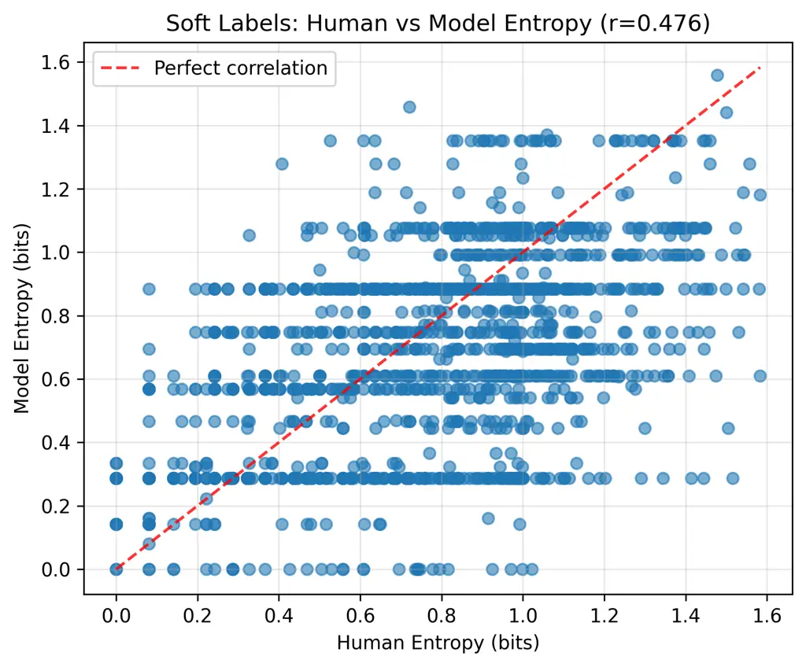  | 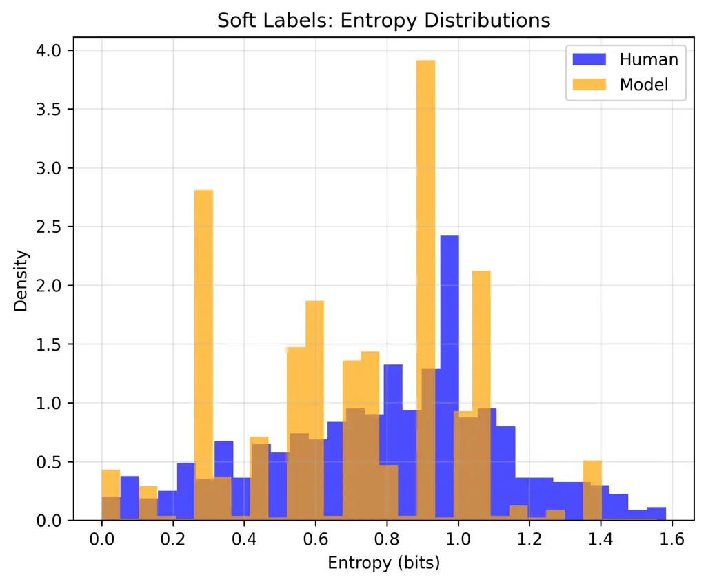  |
| \(a\) Correlation of human and model entropy                 | \(b\) Entropy Distribution                                   |
| 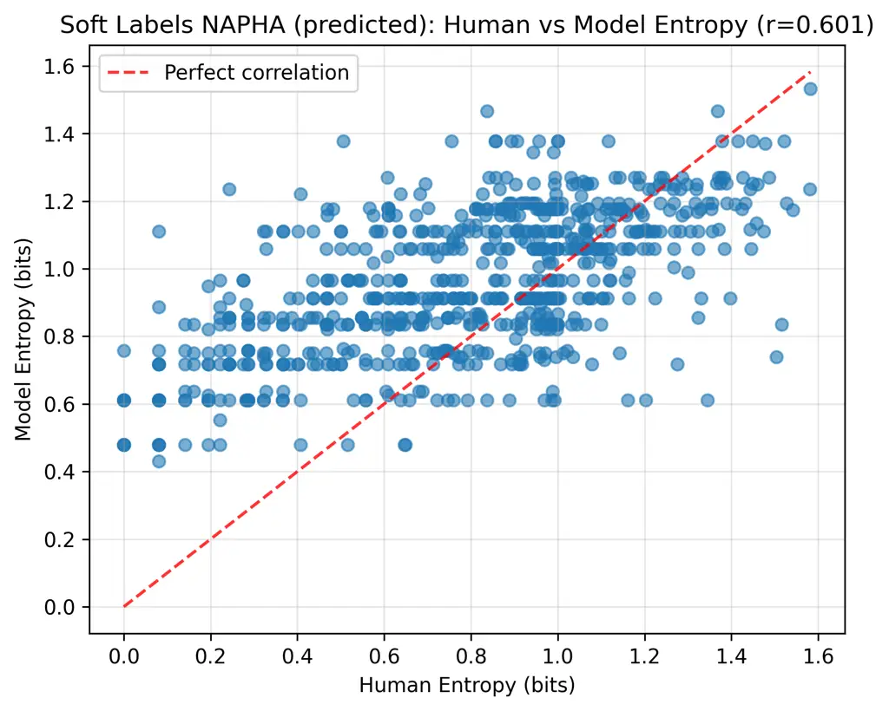 | 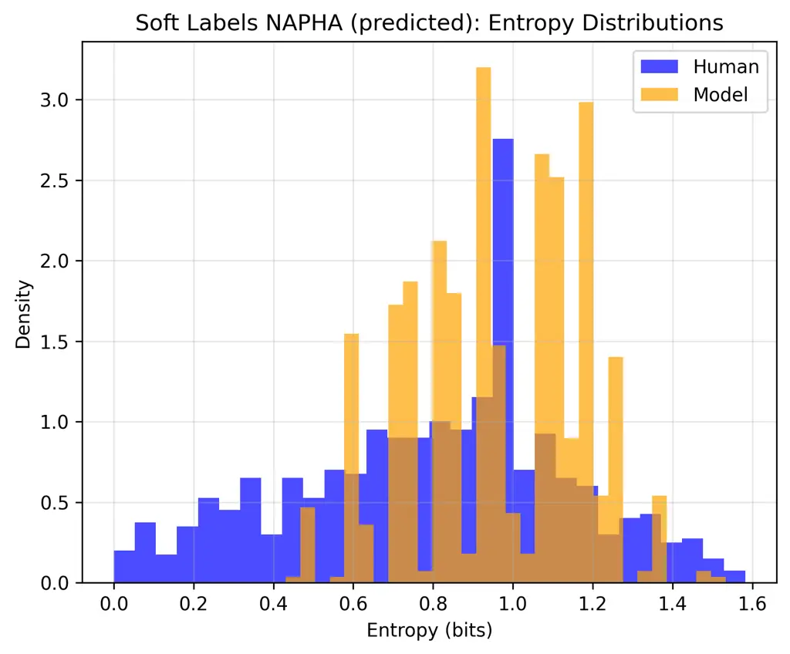 |
| \(d\) Correlation of human and model entropy                 | \(d\) Entropy Distribution                                   |
| 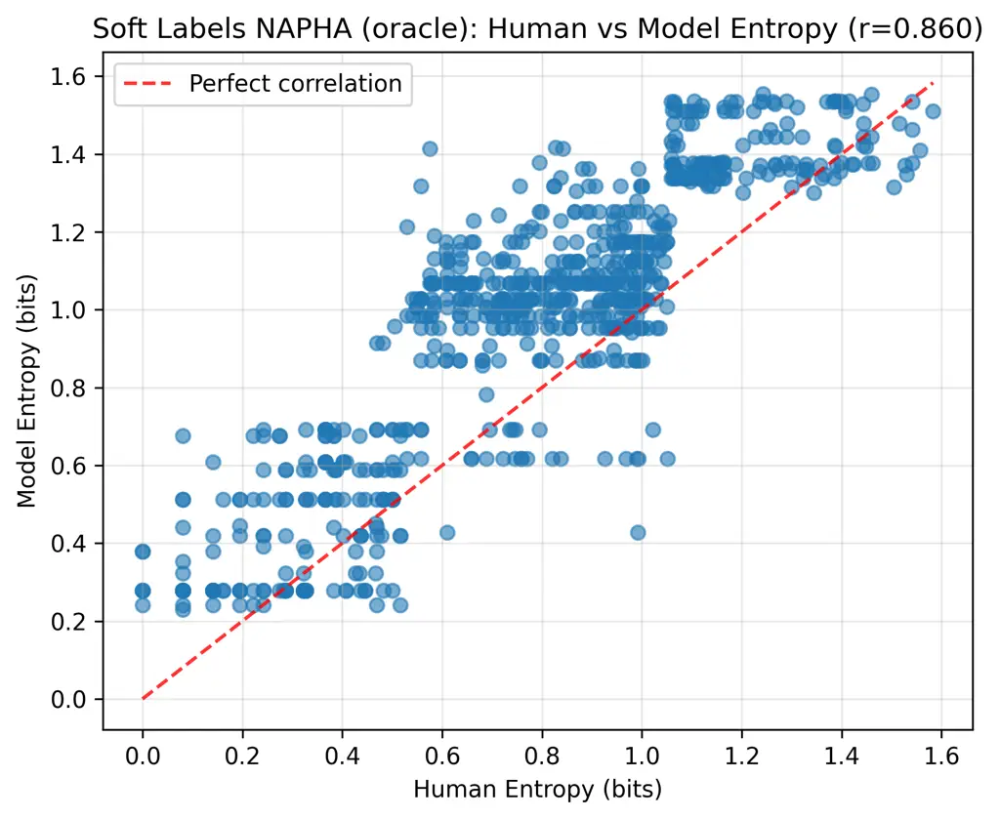 | 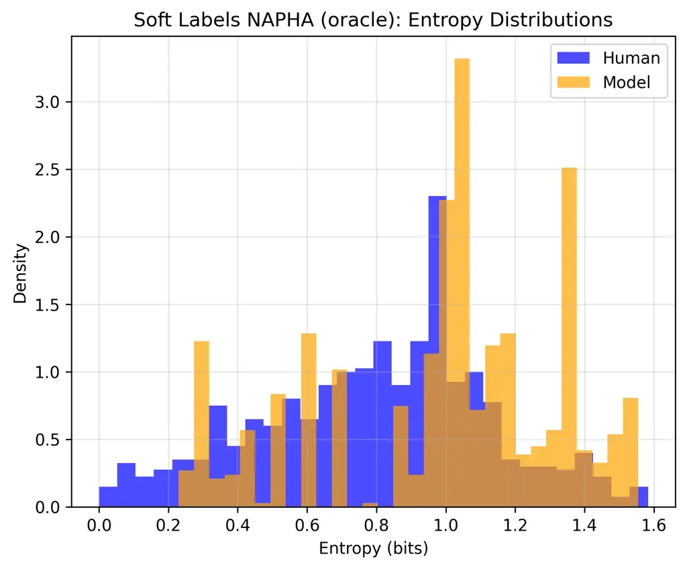 |
| \(e\) Correlation of human and model entropy                 | \(f\) Entropy Distribution                                   |

Figure 4: Analysis of entropy across the predictions. Top: Without
NAPHA. Middle: With NAPHA with predicted entropy classes. Bottom: With
NAPHA with oracle entropy classes.

[TABLE]

Table 10: Weighted Average F1 Score for the classification of the
entropy class.

## Appendix F Ablations

First, Tab. 11 shows the performance of post-hoc alignment without being
entropy-aware. Next, Tab. 12 shows the performance when using oracle
entropy-classes during training of the NAPHA alignment models, but
predicted entropy-classes during test-set inference. In Tab. 13 we
include results when using different test-train splits. Finally, Tab. 14
showcases results when using different architectures for the alignment
models. While the linear transformation and temperature scaling Guo et
al. (2017) show slightly worse performance, the Dirichlet calibration
Kull et al. (2019) presents with virtually the same performance. Thus,
we consider both using a neural network and Dirichlet calibration as
equally valid choices for the post-hoc alignment model architecture.

|             | Average               |                    | Low                   |                    | Medium                |                    | High                  |                    |
| ----------- | --------------------- | ------------------ | --------------------- | ------------------ | --------------------- | ------------------ | --------------------- | ------------------ |
| Dataset     | DistCE $`\downarrow`$ | JSD $`\downarrow`$ | DistCE $`\downarrow`$ | JSD $`\downarrow`$ | DistCE $`\downarrow`$ | JSD $`\downarrow`$ | DistCE $`\downarrow`$ | JSD $`\downarrow`$ |
| ChaosNLI    | 0.185                 | 0.203              | 0.204                 | 0.235              | 0.169                 | 0.189              | 0.209                 | 0.205              |
| Anecdotes   | 0.268                 | 0.288              | 0.216                 | 0.285              | 0.294                 | 0.313              | 0.294                 | 0.262              |
| DynaSent    | 0.278                 | 0.310              | 0.252                 | 0.319              | 0.278                 | 0.336              | 0.306                 | 0.271              |
| SummEval    | 0.297                 | 0.352              | \-                    | \-                 | \-                    | \-                 | \-                    | \-                 |
| TopicalChat | 0.355                 | 0.376              | \-                    | \-                 | \-                    | \-                 | \-                    | \-                 |

Table 11: Using Post-hoc alignment without being entropy-aware. Thus,
only one alignment model is used for all datapoints. Results shown for
base model SLP-SE.

|             | Average               |                    | Low                   |                    | Medium                |                    | High                  |                    |
| ----------- | --------------------- | ------------------ | --------------------- | ------------------ | --------------------- | ------------------ | --------------------- | ------------------ |
| Dataset     | DistCE $`\downarrow`$ | JSD $`\downarrow`$ | DistCE $`\downarrow`$ | JSD $`\downarrow`$ | DistCE $`\downarrow`$ | JSD $`\downarrow`$ | DistCE $`\downarrow`$ | JSD $`\downarrow`$ |
| ChaosNLI    | 0.189                 | 0.219              | 0.130                 | 0.191              | 0.202                 | 0.228              | 0.218                 | 0.220              |
| Anecdotes   | 0.289                 | 0.306              | 0.285                 | 0.332              | 0.295                 | 0.315              | 0.287                 | 0.266              |
| DynaSent    | 0.269                 | 0.308              | 0.196                 | 0.281              | 0.275                 | 0.335              | 0.336                 | 0.305              |
| SummEval    | 0.320                 | 0.371              | \-                    | \-                 | \-                    | \-                 | \-                    | \-                 |
| TopicalChat | 0.383                 | 0.401              | \-                    | \-                 | \-                    | \-                 | \-                    | \-                 |

Table 12: Using oracle entropy labels for training, and predicted labels
for testing. Results shown for base model SLP-SE.

|           |            | Average               |                    | Low                   |                    | Medium                |                    | High                  |                    |
| --------- | ---------- | --------------------- | ------------------ | --------------------- | ------------------ | --------------------- | ------------------ | --------------------- | ------------------ |
| Dataset   | Training % | DistCE $`\downarrow`$ | JSD $`\downarrow`$ | DistCE $`\downarrow`$ | JSD $`\downarrow`$ | DistCE $`\downarrow`$ | JSD $`\downarrow`$ | DistCE $`\downarrow`$ | JSD $`\downarrow`$ |
| ChaosNLI  | 50%        | 0.171                 | 0.197              | 0.140                 | 0.188              | 0.171                 | 0.196              | 0.206                 | 0.208              |
|           | 25%        | 0.170                 | 0.196              | 0.150                 | 0.200              | 0.166                 | 0.192              | 0.201                 | 0.201              |
|           | 10%        | 0.170                 | 0.198              | 0.138                 | 0.190              | 0.169                 | 0.198              | 0.205                 | 0.205              |
|           | 5%         | 0.176                 | 0.202              | 0.139                 | 0.190              | 0.177                 | 0.199              | 0.215                 | 0.224              |
| Anecdotes | 50%        | 0.271                 | 0.293              | 0.227                 | 0.295              | 0.285                 | 0.316              | 0.301                 | 0.268              |
|           | 25%        | 0.272                 | 0.294              | 0.208                 | 0.281              | 0.285                 | 0.317              | 0.322                 | 0.283              |
|           | 10%        | 0.271                 | 0.294              | 0.212                 | 0.287              | 0.303                 | 0.322              | 0.300                 | 0.271              |
|           | 5%         | 0.287                 | 0.306              | 0.246                 | 0.310              | 0.311                 | 0.330              | 0.303                 | 0.276              |
| DynaSent  | 50%        | 0.264                 | 0.305              | 0.211                 | 0.296              | 0.299                 | 0.349              | 0.279                 | 0.264              |
|           | 25%        | 0.281                 | 0.314              | 0.270                 | 0.330              | 0.285                 | 0.341              | 0.287                 | 0.265              |
|           | 10%        | 0.263                 | 0.305              | 0.207                 | 0.294              | 0.285                 | 0.341              | 0.296                 | 0.275              |
|           | 5%         | 0.264                 | 0.304              | 0.198                 | 0.286              | 0.281                 | 0.336              | 0.312                 | 0.288              |

Table 13: Ablation on percentage of data used to train NAPHA. Results
shown for base model SLP-SE.

|             |                       |                       |        |                     |        |                      |        |           |        |
| ----------- | --------------------- | --------------------- | ------ | ------------------- | ------ | -------------------- | ------ | --------- | ------ |
|             | Alignment Model       | Linear Transformation |        | Temperature Scaling |        | Param. Temp. Scaling |        | Dirichlet |        |
|             | Alignment             | NAPHA                 |        | NAPHA               |        | NAPHA                |        | NAPHA     |        |
|             | Entropy Labels        | predicted             | oracle | predicted           | oracle | predicted            | oracle | predicted | oracle |
| Anecdotes   | DistCE $`\downarrow`$ | 0.285                 | 0.191  | 0.365               | 0.265  | 0.310                | 0.320  | 0.267     | 0.176  |
|             | JSD $`\downarrow`$    | 0.302                 | 0.238  | 0.366               | 0.300  | 0.347                | 0.336  | 0.291     | 0.228  |
| ChaosNLI    | DistCE $`\downarrow`$ | 0.192                 | 0.182  | 0.232               | 0.199  | 0.215                | 0.216  | 0.171     | 0.149  |
|             | JSD $`\downarrow`$    | 0.217                 | 0.210  | 0.244               | 0.226  | 0.231                | 0.231  | 0.197     | 0.184  |
| DynaSent    | DistCE $`\downarrow`$ | 0.281                 | 0.216  | 0.341               | 0.225  | 0.277                | 0.286  | 0.265     | 0.168  |
|             | JSD $`\downarrow`$    | 0.317                 | 0.279  | 0.353               | 0.275  | 0.323                | 0.330  | 0.305     | 0.244  |
| SummEval    | DistCE $`\downarrow`$ | 0.319                 | 0.274  | 0.386               | 0.411  | 0.386                | 0.375  | 0.306     | 0.257  |
|             | JSD $`\downarrow`$    | 0.368                 | 0.339  | 0.434               | 0.444  | 0.448                | 0.442  | 0.360     | 0.333  |
| TopicalChat | DistCE $`\downarrow`$ | 0.357                 | 0.322  | 0.357               | 0.322  | 0.319                | 0.322  | 0.357     | 0.322  |
|             | JSD $`\downarrow`$    | 0.383                 | 0.366  | 0.383               | 0.366  | 0.366                | 0.380  | 0.383     | 0.366  |

Table 14: Ablation study on using different alignment model
architectures. Results shown for base model SLP-SE.

## Appendix G Leave-One-Out Bootstrapping

To estimate the human performance, we modify the bootstrapping approach
from Bavaresco et al. (2025) to a leave-one-out bootstrapping. Given the
small number (3) of annotators for these two datasets, we need to
measure with the leave-one-out mechanism. Otherwise, the estimation of
human performance would be too optimistic, since $`\frac{1}{3}`$ of the
value that a single annotator is being compared to, is his own judgment,
introducing a statistical bias. We average the results of 1000
iterations to estimate the human performance. In each iteration, one
annotator is randomly picked. This single annotator judgment is then
compared to the aggregated judgment from the other two annotators. In
our case, we calculate the Kendall’s $`\tau`$ correlation. This process
is similar to how the alt-test Calderon et al. (2025) estimates the
human performance.

## Appendix H Results with other Backbone LLMs

While our results mainly focus on using Claude-4-Sonnet as a backbone
LLM, we also report results with GPT-OSS-120B Agarwal et al. (2025) and
Qwen3-32B Yang et al. (2025).

For the _hard-label_ predictions, the results are shown in Tab. 15. The
soft-label predictions are shown in Tables 16 to 20.

| Base Model   | Dataset / Entropy class | Low $`H`$ | Medium $`H`$ | High $`H`$ |
| ------------ | ----------------------- | --------- | ------------ | ---------- |
| GPT-OSS-120B | ChaosNLI                | 0.93      | 0.77         | 0.56       |
|              | Anecdotes               | 0.35      | 0.38         | 0.28       |
|              | DynaSent                | 0.96      | 0.81         | 0.39       |
| Qwen3-32B    | ChaosNLI                | 0.92      | 0.74         | 0.59       |
|              | Anecdotes               | 0.66      | 0.41         | 0.22       |
|              | DynaSent                | 0.96      | 0.80         | 0.40       |

Table 15: Results from _hard-label_ predictions from GPT-OSS-120B and
Qwen3-32B, stratified by entropy class. Reporting macro-Average F1
Scores.

|              |            |           |                | Average               |                    | Low $`H`$             |                    | Medium $`H`$          |                    | High $`H`$            |                    |
| ------------ | ---------- | --------- | -------------- | --------------------- | ------------------ | --------------------- | ------------------ | --------------------- | ------------------ | --------------------- | ------------------ |
| Backbone     | Base model | Alignment | Entropy Labels | DistCE $`\downarrow`$ | JSD $`\downarrow`$ | DistCE $`\downarrow`$ | JSD $`\downarrow`$ | DistCE $`\downarrow`$ | JSD $`\downarrow`$ | DistCE $`\downarrow`$ | JSD $`\downarrow`$ |
| GPT-OSS-120B | SLP-SE     | none      | none           | 0.365                 | 0.376              | 0.289                 | 0.363              | 0.376                 | 0.392              | 0.431                 | 0.372              |
|              |            | NAPHA     | predicted      | $`0.321`$ (0.001)     | $`0.327`$ (0.001)  | $`0.331`$ (0.004)     | $`0.367`$ (0.002)  | $`0.325`$ (0.002)     | $`0.333`$ (0.001)  | $`0.305`$ (0.003)     | $`0.273`$ (0.002)  |
|              |            | NAPHA     | oracle         | $`0.222`$ (0.002)     | $`0.265`$ (0.001)  | $`0.140`$ (0.005)     | $`0.247`$ (0.002)  | $`0.314`$ (0.002)     | $`0.325`$ (0.001)  | $`0.210`$ (0.000)     | $`0.210`$ (0.000)  |
|              | SimAnn     | none      | none           | 0.374                 | 0.420              | 0.150                 | 0.281              | 0.410                 | 0.437              | 0.564                 | 0.508              |
|              |            | NAPHA     | predicted      | $`0.315`$ (0.001)     | $`0.325`$ (0.001)  | $`0.322`$ (0.003)     | $`0.361`$ (0.002)  | $`0.302`$ (0.001)     | $`0.325`$ (0.001)  | $`0.321`$ (0.003)     | $`0.285`$ (0.002)  |
|              |            | NAPHA     | oracle         | $`0.205`$ (0.001)     | $`0.254`$ (0.001)  | $`0.109`$ (0.003)     | $`0.222`$ (0.002)  | $`0.296`$ (0.002)     | $`0.317`$ (0.002)  | $`0.210`$ (0.001)     | $`0.210`$ (0.001)  |
| Qwen3-32B    | SLP-SE     | none      | none           | 0.3910                | 0.396              | 0.397                 | 0.424              | 0.402                 | 0.408              | 0.373                 | 0.351              |
|              |            | NAPHA     | predicted      | $`0.333`$ (0.001)     | $`0.336`$ (0.001)  | $`0.364`$ (0.003)     | $`0.387`$ (0.002)  | $`0.330`$ (0.001)     | $`0.339`$ (0.001)  | $`0.304`$ (0.002)     | $`0.272`$ (0.002)  |
|              |            | NAPHA     | oracle         | $`0.237`$ (0.002)     | $`0.278`$ (0.001)  | $`0.164`$ (0.005)     | $`0.271`$ (0.002)  | $`0.333`$ (0.001)     | $`0.336`$ (0.001)  | $`0.213`$ (0.000)     | $`0.214`$ (0.000)  |
|              | SimAnn     | none      | none           | 0.533                 | 0.515              | 0.566                 | 0.566              | 0.534                 | 0.508              | 0.499                 | 0.467              |
|              |            | NAPHA     | predicted      | $`0.359`$ (0.001)     | $`0.369`$ (0.001)  | $`0.351`$ (0.005)     | $`0.386`$ (0.003)  | $`0.369`$ (0.002)     | $`0.374`$ (0.002)  | $`0.359`$ (0.004)     | $`0.346`$ (0.003)  |
|              |            | NAPHA     | oracle         | $`0.351`$ (0.001)     | $`0.347`$ (0.001)  | $`0.402`$ (0.004)     | $`0.409`$ (0.002)  | $`0.337`$ (0.001)     | $`0.342`$ (0.001)  | $`0.315`$ (0.004)     | $`0.280`$ (0.003)  |

Table 16: Results Table Anecdotes soft-labels with GPT-OSS-120B and
Qwen3-32B backbones.

|              |            |           |                | Average               |                    | Low $`H`$             |                    | Medium $`H`$          |                    | High $`H`$            |                    |
| ------------ | ---------- | --------- | -------------- | --------------------- | ------------------ | --------------------- | ------------------ | --------------------- | ------------------ | --------------------- | ------------------ |
| Backbone     | Base model | Alignment | Entropy Labels | DistCE $`\downarrow`$ | JSD $`\downarrow`$ | DistCE $`\downarrow`$ | JSD $`\downarrow`$ | DistCE $`\downarrow`$ | JSD $`\downarrow`$ | DistCE $`\downarrow`$ | JSD $`\downarrow`$ |
| GPT-OSS-120B | SLP-SE     | none      | none           | 0.222                 | 0.256              | 0.094                 | 0.188              | 0.230                 | 0.261              | 0.338                 | 0.301              |
|              |            | NAPHA     | predicted      | $`0.201`$ (0.001)     | $`0.220`$ (0.001)  | $`0.201`$ (0.003)     | $`0.236`$ (0.002)  | $`0.191`$ (0.001)     | $`0.213`$ (0.001)  | $`0.229`$ (0.002)     | $`0.221`$ (0.001)  |
|              |            | NAPHA     | oracle         | $`0.171`$ (0.001)     | $`0.202`$ (0.001)  | $`0.103`$ (0.003)     | $`0.182`$ (0.003)  | $`0.189`$ (0.002)     | $`0.211`$ (0.002)  | $`0.191`$ (0.001)     | $`0.196`$ (0.001)  |
|              | SimAnn     | none      | none           | 0.260                 | 0.313              | 0.092                 | 0.187              | 0.275                 | 0.320              | 0.397                 | 0.390              |
|              |            | NAPHA     | predicted      | $`0.205`$ (0.001)     | $`0.230`$ (0.001)  | $`0.197`$ (0.003)     | $`0.234`$ (0.002)  | $`0.200`$ (0.001)     | $`0.230`$ (0.001)  | $`0.230`$ (0.002)     | $`0.226`$ (0.001)  |
|              |            | NAPHA     | oracle         | $`0.168`$ (0.001)     | $`0.205`$ (0.001)  | $`0.067`$ (0.004)     | $`0.147`$ (0.004)  | $`0.198`$ (0.001)     | $`0.226`$ (0.001)  | $`0.187`$ (0.001)     | $`0.195`$ (0.001)  |
| Qwen3-32B    | SLP-SE     | none      | none           | 0.319                 | 0.323              | 0.207                 | 0.279              | 0.342                 | 0.334              | 0.374                 | 0.333              |
|              |            | NAPHA     | predicted      | $`0.216`$ (0.001)     | $`0.227`$ (0.001)  | $`0.240`$ (0.004)     | $`0.263`$ (0.003)  | $`0.208`$ (0.001)     | $`0.215`$ (0.001)  | $`0.212`$ (0.002)     | $`0.216`$ (0.002)  |
|              |            | NAPHA     | oracle         | $`0.195`$ (0.001)     | $`0.209`$ (0.001)  | $`0.144`$ (0.004)     | $`0.215`$ (0.003)  | $`0.215`$ (0.002)     | $`0.211`$ (0.002)  | $`0.193`$ (0.002)     | $`0.196`$ (0.001)  |
|              | SimAnn     | none      | none           | 0.224                 | 0.271              | 0.102                 | 0.192              | 0.236                 | 0.276              | 0.319                 | 0.324              |
|              |            | NAPHA     | predicted      | $`0.206`$ (0.001)     | $`0.224`$ (0.001)  | $`0.226`$ (0.004)     | $`0.256`$ (0.002)  | $`0.195`$ (0.002)     | $`0.216`$ (0.001)  | $`0.216`$ (0.002)     | $`0.211`$ (0.002)  |
|              |            | NAPHA     | oracle         | $`0.173`$ (0.002)     | $`0.201`$ (0.001)  | $`0.106`$ (0.006)     | $`0.185`$ (0.004)  | $`0.194`$ (0.002)     | $`0.210`$ (0.002)  | $`0.184`$ (0.001)     | $`0.188`$ (0.001)  |

Table 17: Results Table ChaosNLI soft-labels with GPT-OSS-120B and
Qwen3-32B backbones.

|              |            |           |                | Average               |                    | Low $`H`$             |                    | Medium $`H`$          |                    | High $`H`$            |                    |
| ------------ | ---------- | --------- | -------------- | --------------------- | ------------------ | --------------------- | ------------------ | --------------------- | ------------------ | --------------------- | ------------------ |
| Backbone     | Base model | Alignment | Entropy Labels | DistCE $`\downarrow`$ | JSD $`\downarrow`$ | DistCE $`\downarrow`$ | JSD $`\downarrow`$ | DistCE $`\downarrow`$ | JSD $`\downarrow`$ | DistCE $`\downarrow`$ | JSD $`\downarrow`$ |
| GPT-OSS-120B | SLP-SE     | none      | none           | 0.277                 | 0.317              | 0.133                 | 0.234              | 0.256                 | 0.321              | 0.443                 | 0.378              |
|              |            | NAPHA     | predicted      | $`0.288`$ (0.001)     | $`0.322`$ (0.001)  | $`0.268`$ (0.006)     | $`0.333`$ (0.004)  | $`0.307`$ (0.002)     | $`0.355`$ (0.001)  | $`0.288`$ (0.005)     | $`0.273`$ (0.003)  |
|              |            | NAPHA     | oracle         | $`0.175`$ (0.003)     | $`0.250`$ (0.002)  | $`0.067`$ (0.008)     | $`0.175`$ (0.007)  | $`0.277`$ (0.006)     | $`0.338`$ (0.003)  | $`0.179`$ (0.001)     | $`0.204`$ (0.000)  |
|              | SimAnn     | none      | none           | 0.304                 | 0.375              | 0.035                 | 0.142              | 0.277                 | 0.346              | 0.600                 | 0.532              |
|              |            | NAPHA     | predicted      | $`0.305`$ (0.002)     | $`0.330`$ (0.001)  | $`0.293`$ (0.007)     | $`0.345`$ (0.004)  | $`0.280`$ (0.003)     | $`0.341`$ (0.002)  | $`0.341`$ (0.004)     | $`0.301`$ (0.003)  |
|              |            | NAPHA     | oracle         | $`0.165`$ (0.004)     | $`0.242`$ (0.003)  | $`0.063`$ (0.010)     | $`0.173`$ (0.008)  | $`0.250`$ (0.005)     | $`0.322`$ (0.003)  | $`0.181`$ (0.001)     | $`0.204`$ (0.001)  |
| Qwen3-32B    | SLP-SE     | none      | none           | 0.277                 | 0.317              | 0.133                 | 0.234              | 0.256                 | 0.321              | 0.443                 | 0.378              |
|              |            | NAPHA     | predicted      | $`0.288`$ (0.001)     | $`0.322`$ (0.001)  | $`0.268`$ (0.006)     | $`0.333`$ (0.004)  | $`0.307`$ (0.002)     | $`0.355`$ (0.001)  | $`0.288`$ (0.005)     | $`0.273`$ (0.003)  |
|              |            | NAPHA     | oracle         | $`0.175`$ (0.003)     | $`0.250`$ (0.002)  | $`0.067`$ (0.008)     | $`0.175`$ (0.007)  | $`0.277`$ (0.006)     | $`0.338`$ (0.003)  | $`0.179`$ (0.001)     | $`0.204`$ (0.000)  |
|              | SimAnn     | none      | none           | 0.291                 | 0.359              | 0.037                 | 0.134              | 0.281                 | 0.346              | 0.553                 | 0.499              |
|              |            | NAPHA     | predicted      | $`0.293`$ (0.001)     | $`0.321`$ (0.001)  | $`0.269`$ (0.006)     | $`0.330`$ (0.004)  | $`0.281`$ (0.002)     | $`0.340`$ (0.001)  | $`0.329`$ (0.004)     | $`0.293`$ (0.003)  |
|              |            | NAPHA     | oracle         | $`0.167`$ (0.003)     | $`0.245`$ (0.002)  | $`0.058`$ (0.008)     | $`0.166`$ (0.008)  | $`0.267`$ (0.005)     | $`0.332`$ (0.003)  | $`0.176`$ (0.002)     | $`0.203`$ (0.001)  |

Table 18: Results Table DynaSent soft-labels with GPT-OSS-120B and
Qwen3-32B backbones.

|              |            |           |                | Average               |                    |
| ------------ | ---------- | --------- | -------------- | --------------------- | ------------------ |
| Backbone     | Base model | Alignment | Entropy Labels | DistCE $`\downarrow`$ | JSD $`\downarrow`$ |
| GPT-OSS-120B | SLP-SE     | none      | none           | 0.482                 | 0.506              |
|              |            | NAPHA     | predicted      | 0.330                 | 0.379              |
|              |            | NAPHA     | oracle         | 0.282                 | 0.349              |
|              | SimAnn     | none      | none           | 0.524                 | 0.530              |
|              |            | NAPHA     | predicted      | 0.309                 | 0.362              |
|              |            | NAPHA     | oracle         | 0.264                 | 0.334              |
| Qwen3-32B    | SLP-SE     | none      | none           | 0.338                 | 0.424              |
|              |            | NAPHA     | predicted      | none^(∗)              | none^(∗)           |
|              |            | NAPHA     | oracle         | 0.297                 | 0.359              |
|              | SimAnn     | none      | none           | 0.469                 | 0.501              |
|              |            | NAPHA     | predicted      | 0.307                 | 0.361              |
|              |            | NAPHA     | oracle         | 0.260                 | 0.332              |

Table 19: Results Table SummEval soft-labels with GPT-OSS-120B and
Qwen3-32B backbones.^(∗): Prediction did not allow for train-test split
stratified by entropy-level. Displaying the average over the evaluation
dimensions

|              |            |           |                | Average               |                    |
| ------------ | ---------- | --------- | -------------- | --------------------- | ------------------ |
| Backbone     | Base model | Alignment | Entropy Labels | DistCE $`\downarrow`$ | JSD $`\downarrow`$ |
| GPT-OSS-120B | SLP-SE     | none      | none           | 0.355                 | 0.379              |
|              |            | NAPHA     | predicted      | none^(∗)              | none^(∗)           |
|              |            | NAPHA     | oracle         | 0.244                 | 0.309              |
|              | SimAnn     | none      | none           | 0.365                 | 0.409              |
|              |            | NAPHA     | predicted      | 0.301                 | 0.338              |
|              |            | NAPHA     | oracle         | 0.225                 | 0.295              |
| Qwen3-32B    | SLP-SE     | none      | none           | 0.405                 | 0.472              |
|              |            | NAPHA     | predicted      | none^(∗)              | none^(∗)           |
|              |            | NAPHA     | oracle         | 0.369                 | 0.400              |
|              | SimAnn     | none      | none           | 0.304                 | 0.358              |
|              |            | NAPHA     | predicted      | 0.312                 | 0.347              |
|              |            | NAPHA     | oracle         | 0.236                 | 0.306              |

Table 20: Results Table TopicalChat soft-labels with GPT-OSS-120B and
Qwen3-32B backbones.^(∗): Prediction did not allow for train-test split
stratified by entropy-level. Displaying the average over the evaluation
dimensions

## Appendix I Case Studies

We present two case studies and their discussion in Figures 5 and 6.

Case. Title: AITA for expecting one of my family members to pay for my
painting? Situation: My uncle wants a portrait done of his sons.
Painting is hard and very time consuming when you take it seriously. As
much as I am passionate about it, when I paint something I wasn’t
motivate to do in the first place, I need a motivation and that is
commission! So I tell my uncle I will charge him the rate I charge my
other clients. He gets upset and insists I do it for free because it’s a
family thing. I’m a college student. Painting supplies are expensive,
not to mention tuition. And most importantly, my time is valuable during
this phase of my life.

LLM Response.

> The author is a college student who paints and charges clients for
> commissioned work. Their uncle wants a portrait of his sons and
> expects it to be done for free because they are family. The author
> wants to charge their normal rate, citing that painting supplies are
> expensive, they need money for tuition, and their time is valuable.
>
> Key considerations:
>
> - •
>   The author has established rates for their painting services
> - •
>   They are a college student with financial needs (tuition, supplies)
> - •
>   The uncle is requesting a service that normally costs money
> - •
>   The uncle expects free work solely based on family relationship
> - •
>   The author treats this as their business/source of income
>
> The author is not wrong for:
>
> - •
>   Wanting to be paid for their skilled work and time
> - •
>   Treating family clients the same as other clients professionally
> - •
>   Needing income as a college student
> - •
>   Valuing their artistic services appropriately
>
> The uncle is wrong for:
>
> - •
>   Expecting free professional services just because of family
>   relationship
> - •
>   Getting upset when asked to pay normal rates
> - •
>   Not respecting the author’s time, skill, and financial needs
> - •
>   Pressuring family to work for free
>
> This is a clear case where the uncle is trying to exploit the family
> relationship to get free professional services, while the author is
> reasonably asking to be compensated for their work.
>
> \[AUTHOR\]: 0.05  \[OTHER\]: 0.90  \[EVERYBODY\]: 0.02  \[NOBODY\]:
> 0.02  \[INFO\]: 0.01

Discussion. The LLM makes a clear decision: the uncle (\[OTHER\]), not
the student (\[AUTHOR\]). It takes the stance that “The author is not
wrong for: Treating family clients the same as other clients
professionally.” This aligns with a more individualist cultural
perspective. Importantly, the reasoning trace completely lacks
consideration of other perspectives and cultural norms. E.g., in more
collectivist cultures, providing services to family free of charge is
more expected and highly valued. In this specific example, the LLM
prediction actually aligns with the human ground-truth. The inherent
model bias happens to match the human majority perspective.
Nevertheless, the reasoning trace shows the model is not considering
other perspectives.

Figure 5: Case study 1: Example from the Anecdotes dataset, discussing
pricing for commissioned work to family.

Case. Title: AITA for being upset my girlfriend chooses to share things
with others before me? Situation: I (24M) have a girlfriend (21F). She’s
in college studying graphic design, and she recently got a job at the
school’s newspaper. She designed the front page layout and created
illustrations. This was a big deal, (at least in my eyes). She wants to
be a graphic designer, and this is directly related to that. I am proud
of her for doing it, but I only found out about it through social media.
This is not the first time things like this have happened. I think it
boils down to of it were me, I would be so excited to share this news
with my significant other. My first action would not be to post it on
social media to let everyone else know first. So, AITA for wanting to be
the first person my SO tells news to? Or is it her news and she can tell
who she chooses?

LLM Response.

> Let me carefully analyze this situation to determine who is in the
> wrong. The author is upset that his girlfriend shares her achievements
> and news on social media before telling him directly. He feels that as
> her significant other, he should be the first person she tells
> important news to, rather than finding out through social media posts.
> Let me consider each party’s position:
>
> The girlfriend’s perspective:
>
> - •
>   She achieved something she’s proud of (getting a job at the school
>   newspaper and designing the front page)
> - •
>   She chose to share this news on social media first
> - •
>   She has the right to decide how and when to share her own news
> - •
>   There’s no indication she was intentionally trying to hurt or
>   exclude her boyfriend
>
> The author’s perspective:
>
> - •
>   He feels hurt that he wasn’t told first about his girlfriend’s
>   achievement
> - •
>   He believes significant others should share important news with each
>   other before posting on social media
> - •
>   He’s expressed this is a pattern of behavior that bothers him
>
> The key question is: Is either party doing something wrong? The
> girlfriend is not obligated to follow a specific order when sharing
> her own news. While it might be considerate to tell a significant
> other first, it’s not a requirement, and she’s not doing anything
> inherently wrong by posting on social media first.
>
> The author, while his feelings are understandable, is trying to impose
> expectations on how his girlfriend should share her own achievements.
> His desire to be told first, while natural, doesn’t make his
> girlfriend wrong for not doing so.
>
> This appears to be a case where both parties have valid perspectives,
> but neither is actually doing something wrong. It’s more about
> different communication styles and expectations in the relationship.
>
> \[AUTHOR\]: 0.15  \[OTHER\]: 0.05  \[EVERYBODY\]: 0.05  \[NOBODY\]:
> 0.70  \[INFO\]: 0.05

Discussion. In the second case study, the LLM argues that nobody is
wrong, since the situation reflects different communication styles.
However, the ground-truth is very different: roughly 2/3 see the author
in the wrong, and 1/3 the other party. The LLM gravitates toward
avoiding to assign blame to any of the two parties, providing a
conflict-averse response. The human opinions are much more polarized.

Figure 6: Case study: differing communication expectations about sharing
news (AITA).

## Appendix J Prompts

Figures 7 and 8 showcase example prompts for hard- and soft-label
prediction, respectively. These were used for the Anecdotes dataset. The
prompts for the other datasets follow the same structure and only
minimal changes were made to fit the specific task.

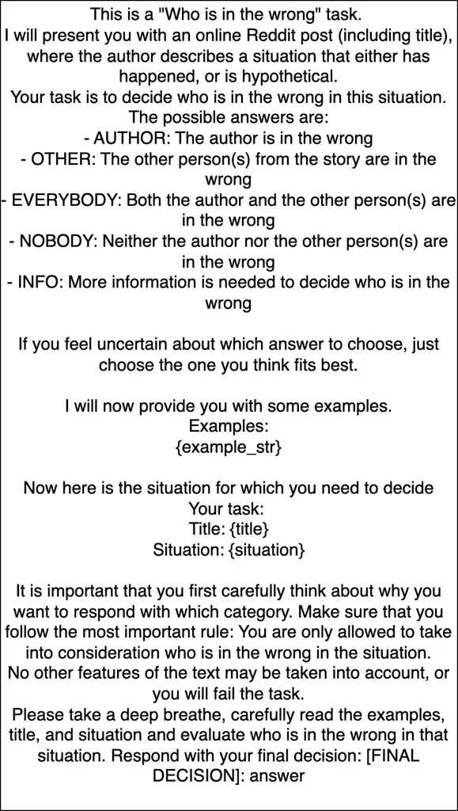

Figure 7: Example prompt for the _hard-label_ base model prediction.
Shown for the Anecdotes dataset

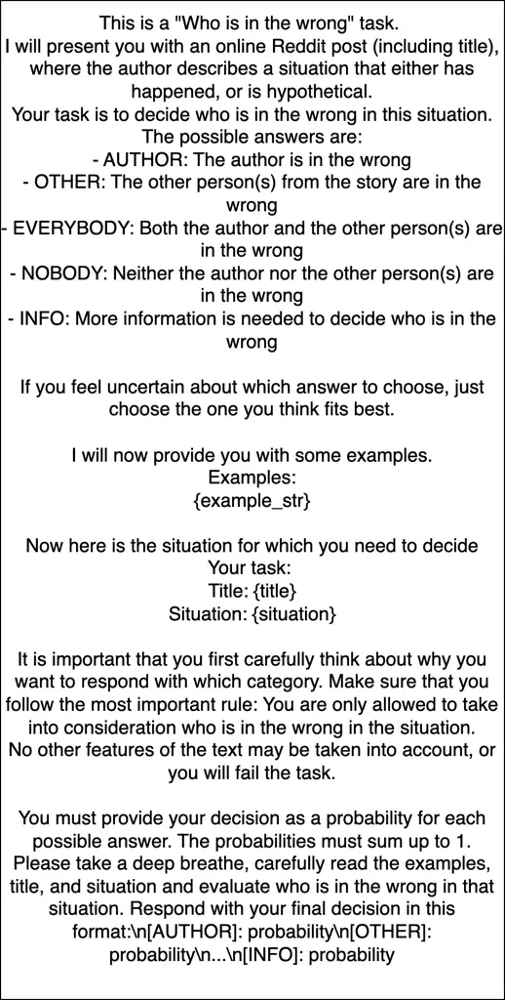

Figure 8: Example prompt for the soft-label base model prediction. Shown
for the Anecdotes dataset

## Appendix K AI Assistant Usage

We used AI assistants as coding assistance and for basic proof-reading
of our manuscript. We are solely responsible for all content.
