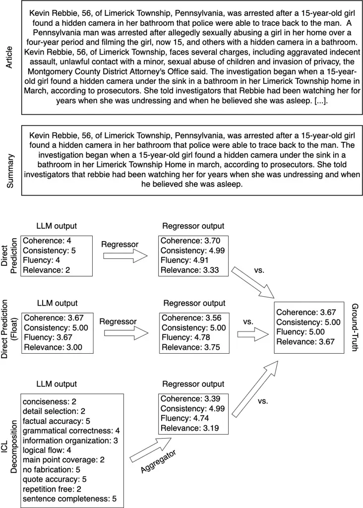
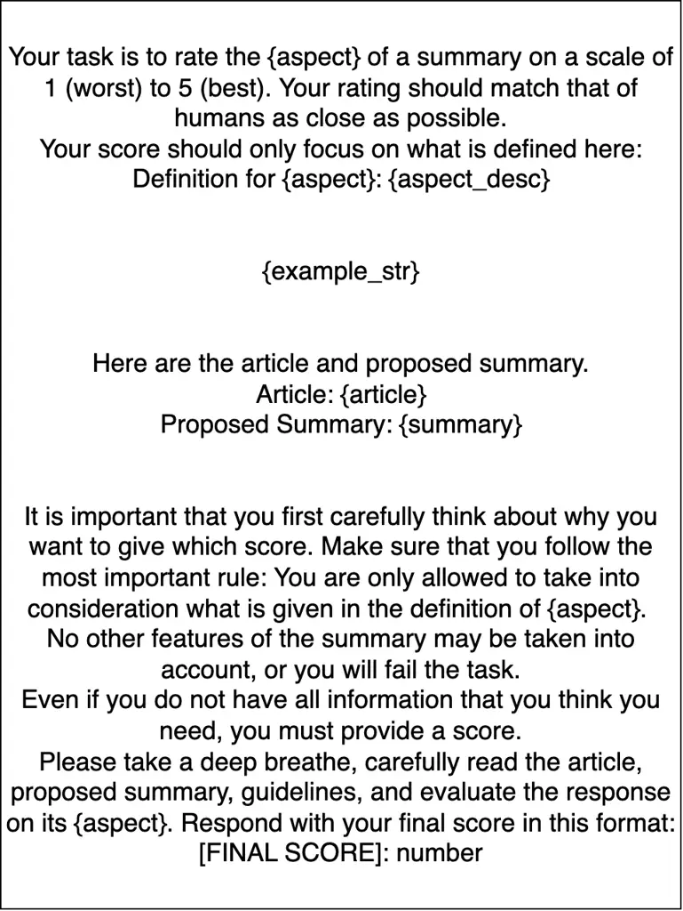
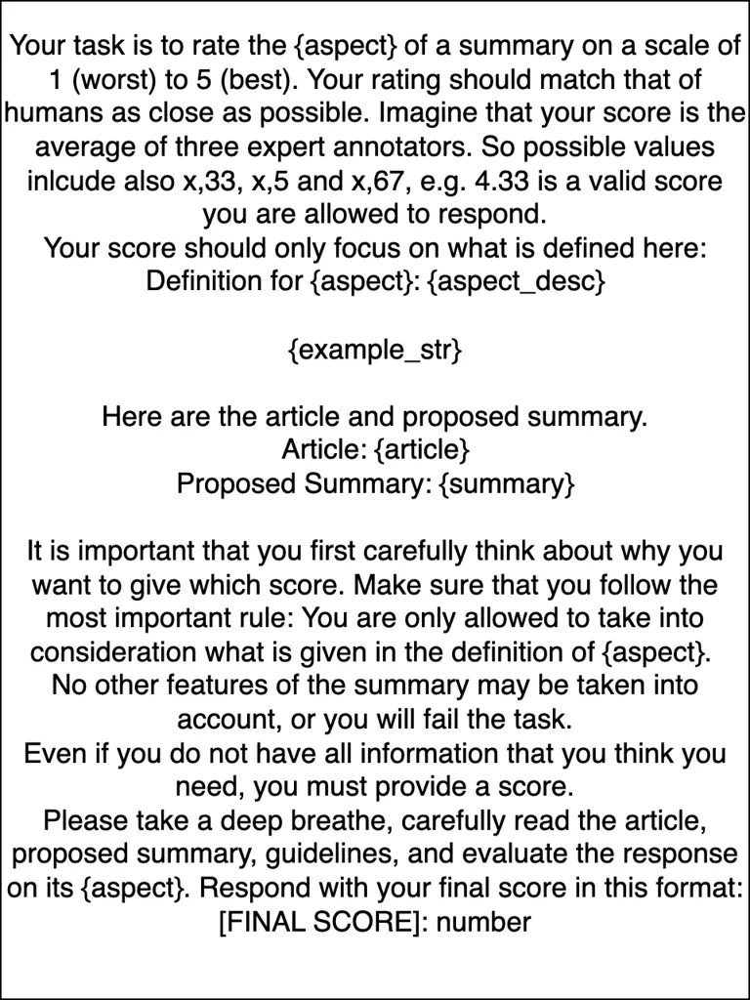
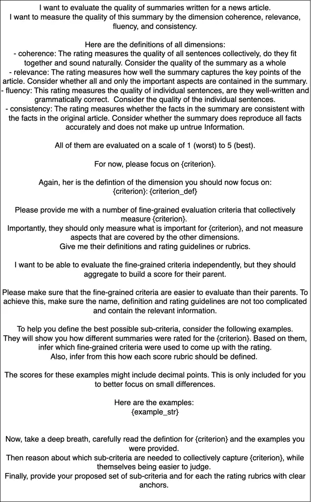
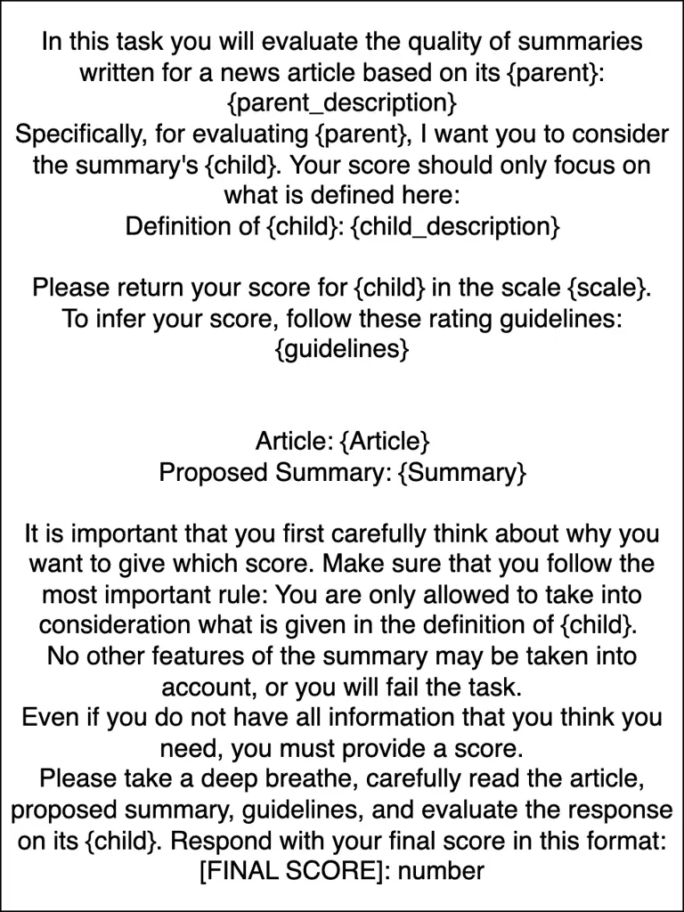
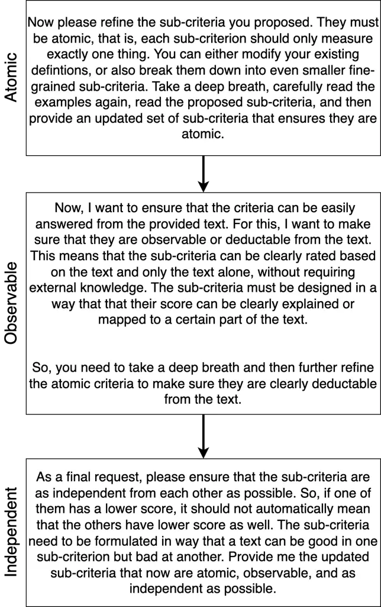

# Does task decomposition improve automatic NLG evaluation?

Sebastian Steindl Affiliation: Amazon, Barcelona, Spain    Nikos
Voskarides Affiliation: Amazon, Barcelona, Spain    Alberto Gasparin
Affiliation: Amazon, Berlin,
Germany{sebstei,nvvoskar,marchegg}@amazon.es, albgas@amazon.de    Diego
Marcheggiani Affiliation: Amazon, Barcelona, Spain

###### Abstract

The LLM-as-a-judge (LLMaJ) framework has emerged as a promising solution
for cheap, reproducible, reference-free Natural Language Generation
(NLG) evaluation. Prior work seeks to improve LLMaJ by decomposing
evaluation tasks into simpler sub-tasks. In this work, we systematically
compare LLMaJ methods with and without decomposition on multiple NLG
datasets. We find no evidence that LLMaJ with task decomposition leads
to performance gains over a fair baseline that does not use
decomposition. Instead, we find that previously reported performance
gains in decomposition-based LLMaJ stem from using human labels as
training data, and not task decomposition itself. Also, we find that,
when human labels are available, LLMaJ without using task decomposition
can perform comparably to human annotators.

## 1 Introduction

Evaluating the output quality of automatic NLG (NLG) methods is
intricate: widely used reference-based metrics such as ROUGE Lin (2004)
and BERTScore Zhang et al. (2020) rely on expensive human annotations,
operate on surface-level features, and correlate poorly with human
judgments Gehrmann et al. (2023). The LLMaJ (LLMaJ) framework Zheng et
al. (2023); Wang et al. (2023) has thus gained attention as a
reference-free alternative Gao et al. (2025). A recent line of work
proposes decomposing each evaluation criterion into simpler
sub-criteria, aiming to improve alignment with human annotations and
reduce variance across models and executions Min et al. (2023); Saha et
al. (2024); Liu et al. (2024b); Lee et al. (2025).

In this paper, we perform a systematic analysis of decomposition-based
LLMaJ (Figure 1). These methods follow a three-stage pipeline: an LLM
decomposes a given evaluation criterion (e.g., Coherence) into
subcriteria, scores each subcriterion, and an aggregator produces a
single score, either by using a learned regressor Liu et al. (2024b) or
by a simple average of subcriteria scores Lee et al. (2025). We ask
whether this decomposition step is actually beneficial. To answer this,
we construct a strong baseline that directly predicts the score for a
given criterion without decomposition, granting it access to the same
human labels used by Liu et al. (2024b) to ensure a fair comparison (we
also report results without human labels). Additionally, we attempt to
improve decomposition-based LLMaJ itself through more principled
decomposition logic and ICL (ICL) Brown et al. (2020).

Our experimental results show no evidence of decomposition-based LLMaJ
being superior to the baseline that does not use decomposition. In fact,
our analysis showed that previously reported gains of
decomposition-based LLMaJ are not due to task simplification by
decomposition, but rather due to using human labels as training data. In
summary, our main contributions are: i) a systematic comparison of
decomposition-based and direct prediction LLMaJ approaches, ii) insights
into why decomposition-based LLMaJ is not beneficial, iii) evidence that
direct prediction LLMaJ can reach human-level performance on some
evaluation criteria when using human ratings as training data.

Figure 1: Visualization of decomposition-based LLMaJ (upper part), and
Direct Prediction LLMaJ (lower part). Human labels are optional: they
are used by HD-Eval, can be used by Direct Prediction but are not used
by CheckEval. The input text $`t`$ is not shown.

## 2 Problem Statement

Given a text $`t`$ to be evaluated according to an evaluation criterion
$`d`$ (e.g. Coherence), we define the annotation score from an LLMaJ
$`f`$ as $`s=f(t,d)`$. The goal is to align $`s`$ as closely as possible
to the human score $`s^{*}=human(t,d)`$. We follow the notation from Liu
et al. (2024b) and denote with $`L_{1}`$ the set of evaluation criteria
rated by humans and with $`L_{n}`$ the set of sub-criteria after $`n-1`$
decomposition steps. For example, the $`L_{1}`$ criterion Coherence
could be broken down into the $`L_{2}`$ sub-criteria Sentence Order,
Structure, and others.

We study two approaches for predicting a score $`s`$ for an $`L_{1}`$
criterion: decomposition-based, where $`L_{1}`$ is decomposed to
sub-criteria and then aggregated back to $`L_{1}`$ to make a prediction
(Section 3), and direct prediction, where $`L_{1}`$ is predicted
directly without decomposition (Section 4).

## 3 Decomposition-based LLMaJ

Fig. 1 (upper part) shows an overview of the decomposition-based LLMaJ.
Given a text $`t`$, it first uses an LLM to decompose an $`L_{1}`$
evaluation criterion into $`L_{2}`$ sub-criteria and then score each
sub-criterion. Then, it aggregates the scores of sub-criteria to output
a single score $`s`$. We study decomposition-based approaches both when
human labels are used to train an aggregator, and when they are
withheld. Note that human annotations are only available at the
$`L_{1}`$ level; no ground-truth exists for the decomposed sub-criteria.

### 3.1 Existing approaches

Existing approaches differ along three axes: the _structure_ of the
decomposition (flat vs. hierarchical), the _scale_ used for scoring
(binary vs. ordinal), and the _aggregation_ mechanism (label-free vs.
learned).

We focus on HD-Eval Liu et al. (2024b) and CheckEval Lee et al. (2025)
as representative instantiations of this template, since they decompose
into a general set of sub-criteria rather than generating instance-level
checklists Wei et al. (2025). Both are evaluated on the same well-known
NLG benchmarks, enabling direct comparison. Related but out of scope is
LLM-Rubric Hashemi et al. (2024), which defines evaluation criteria but
trains a calibrator to map LLM scores to human scores without a
decomposition step, making it a calibration method rather than a
decomposition method. Also, Li et al. (2024) focus on pairwise
evaluation whereas we consider a single instance at a time.

#### HD-Eval Liu et al. (2024b)

HD-Eval decomposes an $`L_{1}`$ evaluation criterion into $`L_{2}`$ and
$`L_{3}`$ sub-criteria in a hierarchical manner, which are then scored
by the LLM on an ordinal scale (e.g., 1-5). As an aggregator, HD-Eval
uses a regressor trained on human labeled data (that are assumed to be
available at the $`L_{1}`$ level) to output the score $`s`$.¹¹ 1 We do
not consider Liu et al. (2024a) since it has consistently inferior
performance than HD-Eval. In our reproduction of HD-Eval we use the
$`L_{2}`$ and $`L_{3}`$ sub-criteria as input to the regressor.²² 2 Note
that, unless stated otherwise, we do not use direct $`L_{1}`$
predictions as input as they do in the original paper, since that would
not allow us to disentangle the effect of decomposition and direct
prediction. Nevertheless, we find that also using $`L_{1}`$ criteria as
input does not lead to performance gains.

#### CheckEval Lee et al. (2025)

CheckEval decomposes an $`L_{1}`$ evaluation criterion into $`L_{2}`$
sub-criteria that are binary yes/no questions. Differently from HD-Eval,
they do not use human labeled data to aggregate the $`L_{2}`$ scores.
Instead, the aggregator simply outputs the proportion of positively
answered binary questions as the score $`s`$. This approach is fully
equivalent to TICK Cook et al. (2024).

### 3.2 Proposed Extensions

We investigate two extensions to HD-Eval Liu et al. (2024b), in an
attempt to further improve the performance of decomposition-based LLMaJ.
First, we introduce Atomic, Observable, and Independent (AOI)
decomposition, which creates sub-criteria that are meant to be
uncorrelated (Atomic, Independent) and clearly derivable from the text
(Observable) (see Fig. 7). Second, we apply ICL during decomposition
Brown et al. (2020); Sanh et al. (2022); Dong et al. (2024) to guide the
LLM to infer human-aligned sub-criteria.³³ 3 Implementation details in
Appendix D.1. Both can be seen as additional decomposition variants that
extend the reasoning underlying the decomposition approach. Thus, one
would hypothesize that they lead to better decompositions and
consequently better alignment to humans.

## 4 Direct Prediction LLMaJ

We establish a strong, Direct Prediction LLMaJ baseline that predicts a
score $`s`$ for an $`L_{1}`$ evaluation criterion without decomposition
(Fig. 1, lower part). Following common practices Gao et al. (2025), the
prompt contains the criterion name and definition, the rating scale, a
CoT-inducing statement (Fig. 3), and five ICL Brown et al. (2020)
examples showcasing human evaluations at low, medium, and high scores.⁴⁴
4 Here, ICL is used for directly predicting $`L_{1}`$ scores, not for
guiding decomposition as in Section 3.2. Since this baseline directly
predicts the target $`L_{1}`$ score, no aggregation step is needed.
However, for fair comparison with HD-Eval, we also train a regressor on
the uni-dimensional LLM output using human labels, which shifts
predictions closer to the human distribution without influencing LLM
inference.⁵⁵ 5 For fair comparison with CheckEval, which uses no human
labels, we also report results without the regressor.

## 5 Experimental Setup

#### Datasets

Following Liu et al. (2024b) and Lee et al. (2025), we use SummEval
Fabbri et al. (2021) and TopicalChat Gopalakrishnan et al. (2019) as the
main datasets. Additionally, we use Seahorse Clark et al. (2023) as an
alternative summarization dataset with multiple evaluation criteria.

#### Metrics

To evaluate the quality of LLMaJ methods, we measure their alignment to
human labels for $`L_{1}`$ criteria. We follow standard practices and
report alignment as measured by correlation metrics. Concretely, we
report Spearman’s $`\rho`$.⁶⁶ 6 Pearson’s $`r`$ and Kendall’s $`\tau`$
shown in the full results in the Appendix. Moreover, we adopt the
alt-test Calderon et al. (2025) for SummEval and TopicalChat, where we
have access to scores from multiple (three) annotators. We report the
Average Advantage Probability (AP) and Winning-Rate (WR), which are both
in $`[0,1]`$ (higher is better). AP represents the probability that the
LLM annotations are as good as or better than those of a randomly chosen
annotator, and can be used to compare judges against each other. WR is
the percentage of annotators against which the LLMaJ “wins”. For the
Seahorse dataset it is not possible to use the alt-test since only one
annotation per sample is available. We thus report accuracy and
Krippendorf’s $`\alpha`$, and calculate IAA (IAA) to compare to human
labels, following Clark et al. (2023).

#### Implementation Details

We use Claude-4 (Sonnet) Anthropic (2025) with temperature $`t=0`$ as
the base LLM for our main results. We also provide results with
Qwen3-32B Yang et al. (2025) and GPT-OSS-120B Agarwal et al. (2025) in
the Appendix E. We observe generally the same trends across these
models. To ensure the best possible comparison, we re-implement
HD-Eval Liu et al. (2024b) and CheckEval Lee et al. (2025) with Claude-4
using their provided code or prompts, and additionally also include the
results reported in the original publications. We use a 50/50 train/test
split as in Liu et al. (2024b). We follow HD-Eval Liu et al. (2024b) and
experiment with different regressors: Linear Regression, Decision Tree,
Random Forest, Multilayer Perceptron (details in Appendix D.4). We
report results from the best regressor per setting. The best regressor
is selected for every evaluated setting individually and choesn by the
combination of Spearman’s $`\rho`$ and AP score. The same regressor is
used for all evaluation dimensions to ensure fair comparison. The best
regressors are shown in the full results in Tables 7 and 8. All methods
under comparison output floats.⁷⁷ 7 Float outputs gain a numerical
advantage over integer outputs through tie elimination and better fit to
float ground truths; we provide results both with and without rounding
to ensure fair comparison (Appendix D.3). We report results on a single
run, but did not observe significant variations across runs.

|                                |         |              |                  |                 |                 |                  |                 |                 |
| ------------------------------ | ------- | ------------ | ---------------- | --------------- | --------------- | ---------------- | --------------- | --------------- |
| Method                         | Decomp. | Human labels | SummEval         |                 |                 | TopicalChat      |                 |                 |
|                                |         |              | $`\rho\uparrow`$ | AP $`\uparrow`$ | WR $`\uparrow`$ | $`\rho\uparrow`$ | AP $`\uparrow`$ | WR $`\uparrow`$ |
| HD-Eval^(∗)                    | yes     | yes          | 0.535            | –               | –               | 0.638            | –               | –               |
| HD-Eval (Claude 4)             | yes     | yes          | 0.567            | 0.833           | 1.0             | 0.563            | 0.848           | 0.58            |
| HD-Eval (Claude 4) + $`L_{1}`$ | yes     | yes          | 0.560            | 0.828           | 1.0             | 0.582            | 0.843           | 0.58            |
| CheckEval^(∗) (Mistral-Large)  | yes     | no           | 0.549            | –               | –               | 0.645            | –               | –               |
| CheckEval^(∗) (GPT-4o)         | yes     | no           | 0.504            | –               | –               | 0.640            | –               | –               |
| CheckEval (Claude 4)           | yes     | no           | 0.411            | –               | –               | 0.428            | –               | –               |
| ICL Decomposition              | yes     | yes          | 0.567            | 0.842           | 1.0             | 0.575            | 0.840           | 1.0             |
| AOI Decomposition              | yes     | yes          | 0.586            | 0.831           | 1.0             | 0.574            | 0.839           | 1.0             |
| Direct Prediction              | no      | no           | 0.553            | 0.593           | 0.5             | 0.701            | 0.864           | 0.5             |
| Direct Prediction (+ICL)       | no      | no           | 0.552            | 0.638           | 0.75            | 0.716            | 0.870           | 0.58            |
| Direct Prediction              | no      | yes          | 0.560            | 0.835           | 1.0             | 0.672            | 0.885           | 1.0             |
| Direct Prediction (+ICL)       | no      | yes          | 0.545            | 0.846           | 1.0             | 0.687            | 0.888           | 1.0             |

Table 1: Main results of our study. We show the results averaged across
all criteria. We report sample-wise Spearman’s $`\rho`$, Advantage
Probability (AP), and Win-Rate (WR). Pearson’s $`r`$ and Kendall’s
$`\tau`$ are shown with the per-criterion results in the Appendix F.
Column "Decomp." refers to whether decomposition is performed. Column
"Human Labels" refers to whether human labels are used either during the
aggregation step (HD-Eval) or for aligning direct prediction scores.
Note that we do not report AP and WR for CheckEval since the output is
on a different scale than the human responses, making their calculation
not meaningful. $`{}^{\ast}:`$As originally reported.

## 6 Results and Discussion

### 6.1 Decomposition VS Direct Prediction

Table 1 shows the performance of different LLMaJ methods on the SummEval
and TopicalChat datasets. First, we see that Direct Prediction
combinations perform better or only slightly worse than the best
decomposition-based approaches, with one of them achieving the best
overall AP on both datasets. Also, we see that even the Direct
Prediction combination that does not use human labels is on par or
better than CheckEval.⁸⁸ 8 Note that our re-production of CheckEval with
the original code but with Claude-4 led to worse results than originally
reported. Nevertheless, the conclusions we make here hold even with
their best reported results. Furthermore, our proposed extensions to
decomposition-based approaches (ICL and AOI) show some marginal
improvements but do not consistently outperform Direct Prediction. Our
second main finding is that using human labels for Direct Prediction
leads to improved performance. Part of the improvement can be attributed
to numerical benefits from the regressor outputting floating-point
numbers. More details in Appendix D.3. Results on Seahorse (Table 2 in
Appendix A) confirm the trend: none of the decomposition-based
approaches evaluated in this work consistently outperforms the Direct
Prediction baseline.

To further test whether decomposition from $`L_{1}`$ criteria improves
performance through task simplification, we modify HD-Eval to be
$`L_{1}`$-agnostic: we ask the LLM to generate 25 general quality
criteria for the task without specifying the target $`L_{1}`$ criterion,
then train the regressor on human labels as usual. This
$`L_{1}`$-agnostic variant performs on par with both standard
decomposition and Direct Prediction (Table 3, Appendix C), indicating
that HD-Eval’s gains stem from the learned aggregation rather than
decomposition itself. This might suggest that the LLM already possesses
an internal understanding of quality that the regressor can align to
specific $`L_{1}`$ criteria.

### 6.2 How far is Direct Prediction LLMaJ from human-level performance

Table 1 shows that, even without using human labels, Direct Prediction
achieves a $`\text{WR}\geq 0.5`$ on both datasets, which is the
threshold at which LLMs are considered as good as human
annotators Calderon et al. (2025). However, when we consider
per-criterion scores instead of the average across all criteria
(Tables 7 and 8 in Appendix F), we identify criteria where Direct
Prediction LLMaJ outperforms human annotators even without using human
labels (e.g. Coherence in SummEval), whereas for other dimensions it
does not (e.g. Relevance). When using human labels, Direct Prediction
can reach a WR of 100% on both datasets, which means that the LLM is
closer to the average human rating than the humans individually Calderon
et al. (2025). Results on Seahorse are similar (see Table 2 in Appendix
A). We see that, while on average the LLMs still lack behind humans, the
difference is mostly due to two criteria, namely Grammar and Main Ideas.
On the other three criteria, Direct Prediction is close enough to humans
to consider it a valid alternative.⁹⁹ 9 A more detailed analysis is
provided in Appendix A.

## 7 Conclusion

We studied two decomposition-based LLMaJ methods for NLG evaluation
across three datasets and multiple LLMs, finding that they do not
consistently outperform a fair Direct Prediction baseline we designed.
Our analysis shows that HD-Eval’s gains stem from access to human
labels, not from task decomposition as previously claimed. Thus, despite
the intuitive appeal of decomposition Lommel et al. (2013), we find no
compelling evidence that it improves LLMaJ. Finally, we show that Direct
Prediction with human labels can reach human-level performance on some
evaluation tasks on both SummEval and TopicalChat. Future work might
study how decomposition-based evaluation performs in settings where
humans rate not only the original criteria, but also the decomposed
criteria.

## Limitations

First, the number of NLG tasks and datasets that we consider is limited,
but is consistent with the prior work we base our study upon and diverse
enough to support our conclusions. While we find no compelling evidence
that decomposition is beneficial for typical NLG tasks, this finding
does not necessarily extend to complicated, multi-step reasoning tasks.
Further, studying LLMaJ from the perspective of bias, fine-tuning, and
human-LLM-collaboration Gao et al. (2025) is out of the scope for our
work. Moreover, our replication of the CheckEval results using their
published code but replacing the LLM with Claude-4 to be consistent with
the rest of the methods led to much worse performance than reported by
Lee et al. (2025). We want to stress that our findings remain true, even
when comparing to the better, originally reported performance. Lastly, a
general limitation of our study is that we cannot determine whether the
evaluated LLMs were exposed to our benchmark datasets during
pre-training.

## References

- Agarwal et al. (2025) S. Agarwal, L. Ahmad, J. Ai, S. Altman, A.
  Applebaum, E. Arbus, R. K. Arora, Y. Bai, B. Baker, H. Bao, et al.
  Gpt-oss-120b & gpt-oss-20b model card. arXiv preprint
  arXiv:2508.10925. Cited by: Appendix E, §5.
- Anthropic (2025) Anthropic Introducing Claude 4 — anthropic.com. Note:
  [https://www.anthropic.com/news/claude-4](https://www.anthropic.com/news/claude-4)\[Accessed
  15-12-2025\] Cited by: §5.
- Brown et al. (2020) T. Brown, B. Mann, N. Ryder, M. Subbiah, J. D.
  Kaplan, P. Dhariwal, A. Neelakantan, P. Shyam, G. Sastry, A. Askell,
  et al. Language models are few-shot learners. Advances in neural
  information processing systems 33, pp. 1877–1901. Cited by: §D.1, §1,
  §3.2, §4.
- Calderon et al. (2025) N. Calderon, R. Reichart, and R. Dror The
  alternative annotator test for LLM-as-a-judge: how to statistically
  justify replacing human annotators with LLMs. In Proceedings of the
  63rd Annual Meeting of the Association for Computational Linguistics
  (Volume 1: Long Papers), W. Che, J. Nabende, E. Shutova, and M. T.
  Pilehvar (Eds.), Vienna, Austria, pp. 16051–16081. External Links:
  [Link](https://aclanthology.org/2025.acl-long.782/),
  [Document](https://dx.doi.org/10.18653/v1/2025.acl-long.782), ISBN
  979-8-89176-251-0 Cited by: §D.1, §5, §6.2.
- Clark et al. (2023) E. Clark, S. Rijhwani, S. Gehrmann, J. Maynez, R.
  Aharoni, V. Nikolaev, T. Sellam, A. Siddhant, D. Das, and A. Parikh
  SEAHORSE: a multilingual, multifaceted dataset for summarization
  evaluation. In Proceedings of the 2023 Conference on Empirical Methods
  in Natural Language Processing, H. Bouamor, J. Pino, and K. Bali
  (Eds.), Singapore, pp. 9397–9413. External Links:
  [Link](https://aclanthology.org/2023.emnlp-main.584/),
  [Document](https://dx.doi.org/10.18653/v1/2023.emnlp-main.584) Cited
  by: Table 2, Appendix A, §5, §5.
- Cook et al. (2024) J. Cook, T. Rocktäschel, J. N. Foerster, D.
  Aumiller, and A. Wang TICKing all the boxes: generated checklists
  improve LLM evaluation and generation. In Language Gamification -
  NeurIPS 2024 Workshop, External Links:
  [Link](https://openreview.net/forum?id=Q3y6QhOUnI) Cited by: §3.1.
- Dong et al. (2024) Q. Dong, L. Li, D. Dai, C. Zheng, J. Ma, R. Li, H.
  Xia, J. Xu, Z. Wu, B. Chang, X. Sun, L. Li, and Z. Sui A survey on
  in-context learning. In Proceedings of the 2024 Conference on
  Empirical Methods in Natural Language Processing, Y. Al-Onaizan, M.
  Bansal, and Y. Chen (Eds.), Miami, Florida, USA, pp. 1107–1128.
  External Links: [Link](https://aclanthology.org/2024.emnlp-main.64/),
  [Document](https://dx.doi.org/10.18653/v1/2024.emnlp-main.64) Cited
  by: §D.1, §3.2.
- Fabbri et al. (2021) A. R. Fabbri, W. Kryściński, B. McCann, C.
  Xiong, R. Socher, and D. Radev SummEval: re-evaluating summarization
  evaluation. Transactions of the Association for Computational
  Linguistics 9, pp. 391–409. External Links:
  [Link](https://aclanthology.org/2021.tacl-1.24/),
  [Document](https://dx.doi.org/10.1162/tacl%5Fa%5F00373) Cited by: §5.
- Gao et al. (2025) M. Gao, X. Hu, X. Yin, J. Ruan, X. Pu, and X. Wan
  LLM-based nlg evaluation: current status and challenges. Computational
  Linguistics 51 (2), pp. 661–687. External Links: ISSN 0891-2017,
  [Document](https://dx.doi.org/10.1162/coli%5Fa%5F00561),
  [Link](https://doi.org/10.1162/coli_a_00561),
  https://direct.mit.edu/coli/article-pdf/51/2/661/2513169/coli_a_00561.pdf
  Cited by: §1, §4, Limitations.
- Gehrmann et al. (2023) S. Gehrmann, E. Clark, and T. Sellam Repairing
  the cracked foundation: a survey of obstacles in evaluation practices
  for generated text. Journal of Artificial Intelligence Research 77,
  pp. 103–166. Cited by: §1.
- Gopalakrishnan et al. (2019) K. Gopalakrishnan, B. Hedayatnia, Q.
  Chen, A. Gottardi, S. Kwatra, A. Venkatesh, R. Gabriel, and D.
  Hakkani-Tür Topical-Chat: Towards Knowledge-Grounded Open-Domain
  Conversations. In Proc. Interspeech 2019, pp. 1891–1895. External
  Links: [Document](https://dx.doi.org/10.21437/Interspeech.2019-3079),
  [Link](http://dx.doi.org/10.21437/Interspeech.2019-3079) Cited by: §5.
- Hashemi et al. (2024) H. Hashemi, J. Eisner, C. Rosset, B. Van Durme,
  and C. Kedzie LLM-rubric: a multidimensional, calibrated approach to
  automated evaluation of natural language texts. In Proceedings of the
  62nd Annual Meeting of the Association for Computational Linguistics
  (Volume 1: Long Papers), L. Ku, A. Martins, and V. Srikumar (Eds.),
  Bangkok, Thailand, pp. 13806–13834. External Links:
  [Link](https://aclanthology.org/2024.acl-long.745/),
  [Document](https://dx.doi.org/10.18653/v1/2024.acl-long.745) Cited by:
  §3.1.
- Lee et al. (2025) Y. Lee, J. Kim, J. Kim, H. Cho, J. Kang, P. Kang,
  and N. Kim CheckEval: a reliable LLM-as-a-judge framework for
  evaluating text generation using checklists. In Proceedings of the
  2025 Conference on Empirical Methods in Natural Language
  Processing, C. Christodoulopoulos, T. Chakraborty, C. Rose, and V.
  Peng (Eds.), Suzhou, China, pp. 15771–15798. External Links:
  [Link](https://aclanthology.org/2025.emnlp-main.796/),
  [Document](https://dx.doi.org/10.18653/v1/2025.emnlp-main.796), ISBN
  979-8-89176-332-6 Cited by: §1, §1, §3.1, §3.1, §5, §5, Limitations.
- Li et al. (2024) M. Li, Z. Liu, S. Deng, S. Joty, N. F. Chen, and M.
  Kan Decompose and aggregate: a step-by-step interpretable evaluation
  framework. arXiv preprint arXiv:2405.15329. Cited by: §3.1.
- Lin (2004) C. Lin ROUGE: a package for automatic evaluation of
  summaries. In Text Summarization Branches Out, Barcelona, Spain,
  pp. 74–81. External Links: [Link](https://aclanthology.org/W04-1013/)
  Cited by: §1.
- Liu et al. (2024a) Y. Liu, T. Yang, S. Huang, Z. Zhang, H. Huang, F.
  Wei, W. Deng, F. Sun, and Q. Zhang Calibrating LLM-based evaluator. In
  Proceedings of the 2024 Joint International Conference on
  Computational Linguistics, Language Resources and Evaluation
  (LREC-COLING 2024), N. Calzolari, M. Kan, V. Hoste, A. Lenci, S.
  Sakti, and N. Xue (Eds.), Torino, Italia, pp. 2638–2656. External
  Links: [Link](https://aclanthology.org/2024.lrec-main.237/) Cited by:
  footnote 1.
- Liu et al. (2024b) Y. Liu, T. Yang, S. Huang, Z. Zhang, H. Huang, F.
  Wei, W. Deng, F. Sun, and Q. Zhang HD-eval: aligning large language
  model evaluators through hierarchical criteria decomposition. In
  Proceedings of the 62nd Annual Meeting of the Association for
  Computational Linguistics (Volume 1: Long Papers), L. Ku, A. Martins,
  and V. Srikumar (Eds.), Bangkok, Thailand, pp. 7641–7660. External
  Links: [Link](https://aclanthology.org/2024.acl-long.413/),
  [Document](https://dx.doi.org/10.18653/v1/2024.acl-long.413) Cited by:
  §D.1, §1, §1, §2, §3.1, §3.1, §3.2, §5, §5.
- Lommel et al. (2013) A. R. Lommel, A. Burchardt, and H. Uszkoreit
  Multidimensional quality metrics: a flexible system for assessing
  translation quality. In Proceedings of Translating and the Computer
  35, London, UK. External Links:
  [Link](https://aclanthology.org/2013.tc-1.6/) Cited by: §7.
- Min et al. (2023) S. Min, K. Krishna, X. Lyu, M. Lewis, W. Yih, P.
  Koh, M. Iyyer, L. Zettlemoyer, and H. Hajishirzi FActScore:
  fine-grained atomic evaluation of factual precision in long form text
  generation. In Proceedings of the 2023 Conference on Empirical Methods
  in Natural Language Processing, H. Bouamor, J. Pino, and K. Bali
  (Eds.), Singapore, pp. 12076–12100. External Links:
  [Link](https://aclanthology.org/2023.emnlp-main.741/),
  [Document](https://dx.doi.org/10.18653/v1/2023.emnlp-main.741) Cited
  by: §1.
- Saha et al. (2024) S. Saha, O. Levy, A. Celikyilmaz, M. Bansal, J.
  Weston, and X. Li Branch-solve-merge improves large language model
  evaluation and generation. In Proceedings of the 2024 Conference of
  the North American Chapter of the Association for Computational
  Linguistics: Human Language Technologies (Volume 1: Long Papers), K.
  Duh, H. Gomez, and S. Bethard (Eds.), Mexico City, Mexico,
  pp. 8352–8370. External Links:
  [Link](https://aclanthology.org/2024.naacl-long.462/),
  [Document](https://dx.doi.org/10.18653/v1/2024.naacl-long.462) Cited
  by: §1.
- Sanh et al. (2022) V. Sanh, A. Webson, C. Raffel, S. Bach, L.
  Sutawika, Z. Alyafeai, A. Chaffin, A. Stiegler, A. Raja, M. Dey, M. S.
  Bari, C. Xu, U. Thakker, S. S. Sharma, E. Szczechla, T. Kim, G.
  Chhablani, N. Nayak, D. Datta, J. Chang, M. T. Jiang, H. Wang, M.
  Manica, S. Shen, Z. X. Yong, H. Pandey, R. Bawden, T. Wang, T.
  Neeraj, J. Rozen, A. Sharma, A. Santilli, T. Fevry, J. A. Fries, R.
  Teehan, T. L. Scao, S. Biderman, L. Gao, T. Wolf, and A. M. Rush
  Multitask prompted training enables zero-shot task generalization. In
  International Conference on Learning Representations, External Links:
  [Link](https://openreview.net/forum?id=9Vrb9D0WI4) Cited by: §D.1,
  §3.2.
- Wang et al. (2023) J. Wang, Y. Liang, F. Meng, Z. Sun, H. Shi, Z.
  Li, J. Xu, J. Qu, and J. Zhou Is ChatGPT a good NLG evaluator? a
  preliminary study. In Proceedings of the 4th New Frontiers in
  Summarization Workshop, Y. Dong, W. Xiao, L. Wang, F. Liu, and G.
  Carenini (Eds.), Singapore, pp. 1–11. External Links:
  [Link](https://aclanthology.org/2023.newsum-1.1/),
  [Document](https://dx.doi.org/10.18653/v1/2023.newsum-1.1) Cited by:
  §1.
- Wei et al. (2025) T. Wei, W. Wen, R. Qiao, X. Sun, and J. Ma
  RocketEval: efficient automated LLM evaluation via grading checklist.
  In The Thirteenth International Conference on Learning
  Representations, External Links:
  [Link](https://openreview.net/forum?id=zJjzNj6QUe) Cited by: §3.1.
- Yang et al. (2025) A. Yang, A. Li, B. Yang, B. Zhang, B. Hui, B.
  Zheng, B. Yu, C. Gao, C. Huang, C. Lv, et al. Qwen3 technical report.
  arXiv preprint arXiv:2505.09388. Cited by: Appendix E, §5.
- Zhang et al. (2020) T. Zhang, V. Kishore, F. Wu, K. Q. Weinberger,
  and Y. Artzi BERTScore: evaluating text generation with bert. In
  International Conference on Learning Representations, External Links:
  [Link](https://openreview.net/forum?id=SkeHuCVFDr) Cited by: §1.
- Zheng et al. (2023) L. Zheng, W. Chiang, Y. Sheng, S. Zhuang, Z.
  Wu, Y. Zhuang, Z. Lin, Z. Li, D. Li, E. Xing, H. Zhang, J. E.
  Gonzalez, and I. Stoica Judging llm-as-a-judge with mt-bench and
  chatbot arena. In Advances in Neural Information Processing
  Systems, A. Oh, T. Naumann, A. Globerson, K. Saenko, M. Hardt, and S.
  Levine (Eds.), Vol. 36, pp. 46595–46623. External Links:
  [Link](https://proceedings.neurips.cc/paper_files/paper/2023/file/91f18a1287b398d378ef22505bf41832-Paper-Datasets_and_Benchmarks.pdf)
  Cited by: §1.

## Appendix A Results on Seahorse

For the Seahorse dataset, we do not have multiple annotations for the
examples, and so there is no principled way of considering the
cost-benefit tradeoff as in the alt-test. Therefore, we can only rely on
the IAA published by Clark et al. (2023) as a comparison. However, we
see again that the decompositions do not improve above the baseline. In
most cases, they are actually worse. This might be partly because the
criteria are already relatively atomic. The metrics used are the
accuracy and Krippendorf’s $`\alpha`$. While the accuracy has limited
meaningfulness, since i) the criteria are binary, increasing per-chance
agreement, and ii) some criteria show a significant class-imbalance.
Therefore, Krippendorf’s $`\alpha`$ is the main metric. We still report
accuracy to enable comparison to the results from Clark et al. (2023).
While on average, the LLMs still lack behind the humans in the
Krippendorf’s $`\alpha`$, the difference comes mostly from two criteria,
namely Grammar and Main Ideas. On the other three criteria, the LLM is
at minimum close enough to humans to consider it a valid alternative.
Tab. 2 shows the results on the Seahorse dataset.

|                     |         |            |              |            |            |            |             |            |            |            |         |            |
| ------------------- | ------- | ---------- | ------------ | ---------- | ---------- | ---------- | ----------- | ---------- | ---------- | ---------- | ------- | ---------- |
| Method              | Grammar |            | Attributable |            | Main Ideas |            | Conciseness |            | Repetition |            | Average |            |
|                     | Acc.    | $`\alpha`$ | Acc.         | $`\alpha`$ | Acc.       | $`\alpha`$ | Acc.        | $`\alpha`$ | Acc.       | $`\alpha`$ | Acc.    | $`\alpha`$ |
| Human IAA           | 0.94    | 0.87       | 0.95         | 0.35       | 0.69       | 0.47       | 0.61        | 0.40       | 0.69       | 0.41       | 0.78    | 0.50       |
| Direct Prediction   | 0.81    | 0.33       | 0.74         | 0.48       | 0.65       | 0.27       | 0.72        | 0.39       | 0.95       | 0.68       | 0.77    | 0.43       |
| Decomposition (AOI) | 0.76    | 0.21       | 0.66         | 0.38       | 0.65       | 0.28       | 0.72        | 0.40       | 0.93       | 0.62       | 0.74    | 0.38       |
| Decomposition (ICL) | 0.78    | 0.27       | 0.72         | 0.45       | 0.66       | 0.30       | 0.71        | 0.38       | 0.91       | 0.54       | 0.75    | 0.39       |

Table 2: Results on the Seahorse Clark et al. (2023) dataset. Reporting
Accuracy (Acc.) and Krippendorf’s $`\alpha`$. All results use vertical
aggregation.

## Appendix B Further Qualitative Examples

In Fig. 2 we show another qualitative example that shows outputs from
different methods for a given input before and after applying the
Regressor or the Aggregator.

Figure 2: Further example from the SummEval dataset, showcasing the
outputs from a direct integer prediction (top), direct floating point
prediction (middle) and the ICL-decomposition (bottom). After regression
/ aggregation step, the outputs are better aligned both with each other,
and with the ground-truth.

## Appendix C L1-agnostic Decomposition

Table 3 shows the results for $`L_{1}`$-agnostic decomposition, i.e.,
asking the LLM to come up 25 criteria or questions that can be used to
evaluate the quality of a text, ignoring the $`L_{1}`$ criteria.

|                                  |     | SummEval |       |     | TopicalChat |       |      |
| -------------------------------- | --- | -------- | ----- | --- | ----------- | ----- | ---- |
| Method                           | ICL | $`\rho`$ | AP    | WR  | $`\rho`$    | AP    | WR   |
| ICL Decomposition                | no  | 0.594    | 0.853 | 1.0 | 0.604       | 0.852 | 1.0  |
| AOI Decomposition                | no  | 0.608    | 0.850 | 1.0 | 0.622       | 0.862 | 0.75 |
| $`L_{1}`$-agnostic Decomposition | no  | 0.579    | 0.857 | 1.0 | 0.621       | 0.856 | 1.0  |
| Direct Prediction                | yes | 0.566    | 0.842 | 1.0 | 0.704       | 0.90  | 1.0  |

Table 3: Comparison of $`L_{1}`$-agnostic Decomposition to ICL and AOI
decomposition, and direct prediction. All aggregations performed
horizontally. All methods use human labels.

## Appendix D Implementation Details

### D.1 ICL and AOI decomposition

We investigate two modifications to the HD-Eval framework, in an attempt
to further improve the performance of decomposition approaches. Both
modifications are motivated by the intuition of the frameworks working
mechanism. First, we use ICL Brown et al. (2020); Sanh et al. (2022);
Dong et al. (2024) while decomposing (ICL Decomposition). The rationale
is that seeing not only the description of the evaluation criteria, but
also examples of how concrete examples were rated, allows the LLM to
infer what features the annotators paid attention to. Thus, the
fine-grained criteria can be better aligned to the criteria the raters
used to find their score.

As a second approach, we propose a novel decomposition, which we call
atomic, observable and independent (AOI). It uses three prompts in
sequence to create sub-criteria that are AOI, aiming to maximize their
usefulness for the aggregation step (cf. Fig. 7 in the Appendix). The
AOI-decomposition additionally tries to enforce sub-criteria that are
simpler to evaluate, more objective, and more informative in the
aggregation step. First, the LLM is tasked to decompose the evaluation
criteria into atomic sub-criteria, that is, criteria that measure only
one thing. This should simplify the evaluation from the perspective of
the LLMaJ. Next, it is prompted to make them directly observable from
the text. This is aimed to increase the objectivity. Finally, it is
prompted to make the now atomic and observable sub-criteria as
independent from each other as possible. The motivation for this is to
increase the information contained in those sub-criteria when used as
input to the regression model, by reducing the overlap (correlation)
between them. While the decomposition step could be applied recursively,
the ablations showed that the gain after $`L_{2}`$ becomes marginal Liu
et al. (2024b). For the ICL and AOI decomposition, we remain at
$`L_{2}`$. When reproducing the HD-Eval scores with Claude-4, we do not
provide the direct $`L_{1}`$ predictions to the aggregator. Contrary to
HD-Eval, we do not aggregate the values horizontally, but vertically.
That is, only the children of a given $`L_{1}`$ criterion are used to
train the regressor, instead of all decomposed sub-criteria. This
practice is more aligned with the theoretical motivation of
task-decomposition. A more detailed discussion and performance
comparison of both approaches is given in the Appendix D.2.

For the alt-test, we follow the instructions from Calderon et al. (2025)
and set the False Discovery Rate $`q:=0.05`$ and the cost-benefit
penalty to $`\epsilon:=0.2`$ and $`\epsilon:=0.1`$ for SummEval and
TopicalChat, respectively. The difference in $`\epsilon`$ represents the
fact that in SummEval we compare to expert annotators and in TopicalChat
to crowd-workers.

### D.2 Vertical or horizontal aggregation

|                         |             |        |     |         |          |       |     |             |       |      |
| ----------------------- | ----------- | ------ | --- | ------- | -------- | ----- | --- | ----------- | ----- | ---- |
|                         | Aggregation | Human  |     | Outputs | SummEval |       |     | TopicalChat |       |      |
| Method                  | type        | labels | ICL | floats  | $`\rho`$ | AP    | WR  | $`\rho`$    | AP    | WR   |
| ICL Decomposition       | vertical    | yes    | no  | yes     | 0.567    | 0.842 | 1.0 | 0.575       | 0.840 | 1.0  |
|                         | horizontal  | yes    | no  | yes     | 0.594    | 0.853 | 1.0 | 0.604       | 0.852 | 0.75 |
| AOI Decomposition       | vertical    | yes    | no  | yes     | 0.586    | 0.831 | 1.0 | 0.574       | 0.839 | 0.33 |
|                         | horizontal  | yes    | no  | yes     | 0.608    | 0.850 | 1.0 | 0.622       | 0.862 | 0.75 |
| Direct Float Prediction | vertical    | yes    | yes | yes     | 0.545    | 0.846 | 1.0 | 0.687       | 0.888 | 1.0  |
|                         | horizontal  | yes    | no  | yes     | 0.566    | 0.842 | 1.0 | 0.704       | 0.896 | 1.0  |

Table 4: Vertical vs. horizontal aggregation.

HD-Eval performs the aggregation in what we call horizontal fashion.
That is, while training one regressor for each of the $`L_{1}`$
criteria, they use all decomposed sub-criteria as input. Thus, the
regressor uses information from e.g. the prediction of Grammar, which
was decoded from Fluency, to predict the score of Consistency. In our
understanding, this practice is not aligned with the idea of
decomposition. Instead, to follow the principles of breaking down a task
into sub-tasks, whose can be aggregated into a solution to the original
task, we propose to aggregate vertically. That is, only the children of
an $`L_{1}`$ criterion are used to train the regressor. Additionally,
this can have influence on the practical application. In a horizontal
aggregation, the user will need to evaluate all sub-criteria, even if he
intends to only evaluate one of the $`L_{1}`$ criteria.

In Table 4 we showcase the difference between using vertical and
horizontal aggregation. Overall, horizontal aggregation outperforms
vertical aggregation. This can again be explained by the performance
gains coming from the aggregator. When using all sub-criteria as inputs,
the regressor has more information , i.e., the classifier has more
features, to make a prediction. However, since a vertical aggregation is
more in line with the idea of decomposition, all of our results in Table
1 are from vertical aggregation. The HD-Eval result taken from the
publication are horizontally aggregated.

### D.3 Floats, Ties, and Rounding

|                             | Human  |     | With     | Outputs | SummEval |       |      | TopicalChat |       |      |
| --------------------------- | ------ | --- | -------- | ------- | -------- | ----- | ---- | ----------- | ----- | ---- |
| Method                      | labels | ICL | rounding | floats  | $`\rho`$ | AP    | WR   | $`\rho`$    | AP    | WR   |
| ICL Decomp                  | yes    | no  | yes      | no      | 0.567    | 0.842 | 1.0  | 0.575       | 0.840 | 1.0  |
|                             | yes    | no  | no       | yes     | 0.569    | 0.357 | 0.5  | 0.594       | 0.443 | 0.75 |
| AOI Decomp                  | yes    | no  | yes      | no      | 0.586    | 0.831 | 1.0  | 0.574       | 0.839 | 0.33 |
|                             | yes    | no  | no       | yes     | 0.575    | 0.349 | 0.5  | 0.612       | 0.426 | 0    |
| Direct Prediction w/o float | yes    | yes | yes      | no      | 0.553    | 0.825 | 1.0  | 0.738       | 0.870 | 0.5  |
|                             | yes    | yes | no       | yes     | 0.552    | 0.341 | 0.5  | 0.738       | 0.440 | 0.25 |
| Direct Prediction w/ float  | yes    | yes | yes      | no      | 0.545    | 0.845 | 0.75 | 0.716       | 0.870 | 0.58 |
|                             | yes    | yes | no       | yes     | 0.565    | 0.331 | 0.5  | 0.754       | 0.444 | 0.5  |

Table 5: Comparison of performance with and without rounding the
outputs.

When calculating alignment between LLM and humans, the de-facto standard
is to use the average of three annotators as ground-truth, which
produces floating-point values whenever annotators disagree. Individual
annotators and standard direct predictions only output integers, but any
method using a regressor or aggregator (e.g., HD-Eval) will produce
floating-point outputs.

This has two non-obvious consequences. First, a floating-point model can
theoretically achieve perfect RMSE against a floating-point
ground-truth, while integer-outputting humans cannot. A similar minor
benefit arises for Pearson’s $`r`$. Second, floating-point outputs
virtually eliminate ties, which affects both the alt-test (where ties
count as wins) and Spearman’s $`\rho`$ (which assigns average ranks to
tied values). Given the small rating scales (1–5 and 1–3), integer
predictions inevitably produce many ties; floating-point predictions do
not.

To control for this, we report results with and without rounding
(Table 5). Rounding generally improves alt-test AP and WR (by restoring
expected tie behavior) but slightly worsens correlations (by removing
the numerical advantage of float-to-float comparison). We apply rounding
throughout this work to ensure methods are compared fairly: without it,
small numerical artifacts (e.g., a score of 4.0002 not tying with
ground-truth 4.0) can lead to inflated conclusions. This reveals another
reason why the aggregation step in HD-Eval contributes to its reported
improvements: it enables floating-point outputs, which benefit from
these numerical effects rather than from genuinely better judgment.

### D.4 Regressor Implementation Details

We implemented the aggregators with scikit-learn using the default
parameters:

- •
  LinearRegression(\*, fit_intercept=True)
- •
  DecisionTreeRegressor(\*, criterion=’squared_error’,
  splitter=’best’,max_depth=None, min_samples_split=2,
  min_samples_leaf=1)
- •
  RandomForestRegressor(n_estimators=100, \*, criterion=’squared_error’,
  max_depth=None, min_samples_split=2, min_samples_leaf=1)
- •
  MLPRegressor(loss=’squared_error’, hidden_layer_sizes=(100,),
  activation=’relu’, \*, solver=’adam’, alpha=0.0001)

## Appendix E Results with other Models

Table 6 shows results using Qwen3-32B Yang et al. (2025) and
GPT-OSS-120B Agarwal et al. (2025). Compared to the results from
Claude-4 we see that the observation of decomposition not leading to
significant performance improvements still hold. This is clear on the
TopicalChat dataset. On SummEval, the ICL and AOI decomposition that
were proposed as part of this work achieve the best scores. On the AP
metric, the benefit from them is smaller than on the correlation
metrics. In general, these two models perform comparatively to Claude-4.
There is no clear trend that larger models automatically lead to better
performance.

|                   |         |              |     | Outputs | SummEval |          |       |     | TopicalChat |          |       |      |
| ----------------- | ------- | ------------ | --- | ------- | -------- | -------- | ----- | --- | ----------- | -------- | ----- | ---- |
| Method            | Model   | Human Labels | ICL | floats  | $`\rho`$ | $`\tau`$ | AP    | WR  | $`\rho`$    | $`\tau`$ | AP    | WR   |
| HD-Eval           | Qwen    | yes          | no  | yes     | 0.543    | 0.488    | 0.832 | 1.0 | 0.570       | 0.500    | 0.831 | 0.5  |
|                   | GPT-OSS | yes          | no  | yes     | 0.560    | 0.505    | 0.847 | 1.0 | 0.530       | 0.465    | 0.804 | 0.25 |
| CheckEval         | Qwen    | no           | no  | yes     | 0.437    | 0.368    | \-    | \-  | 0.382       | 0.317    | \-    | \-   |
|                   | GPT-OSS | no           | no  | yes     | 0.411    | 0.352    | \-    | \-  | 0.373       | 0.314    | \-    | \-   |
| ICL Decomposition | Qwen    | yes          | no  | yes     | 0.563    | 0.510    | 0.856 | 1.0 | 0.575       | 0.499    | 0.798 | 0.83 |
|                   | GPT-OSS | yes          | no  | yes     | 0.567    | 0.512    | 0.835 | 1.0 | 0.495       | 0.443    | 0.810 | 1    |
| AOI Decomposition | Qwen    | yes          | no  | yes     | 0.580    | 0.522    | 0.850 | 1.0 | 0.488       | 0.431    | 0.801 | 0    |
|                   | GPT-OSS | yes          | no  | yes     | 0.565    | 0.510    | 0.850 | 1.0 | 0.507       | 0.445    | 0.801 | 0.16 |
| Direct Prediction | Qwen    | no           | yes | yes     | 0.525    | 0.461    | 0.629 | 0.5 | 0.558       | 0.492    | 0.813 | 0.33 |
|                   | Qwen    | yes          | yes | yes     | 0.541    | 0.488    | 0.844 | 1.0 | 0.577       | 0.510    | 0.831 | 0.58 |
|                   | GPT-OSS | no           | yes | yes     | 0.523    | 0.450    | 0.583 | 0.5 | 0.694       | 0.614    | 0.790 | 0.33 |
|                   | GPT-OSS | yes          | yes | yes     | 0.496    | 0.448    | 0.828 | 1.0 | 0.655       | 0.587    | 0.867 | 1    |

Table 6: Results with Qwen3-32B and GPT-OSS-120B. We show the results
averaged across all criteria. We report sample-wise Spearman’s $`\rho`$,
Kendall’s $`\tau`$, Advantage Probability (AP), and Win-Rate (WR).
Column "ICL" refers to ICL in the evaluation-phase, not the
decomposition-phase.

## Appendix F Per-criterion results

We show the per-criterion results in Tables 7 and 8.

|                                |        |              |     |         |           |          |          |       |     |             |          |          |       |     |         |          |          |       |     |           |          |          |       |     |         |          |          |       |      |
| ------------------------------ | ------ | ------------ | --- | ------- | --------- | -------- | -------- | ----- | --- | ----------- | -------- | -------- | ----- | --- | ------- | -------- | -------- | ----- | --- | --------- | -------- | -------- | ----- | --- | ------- | -------- | -------- | ----- | ---- |
|                                | Aggre- |              |     | Outputs | Coherence |          |          |       |     | Consistency |          |          |       |     | Fluency |          |          |       |     | Relevance |          |          |       |     | Average |          |          |       |      |
| Method                         | gator  | Human Labels | ICL | Floats  | $`r`$     | $`\rho`$ | $`\tau`$ | AP    | WR  | $`r`$       | $`\rho`$ | $`\tau`$ | AP    | WR  | $`r`$   | $`\rho`$ | $`\tau`$ | AP    | WR  | $`r`$     | $`\rho`$ | $`\tau`$ | AP    | WR  | $`r`$   | $`\rho`$ | $`\tau`$ | AP    | WR   |
| HD-Eval ^(∗)                   | MLP    | yes          | no  | yes     | 0.668     | 0.657    | \-       | \-    | \-  | 0.604       | 0.451    | \-       | \-    | \-  | 0.580   | 0.435    | \-       | \-    | \-  | 0.619     | 0.599    | \-       |       |     | 0.617   | 0.535    | \-       | \-    | \-   |
| HD-Eval (Claude 4)             | MLP    | yes          | no  | yes     | 0.632     | 0.629    | 0.533    | 0.781 | 1.0 | 0.715       | 0.690    | 0.657    | 0.898 | 1.0 | 0.626   | 0.550    | 0.521    | 0.823 | 1.0 | 0.429     | 0.397    | 0.342    | 0.830 | 1.0 | 0.601   | 0.567    | 0.513    | 0.833 | 1.0  |
| CheckEval ^(∗) (Mistral-Large) | Mean   | no           | no  | yes     | \-        | 0.644    | 0.542    | \-    | \-  | \-          | 0.613    | 0.567    | \-    | \-  | \-      | 0.456    | 0.393    | \-    | \-  | \-        | 0.481    | 0.417    | \-    | \-  | \-      | 0.549    | 0.480    | \-    | \-   |
| CheckEval^(∗) (GPT-4o)         | Mean   | no           | no  | yes     | \-        | 0.556    | 0.464    | \-    | \-  | \-          | 0.530    | 0.474    | \-    | \-  | \-      | 0.470    | 0.413    | \-    | \-  | \-        | 0.460    | 0.400    | \-    | \-  | \-      | 0.504    | 0.438    | \-    | \-   |
| CheckEval (Claude 4)           | Mean   | no           | no  | yes     | 0.277     | 0.248    | 0.195    | \-    | \-  | 0.511       | 0.465    | 0.400    | \-    | \-  | 0.397   | 0.413    | 0.346    | \-    | \-  | 0.524     | 0.520    | 0.418    | \-    | \-  | 0.427   | 0.411    | 0.340    | \-    | \-   |
| ICL Decomp                     | MLP    | yes          | no  | yes     | 0.578     | 0.575    | 0.491    | 0.764 | 1.0 | 0.703       | 0.664    | 0.631    | 0.889 | 1.0 | 0.571   | 0.580    | 0.543    | 0.880 | 1.0 | 0.460     | 0.451    | 0.388    | 0.836 | 1.0 | 0.578   | 0.567    | 0.513    | 0.842 | 1.0  |
| AOI Decomp                     | LR     | yes          | no  | yes     | 0.616     | 0.613    | 0.519    | 0.777 | 1.0 | 0.715       | 0.667    | 0.632    | 0.883 | 1.0 | 0.529   | 0.583    | 0.541    | 0.844 | 1.0 | 0.501     | 0.481    | 0.404    | 0.82  | 1.0 | 0.590   | 0.586    | 0.524    | 0.831 | 1.0  |
| ICL Decomp $`\ddagger`$        | LR     | yes          | no  | no      | 0.642     | 0.628    | 0.482    | 0.57  | 1.0 | 0.690       | 0.581    | 0.527    | 0.093 | 0.0 | 0.596   | 0.532    | 0.430    | 0.172 | 0.0 | 0.542     | 0.536    | 0.399    | 0.592 | 1.0 | 0.618   | 0.569    | 0.459    | 0.357 | 0.5  |
| AOI Decomp $`\ddagger`$        | LR     | yes          | no  | no      | 0.662     | 0.664    | 0.507    | 0.557 | 1.0 | 0.726       | 0.606    | 0.552    | 0.072 | 0.0 | 0.619   | 0.498    | 0.403    | 0.175 | 0.0 | 0.555     | 0.533    | 0.395    | 0.591 | 1.0 | 0.640   | 0.575    | 0.465    | 0.349 | 0.5  |
| Baseline w/o ICL               | no     | no           | no  | no      | 0.633     | 0.632    | 0.514    | 0.742 | 1.0 | 0.670       | 0.660    | 0.624    | 0.858 | 1.0 | 0.375   | 0.423    | 0.378    | 0.15  | 0.0 | 0.457     | 0.444    | 0.377    | 0.477 | 0.0 | 0.534   | 0.540    | 0.473    | 0.557 | 0.5  |
| Baseline w/o ICL               | DT     | yes          | no  | yes     | 0.586     | 0.576    | 0.494    | 0.763 | 1.0 | 0.682       | 0.648    | 0.621    | 0.902 | 1.0 | 0.472   | 0.453    | 0.429    | 0.735 | 0.0 | 0.462     | 0.432    | 0.373    | 0.789 | 1.0 | 0.550   | 0.527    | 0.479    | 0.797 | 0.75 |
| Baseline                       | no     | no           | yes | no      | 0.628     | 0.617    | 0.494    | 0.735 | 1.0 | 0.699       | 0.669    | 0.630    | 0.866 | 1.0 | 0.417   | 0.431    | 0.381    | 0.212 | 0.0 | 0.501     | 0.485    | 0.405    | 0.604 | 0.0 | 0.561   | 0.551    | 0.477    | 0.600 | 0.5  |
| Baseline                       | DT     | yes          | yes | yes     | 0.609     | 0.603    | 0.516    | 0.772 | 1.0 | 0.700       | 0.666    | 0.636    | 0.902 | 1.0 | 0.556   | 0.466    | 0.441    | 0.792 | 1.0 | 0.509     | 0.477    | 0.411    | 0.835 | 1.0 | 0.594   | 0.553    | 0.501    | 0.825 | 1.0  |
| Float Prediction               | no     | no           | yes | yes     | 0.623     | 0.611    | 0.488    | 0.759 | 1.0 | 0.712       | 0.674    | 0.635    | 0.874 | 1.0 | 0.475   | 0.445    | 0.397    | 0.233 | 0.0 | 0.502     | 0.479    | 0.401    | 0.684 | 1.0 | 0.578   | 0.552    | 0.480    | 0.638 | 0.75 |
| Float Prediction               | DT     | yes          | yes | yes     | 0.609     | 0.599    | 0.512    | 0.775 | 1.0 | 0.690       | 0.683    | 0.648    | 0.892 | 1.0 | 0.633   | 0.483    | 0.458    | 0.874 | 1.0 | 0.466     | 0.411    | 0.355    | 0.842 | 1.0 | 0.599   | 0.544    | 0.493    | 0.846 | 1.0  |
| Float Prediction $`\ddagger`$  | LR     | yes          | yes | yes     | 0.653     | 0.636    | 0.491    | 0.547 | 1.0 | 0.718       | 0.646    | 0.601    | 0.052 | 0.0 | 0.493   | 0.466    | 0.393    | 0.168 | 0.0 | 0.537     | 0.511    | 0.401    | 0.583 | 1.0 | 0.601   | 0.565    | 0.472    | 0.338 | 0.5  |

Table 7: Per-criterion results on SummEval. Highest per column is
bolded, second-highest underlined. $`\ddagger:`$ Without rounding before
comparison.

|                                |        |              |     |         |             |          |          |       |     |           |          |          |       |      |              |          |          |       |      |              |          |          |       |     |         |          |          |       |      |
| ------------------------------ | ------ | ------------ | --- | ------- | ----------- | -------- | -------- | ----- | --- | --------- | -------- | -------- | ----- | ---- | ------------ | -------- | -------- | ----- | ---- | ------------ | -------- | -------- | ----- | --- | ------- | -------- | -------- | ----- | ---- |
|                                | Aggre- |              |     | Outputs | Naturalness |          |          |       |     | Coherence |          |          |       |      | Engagingness |          |          |       |      | Groundedness |          |          |       |     | Average |          |          |       |      |
| Method                         | gator  | Human Labels | ICL | Floats  | $`r`$       | $`\rho`$ | $`\tau`$ | AP    | WR  | $`r`$     | $`\rho`$ | $`\tau`$ | AP    | WR   | $`r`$        | $`\rho`$ | $`\tau`$ | AP    | WR   | $`r`$        | $`\rho`$ | $`\tau`$ | AP    | WR  | $`r`$   | $`\rho`$ | $`\tau`$ | AP    | WR   |
| HD-Eval ^(∗)                   | MLP    | yes          | no  | yes     | 0.648       | 0.674    | \-       | \-    | \-  | 0.584     | 0.607    | \-       | \-    | \-   | 0.682        | 0.701    | \-       | \-    | \-   | 0.549        | 0.568    | \-       | \-    | \-  | 0.616   | 0.638    | \-       | \-    | \-   |
| HD-Eval (Claude 4)             | RF     | yes          | no  | yes     | 0.537       | 0.513    | 0.447    | 0.843 | 1.0 | 0.587     | 0.590    | 0.515    | 0.852 | 0.33 | 0.703        | 0.712    | 0.712    | 0.885 | 1.0  | 0.429        | 0.435    | 0.407    | 0.811 | 0.0 | 0.564   | 0.563    | 0.498    | 0.848 | 0.58 |
| CheckEval ^(∗) (Mistral-Large) | Mean   | no           | no  | yes     | 0.666       | 0.651    | \-       | \-    | \-  | 0.617     | 0.627    | \-       | \-    | \-   | 0.721        | 0.722    | \-       | \-    | \-   | 0.577        | 0.581    | \-       | \-    | \-  | 0.645   | 0.645    | \-       | \-    | \-   |
| CheckEval^(∗) (GPT-4o)         | Mean   | no           | no  | yes     | 0.645       | 0.646    | \-       | \-    | \-  | 0.580     | 0.589    | \-       | \-    | \-   | 0.735        | 0.736    | \-       | \-    | \-   | 0.576        | 0.587    | \-       | \-    | \-  | 0.634   | 0.634    | \-       | \-    | \-   |
| CheckEval (Claude 4)           | Mean   | no           | no  | yes     | 0.491       | 0.485    | 0.383    | \-    | \-  | 0.624     | 0.627    | 0.534    | \-    | \-   | 0.306        | 0.334    | 0.256    | \-    | \-   | 0.259        | 0.264    | 0.220    | \-    | \-  | 0.420   | 0.428    | 0.348    | \-    | \-   |
| ICL Decomp                     | RF     | yes          | no  | yes     | 0.499       | 0.506    | 0.432    | 0.824 | 1.0 | 0.649     | 0.633    | 0.547    | 0.852 | 1.0  | 0.577        | 0.578    | 0.497    | 0.824 | 1.0  | 0.578        | 0.581    | 0.543    | 0.861 | 1.0 | 0.543   | 0.575    | 0.505    | 0.840 | 1.0  |
| AOI Decomp                     | LR     | yes          | no  | yes     | 0.433       | 0.388    | 0.330    | 0.776 | 0.0 | 0.679     | 0.684    | 0.590    | 0.861 | 0.67 | 0.604        | 0.625    | 0.539    | 0.841 | 0.67 | 0.628        | 0.600    | 0.561    | 0.878 | 0.0 | 0.586   | 0.574    | 0.505    | 0.839 | 0.33 |
| ICL Decomp $`\ddagger`$        | RF     | yes          | no  | no      | 0.546       | 0.500    | 0.369    | 0.52  | 1.0 | 0.663     | 0.643    | 0.512    | 0.509 | 1.0  | 0.623        | 0.651    | 0.494    | 0.511 | 1.0  | 0.589        | 0.581    | 0.495    | 0.233 | 0   | 0.605   | 0.594    | 0.467    | 0.443 | 0.75 |
| AOI Decomp $`\ddagger`$        | LR     | yes          | no  | no      | 0.495       | 0.495    | 0.495    | 0.511 | 0.0 | 0.737     | 0.739    | 0.593    | 0.491 | 0.0  | 0.632        | 0.662    | 0.539    | 0.467 | 0.0  | 0.637        | 0.637    | 0.518    | 0.233 | 0.0 | 0.625   | 0.612    | 0.496    | 0.425 | 0.0  |
| Baseline w/o ICL               | no     | no           | no  | no      | 0.664       | 0.686    | 0.580    | 0.769 | 0.0 | 0.688     | 0.687    | 0.589    | 0.856 | 0.33 | 0.712        | 0.723    | 0.627    | 0.839 | 0.33 | 0.749        | 0.749    | 0.700    | 0.944 | 1.0 | 0.703   | 0.711    | 0.624    | 0.852 | 0.42 |
| Baseline w/o ICL               | DT     | yes          | no  | yes     | 0.547       | 0.559    | 0.493    | 0.839 | 1.0 | 0.632     | 0.642    | 0.565    | 0.843 | 1.0  | 0.583        | 0.603    | 0.528    | 0.841 | 1.0  | 0.749        | 0.749    | 0.700    | 0.944 | 1.0 | 0.628   | 0.638    | 0.572    | 0.867 | 1.0  |
| Baseline                       | no     | no           | yes | no      | 0.652       | 0.663    | 0.567    | 0.793 | 0.0 | 0.661     | 0.669    | 0.574    | 0.848 | 0.33 | 0.770        | 0.785    | 0.688    | 0.861 | 0.67 | 0.862        | 0.837    | 0.783    | 0.978 | 1.0 | 0.736   | 0.738    | 0.653    | 0.870 | 0.5  |
| Baseline                       | LR     | yes          | yes | yes     | 0.599       | 0.609    | 0.537    | 0.863 | 1.0 | 0.607     | 0.628    | 0.553    | 0.833 | 1.0  | 0.617        | 0.644    | 0.564    | 0.859 | 1.0  | 0.862        | 0.837    | 0.783    | 0.978 | 1.0 | 0.671   | 0.680    | 0.609    | 0.883 | 1.0  |
| Float Prediction               | no     | no           | yes | yes     | 0.634       | 0.651    | 0.554    | 0.794 | 0.0 | 0.729     | 0.722    | 0.634    | 0.887 | 1.0  | 0.674        | 0.684    | 0.598    | 0.824 | 0.33 | 0.813        | 0.809    | 0.756    | 0.972 | 1.0 | 0.712   | 0.716    | 0.636    | 0.870 | 0.58 |
| Float Prediction               | LR     | yes          | yes | yes     | 0.605       | 0.613    | 0.540    | 0.852 | 1.0 | 0.657     | 0.665    | 0.587    | 0.856 | 1.0  | 0.644        | 0.662    | 0.581    | 0.872 | 1.0  | 0.813        | 0.809    | 0.756    | 0.972 | 1.0 | 0.680   | 0.687    | 0.616    | 0.888 | 1.0  |
| Float Prediction $`\ddagger`$  | DT     | yes          | yes | yes     | 0.676       | 0.671    | 0.540    | 0.535 | 1.0 | 0.731     | 0.737    | 0.614    | 0.472 | 0.33 | 0.766        | 0.778    | 0.656    | 0.533 | 0.67 | 0.860        | 0.831    | 0.750    | 0.233 | 0.0 | 0.758   | 0.754    | 0.640    | 0.443 | 0.5  |

Table 8: Per-criterion results on TopicalChat. Highest per column is
bolded, second-highest underlined. $`\ddagger:`$ Without rounding before
comparison.

## Appendix G Prompts

We show the full prompts in Figures 3, 4, 5, 6, and 7.

Figure 3: Example Prompt for direct prediction.

Figure 4: Example Prompt for direct prediction, predicting floating
points.

Figure 5: Example Prompt for performing decomposition.

Figure 6: Example Prompt for rating a sub-criteria obtained from
decomposition.

Figure 7: Example Prompt for creating AOI decomposition

## Appendix H AI Assistant Usage

We used AI assistants as coding assistance and for basic proof-reading
of our manuscript. We are solely responsible for all content.
