# Judging LLM-as-a-Judge: Concerning Rubric Artifacts in LLM-based Automated Text Generation Evaluation

Anshul Bagaria    Sowmya S Sundaram    Gokul S Krishnan    Balaraman
Ravindran Affiliation: Centre for Responsible AI (CeRAI), Wadhwani
School of Data Science and AI (WSAI), Affiliation: IIT Madras, Chennai,
India Affiliation: be21b005@smail.iitm.ac.in, {sowmya,gokul}@cerai.in,
ravi@dsai.iitm.ac.in

###### Abstract

LLM-as-a-Judge pipelines are increasingly used to evaluate AI-generated
text, based on the assumption that judgments arise from reasoning over
candidate responses with respect to a rubric. We show that this
assumption warrants further scrutiny. Classifiers trained only on rubric
text, without access to any evaluated response, achieve nontrivial
predictive performance on judge outputs. This suggests that rubric
formulations encode recoverable evaluative signals, allowing scores to
be partially anticipated independently of model outputs. Finally,
counterfactual perturbations reveal that judges often fail to reliably
update their decisions when either the candidate response or the rubric
criterion is reversed. Our findings raise concerns about the reliability
of rubric-based LLM evaluation and highlight the need for further
methodological study of automated evaluation via LLMs.

## 1 Introduction

LLM-based evaluators are now widely used to benchmark and validate
generative systems, despite growing evidence of systematic biases such
as position effects, verbosity preferences, and sensitivity to
prompting Shi et al. (2025); Chen et al. (2024); Li et al. (2026); Gu et
al. (2026); Tan et al. (2025). These issues raise a broader concern:
whether current evaluation pipelines reliably measure response quality
or reflect artifacts of the evaluation setup.

Building on critiques of LLMs as judges, there are many evaluation
settings, including direct scoring, pairwise comparison, and
reference-based scoring, which vary in the structure of inputs and the
guidance provided Gu et al. (2026). Among these, rubric-based evaluation
is widely adopted, especially in high-stakes domains, because it
provides explicit criteria intended to standardize judgments and improve
transparency Croxford et al. (2025). This reliance rests on the
assumption that rubrics constrain models without introducing an
independent evaluative signal. We test this assumption by proposing a
novel controlled experiment (Figure 1) that asks whether an evaluative
signal can be recovered from the rubric alone, without access to the
candidate response or its context. This formulation isolates the
rubric’s contribution and removes systemic biases that arise in response
evaluation.

Using HealthBench Arora et al. (2025) and ResearchRubrics Sharma et al.
(2026), we find that rubric text alone predicts judge outputs,
suggesting a previously underexamined coupling between rubric
formulation and evaluation outcomes. Our analysis of embedding geometry
suggests that rubric text conveys an evaluative signal. This motivates
closer scrutiny of the rubric design in LLM-based evaluation.

## 2 Related Work

Prior work on LLM-as-a-Judge has shown that automated evaluation is
sensitive to position effects, scoring bias, prompt framing, and other
non-semantic factors, raising concerns about the reliability of
model-based judgments Zheng et al. (2023); Shi et al. (2025); Chen et
al. (2024); Li et al. (2026); Tan et al. (2025); Gu et al. (2026). In
benchmark settings such as HealthBench, where expert-authored rubrics
define the evaluation criteria for medical responses, and
ResearchRubrics, with instance-specific rubrics, rubrics are typically
treated as evaluation instructions rather than potential sources of
signal  Arora et al. (2025); Sharma et al. (2026). Our work differs in
that it probes whether the rubric text itself encodes recoverable
evaluative priors, independent of the candidate response. This connects
to shortcut-learning research showing that language models often exploit
superficial lexical cues rather than intended semantic signal Zhou et
al. (2024); Ong Ly et al. (2024).

## 3 LLM-as-a-Judge Probe Design

A central assumption in rubric-based evaluation is that judgments arise
from grounded reasoning over the candidate response with respect to the
rubric, which is treated as an evaluative instruction. We instead
investigate whether rubric formulations encode latent priors correlated
with evaluation labels, such that a model can partially infer the
expected judgment from the rubric text alone (Figure 2).


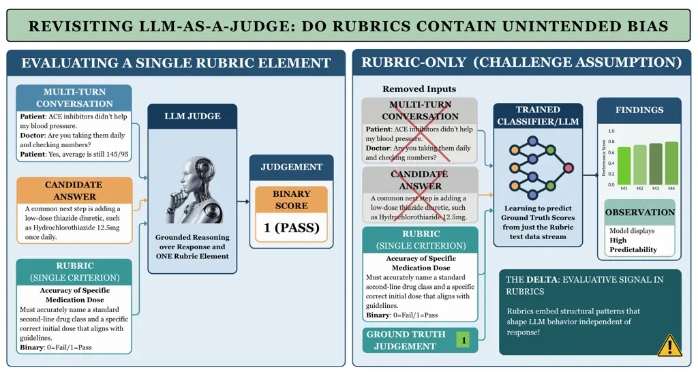

Figure 1: Rubric Probe: Given a rubric alone, we train a classifier to
predict the judge label, testing whether rubric text carries recoverable
evaluative signal beyond chance.

Beyond predictive performance, we analyze the structure of the rubric
signal using generalizability studies and the geometry of the embedding
space.

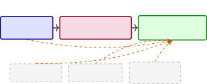

Figure 2: Probe overview. The classifier receives only rubric text and
predicts the LLM-as-a-judge output, while the evaluated answer,
contextual metadata, and grounding information are excluded.

## 4 LLM-as-a-Judge Probe Experiment

We start by describing the details of our experiment and setup, followed
by the probe results.

### 4.1 Experiment Details

We evaluate our probe across two complementary benchmarks: HealthBench,
including its HealthBench-Eval and HealthBench-Hard variants, which
provide conversation-specific rubrics for open-ended healthcare
responses, and ResearchRubrics, which use instance-specific rubrics to
assess whether research queries are sufficiently answered.

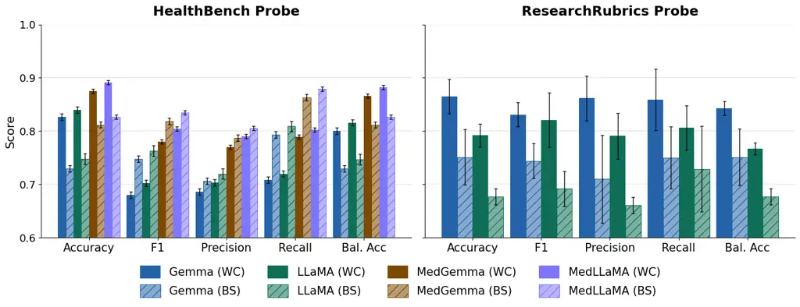

Figure 3: Per-metric comparison across probe datasets. PubMedBERT
classifiers use rubric text to predict LLM-as-a-Judge labels. The left
panel shows HealthBench results for Gemma, LLaMA, MedGemma, and
MedLLaMA, while the right shows ResearchRubrics results for Gemma and
LLaMA. The latter reflects the available candidate-model evaluations for
this non-medical domain. Error bars denote standard deviation. The
weighted classification (WC) and balanced subsampling (BS) cohorts are
presented here to address class imbalance.

Dataset Source: We analyze two complementary benchmarks with
instance-specific rubrics: HealthBench and ResearchRubrics. HealthBench
Arora et al. (2025) is a comprehensive healthcare dataset comprising
complex healthcare conversations, where each conversation is paired with
a set of case-specific rubrics. More importantly, the rubrics are
provided by clinicians and are NOT generated by an LLM. These features,
which follow best-practice benchmarking, made HealthBench a strong
candidate for the analysis. In the standard evaluation setting, an LLM
generates a response that is evaluated against the corresponding rubric
by an LLM-as-a-Judge, producing a binary satisfiability label (0/1). We
have 5k such conversations paired with an expected answer and
case-specific rubrics.

ResearchRubrics Sharma et al. (2026) provides a complementary
non-medical setting, pairing research queries with instance-specific
rubrics that assess whether the query has been sufficiently answered.
Thus, while the two benchmarks differ in domain and task, both employ
per-instance rubrics, allowing us to examine whether rubric-derived
evaluative signals persist across distinct evaluation settings.

Probing Dataset: We first run the candidate LLM and obtain responses
from various models. We then apply the LLM-as-a-Judge model and obtain
the class labels (0/1). We use Qwen (Qwen2.5-7B-Instruct Qwen et al.
(2025)) as an LLM-as-a-Judge on LLM outputs from LlaMA
(meta-llama/Llama-3.1-8B-Instruct Grattafiori et al. (2024)), MedLlaMA
(MMed-Llama-3-8B Qiu et al. (2024)), Gemma (google/gemma-7b-it Gemma et
al. (2024)), and MedGemma (google/medgemma-1.5-4b-it Sellergren et al.
(2026)). Then, we construct four classifier datasets, using the rubric
as input and the LLM-as-a-Judge output as the label for each model.
HealthBench-Eval-Probe comprises approximately $`\approx`$43k rubrics,
while HealthBench-Hard-Probe contains around $`\approx`$11k rubrics. The
final experiment evaluates eight cohorts across these two datasets.
Additionally, ResearchRubrics-Probe contains approximately
$`\approx`$2.5k rubrics and is used to assess generalization beyond the
healthcare domain. Each classifier is trained using an 80/20 train–test
split.

Classifier Setup: We use the PubMedBERT Gu et al. (2021) based
classifier for our main experiments. For generalization, we test
cross-dataset transfer between HealthBench-Eval-Probe and
HealthBench-Hard-Probe by evaluating on ResearchRubrics-Probe. ¹¹ 1 Code
available here: [Repository
Link](https://anonymous.4open.science/r/JudgingLLM-as-a-Judge-CFA6/)

### 4.2 Rubric Probe Results

In this study, we evaluate the PubMedBERT-based classifier’s performance
against the four cohorts (Gemma, MedGemma, LlaMA, MedLLaMa), across the
HealthBench-Eval-Probe and HealthBench-Hard-Probe using standard metrics
while explicitly accounting for class imbalance through weighted
classification and balanced subsampling strategies (Figure 3). We
observe that the classifier outputs are \> 0.5 and, in some cases,
exceeding 0.8, even after accounting for dataset imbalance. A similar
pattern is observed on ResearchRubrics, suggesting that rubric text
carries predictive signal beyond the healthcare setting. Together, these
results indicate that the rubric text contains a signal that predicts
judge labels beyond random chance. Additional analyses on these
classifier experiments are included in the Appendix B.

### 4.3 Generalization Checks

We perform several checks to assess the robustness and generalizability
of the rubric-only predictive signal. First, we evaluate the
PubMedBERT-based probe using 5-fold cross-validation and bootstrap
confidence intervals, rather than relying on a single train–test split.
Detailed results from these evaluations are reported in Appendix C.

We additionally examine whether the observed performance is sensitive to
the choice of classifier architecture. We compare PubMedBERT with BERT,
RoBERTa, and DeBERTa-v3, and report the corresponding results alongside
majority-class baselines in Appendix D. These comparisons help
distinguish the observed signal from performance attributable to a
particular classifier or class imbalance.

Finally, we conduct additional transfer and diagnostic analyses,
including cross-dataset evaluation between HEALTHBENCH-EVAL-PROBE and
HEALTHBENCH-HARD-PROBE and experiments using simpler classifiers such as
TF-IDF with logistic regression. These results are provided in
Appendix C. Collectively, these analyses provide complementary checks on
the robustness of the rubric-only predictive signal.

## 5 Counterfactual Consistency Analysis

The rubric-only probe establishes an association between rubric text and
judge decisions, but this association could in principle arise from
differences in item difficulty rather than rubric-conditioned
evaluation. To distinguish these possibilities, we conduct two paired
counterfactual experiments that directly test whether the judge responds
to controlled changes in either the candidate response or the evaluation
criterion. Detailed experimental setup and results are provided in
Appendix E.

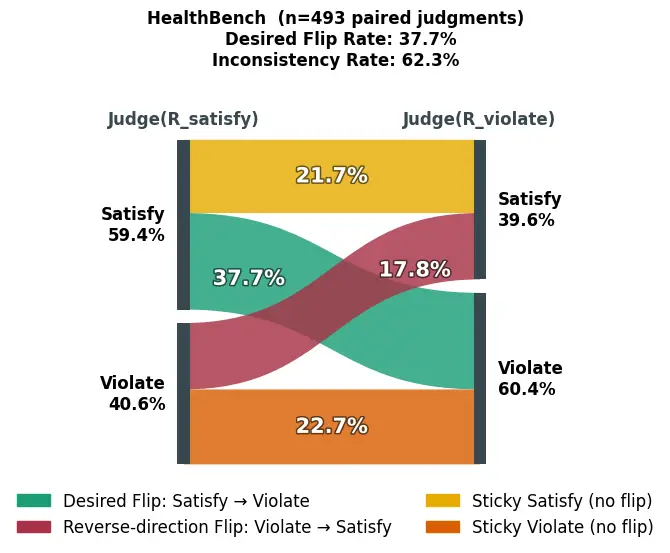

Figure 4: Output perturbation: The conversation and rubric are fixed
while the candidate response is reversed. A counterfactually responsive
judge should always flip its verdict. Instead, the expected verdict
reversal occurs in only 37.7% of pairs, indicating that the judge often
fails to track changes in answer-level rubric satisfaction.

### 5.1 Output Perturbation

We first test whether the judge responds to changes in the candidate’s
response while holding the conversation and rubric fixed. We randomly
sample 500 HealthBench conversations and select one rubric per
conversation. For each pair, Mistral-7B generates responses designed to
respectively satisfy and violate the rubric, followed by a qualitative
check. Qwen2.5-7B-Instruct then evaluates both responses under the same
context and rubric.

A counterfactually responsive judge should reverse its verdict when
response-level evidence is reversed. Across 493 valid pairs, however,
the judge produces the expected verdict reversal in only 37.7% of cases,
yielding an inconsistency rate of 62.3% (Figure 4). Since the context
and rubric are fixed within each pair, these failures cannot be
attributed solely to cross-item differences in difficulty or rubric
wording. While rubric ambiguity or response-construction errors may
contribute, the results demonstrate substantial non-responsiveness to
controlled changes in answer-level evidence.

### 5.2 Rubric Perturbation

We next test whether the judge tracks changes in the evaluation
criterion. We randomly sample 1,000 HealthBench conversations with
candidate responses from Gemma and LLaMA, and construct counterfactual
rubrics whose intended criteria are reversed using Mistral-7B. The
conversation and candidate response remain fixed, so only the rubric
semantics change. We again perform a manual qualitative check of the
paired rubrics.

A criterion-sensitive judge should reverse its verdict when the rubric
meaning is reversed. Instead, the desired flip rate is only 16.8% for
Gemma and 32.2% for LLaMA, corresponding to inconsistency rates of 83.2%
and 67.8%, respectively (Figure 5). Thus, although rubric changes can
affect judgments, the judge retains its original verdict despite a
reversal of the evaluation criterion.

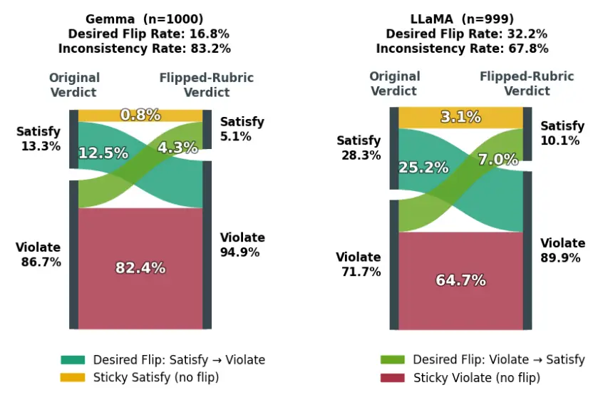

Figure 5: Rubric perturbation: On HealthBench, the conversation and
candidate response are fixed while the rubric criterion is reversed. A
criterion-sensitive judge should therefore always flip its verdict.
Instead, the expected reversal occurs in only 16.8% of pairs with Gemma
and 32.2% of pairs with LLaMA, indicating poor sensitivity to changes in
the evaluation criterion.

Figure 6: The UMAP projections of HealthBench-Eval-Probe and
HealthBench-Hard-Probe

### 5.3 Semantic Analysis of Rubrics

We next probe whether the rubrics themselves, independent of the
LLM-as-a-Judge output, encode semantic cues that may drive the observed
label structure. With UMAP McInnes et al. (2018), we visualize BERT
embeddings to test whether Eval and Hard rubrics form separable clusters
(Figure 6). HealthBench-Hard contains more challenging and clinically
ambiguous cases than HealthBench-Eval, providing a useful contrast in
rubric characteristics. Additional semantics are included in Appendix F.

The correct label is defined by the rubric, the context, and the
candidate response, and should not be recoverable from the rubric alone.
Yet we observe consistent correlations between rubric text and judge
labels even without the response. Moreover, HealthBench-Eval rubrics are
more separable with respect to judge labels, suggesting that some rubric
formulations are associated with particular outcomes. Together, these
findings indicate that rubric text encodes label-correlated signal,
raising concerns that evaluation may reflect rubric properties
independently of the response.

### 5.4 Discussion

Our probe shows that rubric text alone predicts LLM-as-a-Judge outputs
above chance, demonstrating a recoverable rubric-conditioned signal
independent of the candidate response. This signal is distributed across
the semantic structure rather than being reducible to keyword artifacts.
These patterns indicate that evaluation difficulty is driven not solely
by the task but also by variability and ambiguity in rubric formulation.
This is not a model capacity limitation. Our findings are unlikely to be
explained by dataset-specific confounding alone, since the probe never
observes the response or context, and the effect persists across
HealthBench-Probe splits and the ResearchRubrics setting. While we do
not establish causality, we identify a consistent association between
rubric text and judge outputs. This motivates systematic validation of
rubric design, including stress-testing rubric sensitivity, auditing
judge rationales DeLucia et al. (2026), and complementing rubric-based
evaluation with more robust metrics Shailya et al. (2025); Ito et al.
(2025); Croxford et al. (2025).

## 6 Conclusion

Rubric-conditioned evaluation may inadvertently encode predictive signal
that correlates with judges’ outputs. To make LLM-as-a-Judge reliable,
benchmarks should aim to eliminate recoverable rubric priors. We hope
this work motivates closer scrutiny of rubric design in automated
evaluation.

## 7 Limitations

Our probe intentionally isolates rubric text, thereby capturing
potential rubric priors rather than end-to-end judge behavior in full
evaluation settings. We evaluate HealthBench and ResearchRubrics, but
the findings may not generalize to other domains, rubric styles, or
languages. We also rely on a small set of probing methods and a binary
formulation, which may understate or distort more subtle rubric effects.
Finally, while the results are consistent with shortcut learning, they
do not identify the full causal mechanism behind rubric-conditioned
judgments. We posit that, despite these limitations, our work serves as
an initial probe to invite research into the design of automated text
evaluation.

## AI Usage Declaration

We acknowledge the use of AI for writing assistance, including
grammatical corrections and minor rewrites.

## References

- Arora et al. (2025) R. K. Arora, J. Wei, R. S. Hicks, P. Bowman, J.
  Quiñonero-Candela, F. Tsimpourlas, M. Sharman, M. Shah, A. Vallone, A.
  Beutel, et al. Healthbench: evaluating large language models towards
  improved human health. arXiv preprint arXiv:2505.08775. Cited by: §1,
  §2, §4.1.
- Chen et al. (2024) G. H. Chen, S. Chen, Z. Liu, F. Jiang, and B. Wang
  Humans or llms as the judge? a study on judgement bias. In Proceedings
  of the 2024 Conference on Empirical Methods in Natural Language
  Processing, pp. 8301–8327. Cited by: §1, §2.
- Croxford et al. (2025) E. Croxford, Y. Gao, E. First, N.
  Pellegrino, M. Schnier, J. Caskey, M. Oguss, G. Wills, G. Chen, D.
  Dligach, et al. Evaluating clinical ai summaries with large language
  models as judges. npj Digital Medicine 8 (1), pp. 640. Cited by: §1,
  §5.4.
- DeLucia et al. (2026) A. DeLucia, H. Huang, S. Joshi, M.
  Yarmohammadi, A. Hassoon, and M. Dredze Same verdict, different
  reasons: llm-as-a-judge and clinician disagreement on medical chatbot
  completeness. arXiv preprint arXiv:2604.16383. Cited by: §5.4.
- Gemma et al. (2024) Gemma, T. Mesnard, C. Hardin, R. Dadashi, S.
  Bhupatiraju, S. Pathak, L. Sifre, M. Rivière, M. S. Kale, J. Love, et
  al. Gemma: open models based on gemini research and technology. arXiv
  preprint arXiv:2403.08295. Cited by: §4.1.
- Grattafiori et al. (2024) A. Grattafiori, A. Dubey, A. Jauhri, A.
  Pandey, A. Kadian, A. Al-Dahle, A. Letman, A. Mathur, A. Schelten, A.
  Vaughan, et al. The llama 3 herd of models. arXiv preprint
  arXiv:2407.21783. Cited by: §4.1.
- Gu et al. (2026) J. Gu, X. Jiang, Z. Shi, H. Tan, X. Zhai, C. Xu, W.
  Li, Y. Shen, S. Ma, H. Liu, et al. A survey on llm-as-a-judge. The
  Innovation 7 (6). Cited by: §1, §1, §2.
- Gu et al. (2021) Y. Gu, R. Tinn, H. Cheng, M. Lucas, N. Usuyama, X.
  Liu, T. Naumann, J. Gao, and H. Poon Domain-specific language model
  pretraining for biomedical natural language processing. ACM
  Transactions on Computing for Healthcare (HEALTH) 3 (1), pp. 1–23.
  Cited by: §4.1.
- Ito et al. (2025) T. Ito, K. van Deemter, and J. Suzuki Reference-free
  evaluation metrics for text generation: a survey. arXiv preprint
  arXiv:2501.12011. Cited by: §5.4.
- Li et al. (2026) Q. Li, S. Dou, K. Shao, C. Chen, and H. Hu Evaluating
  scoring bias in llm-as-a-judge. In International Conference on
  Database Systems for Advanced Applications, pp. 19–34. Cited by: §1,
  §2.
- McInnes et al. (2018) L. McInnes, J. Healy, and J. Melville Umap:
  uniform manifold approximation and projection for dimension reduction.
  arXiv preprint arXiv:1802.03426. Cited by: §5.3.
- Ong Ly et al. (2024) C. Ong Ly, B. Unnikrishnan, T. Tadic, T.
  Patel, J. Duhamel, S. Kandel, Y. Moayedi, M. Brudno, A. Hope, H. Ross,
  et al. Shortcut learning in medical ai hinders generalization: method
  for estimating ai model generalization without external data. NPJ
  digital medicine 7 (1), pp. 124. Cited by: §2.
- Qiu et al. (2024) P. Qiu, C. Wu, X. Zhang, W. Lin, H. Wang, Y.
  Zhang, Y. Wang, and W. Xie Towards building multilingual language
  model for medicine. Nature Communications 15 (1), pp. 8384. Cited by:
  §4.1.
- Qwen et al. (2025) Qwen, :, A. Yang, B. Yang, B. Zhang, B. Hui, B.
  Zheng, B. Yu, C. Li, D. Liu, F. Huang, H. Wei, H. Lin, J. Yang, J.
  Tu, J. Zhang, J. Yang, J. Yang, J. Zhou, J. Lin, K. Dang, K. Lu, K.
  Bao, K. Yang, L. Yu, M. Li, M. Xue, P. Zhang, Q. Zhu, R. Men, R.
  Lin, T. Li, T. Tang, T. Xia, X. Ren, X. Ren, Y. Fan, Y. Su, Y.
  Zhang, Y. Wan, Y. Liu, Z. Cui, Z. Zhang, and Z. Qiu Qwen2.5 technical
  report. External Links: 2412.15115,
  [Link](https://arxiv.org/abs/2412.15115) Cited by: §4.1.
- Sellergren et al. (2026) A. Sellergren, C. Gao, F. Mahvar, T.
  Kohlberger, F. Jamil, M. Traverse, A. Tono, B. Sadjad, L. Yang, C.
  Lau, et al. Medgemma 1.5 technical report. arXiv preprint
  arXiv:2604.05081. Cited by: §4.1.
- Shailya et al. (2025) K. Shailya, S. Rajpal, G. S. Krishnan, and B.
  Ravindran Lext: towards evaluating trustworthiness of natural language
  explanations. In Proceedings of the 2025 ACM Conference on Fairness,
  Accountability, and Transparency, pp. 1565–1587. Cited by: §5.4.
- Sharma et al. (2026) M. Sharma, C. B. C. Zhang, C. Bandi, C. Wang, A.
  Aich, H. Nghiem, T. Rabbani, Y. Htet, B. Jang, S. Basu, et al.
  Researchrubrics: a benchmark of prompts and rubrics for evaluating
  deep research agents. In International Conference on Learning
  Representations, Vol. 2026, pp. 90447–90472. Cited by: §1, §2, §4.1.
- Shi et al. (2025) L. Shi, C. Ma, W. Liang, X. Diao, W. Ma, and S.
  Vosoughi Judging the judges: a systematic study of position bias in
  llm-as-a-judge. In Proceedings of the 14th International Joint
  Conference on Natural Language Processing and the 4th Conference of
  the Asia-Pacific Chapter of the Association for Computational
  Linguistics, pp. 292–314. Cited by: §1, §2.
- Tan et al. (2025) S. Tan, S. Zhuang, K. Montgomery, W. Tang, A.
  Cuadron, C. Wang, R. Popa, and I. Stoica Judgebench: a benchmark for
  evaluating llm-based judges. In International Conference on Learning
  Representations, Vol. 2025, pp. 63277–63303. Cited by: §1, §2.
- Zheng et al. (2023) L. Zheng, W. Chiang, Y. Sheng, S. Zhuang, Z.
  Wu, Y. Zhuang, Z. Lin, Z. Li, D. Li, E. Xing, et al. Judging
  llm-as-a-judge with mt-bench and chatbot arena. Advances in neural
  information processing systems 36, pp. 46595–46623. Cited by: §2.
- Zhou et al. (2024) Y. Zhou, R. Tang, Z. Yao, and Z. Zhu Navigating the
  shortcut maze: a comprehensive analysis of shortcut learning in text
  classification by language models. In Findings of the Association for
  Computational Linguistics: EMNLP 2024, pp. 2586–2614. Cited by: §2.

## Appendix A Experimental Setup and Modeling

### A.1 Models Explored

We evaluate four candidate language models for generating responses to
the HealthBench conversations. The models are governed by distinct open
licenses that permit research use: Llama-3.1-8B-Instruct is licensed
under the [Llama 3.1 Community License
Agreement](https://llama.meta.com/llama3_1/license/), Gemma-7b-it is
governed by the [Gemma Terms of Use](https://ai.google.dev/gemma/terms),
and MedGemma model is licensed under the [Health AI Developer
Foundations
License](https://developers.google.com/health-ai-developer-foundations/terms)
but the repository is licensed under the [Apache 2.0
License](https://www.apache.org/licenses/LICENSE-2.0). MedLLaMA is
licensed under
[CC-BY-NC-ND](https://creativecommons.org/licenses/by-nc-nd/4.0/deed.en).
Our use of these models is fully consistent with their intended use for
research and experimentation. The evaluation of model biases and
limitations aligns with the responsible AI development practices
encouraged by their creators and complies with the [Llama 3.1 Acceptable
Use Policy](https://llama.meta.com/llama3_1/use-policy/), the [Gemma
Prohibited Use
Policy](https://ai.google.dev/gemma/prohibited_use_policy), the
[MedLlaMA Acceptable Use Policy and the Health AI Developer Foundations
Terms of Use](https://huggingface.co/johnsnowlabs).

### A.2 Computing Requirements

The experimental pipeline was implemented in Python 3.10. Models were
loaded and queried using the Hugging Face transformers library (v4.38.2)
with the PyTorch (v2.1) backend. All the experiments were executed on a
GPU cloud instance with NVIDIA A100 GPUs to accelerate inference. Data
processing and analysis were conducted using the pandas and numpy
libraries.

A total of 5,000 Question Answering operations, along with 43,000 Yes/No
answers for LLM-as-a-judge answers across 4 model generations, were
performed. The total computational budget is estimated at 30-35
GPU-hours on the specified hardware.

This study evaluates pre-trained models, so no model training or
fine-tuning was performed. The key hyperparameters relate to the text
generation (decoding) process. To ensure a fair and consistent
comparison across all models, a fixed set of decoding parameters was
used for every query detailed in Table 1. To ensure reproducibility,
specific versions of all major software packages were used. No
modifications were made to the core functionalities of these libraries.

Core ML/DL Libraries: transformers (v4.38.2), torch (v2.1).

Data Handling Tools: pandas (v2.0.3), numpy (v1.25.2).

|                      |       |
| -------------------- | ----- |
| Parameter            | Value |
| temperature          | 1.0   |
| repetition penalty   | 1.15  |
| top_p                | 0.95  |
| num_return_sequences | 1     |

Table 1: Decoding hyperparameters used for all model queries. All the
other parameters were set to default values.

## Appendix B Rubric Classification Exploration

Apart from the main classification results, we now present deeper
analysis in precision and recall through confusion matrices for an
illustration (Figures 8(a),  8(b),  8(c),  8(d)). We evaluated models on
the OpenAI HealthBench dataset, which is released under the [MIT
license](https://opensource.org/license/mit) with strict safeguards
under [OpenAI Usage
Policies](https://openai.com/policies/usage-policies/) and standard
[HuggingFace Content Policy](https://huggingface.co/content-policy).

To further probe whether the evaluative signal is recoverable from the
rubric text alone, we project the rubric inputs into a TF-IDF vector
space and evaluate two simple classifiers (multinomial Naïve Bayes and
L2-regularized logistic regression) alongside a majority-class dummy
baseline.


HB Eval Probe


HB Hard Probe

(a) Gemma Model


HB Eval Probe


HB Hard Probe

(b) LLaMA Model


HB Eval Probe


HB Hard Probe

(c) MedGemma Model


HB Eval Probe


HB Hard Probe

(d) MedLLaMA Model

Figure 8: Confusion matrices for rubric-only judge-label classification
across the four evaluated models

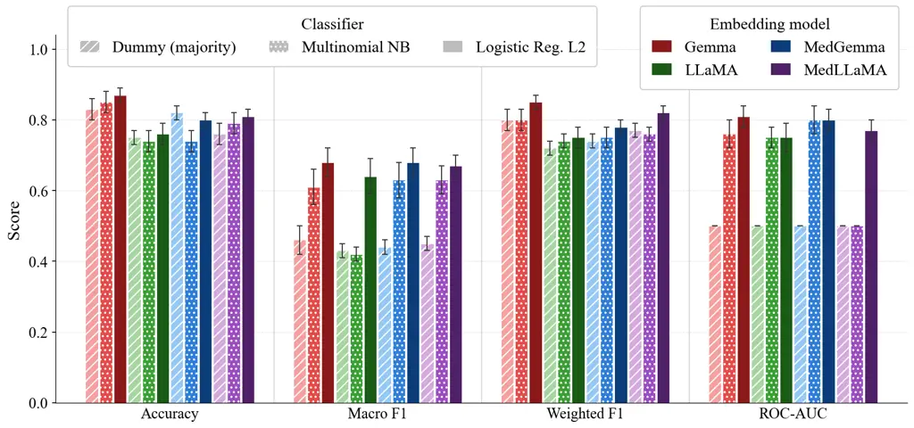

Figure 9: Rubric-Only Classifiers Achieve Nontrivial Performance across
Judge Models and Evaluation Metrics

Figure 9 reports cross-validated accuracy, macro-F1, weighted-F1, and
ROC-AUC across four embedding models used as judges: Gemma, LLaMA,
MedGemma, and MedLLaMA. Across all four metrics, logistic regression
consistently outperforms both the Naïve Bayes baseline and the
majority-class dummy, confirming that rubric-derived lexical features
carry a discriminative signal beyond class imbalance. This pattern holds
across embedding families, though performance varies by judge,
suggesting that different models impose distinct evaluative surfaces on
the same rubric text. These results strengthen the case that
rubric-based LLM evaluation pipelines warrant closer scrutiny.

## Appendix C Validation and Uncertainty Estimation

### C.1 Classifier Evaluation Protocol

To assess the robustness of the rubric-only probe results, we use both
cross-validation and held-out test-set evaluation. For each probe
cohort, we first reserve 20% of the data as a held-out test set. The
remaining 80% is used for model development and evaluated using standard
5-fold cross-validation. In each fold, four partitions are used for
training, and the remaining partition is used for validation, with each
partition serving as the validation set exactly once. We report the mean
and standard deviation across the five folds.

For the final held-out evaluation, the classifier is evaluated on the
reserved test set, which is not used during model development. This
provides an independent estimate of performance in addition to the
cross-validation results. Detailed results for the four judge cohorts
are reported in Table 2.

### C.2 Bootstrap Confidence Intervals

To quantify sampling uncertainty in the held-out evaluation, we perform
non-parametric bootstrap resampling with 10,000 iterations over the
held-out test set. For each bootstrap sample, we recompute the
evaluation metrics and use the resulting empirical distributions to
obtain 95% confidence intervals.

Across the four judge cohorts, the resulting confidence intervals are
relatively narrow, indicating that the observed probe performance is
stable with respect to sampling variability. We report confidence
intervals for accuracy, precision, recall, F1, and balanced accuracy in
Table 2.

| Model    | Metric        | 5-Fold CV (Mean $`\pm`$ SD) | Held-Out Test \[95% CI\] |
| -------- | ------------- | --------------------------- | ------------------------ |
| Gemma    | Accuracy      | 0.826 $`\pm`$ 0.006         | 0.826 \[0.814, 0.837\]   |
|          | F1            | 0.682 $`\pm`$ 0.006         | 0.682 \[0.671, 0.693\]   |
|          | Precision     | 0.687 $`\pm`$ 0.016         | 0.687 \[0.656, 0.717\]   |
|          | Recall        | 0.704 $`\pm`$ 0.013         | 0.704 \[0.678, 0.729\]   |
|          | Balanced Acc. | 0.801 $`\pm`$ 0.006         | 0.801 \[0.789, 0.812\]   |
| MedGemma | Accuracy      | 0.886 $`\pm`$ 0.004         | 0.886 \[0.879, 0.893\]   |
|          | F1            | 0.781 $`\pm`$ 0.004         | 0.781 \[0.773, 0.789\]   |
|          | Precision     | 0.772 $`\pm`$ 0.011         | 0.772 \[0.751, 0.793\]   |
|          | Recall        | 0.785 $`\pm`$ 0.009         | 0.785 \[0.768, 0.801\]   |
|          | Balanced Acc. | 0.867 $`\pm`$ 0.004         | 0.867 \[0.860, 0.873\]   |
| LLaMA    | Accuracy      | 0.842 $`\pm`$ 0.005         | 0.842 \[0.833, 0.851\]   |
|          | F1            | 0.705 $`\pm`$ 0.004         | 0.705 \[0.697, 0.713\]   |
|          | Precision     | 0.707 $`\pm`$ 0.010         | 0.707 \[0.688, 0.726\]   |
|          | Recall        | 0.721 $`\pm`$ 0.011         | 0.721 \[0.700, 0.741\]   |
|          | Balanced Acc. | 0.817 $`\pm`$ 0.004         | 0.817 \[0.809, 0.825\]   |
| MedLLaMA | Accuracy      | 0.900 $`\pm`$ 0.003         | 0.900 \[0.894, 0.906\]   |
|          | F1            | 0.800 $`\pm`$ 0.003         | 0.800 \[0.794, 0.806\]   |
|          | Precision     | 0.798 $`\pm`$ 0.008         | 0.798 \[0.783, 0.812\]   |
|          | Recall        | 0.804 $`\pm`$ 0.007         | 0.804 \[0.791, 0.816\]   |
|          | Balanced Acc. | 0.881 $`\pm`$ 0.003         | 0.881 \[0.876, 0.886\]   |

Table 2: Five-fold cross-validation and held-out test-set performance of
the rubric-only probe classifier. Confidence intervals are obtained
using 10,000 bootstrap resamples of the held-out test set.

### C.3 Cross-Dataset Generalization

To further assess the generalizability of the rubric-only predictive
signal, we conduct a cross-dataset evaluation between
HealthBench-Eval-Probe and HealthBench-Hard-Probe. Specifically, we
train the rubric classifier on one probe dataset and evaluate it on the
other, considering both transfer directions: training on
HealthBench-Eval-Probe and testing on HealthBench-Hard-Probe, and vice
versa.

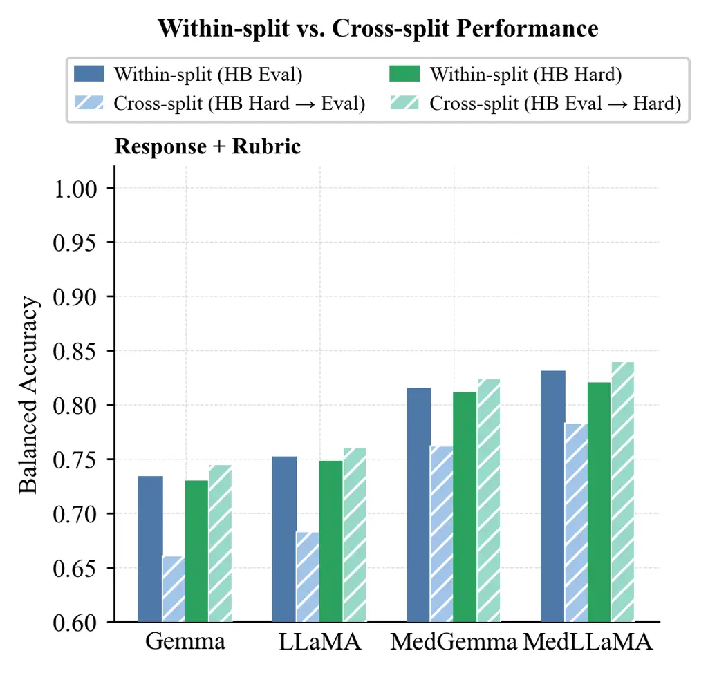

Figure 10: Cross-dataset transfer: within-split vs. cross-split balanced
accuracy. Solid bars = within-split (train = test). Hatched bars =
cross-split (train on one split, test on the other) Lower gap = better
generalization.

This setting provides a more stringent test of generalization because
the classifier is evaluated on rubrics from a different HealthBench
variant than those used during training. Figure 10 presents the
resulting accuracy across the two transfer directions. Performance
remains above the 0.5 chance level under both cross-dataset settings,
indicating that the rubric-only classifier captures predictive patterns
that transfer across the two HealthBench variants rather than being
entirely specific to a single dataset.

The cross-dataset results therefore provide an additional check that the
observed rubric–label association is not solely an artifact of the
particular train–test partition or dataset-specific distribution.
Detailed results across the different judge cohorts are reported in
Figure 10.

## Appendix D Classifier Ablations and Baselines

### D.1 Choice of PubMedBERT

We use PubMedBERT as the primary probe classifier because the
HealthBench rubrics contain specialized biomedical terminology, for
which domain-specific pretraining provides a natural advantage. To
assess whether our findings depend on this architectural choice, we
additionally evaluate BERT, RoBERTa, and DeBERTa-v3 under the same
experimental setting.

Table 3 reports the resulting performance across the three judge
cohorts. All four classifiers exhibit the same qualitative pattern, with
performance substantially above chance. PubMedBERT provides a modest,
generally consistent improvement, supporting its use as the primary
probe and indicating that the observed rubric-only signal is not
specific to a single classifier architecture.

|            |                           |                           |                           |
| ---------- | ------------------------- | ------------------------- | ------------------------- |
| Classifier | Gemma                     | MedGemma                  | LLaMA                     |
|            | Acc / Pre / Rec / F1      | Acc / Pre / Rec / F1      | Acc / Pre / Rec / F1      |
| PubMedBERT | 86.5 / 83.1 / 86.2 / 85.9 | 79.2 / 82.1 / 79.1 / 80.6 | 78.2 / 77.1 / 78.0 / 77.8 |
| BERT       | 86.1 / 85.2 / 86.2 / 84.6 | 76.0 / 80.9 / 76.1 / 78.4 | 74.5 / 78.2 / 74.1 / 75.9 |
| RoBERTa    | 85.2 / 81.5 / 90.2 / 85.3 | 78.4 / 83.7 / 78.2 / 81.1 | 75.9 / 78.7 / 75.4 / 76.6 |
| DeBERTa-v3 | 84.6 / 84.5 / 86.7 / 84.9 | 70.5 / 83.4 / 71.6 / 74.3 | 74.2 / 78.3 / 74.7 / 75.1 |

Table 3: Classifier comparison on HealthBench. Values are reported as
accuracy, precision, recall, and F1 (%).

| Response Model | HB-Eval    | HB-Hard    |
| -------------- | ---------- | ---------- |
|                | $`n=4000`$ | $`n=1000`$ |
| Gemma          | 89.4       | 76.0       |
| LLaMA          | 88.1       | 79.3       |
| MedGemma       | 83.4       | 78.3       |
| MedLLaMA       | 78.3       | 88.4       |

Table 4: Majority-class accuracy (%) for each model on HealthBench-Eval
HealthBench-Hard.

### D.2 Majority-Class Baseline

Because each response model produces different candidate responses for
the same rubrics, the resulting LLM-as-a-Judge labels have different
class distributions. We therefore compute the majority-class baseline
separately for each response model by always predicting its dominant
label (Table  4).

Although the majority baseline can achieve high accuracy under class
imbalance, it obtains a balanced accuracy of 0.50 by construction. We
therefore use weighted classification and balanced subsampling in the
main experiments to guard against a trivial majority-class solution. The
resulting probe performance remains above this baseline across metrics.

## Appendix E Counterfactual Perturbations

This section provides additional details on the counterfactual
experiments presented in Section 5.

### E.1 Output Perturbation

For each conversation–rubric pair $`(C_{i},r_{i})`$, Mistral-7B was
prompted to generate two responses: one designed to satisfy the rubric
($`R_{\mathrm{satisfy}}`$) and one designed to violate it
($`R_{\mathrm{violate}}`$). We manually inspected the generated pairs to
verify that the intended contrast was preserved. The resulting responses
were then evaluated independently by Qwen2.5-7B-Instruct using the
original conversation and rubric.

We compare the judge’s verdicts across each response pair (Table 5). A
desired flip occurs when the judge changes its verdict in accordance
with the intended change in rubric satisfaction. A sticky outcome occurs
when the judge retains its original verdict despite the response
perturbation. A wrong-direction flip occurs when the judge changes its
verdict in the opposite direction.

| Outcome              | Count | Percentage |
| -------------------- | ----- | ---------- |
| Desired flip         | 186   | 37.7%      |
| Wrong-direction flip | 88    | 17.8%      |
| Sticky satisfy       | 107   | 21.7%      |
| Sticky violate       | 112   | 22.7%      |

Table 5: Transition outcomes under counterfactual output perturbation.
Percentages are computed over the corresponding 493 valid paired
evaluations.

We summarize the paired outcomes using three measures:

```math
{\text{Desired Flip Rate}=\frac{\text{Desired Flips}}{\text{Valid Paired Perturbations}}}, \tag{1}
```

```math
{\text{Stickiness Rate}=\frac{\text{Sticky Satisfy}+\text{Sticky Violate}}{\text{Valid Paired Perturbations}}}, \tag{2}
```

```math
{\text{Output Inconsistency Rate}=1-\text{Desired Flip Rate}}. \tag{3}
```

For the 493 valid paired perturbations, the desired-flip rate is 37.7%,
the stickiness rate is 39.6%, and the resulting inconsistency rate is
62.3%. These results provide the detailed transition statistics
underlying the complete analysis.

### E.2 Rubric Perturbation

We randomly sampled 1,000 HealthBench conversations together with
candidate responses generated by Gemma and LLaMA. For each instance,
Mistral-7B was used to construct a counterfactual rubric whose intended
criterion was reversed relative to the original rubric. The conversation
and candidate response were kept fixed. We manually inspected the
resulting rubric pairs to verify that the intended semantic reversal was
preserved.

| Outcome        | Gemma            | LLaMA            |
| -------------- | ---------------- | ---------------- |
| Desired flip   | 125 + 43 (16.8%) | 252 + 70 (32.2%) |
| Sticky satisfy | 8 (0.8%)         | 31 (3.1%)        |
| Sticky violate | 824 (82.4%)      | 646 (64.7%)      |

Table 6: Transition outcomes under counterfactual rubric perturbation.
The two desired flip directions are aggregated in the reported desired
flip rate.

We compare the judge’s verdicts before and after the rubric perturbation
(Table 6). A desired flip occurs when the judge reverses its verdict in
accordance with the reversed rubric criterion, while a sticky outcome
occurs when the judge retains its original verdict despite the change in
rubric semantics or phrasing.

Aggregating the two desired-flip directions, the judge produces the
expected reversal in 16.8% of Gemma pairs and 32.2% of LLaMA pairs. The
corresponding rubric inconsistency rates are 83.2% and 67.8%,
respectively. Thus, the detailed transition analysis confirms the
substantial non-responsiveness reported above.

## Appendix F Rubric Semantics Exploration

### F.1 Keywords

To examine whether rubric text encodes lexically recoverable evaluative
priors, we conduct two complementary analyses at the word level: binary
lexical cue profiling across judge labels, and contrastive token
attribution stratified by class.

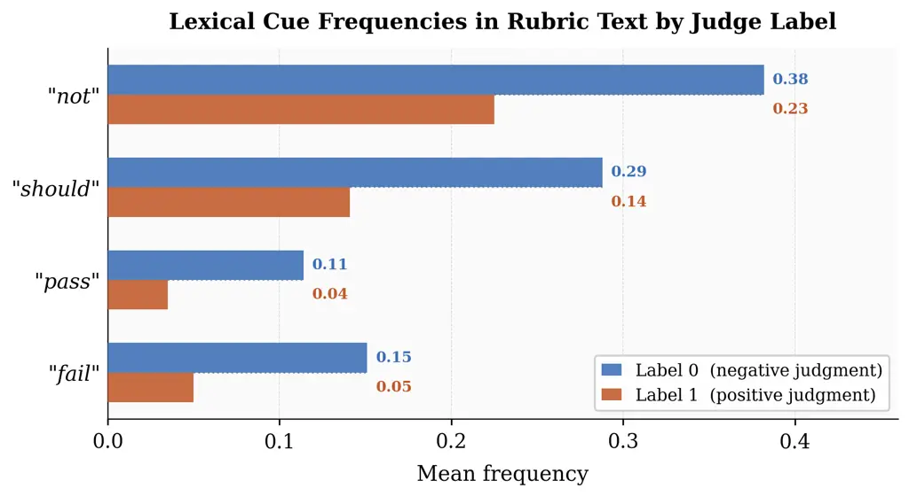

Figure 11: Lexical Cue Frequencies in Rubric Text.  
Mean frequency of selected binary lexical features across rubrics
stratified by judge label.

Figure 11 shows that several surface tokens exhibit pronounced frequency
asymmetries across judge labels. The terms fail, pass, and not appear
substantially more often in rubrics assigned label 0, while label 1
rubrics show comparatively sparse usage of these markers. The word
_should_ is elevated in both classes but skews toward label 0,
suggesting prescriptive and negation-heavy language is a consistent
surface correlate of negative judgments.

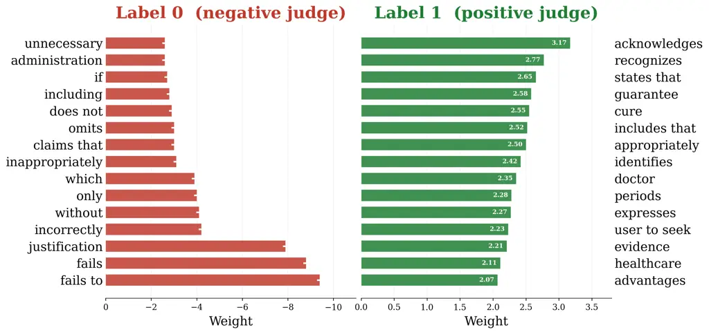

Figure 12: Top Logistic Regression Weights by Judge Label. Rubric
phrasing encodes a class-discriminative lexical signal

Figure 12 presents the top logistic regression TF-IDF weights for each
class, displayed as a diverging chart. Rubrics associated with negative
judgments (label 0) are dominated by failure-marking and negation
vocabulary, with justification also carrying strong negative weight,
suggesting that rubrics that foreground what must be justified tend to
predict failure. Positive-judgment rubrics (label 1) show the mirror
pattern: the highest-weighted tokens are epistemic and affirmative
verbs, reflecting rubric language that describes what a correct response
should exhibit rather than what it must not do. The two vocabularies are
entirely disjoint, indicating that failure-predictive language is
encoded more strongly and distinctively in rubric text than
success-predictive language.

### F.2 Word Length Analysis

Figure 13 shows the distribution of rubric word counts stratified by
judge label. Label 0 rubrics are systematically longer than label 1
rubrics. Both the distributions overlap substantially, so word count
alone does not cleanly separate the two classes. The many outliers in
both labels suggest that a small number of very long rubrics exist in
each group.

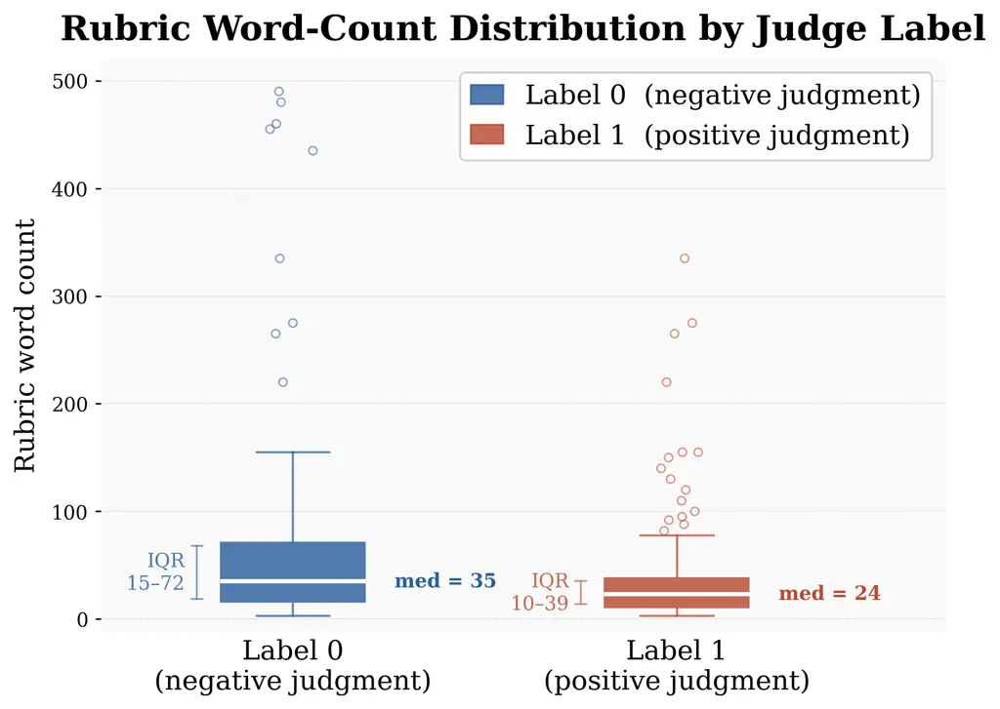

Figure 13: Rubric Word-Count Distribution by Judge Label. Label 0
rubrics are longer on average; distributions overlap substantially.

### F.3 BERTopic Modeling

To move beyond individual tokens and examine the sentence-level semantic
structure of rubric text, we apply BERTopic grootendorst2022bertopic
conditioned on the judge label. Rather than jointly discovering topics
across all rubrics, we fit separate topic models for each class,
allowing us to characterize the evaluative concerns prototypical of
positive and negative judgments independently.

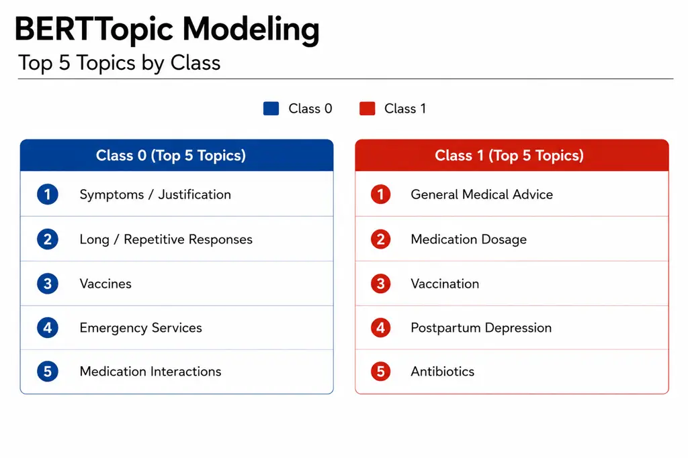

Figure 14: BERTopic Model results on HealthBench-Hard and
HealthBench-Eval

The top five topics per class, shown in Figure 14, reveal a semantically
coherent contrast. Class 0 rubrics cluster around failure modes and
clinical edge cases (symptom justification requirements, verbose or
repetitive responses, and scenarios involving vaccines, emergency
services, and medication interactions) consistent with the
negation-heavy lexical profile identified earlier. Class 1 rubrics
organize around affirmative clinical competencies: general medical
advice, dosage correctness, vaccination guidance, postpartum mental
health, and antibiotic stewardship.  
The two topic sets are largely disjoint, with no direct thematic overlap
in the top five, confirming that positive and negative judgment rubrics
occupy distinct semantic regions. That these regions correspond to
coherent clinical subfields rather than generic discourse patterns
demonstrates that there is evaluative signal in rubric text.
