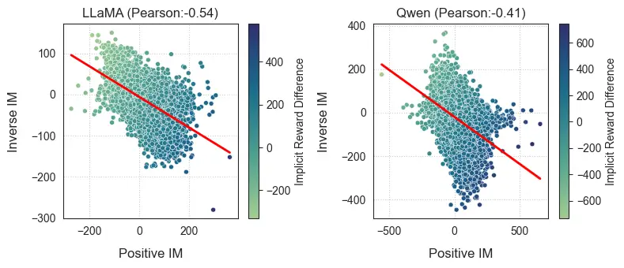
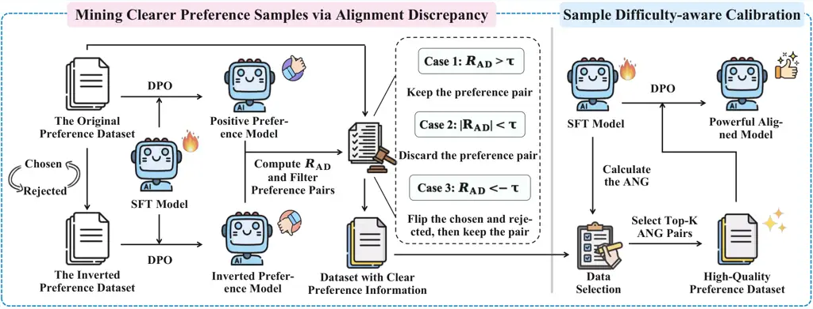
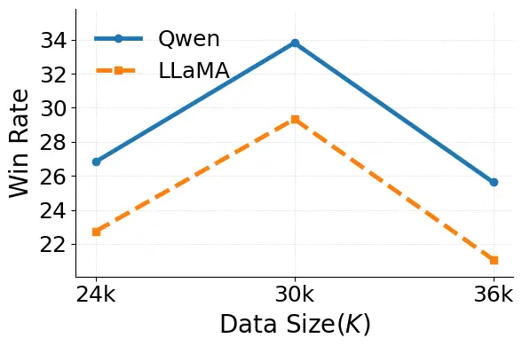
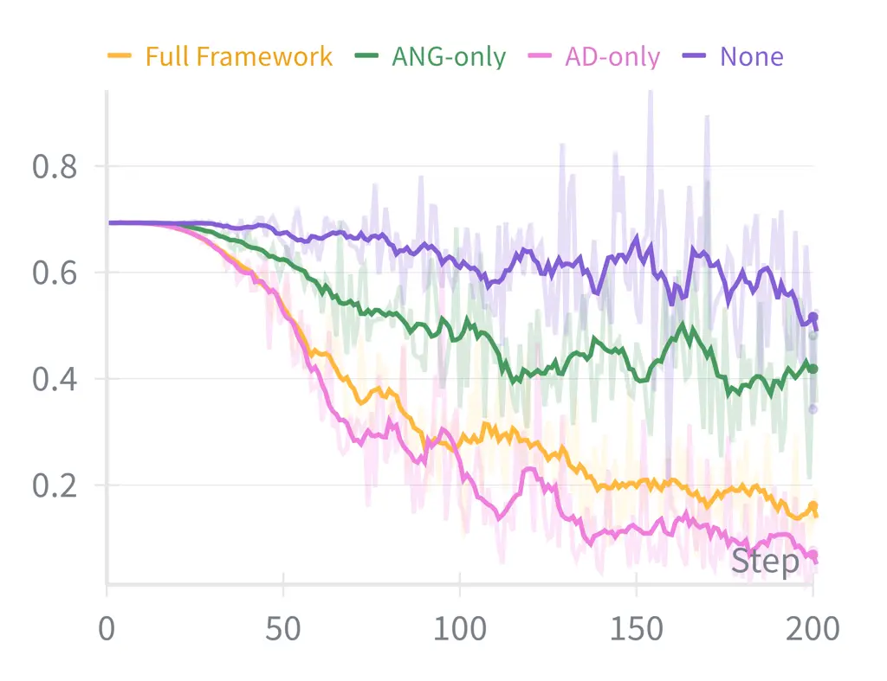
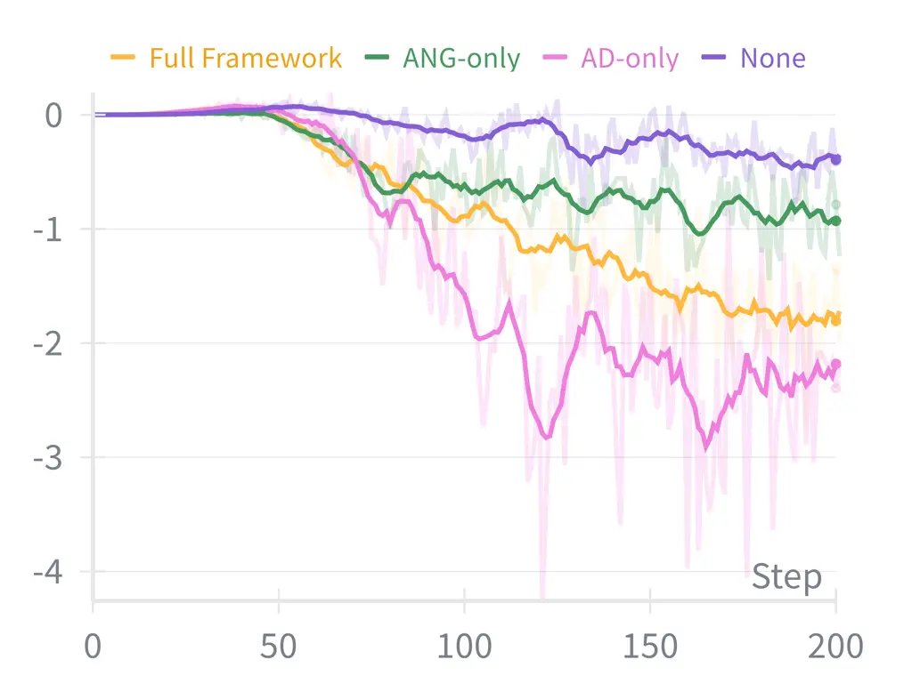
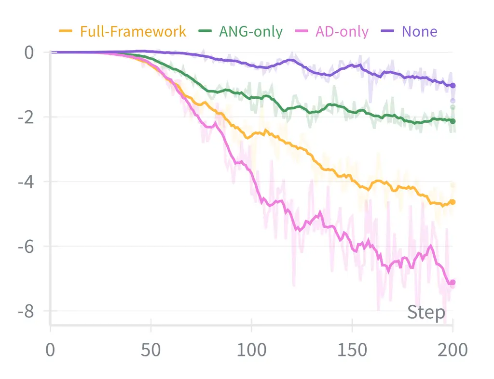
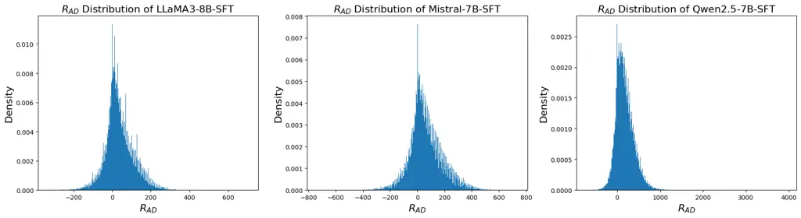

# AlignDiff: Exploiting Model-Intrinsic Information for Better Preference Data Selection

Peng Lai ^(†)^(†)thanks: Equal contribution. Affiliation: Southern
University of Science and Technology    He Zhu¹¹footnotemark: 1
Affiliation: Peking University    Zhiwen Ruan Affiliation: Southern
University of Science and Technology    Dongdong Zhang Affiliation: MSRA
   Yun Chen Affiliation: Shanghai University of Finance and Economics   
Peng Li Affiliation: Tsinghua University    Furu Wei Affiliation: MSRA
   Yang Liu Affiliation: Tsinghua University    Guanhua Chen
^(†)^(†)thanks: Corresponding author. Affiliation: Southern University
of Science and Technology

###### Abstract

Aligning large language models with human preferences remains a
challenge, primarily due to the critical role of preference data quality
in effective alignment. Existing datasets are frequently plagued by
inherent noise and distribution shifts, which inherently limit model
performance. To bridge this gap, we propose AlignDiff, a preference data
filtering framework driven by intrinsic model signals. AlignDiff first
identifies samples with clear preferences using both positive and
inverse signals, then prioritizes the more challenging samples based on
the average negative log-likelihood gap, encouraging the model to learn
richer information from them. AlignDiff is evaluated on two widely used
model families (LLaMA and Qwen) and three benchmarks widely adopted in
the alignment community (AlpacaEval 2.0, Arena-Hard, and MT-Bench).
Across all settings, it consistently outperforms seven strong baselines.
We conduct comprehensive ablation studies to validate the effectiveness
of AlignDiff, and further show that difficulty-based curriculum learning
improves model performance.

## 1 Introduction

As large language models (LLMs) advance, aligning outputs with human
expectations and mitigating risks remains a major challenge (Zhao
et al., 2025; Jiang et al., 2025). Early post-training efforts relied on
preference alignment algorithms such as RLHF (Ouyang et al., 2022) and
DPO (Rafailov et al., 2023), trained on preference data, to guide model
behavior toward human values (Wang et al., 2023a). As research
progresses, reinforcement fine-tuning (e.g., using the GRPO
algorithm (Shao et al., 2024)) enhances model reasoning and alignment,
potentially reducing reliance on traditional preference alignment.
However, Lanchantin et al. (2025) found that semi-online DPO can match
the performance of fully online GRPO while substantially decreasing
training costs, indicating that further research on DPO is valuable. As
the core of DPO, preference data provides models with more reliable
preference signals and lays a solid foundation for subsequent method
improvements (Meng et al., 2024; Ethayarajh et al., 2024). Early studies
typically trained DPO directly on large-scale preference datasets such
as UltraFeedback (Cui et al., 2023), aiming to cover a broad
human-preference space in one shot. However, follow-up work (Xiao
et al., 2025; Shen et al., 2024) has shown that simply “piling on data”
introduces noise and distribution shifts that degrade alignment
performance, highlighting the need to filter the data (Wang et al.,
2024a) carefully.

To address this issue, previous work (Morimura et al., 2024; Hu et al.,
2024b) has proposed various preference data filtering methods that are
grounded in external signals (e.g., scores produced by LLM-as-a-judge),
leveraging external reward scores (Yasunaga et al., 2024; Pattnaik
et al., 2024) or data attributes (Yu et al., 2025). However, those
methods may introduce preference data that does not align with the
model’s intrinsic preferences (e.g., data with very low implicit reward
margins), which can negatively affect the stability of alignment (Xu
et al., 2024; Wang et al., 2025b). To mitigate these issues, recent
studies have increasingly leveraged the implicit rewards of DPO for
preference data filtering (Gao et al., 2025; Kim et al., 2025; Chen
et al., 2025; Xue et al., 2026a; Deng et al., 2025a). Nevertheless, such
methods still exploit only a small portion of the model’s internal
information, leaving many latent signals unexplored. This limitation not
only constrains their effectiveness but also exacerbates the “squeezing
effect” in DPO optimization: training on samples with the highest
implicit reward margin tends to shrink the high-likelihood regions of
both chosen and rejected responses, thereby biasing the model toward
ambiguous outputs (Ren and Sutherland, 2025; Lv et al., 2026).

In this work, we propose AlignDiff, a preference data filtering
framework driven by intrinsic model signals. It integrates Mining
Clearer Preference Samples via Alignment Discrepancy and Sample
Difficulty-aware Calibration to select a high-quality preference
dataset. AlignDiff separates two orthogonal concerns: preference-signal
clarity—whether a pair has a reliable preference direction—and sample
difficulty—how informative the pair is for the current model to learn
from. Stage 1 uses Alignment Discrepancy ($`R_{\mathrm{AD}}`$) to
address clarity by exploiting positive and inverse implicit reward
margins; Stage 2 uses the Average Negative Log-Likelihood Gap (ANG) to
address difficulty by prioritizing more informative pairs after polarity
has been established. Our key observation is that standard DPO can
exploit positive and inverse preference signals by swapping chosen and
rejected responses, thus providing complementary information. Motivated
by this, we first filter raw preference pairs using $`R_{\mathrm{AD}}`$
to identify samples with clear preferences. However, some samples in
this dataset are simplistic for the model, yielding negligible training
benefit, and may even induce a “squeezing effect” (Ren and Sutherland,
2025): it further shrinks the high-likelihood regions of both chosen and
rejected responses. To address these issues, we calibrate the dataset
through the lens of sample difficulty: estimating difficulty via the
average negative log-likelihood gap and prioritizing more challenging
samples. Extensive experiments demonstrate the effectiveness of
AlignDiff. On AlpacaEval 2.0, AlignDiff surpasses the strongest baseline
SDPO (Gao et al., 2025) by 6.3 and 3.2 points in length-controlled win
rate on LLaMA-3-8B-SFT and Qwen2.5-7B-SFT, respectively, while
maintaining comparable response lengths. The same trend holds on
Arena-Hard and MT-Bench, where AlignDiff achieves the strongest overall
performance across both backbones. A difficulty-based curriculum built
on the filtered data yields further gains.¹¹ 1 Our code is publicly
available at
[https://github.com/sustech-nlp/AlignDiff](https://github.com/sustech-nlp/AlignDiff).

## 2 Background

We first review the core ideas of Reinforcement Learning from Human
Feedback (RLHF) (Ouyang et al., 2022), which naturally leads to the
implicit reward mechanism employed in Direct Preference Optimization
(DPO) (Rafailov et al., 2023), the foundation of our method.

RLHF is a widely used framework for aligning LLMs with human preferences
via preference learning. Let $`\mathcal{D}`$ be a dataset consisting of
pairwise comparisons $`(\mathbf{x},\mathbf{y}_{w},\mathbf{y}_{l})`$,
where $`\mathbf{y}_{w}`$ is the preferred response over
$`\mathbf{y}_{l}`$ for a given prompt $`\mathbf{x}`$, RLHF trains a
reward model $`r_{\phi}(\mathbf{y}|\mathbf{x})`$ using the Bradley–Terry
model (Bradley and Terry, 1952) and optimizes it by minimizing the
cross-entropy loss. The policy $`\pi_{\boldsymbol{\theta}}`$ is refined
via RL algorithms such as PPO (Schulman et al., 2017) by maximizing the
expected reward, with a KL constraint $`\lambda`$ enforcing the learned
policy to stay close to the reference policy $`\pi_{\text{ref}}`$:

```math
\begin{aligned} \mathcal{J}_{\text{RLHF}}(\boldsymbol{\theta})={}&\mathbb{E}_{\mathbf{x}\sim\mathcal{D},\,\mathbf{y}\sim\pi_{\boldsymbol{\theta}}(\cdot|\mathbf{x})}\left[r_{\phi}(\mathbf{y}|\mathbf{x})\right]\\
&{}-\lambda\cdot\mathbb{D}_{\text{KL}}\!\left(\pi_{\boldsymbol{\theta}}(\cdot|\mathbf{x})\,\|\,\pi_{\text{ref}}(\cdot|\mathbf{x})\right).\end{aligned} \tag{1}
```



Figure 1: Complementarity between inverse and positive preference
signals. We present the scatter plot of the joint distribution of
positive and inverse implicit reward margins (IM) computed by SFT models
on UltraFeedback samples. The results show that inverse IM and positive
IM do not exhibit a clear inverse correlation, indicating that inverse
signals can provide additional information not captured by positive
signals, helping to understand the model’s preference distribution
better.



Figure 2: Overview of the AlignDiff Framework. Stage 1 uses Alignment
Discrepancy ($`R_{\mathrm{AD}}`$) with positive and inverse implicit
reward margins to retain polarity-clear pairs; Stage 2 ranks them by the
Average Negative Log-Likelihood Gap (ANG) to prioritize informative hard
pairs and mitigate the squeezing effect. AlignDiff relies solely on
internal model signals.

DPO simplifies the alignment process by removing the need for an
explicit reward model (Xue et al., 2026a). Instead, it defines an
implicit reward using the policy model $`\pi_{\boldsymbol{\theta}}`$ and
a reference model $`\pi_{\text{ref}}`$. For a prompt $`\mathbf{x}`$ and
response $`\mathbf{y}`$, the implicit reward is defined as:

```math
r_{\text{im}}(\mathbf{y}|\mathbf{x};\pi_{\boldsymbol{\theta}})=\log\frac{\pi_{\boldsymbol{\theta}}(\mathbf{y}|\mathbf{x})}{\pi_{\text{ref}}(\mathbf{y}|\mathbf{x})}. \tag{2}
```

DPO models preferences between a chosen response $`\mathbf{y}_{w}`$ and
a rejected response $`\mathbf{y}_{l}`$ based on the implicit reward
margin:

```math
\mathrm{M}_{\mathrm{im}}(\mathbf{y}_{w},\mathbf{y}_{l}|\mathbf{x})=r_{\text{im}}(\mathbf{y}_{w}|\mathbf{x};\pi_{\boldsymbol{\theta}})-r_{\text{im}}(\mathbf{y}_{l}|\mathbf{x};\pi_{\boldsymbol{\theta}}). \tag{3}
```

The preference probability is then modeled as:

```math
p(\mathbf{y}_{w}\succ\mathbf{y}_{l}|\mathbf{x})=\sigma\left(\beta\cdot\mathrm{M}_{\mathrm{im}}(\mathbf{y}_{w},\mathbf{y}_{l}|\mathbf{x})\right), \tag{4}
```

where $`\beta`$ controls the logit-scale sensitivity. To align the
model, DPO optimizes a contrastive loss over the preference dataset
$`\mathcal{D}`$, which corresponds to minimizing the negative
log-likelihood of this preference probability:

```math
\mathcal{L}_{\text{DPO}}=-\mathbb{E}_{(\mathbf{x},\mathbf{y}_{w},\mathbf{y}_{l})\sim\mathcal{D}}\Big[\log p(\mathbf{y}_{w}\succ\mathbf{y}_{l}|\mathbf{x})\Big]. \tag{5}
```

In essence, minimizing this loss is equivalent to maximizing the
implicit reward margin $`\mathrm{M}_{\mathrm{im}}`$. A larger margin
indicates clearer preference signals, which simplifies the optimization
process, improves stability, and correlates with faster convergence
(Rafailov et al., 2023). Consequently, several works (Chen et al., 2024;
Deng et al., 2025b) have proposed using IM as a core criterion to
identify high-quality preference data.

## 3 AlignDiff

We aim to extract a high-quality subset from a preference dataset.
AlignDiff (Figure 2) performs model-internal selection in two stages
that target distinct questions: Stage 1 ($`R_{\mathrm{AD}}`$) asks
whether a pair has clear preference polarity; Stage 2 (ANG) asks, among
polarity-clear pairs, which are most informative for learning. Inspired
by the symmetry of the DPO loss, we propose Alignment Discrepancy (§3.2)
to exploit positive and inverse implicit reward margins for polarity
filtering. We then calibrate the dataset by sample difficulty (§3.3),
retaining harder yet polarity-consistent pairs. The details of AlignDiff
are shown in Algorithm 1.

### 3.1 Motivation

We find that the IM is inherently tied to modeling positive preference
signals in standard DPO. Interestingly, due to its symmetry, the DPO
objective can also be used to model negative preference signals when the
chosen and rejected responses are swapped in Eq. 4. This insight leads
to a natural question: Can we leverage both positive and inverse
preference signals to facilitate the selection of higher-quality
preference data? Formally, we define two policy models: (1) The positive
preference policy $`\pi_{\boldsymbol{\theta}}^{\text{pos}}`$, trained to
align with preferred responses via the standard DPO loss:

```math
\begin{aligned} \mathcal{L}^{+}_{\mathrm{DPO}}&=-\mathbb{E}_{(\mathbf{x},\mathbf{y}_{w},\mathbf{y}_{l})\sim\mathcal{D}}\Big[\log\sigma\big(\\
&\beta\,r_{\text{im}}(\mathbf{y}_{w}|\mathbf{x};\pi_{\boldsymbol{\theta}}^{\text{pos}})-\beta\,r_{\text{im}}(\mathbf{y}_{l}|\mathbf{x};\pi_{\boldsymbol{\theta}}^{\text{pos}})\big)\Big],\end{aligned} \tag{6}
```

and (2) the inverse preference policy
$`\pi_{\boldsymbol{\theta}}^{\text{inv}}`$, trained on inverse
preference data to prefer typically dispreferred responses, with a DPO
loss that reverses the preferred and dispreferred responses:

```math
\begin{aligned} \mathcal{L}^{-}_{\mathrm{DPO}}&=-\mathbb{E}_{(\mathbf{x},\mathbf{y}_{w},\mathbf{y}_{l})\sim\mathcal{D}}\Big[\log\sigma\big(\\
&\beta\,r_{\text{im}}(\mathbf{y}_{w}|\mathbf{x};\pi_{\boldsymbol{\theta}}^{\text{inv}})-\beta\,r_{\text{im}}(\mathbf{y}_{l}|\mathbf{x};\pi_{\boldsymbol{\theta}}^{\text{inv}})\big)\Big].\end{aligned} \tag{7}
```

These two policy models induce different reward behaviors: while
$`\pi_{\boldsymbol{\theta}}^{\text{pos}}`$ encourages alignment with
human preferences, $`\pi_{\boldsymbol{\theta}}^{\text{inv}}`$ exhibits
systematically inverted tendencies. The differences between the implicit
reward margins induced by the two models provide valuable signals for
analyzing preference polarity and understanding model behavior. It can
be observed from Figure 1 that the implicit reward margin
$`\mathrm{M}^{\mathrm{inv}}_{\mathrm{im}}(\mathbf{y}_{w},\mathbf{y}_{l}|\mathbf{x})`$
computed by $`\pi_{\boldsymbol{\theta}}^{\text{inv}}`$ does not exhibit
a strong negative correlation with
$`\mathrm{M}^{\mathrm{pos}}_{\mathrm{im}}(\mathbf{y}_{w},\mathbf{y}_{l}|\mathbf{x})`$
computed by $`\pi_{\boldsymbol{\theta}}^{\text{pos}}`$. This suggests
that inverse preference signals are not merely the opposite of positive
ones but imply that they capture complementary aspects of preference
information. As empirically validated in §4.3, integrating both signals
yields superior performance compared to relying on either signal in
isolation.

### 3.2 Mining Clearer Preference Samples via Alignment Discrepancy

Motivated by the observation above, we define Alignment Discrepancy
($`R_{\mathrm{AD}}`$) as the difference between the margins
$`\mathrm{M}^{\mathrm{pos}}_{\mathrm{im}}`$ and
$`\mathrm{M}^{\mathrm{inv}}_{\mathrm{im}}`$, computed respectively from
$`\pi_{\boldsymbol{\theta}}^{\text{pos}}`$ and
$`\pi_{\boldsymbol{\theta}}^{\text{inv}}`$:

```math
R_{\mathrm{AD}}(\mathbf{y}_{w},\mathbf{y}_{l}|\mathbf{x})=\log\frac{\pi^{\mathrm{pos}}_{\boldsymbol{\theta}}(\mathbf{y}_{w}|\mathbf{x})}{\pi^{\mathrm{pos}}_{\boldsymbol{\theta}}(\mathbf{y}_{l}|\mathbf{x})}-\log\frac{\pi^{\mathrm{inv}}_{\boldsymbol{\theta}}(\mathbf{y}_{w}|\mathbf{x})}{\pi^{\mathrm{inv}}_{\boldsymbol{\theta}}(\mathbf{y}_{l}|\mathbf{x})}. \tag{8}
```

The detailed derivation can be found in the Appendix H.1. Compared to
traditional methods relying only on positive signals,
$`{R_{\mathrm{AD}}}`$ leverages implicit reward margins from both
$`\pi_{\boldsymbol{\theta}}^{\text{pos}}`$ and
$`\pi_{\boldsymbol{\theta}}^{\text{inv}}`$ to better capture preference
consistency and detect anomalies. Therefore, based on the properties of
$`R_{\mathrm{AD}}`$, we can perform a more refined filtering of the
original data and fully leverage it. Specifically, we first define a
labeling function $`\phi`$ that categorizes each sample into one of
three preference types. Given a threshold $`\tau>0`$, let
$`R\triangleq R_{\mathrm{AD}}(\mathbf{y}_{w},\mathbf{y}_{l}|\mathbf{x})`$.
The preference label $`\phi(R;\tau)`$ is defined as:

```math
\phi(R;\tau)=\begin{cases}\operatorname{sign}(R),&|R|>\tau\\
0,&|R|\leq\tau\end{cases}\,\,, \tag{9}
```

where the label $`\phi`$ encodes internal preference polarity based on
$`R_{\mathrm{AD}}(\mathbf{y}_{w},\mathbf{y}_{l}|\mathbf{x})`$:
$`\phi=-1`$ indicates a clear inverse preference, where the model favors
the rejected response $`\mathbf{y}_{l}`$, potentially due to annotation
noise or inconsistencies; $`\phi=0`$ denotes an ambiguous case with weak
or uncertain polarity; and $`\phi=1`$ represents a clear positive
preference, where the model’s choice aligns with the original human
annotation. Given $`\phi^{(i)}`$, we can process each preference pair as
follows: samples with $`\phi^{(i)}=0`$ are discarded, while those with
$`\phi^{(i)}\neq 0`$ are retained with possibly reordered responses:

```math
\resizebox{9043830}{}{$(\mathbf{x}^{(i)},\tilde{\mathbf{y}}_{w}^{(i)},\tilde{\mathbf{y}}_{l}^{(i)})=\left\{\begin{aligned} (\mathbf{x}^{(i)},\mathbf{y}_{w}^{(i)},\mathbf{y}_{l}^{(i)}),\,&\phi^{(i)}=1,\\
(\mathbf{x}^{(i)},\mathbf{y}_{l}^{(i)},\mathbf{y}_{w}^{(i)}),\,&\phi^{(i)}=-1.\end{aligned}\right.$}, \tag{10}
```

Therefore, we can construct a higher-quality preference dataset
$`\tilde{\mathcal{D}}=\Big\{(\mathbf{x}^{(i)},\tilde{\mathbf{y}}_{w}^{(i)},\tilde{\mathbf{y}}_{l}^{(i)})\;\Big|\;\phi^{(i)}\neq 0\Big\}.`$

| Method            | LLaMA-3-8B-SFT  |        |       |            |          | Qwen2.5-7B-SFT  |        |       |            |          |
| ----------------- | --------------- | ------ | ----- | ---------- | -------- | --------------- | ------ | ----- | ---------- | -------- |
|                   | Alpaca Eval 2.0 |        |       | Arena-Hard | MT-Bench | Alpaca Eval 2.0 |        |       | Arena-Hard | MT-Bench |
|                   | LC (%)          | WR (%) | Len   | WR (%)     | Score    | LC (%)          | WR (%) | Len   | WR (%)     | Score    |
| Init              | 1.2             | 2.2    | 3,841 | 7.7        | 5.2^(∗)  | 5.3             | 4.7    | 1,230 | 10.7       | 5.7      |
| Full              | 13.7            | 16.8   | 3,431 | 36.2       | 6.5^(∗)  | 21.3            | 18.9   | 1,715 | 46.9       | 6.8      |
| PPLGAP            | 3.7             | 6.3    | 4,002 | 33.7       | 6.5      | 21.2            | 16.9   | 1,631 | 39.0       | 6.7      |
| LCPP              | 14.6            | 20.1   | 5,138 | 25.0       | 7.1      | 20.0            | 22.6   | 2,050 | 38.8       | 7.2      |
| EM                | 12.6            | 13.5   | 2,076 | 33.5       | 7.0      | 21.7            | 19.4   | 1,740 | 46.6       | 7.2      |
| IM                | 19.1            | 19.8   | 2,428 | 38.9       | 7.1      | 27.8            | 27.0   | 1,928 | 57.0       | 7.3      |
| $`\text{M}_{AP}`$ | 8.5             | 10.8   | 3375  | 17.3       | 6.4      | 17.1            | 14.6   | 1,631 | 15.6       | 6.9      |
| IM&EM             | 16.2            | 17.6   | 2,592 | 38.9       | 7.1      | 25.5            | 25.3   | 1,951 | 57.8       | 7.3      |
| R.I.P             | 15.9            | 20.0   | 3,461 | 38.9       | 7.1      | 25.1            | 24.3   | 1,902 | 55.8       | 7.3      |
| SDPO              | 20.1            | 21.3   | 2,501 | 45.3       | 6.9      | 30.2            | 28.8   | 1,902 | 55.3       | 7.2      |
| AlignDiff         | 26.4            | 29.3   | 2,680 | 47.0       | 7.2      | 33.4            | 33.8   | 2,035 | 58.7       | 7.3      |

Results marked with \* in the table are from SDPO.

Table 1: Performance comparison on AlpacaEval 2.0, Arena-Hard, and
MT-Bench using DPO-trained models with various data subsets. The base
models are LLaMA-3-8B-SFT and Qwen2.5-7B-SFT. The best-performing
subsets are highlighted in bold, and the second-best ones are
underlined.

### 3.3 Sample Difficulty-Aware Dataset Calibration

Stage 1 ($`R_{\mathrm{AD}}`$) yields a preference dataset
$`\tilde{\mathcal{D}}`$ with clear polarity, helping the model capture
the fundamental alignment direction (Rafailov et al., 2023). Stage 2
addresses a distinct question: which polarity-clear pairs are most
informative to learn from? Some retained samples remain too easy—the
chosen response is already highly likely under the reference model while
the rejected response is already unlikely—and thus offer limited
training benefit (Xue et al., 2026b). Optimizing such pairs may further
trigger the “squeezing effect” (Ren and Sutherland, 2025; Pal et al.,
2024; Lan et al., 2025): both chosen and rejected responses are pushed
into overly narrow high-likelihood regions (Figure 4(b) and 4(c)),
yielding ambiguous generations.

Importantly, we do not treat difficulty as the absolute quality of a
single response. DPO optimizes pairwise preference advantage, so we
define difficulty as a relative contrast within a pair: an informative
pair should present a chosen response that remains challenging for the
model to favor, alongside a rejected response that is comparatively
easier to disfavor. This “hard chosen, easy rejected” structure is
captured jointly by a single pairwise score rather than two independent
absolute-quality filters.

To measure this contrast robustly, we propose the Average Negative
Log-Likelihood Gap (ANG), which is less sensitive to response length
than perplexity (PPL). We define the average negative log-likelihood
(AvgNLL) of a response $`\mathbf{y}`$ of length $`T`$ given input
$`\mathbf{x}`$ as
$`\overline{\mathrm{NLL}}(\mathbf{y})=-\tfrac{1}{T}\sum_{t=1}^{T}\log P(y_{t}|y_{<t},\mathbf{x})`$.
ANG is the gap between the AvgNLL of the chosen and rejected responses:

```math
\mathrm{ANG}(\mathbf{y}_{w},\mathbf{y}_{l})=\overline{\mathrm{NLL}}(\mathbf{y}_{w})-\overline{\mathrm{NLL}}(\mathbf{y}_{l}). \tag{11}
```

A larger (positive) $`\mathrm{ANG}`$ means $`\mathbf{y}_{w}`$ is
relatively harder to generate than $`\mathbf{y}_{l}`$ under the
reference model—i.e., the pair is more informative for preference
learning—not that $`\mathbf{y}_{w}`$ is intrinsically high-quality in
isolation. Conversely, a smaller (or negative) $`\mathrm{ANG}`$
indicates an already easy pair with limited learning signal and higher
squeezing risk. Because $`R_{\mathrm{AD}}`$-filtering already removes
ambiguous pairs, ANG ranking is applied only to polarity-clear data. We
select the top-$`K`$% pairs with the largest $`\mathrm{ANG}`$ values to
construct the final dataset $`\mathcal{D}_{\text{final}}`$.

## 4 Experiments

### 4.1 Experimental Settings

#### Datasets and Base Models.

Following previous works on preference optimization and LLM
alignment (Pattnaik et al., 2024; Tunstall et al., 2023), we adopt a
widely used preference dataset, namely UltraFeedback_Binarized (Cui
et al., 2023). Instead of using off-the-shelf “Instruct” models, we
initialize from SFT checkpoints trained on UltraChat (Ding et al.,
2023), which helps reduce biases from heterogeneous instruction-tuning
data across different Instruct releases and provides a consistent
baseline for isolating the gains of our method. Following prior
work (Meng et al., 2024; Gao et al., 2025), we use LLaMA-3-8B-SFT²² 2
[https://huggingface.co/princeton-nlp/Llama-3-Base-8B-SFT](https://huggingface.co/princeton-nlp/Llama-3-Base-8B-SFT) (Meng
et al., 2024) and Qwen-2.5-7B-SFT³³ 3
[https://huggingface.co/glorgao/Qwen2.5-7B-SFT](https://huggingface.co/glorgao/Qwen2.5-7B-SFT) (Gao
et al., 2025) as reference models.

#### Baselines.

To comprehensively evaluate our method, we compare it against multiple
strong baselines (See Appendix G for details), and all methods use their
originally reported optimal settings: (1) External Reward Margin
(EM) (Yasunaga et al., 2024; He et al., 2025): We use
Qwen2.5-72B-Instruct (Qwen-Team, 2024) to score preference pairs across
four dimensions, average the scores to obtain a final reward, and select
samples with the largest reward margin. (2) Implicit Reward Margin
(IM) (Chen et al., 2024; Kim et al., 2024): We use the SFT model as the
reference model and train on the raw dataset. Then, we compute the IM
for all data in this dataset using the SFT model, and select the data
with the largest IM. (3) PPLGap: Using PPL as a difficulty proxy, we
select pairs with the largest chosen–rejected PPL gap. (4)
Longest-Chosen Preference Pair (LCPP): Motivated by prior
findings (Shen, 2024), we adopt pairs with the longest chosen responses
as a baseline. (5) $`\mathbf{\text{M}_{AP}}`$ (Huang et al., 2025): This
method integrates both margins to quantify the gap from the model’s
current implicit reward margin to the target explicit reward margin,
thereby filtering the preference data. (6) External & Implicit Reward
Margin (IM&EM): Following Deng et al. (2025b), we aggregate external and
implicit reward margins and select samples with the largest combined
margin. (7) R.I.P (Yu et al., 2025): Selecting preference pairs with the
longest rejected responses, while ensuring a sufficient external reward
margin. (8) SDPO (Gao et al., 2025): SDPO identifies sample difficulty
via six reference models, removes hard samples, and applies training
only to easy ones.

(a) Hyperparameter $`\tau`$.



(b) Hyperparameter K.

(c) Avg. Improvement.

Figure 3: Results of Hyperparameter & Ablation Studies. Panels (a) and
(b) show the results of our hyperparameter studies; Panel (c) presents
the ablation results for the role of each filtering step.

#### Evaluation.

Following prior work (Chen et al., 2024; Wu et al., 2024; He et al.,
2025), we evaluate DPO-tuned models on three widely used benchmarks: (1)
AlpacaEval 2.0 (Dubois et al., 2024) adopts a weighted win-rate
evaluation protocol and reports both WR (win rate) and LC
(length-controlled win rate) to assess response quality and alignment.
(2) Arena-Hard (Li et al., 2025) evaluates instruction-following ability
and includes challenging real-world and creative tasks, with strong
correlation to Chatbot Arena human preferences. (3) MT-Bench (Zheng
et al., 2023) assesses multi-turn dialogue capability to measure overall
conversational performance. All evaluations follow the standard settings
of each benchmark and use greedy decoding for generation. For more
detailed evaluation settings, please refer to the Appendix E.

#### Implementation details.

All baselines use 30k samples for fair comparison, and all experiments
are conducted under identical settings. More details of the training
procedure are provided in Appendix F.

### 4.2 Main Results

Implicit Rewards Consistently Outperform External Rewards. Our main
results are summarized in Table 1. For both LLaMA-3-8B-SFT and
Qwen2.5-7B-SFT, IM-filtered preference data consistently outperforms
EM-filtered data on all three benchmarks. In contrast, IM&EM, which
incorporates external signals on top of IM, does not yield a clear win
over IM alone. Relative to IM, IM&EM reduces AlpacaEval LC and WR on
both backbones (e.g., LLaMA-3-8B-SFT LC falls from 19.1% to 16.2%;
Qwen2.5-7B-SFT LC from 27.8% to 25.5%), and on Arena-Hard ties IM on
LLaMA-3-8B-SFT while showing only a small gain on Qwen2.5-7B-SFT (57.8%
vs. 57.0%). A similar limitation is observed for
$`\mathrm{M}_{AP}`$ (Huang et al., 2025), which performs substantially
worse than IM across both backbones. We conjecture that this is because
$`\mathrm{M}_{AP}`$ only compares the absolute magnitudes of the target
explicit and current implicit reward margins, while ignoring their
directional consistency. As a result, incorrectly ordered pairs with
large margins may still receive high scores, making the metric more
sensitive to scale mismatch and anomalous or contradictory preference
signals. These results suggest that effectively integrating external and
internal information to achieve consistent performance gains remains
challenging. This is consistent with evidence that LLM-as-a-judge scores
can be driven by spurious correlations (Zhang et al., 2026; Lai et al.,
2026); unlike some quality-aware settings that fuse an external
estimator with an internal reward (Wang et al., 2025a), adding EM on top
of IM does not yield a clear gain for general-purpose alignment.

AlignDiff Outperforms Other Baselines. AlignDiff yields the strongest
overall alignment among compared methods. With response lengths close to
SDPO, LC exceeds SDPO by 6.3 points on LLaMA-3-8B-SFT and by 3.2 points
on Qwen2.5-7B-SFT. The same pattern holds on Arena-Hard, where AlignDiff
improves win rates over SDPO by 1.7 points on LLaMA-3-8B-SFT and by 3.4
points on Qwen2.5-7B-SFT, and attains the best Arena-Hard scores among
all filters on both backbones. Training LLaMA-3-8B-SFT on our top-50%
subset nearly doubles AlpacaEval 2.0 LC versus the full dataset (13.7%
$`\rightarrow`$ 26.4%). We further assess the impact of our filtered
data on WPO (Zhou et al., 2024), the strongest DPO variant from the SDPO
paper. LLaMA-3-8B-SFT trained on the original dataset achieves a win
rate of 19.37%, whereas using our filtered data increases the win rate
to 31.59%, highlighting the substantial improvement brought by
AlignDiff. Taken together, these results underscore that
AlignDiff-filtered data can boost alignment performance, proving that
higher data quality can indeed outweigh sheer quantity.



(a) Training Loss



(b) Chosen Rewards



(c) Rejected Rewards

(d) Performance Comparison

Figure 4: Training Dynamics and Performance. Dynamics of three metrics
during DPO training: (a) training loss; (b) rewards of chosen responses;
(c) rewards of rejected responses, each showing results for different
filtering methods: None, $`R_{\mathrm{AD}}`$-only, ANG-only, and the
full framework; and (d) performance comparison. Although
$`R_{\mathrm{AD}}`$-only achieves lower loss, it is constrained by the
squeezing effect; ANG-only mitigates squeezing but struggles to converge
without polarity filtering.

### 4.3 Hyperparameter and Ablation Studies

Hyperparameters. AlignDiff introduces two key hyperparameters: (1)
$`R_{\mathrm{AD}}`$ threshold $`\tau>0`$ (Figure 3(a)): for Qwen and
LLaMA, setting $`\tau=20`$ achieves an optimal trade-off between data
quality and quantity. Since the $`R_{\mathrm{AD}}`$ range may differ
across models, we recommend selecting $`\tau`$ at approximately
5k-sample intervals and evaluating their effects. (2) Top-$`K`$ data
selection (Figure 3(b)): choosing the top 30k samples ranked by ANG
after $`R_{\mathrm{AD}}`$-filtering yields the best performance.
Comparative Ablation of First-Stage Filtering Methods (Figure 5(a)). We
employ $`R_{\mathrm{AD}}`$, positive IM (PIM), inverse IM (IIM), and EM
for first-stage filtering, train DPO on the Qwen model with each
resulting dataset, and compare performance. $`R_{\mathrm{AD}}`$
outperforms the other methods, demonstrating that combining positive and
inverse IM provides richer signals for identifying pairs with clearer
polarity.

Validity of Calibration Using Difficult Samples (Figure 5(b)). We
compare calibration strategies based on easy and random samples, and
find that calibration based on difficult samples yields greater
performance improvement than both. Among all settings, selecting easy
samples for training results in the poorest performance, lagging behind
the difficult-sample variant by 9.7%. This gap suggests that challenging
samples provide richer learning signals for model improvement.

Role of Each Filtering Step (Figure 3(c)). To assess the contribution of
each component in AlignDiff, we conduct a step-by-step ablation study on
the two models, incrementally adding key steps. We evaluate the
following settings and compare the results with the original dataset:
(1) $`R_{\mathrm{AD}}`$ (W/o Reversal): applying
$`R_{\mathrm{AD}}`$-based filtering to $`\mathcal{D}`$, retaining only
samples with $`\phi=1`$; (2) $`R_{\mathrm{AD}}`$ (W/ Reversal): applying
both $`R_{\mathrm{AD}}`$-based filtering and the reversal operation,
resulting in $`\tilde{\mathcal{D}}`$; and (3) Full Framework: applying
the full pipeline, including ANG-based difficulty selection. The results
show that model performance consistently improves as we progressively
incorporate components of AlignDiff. Introducing
$`R_{\mathrm{AD}}`$-based filtering without reversal yields a
substantial improvement over the unfiltered baseline, and further adding
the reversal operation brings additional gains. AlignDiff achieves top
performance by combining polarity clarity ($`R_{\mathrm{AD}}`$) and
difficulty-aware selection (ANG), highlighting their complementarity.

## 5 Analysis

### 5.1 Training Dynamics and Effectiveness

We examine training stability, reward quality, and model performance. We
find that (1) $`R_{\mathrm{AD}}`$ provides cleaner optimization signals
(Figure 4(a)): after incorporating $`R_{\mathrm{AD}}`$, the full
framework trains more stably than ANG-only and converges to a level not
far from $`R_{\mathrm{AD}}`$-only training. Although
$`R_{\mathrm{AD}}`$-only achieves lower loss, the final performance
(Figure 4(d)) falls short of the full framework, illustrating the
squeezing effect (Ren and Sutherland, 2025; Lv et al., 2026). (2)
Mitigating the squeezing effect requires difficulty-aware selection
(Figure 4(b) and 4(c)): learning polarity-clear pairs with relatively
hard chosen and easy rejected responses stabilizes implicit rewards,
prevents excessive deviation from the reference policy, and ensures
relatively stable gradient signals. (3) Combining $`R_{\mathrm{AD}}`$
and ANG enhances performance (Figure 4(d)): without clear polarity, the
model cannot learn effectively, yielding worse performance than no
filtering; without informative hard pairs, performance is also limited
by the squeezing effect. (4) Leading to greater preference consistency
(Figure 6): We compute the AvgNLLs of chosen and rejected samples on the
small, high-quality preference dataset argilla/dpo-mix-7k⁴⁴ 4
[https://huggingface.co/datasets/argilla/dpo-mix-7k](https://huggingface.co/datasets/argilla/dpo-mix-7k)
via forced decoding, and compare the results with those of the
best-performing baseline SDPO, which relies solely on implicit rewards.
The results show that the model trained on our filtered data exhibits a
left-shifted and sharper distribution for both chosen and rejected
responses. This indicates that the model produces preferred responses
more consistently.

(a) $`R_{\mathrm{AD}}`$ vs. other methods

(b) Calib. Strategy Comp.

Figure 5: (a) $`R_{\mathrm{AD}}`$-based filtering consistently
outperforms PIM, IIM, and EM; (b) calibrating on hard samples boosts
performance vs. easy/random baselines.

Figure 6: Dist. of Avg. NLLs. The model trained on filtered data
exhibits a tighter, left-shifted distribution.

| Sample Ordering Strategy | LC(%) | WR(%) | Length |
| ------------------------ | ----- | ----- | ------ |
| Random Order (baseline)  | 33.38 | 33.81 | 2,035  |
| Hard-to-Easy             | 27.72 | 27.95 | 2,005  |
| Easy-to-Hard             | 36.40 | 36.89 | 2,064  |

Table 2: Sample Ordering Strategies Comparison.

### 5.2 Difficulty-based Curriculum Learning

In this work, we adopt the ANG as a metric to measure sample difficulty,
where larger gaps indicate harder examples. Building on the idea of
curriculum learning used in DPO (Pattnaik et al., 2024), we investigate
whether a difficulty-based curriculum strategy can further improve model
performance. We conduct an analytical experiment using the
Qwen2.5-8B-SFT model, where the final 30k preference data selected by
the whole AlignDiff framework is organized according to three
difficulty-based sample ordering strategies: (1) random order, serving
as a baseline without any curriculum structure; (2) hard-to-easy order,
where more difficult samples are presented to the model first; and (3)
easy-to-hard order, where simpler samples are introduced first to
enhance the model’s capability gradually. The results in Table 2
indicate significant performance differences under different training
sample orders. For the random order, LC/WR are 33.38/33.81; for the
hard-to-easy order, they drop to 27.72/27.95; and for the easy-to-hard
order, performance is the best, with LC/WR increasing to 36.40/36.89.
Therefore, the easy-to-hard training strategy can further improve model
performance, and the training order has an important impact on the
outcome.

### 5.3 Computational Efficiency Comparison

To evaluate the trade-off between computational cost incurred during
data selection and model performance, we conduct experiments and compare
AlignDiff with several baselines, including IM, EM, and SDPO. We report
the GPU hours required for each method and compute efficiency as
performance (average WR) per GPU hour. Please note that the computation
of EM relies on the Qwen2.5-72B model for scoring across four
dimensions, which leads to a relatively high computational cost. The
detailed calculation of GPU hours for these methods can be found in the
Appendix I. Table 3 shows that, compared with EM and SDPO, our method
achieves a better balance between efficiency and performance. Although
its efficiency is lower than IM’s, our method attains superior
performance while mitigating the squeeze effect. Moreover, we also
explored a strategy where the first stage uses only half of the original
dataset while keeping the second stage unchanged (referred to as
Random-Half). The results indicate that although this strategy
underperforms the full-data version, it surpasses the strongest baseline
SDPO and attains efficiency comparable to IM (the most efficient
method).

| Method                  | GPU Hours | Avg. WR | Efficiency |
| ----------------------- | --------- | ------- | ---------- |
| IM                      | 43        | 24.6    | 0.57       |
| EM                      | 128       | 17.2    | 0.13       |
| SDPO                    | 162       | 25.6    | 0.16       |
| AlignDiff               | 80.5      | 30.2    | 0.38       |
| AlignDiff (Random-Half) | 48.5      | 28.1    | 0.58       |

Table 3: Efficiency Comparison across Methods.

## 6 A Close Look at the Filtered High-Quality Data

To better understand the nature of the high-quality preference data
selected by AlignDiff, we conduct a detailed analysis of the resulting
dataset across three different models (LLaMA, Mistral, and Qwen).

(a) Length gap distribution

(b) EM distribution

(c) Overlap analysis

Figure 7: External Reward margin optimization with length gap preserved
((a) and (b)). The filtered data caused almost no change in the length
gap distribution, while optimizing the external reward margin
distribution, reducing ambiguous samples, and shifting the overall
distribution slightly to the right. Panel (c) shows the comparative
analysis from method and model Perspectives.

Optimizing external reward margins while preserving length gap
distribution. In the filtered high-quality preference data, the
distribution of length gaps closely matches that of the original dataset
(Figure 7(a)), indicating that the improvement in data quality is not
due to increased response length. Although our filtering relies solely
on internal information, observing the external reward margin
distribution (Figure 7(b)) before and after filtering reveals that, for
external rewards, the primarily removed samples are still ambiguous
ones, and the distribution shifts slightly to the right.

Comparative Overlap Analysis: Model-Level and Method-Level Perspectives.
At the method level (Figure 7(c) (bottom)), our approach shows high
overlap with IM (67.4%) and SDPO (63.2%) due to their shared reliance on
internal model signals for selecting high-reward-margin samples.
Nevertheless, AlignDiff can still identify more representative and
higher-quality data beyond the overlapping subset. In contrast, the
overlap with EM is significantly lower (38.4%) because EM relies on
external models for multi-dimensional fine-grained scoring, making its
selection criteria fundamentally different from internal-signal-based
methods. This highlights the distinctions and complementarity between
the two types of methods. At the model level (Figure 7(c) (top)), the
high overlap rates indicate consistency among different model
architectures in identifying high-quality samples, possibly stemming
from their shared capabilities in language understanding and data
quality assessment, which also validates the robustness of our method
across different architectures. To further understand the properties of
our scoring metric, we also show the distribution of $`R_{\mathrm{AD}}`$
for three SFT models on the UltraFeedback dataset in Figure 9.

## 7 Conclusion

We propose AlignDiff, a two-stage framework for filtering preference
data using only the model’s internal signals. Our approach effectively
removes ambiguous or conflicting samples by leveraging both positive and
inverse preference signals through bidirectional alignment
discrepancies. We further refine data selection using the average
negative log-likelihood gap to identify high-quality, informative pairs.
Both stages depend entirely on the model’s internal evaluation signals,
thereby avoiding potential distributional shifts introduced by external
reward functions and yielding data that better matches the model’s
intrinsic learning tendencies. Experiments across multiple base LLMs and
benchmarks show that AlignDiff consistently outperforms strong
preference data selection baselines while maintaining competitive
response lengths, and that the filtered data further benefits from a
difficulty-based curriculum. Overall, our results suggest that intrinsic
model signals provide an effective foundation for data-centric
alignment. In future work, it would be interesting to extend this
framework to larger-scale models and broader post-training settings.

## Acknowledgements

This project was supported by the National Key R&D Program of China (No.
2025YFB4007600), National Natural Science Foundation of China (No.
62306132), Guangdong Basic and Applied Basic Research Foundation (No.
2025A1515011564), Natural Science Foundation of Shanghai (No.
25ZR1402136). We thank the anonymous reviewers for their insightful
feedback on this work. We used large language models only for language
polishing and grammatical correction. All scientific content, analyses,
and conclusions are solely our own, and we assume full responsibility
for the integrity of this work.

## Limitation

AlignDiff relies on intrinsic model signals (e.g., likelihood), which
may vary with model scale and architecture, so it may be necessary to
adjust the corresponding hyperparameters for different models. Moreover,
although AlignDiff demonstrates promising improvements, the filtering
process inevitably discards part of the training data, which may also
exclude some valuable but subtle preference signals. Our experiments are
conducted on a single preference dataset (UltraFeedback_Binarized) and
limited to 7–8B-scale base models due to computational constraints,
leaving the scalability of AlignDiff to larger models and additional
preference corpora as an open question. These aspects constitute
important directions for future work.

## References

- Askell et al. (2021) Amanda Askell, Yuntao Bai, Anna Chen, Dawn Drain,
  Deep Ganguli, Tom Henighan, Andy Jones, Nicholas Joseph, Ben Mann,
  Nova DasSarma, Nelson Elhage, Zac Hatfield-Dodds, Danny Hernandez,
  Jackson Kernion, Kamal Ndousse, Catherine Olsson, Dario Amodei, Tom
  Brown, Jack Clark, and 3 others. 2021. [A general language assistant
  as a laboratory for alignment](https://arxiv.org/abs/2112.00861).
  _Preprint_, arXiv:2112.00861.
- Azar et al. (2023) Mohammad Gheshlaghi Azar, Mark Rowland, Bilal Piot,
  Daniel Guo, Daniele Calandriello, Michal Valko, and Rémi Munos. 2023.
  [A general theoretical paradigm to understand learning from human
  preferences](https://arxiv.org/abs/2310.12036). _Preprint_,
  arXiv:2310.12036.
- Bai et al. (2023) Jinze Bai, Shuai Bai, Yunfei Chu, Zeyu Cui, Kai
  Dang, Xiaodong Deng, Yang Fan, Wenbin Ge, Yu Han, Fei Huang, Binyuan
  Hui, Luo Ji, Mei Li, Junyang Lin, and et al. 2023. [Qwen technical
  report](https://arxiv.org/abs/2309.16609). _Preprint_,
  arXiv:2309.16609.
- Bradley and Terry (1952) Ralph Allan Bradley and Milton E.
  Terry. 1952. [Rank analysis of incomplete block designs: I. the method
  of paired comparisons](http://www.jstor.org/stable/2334029).
  _Biometrika_, 39(3/4):324–345.
- Chen et al. (2024) Changyu Chen, Zichen Liu, Chao Du, Tianyu Pang,
  Qian Liu, Arunesh Sinha, Pradeep Varakantham, and Min Lin. 2024.
  [Bootstrapping language models with dpo implicit
  rewards](https://arxiv.org/abs/2406.09760). _Preprint_,
  arXiv:2406.09760.
- Chen et al. (2025) Changyu Chen, Zichen Liu, Chao Du, Tianyu Pang,
  Qian Liu, Arunesh Sinha, Pradeep Varakantham, and Min Lin. 2025.
  [Bootstrapping language models with dpo implicit
  rewards](https://arxiv.org/abs/2406.09760). _Preprint_,
  arXiv:2406.09760.
- Cui et al. (2023) Ganqu Cui, Lifan Yuan, Ning Ding, Guanming Yao, Wei
  Zhu, Yuan Ni, Guotong Xie, Zhiyuan Liu, and Maosong Sun. 2023.
  [Ultrafeedback: Boosting language models with high-quality
  feedback](https://arxiv.org/abs/2310.01377). _Preprint_,
  arXiv:2310.01377.
- Deng et al. (2025a) Qiyuan Deng, Xuefeng Bai, Kehai Chen, Yaowei Wang,
  Liqiang Nie, and Min Zhang. 2025a. Efficient safety alignment of large
  language models via preference re-ranking and representation-based
  reward modeling. In _Proceedings of the 63rd Annual Meeting of the
  Association for Computational Linguistics (Volume 1: Long Papers)_,
  pages 31156–31171, Vienna, Austria. Association for Computational
  Linguistics.
- Deng et al. (2025b) Xun Deng, Han Zhong, Rui Ai, Fuli Feng, Zheng
  Wang, and Xiangnan He. 2025b. [Less is more: Improving llm alignment
  via preference data selection](https://arxiv.org/abs/2502.14560).
  _Preprint_, arXiv:2502.14560.
- Ding et al. (2023) Ning Ding, Yulin Chen, Bokai Xu, Yujia Qin, Zhi
  Zheng, Shengding Hu, Zhiyuan Liu, Maosong Sun, and Bowen Zhou. 2023.
  Enhancing chat language models by scaling high-quality instructional
  conversations. _arXiv preprint arXiv:2305.14233_.
- Dubois et al. (2024) Yann Dubois, Balázs Galambosi, Percy Liang, and
  Tatsunori B Hashimoto. 2024. Length-controlled alpacaeval: A simple
  way to debias automatic evaluators. _arXiv preprint arXiv:2404.04475_.
- Ethayarajh et al. (2024) Kawin Ethayarajh, Winnie Xu, Niklas
  Muennighoff, Dan Jurafsky, and Douwe Kiela. 2024. [Kto: Model
  alignment as prospect theoretic
  optimization](https://arxiv.org/abs/2402.01306). _Preprint_,
  arXiv:2402.01306.
- Gao et al. (2025) Chengqian Gao, Haonan Li, Liu Liu, Zeke Xie, Peilin
  Zhao, and Zhiqiang Xu. 2025. [Principled data selection for alignment:
  The hidden risks of difficult
  examples](https://arxiv.org/abs/2502.09650). _Preprint_,
  arXiv:2502.09650.
- Grattafiori et al. (2024) Aaron Grattafiori, Abhimanyu Dubey, Abhinav
  Jauhri, Abhinav Pandey, Abhishek Kadian, Ahmad Al-Dahle, Aiesha
  Letman, Akhil Mathur, Alan Schelten, Alex Vaughan, Amy Yang, Angela
  Fan, and et al. 2024. [The llama 3 herd of
  models](https://arxiv.org/abs/2407.21783). _Preprint_,
  arXiv:2407.21783.
- He et al. (2025) Bingxiang He, Wenbin Zhang, Jiaxi Song, Cheng Qian,
  Zixuan Fu, Bowen Sun, Ning Ding, Haiwen Hong, Longtao Huang, Hui Xue,
  Ganqu Cui, Wanxiang Che, Zhiyuan Liu, and Maosong Sun. 2025. [Air: A
  systematic analysis of annotations, instructions, and response pairs
  in preference dataset](https://arxiv.org/abs/2504.03612). _Preprint_,
  arXiv:2504.03612.
- Hu et al. (2024a) Jian Hu, Xibin Wu, Zilin Zhu, Xianyu, Weixun Wang,
  Dehao Zhang, and Yu Cao. 2024a. Openrlhf: An easy-to-use, scalable and
  high-performance rlhf framework. _arXiv preprint arXiv:2405.11143_.
- Hu et al. (2024b) Yulan Hu, Qingyang Li, Sheng Ouyang, Ge Chen, Kaihui
  Chen, Lijun Mei, Xucheng Ye, Fuzheng Zhang, and Yong Liu. 2024b.
  [Towards comprehensive preference data collection for reward
  modeling](https://arxiv.org/abs/2406.16486). _Preprint_,
  arXiv:2406.16486.
- Huang et al. (2025) Kexin Huang, Junkang Wu, Ziqian Chen, Xue Wang,
  Jinyang Gao, Bolin Ding, Jiancan Wu, Xiangnan He, and Xiang
  Wang. 2025. [Larger or smaller reward margins to select preferences
  for LLM alignment?](https://openreview.net/forum?id=ncTwQagrj8) In
  _Forty-second International Conference on Machine Learning_.
- Ji et al. (2024) Jiaming Ji, Donghai Hong, Borong Zhang, Boyuan Chen,
  Josef Dai, Boren Zheng, Tianyi Qiu, Boxun Li, and Yaodong Yang. 2024.
  [Pku-saferlhf: Towards multi-level safety alignment for llms with
  human preference](https://arxiv.org/abs/2406.15513). _Preprint_,
  arXiv:2406.15513.
- Jiang et al. (2025) Ruili Jiang, Kehai Chen, Xuefeng Bai, Zhixuan He,
  Juntao Li, Muyun Yang, Tiejun Zhao, Liqiang Nie, and Min Zhang. 2025.
  [A survey on human preference learning for aligning large language
  models](https://doi.org/10.1145/3773279). _ACM Computing Surveys_.
- Khaki et al. (2024) Saeed Khaki, JinJin Li, Lan Ma, Liu Yang, and
  Prathap Ramachandra. 2024. [Rs-dpo: A hybrid rejection sampling and
  direct preference optimization method for alignment of large language
  models](https://arxiv.org/abs/2402.10038). _Preprint_,
  arXiv:2402.10038.
- Kim et al. (2024) Dongyoung Kim, Kimin Lee, Jinwoo Shin, and Jaehyung
  Kim. 2024. [Spread preference annotation: Direct preference judgment
  for efficient llm alignment](https://arxiv.org/abs/2406.04412).
  _Preprint_, arXiv:2406.04412.
- Kim et al. (2025) Dongyoung Kim, Kimin Lee, Jinwoo Shin, and Jaehyung
  Kim. 2025. [Spread preference annotation: Direct preference judgment
  for efficient llm alignment](https://arxiv.org/abs/2406.04412).
  _Preprint_, arXiv:2406.04412.
- Lai et al. (2026) Peng Lai, Zhihao Ou, Yong Wang, Longyue Wang, Jian
  Yang, Yun Chen, and Guanhua Chen. 2026. [Biasscope: Towards automated
  detection of bias in llm-as-a-judge
  evaluation](https://arxiv.org/abs/2602.09383). _Preprint_,
  arXiv:2602.09383.
- Lai et al. (2025) Peng Lai, Jianjie Zheng, Sijie Cheng, Yun Chen, Peng
  Li, Yang Liu, and Guanhua Chen. 2025. [Beyond the surface: Enhancing
  llm-as-a-judge alignment with human via internal
  representations](https://arxiv.org/abs/2508.03550). _Preprint_,
  arXiv:2508.03550.
- Lan et al. (2025) Guangchen Lan, Sipeng Zhang, Tianle Wang, Yuwei
  Zhang, Daoan Zhang, Xinpeng Wei, Xiaoman Pan, Hongming Zhang, Dong-Jun
  Han, and Christopher G. Brinton. 2025. [Mappo: Maximum a posteriori
  preference optimization with prior
  knowledge](https://arxiv.org/abs/2507.21183). _Preprint_,
  arXiv:2507.21183.
- Lanchantin et al. (2025) Jack Lanchantin, Angelica Chen, Janice Lan,
  Xian Li, Swarnadeep Saha, Tianlu Wang, Jing Xu, Ping Yu, Weizhe Yuan,
  Jason E Weston, Sainbayar Sukhbaatar, and Ilia Kulikov. 2025.
  [Bridging offline and online reinforcement learning for
  llms](https://arxiv.org/abs/2506.21495). _Preprint_, arXiv:2506.21495.
- Lee et al. (2024) Seongyun Lee, Sue Hyun Park, Seungone Kim, and
  Minjoon Seo. 2024. [Aligning to thousands of preferences via system
  message generalization](https://arxiv.org/abs/2405.17977). _Preprint_,
  arXiv:2405.17977.
- Li et al. (2025) Tianle Li, Wei-Lin Chiang, Evan Frick, Lisa Dunlap,
  Tianhao Wu, Banghua Zhu, Joseph E. Gonzalez, and Ion Stoica. 2025.
  [From crowdsourced data to high-quality benchmarks: Arena-hard and
  benchbuilder pipeline](https://openreview.net/forum?id=KfTf9vFvSn). In
  _Forty-second International Conference on Machine Learning_.
- Lv et al. (2026) Xufei Lv, Kehai Chen, Haoyuan Sun, Xuefeng Bai, Min
  Zhang, and Houde Liu. 2026. The hidden link between RLHF and
  contrastive learning. In _Proceedings of the 43rd International
  Conference on Machine Learning_.
- Meng et al. (2024) Yu Meng, Mengzhou Xia, and Danqi Chen. 2024. Simpo:
  Simple preference optimization with a reference-free reward. In
  _Advances in Neural Information Processing Systems (NeurIPS)_.
- Morimura et al. (2024) Tetsuro Morimura, Mitsuki Sakamoto, Yuu Jinnai,
  Kenshi Abe, and Kaito Ariu. 2024. [Filtered direct preference
  optimization](https://doi.org/10.18653/v1/2024.emnlp-main.1266). In
  _Proceedings of the 2024 Conference on Empirical Methods in Natural
  Language Processing_, pages 22729–22770, Miami, Florida, USA.
  Association for Computational Linguistics.
- Ouyang et al. (2022) Long Ouyang, Jeff Wu, Xu Jiang, Diogo Almeida,
  Carroll L. Wainwright, Pamela Mishkin, Chong Zhang, Sandhini Agarwal,
  Katarina Slama, and et al. 2022. [Training language models to follow
  instructions with human feedback](https://arxiv.org/abs/2203.02155).
  _Preprint_, arXiv:2203.02155.
- Pal et al. (2024) Arka Pal, Deep Karkhanis, Samuel Dooley, Manley
  Roberts, Siddartha Naidu, and Colin White. 2024. [Smaug: Fixing
  failure modes of preference optimisation with
  dpo-positive](https://arxiv.org/abs/2402.13228). _Preprint_,
  arXiv:2402.13228.
- Pattnaik et al. (2024) Pulkit Pattnaik, Rishabh Maheshwary, Kelechi
  Ogueji, Vikas Yadav, and Sathwik Tejaswi Madhusudhan. 2024. [Enhancing
  alignment using curriculum learning & ranked
  preferences](https://doi.org/10.18653/v1/2024.findings-emnlp.754). In
  _Findings of the Association for Computational Linguistics: EMNLP
  2024_, pages 12891–12907, Miami, Florida, USA. Association for
  Computational Linguistics.
- Peng et al. (2023) Baolin Peng, Chunyuan Li, Pengcheng He, Michel
  Galley, and Jianfeng Gao. 2023. [Instruction tuning with
  gpt-4](https://arxiv.org/abs/2304.03277). _Preprint_,
  arXiv:2304.03277.
- Qwen-Team (2024) Qwen-Team. 2024. [Qwen2.5: A party of foundation
  models](https://qwenlm.github.io/blog/qwen2.5/).
- Rafailov et al. (2023) Rafael Rafailov, Archit Sharma, Eric Mitchell,
  Stefano Ermon, Christopher D. Manning, and Chelsea Finn. 2023. [Direct
  preference optimization: Your language model is secretly a reward
  model](https://arxiv.org/abs/2305.18290). _Preprint_,
  arXiv:2305.18290.
- Ren and Sutherland (2025) Yi Ren and Danica J. Sutherland. 2025.
  [Learning dynamics of llm
  finetuning](https://arxiv.org/abs/2407.10490). _Preprint_,
  arXiv:2407.10490.
- Schulman et al. (2017) John Schulman, Filip Wolski, Prafulla Dhariwal,
  Alec Radford, and Oleg Klimov. 2017. [Proximal policy optimization
  algorithms](https://arxiv.org/abs/1707.06347). _Preprint_,
  arXiv:1707.06347.
- Shao et al. (2024) Zhihong Shao, Peiyi Wang, Qihao Zhu, Runxin Xu,
  Junxiao Song, Xiao Bi, Haowei Zhang, Mingchuan Zhang, Y. K. Li, Y. Wu,
  and Daya Guo. 2024. [Deepseekmath: Pushing the limits of mathematical
  reasoning in open language models](https://arxiv.org/abs/2402.03300).
  _Preprint_, arXiv:2402.03300.
- Shen et al. (2024) Judy Hanwen Shen, Archit Sharma, and Jun Qin. 2024.
  [Towards data-centric rlhf: Simple metrics for preference dataset
  comparison](https://arxiv.org/abs/2409.09603). _Preprint_,
  arXiv:2409.09603.
- Shen (2024) Ming Shen. 2024. [Rethinking data selection for supervised
  fine-tuning](https://arxiv.org/abs/2402.06094). _Preprint_,
  arXiv:2402.06094.
- Shi et al. (2026) Ling Shi, Xinwei Wu, Xiaohu Zhao, Hao Wang, Heng
  Liu, Yangyang Liu, Linlong Xu, Longyue Wang, Deyi Xiong, and Weihua
  Luo. 2026. From insight to action: A novel framework for
  interpretability-guided data selection in large language models. In
  _Proceedings of the 64th Annual Meeting of the Association for
  Computational Linguistics (Volume 1: Long Papers)_, pages 6258–6272,
  San Diego, California, United States. Association for Computational
  Linguistics.
- Touvron et al. (2023) Hugo Touvron, Louis Martin, Kevin Stone, Peter
  Albert, Amjad Almahairi, Yasmine Babaei, Nikolay Bashlykov, Soumya
  Batra, Prajjwal Bhargava, and et al. 2023. [Llama 2: Open foundation
  and fine-tuned chat models](https://arxiv.org/abs/2307.09288).
  _Preprint_, arXiv:2307.09288.
- Tunstall et al. (2023) Lewis Tunstall, Edward Beeching, Nathan
  Lambert, Nazneen Rajani, Kashif Rasul, Younes Belkada, Shengyi Huang,
  Leandro von Werra, Clémentine Fourrier, Nathan Habib, Nathan Sarrazin,
  Omar Sanseviero, Alexander M. Rush, and Thomas Wolf. 2023. [Zephyr:
  Direct distillation of lm
  alignment](https://arxiv.org/abs/2310.16944). _Preprint_,
  arXiv:2310.16944.
- Wang et al. (2024a) Binghai Wang, Rui Zheng, Lu Chen, Yan Liu, Shihan
  Dou, Caishuang Huang, Wei Shen, Senjie Jin, Enyu Zhou, Chenyu Shi,
  Songyang Gao, Nuo Xu, Yuhao Zhou, Xiaoran Fan, Zhiheng Xi, Jun Zhao,
  Xiao Wang, Tao Ji, Hang Yan, and 8 others. 2024a. [Secrets of rlhf in
  large language models part ii: Reward
  modeling](https://arxiv.org/abs/2401.06080). _Preprint_,
  arXiv:2401.06080.
- Wang et al. (2024b) Guan Wang, Sijie Cheng, Xianyuan Zhan, Xiangang
  Li, Sen Song, and Yang Liu. 2024b. [OpenChat: Advancing open-source
  language models with mixed-quality
  data](https://openreview.net/forum?id=AOJy0QwADj). In _The Twelfth
  International Conference on Learning Representations_.
- Wang et al. (2025a) Hao Wang, Linlong Xu, Heng Liu, Yangyang Liu,
  Xiaohu Zhao, Bo Zeng, Longyue Wang, Weihua Luo, and Kaifu Zhang.
  2025a. Marco large translation model at WMT 2025: Transforming
  translation capability in LLMs via quality-aware training and
  decoding. In _Proceedings of the Tenth Conference on Machine
  Translation_, pages 587–593, Suzhou, China. Association for
  Computational Linguistics.
- Wang et al. (2023a) Yufei Wang, Wanjun Zhong, Liangyou Li, Fei Mi,
  Xingshan Zeng, Wenyong Huang, Lifeng Shang, Xin Jiang, and Qun Liu.
  2023a. [Aligning large language models with human: A
  survey](https://arxiv.org/abs/2307.12966). _Preprint_,
  arXiv:2307.12966.
- Wang et al. (2025b) Yunan Wang, Jijie Li, Bo-Wen Zhang, Liangdong
  Wang, and Guang Liu. 2025b. [Inco-dpo: Balancing distribution shift
  and data quality for enhanced preference
  optimization](https://arxiv.org/abs/2503.15880). _Preprint_,
  arXiv:2503.15880.
- Wang et al. (2023b) Zhilin Wang, Yi Dong, Jiaqi Zeng, Virginia Adams,
  Makesh Narsimhan Sreedhar, Daniel Egert, Olivier Delalleau, Jane Polak
  Scowcroft, Neel Kant, Aidan Swope, and Oleksii Kuchaiev. 2023b.
  [Helpsteer: Multi-attribute helpfulness dataset for
  steerlm](https://arxiv.org/abs/2311.09528). _Preprint_,
  arXiv:2311.09528.
- Wu et al. (2024) Junkang Wu, Yuexiang Xie, Zhengyi Yang, Jiancan Wu,
  Jinyang Gao, Bolin Ding, Xiang Wang, and Xiangnan He. 2024.
  [$`\beta`$-dpo: Direct preference optimization with dynamic
  $`\beta`$](https://arxiv.org/abs/2407.08639). _Preprint_,
  arXiv:2407.08639.
- Xiao et al. (2025) Yao Xiao, Hai Ye, Linyao Chen, Hwee Tou Ng, Lidong
  Bing, Xiaoli Li, and Roy Ka wei Lee. 2025. [Finding the sweet spot:
  Preference data construction for scaling preference
  optimization](https://arxiv.org/abs/2502.16825). _Preprint_,
  arXiv:2502.16825.
- Xiao et al. (2026) Zeguan Xiao, Yun Chen, Guanhua Chen, and
  Ke Tang. 2026. [Towards bridging the reward-generation gap in direct
  alignment algorithms](https://arxiv.org/abs/2506.09457). _Preprint_,
  arXiv:2506.09457.
- Xu et al. (2024) Shusheng Xu, Wei Fu, Jiaxuan Gao, Wenjie Ye, Weilin
  Liu, Zhiyu Mei, Guangju Wang, Chao Yu, and Yi Wu. 2024. [Is dpo
  superior to ppo for llm alignment? a comprehensive
  study](https://arxiv.org/abs/2404.10719). _Preprint_,
  arXiv:2404.10719.
- Xue and Gao (2025) Chao Xue and Ziyuan Gao. 2025. Structcoh:
  Structured contrastive learning for context-aware text semantic
  matching. In _Pacific Rim International Conference on Artificial
  Intelligence_, pages 300–315. Springer.
- Xue et al. (2024) Chao Xue, Di Liang, Pengfei Wang, and Jing
  Zhang. 2024. Question calibration and multi-hop modeling for temporal
  question answering. In _Proceedings of the AAAI Conference on
  Artificial Intelligence_, volume 38, pages 19332–19340.
- Xue et al. (2023) Chao Xue, Di Liang, Sirui Wang, Jing Zhang, and Wei
  Wu. 2023. Dual path modeling for semantic matching by perceiving
  subtle conflicts. In _ICASSP 2023-2023 IEEE International Conference
  on Acoustics, Speech and Signal Processing (ICASSP)_, pages 1–5. IEEE.
- Xue et al. (2026a) Chao Xue, Yao Wang, Mengqiao Liu, Di Liang,
  Xingsheng Han, Peiyang Liu, Xianjie Wu, Chenyao Lu, Lei Jiang, Yu Lu,
  and 1 others. 2026a. Reason only when needed: Efficient generative
  reward modeling via model-internal uncertainty. In _Findings of the
  Association for Computational Linguistics: ACL 2026_, pages
  23302–23319.
- Xue et al. (2026b) Chao Xue, Yao Wang, Mengqiao Liu, Di Liang,
  Xingsheng Han, Peiyang Liu, Xianjie Wu, Chenyao Lu, Lei Jiang, Yu Lu,
  and 1 others. 2026b. Why supervised fine-tuning fails to learn: A
  systematic study of incomplete learning in large language models. In
  _Proceedings of the 64th Annual Meeting of the Association for
  Computational Linguistics (Volume 1: Long Papers)_, pages 30186–30213.
- Yasunaga et al. (2024) Michihiro Yasunaga, Leonid Shamis, Chunting
  Zhou, Andrew Cohen, Jason Weston, Luke Zettlemoyer, and Marjan
  Ghazvininejad. 2024. [Alma: Alignment with minimal
  annotation](https://arxiv.org/abs/2412.04305). _Preprint_,
  arXiv:2412.04305.
- Yu et al. (2025) Ping Yu, Weizhe Yuan, Olga Golovneva, Tianhao Wu,
  Sainbayar Sukhbaatar, Jason Weston, and Jing Xu. 2025. [R.i.p.: Better
  models by survival of the fittest
  prompts](https://arxiv.org/abs/2501.18578). _Preprint_,
  arXiv:2501.18578.
- Zeng et al. (2024) Dun Zeng, Yong Dai, Pengyu Cheng, Longyue Wang,
  Tianhao Hu, Wanshun Chen, Nan Du, and Zenglin Xu. 2024. On diversified
  preferences of large language model alignment. In _Findings of the
  Association for Computational Linguistics: EMNLP 2024_. Association
  for Computational Linguistics.
- Zhang et al. (2026) Hongbin Zhang, Kehai Chen, Xuefeng Bai, Youcheng
  Pan, Yang Xiang, Jinpeng Wang, and Min Zhang. 2026. Mitigating
  translationese bias in multilingual LLM-as-a-judge via disentangled
  information bottleneck. In _Proceedings of the 43rd International
  Conference on Machine Learning_.
- Zhao et al. (2025) Wayne Xin Zhao, Kun Zhou, Junyi Li, Tianyi Tang,
  Xiaolei Wang, Yupeng Hou, Yingqian Min, Beichen Zhang, Junjie Zhang,
  Zican Dong, Yifan Du, Chen Yang, Yushuo Chen, Zhipeng Chen, Jinhao
  Jiang, Ruiyang Ren, Yifan Li, Xinyu Tang, Zikang Liu, and 3
  others. 2025. [A survey of large language
  models](https://arxiv.org/abs/2303.18223). _Preprint_,
  arXiv:2303.18223.
- Zheng et al. (2023) Lianmin Zheng, Wei-Lin Chiang, Ying Sheng, Siyuan
  Zhuang, Zhanghao Wu, Yonghao Zhuang, Zi Lin, Zhuohan Li, Dacheng Li,
  Eric. P Xing, Hao Zhang, Joseph E. Gonzalez, and Ion Stoica. 2023.
  [Judging llm-as-a-judge with mt-bench and chatbot
  arena](https://arxiv.org/abs/2306.05685). _Preprint_,
  arXiv:2306.05685.
- Zhou et al. (2024) Wenxuan Zhou, Ravi Agrawal, Shujian Zhang,
  Sathish Reddy Indurthi, Sanqiang Zhao, Kaiqiang Song, Silei Xu, and
  Chenguang Zhu. 2024. [Wpo: Enhancing rlhf with weighted preference
  optimization](https://arxiv.org/abs/2406.11827). _Preprint_,
  arXiv:2406.11827.

## Appendix A Societal Impacts

Aligning LLMs with human preferences is crucial for ensuring AI safety.
By effectively filtering out inherent noise and toxic behaviors using
intrinsic model signals, our framework, AlignDiff, helps downstream
algorithms better capture benign human preferences, thereby mitigating
the risk of models generating harmful or biased content. Furthermore,
AlignDiff demonstrates that achieving superior alignment with a smaller,
filtered dataset drastically reduces the carbon footprint and compute
barriers, democratizing high-performance alignment for
resource-constrained researchers. While relying on base model signals
introduces a potential risk of amplifying data selection biases, this
can be mitigated by auditing the cultural diversity of the filtered
subsets and integrating external safety guidelines.

## Appendix B Related Work

### B.1 Preference Learning for Alignment

Preference learning has been surveyed from a preference-centered view
covering feedback sources, modeling, and usage (Jiang et al., 2025; Xiao
et al., 2026). Early work (Peng et al., 2023; Ji et al., 2024; Bai
et al., 2023) predominantly employs the RLHF (Ouyang et al., 2022)
framework, integrating algorithms such as PPO (Schulman et al., 2017)
with explicit reward modeling to improve alignment between models and
human preferences. DPO (Rafailov et al., 2023) has been proposed as an
efficient alternative approach that leverages implicit reward signals to
directly optimize models using preference data, thereby streamlining the
training process and substantially reducing computational costs. Recent
analyses further interpret DPO as contrastive mutual-information
maximization and attribute the late-stage decline of chosen likelihood
to this formulation (Lv et al., 2026). Building on DPO, more advanced
preference learning algorithms such as IPO (Azar et al., 2023),
KTO (Ethayarajh et al., 2024), and SimPO (Meng et al., 2024) have
emerged, aiming to improve the efficiency of preference modeling and
enhance the alignment performance of language models. Recent studies
further show that SFT can suffer from incomplete learning (Xue et al.,
2026b), and that model-internal uncertainty provides an efficient signal
for reward modeling (Xue et al., 2026a). However, these algorithms all
rely on high-quality preference data, and ensuring the quality of such
data has become one of the key bottlenecks in further improving
alignment performance.

### B.2 Data Selection in Preference Optimization

The alignment performance of a large language model is largely dependent
on the quality of the preference data. Reliable preference optimization
also depends on accurately capturing subtle semantic distinctions
between candidate responses (Xue et al., 2023; Xue and Gao, 2025). Early
preference optimization work (Touvron et al., 2023; Cui et al., 2023;
Wang et al., 2023b; Grattafiori et al., 2024) adopts data selection
techniques inherited from the pre-training and instruction-tuning
stages, such as deduplication, quality classifiers, and heuristic
filtering, while quality-aware methods further exploit mixed-quality
instruction data rather than treating all samples equally (Wang et al.,
2024b). These approaches typically rely on an external reward signal,
which refers to the scores assigned by a reward model or an
LLM-as-a-judge to evaluate candidate responses, and apply rejection
sampling to construct preference pairs. Diversified annotator
preferences can further degrade reward calibration (Zeng et al., 2024),
and LLM-as-a-judge scores may rely on spurious cues rather than genuine
preference (Zhang et al., 2026). Recent studies (Wu et al., 2024; Khaki
et al., 2024) suggest that, compared to methods that evaluate and filter
individual responses based on absolute quality, selecting response pairs
according to their reward gap is more beneficial for preference
optimization, as it provides stronger training signals for alignment.
Inspired by this, Morimura et al. (2024); Hu et al. (2024b) leveraged
the external reward gap to filter preference data. Unlike using external
reward signals, Kim et al. (2025) trained a weakly aligned model to
compute implicit rewards and use the implicit reward gap (derived from
the logit differences in the DPO objective and reflecting the model’s
internal preferences) as the basis for data selection. Deng et al.
(2025a) similarly re-rank preference pairs with the model’s own
judgments to mitigate off-policy distribution shift. Deng et al. (2025b)
found that the external reward gap and the implicit reward gap exhibit a
notably weak correlation; thus, they combined both the external reward
gap and the implicit reward gap to refine the preference pair selection
process. Combining external quality estimates with internal rewards has
also been explored in quality-aware preference optimization (Wang
et al., 2025a). A parallel line selects training data using
model-internal features rather than external rewards (Shi et al., 2026).
Overall, this phenomenon reflects a paradigm shift in preference data
selection, gradually transitioning from reliance on external reward
signals to reliance on internal ones.

| Method    | LLaMA-3-8B-SFT |        |       |            | Qwen2.5-7B-SFT |        |       |            |
| --------- | -------------- | ------ | ----- | ---------- | -------------- | ------ | ----- | ---------- |
|           | AlpacaEval 2.0 |        |       | Arena-Hard | AlpacaEval 2.0 |        |       | Arena-Hard |
|           | LC (%)         | WR (%) | Len   | WR (%)     | LC (%)         | WR (%) | Len   | WR (%)     |
| Init      | 5.6            | 10.4   | 3,841 | 12.3       | 8.7            | 7.5    | 1,230 | 13.0       |
| Full      | 20.9           | 28.0   | 3,431 | 31.5       | 31.1           | 26.9   | 1,715 | 40.0       |
| PPLGAP    | 9.8            | 20.7   | 4,002 | 26.6       | 27.3           | 22.2   | 1,631 | 33.0       |
| LCPP      | 22.1           | 33.8   | 5,138 | 27.9       | 29.5           | 30.8   | 2,050 | 34.0       |
| EM        | 20.0           | 25.1   | 2,076 | 30.9       | 31.8           | 27.7   | 1,740 | 36.3       |
| IM        | 25.4           | 27.4   | 2,428 | 33.3       | 35.0           | 33.7   | 1,928 | 42.5       |
| IM&EM     | 24.5           | 28.2   | 2,592 | 31.8       | 33.4           | 32.8   | 1,951 | 45.1       |
| R.I.P     | 22.3           | 27.6   | 3,461 | 32.0       | 32.2           | 30.8   | 1,902 | 43.5       |
| SDPO      | 28.6           | 31.3   | 2,501 | 34.6       | 36.7           | 34.9   | 1,902 | 43.4       |
| AlignDiff | 29.5           | 34.9   | 2,680 | 36.4       | 38.8           | 39.1   | 2,035 | 45.3       |

Table 4: Average performance comparison of DPO-trained models on
AlpacaEval 2.0 and Arena-Hard using different data subsets, evaluated
with multiple judge models.. The base models are LLaMA-3-8B-SFT and
Qwen2.5-7B-SFT. The best-performing results are highlighted in bold, and
the second-best ones are underlined.

| Method         |     | GPQA  | Toxigen | TruthfulQA | MMLU  | Winogrande | AVG   |
| -------------- | --- | ----- | ------- | ---------- | ----- | ---------- | ----- |
| LLaMA-3-8B-SFT |     |       |         |            |       |            |       |
| PPLGAP         |     | 0.328 | 0.427   | 0.493      | 0.613 | 0.729      | 0.518 |
| EM             |     | 0.313 | 0.430   | 0.521      | 0.624 | 0.719      | 0.521 |
| IM             |     | 0.317 | 0.429   | 0.488      | 0.622 | 0.719      | 0.515 |
| IM & Em        |     | 0.308 | 0.428   | 0.490      | 0.623 | 0.717      | 0.513 |
| LCPP           |     | 0.332 | 0.427   | 0.498      | 0.612 | 0.730      | 0.520 |
| R.I.P          |     | 0.324 | 0.427   | 0.492      | 0.620 | 0.721      | 0.517 |
| SDPO           |     | 0.319 | 0.430   | 0.485      | 0.620 | 0.717      | 0.514 |
| AlignDiff      |     | 0.335 | 0.428   | 0.493      | 0.621 | 0.722      | 0.520 |
| Qwen2.5-7B-SFT |     |       |         |            |       |            |       |
| PPLGAP         |     | 0.339 | 0.567   | 0.611      | 0.710 | 0.720      | 0.589 |
| EM             |     | 0.346 | 0.569   | 0.615      | 0.709 | 0.710      | 0.590 |
| IM             |     | 0.344 | 0.569   | 0.603      | 0.709 | 0.707      | 0.586 |
| IM & Em        |     | 0.344 | 0.569   | 0.603      | 0.710 | 0.706      | 0.586 |
| LCPP           |     | 0.326 | 0.569   | 0.602      | 0.709 | 0.707      | 0.583 |
| R.I.P          |     | 0.348 | 0.568   | 0.608      | 0.709 | 0.707      | 0.588 |
| SDPO           |     | 0.344 | 0.569   | 0.603      | 0.709 | 0.710      | 0.587 |
| AlignDiff      |     | 0.342 | 0.569   | 0.609      | 0.709 | 0.708      | 0.587 |

Table 5: Performance Comparison of downstream tasks (GPQA / Toxigen /
TruthfulQA / MMLU / Winogrande) Using DPO-Trained Models with Various
Data Subsets.

## Appendix C Additional Experimental Results

Evaluation results from multiple evaluators. In our main experiments, we
primarily rely on a single judge model for evaluation. This may raise a
concern: whether the observed performance gains are influenced by biases
of a specific judge, thereby calling into question the reliability of
the results. To address this issue, we further conducted multi-judge
evaluations on Arena-Hard (using GPT-4o-mini, GPT-4.1-nano, and
Qwen3-Max as judgers) as well as on Alpaca-Eval 2 (using GPT-4o-mini,
GPT-4.1-nano, and DeepSeek-V3 as judgers) to verify the robustness of
our results. We reported the averaged performance across them in
Table 4. As shown in Table 4, our method AlignDiff consistently achieves
the best performance across both base models and all evaluation metrics
under multi-judge evaluation. Specifically, on LLaMA-3-8B-SFT, /mname
attains the highest LC (29.5%), WR (34.9%), and Arena-Hard WR (36.4%) on
AlpacaEval 2.0 and Arena-Hard, respectively, outperforming the strongest
baseline SDPO by 0.9%, 3.6%, and 1.8% absolute points. On
Qwen2.5-7B-SFT, /mname similarly leads with LC of 38.8%, WR of 39.1%,
and Arena-Hard WR of 45.3%, surpassing SDPO by 2.1%, 4.2%, and 1.9%
absolute points. These consistent gains across multiple judge models
(GPT-4o-mini, GPT-4.1-nano, Qwen3-Max for Arena-Hard; GPT-4o-mini,
GPT-4.1-nano, DeepSeek-V3 for AlpacaEval 2.0) demonstrate that the
superiority of /m na me is not an artifact of any single judge’s bias,
but reflects genuine and robust improvements in alignment quality.

Downstream task results. We further evaluate the performance of DPO
models trained with different baselines on diverse benchmarks (GPQA /
Toxigen / TruthfulQA / MMLU / Winogrande) to assess their capabilities
on downstream tasks, including question answering (Xue et al., 2024)
(Table 5). Interestingly, under comparable data scales, different
filtering strategies yield similar performance on downstream tasks. This
phenomenon is consistent with the alignment tax effect (Askell et al.,
2021), which suggests that improvements in alignment or preference
optimization do not necessarily translate into proportional gains on
downstream performance. From this perspective, the limited performance
differences across filtering strategies may indicate that downstream
performance is influenced not only by data selection quality but also by
inherent trade-offs introduced during the alignment training process.
Nevertheless, our method consistently achieves competitive results,
suggesting that even under a potential alignment tax, improving the
effectiveness of data selection remains important.

## Appendix D Pseudocode of AlignDiff

We show the detailed pseudocode of AlignDiff in Figure 8.

Figure 8: Pseudocode of AlignDiff.



Figure 9: Distribution of $`R_{\mathrm{AD}}`$ for three SFT models on
the UltraFeedback dataset.

## Appendix E Evaluation Settings

### E.1 Evaluation Datasets

#### AlpacaEval 2.0

AlpacaEval 2.0⁵⁵ 5
[https://github.com/tatsu-lab/alpaca_eval](https://github.com/tatsu-lab/alpaca_eval)
is an automated evaluation tool designed to efficiently and
cost-effectively assess the performance of instruction-following
language models. It is based on the AlpacaFarm dataset and focuses on
testing the models’ ability to understand and execute general user
instructions. Specifically, we conduct pairwise comparisons on 805 test
examples, where the outputs of the DPO-trained model are compared
against those of the strong baseline GPT-4-1106-Preview. The preferences
are judged by the automatic evaluator deepseek-v3-03-24 (See
Appendix E.2 for the justification of using this as the evaluator). We
utilize a fixed decoding temperature (T = 0.9) for all model generation
in the experiments. To align with the training phase, we also limit the
total length of input and generated tokens to 2048 (max_length=2048)
during inference.

#### Arena-Hard

Arena-Hard⁶⁶ 6
[https://github.com/lmarena/arena-hard-auto](https://github.com/lmarena/arena-hard-auto)
is a benchmark dataset for evaluating the performance of language models
in various tasks, including natural language understanding, reasoning,
and generation. It is designed to be challenging and diverse, covering a
wide range of topics and domains. We conduct the evaluation on
Arena-Hard, using GPT-4o-mini as the judge model.

#### MT-Bench

MT-Bench⁷⁷ 7
[https://github.com/lm-sys/FastChat/tree/main/fastchat/llm_judge#mt-bench](https://github.com/lm-sys/FastChat/tree/main/fastchat/llm_judge#mt-bench)
is a benchmark framework for evaluating the performance of large
language models (LLMs) in multi-turn dialogues, designed to address the
limitations of traditional evaluations (such as MMLU and HELM) in
open-ended tasks and human preference alignment. We conduct the
evaluation on FastChat, using GPT-4 Turbo as the judge model.

### E.2 Justification for Using DeepSeek-V3 as the Evalueator

Due to the extensive experiments conducted in this paper, the use of
gpt4_turbo in the official AlpacaEval 2.0 implementation is expensive
for us. Therefore, we opted for the more powerful and cost-effective
model deepseek-v3-0324. We analyzed our annotator using the
analyze_evaluators command in AlpacaEval 2.0 and compared it with the
official annotator in Table 6. The results show that our annotator
outperforms the official one in human consistency, Spearman correlation,
and Pearson correlation, while being significantly more cost-effective.

| Annotator   | Human Agreement | Price | Spearman Corr. | Pearson Corr. | Bias  | Variance |
| ----------- | --------------- | ----- | -------------- | ------------- | ----- | -------- |
| DeepSeek-V3 | 67.27           | 0.12  | 0.95           | 0.87          | 32.19 | 16.45    |
| GPT-4 Turbo | 65.73           | 4.32  | 0.78           | 0.77          | 33.90 | 23.65    |

Table 6: Comparison of AlpacaEval 2.0 Annotators. The better results
under each metric in the table are highlighted in bold.

## Appendix F Details of DPO Training

Following the previous works (Lee et al., 2024; Hu et al., 2024a), we
adopt the OpenRLHF (Hu et al., 2024a) framework to perform DPO training,
strictly following the standard procedure. All DPO experiments are
conducted on 8$`\times`$ L40 GPUs. Specifically, we use the AdamW
optimizer with a cosine learning rate scheduler and a learning rate of
5e-7; a warmup ratio of 10% is applied at the beginning of training. All
models are only trained for 1 epoch over the training set. For the
hyper-parameter $`\beta`$ of DPO, we use a fixed value of
$`\beta=0.01`$. Input sequences are truncated or padded to a maximum
length of 2048 tokens.

## Appendix G Details of Baselines

#### External Reward Margin (EM).

As a commonly used filtering strategy, we select four key evaluation
dimensions (helpfulness, instruction following, honesty, and
truthfulness) and leverage the powerful Qwen2.5-72B-Instruct model to
score the chosen and rejected responses for each preference pair. Unlike
the conventional approach of assigning discrete integer scores, we
follow the method proposed in Lai et al. (2025), performing
probability-weighted aggregation over score tokens to obtain more
fine-grained scores for each dimension. Details of the prompt template
can be found in Table . Specifically, we prompt the model to assign a
score from 1 to 9 for each dimension, denoted as
$`s\in\{1,2,\dots,9\}`$. The score for each dimension is computed as:

```math
\mathrm{Score}=\sum_{s=1}^{9}s\times P(s), \tag{12}
```

where $`P(s)`$ denotes the probability assigned by the model to the
score token s, typically obtained via softmax. This formulation allows
for a smoother and more fine-grained score. The final score for each
sample pair is then computed as the average of the scores across the
four dimensions. We then consider the samples with the largest score
difference between chosen and rejected as high-quality preference
examples for filtering.

#### PPLGAP.

To identify high-quality preference pairs, we use PPL Gap as a
difficulty-based filtering metric. Given a preference pair
$`(\mathbf{y}_{w},\mathbf{y}_{l})`$, we define:

```math
\text{PPLGap}(\mathbf{y}_{w},\mathbf{y}_{l})=\text{PPL}(\mathbf{y}_{w})-\text{PPL}(\mathbf{y}_{l}), \tag{13}
```

where PPL is computed as:

```math
\text{PPL}(\mathbf{y})=\exp\left(\frac{1}{|\mathbf{y}|}\sum_{t=1}^{|\mathbf{y}|}-\log P(y_{t}|y_{<t})\right). \tag{14}
```

A larger PPLGap indicates the chosen response is much more likely under
the model than the rejected one, suggesting a clearer preference. We
select preference pairs with the highest PPLGap values as high-quality
data.

#### Implicit reward margin (IM).

We use the corresponding SFT model as the reference model and train the
policy model on the entire UltraFeedback_Binarized dataset. Then, we
compute the implicit reward margin for all data in this dataset using
these three SFT models, as defined in Equation 2. Samples with the
highest implicit reward margins are regarded as high-quality preference
examples, as they better reflect a strong alignment between the model
and human preferences.

#### $`\mathbf{\text{M}_{AP}}`$.

Following Huang et al. (2025), we use the alignment potential metric
$`M_{AP}`$ to assess the quality of preference pairs. It is defined as:

```math
M_{AP}(\mathbf{y}_{w},\mathbf{y}_{l}|\mathbf{x})=\left|M_{ex}(\mathbf{y}_{w},\mathbf{y}_{l}|\mathbf{x})\right|-\left|M_{im}(\mathbf{y}_{w},\mathbf{y}_{l}|\mathbf{x})\right|, \tag{15}
```

where$`M_{ex}(\mathbf{y}_{w},\mathbf{y}_{l}|\mathbf{x})=r(\mathbf{x},\mathbf{y}_{w})-r(\mathbf{x},\mathbf{y}_{l}).`$
Here, $`M_{ex}`$ denotes the explicit reward margin given by the reward
model, and $`M_{im}`$ is the implicit reward margin defined in
Equation 2. Intuitively, $`M_{AP}`$ measures the gap between the target
explicit preference and the model’s current implicit preference.
Therefore, samples with larger $`M_{AP}`$ are considered to have greater
alignment potential, and we rank all preference pairs by $`M_{AP}`$ and
select the top-scoring ones as high-quality training data.

#### External & Implicit reward margin (IM&EM).

We aggregate the external reward margin $`M_{ex}`$ and the implicit
reward margin $`M_{im}`$ following the method described in Deng et al.
(2025b). Specifically, we first transform the margin values into
margin-guided probabilities through a simple linear transformation:

```math
\mathbb{P}(M)=\frac{\mathrm{clip}(M,M_{1},M_{2})-M_{1}}{M_{2}-M_{1}}, \tag{16}
```

where $`M\in\{M_{ex},M_{im}\}`$,
$`\mathrm{clip}(M)=min(max(M,M_{1}),M_{2}))`$ and $`(M_{1},M_{2})`$ are
tuning parameters. As provided in the original paper, we adopt the
optimal settings for $`M_{1}`$ and $`M_{2}`$. Consequently, we obtain:

```math
\begin{aligned} &P(\mathbf{y}_{w}\geq\mathbf{y}_{l}|M_{\mathrm{ex}},M_{\mathrm{im}})\\
&\quad=\frac{P(M_{\mathrm{ex}})P(M_{\mathrm{im}})}{P(M_{\mathrm{ex}})P(M_{\mathrm{im}})+(1-P(M_{\mathrm{ex}}))(1-P(M_{\mathrm{im}}))}.\end{aligned} \tag{17}
```

We then select the samples with the highest probabilities obtained above
as high-quality preference examples.

#### R.I.P.

Yu et al. (2025) proposed that, under the condition of maintaining a
positive external reward margin, preference pairs in which the rejected
response exceeds a certain length threshold are more likely to be
high-quality. Therefore, following the setup in the original paper, we
set the external reward margin threshold to 0.126 and select those
samples with the longest rejected responses as high-quality preference
data.

#### SDPO.

Gao et al. (2025) proposed that, by training six reference models to
compute validation loss for identifying sample difficulty, then
filtering out overly difficult samples that exceed the model’s capacity,
and conducting preference alignment training only on easy samples within
the model’s capacity. The validation loss
$`\mathrm{VL(\mathbf{y}_{w},\mathbf{y}_{l}|\mathbf{x})}`$ can be
computed as:

```math
\begin{aligned} &\mathrm{VL(\mathbf{y}_{w},\mathbf{y}_{l}|\mathbf{x})}=\\
&-\log\sigma\left(\beta\log\frac{\pi_{\boldsymbol{\theta}}(\mathbf{y}_{w}|\mathbf{x})}{\pi_{\text{ref}}(\mathbf{y}_{w}|\mathbf{x})}-\beta\log\frac{\pi_{\boldsymbol{\theta}}(\mathbf{y}_{l}|\mathbf{x})}{\pi_{\text{ref}}(\mathbf{y}_{l}|\mathbf{x})}\right).\end{aligned} \tag{18}
```

In essence, the validation loss
$`\mathrm{VL(\mathbf{y}_{w},\mathbf{y}_{l}|\mathbf{x})}`$ is equivalent
to the implicit reward margin. This implies that the data selected by
their method can also be filtered using implicit reward margins derived
from six different models. We directly use the top 50% examples selected
from UltraFeedback_Binarized as identified by the paper, which
represents the best-performing setting.

## Appendix H Mathematical Derivations

### H.1 The Detailed Derivation of Alignment Discrepancy

The Alignment Discrepancy
$`R_{\mathrm{AD}}(\mathbf{y}_{w},\mathbf{y}_{l}|\mathbf{x})`$ is defined
based on the difference in implicit reward margins between
$`\pi_{\boldsymbol{\theta}}^{\text{pos}}`$ and
$`\pi_{\boldsymbol{\theta}}^{\text{inv}}`$, with the formula:
$`R_{\mathrm{AD}}(\mathbf{y}_{w},\mathbf{y}_{l}|\mathbf{x})=\mathrm{M}^{\mathrm{pos}}_{\mathrm{im}}(\mathbf{y}_{w},\mathbf{y}_{l}|\mathbf{x})-\mathrm{M}^{\mathrm{inv}}_{\mathrm{im}}(\mathbf{y}_{w},\mathbf{y}_{l}|\mathbf{x}).`$
Based on the calculation formula for the implicit reward margin as shown
in Equation 2, we can substitute and simplify it to obtain the final
form:

```math
\begin{aligned} R_{\mathrm{AD}}&(\mathbf{y}_{w},\mathbf{y}_{l}|\mathbf{x})=\mathrm{M}^{\mathrm{pos}}_{\mathrm{im}}(\mathbf{y}_{w},\mathbf{y}_{l}|\mathbf{x})-\mathrm{M}^{\mathrm{inv}}_{\mathrm{im}}(\mathbf{y}_{w},\mathbf{y}_{l}|\mathbf{x})\\
&=\left[r_{\text{im}}^{\mathrm{pos}}(\mathbf{y}_{w}|\mathbf{x})-r_{\text{im}}^{\mathrm{pos}}(\mathbf{y}_{l}|\mathbf{x})\right]\\
&\quad-\left[r_{\text{im}}^{\mathrm{inv}}(\mathbf{y}_{w}|\mathbf{x})-r_{\text{im}}^{\mathrm{inv}}(\mathbf{y}_{l}|\mathbf{x})\right]\\
&=\left(\log\frac{\pi^{\mathrm{pos}}_{\theta}(\mathbf{y}_{w}|\mathbf{x})}{\pi_{\text{ref}}(\mathbf{y}_{w}|\mathbf{x})}-\log\frac{\pi^{\mathrm{pos}}_{\theta}(\mathbf{y}_{l}|\mathbf{x})}{\pi_{\text{ref}}(\mathbf{y}_{l}|\mathbf{x})}\right)\\
&\quad-\left(\log\frac{\pi^{\mathrm{inv}}_{\theta}(\mathbf{y}_{w}|\mathbf{x})}{\pi_{\text{ref}}(\mathbf{y}_{w}|\mathbf{x})}-\log\frac{\pi^{\mathrm{inv}}_{\theta}(\mathbf{y}_{l}|\mathbf{x})}{\pi_{\text{ref}}(\mathbf{y}_{l}|\mathbf{x})}\right)\\
&=\log\frac{\pi^{\mathrm{pos}}_{\theta}(\mathbf{y}_{w}|\mathbf{x})}{\pi^{\mathrm{pos}}_{\theta}(\mathbf{y}_{l}|\mathbf{x})}-\log\frac{\pi^{\mathrm{inv}}_{\theta}(\mathbf{y}_{w}|\mathbf{x})}{\pi^{\mathrm{inv}}_{\theta}(\mathbf{y}_{l}|\mathbf{x})}.\end{aligned} \tag{19}
```

## Appendix I Calculation of GPU Hours for the Methods

In our experiments, since both training and inference were consistently
conducted on 8×L40 GPUs, it is straightforward to estimate the
computational cost of each method. For the four main methods compared in
this paper, the estimates are as follows:

- •
  EM: This method requires using the Qwen2.5-72B-Instruct model to score
  along four dimensions. Deploying this model requires 4 L40 GPUs, and
  the inference for a single response takes approximately 4 hours. Since
  each prompt corresponds to two responses (chosen and rejected), the
  estimated computational cost of EM is:
  $`4\times 8\times 4=128\text{ GPUh}`$.
- •
  IM: This method requires training a forward DPO model on the original
  dataset, which takes about 8 GPUs × 4h = 32 GPUh. Then, computing the
  implicit reward margin takes about 11 GPUh. Thus, the total cost of IM
  is: $`32+11=43\text{ GPUh}`$.
- •
  AlignDiff: This method requires training a forward DPO model on the
  original dataset and a reverse DPO model on the inverted dataset,
  taking about 8 × 4 × 2 = 64 GPUh in total. In addition, computing the
  forward and reverse implicit reward margins and the NLL of the
  original model takes about 11 + 5.5 = 16.5 GPUh. Therefore, the total
  cost of AlignDiff is: $`64+16.5=80.5\text{ GPUh}`$.
- •
  SDPO: This method requires training 6 reference models on half of the
  original dataset, which costs about 6 × 8 × 2 = 96 GPUh. Then, each
  model requires implicit reward margin computation, costing about 6 ×
  11 = 66 GPUh. Thus, the total cost of SDPO is:
  $`96+66=162\text{ GPUh}`$.

## Appendix J Prompt Template

In this section, we present all the prompt templates used in this paper.
To evaluate preference pairs effectively, we design a structured prompt
template that guides the Qwen2.5-72B-Instruct model in assigning scores
across multiple evaluation dimensions. The specific design of our
template is illustrated in Figure 10, which provides a clear example of
how questions, responses, and scoring instructions are presented to the
model. Specifically, we focus on four key dimensions: helpfulness,
instruction following, honesty, and truthfulness. The detailed
definitions of different dimensions and their specific scoring standards
are presented in Table .

Figure 10: Prompt Template for Scoring Preference Pairs Using
Qwen2.5-72B-Instruct.

{longtblr}

\[ caption = Definitions of different dimensions and their specific
scoring standards, with each dimension scored on a scale ranging from 1
to 9, each score corresponds to a specific standard., label =
tbl:dimension_scores \] width = colspec = Q\[150\]Q\[812\], row4 = t,
column1 = c, cell21 = r=9, cell121 = r=9, cell221 = r=9, cell321 = r=9,
cell421 = r=9, cell521 = r=9, cell621 = r=9, vlines, hline1,71 =
-0.12em, hline2,11-12,21-22,31-32,41-42,51-52,61-62 = -,
hline3-10,13-20,23-30,33-40,43-50,53-60,63-70 = 2, Dimension-1 &
Definition Answer Accuracy: Evaluate whether the response accurately
addresses the instruction and completely fulfills the task.  
Scoring Standards 1: Completely incorrect, irrelevant to the
instruction.  
2: Partially correct, major omissions or errors in fulfilling the
instruction.  
3: Contains significant errors, unable to fully address the core task.  
4: Partially correct, missing key details or addressing the wrong aspect
of the instruction.  
5: Mostly accurate, but contains some errors or omissions.  
6: Mostly correct, though missing small details or has minor
inaccuracies.  
7: Largely accurate and complete, but may lack small details or have
minimal errors.  
8: Fully accurate, completely addresses the instruction, minimal
flaws.  
9: Perfectly accurate, fully aligns with the instruction, no
omissions.  
Dimension-2 & Definition Helpfulness: Assess whether the response
provides valuable and actionable information that directly aids the user
in achieving their objective.  
Scoring Standards 1: Response is entirely unhelpful and irrelevant,
offering no value.  
2: Response is mostly unhelpful, with very little relevance to the
user’s needs.  
3: Provides limited help, but the response is vague, incomplete, or only
partially relevant.  
4: Response is somewhat helpful, but important details or steps are
missing.  
5: Moderately helpful, addressing the main query but lacking depth or
precision.  
6: Mostly helpful and clear, with minor gaps or room for further
detail.  
7: Helpful and mostly comprehensive, fulfilling the majority of the
user’s request.  
8: Highly helpful and clear, with only minimal areas for potential
improvement.  
9: Exceptionally helpful, fully addressing the user’s needs in a
complete and actionable manner.  
Dimension-3 & Definition Honesty: Evaluate whether the response is
truthful and avoids misleading or fabricating information.  
Scoring Standards 1: Response is entirely dishonest, fabricated, or
intentionally misleading.  
2: Response includes significant falsehoods or misleading information.  
3: Some information is correct, but key elements are false or
deceptive.  
4: Mostly truthful, but contains noticeable inaccuracies or vague
claims.  
5: Generally honest, though minor factual errors or omissions exist.  
6: Honest and clear, with very few small inaccuracies or overly cautious
phrasing.  
7: Mostly accurate and honest, with no significant misleading
elements.  
8: Entirely honest and accurate, only minor potential for clarification
needed.  
9: Flawlessly honest, all information is accurate and presented
transparently.  
Dimension-4 & Definition Instruction Following: Determine if the
response adheres precisely to the instructions provided, fulfilling the
request as intended.  
Scoring Standards 1: Completely disregards the instruction, with no
relation to the request.  
2: Fails to follow the instruction significantly, with only minor
relevant elements.  
3: Partially follows the instruction, but with major omissions or
errors.  
4: Somewhat follows the instruction, though important aspects are
overlooked.  
5: Follows the instruction moderately well, with noticeable gaps or
misinterpretations.  
6: Mostly adheres to the instruction, with minor deviations or missed
nuances.  
7: Adheres to the instruction well, with only slight areas for
improvement.  
8: Accurately follows the instruction, with minimal need for
refinement.  
9: Perfectly adheres to the instruction, fulfilling every aspect
flawlessly.  
Dimension-5 & Definition Truthfulness: Assess whether the response is
factually accurate and based on verified knowledge or reasoning.  
Scoring Standards 1: Response is completely false, with no factual basis
or accuracy.  
2: Response is mostly false, with very few correct facts.  
3: Response has a mix of true and false information, with major
inaccuracies.  
4: Response is somewhat accurate but includes noticeable factual
errors.  
5: Response is generally accurate but contains some minor factual
inaccuracies.  
6: Mostly truthful and fact-based, with minimal errors or ambiguities.  
7: Highly accurate and truthful, with no significant errors or
misleading information.  
8: Entirely truthful and accurate, with only trivial areas for
clarification or nuance.  
9: Flawlessly truthful, presenting facts with utmost accuracy and
precision.
