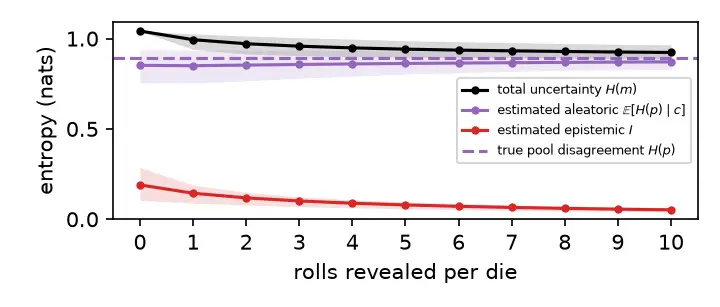
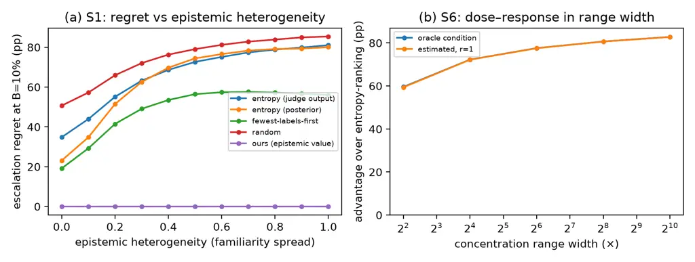
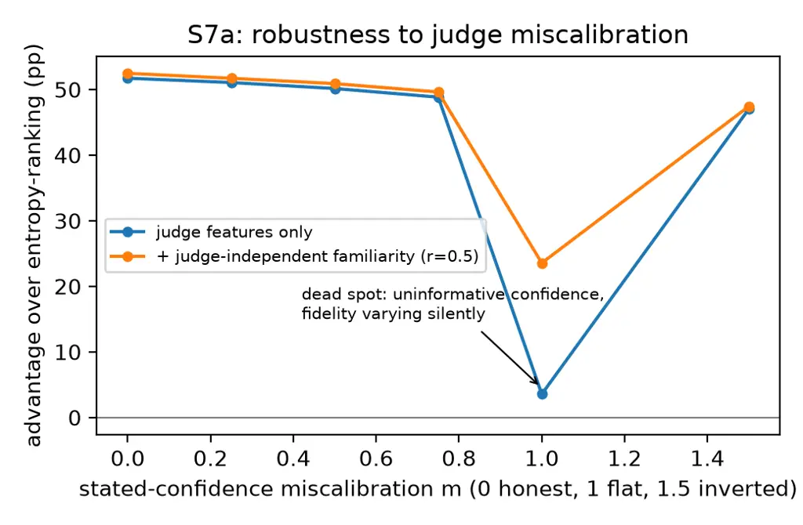

# Decomposing LLM-Judge Uncertainty to Target Expert Labels

Ryan Lail Affiliation: Composo AI Email: [ryan@composo.ai](mailto:)

###### Abstract

An LLM judge evaluates outputs at scale. Experts should label only where
it is least sure. Its natural escalation signal conflates two
uncertainties: _aleatoric_, real disagreement in the expert pool, which
labels cannot reduce, and _epistemic_, the judge’s ignorance, which
labels do reduce. A small Bayesian model separates them: a regression on
labels already collected learns how far to trust a black-box judge’s
prediction. Both components follow as simple formulas, with no sampling
or further judge calls. The components isolate on a real LLM judge
against exactly known truth, and stated confidence is no guide to its
actual error. On real human disagreement (ChaosNLI) the epistemic
ranking removes 83% more error than total uncertainty for the same
expert labels, though simply escalating the least-labelled items does as
well there. We demonstrate we can estimate where a judge is ignorant
rather than where experts genuinely disagree, and propose using this to
direct expert labelling. Code and data are available at
[https://github.com/composo-ai/judge-uncertainty-decomposition](https://github.com/composo-ai/judge-uncertainty-decomposition).

## 1 Introduction

LLMs increasingly serve as judges: evaluators substituting for expert
labels at scale. Judges are stochastic. Averaging repeated calls is the
standard remedy \[Lail and Markham, 2026\], but treats all variation as
noise, when only part of it is. The _pool_ of human experts the judge
stands in for may read an item differently, so the judge should predict
a _distribution_ over labels, not a single verdict \[Baan et al., 2022;
Leonardelli et al., 2025\]. Its spread is _aleatoric_ uncertainty, a
property of the item no further labelling removes. The judge may also be
ignorant of where the pool’s distribution sits: _epistemic_ uncertainty.

This paper asks whether the two can be disentangled for a black-box
judge, from its outputs and the labels already collected.

#### Contributions.

\(1\) _A model of judge uncertainty separating the two components_: a
small regression on already-collected labels learns how far to trust the
judge’s prediction on each item. Both components follow as simple
formulas with no further judge calls. The entropy of the predicted
distribution, the natural escalation score, is exactly the two
components summed, which is why ranking on it conflates ignorance with
disagreement. (2) _A controlled test against exact ground truth_: a
frontier LLM judges dice whose true bias and pool disagreement are
known, with the judge black-box. The components isolate, and the judge’s
stated confidence, taken at face value, is no guide to its actual error.
(3) _A real-world check on human disagreement_: on ChaosNLI the
epistemic ranking recovers more label-budget value than total
uncertainty, though not more than a count-based rule.

## 2 Related work

Calibration to majority labels is ill-posed under genuine disagreement
\[Baan et al., 2022; Plank, 2022\]. LeWiDi-2025 \[Leonardelli et al.,
2025\] standardises evaluation against the pool’s distribution.
Distributional judging \[Chen et al., 2025; Wang et al., 2025\] supplies
the prediction our model consumes, without per-item uncertainty about
it. Systems that escalate on undivided judge-side uncertainty target a
single verdict \[Jung et al., 2025; Sheng et al., 2025; Badshah et al.,
2026\]. Bachar et al. \[2026\] carry the distinction only as
self-reported flags, and Dorner et al. \[2025\] prove an aggregate limit
on judge value. Our framing and the classical decomposition are the same
object, not rivals \[Kotelevskii et al., 2025\], and our epistemic score
is BALD’s \[Houlsby et al., 2011; Bickford Smith et al., 2023; Nguyen
et al., 2019\]. Dubois et al. \[2026\] fit generalised linear models to
grader scores: theirs separates grader severity offsets from residual
disagreement, while ours separates irreducible pool disagreement from
our own ignorance of where the pool sits. The mechanism is theirs. The
transfer, failure characterisation, and judge-side measurement are ours.
None asks which labels to buy.

## 3 Model

The model builds up in three levels: a single annotator (level 0), the
pool of annotators (level 1), and our knowledge of the pool (level 2).

#### Levels 0 and 1: an annotator, and the pool.

Annotator $`a`$ in a pool with weights $`w_{a}`$ holds a label
distribution $`\pi_{a}(x)`$ over the $`K`$ classes, and a label is a
draw from it. A label from a randomly drawn annotator is then a draw
from the pool’s _population label distribution_
$`p_{x}=\sum_{a}w_{a}\pi_{a}(x)`$. Its entropy $`H(p_{x})`$ (or Gini
$`G(p_{x})=1-\lVert p_{x}\rVert^{2}`$) is the _aleatoric_ component: a
property of the pool, unreduced by labels. We model the pool at this
marginal level (real-valued scores: App. B).

#### Level 2: our knowledge of the pool.

$`p_{x}`$ is never observed, so we hold a belief about it. An estimate’s
realised error is a divergence $`D_{x}=d(\hat{p}_{x},p_{x})`$.
_Epistemic_ uncertainty is a prediction of $`D_{x}`$ made without
observing $`p_{x}`$. $`d`$ is the Manhattan distance
$`\sum_{j}|\hat{p}_{j}-p_{j}|`$, running 0 (exact) to 2 (probability on
disjoint classes), standard for categorical soft labels \[Leonardelli
et al., 2025\]. Correctly predicting a genuinely split pool gives
$`D_{x}=0`$: disagreement is not error.

#### The estimator.

The level-2 belief is a Dirichlet centred on an LLM judge’s predicted
distribution $`\hat{q}_{x}`$, weighted by a _trust_ $`\lambda_{x}`$ in
pseudo-label units. The $`n_{x}`$ labels in hand, tallied $`c_{x}`$,
update it in closed form to $`\mathrm{Dir}(\alpha_{x})`$ with mean
$`m_{x}=\alpha_{x}/\alpha_{0,x}`$ and _total evidence_
$`\alpha_{0,x}=\lambda_{x}+n_{x}`$, trust plus labels. Trust is fitted
log-linearly on item features, among them embedding distance/density to
labelled items, the _familiarity channel_, a signal not from the judge.
Ordinary labels are the only training signal (full displays and
likelihood: App. B). The judge’s prediction is never fitted: the judge
does the perceptual work, our model decides how far to believe it.

#### The decomposition.

A fresh label’s uncertainty splits as

```math
H(m_{x})=\mathbb{E}[H(p_{x})\mid c_{x}]+I(y;p_{x}\mid c_{x}),
```

with $`y`$ one further label. The aleatoric term is closed-form
(App. B). The epistemic term $`I_{x}`$ is BALD’s acquisition score
\[Houlsby et al., 2011\], and total uncertainty $`H(m_{x})`$ is the
escalation baseline. Entropy sees only the shape of $`m_{x}`$, not the
evidence behind it: with equal total evidence the two rankings nearly
agree, and where evidence varies they come apart, up to full inversion
(App. B).

## 4 Experimental setup

Two experiments share one real LLM judge, Azure OpenAI’s gpt-5.6-terra,
queried 18 August 2026.

#### Experiment 1: dice (exactly known truth).

500 three-sided dice with biases $`p_{i}`$ carry descriptions in four
tiers (none, weak, directional, strong), assigned independently of bias.
From the description alone the judge predicts the 100-roll distribution
(three prompt variants, 0–100 stated confidence), with 0–10 revealed
rolls as labels. With $`p_{i}`$ known, true disagreement is its entropy,
true error the posterior’s Manhattan distance from it. The regression is
given each die’s tier as its familiarity feature. We measure whether
each estimated component tracks its ground truth, and whether stated
confidence does.

#### Experiment 2: ChaosNLI (real human disagreement).

3,113 items \[Nie et al., 2020\], each a premise–hypothesis sentence
pair labelled entailment, neutral, or contradiction by 100 annotators.
The judge predicts the annotator distribution. Labels are half-split per
item, fitting and acquisition on one half, evaluation the other:
evaluation truth is never touched by training, and disjoint 50-label
halves set a 0.158 noise ceiling (Manhattan). We measure the estimation
error each escalation rule removes for a fixed escalation budget $`B`$,
the fraction of items sent for expert labels: every rule escalates its
top-ranked $`B\%`$, so rules compete purely on which items they pick.

#### Escalation rules.

_Ours_ ranks by the estimated epistemic component: mutual information
$`I_{x}`$ under log loss and, under squared error, the one-label value
$`\Delta_{x}`$, with posterior spread $`v_{x}`$ the withhold variant
(App. B). Experiment 2 reports all three. Baselines: _entropy_ (output
or posterior), _verbalised confidence_, _fewest-labels-first_, _random_,
_oracle_.

## 5 Results

### 5.1 Simulations: the estimator on synthetic pools with known truth

Two simulations precede the judge experiments: one calibrated, one
misspecified (setup and the misspecified results: App. A). The
calibrated one draws worlds from the Sec. 3 model itself, so the value
of every escalation choice is exactly computable. When items differ only
in how many labels they already hold, ranking by total uncertainty
forfeits a third of the error reduction the same labels could have
bought, while epistemic ranking stays at oracle level. When evidence is
equal the gap is exactly zero, as the Sec. 3 claim requires. Posterior
spread alone captures nearly all of that gain, so the takeaway is
simple: escalate on the epistemic component (numbers: App. A, Figure 2).

### 5.2 Experiment 1: a real LLM judge on dice with exactly known truth

| estimate          | vs. disagreement | vs. error |
| ----------------- | ---------------- | --------- |
| aleatoric         | 0.45             | $`-0.12`$ |
| epistemic ($`I`$) | 0.08             | 0.66      |

Table 1: Component isolation: Spearman rank correlation of each estimate
with the true quantities, 500 dice. The truths are themselves
anti-correlated ($`-0.23`$), so the separation is not inherited from the
world. Full grid: App. C.

| rule                        | value | vs. entropy               |
| --------------------------- | ----- | ------------------------- |
| epistemic ($`I`$-ranking)   | 15.0  | $`+6.8`$ $`[+1.7,+11.9]`$ |
| fewest-labels-first         | 14.3  | $`+6.1`$ $`[-0.0,+12.4]`$ |
| entropy (total uncertainty) | 8.2   | —                         |

Table 2: Escalation on ChaosNLI at budget $`B=10\%`$ (the top tenth of
items escalated), Manhattan units of error removed. All seven rules:
App. D.



Figure 1: The decomposition in motion (500 dice, 200 draws, 2.5–97.5
bands). The aleatoric estimate holds at 0.85–0.87 against the true 0.892
(dashed), the epistemic falls 0.190 to 0.052, and total uncertainty
falls to the aleatoric floor: labels drain ignorance, not disagreement.

| tier        | judge error | stated confidence |
| ----------- | ----------- | ----------------- |
| none        | 0.53        | 90.9              |
| weak        | 0.54        | 0.4               |
| directional | 0.41        | 59.1              |
| strong      | 0.007       | 14.8              |

Table 3: The confidence pathology by tier: stated confidence (0–100) is
non-monotone in judge error. Full four-column table: App. C.

On a real LLM judge the two components are separable: each estimated
component tracks its own ground truth and not the other’s (Table 2).
Figure 1 shows it in motion.

Stated confidence fails as an escalation signal: near-certainty with no
information, near-zero when merely told the dice are weighted,
calibrated only near complete information (Table 3). At item level it
correlates _positively_ with error (Spearman $`+0.22`$), and escalating
on low confidence does no better than random (App. C).

Dice are the wrong world for measuring escalation gains, which is why
the decision-level claim waits for Experiment 2: this judge predicts
uniform exactly when ignorant, so ranking by total uncertainty nearly
coincides with ranking by ignorance, and between-rule differences drown
in single-draw noise (App. C). ChaosNLI supplies the regime where the
two come apart.

### 5.3 Experiment 2: escalation on real human disagreement (ChaosNLI)

On ChaosNLI the judge is confidently wrong again: its predicted
annotator distributions miss at triple the noise ceiling, the
irreducible error from annotator sampling (Sec. 4), while its stated
confidence averages above 90 on the 0–100 scale. Neither confidence nor
prediction entropy tracks error (App. D).

The regression finds near-uniform trust, each prediction worth about
five labels, unsurprising for short crowdsourced NLI pairs, which give
the familiarity features little to exploit. But label counts range 0–10
by design, leaving total evidence $`\alpha_{0}`$ heterogeneous where
$`\lambda`$ is flat (the Sec. 3 condition).

On real human disagreement the epistemic ranking recovers more
label-budget value than total uncertainty, though a count-based rule
does as well here. For the same label budget, epistemic ranking removes
15.0 units of error against entropy’s 8.2 (Table 2): 83% more per expert
label. The gap widens at larger budgets and is absent at smaller ones.
The rules split into count-aware and count-blind clusters, and the count
heuristic is not beaten (App. D).

The Sec. 3 mechanism, measured in Sec. 5.1, is present on real data.
Separating our estimator from the count heuristic needs items genuinely
differing in judge familiarity, with dense labels to score. No public
dataset offers both: the field’s missing dataset rather than this
paper’s missing experiment.

## 6 Limitations and conclusion

We demonstrate the full method only on synthetic dice, where the truth
is exactly known. On ChaosNLI the judge was about equally unfamiliar
with every item, so its fitted trust ($`\lambda`$) came out nearly flat,
and only the label-count side of the model was really tested on real
data. That side worked, removing nearly twice as much error as entropy
ranking at the same budget (Sec. 5.3). But when trust is flat our
ranking follows label counts, exactly what the fewest-labels-first
baseline does, so the baseline ties us. The remaining limits are more
ordinary. Each experiment used one judge model and one prompt design.
Simulated effect sizes depend on the generator (Sec. 5.1). Our intervals
resample labels over a fixed item set and say nothing about new items.
We have no defence against a deceptive judge that games the familiarity
signals behind its trust. A merely worthless signal reduces the method
to ranking by label counts, still $`{\sim}32`$pp better than entropy
ranking in the simulations (Sec. 5.1).

Escalate the items the judge is ignorant about, not the items annotators
genuinely disagree on. The two can be separated with the labels already
collected. No new data are needed. Escalating on ignorance removed more
error per expert label than escalating on total uncertainty, though not
more than a fewest-labels-first rule. Overall, this demonstrates a first
step towards decomposing epistemic and aleatoric uncertainty in LLM
judges. The decisive test is on data where judge familiarity genuinely
varies, with the comparison against fewest-labels-first stated before
any results are seen.

## References

- Baan et al. \[2022\] Baan et al. Stop measuring calibration when
  humans disagree. In _EMNLP_, 2022.
- Bachar et al. \[2026\] Bachar et al. LLM performance predictors:
  Learning when to escalate in hybrid human–AI moderation systems. In
  _AAMAS_, 2026.
- Badshah et al. \[2026\] Badshah, Emami, and Sajjad. SCOPE: Selective
  conformal optimized pairwise LLM judging. In _ICML_, 2026.
  arXiv:2602.13110.
- Bickford Smith et al. \[2023\] Bickford Smith et al.
  Prediction-oriented Bayesian active learning (EPIG). In
  _AISTATS_, 2023.
- Chen et al. \[2025\] Chen et al. Distributional LLM-as-a-judge. In
  _NeurIPS_, 2025.
- Dorner et al. \[2025\] Dorner, Nastl, and Hardt. Limits to scalable
  evaluation at the frontier: LLM as judge won’t beat twice the data. In
  _ICLR_, 2025.
- Dubois et al. \[2026\] Dubois, Coppock, et al. Quantifying biases in
  LLM-as-a-judge evaluations. In _ICML_, 2026.
- Houlsby et al. \[2011\] Houlsby et al. Bayesian active learning for
  classification and preference learning. _arXiv:1112.5745_, 2011.
- Jung et al. \[2025\] Jung, Brahman, and Choi. Trust or escalate: LLM
  judges with provable guarantees for human agreement. In _ICLR_, 2025.
- Kotelevskii et al. \[2025\] Kotelevskii et al. From risk to
  uncertainty: Generating predictive uncertainty measures via Bayesian
  estimation. In _ICLR_, 2025.
- Lail and Markham \[2026\] Lail and Markham. On cost-effective
  LLM-as-a-judge improvement techniques. In _ICML 2026 Workshop on
  Statistical Frameworks for Uncertainty in Agentic Systems_, 2026.
  arXiv:2604.13717.
- Leonardelli et al. \[2025\] Leonardelli et al. LeWiDi-2025 at
  NLPerspectives: Third edition of the learning with disagreements
  shared task. In _NLPerspectives @ EMNLP_, 2025. arXiv:2510.08460.
- Nguyen et al. \[2019\] Nguyen, Destercke, and Hüllermeier. Epistemic
  uncertainty sampling. In _Discovery Science_, 2019.
- Nie et al. \[2020\] Nie, Zhou, and Bansal. What can we learn from
  collective human opinions on natural language inference data? In
  _EMNLP_, 2020. ChaosNLI.
- Plank \[2022\] Plank. The “problem” of human label variation: On
  ground truth in data, modeling and evaluation. In _EMNLP_, 2022.
- Sheng et al. \[2025\] Sheng et al. Analyzing uncertainty of
  LLM-as-a-judge: Interval evaluations with conformal prediction. In
  _EMNLP_, 2025. arXiv:2509.18658.
- Wang et al. \[2025\] Wang, Zhang, and Choi. Improving LLM-as-a-judge
  inference with the judgment distribution. In _Findings of
  EMNLP_, 2025. arXiv:2503.03064.

## Appendices

## Appendix A Supporting simulations in full

Terms used for escalation results here and in the body: a rule’s
_regret_ at budget $`B`$ is its top-$`B\%`$ selection’s shortfall below
the best possible, in percentage points (pp). _Advantage_ is the
difference of two rules’ regrets. Escalation _value_ is the reduction in
error from purchased labels, in Manhattan units, summed over the
escalated set. Real-judge numbers are means over 200 label re-draws with
95% intervals, paired within re-draw.



Figure 2: (a) Escalation regret at $`B=10\%`$ as the spread of item
trust grows. Entropy-ranking (on the judge’s output, or on the posterior
with labels folded in) degrades from 35pp toward random’s 85pp,
fewest-labels-first captures part of the gap and plateaus, and ranking
by estimated label value stays at oracle level. (b) The effect does not
require an extreme world: as the trust range narrows from $`\times 256`$
to $`\times 4`$, the advantage over entropy-ranking declines only from
81pp to 60pp, and the estimated-trust condition matches the oracle
condition at every width.

#### Setup.

In the _calibrated_ simulation (2,000 items), the world is drawn from
the Sec. 3 model with the judge’s prior correct by construction, so the
value of every escalation decision is exactly computable. The spread of
item trust, the spread of pool disagreement, and the correlation between
them are steerable axes, and each item reveals 0–10 labels. In the
_misspecified_ simulation, the world is drawn truth-first, the judge’s
prediction quality varies with familiarity, and its stated confidence is
corrupted by a knob $`\gamma`$: honest at $`\gamma=0`$, information-free
at $`\gamma=1`$, inverted at $`\gamma=1.5`$. There the estimator’s model
is wrong by construction and rules are scored against an oracle that
knows the realised world, so only between-rule comparisons are
meaningful.

#### Calibrated simulation: all four findings.

Pass/fail criteria: advantage $`\geq 15`$pp at the criterion cell and
oracle tracking Spearman $`\geq 0.9`$, measured 80.9pp (seed-level CI
80.6–81.2) and 1.0. (1) The failure needs no exotic regime: with
identical prior trust and only revealed counts (0–10) differing,
entropy-ranking loses 34.8pp. In the true null (identical trust _and_
identical label count), the advantage measures 0.0pp, as the Sec. 3
claim requires. (2) Entropy-ranking approaches random as trust spread
grows (81pp regret vs random’s 85pp at the widest setting), because
entropy is blind to evidence and, through revealed counts,
anti-correlated with label value: the claim’s inversion, realised. (3)
There is no estimator-quality threshold, and adverse correlation does
not close the gap: with a worthless familiarity signal the regression
still beats entropy-ranking by 32pp (revealed counts alone carry the
signal), rising monotonically to 81pp as the signal improves, and when
contentious items are also the unfamiliar ones (correlation 0.8, the
realistic direction), the advantage is still 50pp. (4) Ranking by
posterior spread captures $`{\sim}98\%`$ of the gain ($`v`$-ranking
within 1.2–1.8pp of $`\Delta`$-ranking everywhere). The finer
withhold-versus-purchase distinction (App. B) is second-order for
ranking.



Figure 3: Advantage over entropy-ranking at $`B=10\%`$ in the
misspecified simulation, as stated-confidence corruption $`\gamma`$
varies (the axis label reads $`m`$, this paper’s earlier name for the
knob). With judge-supplied features only (blue), the advantage is flat
at $`{\sim}50`$pp from honest through badly miscalibrated
($`\gamma\leq 0.75`$) and at fully inverted confidence ($`\gamma=1.5`$),
where the regression re-learns the mapping and exploits the inversion
(fitted coefficient on stated confidence flips from $`-0.63`$ to
$`+1.09`$). The one dead spot is $`\gamma=1`$: confidence carrying no
information while prediction quality varies silently (3.6pp). A
judge-independent familiarity signal of middling quality (orange)
recovers most of it (23.5pp) and costs nothing elsewhere.

#### Misspecified simulation: the predictions as scored.

The prediction that a regression using only revealed-label counts
survives all tested corruptions was refuted at $`\gamma=1`$ and
confirmed elsewhere: the collapse requires both uninformative confidence
and silently varying quality. The prediction that the regression would
monotonically down-weight stated confidence as corruption grows was
refuted in its monotone form: the fitted coefficient grows through
$`\gamma=0.75`$, reaches zero at $`\gamma=1`$, and flips sign at
inversion. The regression re-learns the mapping rather than gradually
distrusting it (Figure 3). These magnitudes are generator-dependent:
they do not predict real-world effect sizes.

## Appendix B Model details: the estimator, fitting likelihood, closed forms, and the real-valued formulation

#### The estimator in full.

An LLM judge supplies a prediction $`\hat{q}_{x}`$ of the pool. The
belief, the labels in hand ($`n_{x}`$ of them, class tally $`c_{x}`$),
and the trust, fitted log-linearly on item features, are

```math
p_{x}\sim\mathrm{Dir}(\lambda_{x}\hat{q}_{x}),\qquad c_{x}\sim\mathrm{Multinomial}(n_{x},p_{x}),\qquad\log\lambda_{x}=\beta_{0}+\beta^{\top}z_{x},
```

with $`z_{x}`$ collecting variant spread, stated confidence, the label
count $`n_{x}`$ itself, and embedding distance/density to labelled
items. The coefficients $`\beta`$ are the only fitted quantities, and
the log keeps $`\lambda_{x}`$ positive. The posterior is

```math
p_{x}\mid c_{x}\sim\mathrm{Dir}(\alpha_{x}),\qquad\alpha_{x}=\lambda_{x}\hat{q}_{x}+c_{x},\qquad\alpha_{0,x}=\lambda_{x}+n_{x},
```

labels and trust in one currency: updating is addition.

#### The real-valued formulation.

Annotator $`a`$ holds a latent score $`\mu_{a}(x)\in[0,1]`$, the score
they would settle on given unlimited care, and an observed label adds
within-annotator noise, which we take to be Gaussian,

```math
y=\mu_{a}(x)+\varepsilon,\qquad\varepsilon\sim\mathcal{N}(0,\sigma_{a}^{2}),
```

where $`\sigma_{a}^{2}`$ is the variance of a fresh rating of the same
item by the same annotator. A pool of annotators $`a=1,\dots,M`$ with
weights $`w_{a}`$ induces a population score distribution with mean and
spread

```math
m(x)=\sum_{a}w_{a}\mu_{a}(x),\qquad\tau^{2}(x)=\sum_{a}w_{a}(\mu_{a}(x)-m(x))^{2},
```

where $`\tau^{2}(x)`$ is genuine inter-annotator disagreement, a
property of the pool itself, unreduced by collecting further labels.

Neither $`\mu_{a}(x)`$ nor $`\tau^{2}(x)`$ is directly observable: a
label carries the annotator’s own noise with it. Averaging labels still
recovers $`m(x)`$, since that noise is centred, but a label’s variance
is $`\tau^{2}(x)+\bar{\sigma}^{2}`$ with
$`\bar{\sigma}^{2}=\sum_{a}w_{a}\sigma_{a}^{2}`$, so one label per
(item, annotator) pair cannot separate genuine disagreement from
within-annotator noise. It need not: both are aleatoric, and every
quantity in the paper uses only their sum.

For real-valued scores, the split displayed in Sec. 3 is the three-way
variance decomposition

```math
\mathrm{Var}(y\mid x,\mathcal{D})=\underbrace{\bar{\sigma}^{2}}_{\text{within-annotator}}+\underbrace{\mathbb{E}[\tau^{2}\mid\mathcal{D}]}_{\text{between-annotator}}+\underbrace{\mathrm{Var}(m\mid\mathcal{D})}_{\text{epistemic}},
```

whose first two terms are aleatoric (irreducible for a single fresh
label) and whose third alone shrinks with labels. The entropy display of
Sec. 3 is its categorical counterpart, with the first two terms merged
by the Level-0 identifiability constraint above.

#### The fitting likelihood.

The maximum-likelihood objective for $`\beta`$ is the
Dirichlet–multinomial likelihood

```math
\mathcal{L}(\beta)=\prod_{x:n_{x}\geq 1}\mathrm{DirMult}(c_{x}\mid n_{x},\lambda_{x}(\beta)\hat{q}_{x}),
```

a generalised linear model with log link on $`\lambda`$ and
Dirichlet–multinomial response (beta–binomial regression generalised
past two classes). A handful of coefficients against a few hundred
labelled items is well-posed: only the trust scale is learned.

#### Closed form of the aleatoric term.

$`\mathbb{E}[H(p_{x})\mid c_{x}]=\psi(\alpha_{0,x}+1)-\sum_{j}m_{x,j}\psi(\alpha_{x,j}+1)`$,
with $`\psi`$ the digamma function.

#### The derived scores.

Under squared error the decomposition yields two decision quantities:
the posterior spread $`v_{x}=G(m_{x})/(\alpha_{0,x}+1)`$, the expected
squared error of the current estimate (the _withhold_ quantity), and the
one-label value

```math
\Delta_{x}=\frac{G(m_{x})}{(\alpha_{0,x}+1)^{2}},
```

the expected reduction in that error from one further expert label (the
_purchase_ quantity). Withholding and purchasing optimise different
scores \[Bickford Smith et al., 2023\], both distinct from entropy. In
this model class the two rank items nearly identically (Sec. 5.1), and
the claim the paper tests is the two-way split, epistemic against total.

#### When entropy-ranking is safe.

Entropy sees only the shape of $`m_{x}`$, but label value also sees the
evidence behind it, decaying as $`(\alpha_{0,x}+1)^{-2}`$. With equal
total evidence the two rankings nearly agree. Where it varies they come
apart, folded-in labels driving entropy anti-correlated with value, up
to full inversion. Equal evidence is the only $`\alpha_{0}`$ condition
giving agreement for every shape, and it fails in any partially-labelled
deployment: label counts alone make $`\alpha_{0}`$ heterogeneous.

## Appendix C Experiment 1 auxiliary results

All queries in both experiments used the Azure OpenAI deployment
gpt-5.6-terra, API version 2024-12-01-preview.

Escalation numbers on dice. Total predictive entropy tracks judge error
at 0.57, against 0.66 for the epistemic estimate. Escalating on low
stated confidence is indistinguishable from random ($`B=10\%`$:
$`+1.8`$pp, per-draw 95% interval $`-14`$ to $`+18`$).
Ours-versus-entropy regret differences are dominated by single-draw
noise ($`+6`$pp expected, per-draw $`-25`$ to $`+28`$).

|                       |                  |            |                  |                |             |
| --------------------- | ---------------- | ---------- | ---------------- | -------------- | ----------- |
|                       | est-aleatoric vs |            | est-epistemic vs |                |             |
| world                 | true disagr.     | true error | true disagr.     | true error     | truth–truth |
| calibrated simulation | 0.77 (.76,.78)   | 0.13       | $`-0.14`$        | 0.48 (.46,.51) | $`-0.03`$   |
| real LLM judge        | 0.45 (.32,.55)   | $`-0.12`$  | 0.08             | 0.66 (.51,.70) | $`-0.23`$   |

Table 4: Isolation of the estimated components. Spearman correlation
between each estimated component and each ground truth, with 95%
intervals over label re-draws (real judge) or simulated worlds
(calibrated). Isolation requires a strong diagonal and near-zero
off-diagonal. The truth–truth column shows the two ground truths are
themselves uncorrelated or anti-correlated, so the separation is not
inherited from the world.

| tier        | judge error | stated confidence | variant spread |
| ----------- | ----------- | ----------------- | -------------- |
| none        | 0.53        | 90.9              | 0.0002         |
| weak        | 0.54        | 0.4               | 0.0008         |
| directional | 0.41        | 59.1              | 0.0018         |
| strong      | 0.007       | 14.8              | 0.0006         |

Table 5: The judge’s stated confidence is non-monotone in its error. By
description tier (125 dice each): judge error is the mean Manhattan
distance from the judge’s predicted face distribution to the true one
(0–2 scale). Stated confidence is the judge’s self-reported certainty on
its 0–100 scale, and variant spread is the standard deviation of the
predicted face probabilities across three prompt paraphrases, in
probability units (0.0002 means the paraphrases agree to the fourth
decimal place).

#### Self-updating versus conjugate updating.

When shown its own rolls, the judge’s self-updated prediction (error
0.258, $`n=380`$) loses to conjugate updating of its own prior (adding
the observed rolls to its stated prediction as counts) once the
familiarity channel sets the trust level (0.262 with the channel, 0.307
without): the Bayesian machinery is where the correction lives, not
overhead.

## Appendix D Experiment 2 auxiliary results

Descriptives. The judge’s mean Manhattan error is 0.458 against the
0.158 ceiling, and stated confidence averages 90.3. Item-level Spearman
with error is $`-0.13`$ for stated confidence and 0.11 for prediction
entropy. The fitted trust is near-uniform,
$`\mathrm{sd}(\log\hat{\lambda})=0.22`$ against the planned condition’s
$`\geq 0.5`$, each prediction worth about five pseudo-labels. The
planned condition tested only the trust side and so predicted no
separation, a mis-specification: the characterisation is about
$`\alpha_{0}`$, not about $`\lambda`$ alone.

Comparisons beyond Table 2. The planned headline, ranking by $`\Delta`$,
was inconclusive against entropy ($`+4.5`$ $`[-2.2,+9.4]`$), and the
counts-only claim was refuted ($`+6.9`$, grazing zero at $`-0.4`$).
Seven rules are compared, so no interval stands alone. $`I`$-ranking
beats entropy by $`+12.8`$ $`[+4.3,+20.4]`$ at $`B=20\%`$, with smaller
budgets inconclusive. The value clusters are count-aware 12.1–15.0 and
count-blind 6.9–8.3, and $`I`$ minus fewest-labels-first is $`+0.7`$
$`[-6.3,+7.1]`$.

| escalation rule                                   | value (SE) | advantage over entropy \[per-draw 95%\] |
| ------------------------------------------------- | ---------- | --------------------------------------- |
| ours: mutual information $`I`$                    | 15.0 (0.2) | +6.8 $`[+1.7,+11.9]`$                   |
| fewest-labels-first                               | 14.3 (0.2) | $`+6.1`$ $`[-0.0,+12.4]`$               |
| ours: label value $`\Delta`$ _(planned headline)_ | 12.7 (0.2) | $`+4.5`$ $`[-2.2,+9.4]`$                |
| ours: posterior spread $`v`$                      | 12.1 (0.2) | $`+3.9`$ $`[-1.7,+10.7]`$               |
| random                                            | 8.3 (0.2)  | $`+0.1`$ $`[-5.5,+5.6]`$                |
| entropy (judge output)                            | 8.2 (0.1)  | —                                       |
| verbalised confidence                             | 8.1 (0.1)  | $`-0.1`$ $`[-5.8,+5.1]`$                |
| entropy (posterior)                               | 6.9 (0.1)  | $`-1.2`$ $`[-6.0,+3.3]`$                |

Table 6: Escalation on ChaosNLI at $`B=10\%`$ (311 items). All entries
are in Manhattan units of error removed, not percentages. Value is the
total reduction from the purchased labels, summed over the escalated
set, and advantage is the difference from entropy-ranking on the judge’s
output, paired within replicate. Means over 200 label re-draws,
Monte-Carlo standard error in parentheses, per-draw 95% intervals in
brackets. Only the $`\Delta`$ row was the planned headline comparison.
The remaining advantages are exploratory.
