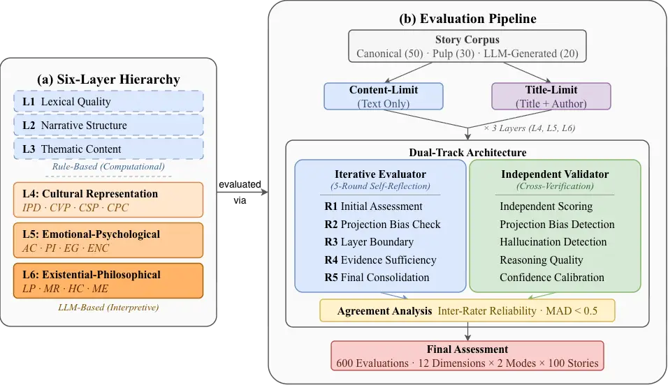
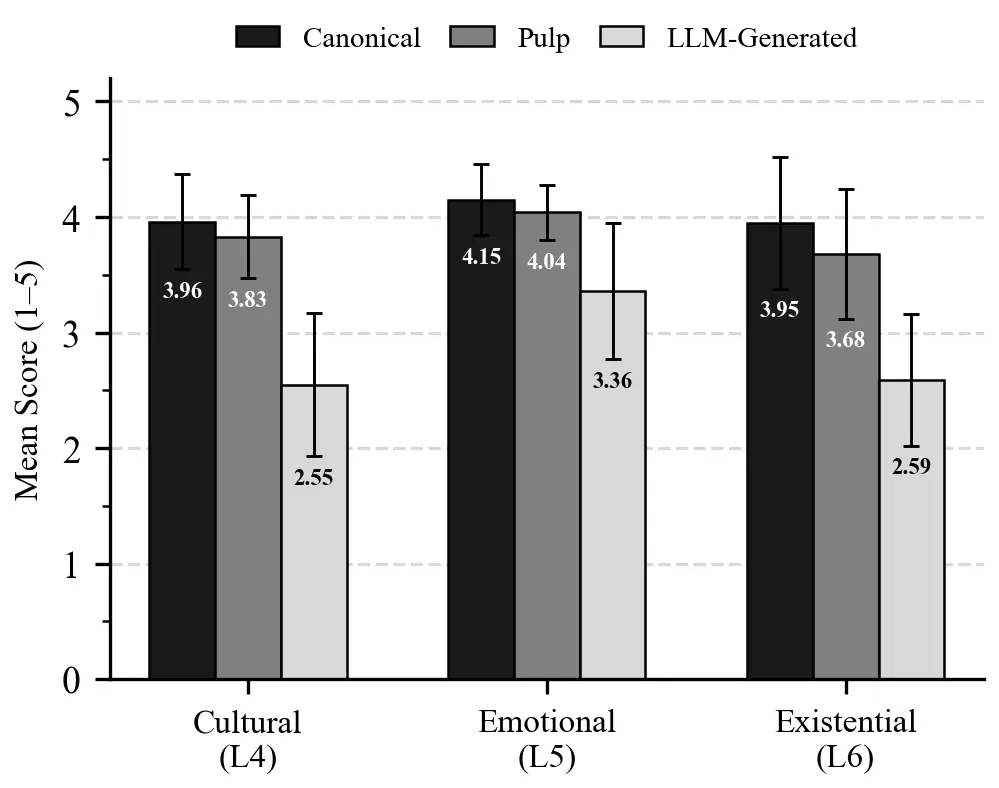
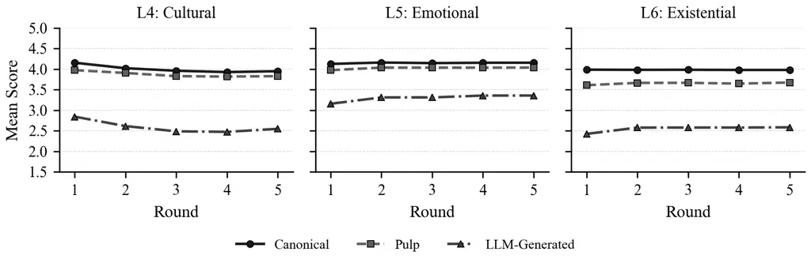
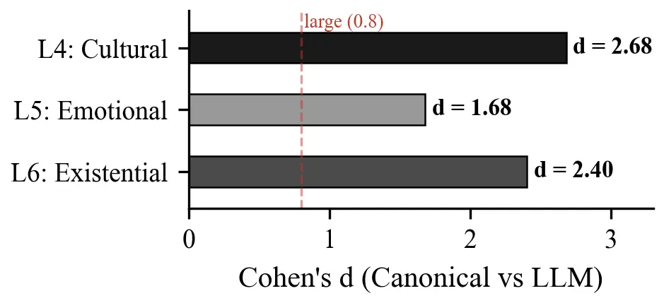

# SAGE: A Hierarchical Framework for Evaluating Interpretive Literary Quality in Narratives

Tianyu Wang Affiliation: Mercy University Affiliation: Math & Computer
Science Department Affiliation: Dobbs Ferry, NY, USA
Email: [twang4@mercy.edu](mailto:)    Nianjun Zhou Affiliation: IBM T.J.
Watson Research Center Affiliation: Yorktown Heights, NY, USA
Email: [jzhou@us.ibm.com](mailto:)

###### Abstract

Assessing the literary quality of narratives requires evaluating
interpretive dimensions (cultural representation, emotional depth, and
philosophical engagement) that existing NLG metrics cannot measure. We
introduce SAGE, a six-layer evaluation framework that separates
rule-based assessment of observable textual properties from LLM-based
evaluation of interpretive qualities drawn from cultural theory, affect
theory, and existentialist philosophy. Each interpretive layer is
assessed through multi-round iterative LLM evaluation with independent
cross-validation, achieving measurement-grade reliability (98.8%
convergence, $`>`$94% inter-rater agreement) stable across evaluator
models. Validated on 600 evaluations across 100 short stories, our
central finding is a systematic capability boundary:
emotional-psychological representation approaches human levels, while
cultural critique and philosophical depth exhibit approximately double
the gap. LLM-generated narratives score below even commercial genre
fiction on all three layers. We interpret this as a boundary between
_pattern-reproducible_ literary capacities learnable from training
corpora and _stance-requiring_ ones demanding cultural positioning and
philosophical engagement that pattern matching alone cannot provide.

## 1 Introduction

Evaluating the literary quality of narratives requires measuring
interpretive dimensions that existing NLG metrics cannot reach: cultural
representation, emotional-psychological depth, and philosophical
engagement. Standard metrics (BLEU, ROUGE, BERTScore; Papineni et al.
2002; Lin 2004; Zhang et al. 2019) measure surface similarity and
correlate poorly with human judgments of narrative quality (Novikova et
al., 2017; Reiter, 2018). Narrative-specific frameworks extend
evaluation to structural properties such as coherence and character
consistency (Chhun et al., 2022; Yi et al., 2025), but these
interpretive dimensions remain unaddressed. As large language models
generate increasingly fluent narratives, the absence of reliable
evaluation for these dimensions creates a systematic gap: generative
systems receive no signal for improvement precisely where the deficits
are largest.

We propose SAGE (Systematic Assessment of Generative Excellence) to
address this blind spot. SAGE is a hierarchical evaluation framework
that decomposes literary quality into six analytically distinct layers,
separating rule-based assessment of observable textual properties
(L1–L3) from LLM-based evaluation of interpretive dimensions (L4–L6).
Each interpretive dimension is grounded in established theoretical
frameworks from literary and cultural studies, and assessment proceeds
through a dual-track architecture combining five-round iterative
self-reflection with independent cross-validation.

We validate SAGE on 100 short stories across three interpretive layers
in two evaluation modes. Applying SAGE reveals a systematic capability
boundary: emotional-psychological representation is substantially closer
to human levels than cultural representation and philosophical depth,
with the latter two exhibiting approximately double the gap. We
interpret this as a boundary between _pattern-reproducible_ literary
capacities (learnable from surface regularities in training corpora) and
_stance-requiring_ ones that demand genuine cultural positioning and
philosophical engagement. LLM-generated narratives score below even
commercial genre fiction on all three layers, suggesting the deficit
reflects something more fundamental than insufficient literary training
data.

These findings motivate four research questions:

RQ1 (Reliability): Can the multi-round LLM evaluation architecture
produce stable, reproducible assessments of interpretive dimensions?

RQ2 (Discriminative Capacity): Does SAGE differentiate meaningfully
among canonical literature, genre fiction, and LLM-generated narratives?

RQ3 (Robustness): Are evaluation outcomes stable across different
informational conditions (text-based vs. reputation-based assessment)?

RQ4 (Dimensional Independence): Do the proposed dimensions capture
non-redundant aspects of literary quality?

##### Contributions.

This work makes two contributions. First, we demonstrate that
theory-driven multi-round LLM evaluation can achieve measurement-grade
reliability ($`>`$94% inter-rater agreement, 98.8% convergence) on
interpretive literary dimensions, establishing LLM-as-judge as viable
for tasks that previously resisted automated assessment. Second, we
identify a systematic capability boundary: emotional representation is
pattern-reproducible and approaches human competence, while cultural
critique and philosophical depth are stance-requiring and exhibit
approximately double the gap---a distinction invisible to existing NLG
evaluation methods and now, for the first time, reliably measurable.
Code, prompts, dataset, and results are publicly available.¹¹ 1
[https://anonymous.4open.science/r/sageFramework-journal-EDD6/](https://anonymous.4open.science/r/sageFramework-journal-EDD6/)

## 2 Related Work

Evaluating narrative quality is a long-standing challenge. Standard NLG
metrics (BLEU, ROUGE, BERTScore; Papineni et al. 2002; Lin 2004; Zhang
et al. 2019) measure surface similarity to reference texts and correlate
poorly with human narrative quality judgments (Reiter, 2018; Novikova et
al., 2017). Recognizing this, narrative-specific frameworks have
extended evaluation to structural dimensions: HANNA (Chhun et al., 2022)
provides human-annotated story evaluations across six criteria;
NarraBench (Hamilton et al., 2025) surveys 78 benchmarks for narrative
understanding; SCORE (Yi et al., 2025) tracks character consistency and
emotional coherence; and computational work has characterized discourse
coherence (Barzilay and Lapata, 2008) and emotional trajectories (Reagan
et al., 2016). Computational literary scholarship has further applied
machine learning to trace genre evolution and literary prestige at scale
(Underwood, 2019), and positioned these methods within narratological
theory (Piper et al., 2021). Together, these approaches establish that
narrative evaluation requires decomposition beyond surface metrics, yet
they remain focused on observable, structural properties. The
interpretive dimensions that distinguish canonical literature from
competent prose (how a text positions itself within cultural and
ideological terrain, how it renders inner life, whether it sustains
genuine philosophical inquiry) are not addressed by any existing
framework.

Relevant NLP subfields illuminate each of these gaps individually, yet
do not bridge them. Bias detection (Blodgett et al., 2020) examines
harmful representations but not the sophistication of cultural
engagement as a literary quality; sentiment analysis (Poria et al., 2019) classifies broad affective categories but not the emotional
granularity and interiority that characterize sophisticated fiction;
topic modeling (Blei et al., 2003) identifies recurring themes but not
the depth of philosophical engagement. These tools address adjacent
problems; none was designed to evaluate interpretive literary quality as
such.

LLM-based evaluation has emerged as a scalable alternative to human
annotation (Zheng et al., 2023; Li et al., 2024). Studies show strong
LLMs achieve over 80% agreement with human preferences, though
systematic biases (position, verbosity, self-preference) require
mitigation. Fine-grained frameworks such as FActScore (Min et al., 2023)
demonstrate that decomposing evaluation into explicit dimensions
substantially improves precision. However, existing LLM-as-judge work
targets conversational or instructional quality; creative and literary
evaluation remains theoretically underspecified. Recent process-oriented
analysis of LLM narrative generation suggests that models systematically
prioritize stylistic surface over character, event, and thematic depth
(Jung et al., 2025)—a generation bias that mirrors the evaluation blind
spot we identify. As LLM-generated narratives approach human-level
fluency (Wu et al., 2025), the absence of reliable evaluation for these
deeper dimensions becomes the critical bottleneck for NLG progress.

## 3 Methodology

### 3.1 Framework Overview

SAGE decomposes literary quality into six analytical layers organized in
a progression from observable textual properties (L1–L3, rule-based) to
increasingly interpretive literary qualities (L4–L6, LLM-based). The
term _hierarchical_ here denotes this progression in analytical depth,
not dependency between layers: L1–L3 and L4–L6 are evaluated
independently, and no layer’s scores are computed from another’s. This
reflects the hypothesis that formal features and interpretive qualities
constitute largely independent dimensions requiring different analytical
approaches. Figure 1 illustrates the architecture; Table 1 summarizes
the six layers. Our experimental validation focuses on L4–L6, which
require reasoning and cultural knowledge available only through modern
LLMs.

The three interpretive layers correspond to the three core questions
that literary criticism has long identified as defining literary
significance: how a text positions itself within social and cultural
power structures (L4), how it renders the inner life of characters (L5),
and how it engages with fundamental questions of human existence (L6).
These are precisely the dimensions absent from existing NLG evaluation
frameworks, and the dimensions where, as our results show, LLM-generated
narratives fall furthest short.

Figure 1: SAGE architecture. Layers 1–3 assess textual properties
through rule-based metrics; Layers 4–6 evaluate interpretive dimensions
through a dual-track LLM pipeline (iterative evaluator + independent
validator) in two modes.

|                    |             |                                           |
| ------------------ | ----------- | ----------------------------------------- |
| L                  | Focus       | Key Dimensions                            |
| Rule-Based (L1–L3) |             |                                           |
| 1                  | Lexical     | Vocabulary richness, syntactic complexity |
| 2                  | Narrative   | Entity coherence, emotional arcs          |
| 3                  | Thematic    | Topic diversity, semantic networks        |
| LLM-Based (L4–L6)  |             |                                           |
| 4                  | Cultural    | IPD, CVP, CSP, CPC                        |
| 5                  | Emotional   | AC, PI, EG, ENC                           |
| 6                  | Existential | LP, MR, HC, ME                            |

Table 1: Six-layer hierarchical evaluation framework.

### 3.2 LLM-Based Evaluation Layers (L4–L6)

#### 3.2.1 Layer 4: Cultural Representation

L4 evaluates cultural engagement and power structures, grounded in
postcolonial and cultural theory (Said, 1978; Spivak, 1988; Geertz, 1973) and field theory (Bourdieu, 2019). Four dimensions operationalize
this layer: Intersectional Power Dynamics (IPD), the complexity of power
relations across social axes; Cultural Voice & Perspective (CVP), how
the narrative voice is positioned relative to represented cultures;
Cultural Specificity (CSP), the density of cultural particularity in the
text; and Cultural Pattern Complexity (CPC), engagement with multiple
cultural logics simultaneously.

#### 3.2.2 Layer 5: Emotional-Psychological Representation

L5 evaluates emotional and psychological representation, grounded in
affect theory (Sedgwick and Frank, 1995; Berlant, 2020), emotion
granularity research (Barrett, 2017), and narrative psychology (Cohn,
1978; Wood, 2008). Four dimensions operationalize this layer: Affective
Complexity (AC), the multiplicity and contradiction of emotional states;
Psychological Interiority (PI), the depth of access to characters’ inner
worlds; Emotional Granularity (EG), the precision and differentiation of
emotional vocabulary; and Emotional-Narrative Coherence (ENC), whether
emotions arise organically from the narrative situation.

#### 3.2.3 Layer 6: Existential-Philosophical Representation

L6 evaluates philosophical depth and existential engagement, grounded in
existentialist philosophy (Heidegger, 2010; Sartre, 2022; Camus and
O’Brien, 1969), moral philosophy (Levinas, 1979; MacIntyre, 2013), and
hermeneutics (Ricoeur, 1980; Gadamer, 2013). Four dimensions
operationalize this layer: Life Philosophy (LP), engagement with
fundamental questions of human existence; Moral Reflection (MR), the
depth of ethical inquiry and moral complexity; Human Condition (HC), the
exploration of mortality, suffering, and vulnerability; and Meaning
Exploration (ME), how narratives construct, question, or subvert
frameworks of meaning.

#### 3.2.4 Construct Validity: Dimension Non-Redundancy

The twelve dimensions are designed to be non-redundant: canonical works
occupy divergent positions on theoretically motivated axes, establishing
that dimensions dissociate in practice. Table 2 illustrates key
orthogonalities across all three layers. At L5, Hemingway’s “Hills Like
White Elephants” achieves high AC (contradictory emotions embedded in
subtext) while PI is near zero (no access to either character’s inner
states), the inverse pattern from Woolf’s _Mrs. Dalloway_. At L4,
Conrad’s _Heart of Darkness_ and Achebe’s _Things Fall Apart_ share high
IPD but occupy opposite CVP positions: outsider gaze versus insider
cultural authority over the same colonial encounter. These dissociations
confirm that the dimensions capture genuinely independent aspects of
literary quality; full exemplar matrices are in Appendix A.

| Work                      | Dims.     | Values | Layer |
| ------------------------- | --------- | ------ | ----- |
| “Hills Like White Eleph.” | AC / PI   | H / L  | L5    |
| _Mrs. Dalloway_           | AC / PI   | H / H  | L5    |
| _Heart of Darkness_       | IPD / CVP | H / L  | L4    |
| _Things Fall Apart_       | IPD / CVP | H / H  | L4    |
| _The Stranger_            | LP / MR   | H / L  | L6    |
| _Crime and Punishment_    | LP / MR   | H / H  | L6    |

Table 2: Selected exemplars demonstrating dimension non-redundancy
across layers. H = High, M = Medium, L = Low. Dissociating pairs
highlighted in bold.

### 3.3 Dual-Mode Evaluation

We implement two evaluation modes that vary the information provided to
the model. Content-limit mode provides only the story text without
title, author, or metadata, requiring the LLM to assess literary
qualities from observable textual evidence alone. Title-limit mode
provides only the work’s title and author without text, requiring
synthesis of scholarly consensus from the model’s training corpus.
Comparing these modes reveals whether LLM evaluations rely on textual
analysis, memorized critical opinions, or both.

### 3.4 Dual-Track Evaluation Architecture

To ensure reliable assessments, we employ two evaluators with
complementary roles.

##### Iterative Evaluator.

Assessment proceeds across five structured rounds. Round 1 extracts
relevant content and produces initial scores (1.0–5.0) with confidence
ratings and textual evidence. Round 2 applies layer-specific bias
mitigation: L4 performs a hallucination check (fabricated
cultural-historical claims); L5 checks projection bias (imposing Western
emotional norms); L6 checks Western framework imposition (overlooking
Buddhist, Confucian, or Daoist philosophical depth). Round 3 verifies
layer boundary compliance: L5 must not evaluate cultural power
structures (L4) or philosophical claims (L6). Round 4 re-examines
evidence sufficiency, adjusting confidence (not scores) where evidence
is sparse. Round 5 consolidates final scores; convergence criterion:
$`|\Delta\text{score}|<0.3`$ from Round 4 to Round 5.

##### Independent Validator.

A separate evaluator assesses the same texts without access to the
iterative evaluator’s outputs, providing (1) independent dimension
scores, (2) projection bias and hallucination detection, (3) agreement
analysis with iterative evaluator scores, and (4) an overall trust
assessment. Agreement between evaluators provides inter-rater
reliability evidence; systematic disagreements reveal where LLM
evaluation proves less reliable.

All rounds produce structured JSON outputs. Complete prompt templates
are provided in Appendix B.

## 4 Experiments

### 4.1 Dataset

We validate the framework through systematic evaluation of 100 short
stories across three quality categories. To control for length effects,
all stories fall within the 2,000–8,000 word range characteristic of the
short fiction form.

##### Canonical Literature (n=50).

Short stories consistently recognized by academic institutions and
literary scholarship, spanning authors including Chekhov, Kafka, Joyce,
Faulkner, Borges, Lu Xun, García Márquez, Hemingway, Poe, and Woolf.
Publication dates span 1835–1990, encompassing Romanticism, Realism,
Modernism, and Postmodernism across Russian, European, North American,
Latin American, and Japanese literary traditions.

##### Pulp Fiction (n=30).

Short stories published between 1880 and 1950 in commercial genre
magazines (All-Story, Weird Tales, Black Mask), including adventure,
horror, western, detective, and early science fiction. This corpus
provides a controlled comparison category distinguished from canonical
literature by critical reception and commercial publication context,
exhibiting technical narrative competence while typically employing
genre conventions and formulaic structures.

##### LLM-Generated Stories (n=20).

Stories selected from the lars76/story-evaluation-llm dataset (lars76,
2024), containing narratives generated by Mistral, Gemma, and Llama
variants. The corpus includes quality stratification: 10 high-quality
stories (human evaluation scores 3.58–3.78 on a 5-point scale), 5
average-quality (score 3.40), and 5 low-quality (scores 2.56–2.58),
enabling testing of whether SAGE tracks deliberate quality variation
within AI-generated content.

| Category      | Stories | Evals. | Quality                     |
| ------------- | ------- | ------ | --------------------------- |
| Canonical     | 50      | 300    | Academically recognized     |
| Pulp Fiction  | 30      | 180    | Commercial genre            |
| LLM-Generated | 20      | 120    | Multi-model, stratified     |
| Total         | 100     | 600    | 3 layers $`\times`$ 2 modes |

Table 3: Evaluation corpus and matrix.

### 4.2 Evaluation Procedure

Each story undergoes evaluation across L4, L5, and L6 in both modes
(content-limit and title-limit), each performed by both the iterative
evaluator (5 rounds) and independent validator (1 round). This yields
600 complete evaluations (Table 3).

All LLM-based evaluations employ GPT-5-mini (OpenAI) with reasoning
effort set to “medium” and structured JSON outputs. Prompts incorporate
explicit theoretical frameworks for each layer (Bourdieu/Said/Geertz for
L4; Sedgwick/Barrett/Wood for L5; Heidegger/Levinas/Ricoeur for L6),
establish evidence sovereignty (all scores must cite textual evidence),
enforce strict layer boundaries, and apply layer-specific bias
mitigation as described in Section 3. Prompt templates are provided in
Appendix B.

### 4.3 Statistical Analysis

RQ1 reliability is assessed via convergence rates ($`|\Delta|<0.3`$ from
Round 4 to Round 5) and inter-rater MAD. RQ2 discriminative validity
uses independent-samples $`t`$-tests and one-way ANOVA with Bonferroni
correction; effect sizes reported as Cohen’s $`d`$. RQ3 robustness uses
paired $`t`$-tests comparing content-limit and title-limit scores. RQ4
dimensional independence uses Pearson and Spearman correlations across
200 story-mode observations.

## 5 Results

### 5.1 Reliability and Robustness (RQ1, RQ3)

The multi-round architecture performs as designed across all 600
evaluations (100% success rate). Scores stabilize by Rounds 3–4, with
98.8% convergence ($`|\Delta|<0.3`$ from R4 to R5; trajectories in
Appendix C), and independent validation yields $`>`$94% inter-rater
agreement (mean MAD $`<`$0.3). The dual-mode comparison tells a similar
story: content-limit and title-limit scores differ by at most 0.05
points overall ($`p>0.05`$), and stratified analysis confirms this holds
within each category (max 0.09 points; all $`p>0.05`$)—including
LLM-generated stories, where title-limit identifiers carry no literary
signal, ruling out reputation retrieval as a confound. Table 4
summarizes these metrics.

| Metric                         | Value    | Threshold     |
| ------------------------------ | -------- | ------------- | ------ | ---------- |
| Evaluation success rate        | 100.0%   | —             |
| Convergence rate (R4$`\to`$R5) | 98.8%    | $`            | \Delta | <0.3`$     |
| Inter-rater agreement          | $`>`$94% | MAD $`<`$ 0.5 |
| Mode invariance (max $`        | \Delta   | `$)           | 0.05   | $`p>0.05`$ |

Table 4: System reliability metrics across 600 evaluations.

### 5.2 Genre Discrimination (RQ2)

SAGE identifies a clear and statistically significant quality hierarchy
across all three layers: Canonical (4.02) $`>`$ Pulp (3.85) $`>`$ LLM
(2.83), with all canonical-vs.-LLM pairwise comparisons significant at
$`p<0.001`$ (Figure 2, Table 5). The overall gap of +1.19 points (29.6%
relative) is unambiguous, but the more informative finding is in the
layer-by-layer breakdown. Effect sizes are not uniform: L4 ($`d`$=2.68)
and L6 ($`d`$=2.40) are roughly 60% larger than L5 ($`d`$=1.68),
indicating qualitatively different capability profiles rather than
uniform underperformance.

Figure 2: Genre comparison across three analytical layers. Error bars
indicate standard deviations. All canonical vs. LLM-generated
differences significant at $`p<0.001`$.

| Layer          | Canon.         | Pulp           | LLM            | $`d`$ | $`p`$ (C vs L) |
| -------------- | -------------- | -------------- | -------------- | ----- | -------------- |
| L4 Cultural    | 3.96$`\pm`$.41 | 3.83$`\pm`$.36 | 2.55$`\pm`$.62 | 2.68  | $`<`$0.001     |
| L5 Emotional   | 4.15$`\pm`$.31 | 4.04$`\pm`$.24 | 3.36$`\pm`$.59 | 1.68  | $`<`$0.001     |
| L6 Existential | 3.95$`\pm`$.57 | 3.68$`\pm`$.56 | 2.59$`\pm`$.57 | 2.40  | $`<`$0.001     |
| Average        | 4.02           | 3.85           | 2.83           | —     | —              |

Table 5: Genre scores by layer (mean $`\pm`$ SD) with Cohen’s $`d`$ and
$`p`$-values for Canonical vs. LLM pairwise comparison. Canon. vs. Pulp:
all layers $`p>0.05`$ (n.s.); Pulp vs. LLM: all layers $`p<0.001`$.

The pulp fiction results sharpen this picture. Commercial authors
writing under genre constraints nonetheless achieve emotional scores
approaching canonical literature (4.04 vs. 4.15, a gap of just 2.7%),
yet LLM-generated stories fall _below_ pulp fiction on all three layers,
including emotional representation (3.36 vs. 4.04). That the deficit
persists even against formulaic genre fiction, which is distinguished
from canonical literature by critical reception rather than by literary
training data volume, points toward something more fundamental than data
insufficiency.

### 5.3 Cross-Model Validation

To assess whether reliability reflects the multi-round architecture
rather than GPT-5-mini specifically, we replicated evaluations on a
30-story subset using Claude Sonnet via OpenRouter (59 of 60 story-mode
pairs completed; one story excluded due to API timeout). Pearson
correlations between GPT-5-mini and Claude scores range from
$`r`$=0.636–0.812 (overall $`r`$=0.775, Spearman $`\rho`$=0.751–0.799).
Claude scores systematically lower by $`\approx`$0.5 points (MAD
0.61–0.71), reflecting inter-model calibration differences rather than
ranking disagreement; ranking agreement, not absolute scale alignment,
is the relevant metric for cross-model validity. Full per-layer results
are in Appendix D.

### 5.4 Dimensional Independence (RQ4)

Cross-layer correlations (Table 6) are moderate and positive
($`r`$=0.649–0.683, all $`p<0.001`$), falling just below the
conventional redundancy threshold of $`r>0.7`$; the margin is modest but
consistent across all three pairs, supporting the claim that layers
capture non-redundant aspects of literary quality. The distinct overall
means reinforce this: L5 Emotional (3.96) $`>`$ L4 Cultural (3.64) $`>`$
L6 Existential (3.59), reflecting that emotional patterns are more
broadly distributed across authorship types, while cultural and
philosophical dimensions differentiate more sharply by genre.

| Layer Pair       | Pearson $`r`$ | Spearman $`\rho`$ | $`p`$      |
| ---------------- | ------------- | ----------------- | ---------- |
| L4 $`\times`$ L5 | 0.649         | 0.514             | $`<`$0.001 |
| L4 $`\times`$ L6 | 0.683         | 0.598             | $`<`$0.001 |
| L5 $`\times`$ L6 | 0.680         | 0.621             | $`<`$0.001 |

Table 6: Cross-layer correlation analysis ($`N`$=200).

## 6 Discussion

### 6.1 The Capability Boundary of LLM-Generated Narratives

The differential effect sizes reported in Section 5 (L4 $`d`$=2.68 and
L6 $`d`$=2.40 vs. L5 $`d`$=1.68) reveal a genuine asymmetry in what
current generative models can and cannot reproduce. We interpret this
asymmetry through the distinction between _pattern-reproducible_ and
_stance-requiring_ literary capacities. Emotional structures such as
affective complexity, psychological interiority, and emotional
granularity are densely represented in narrative training corpora.
Characters experience recognizable emotions; established literary
techniques convey interiority; emotional arcs follow learnable patterns.
LLMs trained on large fiction corpora can reproduce these surface
structures with moderate fidelity (LLM mean 3.36 vs. canonical 4.15).
Cultural power critique and existential-philosophical inquiry, by
contrast, require more than pattern matching: a critical stance toward
the social structures being represented, original engagement with
questions of finitude and meaning, and the capacity to position
narrative voice within contested ideological terrain. If the
pattern-reproducible/stance-requiring distinction is correct, we would
expect emotional dimensions—where surface patterns in training data are
dense—to show smaller gaps than cultural and philosophical ones, where
pattern matching provides less purchase. The approximately doubled
effect sizes for L4 and L6 are consistent with this prediction,
suggesting qualitatively different challenges rather than merely harder
instances of the same task. While alternative explanations exist (for
instance, that emotional dimensions exhibit lower variance across text
types, compressing effect sizes mechanically), the pulp fiction
comparison provides a more direct test.

The pulp fiction results sharpen this interpretation in a way the
canonical-vs.-LLM comparison alone cannot. Pulp fiction authors consume
the same literary training signal as LLMs—genre fiction is abundant in
any large corpus—so if the LLM deficit were primarily a matter of data
volume or literary exposure, pulp fiction would be the category where
gaps should be smallest. Instead, human commercial authors, writing for
mass markets under genre constraints, nonetheless achieve emotional
scores approaching canonical literature (4.04 vs. 4.15, gap of just
2.7%), while LLM-generated stories fall _below_ pulp fiction on all
three layers, including emotional representation (3.36 vs. 4.04). The
cultural and philosophical gaps are even larger (+1.28 and +1.09 points
against pulp). This pattern cannot be explained by data insufficiency
alone. Pulp fiction authors, however formulaic, write from particular
social positions and make choices about how to represent cultural
experience; they take stances, even conventional ones. The LLM deficit
in cultural and philosophical dimensions is consistent with an absence
of such positioning, though whether this reflects a fundamental
architectural limitation or a training signal deficit remains an open
question.

The cross-layer correlation structure corroborates this account. The
strongest association links cultural and existential dimensions
($`r`$=0.683), consistent with both requiring a critical stance toward
represented material. The weakest links cultural and emotional
dimensions ($`r`$=0.649), consistent with emotional competence being
more broadly distributed across authorship types. Collapsing these into
an aggregate quality score would obscure the very differentiation that
reveals the capability boundary.

### 6.2 Why Reliable Evaluation of These Dimensions Matters for NLG

The capability boundary identified above would be invisible to existing
NLG evaluation methods (see Section 2). The pattern-reproducible
dimensions where LLMs perform best (fluency, surface coherence,
emotional mimicry) are precisely those that existing metrics already
capture reasonably well. The stance-requiring dimensions where LLMs
perform worst (cultural critique, $`d`$=2.68; philosophical depth,
$`d`$=2.40) are the dimensions that existing metrics cannot see at all.
The consequence is a systematic blind spot in the feedback available to
NLG systems: improvement signals are rich where improvement is least
needed, and absent where the gaps are largest.

SAGE addresses this blind spot by providing theory-grounded, reliable
evaluation signal for cultural, emotional-psychological, and
existential-philosophical dimensions. The reliability demonstrated here
(98.8% convergence, $`>`$94% inter-rater agreement, near-perfect mode
invariance) is a prerequisite for using evaluation as a training or
feedback signal. An evaluator that produces unstable or inconsistent
scores on these dimensions cannot guide improvement; an evaluator that
achieves measurement-grade reliability can. Prior LLM-as-judge work
demonstrates viability in conversational and instructional settings
(Zheng et al., 2023; Li et al., 2024); our results extend this to
interpretive literary dimensions considerably more complex, showing that
iterative self-reflection, layer-specific bias mitigation, and
independent cross-validation are sufficient to achieve comparable
reliability on tasks that single-pass evaluation cannot handle.
Cross-model validation with Claude Sonnet (overall $`r`$=0.775,
Section 5) confirms this reliability is a property of the architecture,
not the specific model.

### 6.3 Scope and Limitations

##### Corpus and generalizability.

The evaluation corpus comprises 100 English-language short stories;
generalizability to other languages, narrative lengths, and cultural
traditions requires separate validation. The framework validates only
the interpretive layers (L4–L6); full integration with the rule-based
L1–L3 metrics is left for future work. Notably, the canonical vs. pulp
fiction distinction is not statistically significant on any layer
($`p>0.05`$), indicating that SAGE’s discriminative sensitivity is
stronger at the human-vs.-LLM boundary than within human authorship
tiers; finer-grained discrimination may require larger corpora or
additional layers.

##### External validity.

The inter-rater agreement exceeding 94% reflects consistency between two
LLM-based evaluators rather than agreement with professional literary
critics. As a proxy for external validity, we test directional
consistency against scholarly critical consensus: for 15 story pairs
with well-established critical reputations, SAGE rankings match
scholarly consensus in 13 of 15 cases (87%), with perfect accuracy on L5
and L6 (5/5 each, $`p`$=0.031 binomial test). The two discordant cases
in L4 are interpretively interesting rather than merely anomalous: Lu
Xun (canonical Chinese modernist fiction) scores below Carver
(working-class American realism) and Chambers (fin-de-siècle Gothic
fiction) on cultural representation. Carver’s precise social observation
and Chambers’s cultural anxiety register as culturally dense on the
dimensions SAGE measures, consistent with scholarly readings that
identify specificity in these works that canonical criticism has
underemphasized. Full validation against professional literary critics
remains essential.

## 7 Conclusion

We introduced SAGE, a hierarchical framework for evaluating interpretive
literary quality in narratives through structured decomposition into
theory-grounded dimensions assessed via multi-round iterative LLM
evaluation with independent cross-validation. Validated across 600
evaluations, the framework achieves measurement-grade reliability
(convergence, inter-rater agreement, and mode invariance all meeting or
exceeding thresholds), confirmed as a property of the multi-round
architecture rather than any single model.

The central empirical finding is a systematic capability boundary:
LLM-generated narratives approach human competence on
emotional-psychological representation, but exhibit approximately double
the gap on cultural critique and philosophical depth. The fact that
LLM-generated stories score below even commercial genre fiction on all
three layers points toward an absence of genuine epistemic positioning
rather than insufficient literary training. We characterize this as a
boundary between pattern-reproducible literary capacities, which LLMs
can learn from surface regularities in training data, and
stance-requiring ones, which demand cultural positioning and
philosophical engagement that pattern matching alone cannot provide.

Several limitations constrain generalizability. The corpus is restricted
to 100 English-language short stories; cross-lingual and cross-cultural
validation is needed. Inter-rater agreement reflects LLM-to-LLM
consistency rather than agreement with human literary experts; while
directional consistency with scholarly critical consensus reaches 87%
(13/15 story pairs, $`p`$=0.031), external validation against
professional critics remains essential. Future work should examine
whether evaluation feedback on stance-requiring dimensions can be
integrated into NLG training pipelines, and whether the capability
boundary identified here proves stable or shifts as generative
architectures advance.

## Acknowledgements

## References

- Barrett (2017) L. F. Barrett How emotions are made: the secret life of
  the brain. Pan Macmillan. Cited by: §3.2.2.
- Barzilay and Lapata (2008) R. Barzilay and M. Lapata Modeling local
  coherence: an entity-based approach. Computational Linguistics 34 (1),
  pp. 1–34. Cited by: §2.
- Berlant (2020) L. Berlant Cruel optimism. Duke university press. Cited
  by: §3.2.2.
- Blei et al. (2003) D. M. Blei, A. Y. Ng, and M. I. Jordan Latent
  dirichlet allocation. Journal of machine Learning research 3 (Jan),
  pp. 993–1022. Cited by: §2.
- Blodgett et al. (2020) S. L. Blodgett, S. Barocas, H. Daumé Iii,
  and H. Wallach Language (technology) is power: a critical survey of
  “bias” in nlp. In Proceedings of the 58th annual meeting of the
  association for computational linguistics, pp. 5454–5476. Cited by:
  §2.
- Bourdieu (2019) P. Bourdieu Distinction: a social critique of the
  judgement of taste. In Social Stratification, Class, Race, and Gender
  in Sociological Perspective, Second Edition, pp. 499–525. Cited by:
  §3.2.1.
- Camus and O’Brien (1969) A. Camus and J. O’Brien The myth of sisyphus,
  and other essays: translated from the french by justin o’brien. AA
  Knopf. Cited by: §3.2.3.
- Chhun et al. (2022) C. Chhun, P. Colombo, C. Clavel, and F. M.
  Suchanek Of human criteria and automatic metrics: a benchmark of the
  evaluation of story generation. arXiv preprint arXiv:2208.11646. Cited
  by: §1, §2.
- Cohn (1978) D. Cohn Transparent minds: narrative modes for presenting
  consciousness in fiction. Princeton University Press. Cited by:
  §3.2.2.
- Gadamer (2013) H. Gadamer Truth and method. A&C Black. Cited by:
  §3.2.3.
- Geertz (1973) C. Geertz The interpretation of cultures. Basic Books,
  New York. Cited by: §3.2.1.
- Hamilton et al. (2025) S. Hamilton, M. Wilkens, and A. Piper
  NarraBench: a comprehensive framework for narrative benchmarking.
  arXiv preprint arXiv:2510.09869. Cited by: §2.
- Heidegger (2010) M. Heidegger Being and time. SUNY press. Cited by:
  §3.2.3.
- Jung et al. (2025) D. Jung, J. Choi, S. Chae, and S. Jung Style over
  story: a process-oriented study of authorial creativity in large
  language models. arXiv preprint arXiv:2510.02025. Cited by: §2.
- lars76 (2024) lars76 Story evaluation llm dataset. Note:
  [https://huggingface.co/datasets/lars76/story-evaluation-llm](https://huggingface.co/datasets/lars76/story-evaluation-llm)Hugging
  Face dataset containing LLM-generated stories with human evaluation
  scores Cited by: §4.1, LLM-generated stories..
- Levinas (1979) E. Levinas Totality and infinity: an essay on
  exteriority. Springer Science & Business Media. Cited by: §3.2.3.
- Li et al. (2024) H. Li, Q. Dong, J. Chen, H. Su, Y. Zhou, Q. Ai, Z.
  Ye, and Y. Liu Llms-as-judges: a comprehensive survey on llm-based
  evaluation methods. arXiv preprint arXiv:2412.05579. Cited by: §2,
  §6.2.
- Lin (2004) C. Lin Rouge: a package for automatic evaluation of
  summaries. In Text summarization branches out, pp. 74–81. Cited by:
  §1, §2.
- MacIntyre (2013) A. MacIntyre After virtue. A&C Black. Cited by:
  §3.2.3.
- Min et al. (2023) S. Min, K. Krishna, X. Lyu, M. Lewis, W. Yih, P.
  Koh, M. Iyyer, L. Zettlemoyer, and H. Hajishirzi Factscore:
  fine-grained atomic evaluation of factual precision in long form text
  generation. In Proceedings of the 2023 Conference on Empirical Methods
  in Natural Language Processing, pp. 12076–12100. Cited by: §2.
- Novikova et al. (2017) J. Novikova, O. Dušek, A. C. Curry, and V.
  Rieser Why we need new evaluation metrics for nlg. arXiv preprint
  arXiv:1707.06875. Cited by: §1, §2.
- Papineni et al. (2002) K. Papineni, S. Roukos, T. Ward, and W. Zhu
  Bleu: a method for automatic evaluation of machine translation. In
  Proceedings of the 40th annual meeting of the Association for
  Computational Linguistics, pp. 311–318. Cited by: §1, §2.
- Piper et al. (2021) A. Piper, R. J. So, and D. Bamman Narrative theory
  for computational narrative understanding. In Proceedings of the 2021
  conference on empirical methods in natural language processing,
  pp. 298–311. Cited by: §2.
- Poria et al. (2019) S. Poria, N. Majumder, R. Mihalcea, and E. Hovy
  Emotion recognition in conversation: research challenges, datasets,
  and recent advances. IEEE access 7, pp. 100943–100953. Cited by: §2.
- Reagan et al. (2016) A. J. Reagan, L. Mitchell, D. Kiley, C. M.
  Danforth, and P. S. Dodds The emotional arcs of stories are dominated
  by six basic shapes. EPJ data science 5 (1), pp. 1–12. Cited by: §2.
- Reiter (2018) E. Reiter A structured review of the validity of bleu.
  Computational Linguistics 44 (3), pp. 393–401. Cited by: §1, §2.
- Ricoeur (1980) P. Ricoeur Narrative time. Critical inquiry 7 (1),
  pp. 169–190. Cited by: §3.2.3.
- Said (1978) E. W. Said Orientalism. Pantheon Books, New York. Cited
  by: §3.2.1.
- Sartre (2022) J. Sartre Being and nothingness: an essay in
  phenomenological ontology. Routledge. Note: Translated by Sarah
  Richmond Cited by: §3.2.3.
- E. K. Sedgwick and A. Frank (Eds.) (1995) E. K. Sedgwick and A. Frank
  (Eds.) Shame and its sisters: a silvan tomkins reader. Duke University
  Press. Cited by: §3.2.2.
- Spivak (1988) G. C. Spivak Can the subaltern speak?. In Marxism and
  the Interpretation of Culture, C. Nelson and L. Grossberg (Eds.),
  pp. 271–313. Cited by: §3.2.1.
- Underwood (2019) T. Underwood Distant horizons: digital evidence and
  literary change. University of Chicago Press. Cited by: §2.
- Wood (2008) J. Wood How fiction works. Farrar, Straus and Giroux.
  Cited by: §3.2.2.
- Wu et al. (2025) S. Wu, Y. Li, X. Qu, R. Ravikumar, Y. Li, T.
  Loakman, S. Quan, X. Wei, R. Batista-Navarro, and C. Lin Longeval: a
  comprehensive analysis of long-text generation through a plan-based
  paradigm. arXiv preprint arXiv:2502.19103. Cited by: §2.
- Yi et al. (2025) Q. Yi, Y. He, J. Wang, X. Song, S. Qian, X. Yuan, Y.
  Xin, Y. Wang, J. Tang, Y. Li, et al. Score: story coherence and
  retrieval enhancement for ai narratives. arXiv preprint
  arXiv:2503.23512. Cited by: §1, §2.
- Zhang et al. (2019) T. Zhang, V. Kishore, F. Wu, K. Q. Weinberger,
  and Y. Artzi Bertscore: evaluating text generation with bert. arXiv
  preprint arXiv:1904.09675. Cited by: §1, §2.
- Zheng et al. (2023) L. Zheng, W. Chiang, Y. Sheng, S. Zhuang, Z.
  Wu, Y. Zhuang, Z. Lin, Z. Li, D. Li, E. Xing, et al. Judging
  llm-as-a-judge with mt-bench and chatbot arena. Advances in neural
  information processing systems 36, pp. 46595–46623. Cited by: §2,
  §6.2.

## Ethical Considerations

##### Use of literary texts.

The evaluation corpus comprises 100 short stories across three
categories. Canonical and pulp fiction works published before 1928 are
in the public domain and freely available from Project Gutenberg,
Wikisource, and the Internet Archive. Works published between 1928 and
1990 that remain under copyright are used under the Fair Use doctrine
(17 U.S.C. §107) for non-commercial academic research. This use is
transformative (literary texts are converted into numerical evaluation
scores across interpretive dimensions, not reproduced or redistributed)
and consistent with Fair Use precedent in computational literary studies
(Authors Guild v. HathiTrust, 2014; , , Authors Guild v. Google, 2015).
No copyrighted texts are included in supplementary materials or the
public repository; only evaluation scores and aggregate statistics are
released.

##### LLM-generated stories.

The 20 LLM-generated stories are drawn from the publicly available
lars76/story-evaluation-llm dataset (lars76, 2024) under its stated
license. No personally identifiable information is present in this
dataset.

##### LLM-based evaluation.

Automated evaluation using LLMs carries the risk of systematic bias,
including cultural projection, Western-centric norms, and hallucinated
textual evidence. SAGE’s multi-round architecture includes explicit bias
mitigation at Round 2 (projection bias and hallucination checks) and
Round 3 (layer boundary enforcement). Residual bias cannot be fully
eliminated; results should be interpreted as evidence from a structured
automated evaluation system rather than as ground truth literary
judgments.

##### Data availability.

Evaluation scores for all 600 evaluations, prompt templates, analysis
scripts, and the story catalog (with metadata but not copyrighted text)
are publicly available at
[https://anonymous.4open.science/r/sageFramework-journal-EDD6/](https://anonymous.4open.science/r/sageFramework-journal-EDD6/).

## Appendix A Exemplar Matrices

Tables 7–9 present the full exemplar matrices for Layers 4, 5, and 6,
demonstrating construct validity through canonical literary contrasts.
Each table illustrates that all four dimensions within the layer are
non-redundant: works can achieve high scores on one dimension while
scoring low on another, confirming that the dimensions capture genuinely
independent aspects of literary quality.

| Work                            | Form  | IPD | CVP | CSP | CPC |
| ------------------------------- | ----- | --- | --- | --- | --- |
| _Things Fall Apart_ (Achebe)    | Novel | H   | H   | H   | H   |
| _Heart of Darkness_ (Conrad)    | Novel | H   | L   | M   | M   |
| _The Great Gatsby_ (Fitzgerald) | Novel | L   | L   | H   | L   |
| _Animal Farm_ (Orwell)          | Novel | H   | L   | L   | L   |
| “Everyday Use” (Walker)         | Short | H   | H   | H   | H   |
| “Lady with the Dog” (Chekhov)   | Short | L   | L   | H   | L   |
| “The Dead” (Joyce)              | Short | M   | H   | H   | H   |
| “Tlön, Uqbar…” (Borges)         | Short | L   | L   | M   | H   |

Table 7: L4 exemplar matrix. H = High, M = Medium, L = Low.

IPD and CSP vary independently: Orwell’s _Animal Farm_ maximizes power
visibility while stripping cultural specificity to serve allegory;
Fitzgerald’s _The Great Gatsby_ renders Jazz Age New York with
ethnographic precision while treating aspiration rather than power
asymmetry as its central subject. CVP and IPD dissociate: Conrad and
Achebe share comparable IPD while occupying opposite CVP positions,
since Conrad renders Africa through a European observer’s consciousness
while Achebe renders the same colonial encounter from within Igbo life.
CPC can reach high values with low IPD, as in Borges’s “Tlön,” which
stages incommensurable epistemic systems without organizing them through
power hierarchy.

| Work                                     | Form  | AC        | PI  | EG    | ENC |
| ---------------------------------------- | ----- | --------- | --- | ----- | --- |
| “Hills Like White Elephants” (Hemingway) | Short | H         | L   | L     | H   |
| “The Metamorphosis” (Kafka)              | Short | M         | L   | L     | H   |
| “Runaway” (Munro)                        | Short | H         | H   | H     | H   |
| “Miss Brill” (Mansfield)                 | Short | M         | H   | H^(†) | H   |
| “Cathedral” (Carver)                     | Short | L$`\to`$H | L   | L     | H   |
| _Mrs. Dalloway_ (Woolf)                  | Novel | H         | H   | H     | H   |
| _In Search of Lost Time_ (Proust)        | Novel | H         | H   | M     | H   |
| _Neapolitan Novels_ (Ferrante)           | Novel | H         | H   | H     | H   |

Table 8: L5 exemplar matrix. H = High, M = Medium, L = Low. ^(†)EG
operates at narrative apparatus level, not character self-report.

AC and PI dissociate: Hemingway’s “Hills Like White Elephants” stages
extreme emotional complexity while providing no access to either
character’s inner states (AC high, PI near zero); Woolf’s _Mrs.
Dalloway_ achieves both simultaneously through stream-of-consciousness
technique. EG and ENC dissociate in Carver’s “Cathedral”: the narrator
employs deliberately flat emotional vocabulary throughout yet achieves
high ENC because the narrator’s transformation is fully motivated by the
marriage, the defensiveness, and Robert’s patience that the narrative
has established.

| Work                                      | Form  | LP    | MR        | HC  | ME    |
| ----------------------------------------- | ----- | ----- | --------- | --- | ----- |
| _The Stranger_ (Camus)                    | Novel | H     | L         | H   | H     |
| _Crime and Punishment_ (Dostoevsky)       | Novel | H     | H         | H   | H     |
| _Germinal_ (Zola)                         | Novel | L     | M         | H   | L     |
| _Middlemarch_ (Eliot)                     | Novel | L     | H         | H   | M     |
| _Never Let Me Go_ (Ishiguro)              | Novel | L^(∗) | M         | H   | H     |
| “The Guest” (Camus)                       | Short | H     | Susp.^(‡) | H   | H     |
| “A Clean, Well-Lighted Place” (Hemingway) | Short | H     | L         | H   | H     |
| “A Hunger Artist” (Kafka)                 | Short | H     | L         | H   | H^(†) |
| “The Dead” (Joyce)                        | Short | L     | L-M       | H   | H     |

Table 9: L6 exemplar matrix. H = High, M = Medium, L = Low. ^(∗)LP
structurally inaccessible (clones possess no future). ^(†)ME collapses
at death but constitutes the story’s subject throughout. ^(‡)MR
suspended: narrative refuses moral adjudication.

LP and MR dissociate in both directions: Camus’s _The Stranger_ achieves
high LP through Meursault’s coherent absurdist life-position while MR is
near zero, since the novel’s power depends on refusing moral evaluation.
Dostoevsky’s _Crime and Punishment_ shares high LP while MR constitutes
its entire subject. HC and ME dissociate: Zola’s naturalism and
Hemingway’s “A Clean, Well-Lighted Place” share maximal HC but diverge
on ME because Zola’s deterministic framework forecloses meaning from
within while Hemingway’s old waiter constructs meaning through
maintenance of order against the nada.

## Appendix B Evaluation Protocol and Prompt Templates

### Five-Round Iterative Protocol

| R   | Focus      | Task                                                                                                  |
| --- | ---------- | ----------------------------------------------------------------------------------------------------- | ------ | -------------------- |
| 1   | Initial    | Extract layer-relevant content; score all 4 dimensions (1.0–5.0) with confidence and textual evidence |
| 2   | Bias check | L4: hallucination check. L5: projection bias (emotional norms). L6: Western framework imposition      |
| 3   | Boundary   | Verify no cross-layer contamination                                                                   |
| 4   | Evidence   | Adjust _confidence_ (not scores) if evidence is sparse or ambiguous                                   |
| 5   | Final      | Confirm or adjust scores; convergence: $`                                                             | \Delta | <0.3`$ from R4 to R5 |

Table 10: Five-round iterative evaluation protocol (all layers).

### Scoring Rubric

| Score   | Criteria                                                                                  |
| ------- | ----------------------------------------------------------------------------------------- |
| 4.5–5.0 | Exceptional: rich, multi-layered representation; extensive evidence; demonstrable mastery |
| 4.0–4.5 | Strong: substantial representation; clear evidence; depth and nuance                      |
| 3.0–3.5 | Moderate: some representation; adequate but not extensive evidence                        |
| 2.0–2.5 | Weak: minimal representation; surface-level; sparse evidence                              |
| 1.0–1.5 | Absent/Negligible: dimension effectively absent; no meaningful evidence                   |

Table 11: Scoring rubric applied uniformly across all layers.

### Prompt Design Summary

Full prompt templates and JSON schemas for all three layers and both
modes are available at
[https://anonymous.4open.science/r/sageFramework-journal-EDD6/prompts/prompt_templates.md](https://anonymous.4open.science/r/sageFramework-journal-EDD6/prompts/prompt_templates.md).
Table 12 summarizes the key design decisions instantiated in each prompt
component.

| Component        | Design                                                                                                                                                                                                                        |
| ---------------- | ----------------------------------------------------------------------------------------------------------------------------------------------------------------------------------------------------------------------------- | ------ | --------------------- |
| System role      | Expert analyst for the target layer; dimension definitions with theoretical citations                                                                                                                                         |
| Core principles  | (1) Evidence Sovereignty: all scores cite textual evidence. (2) Layer Boundary: evaluate only target-layer content. (3) Projection Awareness: no norm imposition. (4) Dimension Independence: score each dimension separately |
| Mode instruction | Content-limit: text only, no prior knowledge. Title-limit: scholarly consensus from title/author only                                                                                                                         |
| R1 output schema | JSON: extracted content, per-dimension score (1.0–5.0) / confidence (1–5) / reasoning / evidence strength, overall score                                                                                                      |
| R2 bias check    | L4: hallucination check (fabricated cultural/historical claims). L5: projection bias (Western emotional norms). L6: framework imposition (Sartre/Camus onto non-Western texts; overlooking Buddhist/Confucian/Daoist depth)   |
| R3 boundary      | Verify no cross-layer contamination (e.g., L5 must not score cultural power or philosophical claims)                                                                                                                          |
| R4 evidence      | Re-examine evidence quality; adjust confidence only (not scores) if evidence is sparse                                                                                                                                        |
| R5 final         | Consolidate scores; flag convergence ($`                                                                                                                                                                                      | \Delta | <0.3`$ from R4 to R5) |
| Validator role   | Independent scoring + bias/hallucination detection + agreement analysis; no access to iterative evaluator outputs                                                                                                             |

Table 12: Prompt design: components and layer-specific instantiations.

## Appendix C Convergence Trajectories

Figure 3 shows score trajectories across the five iterative rounds for
each layer and genre category; Figure 4 shows the corresponding effect
sizes for the canonical vs. LLM-generated comparison.

Figure 3: Score convergence trajectories across five iterative rounds
for each layer (L4–L6) and genre category. Scores stabilize by
Rounds 3–4; canonical and pulp fiction consistently score higher than
LLM-generated stories.

Figure 4: Effect size (Cohen’s $`d`$) for Canonical vs. LLM-generated
stories across three layers. All values exceed the large-effect
threshold ($`d=0.8`$, dashed line).

## Appendix D Cross-Model Validation Results

| Layer          | Pearson $`r`$ | Spearman $`\rho`$ | MAD   | GPT $`\mu`$ / Claude $`\mu`$ |
| -------------- | ------------- | ----------------- | ----- | ---------------------------- |
| L4 Cultural    | 0.812         | 0.799             | 0.705 | 3.46 / 2.87                  |
| L5 Emotional   | 0.636         | 0.751             | 0.622 | 3.83 / 3.39                  |
| L6 Existential | 0.797         | 0.778             | 0.614 | 3.44 / 2.97                  |
| Overall        | 0.775         | —                 | 0.647 | —                            |

Table 13: Cross-model consistency: GPT-5-mini vs. Claude Sonnet on
30-story subset (59 pairs per layer).
