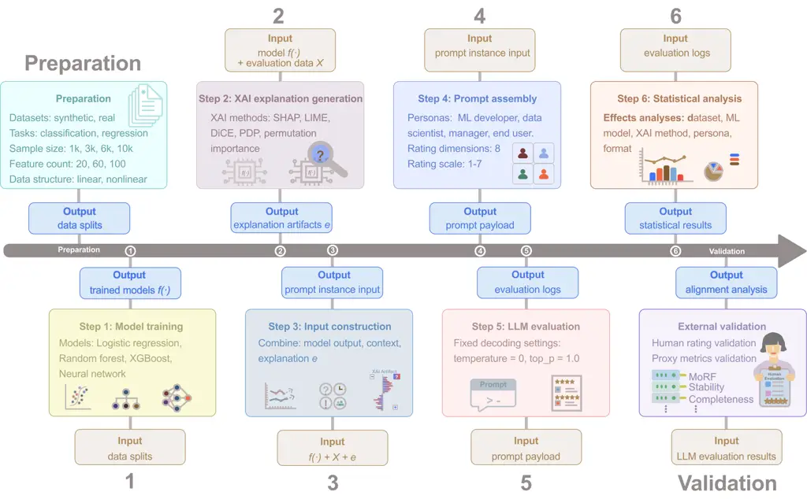

# XAI-Arena: Can LLMs Assess the Quality of XAI Explanations?

CCS: Human-centered computingCCS: Human-centered computing Empirical
studies in HCICCS: Computing methodologies Artificial
intelligenceCCS: Computing methodologies Machine learning

Yanfei Hu Fleischhauer Affiliation: LMU Munich, Munich, Germany email:
<fayfayhu@gmail.com> , Alona Zharova Affiliation: Chair of Information
Systems, School of Business and Economics, Humboldt-Universität zu
Berlin, Berlin, Germany email: <alona.zharova@hu-berlin.de> , Nadja
Klein Affiliation: Scientific Computing Center, Karlsruhe Institute of
Technology, Karlsruhe, Germany email: <nadja.klein@kit.edu> and Stefan
Feuerriegel Affiliation: MCML, LMU Munich, Munich, Germany email:
<feuerriegel@lmu.de>

###### Abstract.

Evaluating the quality of explanations produced by explainable AI (XAI)
methods remains challenging because existing approaches often rely on
subjective human judgment, limiting reproducibility, scalability, and
comparability between studies. We examine whether LLMs can serve as a
reproducible and scalable mechanism to make comparative assessments of
the quality of XAI explanations. We introduce XAI-Arena, an
LLM-as-a-judge framework for scalable, reproducible, multidimensional,
and stakeholder-sensitive evaluation of XAI explanation quality.
XAI-Arena then allows us to compare XAI explanations along various
dimensions, namely, perceived simplicity, clarity, task adequacy, trust
calibration, actionability, transparency, faithfulness, and overall
interpretability. We then benchmark XAI explanation methods across
various datasets, machine learning models, and stakeholder personas.
Human validation shows a strong positive association between
LLM-generated and human ratings (Spearman’s $`\rho=.693`$, $`p<.001`$).
Together, LLM-based evaluations can capture systematic differences in
XAI explanation quality and provide a scalable and reproducible
framework for comparative assessment of XAI explanations.

###### Keywords: 

Explainable AI, explanation quality, interpretability, user study,
LLM-as-a-judge, human-centered evaluation, stakeholder perspectives,
reproducibility

## 1. Introduction

![A visual overview of XAI-Arena. The framework receives explanations
generated across real-world and synthetic datasets, classification and
regression tasks, multiple machine learning models, five XAI methods,
and text-only or text-plus-plot formats. A standardized prompt and fixed
decoding settings are used to evaluate each explanation from four
stakeholder perspectives across eight quality dimensions, producing
ratings and justifications for comparative analysis. The framework
addresses limitations of human evaluation, which is difficult to scale
and reproduce, and technical proxy metrics, which capture only selected
properties and may differ from human perceptions. External validation
shows strong alignment between LLM and human ratings, with Spearman's
rho equal to 0.693, and strong alignment between LLM-rated faithfulness
and the stability metrics rank stability, cosine similarity, and top-k
overlap.](arxiv-2609-09428v1--3ba8088f6070.figures/figure-1.webp)

Figure 1. Our proposed XAI-Arena framework. It addresses limitations of
existing XAI evaluation approaches by proposing an LLM-as-a-judge
framework for scalable, multidimensional, and stakeholder-sensitive
assessment of XAI explanation quality.A visual overview of XAI-Arena.
The framework receives explanations generated across real-world and
synthetic datasets, classification and regression tasks, multiple
machine learning models, five XAI methods, and text-only or
text-plus-plot formats. A standardized prompt and fixed decoding
settings are used to evaluate each explanation from four stakeholder
perspectives across eight quality dimensions, producing ratings and
justifications for comparative analysis. The framework addresses
limitations of human evaluation, which is difficult to scale and
reproduce, and technical proxy metrics, which capture only selected
properties and may differ from human perceptions. External validation
shows strong alignment between LLM and human ratings, with Spearman's
rho equal to 0.693, and strong alignment between LLM-rated faithfulness
and the stability metrics rank stability, cosine similarity, and top-k
overlap.

Understanding how machine learning models arrive at their predictions is
essential in many practical applications. The underlying reasons may be
legal, organizational, or technical, such as ensuring regulatory
compliance, auditing model decisions, understanding and improving model
behavior, or building trust among managers and end users. One way to
achieve this is through explainable AI (XAI), which provides
explanations for model predictions (Doshi-Velez and Kim, 2017; Adadi and
Berrada, 2018; Guidotti et al., 2018). XAI helps users examine model
behavior (Samek et al., 2017b), identify and debug model issues (Balayn
et al., 2022), and communicate why a model produced a specific output
(Miller, 2019).

However, evaluating the quality of XAI explanations remains challenging
(Martens et al., 2025). Existing evaluations often rely on human
judgment, which can provide rich insights but is costly to collect and
difficult to scale (Miller, 2019; Liao and Varshney, 2021; Bhatt et al.,
2020). Moreover, human judgment can vary due to differences in tasks or
expertise of participants (Buçinca et al., 2020; Kim et al., 2024;
Mohseni et al., 2021). Automated proxy metrics provide a more scalable
alternative, but typically measure narrow technical properties, such as
fidelity (Doshi-Velez and Kim, 2017), stability (Alvarez-Melis and
Jaakkola, 2018), and completeness (Vilone and Longo, 2021; Nauta et al.,
2023), rather than broader dimensions of explanation quality. In
particular, it is unclear whether such proxy metrics align with how
stakeholders perceive or use XAI explanations (Nauta et al., 2023;
Vilone and Longo, 2021). As a result, comparative assessments of XAI
explanation quality often remain difficult to conduct in a systematic
and reproducible manner.

Comparative assessment of XAI explanations is further challenged by
several degrees of freedom in the evaluation setting. First, XAI methods
differ in scope. Some methods explain individual predictions, whereas
others summarize model behavior globally. For example, SHAP and LIME
provide local feature attribution explanations for individual
predictions (Lundberg and Lee, 2017; Ribeiro et al., 2016), whereas
permutation importance summarizes feature relevance at the model level.
Second, explanations differ in format. Some methods provide textual and
tabular outputs, while others offer visual representations (e.g.,
partial dependence plots). Third, explanations are interpreted by
different stakeholders (Doshi-Velez and Kim, 2017; Miller, 2019; Liao
and Varshney, 2021; Senoner et al., 2024; Brennen, 2020), such as
developers, data scientists, managers, and end users, who differ in
expertise and decision context and thus may perceive explanation quality
differently. Figure 1 provides an overview of the proposed framework and
its validation against human evaluations and technical proxy metrics.

In this paper, we analyze whether large language models (LLMs) can serve
as reproducible and scalable evaluators of XAI explanation quality. For
this purpose, we introduce XAI-Arena, a controlled LLM-as-a-judge
framework in which a single LLM, under fixed prompting and decoding
settings, is used to assess the quality of XAI explanations within a
unified evaluation protocol. We evaluate five widely used XAI methods:
SHAP (Lundberg and Lee, 2017), LIME (Ribeiro et al., 2016), DiCE
(Mothilal et al., 2020), partial dependence plots (PDP) (Goldstein et
al., 2015; Friedman, 2001), and permutation importance (Fisher et al.,
2019). The explanations are assessed from the perspective of four
stakeholder personas: ML developer, data scientist, manager, and end
user. We compare explanations along eight established dimensions of
explanation quality from prior work on human-centered XAI (Doshi-Velez
and Kim, 2017; Hoffman et al., 2018; Miller, 2019; Liao and Varshney,
2021; Bhatt et al., 2020; Mohseni et al., 2021; Buçinca et al., 2020;
Nauta et al., 2023): perceived simplicity, clarity, task adequacy, trust
calibration, actionability, transparency, faithfulness, and overall
interpretability. As a result, XAI-Arena provides an evaluation
framework to systematically compare the quality of XAI explanations in a
scalable and reproducible manner. Importantly, we do not treat LLM-based
ratings as a direct substitute for human assessments; rather, using
human ratings, we examine whether they recover systematic differences
and preference patterns that can guide choices among XAI explanations.



Figure 2. Overview of the XAI-Arena framework, showing the six-step
evaluation pipeline from model training and explanation generation to
prompt construction, LLM evaluation, and downstream analysis, together
with external validation through human evaluation and proxy metrics.Flow
diagram of the six-step \textsc{XAI-Arena} framework, from model
training and XAI explanation generation through prompt construction and
LLM-based evaluation to downstream analysis, with external validation
using human evaluation and proxy metrics.

Contributions: This paper makes the following contributions:¹¹ 1 Code
and data is available:
[https://anonymous.4open.science/r/xai-arena/](https://anonymous.4open.science/r/xai-arena/)

:  
We introduce XAI-Arena, the first LLM-as-a-judge framework for assessing
the multi-dimensional quality of XAI explanations. Our framework
provides a scalable and reproducible approach for benchmarking the
explanation quality in future XAI research.

:  
We conduct a large-scale comparative study across different machine
learning models, XAI explanation methods, datasets, stakeholder roles,
and explanation formats.

:  
We provide empirical evidence on how XAI explanation quality varies
across explanation methods, stakeholder roles, and explanation formats.
Thereby, we identify systematic preferences for XAI explanations across
application patterns.

## 2. Related Work

Prior work in XAI has developed numerous methods to make model behavior
more transparent and thereby support an accountable, trustworthy use of
AI systems (Doshi-Velez and Kim, 2017; Adadi and Berrada, 2018; Guidotti
et al., 2018). Below, we provide a short overview of existing (1) key
XAI methods, (2) evaluation strategies to assess explanation quality,
and (3) recent applications following the LLM-as-a-judge paradigm.

### 2.1. Explainable AI Methods

We survey key XAI methods²² 2 We use the term explanation broadly to
refer to any output produced by an XAI method. We recognize that the
terminology around explainability and interpretability varies across the
literature (Lipton, 2018; Doshi-Velez and Kim, 2017), and we here adopt
a pragmatic use to broadly refer to the resulting explanation artifact.
while we refer readers to (Guidotti et al., 2018; Adadi and Berrada,
2018; Molnar, 2020) for more comprehensive overviews. Common methods in
practice include: (i) SHAP (Lundberg and Lee, 2017), which uses Shapley
values from cooperative game theory to attribute feature importance
consistently across models; (ii) LIME (Ribeiro et al., 2016), which fits
local surrogate models around individual predictions to approximate
model behavior; (iii) counterfactual explanations such as DiCE (Mothilal
et al., 2020), which identify minimal input changes needed to alter the
model’s output; and (iv) global visualization techniques such as PDP
(Friedman, 2001; Goldstein et al., 2015) and permutation importance
(Fisher et al., 2019; Breiman, 2001). PDP illustrates how model
predictions change with respect to individual features, while
permutation importance measures the contribution of each feature to the
overall predictive accuracy (Breiman, 2001; Strobl et al., 2008; Molnar,
2020; Hooker et al., 2021).

In this paper, we focus on five widely used methods (SHAP, LIME, DiCE,
PDP, and permutation importance), which represent complementary
explanation paradigms used in practice. One difference is that some
explain individual predictions locally, while others summarize overall
model behavior globally. They also vary in representation (textual,
visual, or hybrid) and abstraction level, ranging from feature-level
explanations to higher-level summaries of model behavior.

### 2.2. Evaluation of XAI Explanations

Despite extensive research on XAI methods, systematic comparative
evaluations of explanation quality remain limited (Gilpin et al., 2018;
Arya et al., 2019; Covert et al., 2021). Existing studies often focus on
specific methods, tasks, or evaluation settings, which makes it
difficult to assess how explanation quality varies across machine
learning models, datasets, explanation methods, output formats, and
stakeholders. For instance, an attribution method that yields clear and
stable explanations for a linear model may produce noisier or less
interpretable explanations in a highly nonlinear setting (Slack et al.,
2020). This motivates the development of XAI-Arena as a comparative
evaluation framework in this paper.

Several dimensions can be used to assess the quality of XAI
explanations. Early work emphasized two main outcomes: faithfulness,
which captures how accurately an explanation reflects the model’s
reasoning, and interpretability, which captures how understandable it is
for human users (Doshi-Velez and Kim, 2017; Gilpin et al., 2018).
Subsequent research expanded these perspectives into broader,
multidimensional frameworks that combine technical and human-centered
criteria, including clarity, completeness, plausibility, and usefulness
(Hoffman et al., 2018; Miller, 2019; Liao and Varshney, 2021; Chromik et
al., 2021; Kim et al., 2023). Building on this line of work, we adopt
eight complementary evaluation dimensions:
 perceived
simplicity,
 clarity,
 task
adequacy,
 trust
calibration,
 actionability,
 transparency,
 faithfulness,
and
 interpretability.
Note that we use perceived simplicity rather than perceived complexity
so that higher ratings consistently indicate better explanation quality.
Together, these dimensions should enable a comprehensive assessment of
XAI explanation quality.

Existing human-centered evaluations of XAI explanations vary widely in
design and methodology. A common choice is to rely on user studies in
which participants rate explanation quality on Likert scales, perform
decision support tasks, or provide qualitative feedback through
interviews and think-aloud protocols (Doshi-Velez and Kim, 2017; Mohseni
et al., 2021; Liao and Varshney, 2021; Buçinca et al., 2020).
Participants typically include both domain experts and non-experts,
whose interpretations depend on prior technical experience and task
framing (Liao and Varshney, 2021; Miller, 2019; Ehsan et al., 2024).
However, broad role- or expertise-based categories may obscure
differences in stakeholder knowledge and explanation needs (Suresh et
al., 2021). While such studies provide fine-grained insights into how
users interpret XAI explanations and calibrate trust in model
predictions, they are expensive, time-consuming, and difficult to
reproduce at scale.

Proxy metrics provide automated, quantitative measures for evaluating
XAI explanations without human input (Doshi-Velez and Kim, 2017; Nauta
et al., 2023). Fidelity-based measures assess how closely an explanation
aligns with model behavior, while criteria such as completeness,
stability, sensitivity, MoRF (Most Relevant First), and compactness
capture different technical aspects of explanation quality
(Alvarez-Melis and Jaakkola, 2018; Nauta et al., 2023). For example,
MoRF evaluates how strongly the model output changes when the most
important input features are removed (Samek et al., 2017a), and
stability measures how XAI explanations change under small variations in
the input (Alvarez-Melis and Jaakkola, 2018). However, proxy metrics
remain limited because they primarily benchmark technical properties of
explanations rather than how people interpret, compare, or use them. In
particular, they do not capture human responses to presentation format,
visual explanations, stakeholder context, or perceived usefulness. As a
result, proxy metrics are not suitable to assess the XAI explanation
quality in a human-centered way, which is our focus (Sokol and Vogt,
2024).

### 2.3. LLMs as Evaluators

LLM-based evaluations, often referred to as “LLM-as-a-judge”, have been
applied across various tasks, including text summarization,
recommendation explanations, and educational feedback (Kocmi and
Federmann, 2023; Belouadah et al., 2025; Zhang et al., 2024; Ma et al.,
2026b, a). Empirical studies report moderate to strong correlations
between LLM-based and human judgments, suggesting that LLMs can
approximate human evaluation in many subjective assessment tasks (Wang
et al., 2025; Seo et al., 2025; Zhang et al., 2024). At the same time,
evaluation performance depends on factors such as prompt phrasing and
the underlying LLM model, which highlights the importance of
standardized and transparent prompting procedures (Bavaresco et al.,
2025; Li et al., 2025). More broadly, the emerging LLM-as-a-judge
paradigm investigates whether LLMs can approximate human judgments or
serve as scalable evaluators for complex outputs (Chiang and Lee, 2023;
Bavaresco et al., 2025; Gilardi et al., 2023). However, this literature
has not focused on the evaluation of XAI explanation quality.

A related but distinct line of work uses LLMs to generate or verbalize
model explanations in natural language, for example, through interactive
explanation systems (i.e., “talk to the model” (Liao et al., 2020)). In
contrast, our work uses LLMs to evaluate explanations generated by
external XAI methods.

Research gap: Prior work typically uses human raters or proxy metrics to
assess XAI explanation quality (Table 1), but scalable, reproducible
frameworks for human-centered assessments are missing. To the best of
our knowledge, XAI-Arena is the first LLM-as-a-judge framework designed
for this purpose.

| Approach                                                                                             | Human-         | Scalable       | Repro-         | Multi-         | Stakeholder    |
| ---------------------------------------------------------------------------------------------------- | -------------- | -------------- | -------------- | -------------- | -------------- |
|                                                                                                      | centered       |                | ducible        | dimension      | roles          |
| Human-centered evaluation (Doshi-Velez and Kim, 2017; Liao and Varshney, 2021; Mohseni et al., 2021) | $`\checkmark`$ | $`\times`$     | $`\times`$     | $`\checkmark`$ | $`\checkmark`$ |
| Proxy metrics (Alvarez-Melis and Jaakkola, 2018; Nauta et al., 2023)                                 | $`\times`$     | $`\checkmark`$ | $`\checkmark`$ | $`\times`$     | $`\times`$     |
| XAI-Arena (_this work_)                                                                              | $`\checkmark`$ | $`\checkmark`$ | $`\checkmark`$ | $`\checkmark`$ | $`\checkmark`$ |

Table 1. Comparison of approaches for assessing the quality of XAI
explanations. $`\checkmark`$= supported, $`\times`$= not supported.

## 3. The XAI-Arena Framework

This section presents XAI-Arena, a reproducible LLM-as-a-judge framework
for assessing the quality of XAI explanations. XAI-Arena follows six
steps:
 model
training,
 XAI
explanation generation,
 input
construction,
 prompt
assembly,
 LLM
evaluation, and
 statistical
analysis (see Figure 2). The XAI-Arena framework is general and can be
instantiated with different XAI methods, machine learning models,
datasets, stakeholder personas, and evaluation dimensions.

### 3.1. Problem description

XAI-Arena defines an evaluation protocol that is general and not
specific to any dataset, model, or XAI method. In the following, we
describe each step and specify how inputs, prompts, and outputs are
constructed to enable controlled and reproducible assessment of XAI
explanations across stakeholder roles and explanation formats.

Input. Let $`f`$ denote a trained model, and let $`X`$ denote the input
data available for constructing an explanation artifact. For local
explanations, let $`x\in X`$ denote the input instance being explained,
and let $`f(x)`$ denote the corresponding model prediction. We denote
the XAI explanation method by $`e`$ (e.g., SHAP, LIME, etc.). Depending
on the XAI method, $`e`$ may be a local explanation $`e(x,f)`$ for a
specific instance, or a global explanation $`e(X,f)`$ summarizing model
behavior over a dataset or sample. We call $`e(x,f)`$ and $`e(X,f)`$,
respectively, the explanation artifact, and simply write $`e^{\prime}`$
as short-hand notation. The evaluation input additionally specifies a
stakeholder persona $`p\in\mathcal{P}`$, which defines the role from
whose perspective the explanation artifact is assessed (e.g., a line
manager, an end user).

Task. The task is to assess the quality of the explanation artifact
$`e^{\prime}`$ for the model behavior or prediction it explains, from
the perspective of persona $`p`$. We define a set of evaluation
dimensions $`\mathcal{D}=\{d_{1},\ldots,d_{n_{d}}\}`$, where each
dimension corresponds to one aspect of explanation quality derived from
prior work on XAI evaluation; the concrete dimensions and their
definitions are specified in the experimental setup (see Table 4). Each
dimension is rated on a seven-point Likert scale from 1 (very low) to 7
(very high), so that $`r_{i}\in\{1,\ldots,7\}`$ for each
$`d_{i}\in\mathcal{D}`$.

Output. We denote the evaluator as a function
$`\textrm{LLM}_{\textrm{judge}}(\cdot)`$ that maps the structured input
to ratings and justifications:

```math
\textrm{LLM}_{\textrm{judge}}(x,X,f,e^{\prime},p)\rightarrow(\mathbf{r},\mathbf{j}), \tag{1}
```

where $`\mathbf{r}=(r_{1},\ldots,r_{n_{d}})^{\top}`$ is the vector of
ratings and $`\mathbf{j}=(j_{1},\ldots,j_{n_{d}})^{\top}`$ is the
corresponding vector of textual justifications for $`n_{d}`$ dimensions.
Each pair $`(r_{i},j_{i})`$ corresponds to one evaluation dimension
$`d_{i}\in\mathcal{D}`$ (e.g., perceived simplicity, clarity, task
adequacy, etc.; defined later). For global explanations, $`x`$ is not
used, and the evaluation is based on the model-level or dataset-level
artifact $`e(X,f)`$. Because the persona $`p`$ is part of the evaluation
input, the same explanation artifact $`e^{\prime}`$ may receive
different ratings across stakeholder roles, thus reflecting
role-dependent interpretations of explanation quality. A further
challenge is that many XAI artifacts are visual, which requires a
_multimodal_ evaluation pipeline.

| Step                                                                             | Input                                                     | Output                                                                                   |
| -------------------------------------------------------------------------------- | --------------------------------------------------------- | ---------------------------------------------------------------------------------------- |
|  Model training       | WDBC training split                                       | Trained model $`f`$                                                                      |
|  XAI explanation gen. | Model $`f`$ and instance $`x\in X_{\mathrm{test}}`$       | Prediction $`f(x)=\texttt{benign}`$; local SHAP artifact $`e^{\prime}`$                  |
|  Input construction   | Prediction $`f(x)`$ and artifact $`e^{\prime}`$           | Context: "The tumor is predicted benign." SHAP top-2 features: mean_radius, mean_texture |
|  Prompt assembly      | Context with persona $`p`$ and dimensions $`\mathcal{D}`$ | Prompt excerpt: "You are an end user Evaluate using a 1--7 scale."                       |
|  LLM evaluation       | Standardized prompt                                       | Ratings $`\mathbf{r}=(4,5,4,3,5,4,3,4)^{\top}`$; justifications $`\mathbf{j}`$           |
|  Statistical analysis | Ratings, justifications, metadata                         | Logged record with model, XAI method, persona, explanation ID, ratings, and metadata     |

Table 2. Illustrative input–output example for XAI-Arena using a single
local explanation instance.

### 3.2. Workflow

We now describe the workflow of XAI-Arena, which consists of six steps.
Table 2 illustrates these steps using a single local explanation
instance.


Model training. For each dataset and model combination, we train a
machine learning model $`f`$ on the corresponding training split of the
dataset. The trained model $`f`$ is stored to support traceable and
reproducible explanation generation in subsequent steps.


XAI explanation generation. For each trained model $`f`$ and XAI
explanation method $`e`$, we generate an explanation artifact for either
a selected test instance or the relevant test data. For local XAI
methods, we randomly sample a subset of held-out test instances
$`x\in X_{\mathrm{test}}`$, compute the corresponding model predictions
$`f(x)`$, and generate local explanation artifacts $`e(x,f)`$. For
global XAI methods, we generate global explanation artifacts
$`e(X_{\mathrm{test}},f)`$ that summarize the behavior of the trained
model over the test data.


Input construction. For each explanation artifact generated by an XAI
method, we construct the input to the LLM evaluator. The input combines
the artifact $`e^{\prime}`$ with textual context $`C`$ describing
(i) the prediction task, (ii) the dataset, (iii) the model type,
(iv) the XAI method used to generate the artifact, and, for local XAI
methods, (v) the model prediction $`f(x)`$ and (vi) selected feature
values of the instance $`x`$. The substantive content of the artifact
$`e^{\prime}`$ is preserved, while the representation is formatted
consistently for the corresponding XAI method.


Prompt assembly. The input to the LLM evaluator is inserted into a
standardized prompt template (see Appendix B). Following best practice
in prompt design (Lin, 2024; Giray, 2023; Feuerriegel et al., 2025), the
template uses a fixed structure with four components: (i) persona
framing, (ii) textual context $`C`$ from the previous step,
(iii) explanation artifact $`e^{\prime}`$, and (iv) evaluation
dimensions $`\mathcal{D}`$ with the rating scale and constrained
response format. The fixed structure supports controlled comparison
across datasets, models, XAI explanation methods, and personas.


LLM evaluation. A standardized prompt is provided to the LLM evaluator
$`\textrm{LLM}_{\textrm{judge}}(\cdot)`$. For visual XAI artifacts, the
evaluation input combines the image with its textual context, and thus
applies a multimodal LLM.


Statistical analysis. The evaluator
$`\textrm{LLM}_{\textrm{judge}}(\cdot)`$ outputs
$`(\mathbf{r},\mathbf{j})`$, which are stored together with experimental
metadata, including dataset, model, XAI explanation method, persona
$`p`$, explanation format, and explanation identifier. The numerical
ratings in $`\mathbf{r}`$ are recorded on a 7-point Likert scale
(details below).

We compute descriptive statistics for the ratings in $`\mathbf{r}`$ by
dataset, model, XAI explanation method, persona, explanation format, and
evaluation dimension. We assess correlations between evaluation
dimensions using Pearson correlations. We compare two-group conditions
using two-sided Welch’s $`t`$-tests and multi-group conditions using
Welch’s ANOVA, followed by Games–Howell post hoc tests where applicable.
For synthetic datasets, we use a separate Type-II ANOVA to assess the
effects of dataset structure, feature count, and sample size.
Statistical significance is assessed at $`\alpha=.05`$, and effect sizes
are reported using $`\omega^{2}`$ for Welch’s ANOVA and Hedges’ $`g`$
for pairwise comparisons.

### 3.3. Experimental Setup

We instantiate the XAI-Arena framework with the following choices for
datasets, ML models, XAI explanation methods, evaluation dimensions,
stakeholder personas, explanation formats, and instance selection. The
evaluation protocol is summarized in Appendix A.

#### 3.3.1. Datasets

We include both (1) synthetic datasets to allow for controlled
experiments and (2) real-world datasets for realistic evaluation
settings.

$`\bullet`$ Synthetic datasets are generated using the
make_classification, make_regression, make_moons, and make_circles
functions from scikit-learn (Pedregosa et al., 2011). We vary (i) sample
size across {1,000, 3,000, 6,000, 10,000 }, (ii) feature count across
{20, 60, 100 }, and (iii) data structure (linear vs. nonlinear). This
design follows established practices for evaluating robustness in XAI
research (Molnar, 2020; Alvarez-Melis and Jaakkola, 2018; Nauta et al., 2023) and allows us to isolate how dataset characteristics affect how
the quality of XAI evaluation is assessed. Further details are reported
in Appendices C.1 and C.2.

$`\bullet`$ For real-world benchmarks, we include three tabular datasets
covering both classification and regression tasks. The Wisconsin
Diagnostic Breast Cancer (WDBC) dataset (Wolberg et al., 1995) contains
569 samples with 30 numerical features describing cell nuclei
characteristics derived from digitized biopsy images. It has moderate
dimensionality and well-understood feature semantics, and is widely used
in interpretability research (Lundberg and Lee, 2017; Ribeiro et al.,
2016). The Telco Customer Churn dataset contains 7,032 samples with 19
original features describing customer demographics, services, and
account information. It provides a business-oriented classification task
with heterogeneous numerical and categorical features. The California
Housing dataset contains 20,640 samples with eight numerical features
describing housing and demographic characteristics. It provides a
real-world regression task with continuous features and a continuous
prediction target.

#### 3.3.2. Preprocessing

All datasets are split into training, validation, and test sets using a
70/15/15 ratio. Stratified sampling is applied for classification tasks
to preserve class distributions across splits. We one-hot encode any
categorical features before model training. We standardize numerical
features using $`z`$-score normalization (StandardScaler() in
scikit-learn), fitting the scaler on the training data, and applying it
to the validation and test sets to avoid data leakage. No additional
feature engineering is performed.

#### 3.3.3. Machine Learning Models

We implement four ML model types: (1) logistic regression, (2) random
forest, (3) gradient-boosted trees using XGBoost, and (4) a neural
network implemented as a multi-layer perceptron (MLP). The four models
allow us to compare XAI explanation quality across linear, tree-based,
and neural network models. We train all models using standard settings
from scikit-learn and xgboost (Pedregosa et al., 2011; Chen and
Guestrin, 2016), with minor adjustments to improve the stability during
training. We generate predictions and XAI explanations for held-out test
instances. We do not tune hyperparameters to maintain comparability
across models and XAI methods (Molnar, 2020; Carvalho et al., 2019).
Detailed training settings and validation checks are reported in
Appendix D.

#### 3.3.4. XAI Explanation Methods

We implement five complementary XAI methods. We focus on three local
methods (SHAP, LIME, and DiCE) to generate instance-level explanations,
and two global methods (PDP and permutation importance) to summarize
model-wide behavior. These methods cover feature attribution,
counterfactual explanations, feature importance, and feature–outcome
relationships. For classification tasks, SHAP and LIME explain the
predicted class.

We export explanation artifacts in standardized textual, tabular, and
visual formats to support fair comparison in the LLM evaluation.
Feature-based visualizations show only the most salient features. SHAP
and LIME use consistent colors for positive and negative feature
effects. Details are reported in Appendix E.

#### 3.3.5. Evaluation Scope and Instance Selection

We train each ML model for every applicable dataset configuration,
defined by combinations of sample size, feature count, and data
structure (linear vs. nonlinear). For each dataset–model pair, we
randomly sample $`n=3`$ instances from the held-out test split. Each
selected instance is explained using all local XAI methods. We generate
each global explanation once per dataset–model configuration. All
explanations are evaluated using the same standardized prompt structure.

#### 3.3.6. Persona Framing

We evaluate explanations from four stakeholder perspectives
$`p\in\mathcal{P}`$: (1) ML developer (Bhatt et al., 2020; Liao and
Varshney, 2021), (2) data scientist (Doshi-Velez and Kim, 2017; Hoffman
et al., 2018), (3) manager (Miller, 2019), and (4) an end user (Gilpin
et al., 2018; Buçinca et al., 2020). Distinguishing these roles reflects
the interdisciplinary nature of ML practice, where collaborators differ
in professional background and ML knowledge (Benk et al., 2022). Details
are in Table 3. Each persona description is inserted verbatim at the
beginning of the prompt and remains fixed across evaluation conditions.

[TABLE]

Table 3. Stakeholder personas, definitions, and prompts used in
XAI-Arena.

#### 3.3.7. Evaluation Dimensions

We evaluate each explanation on the eight dimensions (e.g., perceived
simplicity, clarity, task adequacy). Table 4 lists the definition and
exact question used for each dimension.

[TABLE]

Table 4. Evaluation dimensions, definitions, and questions used in
XAI-Arena.

#### 3.3.8. LLM Implementation

We use OpenAI GPT-5.4 (gpt-5.4, accessed April 2026) as the automated
evaluator. We assess the cross-LLM robustness in Appendix H, finding
broadly similar patterns. SHAP, LIME, PDP, and permutation importance
are evaluated using text-only and text-plus-plot inputs, whereas DiCE
remains text-only. We use fixed decoding settings (temperature=0,
top_p=1.0) to reduce sampling variability. The GUIDE-LLM checklist for
reporting LLM research (Feuerriegel et al., 2026) is provided in the
supplementary materials.

We implement the pipeline in Python using the packages scikit-learn,
xgboost, shap, lime, and dice-ml. PDP and permutation importance are
implemented using built-in scikit-learn functions. Each XAI artifact is
supplemented with fixed, neutral definitions to describe method-specific
terms such as “contribution”, “counterfactual”, and “importance”. The
pipeline is version-controlled and executed with fixed random seeds.
Evaluation results are exported as structured CSV files containing
ratings $`\mathbf{r}`$, justifications $`\mathbf{j}`$, and experimental
metadata.

The final corpus contains 17,252 structured LLM evaluation records, each
with ratings and textual justifications for eight dimensions, yielding
138,016 individual dimension ratings. For 19 records, an incorrect
output format resulted in one of the eight justifications being missing,
but all ratings were complete and thus retained.

## 4. Results

Unless otherwise stated, all analyses reported in this section are based
on text-only explanations. The effects of explanation format are
examined separately in Appendix F.

### 4.1. Overall LLM-Based Evaluation Patterns


Can an LLM distinguish meaningful aspects of XAI explanation quality?

We first summarize aggregate ratings and then examine correlations
across evaluation dimensions. For simplicity, we interchangeably refer
to these perceived explanation quality assessments as ratings below.

#### 4.1.1. Aggregate Ratings Across Dimensions

Table 5 reports the mean ($`M`$) and standard deviation ($`SD`$) for
each evaluation dimension. The LLM ratings vary across dimensions.
clarity receives the highest mean rating, followed by perceived
simplicity and interpretability. In contrast, transparency and
actionability receive the lowest mean ratings. The explanations are
generally rated more highly for being understandable than for revealing
model logic or supporting action.

| Dimension            | Mean (SD)   | Dimension        | Mean (SD)   |
| -------------------- | ----------- | ---------------- | ----------- |
| perceived simplicity | 5.03 (0.95) | actionability    | 2.89 (0.74) |
| clarity              | 5.70 (0.65) | transparency     | 3.03 (0.96) |
| task adequacy        | 4.09 (0.64) | faithfulness     | 4.23 (1.12) |
| trust calibration    | 3.77 (0.66) | interpretability | 4.82 (0.79) |

Note: Each dimension is based on 9,988 evaluation records. Values are
reported as mean, with standard deviation in parentheses.

Table 5. Aggregate LLM ratings across evaluation dimensions. Ratings are
measured on a 1–7 scale.

#### 4.1.2. Dimension-Level Correlations and Variability


Figure 3. Pearson correlation heatmap across all eight evaluation
dimensions.An eight-by-eight symmetric heatmap showing Pearson
correlations between the evaluation dimensions. The strongest
correlations occur among perceived simplicity, clarity, and
interpretability, ranging from 0.84 to 0.87. Transparency and
faithfulness are also strongly correlated at 0.69. Each cell displays
its correlation coefficient.

Figure 3 shows Pearson correlations among the eight evaluation
dimensions. clarity, perceived simplicity, and interpretability are
strongly correlated, indicating overlap in comprehensibility.
faithfulness and transparency are also closely associated, whereas
actionability has weaker correlations with the other dimensions. The
dimensions therefore capture related but distinct aspects of explanation
quality.

### 4.2. Dataset Effects


How sensitive are the ratings to the underlying dataset?

We compare how the ratings vary across synthetic vs. real-world datasets
as well as across data structure, feature count, and sample size within
the synthetic datasets.

| Dimension            | Synthetic   | Real-world  | Dimension        | Synthetic   | Real-world  |
| -------------------- | ----------- | ----------- | ---------------- | ----------- | ----------- |
| perceived simplicity | 5.04 (0.95) | 4.83 (0.87) | actionability    | 2.90 (0.74) | 2.77 (0.73) |
| clarity              | 5.70 (0.64) | 5.57 (0.66) | transparency     | 3.03 (0.96) | 3.07 (1.00) |
| task adequacy        | 4.09 (0.62) | 4.11 (0.88) | faithfulness     | 4.25 (1.11) | 3.84 (1.30) |
| trust calibration    | 3.78 (0.65) | 3.61 (0.92) | interpretability | 4.83 (0.78) | 4.69 (0.86) |

Note: Values are reported as mean, with standard deviation in
parentheses. Synthetic datasets contain $`n=9{,}504`$ ratings per
dimension; real-world datasets contain $`n=484`$ ratings per dimension.

Table 6. LLM ratings for synthetic and real-world datasets across
evaluation dimensions. Ratings are measured on a 1–7 scale.

#### 4.2.1. Real-World vs. Synthetic Dataset Differences

Table 6 reports the mean ($`M`$) and standard deviation ($`SD`$) of LLM
ratings for synthetic and real-world datasets. Ratings are broadly
similar across the two dataset origins. Synthetic datasets receive
slightly higher mean ratings for perceived simplicity, clarity, trust
calibration, actionability, faithfulness, and interpretability, whereas
real-world datasets receive slightly higher mean ratings for task
adequacy and transparency. The largest mean difference occurs for
faithfulness, for which synthetic datasets receive a mean rating of
$`4.25`$ compared with $`3.84`$ for real-world datasets. Overall,
differences by dataset origin appear to be modest, and the rating
patterns across dimensions remain largely stable.

#### 4.2.2. Data Structure, Feature Count, and Sample Size Effects

![Two side-by-side heatmaps compare mean aggregate ratings for linear
and nonlinear synthetic datasets. Rows represent feature counts of 20,
60, and 100, while columns represent sample sizes of 1,000, 3,000,
6,000, and 10,000. Ratings range from 4.07 to 4.35 on the seven-point
scale. Nonlinear datasets generally receive slightly higher ratings than
linear datasets, configurations with 20 features receive the highest
ratings, and differences across sample sizes are small. Each cell
displays its mean
rating.](arxiv-2609-09428v1--3ba8088f6070.figures/figure-4.webp)

Figure 4. Mean aggregate ratings across synthetic dataset configurations
by data structure, feature count, and sample size.Two side-by-side
heatmaps compare mean aggregate ratings for linear and nonlinear
synthetic datasets. Rows represent feature counts of 20, 60, and 100,
while columns represent sample sizes of 1,000, 3,000, 6,000, and 10,000.
Ratings range from 4.07 to 4.35 on the seven-point scale. Nonlinear
datasets generally receive slightly higher ratings than linear datasets,
configurations with 20 features receive the highest ratings, and
differences across sample sizes are small. Each cell displays its mean
rating.

Figure 4 shows mean ratings across synthetic dataset configurations by
data structure, feature count, and sample size. We use a Type-II ANOVA
to quantify the effects of data structure (linear vs. nonlinear;
$`F=146.03`$, $`p<.001`$), feature count ($`F=74.67`$, $`p<.001`$), and
sample size ($`F=4.71`$, $`p=.003`$). Given the large corpus, we focus
on the relative magnitude of these patterns rather than statistical
significance alone. Data structure and feature count show clearer and
more consistent patterns than sample size.

Nonlinear datasets receive slightly higher ratings than linear datasets
across most feature count and sample size combinations. Datasets with
$`20`$ features receive the highest ratings, whereas those with $`60`$
and $`100`$ features receive lower ratings, in line with expectations.
Differences by sample size are small and inconsistent. The absolute
rating differences across these dataset characteristics remain modest.

### 4.3. Model Effects


How sensitive are the ratings to the underlying predictive model?


Figure 5. Mean LLM ratings across evaluation dimensions by predictive
model.Heatmap comparing mean ratings across four predictive models and
eight explanation-quality dimensions. Differences are most pronounced
for transparency and faithfulness. Logistic regression receives the
highest ratings for these dimensions, whereas the multilayer perceptron
receives lower ratings.

Figure 5 shows mean ratings across predictive models and evaluation
dimensions. Ratings vary only to some degree across predictive models
for perceived simplicity, clarity, task adequacy, actionability, and
interpretability. Greater variation occurs for transparency and
faithfulness. Logistic regression receives the highest ratings on both
dimensions, in line with expectations, while the random forest, XGBoost,
and particularly MLP receive lower transparency ratings. Welch’s ANOVA
shows model differences for all eight dimensions ($`p<.001`$). The
largest effect occurs for transparency ($`F=1362.40`$,
$`\omega^{2}=.283`$), followed by faithfulness ($`F=215.93`$,
$`\omega^{2}=.056`$). Effects for the remaining dimensions are small,
with $`\omega^{2}`$ values ranging from $`.004`$ for perceived
simplicity to $`.019`$ for trust calibration. Thus, ratings show a more
pronounced sensitivity for transparency and faithfulness. Detailed
statistical results are reported in Appendix D.3.

### 4.4. XAI Method Effects


How does perceived explanation quality vary across XAI methods?

#### 4.4.1. Method-Level Rating Differences

Figure 6 shows mean rating patterns across XAI methods. SHAP receives
the highest mean ratings for task adequacy, transparency, and
faithfulness. DiCE receives the highest ratings for clarity and
actionability; its high actionability rating reflects, in part, the
original intention to support what-if decisions (Fernández-Loría et al.,
2022). Permutation importance receives the highest ratings for perceived
simplicity, trust calibration, and interpretability. Differences among
methods are relatively small for clarity, but more pronounced for
faithfulness and transparency. Welch’s ANOVA confirms significant method
effects for all eight dimensions ($`p<.001`$). The largest effect occurs
for faithfulness ($`\omega^{2}=.869`$), followed by transparency
($`\omega^{2}=.814`$), task adequacy ($`\omega^{2}=.653`$), and trust
calibration ($`\omega^{2}=.519`$). Smaller effects occur for
actionability ($`\omega^{2}=.323`$), perceived simplicity
($`\omega^{2}=.189`$), interpretability ($`\omega^{2}=.135`$), and
clarity ($`\omega^{2}=.109`$). Thus, perceived explanation quality
varies substantially across XAI methods, although the magnitude of this
variation differs across evaluation dimensions. Detailed statistical
results are reported in Appendix E.8.

Eight small-multiple plots show mean ratings on a one-to-seven scale for
SHAP, LIME, DiCE, PDP, and permutation importance across perceived
simplicity, clarity, task adequacy, trust calibration, actionability,
transparency, faithfulness, and interpretability. SHAP receives the
highest ratings for task adequacy, transparency, and faithfulness; DiCE
for clarity and actionability; and permutation importance for perceived
simplicity, trust calibration, and interpretability. Differences are
smallest for clarity and most pronounced for transparency and
faithfulness.

Figure 6. Dimension-specific mean rating patterns across XAI
methods.Eight small-multiple plots show mean ratings on a one-to-seven
scale for SHAP, LIME, DiCE, PDP, and permutation importance across
perceived simplicity, clarity, task adequacy, trust calibration,
actionability, transparency, faithfulness, and interpretability. SHAP
receives the highest ratings for task adequacy, transparency, and
faithfulness; DiCE for clarity and actionability; and permutation
importance for perceived simplicity, trust calibration, and
interpretability. Differences are smallest for clarity and most
pronounced for transparency and faithfulness.

#### 4.4.2. Local vs. Global Explanation Patterns

| Dimension            | Local methods |      | Global methods |      | Test                   |
| -------------------- | ------------- | ---- | -------------- | ---- | ---------------------- |
|                      | Mean          | SD   | Mean           | SD   | $`t`$ ($`p`$)          |
| perceived simplicity | 5.04          | 0.94 | 4.99           | 1.00 | $`1.58`$ (.114)        |
| clarity              | 5.72          | 0.63 | 5.58           | 0.71 | $`7.61`$ ($`<.001`$)   |
| task adequacy        | 4.20          | 0.60 | 3.61           | 0.58 | $`38.49`$ ($`<.001`$)  |
| trust calibration    | 3.69          | 0.64 | 4.11           | 0.66 | $`-24.93`$ ($`<.001`$) |
| actionability        | 2.94          | 0.76 | 2.68           | 0.61 | $`15.86`$ ($`<.001`$)  |
| transparency         | 2.91          | 0.98 | 3.60           | 0.63 | $`-38.25`$ ($`<.001`$) |
| faithfulness         | 4.08          | 1.15 | 4.91           | 0.64 | $`-42.51`$ ($`<.001`$) |
| interpretability     | 4.82          | 0.75 | 4.85           | 0.95 | $`-1.21`$ (.227)       |

Note: Local methods include SHAP, LIME, and DiCE ($`n=8{,}172`$ per
dimension); global methods include PDP and permutation importance
($`n=1{,}816`$ per dimension). Positive $`t`$ values indicate higher
ratings for local methods; negative values indicate higher ratings for
global methods.

Table 7. Mean LLM ratings and Welch’s $`t`$-test results for local
versus global XAI methods across evaluation dimensions.

Table 7 compares mean ratings for local methods (SHAP, LIME, and DiCE)
and global methods (PDP and permutation importance), together with the
corresponding Welch’s $`t`$-test results. Local methods receive
significantly higher ratings for clarity, task adequacy, and
actionability. The largest difference in favor of local methods occurs
for task adequacy ($`M_{\text{local}}=4.20`$ vs.
$`M_{\text{global}}=3.61`$). Global methods receive significantly higher
ratings for trust calibration, transparency, and faithfulness. The
largest difference occurs for faithfulness ($`M_{\text{global}}=4.91`$
vs. $`M_{\text{local}}=4.08`$), followed by transparency
($`M_{\text{global}}=3.60`$ vs. $`M_{\text{local}}=2.91`$). No
significant differences are found for perceived simplicity ($`p=.114`$)
or interpretability ($`p=.227`$).

### 4.5. Persona Effects


How does stakeholder perspective shape LLM ratings?


Figure 7. Mean LLM ratings across evaluation dimensions by stakeholder
persona.Heatmap comparing mean ratings across four stakeholder personas
and eight explanation-quality dimensions. The end user persona generally
receives the lowest ratings, particularly for perceived simplicity,
clarity, actionability, and interpretability.

Figure 7 summarizes mean ratings across stakeholder personas and
evaluation dimensions, while Figure 8 shows how persona differences vary
across XAI methods within each dimension. In line with expectations, the
End User persona generally assigns the lowest ratings. Conversely, the
ML Developer and Data Scientist personas tend to assign higher ratings.
This ordering is broadly consistent across XAI methods, although the
magnitude of the persona differences varies by method and dimension.
Welch’s ANOVA identifies significant persona effects for all eight
dimensions ($`p<.001`$ throughout; Table 8). The largest effects occur
for perceived simplicity ($`\omega^{2}=.711`$), interpretability
($`\omega^{2}=.630`$), and clarity ($`\omega^{2}=.596`$). A substantial
effect is also observed for actionability ($`\omega^{2}=.467`$),
followed by trust calibration ($`\omega^{2}=.304`$) and task adequacy
($`\omega^{2}=.214`$). Persona effects are comparatively small for
faithfulness ($`\omega^{2}=.071`$) and transparency
($`\omega^{2}=.037`$). Detailed Games–Howell pairwise comparisons are
reported in Appendix G.

Eight small-multiple plots show mean ratings on a one-to-seven scale for
SHAP, LIME, DiCE, PDP, and permutation importance, with separate lines
for the ML Developer, Data Scientist, Manager, and End User personas.
The End User generally gives the lowest ratings, while the ML Developer
and Data Scientist tend to give higher ratings. Persona differences are
most pronounced for perceived simplicity, clarity, actionability, and
interpretability, and comparatively small for transparency and
faithfulness.

Figure 8. Mean LLM ratings across XAI methods for each stakeholder
persona, shown separately by evaluation dimension.Eight small-multiple
plots show mean ratings on a one-to-seven scale for SHAP, LIME, DiCE,
PDP, and permutation importance, with separate lines for the ML
Developer, Data Scientist, Manager, and End User personas. The End User
generally gives the lowest ratings, while the ML Developer and Data
Scientist tend to give higher ratings. Persona differences are most
pronounced for perceived simplicity, clarity, actionability, and
interpretability, and comparatively small for transparency and
faithfulness.

| Dimension            | Welch’s $`F`$ | $`\omega^{2}`$ | Dimension        | Welch’s $`F`$ | $`\omega^{2}`$ |
| -------------------- | ------------- | -------------- | ---------------- | ------------- | -------------- |
| perceived simplicity | 4550.29       | .711           | actionability    | 1598.47       | .467           |
| clarity              | 2692.63       | .596           | transparency     | 71.85         | .037           |
| task adequacy        | 504.00        | .214           | faithfulness     | 141.83        | .071           |
| trust calibration    | 807.00        | .304           | interpretability | 3135.68       | .630           |

Note. All tests are significant at $`p<.001`$.

Table 8. Welch’s ANOVA results for persona effects across evaluation
dimensions.

### 4.6. External Validation


How well do LLM-based evaluations align with proxy metrics and human
annotators?

#### 4.6.1. Alignment with Proxy Metrics

We compare MoRF and stability with the corresponding LLM-rated
faithfulness scores for SHAP and LIME. MoRF (Samek et al., 2017a)
sequentially removes features according to their importance ranking and
measures the resulting change in model output. The area under the
resulting output-drop curve is denoted as MoRF AUC. Stability
(Alvarez-Melis and Jaakkola, 2018) evaluates the consistency of
attribution vectors across perturbed instances. We operationalize
stability by comparing cosine similarity, Spearman rank stability based
on absolute attribution magnitudes, and top-$`k`$ feature overlap.
faithfulness is the primary comparison because the proxy metrics assess
technical properties related to explanation faithfulness. transparency,
trust calibration, and interpretability are included as reference
dimensions.

![An eight-by-eight symmetric heatmap shows Spearman correlations among
four proxy metrics—MoRF AUC, cosine similarity, rank stability, and
top-k overlap—and four LLM rating dimensions: faithfulness,
transparency, trust calibration, and interpretability. The three
stability metrics correlate strongly and positively with faithfulness,
with coefficients of 0.74, 0.75, and 0.66, whereas MoRF AUC has a weak
negative correlation with faithfulness of -0.13. Correlations between
the stability metrics and interpretability are comparatively weak. Each
cell displays its correlation coefficient, with colors representing
values from negative one to positive
one.](arxiv-2609-09428v1--3ba8088f6070.figures/figure-7.webp)

Figure 9. Spearman correlation heatmap between proxy metrics and
selected LLM rating dimensions for SHAP and LIME explanations.An
eight-by-eight symmetric heatmap shows Spearman correlations among four
proxy metrics—MoRF AUC, cosine similarity, rank stability, and top-k
overlap—and four LLM rating dimensions: faithfulness, transparency,
trust calibration, and interpretability. The three stability metrics
correlate strongly and positively with faithfulness, with coefficients
of 0.74, 0.75, and 0.66, whereas MoRF AUC has a weak negative
correlation with faithfulness of -0.13. Correlations between the
stability metrics and interpretability are comparatively weak. Each cell
displays its correlation coefficient, with colors representing values
from negative one to positive one.

Figure 9 shows Spearman’s rank correlation coefficients ($`\rho`$)
between the proxy metrics and the selected LLM rating dimensions.
Overall, MoRF AUC shows a very weak negative correlation with
faithfulness ($`\rho=-.127`$, $`p=.007`$). When analyzed separately, the
classification correlation is a very weak negative correlation
($`\rho=-.004`$, $`p=.947`$), and the regression correlation is also a
very weak negative correlation ($`\rho=-.156`$, $`p=.057`$); neither is
statistically significant.

By contrast, the stability metrics show strong positive correlations
with LLM-rated faithfulness. Rank stability has the strongest
association ($`\rho=.749`$, $`p<.001`$), followed by cosine similarity
($`\rho=.738`$, $`p<.001`$) and top-$`k`$ overlap ($`\rho=.664`$,
$`p<.001`$). These results indicate that the stability metrics align
more closely with LLM-rated faithfulness than MoRF AUC. However, the
stability associations may partly reflect the generally higher stability
and faithfulness ratings of SHAP relative to LIME.

#### 4.6.2. Human–LLM Alignment

We recruit $`48`$ participants aged 18 years or older through Prolific
and administer the study in Qualtrics. Participants receive £$`6.50`$
for an estimated completion time of 20–30 minutes, corresponding to an
hourly rate of approximately £$`15.60`$. Before beginning the survey,
participants receive information about the study and provide informed
consent, including consent for their anonymized study data to be made
publicly available for research purposes. Participation is voluntary,
and participants may withdraw at any time before submitting their
responses. The survey does not collect names, email addresses, or other
direct identifying information. Responses are stored in
password-protected project files and analyzed anonymously. The study
received ethical clearance from the Ethics Commission at the LMU Munich
School of Management (reference: ETH-SOM-075).

Each participant rates six explanation artifacts from a single Telco
Customer Churn case. The artifacts cover predictions from MLP and
XGBoost models and explanations generated using DiCE and SHAP.
Specifically, the survey includes text-only DiCE explanations for MLP
and XGBoost, as well as text-only and text+plot SHAP explanations for
both models. Participants rate each artifact across all eight evaluation
dimensions, yielding 48 ratings per participant. This design supports
comparison between human and LLM ratings while keeping the burden for
participants manageable. The six evaluation artifacts and the complete
survey materials are available in the accompanying supplementary
materials.

A scatter plot compares mean human ratings on the horizontal axis with
mean LLM ratings on the vertical axis, both ranging from one to seven.
The 32 points represent text-only artifact--dimension combinations and
are distinguished by evaluation dimension. The points show an overall
upward trend, indicating a strong positive association between human and
LLM ratings, with Spearman's rho equal to 0.693. The dashed diagonal
line represents perfect agreement. Points tend to lie slightly above the
diagonal overall, reflecting a small tendency for the LLM to assign
higher ratings.

Figure 10. Aggregate alignment between human and LLM evaluations across
$`32`$ text-only artifact–dimension combinations. The dashed $`y=x`$
line represents perfect agreement.A scatter plot compares mean human
ratings on the horizontal axis with mean LLM ratings on the vertical
axis, both ranging from one to seven. The 32 points represent text-only
artifact–dimension combinations and are distinguished by evaluation
dimension. The points show an overall upward trend, indicating a strong
positive association between human and LLM ratings, with Spearman's rho
equal to 0.693. The dashed diagonal line represents perfect agreement.
Points tend to lie slightly above the diagonal overall, reflecting a
small tendency for the LLM to assign higher ratings.

For the primary role-agnostic alignment analysis, we calculated mean
human and LLM ratings for each text-only artifact–dimension combination,
aggregating across participants and personas, respectively. The four
text-only artifacts and eight evaluation dimensions yielded 32 paired
observations. Human and LLM ratings showed a strong positive association
(Spearman’s $`\rho=.693`$, $`p<.001`$). The dimension-specific Spearman
correlations showed a very strong positive association for perceived
simplicity ($`\rho=1.000`$), a weak positive association for clarity
($`\rho=.389`$), a very strong positive association for task adequacy
($`\rho=.949`$), a weak positive association for trust calibration
($`\rho=.200`$), a very strong negative association for actionability
($`\rho=-.894`$), a very strong positive association for transparency
($`\rho=1.000`$), a very strong positive association for faithfulness
($`\rho=.800`$), and a strong positive association for interpretability
($`\rho=.632`$).

As shown in Fig. 10, artifact–dimension combinations receiving higher
human ratings generally also received higher LLM ratings. Across all 32
paired observations, the mean absolute error (MAE) was $`0.866`$, the
root mean squared error (RMSE) was $`1.003`$, and the mean LLM–human
difference was $`0.255`$, indicating a small overall tendency for the
LLM to assign higher ratings. Overall, the results demonstrate strong
aggregate alignment in relative evaluations.

## 5. Discussion

### 5.1. Interpretation

Within the text-only condition,

shows that the LLM distinguishes meaningful aspects of explanation
quality. Ratings differ across the eight dimensions, while related
dimensions follow coherent patterns. In particular, understanding an
explanation does not necessarily make it actionable or faithful. This
supports prior work that treats XAI quality as a combination of
technical and human-centered criteria rather than a single property
(Doshi-Velez and Kim, 2017; Hoffman et al., 2018; Liao and Varshney,
2021; Nauta et al., 2023). Explanation quality should therefore be
evaluated across separate dimensions rather than reduced to one score.

Turning to dataset and model sensitivity,

shows that ratings follow similar patterns across real-world and
synthetic datasets. However,

identifies differences between predictive models, which are most
pronounced for transparency and, to a lesser extent, faithfulness. The
observed pattern is broadly consistent with the expectation that linear
models are easier to interpret than more complex models such as neural
networks. It suggests that the LLM responds to model properties most
clearly when assessing how well an explanation reveals or represents
model behavior. This is consistent with earlier findings that
explanation quality can depend on the model and data setting in which an
XAI method is applied (Gilpin et al., 2018; Arya et al., 2019; Covert et
al., 2021; Slack et al., 2020). Dataset and model choice matter, but
they do not affect all aspects of perceived explanation quality equally.


reveals method-specific strengths and weaknesses: no XAI method receives
the highest LLM-based rating across all evaluation dimensions. This
supports prior work showing that no single method suits every purpose
(Arya et al., 2019; Bhatt et al., 2020). SHAP illustrates this
trade-off: despite strong ratings for faithfulness and transparency, it
does not consistently lead on more user-centered dimensions. Its use in
applied settings (Lundberg and Lee, 2017; Senoner et al., 2022)
therefore does not guarantee effective use for every user and task.
Method selection should depend on the explanation goal rather than an
overall ranking.


reveals a pronounced stakeholder gap: under the End User persona, the
LLM assigns the lowest ratings for perceived simplicity, clarity,
interpretability, and actionability. This pattern supports prior
research showing that explanation needs to vary with users’ expertise,
goals, and decision context (Miller, 2019; Liao and Varshney, 2021;
Mohseni et al., 2021; Nimmo et al., 2024). Because XAI can affect human
task performance and human–AI collaboration (Senoner et al., 2022, 2024;
Schoeffer et al., 2024), explanations rated favorably from a technical
perspective may still be unsuitable for their intended users. XAI
evaluation should therefore account for the perspective of the intended
stakeholder.

Finally,

provides converging but qualified evidence for the validity of the
LLM-based evaluation. LLM-rated faithfulness shows strong positive
associations with the three stability metrics but only a very weak
negative association with MoRF AUC. This difference is expected because
each proxy captures a specific technical property rather than
faithfulness as a whole (Alvarez-Melis and Jaakkola, 2018; Vilone and
Longo, 2021; Nauta et al., 2023). The human evaluation provides further
support at the aggregate level: explanations rated more highly by human
participants also tended to receive higher LLM ratings. However, this
strong relative association does not imply exact agreement between human
and LLM scores. The dimension-specific correlations varied
substantially, suggesting that aggregate alignment may not extend
equally across all aspects of explanation quality, although these
patterns are exploratory because each coefficient is based on only four
artifacts. Overall, LLM ratings provide a useful aggregate signal of
explanation quality, but human judgments, LLM evaluations, and proxy
metrics offer complementary rather than interchangeable evidence.

### 5.2. Implications for XAI Benchmarking

Existing XAI evaluation approaches provide important but incomplete
evidence about explanation quality. Human-centered studies capture
users’ needs and experiences but are costly to scale across many
experimental conditions (Hoffman et al., 2018; Liao and Varshney, 2021;
Mohseni et al., 2021). Technical proxy metrics enable systematic
comparison, but each metric typically captures only a specific property
of an explanation (Vilone and Longo, 2021; Nauta et al., 2023).
Moreover, explanation quality is multidimensional and depends on the
intended stakeholder and use context (Doshi-Velez and Kim, 2017; Hoffman
et al., 2018; Liao and Varshney, 2021). XAI-Arena addresses the
resulting methodological gap by using LLM-based evaluation to support
systematic, multidimensional, and stakeholder-sensitive comparisons of
XAI explanations.

Our XAI-Arena framework offers three main methodological strengths.
First, it supports scalable comparisons across multiple explanation
dimensions rather than relying on a single aggregate score. This makes
method-specific strengths and weaknesses visible. Second, it explicitly
incorporates stakeholder perspectives, which are often missing from
technical proxy benchmarks. Third, it provides a controlled and
reproducible protocol through standardized prompts, fixed evaluation
dimensions, documented explanation artifacts, and consistent
experimental settings. Together, these features make it possible to
examine explanation quality systematically while preserving distinctions
that conventional aggregate benchmarks may overlook.

XAI-Arena is not intended to replace human evaluation. Instead, it
provides an additional assessment layer that complements human studies.
LLM-based evaluation can support large-scale screening, identify
systematic patterns across experimental conditions, and indicate which
explanations or stakeholder settings require more focused human
investigation. Human evaluation remains necessary to establish whether
the LLM-generated outputs correspond to the judgments and experiences of
actual stakeholders. We thus envision XAI-Arena as part of a combined
evaluation strategy that uses LLM-based assessment to scale XAI
benchmarking while retaining targeted human evaluation.

### 5.3. Limitations

Our proposed framework and its empirical evaluation have several
limitations. First, the primary evaluation relies on a single LLM, and
the ratings may therefore reflect model-specific tendencies. A
supplementary cross-LLM check with two additional LLMs examines
evaluator dependence and reveals broadly similar degrees of agreement
across dimensions (Appendix H). Moreover, the selected model is a
frontier LLM available at the time of data collection, providing a
strong basis for the primary evaluation. Second, ratings may depend on
the selected prompt, persona formulations, and dimension definitions.
The prompt was designed following established practices (Lin, 2024;
Giray, 2023; Feuerriegel et al., 2025) and standardized across all
conditions, which supports internal comparability. Nevertheless, testing
additional prompt variants would provide stronger evidence of
robustness. Third, LLM outputs may vary across repeated calls, even
under fixed decoding settings. Future work should therefore assess the
robustness of the findings across multiple evaluation runs. Fourth, the
study is limited to tabular data and selected models, XAI methods, and
proxy metrics, while the reported comparisons focus on the text-only
condition. Nevertheless, the factorial design enables systematic
comparison within this scope. Fifth, information leakage from
pretraining cannot be excluded, but this risk is reduced because the
model evaluates newly generated explanation artifacts rather than
reproducing established benchmark answers.

### 5.4. Future Work

Future work could extend XAI-Arena in three directions. First, the
framework could be used to assess user needs in high-stakes domains such
as medical decision-making, where explanation quality is particularly
important for safe use, accountability, and effective communication.
Evaluations should represent the distinct perspectives of clinicians,
patients, and hospital decision-makers because their knowledge,
responsibilities, and explanation needs differ (Kühl et al., 2025).
Second, extending XAI-Arena beyond tabular data to text, time-series,
and multimodal models would test whether the evaluation dimensions and
stakeholder effects generalize to explanations with different
representations and modalities. Third, the framework could support
adaptive frameworks, where additional explanations are generated for
dimensions that are scored too low (e.g., via the TalkToModel approach
(Slack et al., 2023; Bertrand et al., 2023)) and thus improve the
overall perceived quality. Explanations could also be delivered
incrementally to support understanding and memorability (Bo et al.,
2024).

## 6. Conclusion

Our study shows that LLM-based evaluation can identify systematic
differences in the perceived quality of XAI explanations across
evaluation dimensions. To the best of our knowledge, XAI-Arena is the
first LLM-as-a-judge framework for the multidimensional, human-centered
evaluation of XAI explanations. Human ratings show a strong aggregate
association with LLM ratings, whereas the relationships with technical
proxy metrics depend on the specific property being measured. By
combining standardized LLM-based ratings with multiple quality
dimensions and stakeholder perspectives, XAI-Arena provides a scalable
and reproducible framework for the comparative assessment of XAI
explanations.

## AI Use Disclosure

Generative AI tools are used to assist with the implementation and
debugging of research code. All experimental design, code integration,
verification, and interpretation of results are performed and controlled
by the authors.

###### Acknowledgements.

We thank Foster Provost for the inspiring discussion that let to this
idea. Funding by the Deutsche Forschungsgemeinschaft (DFG, German
Research Foundation) under the National Research Data Infrastructure –
NFDI 27/2, project number 460037581 is acknowledged. The idea emerged
from discussion at Dagstuhl Seminar 24342 (Leveraging AI for Management
Decision-Making).

## References

- Adadi and Berrada (2018) Amina Adadi and Mohammed Berrada Peeking
  inside the black-box: a survey on explainable artificial intelligence
  (XAI). IEEE Access 6, pp. 52138–52160. Cited by: §1, §2.1, §2.
- Alvarez-Melis and Jaakkola (2018) David Alvarez-Melis and Tommi S.
  Jaakkola On the robustness of interpretability methods. External
  Links: 1806.08049 Cited by: §1, §2.2, Table 1, §3.3.1, Table 4,
  §4.6.1, §5.1.
- Arya et al. (2019) Vijay Arya, Rachel K. E. Bellamy, Pin-Yu Chen, Amit
  Dhurandhar, Michael Hind, Samuel C. Hoffman, Stephanie Houde, Q. Vera
  Liao, Ronny Luss, Aleksandra Mojsilović, Sami Mourad, Pablo Pedemonte,
  Ramya Raghavendra, John Richards, Prasanna Sattigeri, Karthikeyan
  Shanmugam, Moninder Singh, Kush R. Varshney, Dennis Wei, and Yunfeng
  Zhang One explanation does not fit all: a toolkit and taxonomy of AI
  explainability techniques. External Links: 1909.03012v2 Cited by:
  §2.2, §5.1, §5.1.
- Balayn et al. (2022) Agathe Balayn, Natasa Rikalo, Christoph Lofi, Jie
  Yang, and Alessandro Bozzon How can explainability methods be used to
  support bug identification in computer vision models? In Proceedings
  of the 2022 CHI Conference on Human Factors in Computing Systems,
  Cited by: §1.
- Bavaresco et al. (2025) Anna Bavaresco, Raffaella Bernardi, Leonardo
  Bertolazzi, Desmond Elliott, Raquel Fernández, Albert Gatt, Esam
  Ghaleb, Mario Giulianelli, Michael Hanna, Alexander Koller, Andre
  Martins, Philipp Mondorf, Vera Neplenbroek, Sandro Pezzelle, Barbara
  Plank, David Schlangen, Alessandro Suglia, Aditya K. Surikuchi, Ece
  Takmaz, and Alberto Testoni LLMs instead of human judges? A large
  scale empirical study across 20 NLP evaluation tasks. In Proceedings
  of the 63rd Annual Meeting of the Association for Computational
  Linguistics (Volume 2: Short Papers), pp. 238–255. Cited by: §2.3.
- Belouadah et al. (2025) Ayoub Belouadah, Marcelo Luis Ruiz-Rodríguez,
  Sylvain Kubler, and Yves Le Traon Evaluating the effectiveness of LLMs
  for explainable deep reinforcement learning. Machine Learning with
  Applications 22, pp. 100795. Cited by: §2.3.
- Benk et al. (2022) Michaela Benk, Raphael P. Weibel, Stefan
  Feuerriegel, and Andrea Ferrario “Is it my turn?”: assessing teamwork
  and taskwork in collaborative immersive analytics. Proceedings of the
  ACM on Human-Computer Interaction 6 (CSCW2). Cited by: §3.3.6.
- Bertrand et al. (2023) Astrid Bertrand, Tiphaine Viard, Rafik Belloum,
  James R. Eagan, and Winston Maxwell On selective, mutable and dialogic
  XAI: a review of what users say about different types of interactive
  explanations. In Proceedings of the 2023 CHI Conference on Human
  Factors in Computing Systems, Cited by: §5.4.
- Bhatt et al. (2020) Umang Bhatt, Alice Xiang, Shubham Sharma, Adrian
  Weller, Ankur Taly, Yunhan Jia, Joydeep Ghosh, Ruchir Puri, José M. F.
  Moura, and Peter Eckersley Explainable machine learning in deployment.
  In Proceedings of the 2020 Conference on Fairness, Accountability, and
  Transparency, pp. 648–657. Cited by: §1, §1, §3.3.6, Table 3, Table 4,
  §5.1.
- Bo et al. (2024) Jessica Y. Bo, Pan Hao, and Brian Y. Lim Incremental
  XAI: memorable understanding of AI with incremental explanations. In
  Proceedings of the 2024 CHI Conference on Human Factors in Computing
  Systems, Cited by: §5.4.
- Breiman (2001) Leo Breiman Random forests. Machine Learning 45 (1),
  pp. 5–32. Cited by: §2.1.
- Brennen (2020) Andrea Brennen What do people really want when they say
  they want “explainable AI?” we asked 60 stakeholders. In Extended
  Abstracts of the 2020 CHI Conference on Human Factors in Computing
  Systems, Cited by: §1.
- Buçinca et al. (2020) Zana Buçinca, Phoebe Lin, Krzysztof Z. Gajos,
  and Elena L. Glassman Proxy tasks and subjective measures can be
  misleading in evaluating explainable AI systems. In Proceedings of the
  25th International Conference on Intelligent User Interfaces,
  pp. 454–464. Cited by: §1, §1, §2.2, §3.3.6, Table 3, Table 4.
- Carvalho et al. (2019) Diogo V. Carvalho, Eduardo M. Pereira, and
  Jaime S. Cardoso Machine learning interpretability: a survey on
  methods and metrics. Electronics 8 (8), pp. 832. Cited by: §3.3.3.
- Chen and Guestrin (2016) Tianqi Chen and Carlos Guestrin XGBoost: a
  scalable tree boosting system. In Proceedings of the 22nd ACM SIGKDD
  International Conference on Knowledge Discovery and Data Mining,
  pp. 785–794. Cited by: §D.1, §3.3.3.
- Chiang and Lee (2023) Cheng-Han Chiang and Hung-yi Lee Can large
  language models be an alternative to human evaluations? External
  Links: 2305.01937 Cited by: §2.3.
- Chromik et al. (2021) Michael Chromik, Malin Eiband, Felicitas
  Buchner, Adrian Krüger, and Andreas Butz I think I get your point, AI!
  the illusion of explanatory depth in explainable AI. In Proceedings of
  the 26th International Conference on Intelligent User Interfaces,
  pp. 307–317. Cited by: §2.2.
- Covert et al. (2021) Ian Covert, Scott Lundberg, and Su-In Lee
  Explaining by removing: a unified framework for model explanation.
  Journal of Machine Learning Research 22 (209), pp. 1–90. Cited by:
  §2.2, §5.1.
- Doshi-Velez and Kim (2017) Finale Doshi-Velez and Been Kim Towards a
  rigorous science of interpretable machine learning. External Links:
  1702.08608 Cited by: §1, §1, §1, §1, §2.2, §2.2, §2.2, Table 1, §2,
  §3.3.6, Table 3, Table 4, Table 4, §5.1, §5.2, footnote 2.
- Ehsan et al. (2024) Upol Ehsan, Samir Passi, Q. Vera Liao, Larry Chan,
  I-Hsiang Lee, Michael Muller, and Mark O. Riedl The who in XAI: how AI
  background shapes perceptions of AI explanations. In Proceedings of
  the 2024 CHI Conference on Human Factors in Computing Systems, Cited
  by: §2.2.
- Fernández-Loría et al. (2022) Carlos Fernández-Loría, Foster Provost,
  and Xintian Han Explaining data-driven decisions made by AI systems:
  the counterfactual approach. MIS Quarterly 46 (3), pp. 1635–1660.
  Cited by: §4.4.1.
- Feuerriegel et al. (2026) Stefan Feuerriegel, Christopher
  Barrie, M. J. Crockett, Laura K. Globig, Killian L. McLoughlin,
  Dan-Mircea Mirea, Arthur Spirling, Diyi Yang, Tim Althoff, Maria
  Antoniak, et al. A reporting checklist for large language models in
  behavioural science. Nature Human Behaviour 10, pp. 1182–1186. Cited
  by: §3.3.8.
- Feuerriegel et al. (2025) Stefan Feuerriegel, Abdurahman Maarouf,
  Dominik Bär, Dominique Geissler, Jonas Schweisthal, Nicolas Pröllochs,
  Claire E. Robertson, Steve Rathje, Jochen Hartmann, Saif M. Mohammad,
  Oded Netzer, Alexandra A. Siegel, Barbara Plank, and Jay J. Van Bavel
  Using natural language processing to analyse text data in behavioural
  science. Nature Reviews Psychology 4 (2), pp. 96–111. Cited by: §3.2,
  §5.3.
- Fisher et al. (2019) Aaron Fisher, Cynthia Rudin, and Francesca
  Dominici All models are wrong, but many are useful: learning a
  variable’s importance by studying an entire class of prediction models
  simultaneously. Journal of Machine Learning Research 20 (177),
  pp. 1–81. Cited by: §1, §2.1.
- Friedman (2001) Jerome H. Friedman Greedy function approximation: a
  gradient boosting machine. Annals of Statistics 29 (5), pp. 1189–1232.
  Cited by: §1, §2.1.
- Gilardi et al. (2023) Fabrizio Gilardi, Meysam Alizadeh, and Maël
  Kubli ChatGPT outperforms crowd workers for text-annotation tasks.
  Proceedings of the National Academy of Sciences 120 (30),
  pp. e2305016120. Cited by: §2.3.
- Gilpin et al. (2018) Leilani H. Gilpin, David Bau, Ben Z. Yuan, Ayesha
  Bajwa, Michael Specter, and Lalana Kagal Explaining explanations: an
  overview of interpretability of machine learning. In 2018 IEEE 5th
  International Conference on Data Science and Advanced Analytics
  (DSAA), pp. 80–89. Cited by: §2.2, §2.2, §3.3.6, Table 3, Table 4,
  Table 4, §5.1.
- Giray (2023) Louie Giray Prompt engineering with ChatGPT: a guide for
  academic writers. Annals of Biomedical Engineering 51 (12),
  pp. 2629–2633. Cited by: §3.2, §5.3.
- Goldstein et al. (2015) Alex Goldstein, Adam Kapelner, Justin Bleich,
  and Emil Pitkin Peeking inside the black box: visualizing statistical
  learning with plots of individual conditional expectation. Journal of
  Computational and Graphical Statistics 24 (1), pp. 44–65. Cited by:
  §1, §2.1.
- Guidotti et al. (2018) Riccardo Guidotti, Anna Monreale, Salvatore
  Ruggieri, Franco Turini, Fosca Giannotti, and Dino Pedreschi A survey
  of methods for explaining black box models. ACM Computing Surveys 51
  (5), pp. 1–42. Cited by: §1, §2.1, §2.
- Hoffman et al. (2018) Robert R. Hoffman, Shane T. Mueller, Gary Klein,
  and Jordan Litman Metrics for explainable AI: challenges and
  prospects. External Links: 1812.04608 Cited by: §1, §2.2, §3.3.6,
  Table 3, Table 4, Table 4, Table 4, Table 4, §5.1, §5.2.
- Hooker et al. (2021) Giles Hooker, Lucas Mentch, and Siyu Zhou
  Unrestricted permutation forces extrapolation: variable importance
  requires at least one more model, or there is no free variable
  importance. Statistics and Computing 31 (6), pp. 82. Cited by: §2.1.
- Kim et al. (2024) Jenia Kim, Henry Maathuis, and Danielle Sent
  Human-centered evaluation of explainable AI applications: a systematic
  review. Frontiers in Artificial Intelligence 7, pp. 1456486. Cited by:
  §1.
- Kim et al. (2023) Sunnie S. Y. Kim, Elizabeth Anne Watkins, Olga
  Russakovsky, Ruth Fong, and Andrés Monroy-Hernández “Help me help the
  AI”: understanding how explainability can support human–AI
  interaction. In Proceedings of the 2023 CHI Conference on Human
  Factors in Computing Systems, Cited by: §2.2.
- Kocmi and Federmann (2023) Tom Kocmi and Christian Federmann Large
  language models are state-of-the-art evaluators of translation
  quality. External Links: 2302.14520 Cited by: §2.3.
- Kühl et al. (2025) Niklas Kühl, Adam Perer, Kenneth Holstein, Igor
  Maximilian Sauer, Moritz Queisner, Michael Moor, and Stefan
  Feuerriegel A human-centered approach to designing large language
  models in medicine. Note: SSRN Preprint 5569098 Cited by: §5.4.
- Li et al. (2025) Dawei Li, Bohan Jiang, Liangjie Huang, Alimohammad
  Beigi, Chengshuai Zhao, Zhen Tan, Amrita Bhattacharjee, Yuxuan Jiang,
  Canyu Chen, Tianhao Wu, Kai Shu, Lu Cheng, and Huan Liu From
  generation to judgment: opportunities and challenges of
  LLM-as-a-judge. In Proceedings of the 2025 Conference on Empirical
  Methods in Natural Language Processing, pp. 2757–2791. Cited by: §2.3.
- Liao et al. (2020) Q. Vera Liao, Daniel Gruen, and Sarah Miller
  Questioning the AI: informing design practices for explainable AI user
  experiences. In Proceedings of the 2020 CHI Conference on Human
  Factors in Computing Systems, pp. 1–15. Cited by: §2.3.
- Liao and Varshney (2021) Q. Vera Liao and Kush R. Varshney
  Human-centered explainable AI (XAI): from algorithms to user
  experiences. External Links: 2110.10790 Cited by: §1, §1, §1, §2.2,
  §2.2, Table 1, §3.3.6, Table 3, Table 4, Table 4, Table 4, §5.1, §5.1,
  §5.2.
- Lin (2024) Zhicheng Lin How to write effective prompts for large
  language models. Nature Human Behaviour 8 (4), pp. 611–615. Cited by:
  §3.2, §5.3.
- Lipton (2018) Zachary C. Lipton The mythos of model interpretability:
  in machine learning, the concept of interpretability is both important
  and slippery. Queue 16 (3), pp. 31–57. Cited by: footnote 2.
- Lundberg and Lee (2017) Scott M. Lundberg and Su-In Lee A unified
  approach to interpreting model predictions. In Advances in Neural
  Information Processing Systems, Vol. 30, pp. 4765–4774. Cited by: §1,
  §1, §2.1, §3.3.1, §5.1.
- Ma et al. (2026a) Yuchen Ma, Yue Huang, Han Bao, Haomin Zhuang,
  Swadheen Shukla, Michel Galley, Xiangliang Zhang, and Stefan
  Feuerriegel SkillGen: verified inference-time agent skill synthesis.
  External Links: 2605.10999 Cited by: §2.3.
- Ma et al. (2026b) Yuchen Ma, Yue Huang, Wenjie Wang, Xiaonan Luo,
  Xiangliang Zhang, and Stefan Feuerriegel Synthetic interaction data
  for scalable personalization in large language models. External Links:
  2602.12394 Cited by: §2.3.
- Martens et al. (2025) David Martens, Galit Shmueli, Theodoros
  Evgeniou, Kevin Bauer, Christian Janiesch, Stefan Feuerriegel,
  Sebastian Gabel, Sofie Goethals, Travis Greene, Nadja Klein, Mathias
  Kraus, Niklas Kühl, Claudia Perlich, Wouter Verbeke, Alona Zharova,
  Patrick Zschech, and Foster Provost Beware of “explanations” of AI.
  External Links: 2504.06791 Cited by: §1.
- Miller (2019) Tim Miller Explanation in artificial intelligence:
  insights from the social sciences. Artificial Intelligence 267,
  pp. 1–38. Cited by: §1, §1, §1, §1, §2.2, §2.2, §3.3.6, Table 3, Table
  4, Table 4, Table 4, §5.1.
- Mohseni et al. (2021) Sina Mohseni, Niloofar Zarei, and Eric D. Ragan
  A multidisciplinary survey and framework for design and evaluation of
  explainable AI systems. ACM Transactions on Interactive Intelligent
  Systems 11 (3–4), pp. 1–45. Cited by: §1, §1, §2.2, Table 1, Table 4,
  Table 4, §5.1, §5.2.
- Molnar (2020) Christoph Molnar Interpretable machine learning. Cited
  by: §2.1, §3.3.1, §3.3.3.
- Mothilal et al. (2020) Ramaravind K. Mothilal, Amit Sharma, and
  Chenhao Tan Explaining machine learning classifiers through diverse
  counterfactual explanations. In Proceedings of the 2020 Conference on
  Fairness, Accountability, and Transparency, pp. 607–617. Cited by: §1,
  §2.1.
- Nauta et al. (2023) Meike Nauta, Jan Trienes, Shreyasi Pathak, Elisa
  Nguyen, Michelle Peters, Yasmin Schmitt, Jörg Schlötterer, Maurice van
  Keulen, and Christin Seifert From anecdotal evidence to quantitative
  evaluation methods: a systematic review on evaluating explainable AI.
  ACM Computing Surveys 55 (13s), pp. 1–42. Cited by: §1, §1, §2.2,
  Table 1, §3.3.1, §5.1, §5.1, §5.2.
- Nimmo et al. (2024) Robert Nimmo, Marios Constantinides, Ke Zhou,
  Daniele Quercia, and Simone Stumpf User characteristics in explainable
  AI: the rabbit hole of personalization? In Proceedings of the 2024 CHI
  Conference on Human Factors in Computing Systems, Cited by: §5.1.
- Pedregosa et al. (2011) Fabian Pedregosa, Gaël Varoquaux, Alexandre
  Gramfort, Vincent Michel, Bertrand Thirion, Olivier Grisel, Mathieu
  Blondel, Peter Prettenhofer, Ron Weiss, Vincent Dubourg, Jake
  Vanderplas, Alexandre Passos, David Cournapeau, Matthieu Brucher,
  Matthieu Perrot, and Édouard Duchesnay Scikit-learn: machine learning
  in Python. Journal of Machine Learning Research 12 (85),
  pp. 2825–2830. Cited by: §D.1, §3.3.1, §3.3.3.
- Ribeiro et al. (2016) Marco Tulio Ribeiro, Sameer Singh, and Carlos
  Guestrin “Why should I trust you?”: explaining the predictions of any
  classifier. In Proceedings of the 22nd ACM SIGKDD International
  Conference on Knowledge Discovery and Data Mining, pp. 1135–1144.
  Cited by: §1, §1, §2.1, §3.3.1.
- Samek et al. (2017a) Wojciech Samek, Alexander Binder, Grégoire
  Montavon, Sebastian Bach, and Klaus-Robert Müller Evaluating the
  visualization of what a deep neural network has learned. IEEE
  Transactions on Neural Networks and Learning Systems 28 (11),
  pp. 2660–2673. Cited by: §2.2, §4.6.1.
- Samek et al. (2017b) Wojciech Samek, Thomas Wiegand, and Klaus-Robert
  Müller Explainable artificial intelligence: understanding, visualizing
  and interpreting deep learning models. External Links: 1708.08296
  Cited by: §1.
- Schoeffer et al. (2024) Jakob Schoeffer, Maria De-Arteaga, and Niklas
  Kuehl Explanations, fairness, and appropriate reliance in human–AI
  decision-making. In Proceedings of the 2024 CHI Conference on Human
  Factors in Computing Systems, Cited by: §5.1.
- Senoner et al. (2022) Julian Senoner, Torbjørn Netland, and Stefan
  Feuerriegel Using explainable artificial intelligence to improve
  process quality: evidence from semiconductor manufacturing. Management
  Science 68 (8), pp. 5704–5723. Cited by: §5.1, §5.1.
- Senoner et al. (2024) Julian Senoner, Simon Schallmoser, Bernhard
  Kratzwald, Stefan Feuerriegel, and Torbjørn Netland Explainable AI
  improves task performance in human–AI collaboration. Scientific
  Reports 14 (1), pp. 31150. Cited by: §1, §5.1.
- Seo et al. (2025) Hyein Seo, Taewook Hwang, Jeesu Jung, Hyeonseok
  Kang, Hyuk Namgoong, Yohan Lee, and Sangkeun Jung Large language
  models as evaluators in education: verification of feedback
  consistency and accuracy. Applied Sciences 15 (2), pp. 671. Cited by:
  §2.3.
- Slack et al. (2020) Dylan Slack, Sophie Hilgard, Emily Jia, Sameer
  Singh, and Himabindu Lakkaraju Fooling LIME and SHAP: adversarial
  attacks on post hoc explanation methods. In Proceedings of the
  AAAI/ACM Conference on AI, Ethics, and Society, pp. 180–186. Cited by:
  §2.2, §5.1.
- Slack et al. (2023) Dylan Slack, Satyapriya Krishna, Himabindu
  Lakkaraju, and Sameer Singh Explaining machine learning models with
  interactive natural language conversations using TalkToModel. Nature
  Machine Intelligence 5 (8), pp. 873–883. Cited by: §5.4.
- Sokol and Vogt (2024) Kacper Sokol and Julia E. Vogt What does
  evaluation of explainable artificial intelligence actually tell us? a
  case for compositional and contextual validation of XAI building
  blocks. In Extended Abstracts of the 2024 CHI Conference on Human
  Factors in Computing Systems, Cited by: §2.2.
- Strobl et al. (2008) Carolin Strobl, Anne-Laure Boulesteix, Thomas
  Kneib, Thomas Augustin, and Achim Zeileis Conditional variable
  importance for random forests. BMC Bioinformatics 9 (1), pp. 307.
  Cited by: §2.1.
- Suresh et al. (2021) Harini Suresh, Steven R. Gomez, Kevin K. Nam, and
  Arvind Satyanarayan Beyond expertise and roles: a framework to
  characterize the stakeholders of interpretable machine learning and
  their needs. In Proceedings of the 2021 CHI Conference on Human
  Factors in Computing Systems, Cited by: §2.2.
- Vilone and Longo (2021) Giulia Vilone and Luca Longo Notions of
  explainability and evaluation approaches for explainable artificial
  intelligence. Information Fusion 76, pp. 89–106. Cited by: §1, Table
  4, §5.1, §5.2.
- Wang et al. (2025) Ruiqi Wang, Jiyu Guo, Cuiyun Gao, Guodong Fan, Chun
  Yong Chong, and Xin Xia Can LLMs replace human evaluators? an
  empirical study of LLM-as-a-judge in software engineering. Proceedings
  of the ACM on Software Engineering 2 (ISSTA), pp. 1955–1977. Cited by:
  §2.3.
- Wolberg et al. (1995) William Wolberg, W. Nick Street, and Olvi L.
  Mangasarian Breast cancer wisconsin (diagnostic). Cited by: §3.3.1.
- Zhang et al. (2024) Xiaoyu Zhang, Yishan Li, Jiayin Wang, Bowen Sun,
  Weizhi Ma, Peijie Sun, and Min Zhang Large language models as
  evaluators for recommendation explanations. In Proceedings of the 18th
  ACM Conference on Recommender Systems, pp. 33–42. Cited by: §2.3.

## Appendix A Evaluation Protocol

This appendix summarizes the evaluation protocol used to instantiate
XAI-Arena. The procedure follows the six-step structure defined in
Section 3.2.

1.  (1)
    Step 1: Model training. For each dataset configuration, each
    applicable ML model is trained on the designated training split.
2.  (2)
    Step 2: XAI explanation generation. For each dataset–model pair,
    $`n=3`$ test instances $`x`$ are randomly sampled from the held-out
    test split. For each selected instance, the model prediction
    $`f(x)`$ is computed and local explanation artifacts $`e(x,f)`$ are
    generated using the applicable local XAI methods (SHAP, LIME, and
    DiCE). Global explanation artifacts $`e(X_{\mathrm{test}},f)`$ are
    generated once per dataset–model configuration using PDP and
    permutation importance.
3.  (3)
    Step 3: Input construction. For each explanation artifact, the
    evaluation input combines the artifact with its associated textual
    context. For local explanations, the context includes the model
    prediction $`f(x)`$ and selected feature values of the instance
    $`x`$. For global explanations, the context describes the
    dataset–model setting and the model-level scope of the explanation.
4.  (4)
    Step 4: Prompt assembly. The constructed input is embedded into a
    fixed prompt template under each persona $`p\in\mathcal{P}`$,
    including all evaluation dimensions $`\mathcal{D}`$.
5.  (5)
    Step 5: LLM evaluation. Each prompt is submitted to the LLM using
    fixed decoding settings (temperature=0, top_p=1.0). The evaluator
    returns ratings $`r`$ and textual justifications $`j`$.
6.  (6)
    Step 6: Output logging and statistical analysis. The outputs
    $`(r,j)`$ are stored together with experimental metadata (dataset
    configuration, model, XAI method, persona, instance identifier, and
    explanation format). Ratings are aggregated to compute summary
    statistics, statistical tests, and inter-dimension correlations.

All experiments are conducted with fixed random seeds and
version-controlled code to support reproducibility.

## Appendix B Example LLM Evaluation Prompt

You are an end user with no technical background. You just want a clear,
simple explanation that helps you decide whether to trust and use the
result.

Item ID: case_0217

Prediction context:

This task predicts whether a customer is likely to leave the service.

Dataset context: Telco Customer Churn.

The ML model is Logistic Regression.

The model uses 45 input features.

The model predicts class "stay" with probability 0.904.

Case feature values (subset shown):

PhoneService = Yes

OnlineBackup = No internet service

DeviceProtection = No internet service

PaperlessBilling = No

TotalCharges = 221.350

Explanation artifact:

DiCE counterfactual explanation for one prediction.

Legend: Counterfactuals are example feature changes that would change
the model output.

Number of counterfactuals: 3

Counterfactual changes:

Counterfactual 1:

OnlineBackup: No internet service -\> Yes

PaperlessBilling: No -\> Yes

TotalCharges: 221.350 -\> 8284.910

Counterfactual 2:

PhoneService: Yes -\> No

TotalCharges: 221.350 -\> 8461.880

Counterfactual 3:

OnlineBackup: No internet service -\> Yes

DeviceProtection: No internet service -\> No

TotalCharges: 221.350 -\> 8106.620

Evaluate the explanation across the following dimensions.

For each dimension:

- Provide a score from 1-7 (integer only)

- Provide exactly one concise sentence (max 15 words) for each
  justification.

Scale definition (for each dimension):

1 = very poor

4 = neutral / neither good nor poor

7 = excellent

Evaluate each dimension independently based only on its definition.

1. Perceived Simplicity - How intuitive it is for you to understand the
   explanation?

2. Clarity - How clearly is the explanation presented?

3. Task Adequacy - Does the explanation give you enough information to
   understand or judge the ML model’s prediction?

4. Trust Calibration - How well does the explanation help you adjust
   your trust in the ML model appropriately (not too much or too little)?

5. Actionability - If you were using the ML model’s prediction to make a
   decision, how much would the explanation help you take the right next
   step?

6. Transparency - How clearly are the ML model’s inner workings
   revealed?

7. Faithfulness - How closely does the explanation reflect the real
   reasoning of the ML model?

8. Interpretability - How understandable is the explanation overall?

Return only valid JSON in exactly this structure:

{

"perceived_simplicity": 1,

"clarity": 1,

"task_adequacy": 1,

"trust_calibration": 1,

"actionability": 1,

"transparency": 1,

"faithfulness": 1,

"interpretability": 1,

"justifications": {

"perceived_simplicity": "...",

"clarity": "...",

"task_adequacy": "...",

"trust_calibration": "...",

"actionability": "...",

"transparency": "...",

"faithfulness": "...",

"interpretability": "..."

},

"justification_overall": "..."

}

## Appendix C Dataset Generation and Validation

### C.1. Synthetic Dataset Generation

For datasets generated with make_classification and make_regression, the
number of informative features is fixed at 20, while the remaining
features act as independent noise variables, and no redundant features
are introduced (n_redundant=0). Classification datasets use a class
separation parameter of class_sep=1.0, while regression datasets include
Gaussian target noise with noise=0.1. For the make_moons and
make_circles datasets, the two original geometric features define the
nonlinear class structure, while additional dimensions are generated as
independent Gaussian noise to reach the desired feature dimensionality
(noise=0.1).

### C.2. Dataset Validation

All generated dataset splits are validated before downstream
experiments. The validation procedure operates at the dataset-directory
level and checks both processed split artifacts and associated raw-data
artifacts. For each dataset configuration, we first verify the presence
of all required processed files, including X_train.npy, X_val.npy,
X_test.npy, y_train.npy, y_val.npy, y_test.npy, feature_names.npy, and
manifest.json. We then check structural consistency by confirming that
feature and target arrays have matching row counts within each split,
that feature dimensionality is consistent across training, validation,
and test sets, and that the number of processed feature names matches
the observed feature dimension.

In addition, we verify numerical integrity by checking for missing and
non-finite values in both feature matrices and target vectors. We also
compare the total number of rows across splits against the sample count
recorded in the manifest and inspect whether stored metadata such as
task type, dataset identifier, and split statistics are internally
consistent.

Where available, validation further includes the raw-data artifacts used
before preprocessing, including X_train_raw.csv, X_val_raw.csv,
X_test_raw.csv, and feature_names_raw.npy. For these files, we check
split-level row counts, feature dimensionality, consistency of raw
feature-name lengths, and agreement between raw and processed split
sizes. We also verify the existence of preprocessing-related artifacts
and the corresponding raw-data entries in the manifest.

Additional task-specific checks are performed for classification and
regression datasets. For classification datasets, we inspect class
counts across training, validation, and test splits to identify severe
class imbalance or split inconsistencies. For regression datasets, we
review summary statistics of the target variable across splits to
confirm plausible value ranges and stable distributions. Finally, we
check both processed and raw feature-name arrays for duplicate entries.

Together, these checks ensure that all datasets entering subsequent
stages of the pipeline are complete, internally consistent, numerically
valid, and reproducible. The corresponding validation notebook is
available in the code repository.

## Appendix D Model Training, Validation, and Effects

### D.1. Model Training

All models are trained using the standard implementations provided by
scikit-learn and xgboost (Pedregosa et al., 2011; Chen and Guestrin,
2016). To ensure stable and reproducible training across dataset
configurations, we apply minor implementation-level adjustments where
necessary. For iterative models, we use max_iter=1000 for logistic
regression and max_iter=500 for MLP. For logistic regression, we use
solver=liblinear. For XGBoost, we instantiate the classification and
regression variants with n_estimators=200. We use logloss as the
evaluation metric for classification and rmse for regression. No
additional hyperparameter tuning is performed in order to preserve
comparability across model classes and downstream XAI evaluations.

### D.2. Model Validation

All stored model artifacts are validated after training. For each model
bundle, the validation procedure checks file existence, successful
loading from disk, and the presence of the expected bundle components,
including the trained estimator, feature names, preprocessing entry, and
metadata. We further verify whether the estimator appears fitted and
whether the corresponding dataset split directory and manifest are
available.

Next, we check consistency between the stored model artifact and the
associated dataset splits. This includes agreement of the recorded task
type and seed with the dataset manifest, agreement between model and
split feature dimensionality, and exact alignment between stored feature
names and the feature names saved with the dataset splits.

To confirm functional validity, each reloaded model is used to generate
predictions on the training, validation, and test splits. In addition,
performance metrics are recomputed after reloading and compared against
the stored values. For classification models, this includes accuracy;
for regression models, this includes $`R^{2}`$, MAE, and RMSE. Only
models that satisfy all structural, consistency, predictive, and metric
checks are considered valid for downstream XAI explanation generation
and evaluation. The corresponding validation notebook is available in
code repository. It regenerates the validation results when the required
trained-model artifacts are available.

### D.3. Detailed Statistical Results for Model Effects

Table 9 reports the Welch ANOVA results for differences among predictive
models in the text-only condition. Model effects were statistically
significant for all eight evaluation dimensions ($`p<.001`$). The
largest effect occurred for transparency ($`\omega^{2}=.283`$), followed
by faithfulness ($`\omega^{2}=.056`$). Effects for the remaining
dimensions were small ($`\omega^{2}=.004`$–$`.019`$).

| Dimension            | Welch’s $`F`$ | $`\boldsymbol{df_{1}}`$ | $`\boldsymbol{df_{2}}`$ | $`\boldsymbol{\omega^{2}}`$ |
| -------------------- | ------------- | ----------------------- | ----------------------- | --------------------------- |
| perceived simplicity | 12.79         | 3                       | 5112.70                 | .004                        |
| clarity              | 18.03         | 3                       | 5131.06                 | .005                        |
| task adequacy        | 16.50         | 3                       | 5111.58                 | .005                        |
| trust calibration    | 64.66         | 3                       | 5113.82                 | .019                        |
| actionability        | 15.34         | 3                       | 5128.63                 | .005                        |
| transparency         | 1362.40       | 3                       | 4783.22                 | .283                        |
| faithfulness         | 215.93        | 3                       | 5079.28                 | .056                        |
| interpretability     | 21.80         | 3                       | 5038.18                 | .007                        |

Note: $`n=9{,}988`$ ratings per dimension. All tests were significant at
$`p<.001`$. $`\omega^{2}`$ denotes omega squared.

Table 9. Welch ANOVA results for predictive-model effects across
evaluation dimensions in the text-only condition.

Games–Howell post-hoc tests were used to compare predictive models for
transparency and faithfulness. For faithfulness, logistic regression
received higher ratings than MLP ($`\Delta M=0.81`$, $`g=0.81`$,
$`p<.001`$), random forest ($`\Delta M=0.59`$, $`g=0.54`$, $`p<.001`$),
and XGBoost ($`\Delta M=0.60`$, $`g=0.51`$, $`p<.001`$). MLP received
lower ratings than random forest ($`\Delta M=-0.22`$, $`g=-0.21`$,
$`p<.001`$) and XGBoost ($`\Delta M=-0.21`$, $`g=-0.19`$, $`p<.001`$).
Random forest and XGBoost did not differ significantly
($`\Delta M=0.01`$, $`g=0.01`$, $`p=.989`$).

For transparency, logistic regression received higher ratings than MLP
($`\Delta M=1.57`$, $`g=2.13`$, $`p<.001`$), random forest
($`\Delta M=1.09`$, $`g=1.23`$, $`p<.001`$), and XGBoost
($`\Delta M=0.94`$, $`g=1.00`$, $`p<.001`$). Among the nonlinear models,
MLP received lower ratings than random forest ($`\Delta M=-0.48`$,
$`g=-0.69`$, $`p<.001`$) and XGBoost ($`\Delta M=-0.63`$, $`g=-0.84`$,
$`p<.001`$), while random forest received slightly lower ratings than
XGBoost ($`\Delta M=-0.15`$, $`g=-0.18`$, $`p<.001`$).

## Appendix E XAI Artifact Generation, Validation, and Effects

This appendix provides additional implementation details for the
generation and validation of XAI artifacts used in the LLM-based
evaluation. All explanation artifacts are generated using fixed random
seeds where applicable and are stored together with dataset, model,
method, case, and format metadata to ensure traceability.

### E.1. SHAP

SHAP explanations are generated using model-appropriate explainers.
Linear models are explained with LinearExplainer, tree-based models with
TreeExplainer, and neural-network models with a generic SHAP explainer.
Where no dedicated SHAP explainer is available, approximation-based
explanations are used. For classification tasks, SHAP explanations are
generated for the predicted class. SHAP artifacts consist of attribution
values and visualizations; no additional method-specific interpretive
text is added.

### E.2. LIME

LIME explanations are generated as local feature-weight explanations
around the explained instance. Continuous features are discretized,
perturbations are sampled around the explained instance, and 1000
perturbed samples are used per explanation. For classification tasks,
LIME explanations are generated for the predicted class. LIME
visualizations are adapted to use the same red–blue color encoding as
SHAP, where red indicates positive and blue indicates negative feature
contributions.

### E.3. Permutation Importance

Permutation importance is computed on the held-out test set using the
trained model, test features, and test targets. Feature importance is
measured as the decrease in model performance after shuffling each
feature. Accuracy is used as the scoring metric for classification
tasks, and $`R^{2}`$ is used for regression tasks. The permutation
procedure is repeated 10 times per feature, and the average performance
drop is reported. A fixed random seed is used for reproducibility, and
parallel computation is enabled where possible.

### E.4. Partial Dependence Plots

For PDP generation, features are selected using absolute mean
permutation importance computed on the test split. PDPs are then
generated only for the selected top-$`k`$ features. Each PDP curve is
computed over a grid of 50 evaluation points. The selected feature-wise
PDP curves are aggregated into a single multi-panel figure to provide a
consistent global explanation artifact.

### E.5. DiCE

Counterfactual explanations are generated using the dice-ml library with
the random generation method. For classification tasks, counterfactuals
are generated for the opposite class, and three counterfactual examples
are requested per instance. For regression tasks, desired counterfactual
outcomes are defined as shifted prediction intervals. Starting from the
model’s original prediction, the target is shifted by 10% of the
training-target range. If the original prediction lies in the lower half
of the target range, a higher target interval is used; if it lies in the
upper half, a lower target interval is used. A narrow interval around
the shifted target serves as the desired range for DiCE generation.

### E.6. Visualization Standardization

For feature-based explanation visualizations, only the top 10 features
ranked by the absolute magnitude of the method-specific explanation
scores are displayed. This rule is applied to standardize the amount of
information shown across explanation artifacts while preserving the most
salient features.

### E.7. Artifact Validation

Before LLM-based evaluation, all XAI artifacts are systematically
validated at the artifact level. Across methods, the validation covers
artifact existence, successful loading, metadata integrity, consistency
with the corresponding dataset splits and model bundles, feature and
case alignment, numerical integrity of saved arrays, and plot-file
availability. In addition, method-specific checks are performed.

For SHAP and LIME, validation checks whether local explanation artifacts
are correctly linked to the corresponding case, dataset, and model,
whether saved explanation values and metadata are internally consistent,
and whether associated visualizations are present and loadable. For
DiCE, validation covers both the explainer directory and the case-level
counterfactual artifacts, including the existence of required files,
metadata integrity, and consistency with the corresponding dataset and
model configuration.

For permutation importance, validation additionally checks consistency
of saved importance values, standard deviations, repeated-permutation
arrays, scoring metadata, and plot inputs, together with
recomputation-based verification against rerun outputs. For PDPs,
validation checks directory-level and feature-level metadata,
selected-feature consistency, saved response arrays, global and
feature-specific artifacts, and consistency between stored plot inputs
and the generated figures.

Only artifacts that satisfy the required structural and method-specific
checks are considered valid for downstream evaluation. Remaining
warnings reflect approximation- or method-related behavior rather than
invalid artifact generation. The method-specific validation notebooks
are available in the code repository. They regenerate the validation
results when the required explanation artifacts are available.

### E.8. Games–Howell Comparisons for XAI Method Effects

Games–Howell post-hoc tests compared methods for faithfulness,
transparency, actionability, and interpretability. All pairwise
differences reported below were significant at $`p<.001`$. For
faithfulness, SHAP received higher ratings than permutation importance
($`\Delta M=0.22`$, $`g=0.32`$), PDP ($`\Delta M=0.70`$, $`g=0.95`$),
DiCE ($`\Delta M=1.65`$, $`g=2.36`$), and LIME ($`\Delta M=2.23`$,
$`g=3.41`$). LIME received the lowest faithfulness rating. For
transparency, DiCE received lower ratings than LIME ($`\Delta M=-0.54`$,
$`g=-0.95`$), PDP ($`\Delta M=-1.49`$, $`g=-3.04`$), permutation
importance ($`\Delta M=-1.39`$, $`g=-3.28`$), and SHAP
($`\Delta M=-1.68`$, $`g=-2.53`$). SHAP received the highest
transparency rating, whereas DiCE received the lowest. For
actionability, DiCE received higher ratings than SHAP
($`\Delta M=0.40`$, $`g=0.51`$), permutation importance
($`\Delta M=0.43`$, $`g=0.49`$), LIME ($`\Delta M=0.69`$, $`g=0.92`$),
and PDP ($`\Delta M=0.83`$, $`g=0.97`$). For interpretability,
permutation importance received higher ratings than SHAP
($`\Delta M=0.35`$, $`g=0.41`$), DiCE ($`\Delta M=0.31`$, $`g=0.48`$),
LIME ($`\Delta M=0.54`$, $`g=0.71`$), and PDP ($`\Delta M=0.75`$,
$`g=0.86`$). DiCE received a higher rating than LIME ($`\Delta M=0.23`$,
$`g=0.34`$). These comparisons demonstrate distinct method profiles:
SHAP received the highest ratings for faithfulness and transparency,
DiCE for actionability, and permutation importance for interpretability.

## Appendix F Format Effects

Figure 11 compares the mean LLM ratings of text-only and text+plot
explanations across the eight evaluation dimensions. Text+plot
explanations receive consistently higher ratings across all dimensions
($`p<.001`$ throughout), although the magnitude of the difference varies
across dimensions.

A point plot compares mean ratings on a one-to-seven scale for text-only
and text-plus-plot explanations across the eight evaluation dimensions.
Text-plus-plot explanations receive higher mean ratings than text-only
explanations in every dimension, with particularly clear differences for
task adequacy, trust calibration, transparency, and interpretability.
The two formats nevertheless follow similar rating patterns across
dimensions.

Figure 11. Mean LLM ratings across evaluation dimensions for text-only
versus text+plot explanation formats.A point plot compares mean ratings
on a one-to-seven scale for text-only and text-plus-plot explanations
across the eight evaluation dimensions. Text-plus-plot explanations
receive higher mean ratings than text-only explanations in every
dimension, with particularly clear differences for task adequacy, trust
calibration, transparency, and interpretability. The two formats
nevertheless follow similar rating patterns across dimensions.

To examine whether ratings under the two formats follow similar
patterns, we additionally calculated Spearman correlations between
text-only and text+plot ratings separately for each XAI method. The
correlations were strongly positive for all four methods available in
both formats: LIME ($`\rho=.957`$), SHAP ($`\rho=.939`$), Permutation
Importance ($`\rho=.909`$), and PDP ($`\rho=.885`$; all $`p<.001`$).
Thus, although text+plot explanations received consistently higher mean
ratings, explanation conditions receiving relatively high ratings in the
text-only format also tended to receive relatively high ratings in the
text+plot format. DiCE was excluded from this comparison because no
text+plot DiCE explanations were available.

## Appendix G Pairwise Comparisons between Stakeholder Personas

Games–Howell tests further examine pairwise persona differences across
all eight evaluation dimensions. The largest differences occur for
perceived simplicity. ML Developer, Data Scientist, and Manager ratings
exceed End User ratings by $`\Delta M=1.84`$ ($`g=3.03`$),
$`\Delta M=1.75`$ ($`g=2.80`$), and $`\Delta M=1.34`$ ($`g=2.12`$),
respectively. ML Developer ratings also exceed Manager ratings by
$`\Delta M=0.51`$ ($`g=0.87`$), while Data Scientist ratings exceed
Manager ratings by $`\Delta M=0.42`$ ($`g=0.69`$). The difference
between ML Developer and Data Scientist ratings is comparatively small
($`\Delta M=0.09`$, $`g=0.16`$; all $`p<.001`$).

For clarity, ML Developer, Data Scientist, and Manager ratings exceed
End User ratings by $`\Delta M=1.21`$ ($`g=2.45`$), $`\Delta M=1.10`$
($`g=2.25`$), and $`\Delta M=1.00`$ ($`g=2.06`$), respectively.
Differences among the other three personas are smaller: ML Developer
ratings exceed Manager ratings by $`\Delta M=0.21`$ ($`g=0.57`$) and
Data Scientist ratings by $`\Delta M=0.11`$ ($`g=0.30`$), while Data
Scientist ratings exceed Manager ratings by $`\Delta M=0.10`$
($`g=0.28`$; all $`p<.001`$).

For task adequacy, ML Developer ratings exceed End User ratings by
$`\Delta M=0.59`$ ($`g=1.01`$), while Manager and Data Scientist ratings
exceed End User ratings by $`\Delta M=0.53`$ ($`g=0.89`$) and
$`\Delta M=0.36`$ ($`g=0.59`$), respectively. Differences among the ML
Developer, Manager, and Data Scientist personas are smaller, ranging
from $`\Delta M=0.07`$ to $`0.23`$ ($`|g|=0.12`$–$`0.39`$; all
$`p<.001`$).

For trust calibration, ML Developer ratings exceed Data Scientist
ratings by $`\Delta M=0.74`$ ($`g=1.18`$) and End User ratings by
$`\Delta M=0.62`$ ($`g=1.10`$). Manager ratings also exceed End User
ratings by $`\Delta M=0.39`$ ($`g=0.69`$), whereas End User ratings
slightly exceed Data Scientist ratings by $`\Delta M=0.12`$ ($`g=0.19`$;
all $`p<.001`$).

For actionability, ML Developer ratings exceed End User ratings by
$`\Delta M=1.05`$ ($`g=1.66`$), while Manager and Data Scientist ratings
exceed End User ratings by $`\Delta M=0.83`$ ($`g=1.46`$) and
$`\Delta M=0.55`$ ($`g=1.03`$), respectively. The remaining pairwise
differences are also significant, although their effect sizes are
smaller (all $`p<.001`$).

For interpretability, the largest differences again involve the End User
persona. ML Developer ratings exceed End User ratings by
$`\Delta M=1.51`$ ($`g=2.60`$), Data Scientist ratings exceed End User
ratings by $`\Delta M=1.21`$ ($`g=2.14`$), and Manager ratings exceed
End User ratings by $`\Delta M=1.12`$ ($`g=2.04`$). ML Developer ratings
also exceed Manager ratings by $`\Delta M=0.39`$ ($`g=0.75`$) and Data
Scientist ratings by $`\Delta M=0.30`$ ($`g=0.57`$; all $`p<.001`$).

Differences are smallest for transparency and faithfulness. For
transparency, the End User persona assigns lower ratings than the Data
Scientist, ML Developer, and Manager personas
($`\Delta M=0.26`$–$`0.32`$, $`g=0.29`$–$`0.36`$; all $`p<.001`$), while
the other three personas do not differ significantly from one another.
For faithfulness, Manager and ML Developer ratings exceed Data Scientist
and End User ratings. ML Developer and Manager ratings do not differ
significantly ($`p=.912`$), while the small difference between Data
Scientist and End User ratings is significant ($`\Delta M=-0.11`$,
$`g=-0.10`$, $`p=.002`$).

## Appendix H Cross-LLM Robustness

To assess whether the LLM-based ratings depend on the choice of
evaluator model, we replayed all 9,988 text-only evaluation prompts
using Claude Opus 4.7 and the open-weight Mistral Small 4. We then
computed Spearman rank correlations between ratings from the primary
GPT-5.4 evaluator and the alternative evaluators for each evaluation
dimension. Table 10 reports the pairwise correlations. Overall, the
results largely lead to weak positive or strong positive correlations
across the dimensions, implying that the different LLMs capture broadly
similar patterns.

|                                                        |            |             |                |
| ------------------------------------------------------ | ---------- | ----------- | -------------- |
| Dimension                                              | GPT–Claude | GPT–Mistral | Claude–Mistral |
| perceived simplicity                                   | .797\*\*\* | .090\*\*\*  | -.040\*\*\*    |
| clarity                                                | .699\*\*\* | .288\*\*\*  | .282\*\*\*     |
| task adequacy                                          | .394\*\*\* | .570\*\*\*  | .318\*\*\*     |
| trust calibration                                      | .416\*\*\* | .268\*\*\*  | .184\*\*\*     |
| actionability                                          | .542\*\*\* | .294\*\*\*  | -.053\*\*\*    |
| transparency                                           | .673\*\*\* | .597\*\*\*  | .570\*\*\*     |
| faithfulness                                           | .707\*\*\* | .569\*\*\*  | .418\*\*\*     |
| interpretability                                       | .673\*\*\* | .183\*\*\*  | -.015          |
| $`{}^{*}p<.05`$, $`{}^{**}p<.01`$, $`{}^{***}p<.001`$. |            |             |                |

Table 10. Cross-LLM robustness of LLM-based explanation-quality ratings.
Values are Spearman rank correlations ($`\rho`$) across matched
text-only evaluation instances ($`n=9{,}988`$ per dimension).
