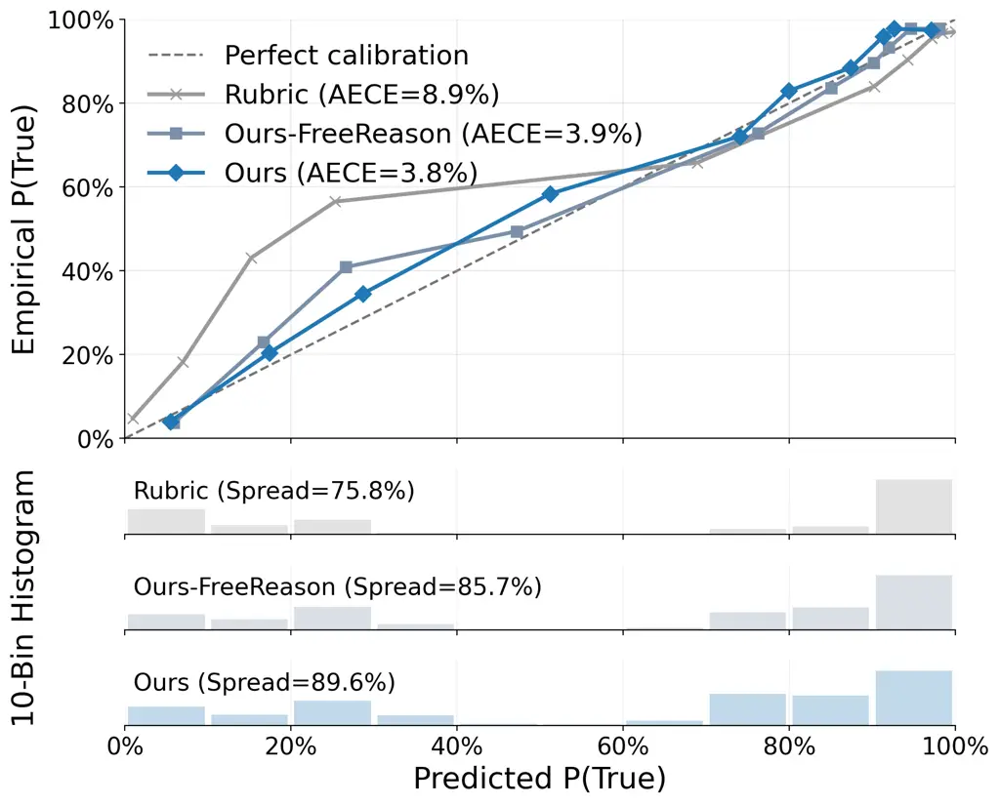
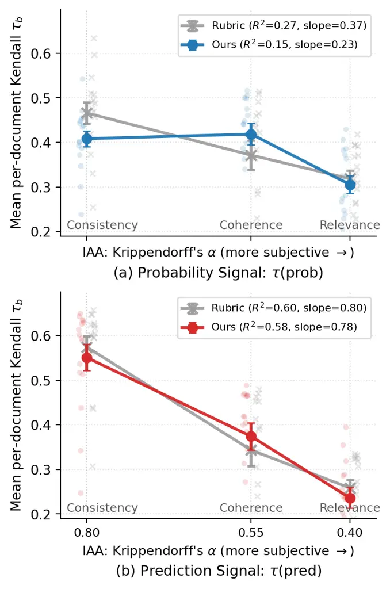
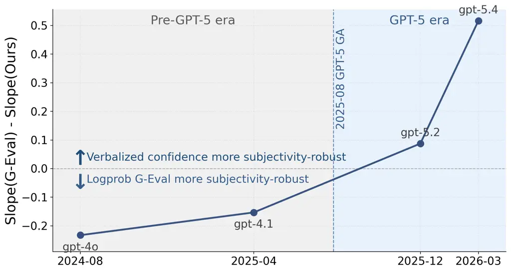
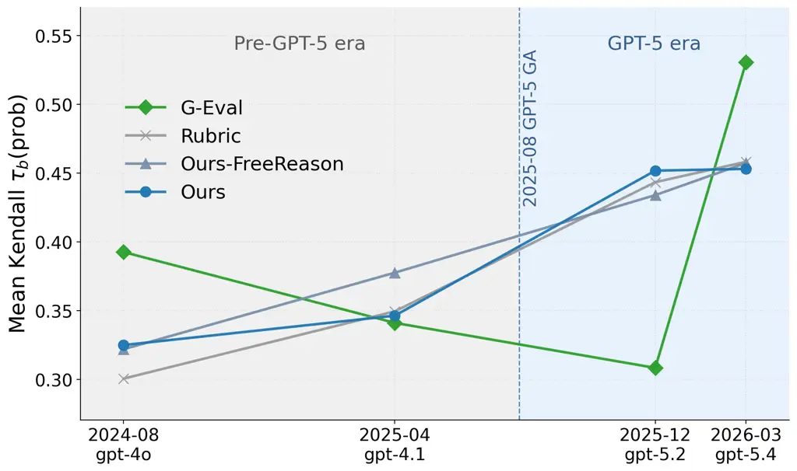
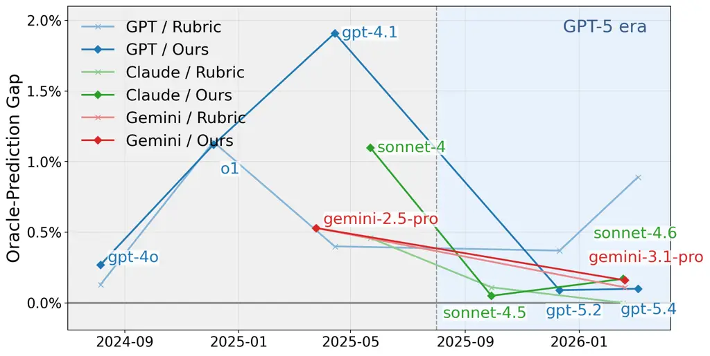
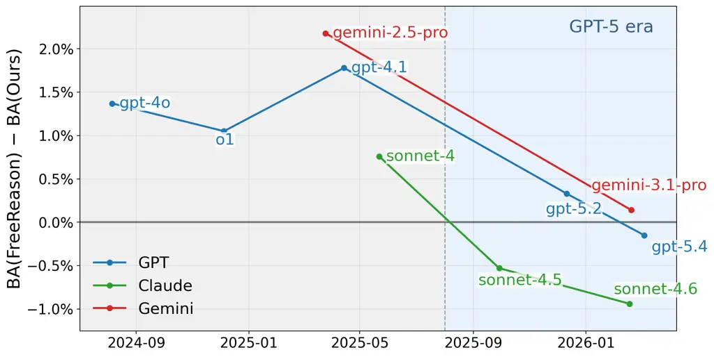
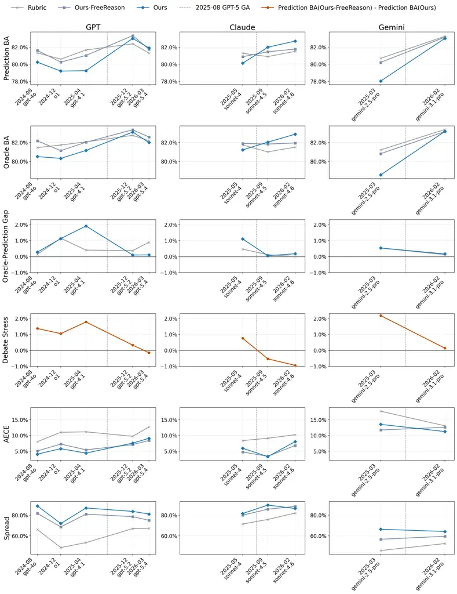

# Rethinking Verbalized Confidence for LLM-as-a-Judge: A Compatibility Shift on Post-2025 Proprietary Models

Yu-Chung Hsiao

###### Abstract

Verbalized confidence, long dismissed as overconfident, coarse, and
prone to round-number clustering, is now the more robust soft-scoring
mechanism for LLM-as-a-Judge on top-tier proprietary models. Across
SummEval, AggreFact, and HelpSteer2, spanning up to 18 LLMs, we show
that the standard advice to prefer log-probabilities no longer holds on
post-2025 models, where verbalized confidence is the better signal. We
call this a _compatibility shift_. On top of a standard
verbalized-confidence baseline, we introduce two new ingredients: an
overconfidence advisory and self-debate. Together they improve
calibration, score-distribution spread, and robustness to task
subjectivity. We further observe a generation effect: post-2025 models
accommodate these two additions with little balanced-accuracy cost,
whereas pre-2025 models pay a measurable penalty. Compared with
logprob-based G-Eval, verbalized confidence is the more
subjectivity-robust soft signal on GPT-family top-tier releases. The
shift is invisible under accuracy-only reporting. Rather than defaulting
to hard predictions, we recommend broader use of soft scoring in
LLM-as-a-Judge. More broadly, verbalized confidence has moved from a
weaker substitute for logprobs to a practical soft-scoring mechanism for
contemporary LLM judges.

Cisco Systems

## Introduction

LLM-as-a-Judge protocols prompt a general-purpose LLM to score a
candidate output against a quality criterion. A central methodological
question has been which _soft signal_ the judge should report: token
log-probabilities (logprobs) over the prediction tokens, or a verbalized
confidence the judge produces in natural language. Pre-2025 evidence
weighed heavily toward logprobs. G-Eval observed that LLM Likert scores
cluster on a few integer values, weakening rank correlations with human
ratings such as Kendall’s $`\tau`$. G-Eval therefore computes a
finer-grained expected score from the token log-probabilities (Liu et
al. 2023). Wang et al. (2025) further showed that the G-Eval style
soft-scoring protocol beats greedy verbal extraction in pointwise,
pairwise, and listwise settings. Large-scale benchmarks reported that
LLMs are systematically overconfident when verbalizing (Xiong et al.
2024), and recent work documented that verbal scores cluster on a
handful of round-number values, collapsing their discriminative power
(Dai and Wang 2026). The dominant practical recommendation, therefore,
has been “prefer logprobs.”

Most of this evidence, however, comes from pre-2025 models, and we find
that the comparison looks different on contemporary proprietary
flagships (each vendor’s top-tier model). As frontier vendors moved
through post-2025 release waves, two changes pull in opposite
directions. On the _logprob_ side, access has become less stable:
closed-model APIs increasingly restrict or remove logprob access. On the
_verbal_ side, recent mechanistic work on open-weight models suggests
that a model’s verbalized confidence is more than its token
probabilities restated in words, and reflects a richer internal
assessment that can carry information not captured by the
log-probabilities (Kumaran et al. 2026). Although we cannot verify this
mechanistically on closed-source flagships, whose internals and often
log-probabilities are inaccessible, it motivates us to probe them
externally with a behavioral question: can a prompt recipe make the
verbalized signal informative enough to match or exceed logprob-based
soft scoring?

This work tests the question empirically across an 18-model sweep
spanning the GPT, Claude, and Gemini families, sampling both pre-2025
checkpoints and post-2025 flagships. We find that a well-designed
verbalized-confidence recipe is now a practical soft signal for frontier
judges, and that on the one family where a fair comparison with logprobs
is still feasible (GPT), our prompt recipe overtakes logprob-based
G-Eval, reversing the pre-2025 preference. We call this reversal a
compatibility shift: the better prompt guidance depends on the model
generation, so advice calibrated on one generation can fail on a newer
one. We trace the shift to a generation effect: post-2025 flagship
models are better able to follow richer judge prompts, an overconfidence
advisory and a self-debate that weighs both stances in a single call,
improving calibration while keeping their balanced accuracy. Pre-2025
models lose significant balanced accuracy under the same prompts. This
shift becomes visible when we analyze the soft score’s calibration and
score-distribution spread. Hence we recommend broader use of soft
scoring in LLM-as-a-Judge, reported with these measures rather than
hard-prediction accuracy alone.

#### Main claims and contributions.

- •
  A logprob-free verbalized-confidence recipe (Method) that adds only
  two ingredients, an overconfidence advisory and self-debate, on top of
  the established rubric-anchored baseline, yielding probability scores
  that are better calibrated, broader in spread, and less coupled to
  task subjectivity than that baseline, which is what makes verbalized
  confidence a strong soft signal in the first place.
- •
  A compatibility shift in the soft signal (Compatibility Shift
  section). On GPT-family flagships, the only family that still returns
  logprobs (Claude never did, and Gemini dropped them at 3.1 Pro),
  verbalized confidence overtakes logprob-based G-Eval as the more
  subjectivity-robust signal and steadily improves its alignment with
  human ratings across GPT generations, while G-Eval’s fluctuates.
- •
  A generation-effect explanation for the shift (same section).
  Post-2025 flagship models keep their prediction accuracy when we add
  the advisory and self-debate, whereas pre-2025 models lose a
  significant amount. This difference is why the recipe helps current
  models without the accuracy cost it imposes on older ones.

#### Scope.

LLM-as-a-Judge is the main tool for _reference-free_ quality evaluation:
it scores a candidate without a gold reference. We study its
single-call, pointwise form, where one model call returns a binary
judgment together with a soft confidence score. The single call is a
scalability choice, and also a foundational one: multi-call and
multi-agent judging build on the same per-call judgment and confidence
signal included in this study. Besides, evaluation trades per-example
resources against data size, and one call per example keeps cost low to
evaluate at the larger scale that gives stable, representative
estimates. We study two kinds of judging target: objective factual
faithfulness, through 9 tasks from AggreFact, and more subjective
quality, through 3 tasks from SummEval (consistency, coherence, and
relevance) and the HelpSteer2 benchmark, which themselves vary in
subjectivity. Tasks with a checkable answer, such as coding,
mathematics, and many agent objectives, are served by verifiable,
reference-based evaluation aimed at correctness and fall outside our
scope, together with pairwise and listwise judging and multi-call
multi-agent debate. We center on contemporary closed-source flagships
from the GPT, Claude, and Gemini families, with smaller and open-weight
models as generation-effect controls.

## Method

### Proposed Soft-Scoring Protocols

Figure 1: Prompt protocols compared in this paper. G-Eval (logprob
baseline) reads a _logprob soft score_ from token log-probabilities,
whereas the verbalized protocols state the score in natural language,
producing a _verbalized soft score_ together with a hard prediction
(True/False). Rubric is the verbalized baseline. Ours adds two
ingredients on top of Rubric, an overconfidence _advisory_ and a
_self-debate_ step (argue True, argue False, then conclude), which give
better-calibrated and more subjectivity-robust verbalized soft scores
than Rubric. All protocols share the remaining blocks: task definition,
prompt inputs, response request, scoring rubric, and output format. The
Prompt design section details how each block is instantiated for logprob
versus verbalized scoring. Ours-FreeReason, an ablation that replaces
the self-debate step with free-form reasoning, is defined there but not
drawn here.

We construct probability scores from a pure verbal signal. The goal is
to extract a soft score that (1) discriminates strongly between True and
False on a given quality criterion and (2) is well calibrated. We
constrain the use of LLMs to:

1.  1.  A single LLM call per judging. This excludes multi-agent setups.
2.  2.  Pointwise binary classification. Traditional machine-learning
        classifiers routinely provide graded quality scores, for example
        between $`0`$ and $`1.0`$. LLMs can be turned into ad-hoc binary
        classifiers through prompting, but they usually lack the granularity
        of the soft scoring that traditional models provide.

Logprob-based methods such as G-Eval (Liu et al. 2023) and the
judgment-distribution line (Wang et al. 2025) are established
alternatives, but logprob access has become less reliable across
closed-model APIs (see Supplementary Material). We therefore focus on a
logprob-free protocol.

We propose two Verbalized Confidence Protocols, Ours-FreeReason and
Ours, with two baselines: the rubric-only Rubric variant and
logprob-based G-Eval as comparison anchors (Figure 1).

#### Prompt components.

Two components distinguish Ours from the Rubric baseline, and because
their exact wording matters we reproduce it here (SummEval Relevance
instantiation; full templates in the Supplementary Material). The
advisory warns the judge against overconfidence, e.g.:

> You have been consistently overconfident in past evaluations…

The self-debate request asks the judge to argue both answers before
deciding, e.g.:

> Emulate a debate in three steps. (1) True because: argue for “True”
> …(2) False because: argue for “False” …(3) Explanation: based on both
> arguments, determine your final answer.

#### Prompt design.

We view judge prompts as compositions of reusable components. The three
shared blocks (response request, scoring rubric, output format) are
instantiated to match each protocol’s output type. G-Eval requests a
Likert rating, so its scoring rubric anchors the Likert scale and its
output is a single Likert value from which the logprob soft score is
read. The verbalized protocols instead request a binary prediction
together with a 0–100 confidence score, so their scoring rubric is a
_confidence rubric_ that fixes how confidence is stated and their output
lists the answer followed by the confidence. We define three verbalized
protocols in this study:

- •
  Rubric (baseline): a logprob-free verbalized-confidence protocol that
  asks the model for a binary judgment and an explicit confidence score
  under a confidence rubric.
- •
  Ours-FreeReason (ablation): the Rubric baseline augmented with
  advisory text discouraging overconfidence and with free-form reasoning
  before the prediction. The model is asked for explicit, unconstrained
  reasoning but is not required to consider both stances.
- •
  Ours: the full recipe, which augments Rubric with advisory text and
  the self-debate request as above.

Relative to the Rubric baseline, only two components change across our
protocols: the overconfidence advisory and the reasoning block
(free-form for Ours-FreeReason, self-debate for Ours). The confidence
rubric, output order, and evidence-quoting sub-directive are held
constant across all three, so comparing Ours-FreeReason with Ours
isolates the effect of self-debate versus free-form reasoning. The
verbatim prompt templates are given in the Supplementary Material due to
their length.

### Metrics

Table 1 defines the six measurements and points to where each is used in
the experiments. We report them together rather than in isolation,
because no single one reveals the compatibility shift and only their
combination does, a point we return to in the Discussion.

| Metric        | Measures                                                                    | Dir.           | Appears in |
| ------------- | --------------------------------------------------------------------------- | -------------- | ---------- |
| Prediction BA | Balanced accuracy of the emitted binary prediction                          | $`\uparrow`$   | Tab. 2, 3  |
| Oracle BA     | Best balanced accuracy from an oracle threshold on the confidence           | $`\uparrow`$   | Fig. 5     |
| OP Gap        | Oracle BA minus Prediction BA: the soft signal the hard prediction discards | $`\downarrow`$ | Fig. 5     |
| Debate Stress | Prediction-BA drop from self-debate vs. free-form reasoning                 | $`\downarrow`$ | Fig. 5     |
| AECE          | Adaptive (equal-mass) expected calibration error                            | $`\downarrow`$ | Tab. 2, 3  |
| Spread        | Bhattacharyya overlap of the confidence histogram with uniform              | $`\uparrow`$   | Tab. 2, 3  |

Table 1: The six metrics: what each measures, its better direction
($`\uparrow`$/$`\downarrow`$), and where it appears. AECE is expected
calibration error with adaptive equal-mass bins (Guo et al. 2017; Nixon
et al. 2019). Spread’s formula is given in the text.

Two definitions need a further word. Oracle BA optimizes the decision
threshold directly on the evaluation set, so we treat it as the ideal
prediction accuracy recoverable from the confidence, and the
(non-negative) Oracle–Prediction Gap (OP Gap) is the portion of that
signal the emitted prediction leaves unused. Spread is the Bhattacharyya
coefficient between the confidence histogram
$`\hat{q}=(\hat{q}_{1},\dots,\hat{q}_{B})`$ over $`B`$ equal-width bins
on $`[0,1]`$ and a uniform reference,

```math
\mathrm{Spread}(\hat{q})=\frac{1}{\sqrt{B}}\sum_{b=1}^{B}\sqrt{\hat{q}_{b}},
```

which we prefer over entropy because we want closeness to the uniform
distribution, not generic dispersion.

## Experimental Setup

### Tasks

We use three benchmarks. SummEval and HelpSteer2 both probe robustness
to task subjectivity, with HelpSteer2 serving as an independent
replication of the SummEval result, while AggreFact probes binary
faithfulness under prompt stress.

SummEval (Fabbri et al. 2021) is a graded subjective evaluation: 100
documents each paired with 17 machine-generated summaries and expert
5-point Likert ratings. We use three dimensions, each a separate judging
task. Consistency asks whether the summary remains faithful to the
source; Coherence asks whether the summary reads as a well-formed
paragraph; and Relevance asks whether the summary captures the important
content while avoiding redundant or tangential details.

Inter-annotator agreement (IAA) for each SummEval dimension is
Krippendorff’s $`\alpha`$ on the expert 5-point ratings, with lower
$`\alpha`$ indicating greater task subjectivity: Consistency
$`\alpha=0.80`$ (least subjective), Coherence $`\alpha=0.55`$ (more
subjective), and Relevance $`\alpha=0.40`$ (highly subjective). We use
IAA as a per-task subjectivity covariate in the slope analyses below.

HelpSteer2 (Wang et al. 2024b) is a modern LLM-output-quality benchmark
with roughly 1,000 crowd annotators and 3–5 raters per item over about
21k prompt-response pairs. Its crowd annotation and task diversity
differ sharply from SummEval’s three-expert panel, so we use it as an
independent replication of the subjectivity result rather than a pooled
extension. We sample 800 items. Because HelpSteer2’s task diversity
precludes a single per-task agreement value, we measure subjectivity per
example from rater disagreement across its 3–5 ratings, the analogue of
SummEval’s IAA.

AggreFact (Tang et al. 2023a) is a binary factual-faithfulness suite
spanning multiple problem regimes: RAG hallucination detection
(RAGTruth), retrieval-augmented claim verification (ClaimVerify),
expert-QA grounding (ExpertQA), long-form QA grounding (Lfqa),
multi-step reasoning verification (Reveal), dialog and meeting grounding
(TofuEval-MediaS, TofuEval-MeetB), post-hoc LLM fact-checking
(FactCheck-GPT), and news-summary faithfulness (AggreFact-CNN). We use
these 9 tasks with 300 examples each (2,700 total). Task selection and
preprocessing are described in the Supplementary Material.

### Models

Our full sweep covers 18 LLMs spanning the GPT, Claude, and Gemini
families plus open-weight checkpoints. Three cohorts are used. The
AggreFact cohort is a 10-model selection of closed-source flagships,
grouped by training generation into _pre-2025_ (GPT-4o, GPT-4.1, o1,
sonnet-4, gemini-2.5-pro) and _post-2025_ (GPT-5.2, GPT-5.4, sonnet-4.5,
sonnet-4.6, gemini-3.1-pro). The SummEval cohort extends this to 16
models by adding 5 open-weight models (gpt-oss-20b, gpt-oss-120b,
llama-3.3-70b, mistral-large-3, gemma-4-26b) and 3 smaller closed models
(gpt-4o-mini, gpt-4.1-mini, gpt-4.1-nano), in order to probe whether
subjectivity robustness extends beyond flagship scale. The HelpSteer2
cohort is a 9-model flagship set spanning 4 vendors and both eras:
_pre-2025_ (GPT-4o, GPT-4.1, sonnet-4, gemini-2.5-pro, mistral-large-3)
and _post-2025_ (GPT-5.2, GPT-5.4, sonnet-4.5, gemini-3.1-pro).

For the GPT-family G-Eval comparison, which requires logprob access, we
use the OpenAI flagships that return logprobs (gpt-4o, gpt-4.1, gpt-5.2,
gpt-5.4). GPT is the only frontier family that still returns logprobs
across several releases, so the comparison is restricted to it by
necessity, not by choice: Claude has never returned logprobs, and Gemini
returned them at 2.5 Pro but withdrew them at 3.1 Pro (Supplementary
Material). This withdrawal is itself part of the picture, since it makes
a logprob-free protocol the forward-compatible option on the newest
models.

## Prompt Effect: The Recipe Improves Soft-Scoring Quality

Across all three datasets, our recipe improves soft-scoring quality. On
AggreFact, the recipe lowers calibration error and broadens the score
distribution. On SummEval and HelpSteer2, it further makes the
probability signal more robust to task subjectivity.

### Calibration Error and Score Spread Improve

Relative to Rubric, Ours-FreeReason sharply reduces calibration error,
and Ours preserves this gain while further broadening the score
distribution. On Sonnet 4.5 for AggreFact, our prompts make the
predicted probabilities less collapsed and more evenly distributed
across the probability range (Figure 2). The rubric baseline is
especially overconfident in low-probability regions. Our prompts tame
this overconfident pattern, especially on the false side, bringing the
calibration curve closer to the diagonal while maintaining broader use
of the probability scale. The full per-model calibration-error and
spread results appear in Table 2.



Figure 2: Calibration curves and probability histograms for Sonnet 4.5
on AggreFact. The top panel plots overall calibration curves using 10
equal-mass bins; points with fewer than 27 examples are omitted. The
lower panels show 10-bin histograms of predicted probabilities. Compared
with Rubric, our prompts substantially reduce calibration error (AECE
from 8.9% to 3.8%) and make the probability distribution more evenly
spread (Spread from 75.8% to 89.6%).

### Ours: Soft Signal More Robust to Subjectivity

Turning to SummEval, we computed Kendall’s $`\tau_{b}`$ between the
judgments of our 16 tested LLMs and the expert-annotated Likert ratings,
separately for binary predictions and probability scores for each
prompt. We then averaged these per-model correlations across the models,
denoting the resulting means $`\tau(\texttt{prob})`$ and
$`\tau(\texttt{pred})`$, plotted in Figure 3 against IAA on the
$`x`$-axis. We compared two prompt configurations, Rubric and Ours.



Figure 3: Probability signals in panel (a) are more robust to task
subjectivity than prediction signals in panel (b). Smaller regression
slopes and lower $`R^{2}`$ indicate weaker coupling to inter-annotator
agreement (IAA) and thus a less confounded capacity measure. Faint
markers show per-model values, jittered along the $`x`$-axis for
visualization only. Relative to the baseline prompt, our prompt
significantly flattens $`\tau(\texttt{prob})`$
($`\Delta\mathrm{slope}=-0.143`$, one-sided $`p<10^{-4}`$), whereas the
slope difference between the two prompts is not significant for
$`\tau(\texttt{pred})`$ (two-sided $`p=0.46`$).

Our prompt’s overconfidence advisory and self-debate make the
probability signal significantly more robust to task subjectivity than
the Rubric baseline, flattening its $`\tau(\texttt{prob})`$ slope by
$`\Delta\mathrm{slope}=-0.143`$ and lowering $`R^{2}`$ (one-sided
$`p<10^{-4}`$, panel a). This gain is clearest in the soft-score signal:
the probability slopes in panel (a) are flatter than the
binary-prediction slopes in panel (b) (one-sided $`p<10^{-5}`$), and the
dimension-level IAA slope does not separate the two prompts on
$`\tau(\texttt{pred})`$ (two-sided $`p=0.46`$). The slope is estimated
over 48 model-and-task points ($`16`$ models $`\times`$ $`3`$
dimensions), shown as the per-model markers in Figure 3. Its confidence
intervals and $`p`$-values come from a paired model-cluster bootstrap
that resamples models with replacement while preserving each model’s
task points. The SummEval annotation process recruited the same expert
pool for all dimensions through the same training, so we treat the IAA
gradient as genuine subjectivity rather than noise.

#### Ours’ robustness advantage replicates independently.

Krippendorff’s $`\alpha`$ is interpretable only within a single study’s
design (Krippendorff 2011), so $`\alpha`$ points cannot be pooled across
datasets with different annotator pools and rubrics. We therefore
corroborate the subjectivity-robustness conclusion with a complementary
per-example rater-disagreement measure that does not require dimension
homogeneity, and we replicate on HelpSteer2 (described in the Tasks
section). Treated as independent replications rather than a pooled fit,
all analyses agree that Ours is more robust to subjectivity than Rubric:
Ours’ slope is significantly flatter on both datasets and both signals
(SummEval $`\Delta\mathrm{slope}=-0.024`$ for $`\tau(\texttt{prob})`$
with $`p=0.018`$ and $`-0.058`$ for $`\tau(\texttt{pred})`$ with
$`p=0.004`$; HelpSteer2 $`\Delta\mathrm{slope}=-0.023`$ with $`p=0.004`$
and $`-0.036`$ with $`p<10^{-4}`$), and its $`R^{2}`$ is lower in every
case. This finer measure resolves the recipe’s robustness gain on
$`\tau(\texttt{pred})`$ too, which the dimension-level IAA slope could
not. The HelpSteer2 replication spans an entirely independent annotation
infrastructure. Full tables are in the Supplementary Material.

## Compatibility Shift and Generation Effect

This section presents the shift and then the generation effect behind
it. First, on SummEval, GPT-family flagships realign from logprob-based
G-Eval toward verbalized confidence, the compatibility shift itself. We
then trace this shift to a generation effect: on AggreFact, post-2025
models keep their prediction accuracy when the advisory and self-debate
are added, shrinking the Oracle-Prediction Gap and Debate Stress toward
zero, whereas older models incur a prediction-quality penalty.

### Verbalized Confidence Overtakes Logprob G-Eval on GPT-Family Flagships

We compare four judging protocols on the GPT flagships that return
logprobs (gpt-4o, gpt-4.1, gpt-5.2, gpt-5.4): G-Eval, Rubric,
Ours-FreeReason, and Ours. For each task and protocol, we compute mean
per-document Kendall $`\tau_{b}`$ between model scores and expert
ratings across candidate summaries, and quantify subjectivity robustness
as the slope of $`\tau(\texttt{prob})`$ against task IAA $`\alpha`$.
Lower slopes indicate less sensitivity to task subjectivity.



(a) Verbalized confidence’s _subjectivity-robustness_ advantage over
G-Eval.  
  
(b) Mean Kendall $`\tau_{b}`$ between the soft score and human ratings.

Figure 4: Compatibility shift across GPT releases on SummEval. The
advantage in (a) changes sign from negative (pre-GPT-5) to positive
(GPT-5 era), so GPT-5 era models favor verbalized confidence over
logprob-based G-Eval for subjectivity robustness. In (b), the verbalized
protocols (Rubric, Ours-FreeReason, Ours) improve steadily across GPT
generations, whereas logprob-based G-Eval fluctuates. Together,
verbalized confidence overtakes logprob-based G-Eval as the more
compatible soft signal for contemporary GPT-family flagships.

Both views in Figure 4 favor newer GPT generations: verbalized
confidence gains a subjectivity-robustness advantage over G-Eval in the
GPT-5 era (a), and its judging capacity improves steadily across the
family while G-Eval’s does not (b). Verbalized confidence is therefore
better aligned with current GPT-family models than logprob-based soft
scoring, one practical reason to recommend Ours as the
forward-compatible LLM-as-a-Judge protocol.

### Generation Effect: Newer Models Keep Their Accuracy With the Recipe, Older Models Don’t

We now turn to the generation effect behind the shift, and ask whether
the model’s emitted binary prediction is as informative as the
confidence signal verbalized in the same response. AggreFact is a binary
faithfulness task, so this setting lets us directly compare the quality
of the hard prediction against the quality of a thresholded confidence
score. We compare three verbal protocols, Rubric, Ours-FreeReason, and
Ours, using Prediction BA, Oracle BA, the Oracle-Prediction Gap, and
Debate Stress.

Table 2 reports Prediction BA and calibration-quality gains by family.
Two patterns emerge. Across nearly all models, Ours yields large
calibration gains, especially in score-distribution spread. The
prediction-quality tradeoff is generation-dependent: older models incur
significant BA drops while post-2025 flagships do not, and some even
improve. These results are stable under a maximally-disjoint
300-per-task resample (Supplementary Material).

|                    |                 |       |                    |                     |       |                      |                     |       |                    |
| ------------------ | --------------- | ----- | ------------------ | ------------------- | ----- | -------------------- | ------------------- | ----- | ------------------ |
|                    | BA $`\uparrow`$ |       |                    | AECE $`\downarrow`$ |       |                      | Spread $`\uparrow`$ |       |                    |
| Model              | Rubric          | Ours  | $`\Delta\uparrow`$ | Rubric              | Ours  | $`\Delta\downarrow`$ | Rubric              | Ours  | $`\Delta\uparrow`$ |
| gpt-4o             | 81.3%           | 80.2% | $`-1.1`$           | 8.0%                | 4.1%  | $`-3.9`$^(∗)         | 66.0%               | 88.8% | $`+22.8`$^(∗)      |
| o1                 | 80.6%           | 79.2% | $`-1.4`$^(∗)       | 11.0%               | 5.8%  | $`-5.2`$^(∗)         | 48.7%               | 71.9% | $`+23.2`$^(∗)      |
| gpt-4.1            | 81.7%           | 79.3% | $`-2.4`$^(∗)       | 11.2%               | 4.4%  | $`-6.8`$^(∗)         | 53.5%               | 86.9% | $`+33.4`$^(∗)      |
| gpt-5.2^(†)        | 82.4%           | 83.0% | $`+0.6`$           | 9.7%                | 7.6%  | $`-2.2`$^(∗)         | 66.9%               | 83.6% | $`+16.6`$^(∗)      |
| gpt-5.4^(†)        | 81.3%           | 81.9% | $`+0.6`$           | 12.7%               | 9.1%  | $`-3.6`$^(∗)         | 67.2%               | 81.0% | $`+13.7`$^(∗)      |
| sonnet-4           | 81.3%           | 80.1% | $`-1.2`$^(∗)       | 8.4%                | 5.9%  | $`-2.4`$^(∗)         | 71.3%               | 81.5% | $`+10.2`$^(∗)      |
| sonnet-4.5^(†)     | 80.9%           | 82.0% | $`+1.1`$           | 9.1%                | 3.3%  | $`-5.8`$^(∗)         | 75.8%               | 89.6% | $`+13.9`$^(∗)      |
| sonnet-4.6^(†)     | 81.5%           | 82.7% | $`+1.2`$^(∗)       | 10.2%               | 8.1%  | $`-2.2`$^(∗)         | 81.9%               | 86.4% | $`+4.4`$^(∗)       |
| gemini-2.5-pro     | 80.7%           | 78.0% | $`-2.7`$^(∗)       | 17.7%               | 13.5% | $`-4.2`$^(∗)         | 45.8%               | 66.3% | $`+20.5`$^(∗)      |
| gemini-3.1-pro^(†) | 83.3%           | 83.0% | $`-0.3`$           | 13.1%               | 11.2% | $`-1.8`$^(∗)         | 52.5%               | 64.2% | $`+11.6`$^(∗)      |

Table 2: AggreFact prediction accuracy and probability-signal quality
under Rubric and Ours. Asterisks (\*) denote statistical significance
under paired bootstrapping. Daggers (^(†)) denote post-2025 flagship
models. Ours consistently reduces calibration error and broadens use of
the probability scale, while prediction-accuracy costs are concentrated
in older models.

The generation effect appears most clearly in the two prompt-stress
measures. Under Ours, newer flagships shrink the Oracle-Prediction Gap
toward zero after mid-2025 (Figure 5a), and Debate Stress follows the
same trajectory (Figure 5b): older GPT and Gemini models show
substantial positive stress while post-2025 models move close to zero,
and later Claude models even gain prediction BA from debate. The full
per-family comparison is in the Supplementary Material.

### Which Component Drives Which Effect

To isolate the contribution of each moving component, we ran a 10-model,
5-configuration sweep on AggreFact that adds the advisory and the
reasoning block independently. Starting from Rubric, we add the advisory
(+Adv), then either free-form reasoning (+FR) or self-debate (+SD) on
top, and separately apply self-debate on its own against Rubric. Table 3
summarizes each configuration split by model era, and the full per-model
grid across all three metrics is in the Supplementary Material. Three
findings emerge. First, the advisory is the primary calibration lever:
it significantly reduces AECE and broadens Spread in every cohort,
whereas self-debate on its own barely moves AECE and contributes only to
Spread. Second, free-form reasoning erodes the advisory’s spread gain
while self-debate preserves it: relative to +Adv, free-form
significantly reduces Spread in both eras, whereas self-debate preserves
it and augments it on pre-2025 models. Third, the prediction-accuracy
effect is a clean generation split: the full Adv+SD recipe significantly
lowers pre-2025 cohort BA but significantly raises it on post-2025
models, and both the advisory and self-debate contribute this
pre-2025-only cost individually. The advisory and self-debate
contributions are approximately additive on calibration, and their joint
condition is where the compatibility shift is most visible.

| Models | Adv       | FR        | SD        | Base   | $`\Delta`$BA | $`\Delta`$AECE | $`\Delta`$Spread |
| ------ | --------- | --------- | --------- | ------ | ------------ | -------------- | ---------------- |
| Pre    | $`\surd`$ |           |           | Rubric | $`-0.7`$^(∗) | $`-4.5`$^(∗)   | $`+18.9`$^(∗)    |
| Post   | $`\surd`$ |           |           | Rubric | $`+0.0`$     | $`-3.6`$^(∗)   | $`+11.6`$^(∗)    |
| Pre    | $`\surd`$ | $`\surd`$ |           | +Adv   | $`+0.4`$^(∗) | $`+0.1`$       | $`-2.5`$^(∗)     |
| Post   | $`\surd`$ | $`\surd`$ |           | +Adv   | $`+0.4`$     | $`+0.4`$       | $`-3.1`$^(∗)     |
| Pre    | $`\surd`$ |           | $`\surd`$ | +Adv   | $`-1.0`$^(∗) | $`-0.0`$       | $`+3.0`$^(∗)     |
| Post   | $`\surd`$ |           | $`\surd`$ | +Adv   | $`+0.6`$^(∗) | $`+0.5`$       | $`+0.5`$         |
| Pre    | $`\surd`$ |           | $`\surd`$ | Rubric | $`-1.8`$^(∗) | $`-4.5`$^(∗)   | $`+22.0`$^(∗)    |
| Post   | $`\surd`$ |           | $`\surd`$ | Rubric | $`+0.7`$^(∗) | $`-3.1`$^(∗)   | $`+12.1`$^(∗)    |
| Pre    |           |           | $`\surd`$ | Rubric | $`-0.8`$^(∗) | $`-0.0`$       | $`+6.1`$^(∗)     |
| Post   |           |           | $`\surd`$ | Rubric | $`+0.3`$     | $`+0.2`$       | $`+2.1`$^(∗)     |

Table 3: Component-isolation ablation on AggreFact. Adv: overconfidence
advisory; FR: free-form reasoning; SD: self-debate. Pre/Post: pre-2025
and post-2025 flagship models. Base: the configuration each $`\Delta`$
is measured against (checkmarks mark active blocks). Each cell is the
mean $`\Delta`$ (percentage points) over the row’s group; \* marks a 95%
confidence interval excluding zero under a paired model-cluster
bootstrap ($`B=20{,}000`$). Bold marks the full-recipe (Adv+SD, i.e.
Ours) $`\Delta`$Prediction-BA cells, where the generation effect is
starkest: pre-2025 models lose balanced accuracy ($`-1.8`$ pp) while
post-2025 models gain ($`+0.7`$ pp). Per-model detail is in the
Supplementary Material.



(a) Oracle-Prediction Gap  
  
(b) Debate Stress

Figure 5: Two prompt-stress measures over model generations, lower is
better. (a) Oracle-Prediction Gap: a smaller gap means the binary
prediction better captures the faithfulness signal in the confidence.
(b) Debate Stress: the prediction-BA change from self-debate, with zero
meaning full robustness and negative values a gain. Both shrink toward
zero on post-2025 flagships.

### Robustness Across Tasks

The recipe’s benefit holds per task, not only in aggregate. We score the
full recipe on every model-and-task combination, 90 in all, and
bootstrap each separately (Supplementary Material). The calibration
benefit is broad: 67 of the 90 (model, task) comparisons favor Ours
(binomial one-sided $`p=1.9\times 10^{-6}`$), none favors Rubric at 95%
confidence, and it appears on all 9 tasks rather than concentrating on a
few. The prediction-accuracy cost is again generation-dependent, with
significant $`\Delta`$BA drops concentrated on the pre-2025 cohort
(Fisher one-sided $`p=0.013`$).

## Discussion

The prompt and model effects are complementary. Our recipe improves the
probability signal across settings: on SummEval and HelpSteer2 it makes
$`\tau(\texttt{prob})`$ more robust to task subjectivity, and on
AggreFact it cuts calibration error while broadening the score
distribution. Post-2025 flagships then convert this richer signal into
stable predictions, whereas older models often pay a prediction-accuracy
penalty for the same calibration gains. This is why accuracy-only
reporting misses the shift: $`\Delta`$Prediction BA looks flat on newer
models, while $`\Delta`$AECE alone hides whether the prediction still
preserves the latent signal.

For benchmark practice, we therefore recommend reporting the soft-score
measures alongside prediction accuracy, and, as logprob access grows
less reliable across production APIs, adopting a logprob-free
verbalized-confidence protocol as the more portable soft-scoring
interface.

## Related Work

#### Soft scoring and verbalized confidence.

LLM-as-judge is well studied (Zheng et al. 2023; Liu et al. 2023), with
AggreFact (Tang et al. 2023b) and SummEval (Fabbri et al. 2021) as
standard faithfulness testbeds. G-Eval (Liu et al. 2023) and later
judgment-distribution methods (Wang et al. 2025) use token logprobs to
recover soft signal beyond greedy outputs. Prior evidence on verbalized
confidence is mixed: it can be useful on QA correctness (Kadavath et al.
2022; Tian et al. 2023), but is often overconfident or collapsed onto
round numbers (Xiong et al. 2024; Dai and Wang 2026). Mechanistic work
suggests verbal confidence can reflect internal answer-quality
assessments beyond a logprob readout (Kumaran et al. 2026). We show this
signal is practically useful on contemporary closed-source flagships.

#### Self-debate and calibration.

Unlike multi-call debate or aggregation systems (Du et al. 2024; Liang
et al. 2024; Khan et al. 2024; Jiang et al. 2023; Wang et al. 2024a),
our self-debate is a single-call prompt constraint. For soft-score
quality, we pair adaptive ECE (Guo et al. 2017; Nixon et al. 2019) with
a Bhattacharyya spread against a uniform reference (Chao and Ricotta
2019; Gregorius and Gillet 2022; Pierson 2021), since ECE alone can miss
the distributional collapse common in verbalized scores (Dai and Wang
2026).

## Conclusion

The pre-2025 preference for logprob-based soft scoring in LLM-as-a-Judge
no longer holds uniformly. Across our three benchmarks, our logprob-free
verbalized-confidence recipe improves calibration, score spread, and
robustness to task subjectivity, while post-2025 flagships keep their
prediction accuracy and pre-2025 models lose it, the generation effect
behind the compatibility shift. In practice, report hard predictions and
soft-score measures together, and treat prompt-model compatibility as a
moving target.

## References

- Bhandari et al. (2020) M. Bhandari, P. N. Gour, A. Ashfaq, P. Liu,
  and G. Neubig Re-evaluating evaluation in text summarization. In
  Proceedings of the 2020 Conference on Empirical Methods in Natural
  Language Processing (EMNLP), pp. 9347–9359. Cited by: Appendix F.
- Chao and Ricotta (2019) A. Chao and C. Ricotta Quantifying evenness
  and linking it to diversity, beta diversity, and similarity. Ecology
  100 (12), pp. e02852. External Links:
  [Document](https://dx.doi.org/10.1002/ecy.2852),
  [Link](https://doi.org/10.1002/ecy.2852) Cited by: Self-debate and
  calibration..
- Dai and Wang (2026) Y. Dai and Y. Wang Rescaling confidence: what
  scale design reveals about LLM metacognition. arXiv preprint
  arXiv:2603.09309. External Links:
  [Link](https://arxiv.org/abs/2603.09309) Cited by: Introduction, Soft
  scoring and verbalized confidence., Self-debate and calibration..
- Du et al. (2024) Y. Du, S. Li, A. Torralba, J. B. Tenenbaum, and I.
  Mordatch Improving factuality and reasoning in language models through
  multiagent debate. In Proceedings of the 41st International Conference
  on Machine Learning (ICML), Cited by: Self-debate and calibration..
- Fabbri et al. (2021) A. R. Fabbri, W. Kryściński, B. McCann, C.
  Xiong, R. Socher, and D. Radev SummEval: re-evaluating summarization
  evaluation. Transactions of the Association for Computational
  Linguistics (TACL). Cited by: Appendix F, Tasks, Soft scoring and
  verbalized confidence..
- Gregorius and Gillet (2022) H. Gregorius and E. M. Gillet The concept
  of evenness/unevenness: less evenness or more unevenness?. Acta
  Biotheoretica 70 (1), pp. 3. External Links:
  [Document](https://dx.doi.org/10.1007/s10441-021-09429-9),
  [Link](https://doi.org/10.1007/s10441-021-09429-9) Cited by:
  Self-debate and calibration..
- Guo et al. (2017) C. Guo, G. Pleiss, Y. Sun, and K. Q. Weinberger On
  calibration of modern neural networks. In Proceedings of the 34th
  International Conference on Machine Learning (ICML), pp. 1321–1330.
  Cited by: Table 1, Self-debate and calibration..
- Jiang et al. (2023) D. Jiang, X. Ren, and B. Y. Lin LLM-Blender:
  ensembling large language models with pairwise ranking and generative
  fusion. In Proceedings of the 61st Annual Meeting of the Association
  for Computational Linguistics (ACL), Cited by: Self-debate and
  calibration..
- Kadavath et al. (2022) S. Kadavath, T. Conerly, A. Askell, T.
  Henighan, D. Drain, E. Perez, N. Schiefer, Z. Hatfield-Dodds, N.
  DasSarma, E. Tran-Johnson, et al. Language models (mostly) know what
  they know. arXiv preprint arXiv:2207.05221. Cited by: Soft scoring and
  verbalized confidence..
- Kamoi et al. (2023) R. Kamoi, T. Goyal, J. Diego Rodriguez, and G.
  Durrett WiCE: real-world entailment for claims in Wikipedia. In
  Proceedings of the 2023 Conference on Empirical Methods in Natural
  Language Processing, Singapore, pp. 7561–7583. External Links:
  [Link](https://aclanthology.org/2023.emnlp-main.470/),
  [Document](https://dx.doi.org/10.18653/v1/2023.emnlp-main.470) Cited
  by: Appendix F.
- Khan et al. (2024) A. Khan, J. Hughes, D. Valentine, L. Ruis, K.
  Sachan, A. Radhakrishnan, E. Grefenstette, S. R. Bowman, T.
  Rocktäschel, and E. Perez Debating with more persuasive LLMs leads to
  more truthful answers. In Proceedings of the 41st International
  Conference on Machine Learning (ICML), Cited by: Self-debate and
  calibration..
- Krippendorff (2011) K. Krippendorff Computing Krippendorff’s
  alpha-reliability. Technical report University of Pennsylvania,
  Annenberg School for Communication. Cited by: Appendix C, Ours’
  robustness advantage replicates independently..
- Kumaran et al. (2026) D. Kumaran, A. Conmy, F. Barbero, S.
  Osindero, V. Patraucean, and P. Veličković How do LLMs compute verbal
  confidence?. arXiv preprint arXiv:2603.17839. Note: Submitted to ICML
  2026 External Links: [Link](https://arxiv.org/abs/2603.17839) Cited
  by: Introduction, Soft scoring and verbalized confidence..
- Liang et al. (2024) T. Liang, Z. He, W. Jiao, X. Wang, Y. Wang, R.
  Wang, Y. Yang, Z. Tu, and S. Shi Encouraging divergent thinking in
  large language models through multi-agent debate. In Proceedings of
  the 2024 Conference on Empirical Methods in Natural Language
  Processing (EMNLP), Cited by: Self-debate and calibration..
- Liu et al. (2023) Y. Liu, D. Iter, Y. Xu, S. Wang, R. Xu, and C. Zhu
  G-Eval: NLG evaluation using GPT-4 with better human alignment. In
  Proceedings of the 2023 Conference on Empirical Methods in Natural
  Language Processing (EMNLP), Cited by: Appendix F, Introduction,
  Proposed Soft-Scoring Protocols, Soft scoring and verbalized
  confidence..
- Nixon et al. (2019) J. Nixon, M. W. Dusenberry, L. Zhang, G. Jerfel,
  and D. Tran Measuring calibration in deep learning. In Proceedings of
  the IEEE/CVF Conference on Computer Vision and Pattern Recognition
  (CVPR) Workshops, pp. 38–41. Cited by: Table 1, Self-debate and
  calibration..
- Pierson (2021) K. Pierson Using geometry to rank evenness measures:
  towards a deeper understanding of divergence. Journal of Theoretical
  Biology 531, pp. 110902. External Links:
  [Document](https://dx.doi.org/10.1016/j.jtbi.2021.110902),
  [Link](https://doi.org/10.1016/j.jtbi.2021.110902) Cited by:
  Self-debate and calibration..
- See et al. (2017) A. See, P. J. Liu, and C. D. Manning Get to the
  point: summarization with pointer-generator networks. In Proceedings
  of the 55th Annual Meeting of the Association for Computational
  Linguistics (Volume 1: Long Papers), pp. 1073–1083. Cited by: Appendix
  F.
- Tang et al. (2023a) L. Tang, T. Goyal, A. Fabbri, P. Laban, J. Xu, S.
  Yavuz, W. Kryscinski, J. Rousseau, and G. Durrett Understanding
  factual errors in summarization: errors, summarizers, datasets, error
  detectors. In Proceedings of the 61st Annual Meeting of the
  Association for Computational Linguistics (Volume 1: Long Papers),
  Toronto, Canada, pp. 11626–11644. External Links:
  [Link](https://aclanthology.org/2023.acl-long.650/),
  [Document](https://dx.doi.org/10.18653/v1/2023.acl-long.650) Cited by:
  Appendix F, Tasks.
- Tang et al. (2023b) L. Tang, T. Goyal, A. Fabbri, P. Laban, J. Xu, S.
  Yavuz, W. Kryściński, J. Rousseau, and G. Durrett Understanding
  factual errors in summarization: errors, summarizers, datasets, error
  detectors. In Proceedings of the 61st Annual Meeting of the
  Association for Computational Linguistics (ACL), Cited by: Soft
  scoring and verbalized confidence..
- Tian et al. (2023) K. Tian, E. Mitchell, A. Zhou, A. Sharma, R.
  Rafailov, H. Yao, C. Finn, and C. D. Manning Just ask for calibration:
  strategies for eliciting calibrated confidence scores from language
  models fine-tuned with human feedback. In Proceedings of the 2023
  Conference on Empirical Methods in Natural Language Processing
  (EMNLP), Cited by: Soft scoring and verbalized confidence..
- Wang et al. (2024a) J. Wang, J. Wang, B. Athiwaratkun, C. Zhang,
  and J. Zou Mixture-of-agents enhances large language model
  capabilities. arXiv preprint arXiv:2406.04692. Cited by: Self-debate
  and calibration..
- Wang et al. (2025) V. Wang, M. J.Q. Zhang, and E. Choi Improving
  LLM-as-a-Judge inference with the judgment distribution. In Findings
  of the Association for Computational Linguistics: EMNLP 2025, External
  Links: [Link](https://arxiv.org/abs/2503.03064) Cited by:
  Introduction, Proposed Soft-Scoring Protocols, Soft scoring and
  verbalized confidence..
- Wang et al. (2024b) Z. Wang, Y. Dong, O. Delalleau, J. Zeng, G.
  Shen, D. Egert, J. J. Zhang, S. Suneja, and O. Kuchaiev HelpSteer2:
  open-source dataset for training top-performing reward models.
  External Links: 2406.08673 Cited by: Appendix C, Tasks.
- Xiong et al. (2024) M. Xiong, Z. Hu, X. Lu, Y. Li, J. Fu, J. He,
  and B. Hooi Can LLMs express their uncertainty? an empirical
  evaluation of confidence elicitation in LLMs. In International
  Conference on Learning Representations (ICLR), External Links:
  [Link](https://arxiv.org/abs/2306.13063) Cited by: Introduction, Soft
  scoring and verbalized confidence..
- Zheng et al. (2023) L. Zheng, W. Chiang, Y. Sheng, S. Zhuang, Z.
  Wu, Y. Zhuang, Z. Lin, Z. Li, D. Li, E. P. Xing, H. Zhang, J. E.
  Gonzalez, and I. Stoica Judging LLM-as-a-Judge with MT-Bench and
  chatbot arena. In Advances in Neural Information Processing Systems
  (NeurIPS), Datasets and Benchmarks Track, Cited by: Soft scoring and
  verbalized confidence..

## Supplementary Material

This appendix collects the supplementary material referred to from the
main text. Each section is self-contained:

- •
  Section A: logprob availability across recent APIs.
- •
  Sections B, C: the full subjectivity-robustness statistics, the
  bootstrap protocol (B) and the per-example replication on SummEval and
  HelpSteer2 (C).
- •
  Sections D, E: the per-model component ablation (D) and the per-task
  replication on AggreFact (E).
- •
  Sections F, G: data processing (deterministic sampling, task
  selection, and sizes) in F, and its stability under an independent
  resample in G.
- •
  Section H: per-family AggreFact metric trends across model
  generations.
- •
  Section I: the verbatim prompt templates.

## Appendix A A. Logprob Access Is No Longer a Stable Primitive

A clear trend emerges across recent closed-model APIs: token logprobs
are becoming less uniformly available as a general-purpose evaluation
signal. Earlier flagship models return them cleanly, which makes
logprob-based soft scoring straightforward. Newer model families
increasingly restrict that path: support becomes conditional on model
variant or serving configuration rather than being a stable default
capability. Even where logprobs remain accessible, the maximum number of
top tokens returned has been reduced. The GPT family, for example,
dropped from 20 in GPT-4o/4.1 to 5 in GPT-5.2/5.4 (Table 4). Support can
also be removed outright across a family’s releases: Google’s Gemini
exposed logprobs at 2.5 Pro but withdrew them starting from 3.0 Pro, and
Anthropic’s Claude has never returned them. This makes logprob-based
judge protocols harder to apply consistently across modern frontier
models, and in several families impossible on the newest release.
Conversely, logprob-free confidence extraction remains broadly portable,
which is why it is the more practical soft-signal interface for
cross-model evaluation.

| Model             | Release | logprobs available? | Max top_logprobs |
| ----------------- | ------- | ------------------- | ---------------- |
| GPT-4o            | 2024-08 | Yes                 | 20               |
| o1                | 2024-12 | No                  |                  |
| GPT-4.1           | 2025-04 | Yes                 | 20               |
| GPT-5             | 2025-08 | No                  |                  |
| GPT-5.2           | 2025-12 | Config dependent    | 5                |
| GPT-5.4           | 2026-03 | Config dependent    | 5                |
| Gemini 2.5 Pro    | 2025-06 | Yes                 | 20               |
| Gemini 3.0 Pro    | 2025-11 | No                  |                  |
| Gemini 3.1 Pro    | 2026-02 | No                  |                  |
| All Claude Models | —       | No                  |                  |

Table 4: Logprob availability across recent closed-model APIs. Row
shading indicates vendor: OpenAI, Google, Anthropic. Within the OpenAI
family, availability has narrowed over time. Google withdrew logprob
support entirely starting from Gemini 3.0 Pro. Anthropic’s Claude has
never supported logprobs.

## Appendix B B. Bootstrap Inference for Subjectivity-Sensitivity Slopes

Slope differences are estimated by simple linear regression of
$`\tau_{b}`$ against the subjectivity covariate, with confidence
intervals and $`p`$-values from a paired model-cluster bootstrap
($`B=100{,}000`$) that resamples models with replacement while
preserving each model’s task or bin points. The resampling unit is the
_model_ in all cases, so the bootstrap evaluates whether Ours’ slope is
reliably flatter than Rubric’s across the model cohort. Two variants of
this procedure are used:

- •
  SummEval (dimension-level IAA): 16 models, regressing $`\tau_{b}`$
  against Krippendorff’s $`\alpha`$ computed at the dimension level (3
  non-fluency dimensions). Table 5 reports these results.
- •
  SummEval and HelpSteer2 (per-example disagreement): 16 models for
  SummEval and 9 flagship models for HelpSteer2, regressing $`\tau_{b}`$
  against bin-mean rater disagreement, i.e. the std of per-annotator
  ratings per example averaged within each equal-mass bin (full
  definition in Section C). Table 6 reports these results.

| Signal                  | Prompt | Cons. | Coh. | Rel. | Slope$`\downarrow`$ | $`R^{2}\downarrow`$ | $`\Delta`$slope     | $`p`$                 |
| ----------------------- | ------ | ----- | ---- | ---- | ------------------- | ------------------- | ------------------- | --------------------- |
| $`\tau(\texttt{pred})`$ | Rubric | 0.58  | 0.34 | 0.26 | 0.80                | 0.61                |                     |                       |
|                         | Ours   | 0.55  | 0.37 | 0.24 | 0.78                | 0.59                | $`-0.025`$          | $`0.46`$              |
| $`\tau(\texttt{prob})`$ | Rubric | 0.47  | 0.37 | 0.32 | 0.37                | 0.27                |                     |                       |
|                         | Ours   | 0.41  | 0.42 | 0.30 | 0.23                | 0.15                | $`\mathbf{-0.143}`$ | $`\mathbf{<10^{-4}}`$ |

Table 5: SummEval dimension-level subjectivity-robustness results.
Per-dimension mean Kendall $`\tau_{b}`$ (Cons. = Consistency, Coh. =
Coherence, Rel. = Relevance), slope and $`R^{2}`$ from regression on IAA
(Krippendorff’s $`\alpha`$), and bootstrap slope-difference tests
($`\Delta`$slope = Ours minus Rubric; $`B=100{,}000`$ paired
model-cluster bootstrap).

## Appendix C C. Per-Example Subjectivity Robustness

The main paper reports a complementary per-example rater-disagreement
measure and an independent HelpSteer2 replication. This section gives
the full protocol and results. Table 5 gives the per-model,
per-dimension $`\tau_{b}`$ values underlying the SummEval
dimension-level slope analysis.

#### Per-example subjectivity measure.

We measure subjectivity per example rather than only per dimension: we
bin examples by the standard deviation of their per-annotator ratings
and regress $`\tau`$ against bin-mean disagreement. This gives finer
resolution than dimension-level IAA, and because it does not require
dimension homogeneity it applies uniformly to SummEval and to datasets
such as HelpSteer2, whose prompt-response pairs span coding, creative
writing, science, and professional communication rather than a single
domain. It also keeps the measurement comparable within each study:
Krippendorff’s $`\alpha`$ is interpretable only within a single study’s
design (Krippendorff 2011), since rater training, rubric anchors, and
pool size are part of the measurement scale (an $`\alpha=0.5`$ on
SummEval’s expert panel is not the same construct as $`\alpha=0.5`$ on
another dataset’s crowd pool), so we report each dataset on its own
scale rather than pooling $`\alpha`$ across studies.

#### HelpSteer2 setup.

HelpSteer2 (Wang et al. 2024b) is a modern LLM-output-quality benchmark
with roughly 1,000 crowd annotators, about 21k prompt-response pairs,
and 3–5 raters per item on a 0–4 Likert scale. We downsample 800 items
via the same md5-hash convention as the AggreFact draw (Section F), and
judge with 9 flagship models across 4 vendors and two eras (pre-2025:
gpt-4.1, gpt-4o, sonnet-4, gemini-2.5-pro, mistral-large-3; post-2025:
gpt-5.2, gpt-5.4, sonnet-4.5, gemini-3.1-pro). Because HelpSteer2 items
span a wide task mix within each dimension, per-dimension $`\alpha`$
collapses genuinely different subjectivity regimes into one number. We
therefore report a per-example rater-disagreement measure, computing
$`\alpha`$ on rater ratings binarized at $`\geq 3`$. This qualitative
boundary follows the HelpSteer2 annotation rubric (Wang et al. 2024b).
Specifically, the Correctness dimension requires a score of $`\geq 3`$
to indicate no hallucinations or misleading information, whereas $`<3`$
indicates a mix of correct and incorrect content; likewise, $`\geq 3`$
on Coherence requires the response to be mostly clear with only minor
issues, whereas $`<3`$ indicates inconsistencies or contradictions. This
cut also corresponds to the True/False boundary used in our judge
prompts for HelpSteer2.

| Dataset    | Signal                  | slope(Rubric) | slope(Ours) | $`R^{2}`$(Rubric) | $`R^{2}`$(Ours) | $`\Delta`$slope | $`p`$-value  |
| ---------- | ----------------------- | ------------- | ----------- | ----------------- | --------------- | --------------- | ------------ |
| SummEval   | $`\tau(\texttt{prob})`$ | $`+0.092`$    | $`+0.067`$  | 0.11              | 0.08            | $`-0.024`$      | $`0.018`$    |
| SummEval   | $`\tau(\texttt{pred})`$ | $`+0.237`$    | $`+0.171`$  | 0.25              | 0.19            | $`-0.058`$      | $`0.004`$    |
| HelpSteer2 | $`\tau(\texttt{prob})`$ | $`+0.280`$    | $`+0.258`$  | 0.85              | 0.80            | $`-0.023`$      | $`0.004`$    |
| HelpSteer2 | $`\tau(\texttt{pred})`$ | $`+0.292`$    | $`+0.256`$  | 0.85              | 0.74            | $`-0.036`$      | $`<10^{-4}`$ |

Table 6: Per-example rater-disagreement slope differences on SummEval
and HelpSteer2. Ours’ slope is significantly flatter than Rubric’s on
both datasets and both signals, and Ours’ $`R^{2}`$ is lower in every
case. Because Krippendorff’s $`\alpha`$ is not comparable across studies
with different annotator pools and rubrics, the two datasets are
reported separately, yet reach the same statistical conclusion.

## Appendix D D. Prompt Component Ablation (10 Models $`\times`$ 5 Configs)

Relative to Rubric, our recipe (Ours) adds two components: the
overconfidence advisory and self-debate. For a thorough comparison, we
include Ours-FreeReason, which substitutes self-debate with a free-form
chain-of-thought reasoning block. Other prompt components, such as the
task description, confidence rubric, and output order, are held constant
across all protocols. Paired-bootstrap comparisons use the same recipe
as Table 2 in the main paper (1,000 replicates, $`\alpha=0.05`$, shared
example keys).

The advisory is the primary calibration lever: adding it reduces AECE
and broadens Spread on all 10 models (10/10 significant on both), and
removing it from Ours reverses both on all 10 (Tables 8 and 9).
Self-debate adds Spread on top of the advisory on 6/10 models, whereas
free-form reasoning is roughly neutral or slightly negative on Spread.
Prediction BA results are in Table 7. The generation effect is driven by
advisory and self-debate acting together.

| Generation | Model          | Rubric | +Adv  | $`\Delta`$Adv | +FR   | $`\Delta`$FR | +SD   | $`\Delta`$SD | ($`-`$Adv) | $`\Delta(-`$Adv$`)`$ |
| ---------- | -------------- | ------ | ----- | ------------- | ----- | ------------ | ----- | ------------ | ---------- | -------------------- |
| Pre-2025   | gpt-4o         | 81.3%  | 80.9% | $`-0.4`$      | 81.6% | $`+0.7`$     | 80.2% | $`-0.7`$     | 79.4%      | $`-0.9`$             |
|            | o1             | 80.6%  | 80.1% | $`-0.5`$      | 80.3% | $`+0.1`$     | 79.2% | $`-0.9`$^(∗) | 80.5%      | $`+1.3`$^(∗)         |
|            | gpt-4.1        | 81.7%  | 81.2% | $`-0.5`$      | 81.0% | $`-0.1`$     | 79.3% | $`-1.9`$^(∗) | 80.8%      | $`+1.6`$^(∗)         |
|            | sonnet-4       | 81.3%  | 80.1% | $`-1.2`$      | 80.9% | $`+0.8`$     | 80.1% | $`+0.0`$     | 81.6%      | $`+1.5`$^(∗)         |
|            | gemini-2.5-pro | 80.7%  | 79.7% | $`-1.0`$^(∗)  | 80.2% | $`+0.5`$     | 78.0% | $`-1.7`$^(∗) | 79.5%      | $`+1.5`$^(∗)         |
| Post-2025  | gpt-5.2        | 82.4%  | 82.7% | $`+0.3`$      | 83.3% | $`+0.7`$     | 83.0% | $`+0.3`$     | 82.6%      | $`-0.5`$             |
|            | gpt-5.4        | 81.3%  | 80.6% | $`-0.7`$      | 81.8% | $`+1.1`$^(∗) | 81.9% | $`+1.3`$^(∗) | 81.3%      | $`-0.6`$             |
|            | sonnet-4.5     | 80.9%  | 80.9% | $`+0.0`$      | 81.5% | $`+0.5`$     | 82.0% | $`+1.1`$     | 82.0%      | $`-0.0`$             |
|            | sonnet-4.6     | 81.5%  | 82.0% | $`+0.5`$      | 81.8% | $`-0.2`$     | 82.7% | $`+0.7`$     | 82.0%      | $`-0.7`$^(∗)         |
|            | gemini-3.1-pro | 83.3%  | 83.4% | $`+0.1`$      | 83.2% | $`-0.2`$     | 83.0% | $`-0.3`$     | 83.0%      | $`-0.0`$             |

Table 7: Prediction BA (%; higher is better) per model across five
configurations on AggreFact. +Adv: Rubric plus advisory. +FR: Rubric
plus advisory plus free-form chain-of-thought (i.e., Ours-FreeReason).
+SD: Rubric plus advisory plus self-debate (i.e., Ours). ($`-`$Adv):
Ours with the advisory removed. Bold $`\Delta`$ columns show marginal
changes: $`\Delta`$Adv is the gain from Rubric $`\to`$ +Adv,
$`\Delta`$FR and $`\Delta`$SD are the gains from +Adv $`\to`$ +FR and
+Adv $`\to`$ +SD, and $`\Delta(-`$Adv$`)`$ is the gain from +SD $`\to`$
($`-`$Adv). Asterisks (\*) denote bootstrap-significant deltas
($`\alpha=0.05`$). Three findings stand out. (1) The advisory alone is
largely neutral on prediction BA (1/10 significant). (2) Adding
self-debate on top of the advisory drops BA significantly on 3/5
pre-2025 models, while post-2025 models are unaffected or gain (gpt-5.4:
$`+1.3`$^(∗)); free-form reasoning shows no consistent effect in either
generation. (3) Removing the advisory from Ours recovers BA on 4
pre-2025 models and hurts 1 post-2025 model, confirming that advisory
and self-debate together drive the pre-2025 compatibility cost.

| Generation | Model          | Rubric | +Adv  | $`\Delta`$Adv | +FR   | $`\Delta`$FR | +SD   | $`\Delta`$SD | ($`-`$Adv) | $`\Delta(-`$Adv$`)`$ |
| ---------- | -------------- | ------ | ----- | ------------- | ----- | ------------ | ----- | ------------ | ---------- | -------------------- |
| Pre-2025   | gpt-4o         | 8.0%   | 4.8%  | $`-3.2`$^(∗)  | 5.1%  | $`+0.3`$     | 4.1%  | $`-0.7`$     | 10.9%      | $`+6.8`$^(∗)         |
|            | o1             | 11.0%  | 7.4%  | $`-3.6`$^(∗)  | 7.3%  | $`-0.1`$     | 5.8%  | $`-1.6`$     | 10.5%      | $`+4.7`$^(∗)         |
|            | gpt-4.1        | 11.2%  | 4.0%  | $`-7.1`$^(∗)  | 5.4%  | $`+1.4`$     | 4.4%  | $`+0.3`$     | 11.0%      | $`+6.6`$^(∗)         |
|            | sonnet-4       | 8.4%   | 4.8%  | $`-3.6`$^(∗)  | 4.8%  | $`-0.0`$     | 5.9%  | $`+1.2`$     | 8.2%       | $`+2.2`$^(∗)         |
|            | gemini-2.5-pro | 17.7%  | 12.9% | $`-4.8`$^(∗)  | 11.8% | $`-1.1`$     | 13.5% | $`+0.7`$     | 15.7%      | $`+2.1`$^(∗)         |
| Post-2025  | gpt-5.2        | 9.7%   | 5.8%  | $`-3.9`$^(∗)  | 7.3%  | $`+1.5`$     | 7.6%  | $`+1.8`$^(∗) | 10.6%      | $`+3.1`$^(∗)         |
|            | gpt-5.4        | 12.7%  | 7.1%  | $`-5.6`$^(∗)  | 8.4%  | $`+1.2`$     | 9.1%  | $`+2.0`$^(∗) | 11.6%      | $`+2.5`$^(∗)         |
|            | sonnet-4.5     | 9.1%   | 4.2%  | $`-4.9`$^(∗)  | 3.4%  | $`-0.8`$     | 3.3%  | $`-0.9`$     | 7.9%       | $`+4.6`$^(∗)         |
|            | sonnet-4.6     | 10.2%  | 7.5%  | $`-2.7`$^(∗)  | 6.8%  | $`-0.7`$     | 8.1%  | $`+0.5`$     | 10.2%      | $`+2.2`$^(∗)         |
|            | gemini-3.1-pro | 13.1%  | 11.9% | $`-1.1`$^(∗)  | 12.6% | $`+0.7`$^(∗) | 11.2% | $`-0.7`$     | 15.3%      | $`+4.0`$^(∗)         |

Table 8: AECE (%; lower is better) per model across five configurations
on AggreFact. Column definitions follow Table 7. Asterisks (\*) denote
bootstrap-significant deltas ($`\alpha=0.05`$). Two findings stand out.
(1) The advisory reduces AECE on all 10 models (10/10 significant),
confirming it as the primary calibration driver; neither self-debate nor
free-form reasoning moves AECE significantly on pre-2025 models, and
self-debate modestly worsens it on the two post-2025 GPT models. (2)
Removing the advisory from Ours reverses the AECE gain on all 10 models
(10/10 significant).

| Generation | Model          | Rubric | +Adv  | $`\Delta`$Adv | +FR   | $`\Delta`$FR | +SD   | $`\Delta`$SD | ($`-`$Adv) | $`\Delta(-`$Adv$`)`$ |
| ---------- | -------------- | ------ | ----- | ------------- | ----- | ------------ | ----- | ------------ | ---------- | -------------------- |
| Pre-2025   | gpt-4o         | 66.0%  | 86.1% | $`+20.0`$^(∗) | 81.6% | $`-4.4`$^(∗) | 88.8% | $`+2.8`$^(∗) | 76.2%      | $`-12.7`$^(∗)        |
|            | o1             | 48.7%  | 68.3% | $`+19.6`$^(∗) | 68.6% | $`+0.3`$     | 71.9% | $`+3.6`$^(∗) | 51.3%      | $`-20.6`$^(∗)        |
|            | gpt-4.1        | 53.5%  | 83.7% | $`+30.2`$^(∗) | 80.9% | $`-2.8`$^(∗) | 86.9% | $`+3.1`$^(∗) | 60.7%      | $`-26.2`$^(∗)        |
|            | sonnet-4       | 71.3%  | 82.8% | $`+11.4`$^(∗) | 79.9% | $`-2.9`$^(∗) | 81.5% | $`-1.3`$     | 79.0%      | $`-2.5`$^(∗)         |
|            | gemini-2.5-pro | 45.8%  | 59.3% | $`+13.5`$^(∗) | 56.7% | $`-2.6`$^(∗) | 66.3% | $`+7.0`$^(∗) | 49.0%      | $`-17.3`$^(∗)        |
| Post-2025  | gpt-5.2        | 66.9%  | 80.4% | $`+13.5`$^(∗) | 78.5% | $`-2.0`$^(∗) | 83.6% | $`+3.1`$^(∗) | 70.7%      | $`-12.9`$^(∗)        |
|            | gpt-5.4        | 67.2%  | 82.0% | $`+14.8`$^(∗) | 75.0% | $`-7.1`$^(∗) | 81.0% | $`-1.1`$     | 67.5%      | $`-13.5`$^(∗)        |
|            | sonnet-4.5     | 75.8%  | 87.0% | $`+11.2`$^(∗) | 85.7% | $`-1.3`$^(∗) | 89.6% | $`+2.7`$^(∗) | 80.9%      | $`-8.7`$^(∗)         |
|            | sonnet-4.6     | 81.9%  | 88.1% | $`+6.1`$^(∗)  | 88.3% | $`+0.3`$     | 86.4% | $`-1.7`$^(∗) | 81.5%      | $`-4.8`$^(∗)         |
|            | gemini-3.1-pro | 52.5%  | 64.7% | $`+12.2`$^(∗) | 59.6% | $`-5.2`$^(∗) | 64.2% | $`-0.5`$     | 54.4%      | $`-9.8`$^(∗)         |

Table 9: Spread (%; higher is better) per model across five
configurations on AggreFact. Column definitions follow Table 7.
Asterisks (\*) denote bootstrap-significant deltas ($`\alpha=0.05`$).
Three findings stand out. (1) The advisory broadens Spread on all 10
models (10/10 significant), with gains ranging from $`+6.1`$ to
$`+30.2`$ pp. (2) Self-debate further broadens Spread on 6/10 models (up
to $`+7.0`$ pp), while free-form reasoning significantly reduces it on
8/10. The difference follows from prompt structure: self-debate requires
the model to argue both stances before committing, which distributes
probability mass across the confidence range; free-form chain-of-thought
builds a unidirectional argument that reinforces a single stance and
concentrates probability mass toward the committed answer. (3) Removing
the advisory from Ours collapses Spread on all 10 models (10/10
significant), confirming it as the primary spread driver.

## Appendix E E. Full Per-Task Breakdown (10 Models $`\times`$ 9 Tasks)

The “Robustness Across Tasks” section of the main paper summarizes the
per-(model, task) $`10\times 9`$ grid of $`\Delta\mathrm{Brier}`$ and
$`\Delta`$BA by era. This section records the methodology behind that
summary. We compute
$`\Delta\mathrm{Brier}=100\times(\mathrm{Brier}(\mathrm{Ours})-\mathrm{Brier}(\mathrm{Rubric}))`$
and $`\Delta`$BA for each of the 90 model-and-task combinations,
bootstrapping each one separately. We use Brier rather than AECE at this
granularity because AECE binning is noise-dominated at the per-task size
of $`n=300`$: any bin count preserving the aggregate resolution
collapses to about 5–6 items per bin, whereas Brier has no binning
parameter and its sample variance is $`O(1/n)`$. Across the 90
comparisons, 67 favor Ours (binomial one-sided $`p=1.9\times 10^{-6}`$),
and none favors Rubric at 95% confidence.

Table 10 breaks the 90 comparisons down by era. The compatibility shift
holds at cell level (Fisher one-sided $`p=0.027`$ for
$`\Delta\mathrm{Brier}`$, $`p=0.013`$ for $`\Delta`$BA). All 9 tasks
have at least one post-2025 flagship with a 95%-CI-below-zero
$`\Delta\mathrm{Brier}`$, versus 6 of 9 on the pre-2025 cohort, so the
benefit broadens across tasks rather than concentrating on any one.

|                 |      |             |             |
| --------------- | ---- | ----------- | ----------- |
| Metric          | Era  | Ours-better | Ours-worse  |
| $`\Delta`$Brier | Pre  | 30 (14 sig) | 15 (0 sig)  |
|                 | Post | 37 (24 sig) | 08 (0 sig)  |
| $`\Delta`$BA    | Pre  | 16 (2 sig)  | 29 (10 sig) |
|                 | Post | 24 (3 sig)  | 20 (2 sig)  |

Table 10: Summary of the full recipe across 90 model-and-task
comparisons on AggreFact (45 per era, 5 flagships $`\times`$ 9 tasks).
“sig” counts comparisons whose 95% CI excludes zero. Calibration
($`\Delta`$Brier) improves in both eras, while the prediction-accuracy
($`\Delta`$BA) cost concentrates on pre-2025 models.

## Appendix F F. Data Processing

#### Deterministic sampling.

For each task we draw a fixed sample deterministically rather than at
random: examples are sorted by the md5 hash of the example id and we
take the first 300 (the _head-300_ draw), for 2,700 examples across the
9 AggreFact tasks; HelpSteer2 uses the same convention with 800 items.
The draw needs no random seed and is applied uniformly across all models
and protocols, so the exact sample can be regenerated from the public
data. Equal per-task size balances each task’s contribution to the
aggregate metric: AggreFact task corpus sizes span roughly $`30\times`$
(558 to 16,371 rows), so an unbalanced draw would let RAGTruth alone
dominate about 58% of the aggregated metric, whereas the equal
300-per-task draw balances each task’s contribution. Results are stable
under an independent, maximally-disjoint resample (Section G).

#### AggreFact tasks.

We use 9 AggreFact tasks: RAGTruth, ClaimVerify, ExpertQA, Lfqa, Reveal,
TofuEval-MediaS, TofuEval-MeetB, FactCheck-GPT, and AggreFact-CNN. Both
AggreFact-XSum and WiCE are excluded by the same criterion: the task
must be a binary, source-grounded decision requiring no external
knowledge. This aligns with prior practice: Tang et al. (2023a) analyze
the AggreFact-CNN and AggreFact-XSum regimes separately, motivated by
differences in source properties, abstractiveness, error prevalence, and
detector-threshold behavior. AggreFact-XSum abstractive summaries
require more inferential judgment, which conflicts with the
no-external-knowledge instruction in our prompt and task definition.
WiCE is a Wikipedia citation-entailment benchmark with three-way labels
(Supported, Partially-Supported, Not-Supported) (Kamoi et al. 2023),
dominated by the partial-supported class (54.7%). Binarizing the WiCE
labels requires an arbitrary mapping of the dominant Partially-Supported
class, which would result in noisy labeling.

#### SummEval dimensions.

SummEval pairs 100 documents with 17 machine-generated summaries each
and expert 5-point Likert ratings. We use three dimensions (consistency,
coherence, relevance) and exclude fluency, because the dataset text and
the fluency rubric are systematically misaligned: the summaries inherit
the See et al. (2017) CNN/DailyMail preprocessing convention
(lowercased, word-tokenized, whitespace-separated punctuation, e.g.
barcelona ’ s), while Fabbri et al. (2021)’s fluency rubric penalizes
“formatting problems, capitalization errors, or obviously ungrammatical
sentences,” so every summary violates it by construction. Detokenization
or truecasing would introduce a new judge-by-restorer confound. Later
SummEval-based work (Liu et al. 2023; Bhandari et al. 2020) likewise
treats fluency as a side metric.

## Appendix G G. Sampling Stability

To assess whether our conclusions are stable under a different sample,
we reran the 6 flagship models (3 families $`\times`$ {pre-, post-2025})
under {Rubric, Ours} on a maximally-disjoint second 300-per-task draw
(md5-tail-300), formed by taking the last 300 examples per task after
sorting by the md5 hash of the example id, versus the paper’s head-300
draw. This yields 0-row overlap on 8 of 9 tasks, and 42/300 rows on
AggreFact-CNN (forced by its corpus size of 558). All 12 previously
significant $`\Delta`$AECE and $`\Delta`$Spread cells and all 4
significant $`\Delta`$BA cells remain significant on the new draw, no
cell reverses at $`\alpha=0.05`$, and point-estimate drift is small (max
$`|\Delta\mathrm{BA}|`$ 0.9pp, $`|\Delta\mathrm{AECE}|`$ 1.6pp,
$`|\Delta\mathrm{Spread}|`$ 1.2pp), within the paper’s own
paired-bootstrap CI width. The pre-versus-post $`\Delta`$BA
compatibility pattern replicates in full.

| Gen.      | Model          | Sampling | $`\Delta`$BA | $`\Delta`$AECE | $`\Delta`$Sprd. |
| --------- | -------------- | -------- | ------------ | -------------- | --------------- |
| Pre-2025  | gpt-4.1        | head-300 | $`-2.4`$^(∗) | $`-6.8`$^(∗)   | $`+33.4`$^(∗)   |
|           | gpt-4.1        | tail-300 | $`-2.5`$^(∗) | $`-8.2`$^(∗)   | $`+32.7`$^(∗)   |
|           | sonnet-4       | head-300 | $`-1.2`$     | $`-2.4`$^(∗)   | $`+10.2`$^(∗)   |
|           | sonnet-4       | tail-300 | $`-0.7`$     | $`-2.8`$^(∗)   | $`+9.5`$^(∗)    |
|           | gemini-2.5-pro | head-300 | $`-2.7`$^(∗) | $`-4.2`$^(∗)   | $`+20.5`$^(∗)   |
|           | gemini-2.5-pro | tail-300 | $`-2.6`$^(∗) | $`-4.0`$^(∗)   | $`+21.7`$^(∗)   |
| Post-2025 | gpt-5.2        | head-300 | $`+0.6`$     | $`-2.2`$^(∗)   | $`+16.6`$^(∗)   |
|           | gpt-5.2        | tail-300 | $`+0.3`$     | $`-3.2`$^(∗)   | $`+16.5`$^(∗)   |
|           | sonnet-4.5     | head-300 | $`+1.1`$     | $`-5.8`$^(∗)   | $`+13.9`$^(∗)   |
|           | sonnet-4.5     | tail-300 | $`+0.6`$     | $`-5.8`$^(∗)   | $`+14.3`$^(∗)   |
|           | gemini-3.1-pro | head-300 | $`-0.2`$     | $`-1.8`$^(∗)   | $`+11.7`$^(∗)   |
|           | gemini-3.1-pro | tail-300 | $`+0.1`$     | $`-2.6`$^(∗)   | $`+10.6`$^(∗)   |

Table 11: Sampling stability. Ours$`-`$Rubric deltas on the original
head-300 draw versus the maximally-disjoint tail-300 draw. Every
significant cell replicates and the pre-versus-post $`\Delta`$BA pattern
holds.

## Appendix H H. AggreFact: Per-Family Trends Across Generations

Figure 6 shows the full faithfulness-judging metrics over model
generations across the GPT, Claude, and Gemini families, including the
per-family Oracle-Prediction Gap and Debate Stress summarized in the
main paper. Three patterns hold across all three families.

- •
  Calibration improves substantially under Ours and Ours-FreeReason on
  every model: AECE falls and Spread widens in both generations.
- •
  The prediction-accuracy cost (BA drop) concentrates on pre-2025
  models; post-2025 flagships are unaffected or gain.
- •
  The Oracle-Prediction Gap and Debate Stress both approach zero in the
  post-2025 generation, indicating that post-2025 models’ predictions
  are more consistent with their verbalized confidence under our
  prompts.



Figure 6: AggreFact metrics across model generations for the GPT,
Claude, and Gemini families. Three patterns are consistent across all
three families. (1) Calibration improves substantially under Ours and
Ours-FreeReason on every model, with AECE reductions and Spread gains in
both generations. (2) The prediction-accuracy cost (BA drop)
concentrates on pre-2025 models; post-2025 flagships are largely
unaffected or gain. (3) The Oracle-Prediction Gap and Debate Stress both
decrease toward zero in the post-2025 generation, indicating that
post-2025 models’ predictions are better aligned with their verbalized
confidence under our prompts.

## Appendix I I. Prompt Templates

This section gives the verbatim text of the three verbalized-confidence
protocols for both settings used in the paper. Table 12 summarizes which
components are active in each protocol.

| Component           | Rubric    | Ours-FR   | Ours      |
| ------------------- | --------- | --------- | --------- |
| Task definition     | $`\surd`$ | $`\surd`$ | $`\surd`$ |
| Prompt inputs       | $`\surd`$ | $`\surd`$ | $`\surd`$ |
| Reasoning request   |           | $`\surd`$ |           |
| Self-debate request |           |           | $`\surd`$ |
| Response request    | $`\surd`$ | $`\surd`$ | $`\surd`$ |
| Advisory            |           | $`\surd`$ | $`\surd`$ |
| Confidence rubric   | $`\surd`$ | $`\surd`$ | $`\surd`$ |
| Output format       | $`\surd`$ | $`\surd`$ | $`\surd`$ |

Table 12: Prompt-component activation across the three
verbalized-confidence protocols. Ours-FR abbreviates Ours-FreeReason.

SummEval (Relevance). The {context} placeholder receives the original
article and {candidate} receives the candidate summary.

#### Rubric.

Response request and rubric only.

Determine whether the summary captures the important content from the
original article. A relevant summary should include only the main points
from the source document and avoid redundant or tangential information.
Penalize summaries that miss key points or that pad the summary with
unimportant details.  
Original Article:  
"{context}"  
Summary:  
"{candidate}"  
State your answer of "True" or "False", and provide your confidence
score (0-100) indicating how confident you are in your answer.  
Confidence Rubrics (for your chosen answer): • 95-100: Absolutely
certain. The answer is trivially obvious with no room for any other
interpretation. • 85-94: Very confident. Strong evidence directly
supports your answer with minimal ambiguity. • 70-84: Confident. Good
evidence supports your answer, but minor ambiguities or alternative
readings exist. • 55-69: Somewhat confident. Evidence leans toward your
answer, but reasonable counterarguments exist. • 45-54: Uncertain.
Evidence is mixed or ambiguous; either answer could be defensible. •
35-44: Slightly uncertain. You chose this answer but the opposite has
merit. • 25-34: Quite uncertain. Weak evidence for your answer; opposite
may be equally valid. • Below 25: Very uncertain. Consider changing your
answer to the opposite. Format your response as:  
Answer: \[True/False\]  
Confidence: \[0-100\]

Figure 7: Rubric prompt (SummEval Relevance instantiation).

#### Ours-FreeReason.

Adds the advisory and a free-form reasoning request to the Rubric
baseline; the output format gains an Explanation field.

\[Identical task definition and prompt inputs as Rubric.\]  
Provide your explanation with quotes of evidence from the Original
Article, then answer True (relevant) or False (not relevant), and
provide your confidence score (0-100) indicating how confident you are
in your answer.  
IMPORTANT: You have been consistently overconfident in past evaluations.
Before assigning a high confidence score, actively look for reasons you
might be wrong. Consider alternative interpretations of what counts as
"important content" and edge cases.  
ALSO IMPORTANT: You are especially overconfident when predicting
"False". Even when you feel certain a summary is not relevant, there is
often a valid interpretation that makes it relevant. Always ask
yourself: "Could there be a reasonable reading of the Original Article
that makes this summary’s content selection appropriate?"  
\[Confidence Rubrics block, identical to Rubric.\]  
Format your response as:  
Explanation:  
\[your reasoning with quotes of evidence from the Original Article\]  
Answer: \[True/False\]  
Confidence: \[0-100\]

Figure 8: Ours-FreeReason prompt (SummEval Relevance instantiation).

#### Ours.

Replaces the free-form reasoning request with a self-debate request;
advisory and rubric carry over from Ours-FreeReason.

\[Identical task definition and prompt inputs as Rubric.\]  
Emulate a debate in three steps: 1. True because: Argue for "True"
(relevant). List reasons why the Summary captures the important content
of the Original Article, with quotes from the Original Article. 2. False
because: Argue for "False" (not relevant). List reasons why the Summary
misses important content or includes tangential content, with quotes
from the Original Article. 3. Explanation: Based on both arguments,
determine your final answer "True" (relevant) or "False" (not relevant).
Provide your debate using the fields: "True because", "False because",
and "Explanation", then state your final answer of "True" or "False",
and provide your confidence score (0-100) indicating how confident you
are in your answer.  
\[Advisory block and Confidence Rubrics block, identical to
Ours-FreeReason.\]  
Format your response as:  
True because:  
\[reasons why the summary captures important content with quotes of
evidence\]  
False because:  
\[reasons why the summary misses or pads important content with quotes
of evidence\]  
Explanation:  
\[your conclusion based on the above debate\]  
Answer: \[True/False\]  
Confidence: \[0-100\]

Figure 9: Ours prompt (SummEval Relevance instantiation).

AggreFact (Faithfulness). The {context} placeholder receives the source
document and {candidate} receives the sentence, statement, or claim.

#### Rubric.

Task definition and slot names differ from the SummEval Relevance
instantiation; the confidence rubric block is identical.

Determine whether all information presented in the
Sentence/Statement/Claim is substantiated by the Source, allowing for
information that is explicitly stated or clearly and unambiguously
inferred from context within the Source, without relying on external
knowledge or speculation.  
Source:  
"{context}"  
Sentence/Statement/Claim:  
"{candidate}"  
Answer True or False, then provide your confidence score (0-100)
indicating how confident you are in your answer.  
\[Confidence Rubrics block, identical to SummEval Relevance Rubric.\]  
Format your response as:  
Answer: \[True/False\]  
Confidence: \[0-100\]

Figure 10: Rubric prompt (AggreFact faithfulness instantiation).

#### Ours-FreeReason.

Adds the advisory and a free-form reasoning request. The advisory is
faithfulness-specific; otherwise the structure follows the SummEval
Relevance instantiation.

\[Identical task definition and prompt inputs as AggreFact Rubric.\]  
Provide your explanation with quotes of evidence from the Source, then
answer True or False, and provide your confidence score (0-100)
indicating how confident you are in your answer.  
IMPORTANT: You have been consistently overconfident in past evaluations.
Before assigning a high confidence score, actively look for reasons you
might be wrong. Consider alternative interpretations, edge cases, and
subtle mismatches between the claim and source.  
ALSO IMPORTANT: You are especially overconfident when predicting
"False". Even when you feel certain something is False, there is often a
valid interpretation that makes it True. Always ask yourself: "Could
there be a reasonable reading of the source that supports this claim?"  
\[Confidence Rubrics block, identical to AggreFact Rubric.\]  
Format your response as:  
Explanation:  
\[your reasoning with quotes of evidence from the Source\]  
Answer: \[True/False\]  
Confidence: \[0-100\]

Figure 11: Ours-FreeReason prompt (AggreFact faithfulness
instantiation).

#### Ours.

Replaces the free-form reasoning request with a self-debate request.
Advisory and rubric carry over from Ours-FreeReason; debate steps are
rephrased for claim verification.

\[Identical task definition and prompt inputs as AggreFact Rubric.\]  
Emulate a debate in three steps: 1. True because: Argue for ‘‘True’’.
List reasons why the claim is supported, with quotes from the Source. 2.
False because: Argue for ‘‘False’’. List reasons why the claim is not
supported, with quotes from the Source. 3. Explanation: Based on both
arguments, determine your final answer ‘‘True’’ or ‘‘False’’. Provide
your debate using the fields: ‘‘True because’’, ‘‘False because’’, and
‘‘Explanation’’, then state your final answer of ‘‘True’’ or ‘‘False’’,
and provide your confidence score (0-100) indicating how confident you
are in your answer.  
\[Advisory block and Confidence Rubrics block, identical to AggreFact
Ours-FreeReason.\]  
Format your response as:  
True because:  
\[reasons why the claim is supported with quotes of evidence\]  
False because:  
\[reasons why the claim is not supported with quotes of evidence\]  
Explanation:  
\[your conclusion based on the above debate\]  
Answer: \[True/False\]  
Confidence: \[0-100\]

Figure 12: Ours prompt (AggreFact faithfulness instantiation).
