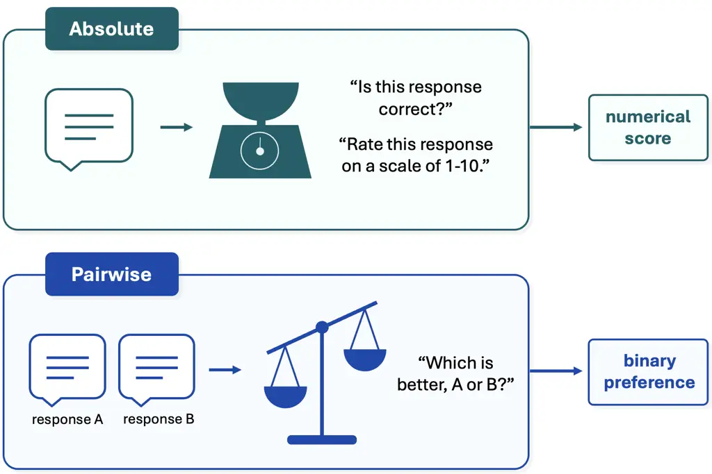
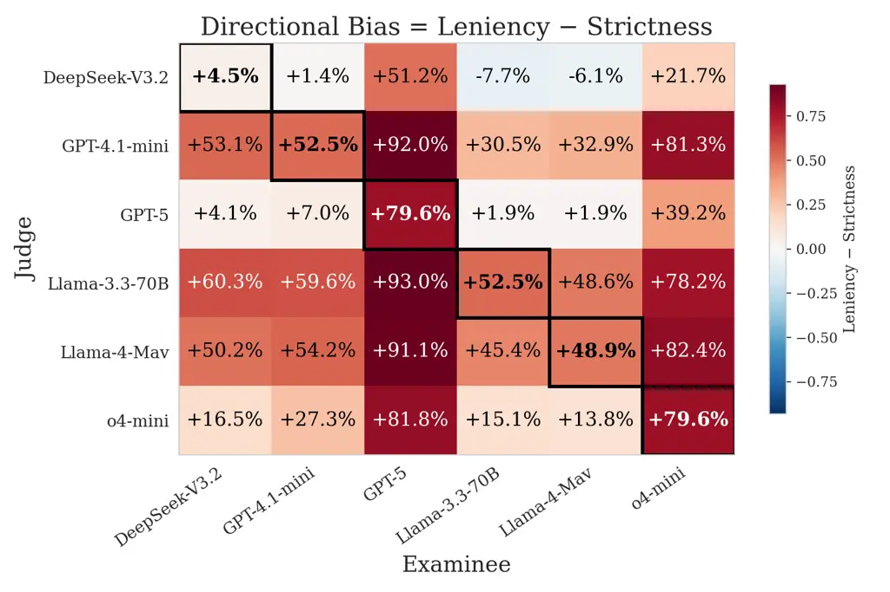
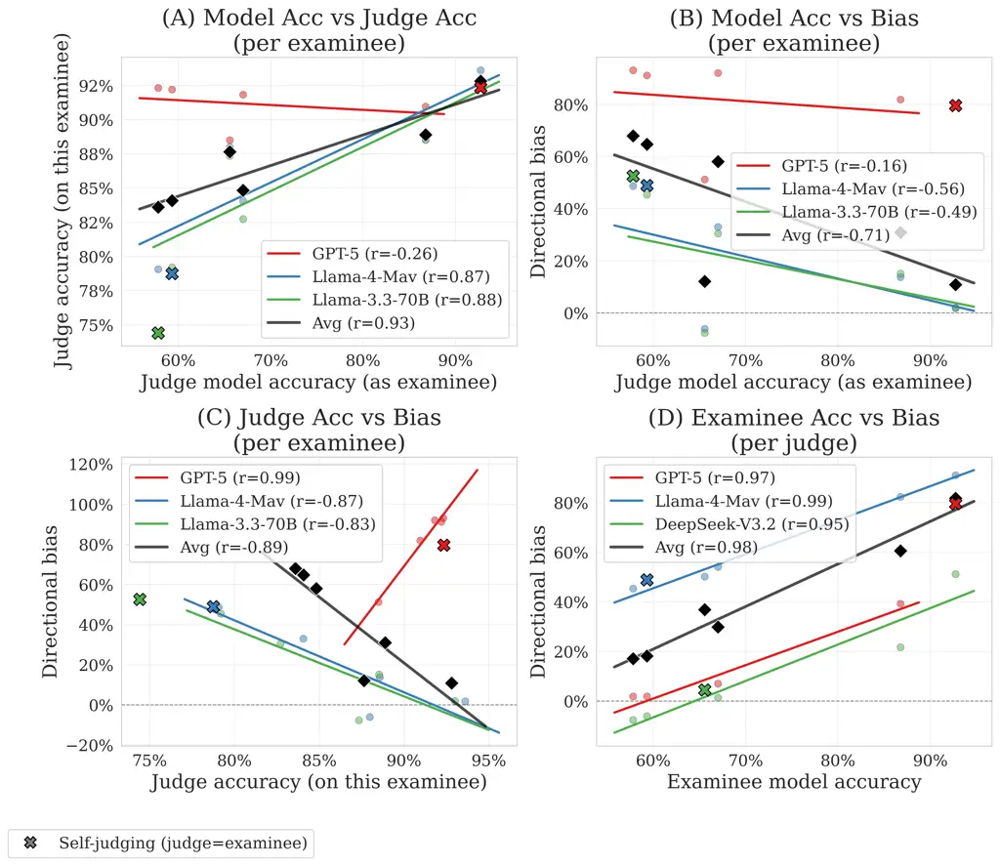
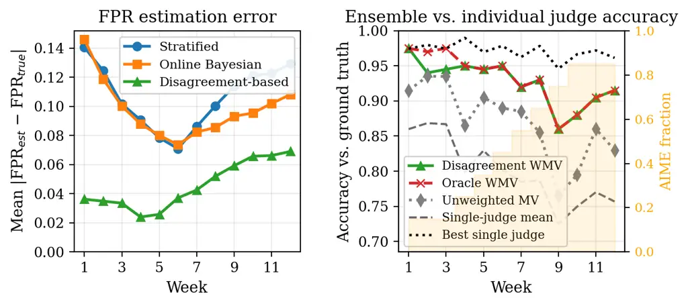

# Can We Trust LLM Judges: A Study of Capability-Dependent Biases and Multi-Judge Ensemble for Bias Calibration

Gemma Zhang ^(†)^(†)thanks: Equal contribution. Affiliation: Microsoft
   Prachi Badarayani¹¹footnotemark: 1 Affiliation: Microsoft    Asmi
Kumar¹¹footnotemark: 1 Affiliation: Microsoft Affiliation: Massachusetts
Institute of Technology    Sadid Hasan Affiliation: Microsoft   
Sulaiman Vesal Affiliation: Microsoft

###### Abstract

LLMs are increasingly used as automated judges for model training and
evaluation, yet individual judges exhibit systematic biases that
undermine reliability. Much of prior work has studied biases in pairwise
LLM-as-a-judge settings; in this paper, we focus on absolute scoring
tasks, which mirror more realistic use cases. Across four benchmarks and
six models (36 judge-examinee pairs), we show that a model’s task
accuracy strongly predicts its judging accuracy (Pearson $`r\geq 0.90`$
on most models) and inversely predicts its directional bias
($`r\leq-0.83`$), but that accuracy alone does not ensure fair
evaluation: more capable examinee models consistently receive more
lenient judgments from all judges ($`r\geq 0.83`$). To address this, we
propose calibrated weighted majority voting (WMV), an ensemble
evaluation method that aggregates multiple LLM judges weighted by online
estimates of their false-positive and false-negative rates. We introduce
a disagreement-based estimator that derives these error rates purely
from inter-judge agreement patterns, requiring no ground-truth labels or
task metadata. In a simulated experiment with shifting task
distributions, our label-free WMV tracks an oracle with perfect
error-rate knowledge to within 0.5 percentage points on average,
outperforming both individual judges and unweighted majority voting.
These results demonstrate that principled multi-judge calibration can
simultaneously improve accuracy and correct for systematic leniency
without requiring labeled data, offering a scalable path to reliable
automated evaluation as model capabilities increase.

   

|     |
| --- |
|     |

## 1 Introduction

Large language models (LLMs) are increasingly used as judges of other
models’ outputs, often called LLM-as-a-judge Zheng et al. (2023). These
judgments now power benchmarks, model selection, and reward
modeling Zheng et al. (2023); Lambert et al. (2024); Mazeika et al.
(2024). LLM-as-a-judge is appealing because it offers a scalable and
intuitive alternative to human evaluation, and recent work shows that
strong models can approximate human pairwise preferences in open-ended
evaluation settings (Zheng et al., 2023; Chiang et al., 2024; Dubois et
al., 2023). At the same time, the judge is itself a model, so its
decisions can reflect model-specific biases that are separate from
response quality.

Prior work has identified several such biases, showing that LLM judges
are sensitive to details of the evaluation setup. Judges may prefer
responses based on their position in the prompt, reward longer answers
regardless of correctness, favor particular writing styles, or agree
with user-suggested conclusions. They may also show self-preference,
favoring outputs from their own model family Zheng et al. (2023); Chen
et al. (2024); Panickssery et al. (2024); Wataoka et al. (2024). These
findings raise concerns about whether LLM-as-a-judge measures answer
quality or also rewards features unrelated to the task.

Much of this work, however, studies pairwise preference settings, where
the judge compares two responses and selects the better one (Figure 1).
Many practical evaluation workflows instead require an absolute decision
about a single response (rubric-based scoring, pass/fail test suites,
safety gatekeeping), where the question is not which response is better
but whether a given response is correct, safe, or acceptable. The main
failures in this setting are false positives, where incorrect answers
are accepted, and false negatives, where correct answers are rejected.
These errors can silently distort model rankings, corrupt training
signals, and influence deployment decisions, yet they are invisible
without ground-truth labels.



Figure 1: Absolute scoring assigns an independent quality score to a
single response (e.g., marking it as correct or incorrect), whereas
pairwise scoring compares two responses and selects the better one.

This raises a central question for LLM-as-a-judge evaluation: how does a
judge’s behavior depend on the identity and capability of the model
being evaluated? Do judges treat competing models symmetrically, or do
their errors systematically favor some models over others? While recent
work studies harmful self-preference in pairwise objective tasks Chen et
al. (2025a), absolute scoring exposes a different failure mode: leniency
toward particular examinee models, including models other than the judge
itself. We study how LLM judges distribute their errors across models in
this setting, since this is central to assessing whether they are
reliable enough to stand in for human evaluators. We find that the
answer is nuanced: judges systematically favor more capable models’
outputs, a pattern that is broader than self-preference and intensifies
with model capability.

Beyond characterizing these biases, we ask whether they can be corrected
without sacrificing scalability. We propose _calibrated weighted
majority voting_ (WMV), which weighs each judge’s vote by an online
estimate of its false-positive and false-negative rates derived purely
from inter-judge agreement patterns, requiring no ground-truth labels.
Our contributions are:

1.  1.  A systematic study of absolute-scoring bias across four objective
        benchmarks (math, code, reading comprehension), revealing that
        stronger examinee models receive systematically more false-positive
        leniency from _all_ judges, not just from themselves.
2.  2.  Calibrated weighted majority voting for bias mitigation with three
        online FPR/FNR estimators (Bayesian, stratified, and
        disagreement-based), the last of which requires no ground-truth
        labels.
3.  3.  A temporal-drift evaluation showing that label-free WMV matches an
        oracle with perfect error-rate knowledge, outperforming both
        individual judges and unweighted majority vote under non-stationary
        task distributions.

## 2 Related Work

LLM-as-a-judge has become a common evaluation paradigm, but prior work
has shown that judges can exhibit systematic biases unrelated to
response quality. These include position bias Zheng et al. (2023); Shi
et al. (2025), verbosity bias Saito et al. (2023), style and formatting
bias Stureborg et al. (2024), self-preference Zheng et al. (2023);
Panickssery et al. (2024), and agreeableness bias Jain et al. (2025).
Closely related to our focus, Wataoka et al. (2024) links judge
preference to perplexity, suggesting that outputs from more capable
models may receive higher evaluations independent of correctness. In
addition, Chen et al. (2025a) study self-preference on objective
benchmarks in a pairwise setting and analyze legitimate vs harmful
self-preference.

Several works have proposed methods for measuring or mitigating these
effects. Ye et al. (2025) introduce CALM, a taxonomy and automated
framework for bias detection, while Chen et al. (2025b) propose the DBG
score to disentangle self-preference from true quality differences. On
the mitigation side, style perturbations can reduce self-preference but
may not fully remove self-recognition Mahbub and Feng (2026), and
reasoning-based correction can reduce biased evaluations Yang et al.
(2025). Most closely related, Chen et al. (2025a) study harmful
self-preference on verifiable tasks and show that chain-of-thought can
reduce it in pairwise comparisons.

Our work differs from prior studies in two key ways. First, we move from
pairwise comparisons to absolute scoring, the setting used in most
rubric-based evaluation pipelines, reward model training, and automated
test suites, where biases manifest as asymmetric error rates rather than
preference orderings. Second, we go beyond diagnosis: we propose and
evaluate an unsupervised mitigation that corrects these biases online
without ground-truth labels.

## 3 Methodology

### 3.1 Datasets

We evaluate LLM judge bias on four objective benchmarks spanning reading
comprehension, math reasoning, and code generation: QuALITY (Pang et
al., 2022), GSM8K (Cobbe et al., 2021), MBPP (Austin et al., 2021), and
AIME (Balunović et al., 2025). These datasets provide unambiguous
ground-truth answers, allowing us to measure false positives and false
negatives directly rather than relying on subjective preference
judgments.

We use the test split for GSM8K (1,319 problems) and MBPP (500
problems), the train split for AIME 2025 (30 problems; the only
available split), and the dev split of QuALITY. Further details are
provided in Appendix C. Together, these benchmarks cover multiple
reasoning domains and difficulty levels, with GSM8K and AIME
representing easier and harder mathematical reasoning settings,
respectively.

### 3.2 Metrics

We use error-rate metrics rather than aggregate accuracy alone, since
accuracy can mask systematic biases when a judge is more lenient toward
some examinees than others.

1.  1.  False positive rate (FPR, leniency) measures how likely a model is
        to rate an incorrect answer as correct, and it is defined as:
        $`\frac{\#FP}{\#FP+\#TN}`$
2.  2.  False negative rate (FNR, strictness) measures how likely a model is
        to rate a correct answer as incorrect, and it is defined as:
        $`\frac{\#FN}{\#FN+\#TP}`$
3.  3.  Directional bias (leniency - strictness) measures the tendency of a
        model to erroneously accept wrong answers rather than erroneously
        reject correct ones. A neutral judge should have 0 directional bias.
4.  4.  Judge accuracy: $`\frac{\#TP+\#TN}{\mathrm{Total}}`$
5.  5.  $`\Delta`$FPR and $`\Delta`$FNR: The difference in FPR (or FNR)
        between a judge’s evaluation of its own model’s responses versus
        another model’s responses. A positive $`\Delta`$FPR indicates the
        judge is more lenient toward its own (or a particular model’s) wrong
        answers.

### 3.3 Models

We evaluate six models spanning three families: GPT-5 (OpenAI, 2025b),
GPT-4.1-mini (OpenAI, 2025a), and o4-mini (OpenAI, 2025c);
Llama-3.3-70B-Instruct (Grattafiori et al., 2024) and
Llama-4-Maverick (Meta, 2025); and DeepSeek-V3.2 (DeepSeek-AI, 2025).
This enables us to distinguish self-preference from within-family
preference and cross-family model preference. Each of the judge-examinee
combinations is evaluated across all benchmark questions.

#### Judge input format.

For each task, the judge model receives the examinee’s full response
(not just the final answer) in a single-turn prompt and outputs
“correct” or “incorrect.” For GSM8K and AIME, the judge sees “Final
Answer: $`\langle`$answer$`\rangle`$\n\nReasoning: $`\langle`$solution
trace$`\rangle`$,” which includes the model’s complete chain of
reasoning. For MBPP, the judge receives the submitted Python code along
with the problem statement and test cases. For QuALITY, the judge sees
the full article passage, the question, and the model’s answer choice
together with its justification. This means that length and stylistic
properties of the reasoning trace are visible to the judge in all tasks,
motivating the length confound analysis in Section 6.2.

All models are accessed via Azure API endpoints with near-deterministic
decoding ($`t{=}0`$) where supported; reasoning models (o4-mini, GPT-5)
use the API-enforced $`t{=}1`$. Full experimental details including
language model hyperparameters, API configuration, dataset splits,
bootstrap parameters, and simulation settings are provided in
Appendix C.

## 4 Experiments and Results

To evaluate LLM judge biases and make practical recommendations, we set
out to answer the following questions:

1.  1.  Are stronger models more accurate and less biased judges of others?
2.  2.  Does higher judging accuracy imply less biased judging?
3.  3.  Do more accurate models get more leniency from judge LLMs?

Based on our findings in answering these questions, we will make
practical recommendations for bias mitigation in judge LLMs.

Figure 2 presents an example full directional bias matrix across all
judge-examinee pairs, aggregated over the QuALITY benchmark. Each cell
shows
$`\mathrm{DirectionalBias}(J,E)=\mathrm{FPR}(J,E)-\mathrm{FNR}(J,E)`$
together with the number of evaluated instances $`n`$. Green-bordered
cells on the diagonal mark self-evaluation (judge = examinee). Red
indicates net leniency; blue indicates net strictness; white indicates a
balanced judge.

For clarity and brevity, we only present results for the QuALITY dataset
in Figure 2 but note that other datasets generally follow the trends
that we observe. We include full results of all experiments across all
judge-examinee pairs in Section A.



Figure 2: Directional bias for each judge-examinee model pair on QuALITY
dataset; diagonal cells denote self-evaluation and off-diagonal cells
denote cross-model judging.

### 4.1 More accurate models are better judges

There are two dimensions to judging quality: 1) overall judging
accuracy; 2) preference bias in judging. To look at these two facets, we
plot the accuracy and directional bias of a judge model as a function of
its own accuracy on the QuALITY dataset in Figure 3(A) and Figure 3(B),
respectively.

In Figure 3(A), we look at whether the accuracy of a model on a task
translates to how accurately it acts as a judge, on a set of responses
from a given examinee model on the same task. As shown in the figure, in
most cases, there is a strong positive correlation between a model’s own
response accuracy and its accuracy judging responses of other models, in
agreement with findings from Chen et al. (2025a); Mahbub and Feng
(2026). We measure the strength of the correlation using Pearson’s
correlation coefficient
$`r=\frac{\mathrm{Cov}(X,Y)}{\sigma_{X}\sigma_{Y}}`$, where
$`\sigma_{X}`$ and $`\sigma_{Y}`$ denote standard deviations.

Here, we observe that when GPT-5 is the examinee model, the correlations
are much weaker (Table 6). We attribute this to two factors. First,
GPT-5’s high task accuracy (93–97% across benchmarks) means it produces
very few wrong answers, so each judge’s FPR on GPT-5 is estimated from a
small denominator and is therefore noisy. Second, the wrong answers
GPT-5 _does_ produce tend to contain elaborate, well-structured
reasoning that is difficult for any judge to catch, regardless of that
judge’s own capability. In this regime, all judges converge toward
similarly high FPR on GPT-5’s errors, flattening the relationship
between judge accuracy and judge performance on this examinee. This
foreshadows the capability-dependent leniency we analyze in Section 4.3.

In Figure 3(B), instead of a model’s accuracy as a judge, we look at its
preference bias given to other models, as mediated by the directional
bias metric. We first note that the DeepSeek model is overall stricter
as a judge than other models (i.e., smaller directional bias values), as
seen in Figure 2. In most cases, there is a strong negative correlation
between a model’s accuracy on a task and its directional bias when
evaluating other models on the same task, especially when we exclude
Deepseek’s data points. With the Deepseek judge data points excluded
from linear fitting, the Pearson’s absolute value of $`r`$ on the
average across all examinees is $`>0.9`$ and indicates very strong
correlation (see Appendix A). In other words, the more accurate a model
is, the more neutral it is when judging other models.

As an aside, we note that the models almost universally exhibit positive
directional bias, which indicates strong LLM judge agreeableness bias.

### 4.2 More accurate judges are generally less biased

In Figure 3(C), we plot the directional bias as a function of judge
accuracy on each examinee model. We note again that DeepSeek stands out
as an outlier as a judge. On most examinee model responses, we see a
strong negative correlation between judge accuracy and judge bias,
especially when we disregard data points for which DeepSeek is the judge
model. In other words, more accurate judges are generally less biased.
Note that because correlations are not transitive, this is not a trivial
result that can be deduced from the conclusions of Section 4.1.

However, we note the strongly positive correlation between judge
accuracy and bias when GPT-5 is the examinee. In addition, we also see
that most models, when judging GPT-5, incur a high directional bias
indicating a high degree of leniency. This may be due to GPT being a
stronger model in this task compared to other models we ran experiments
with, as shown in Table 1. This can also be seen in the plot in which
o4-mini is the examinee model: the models with lower accuracy acting as
judges leads to higher directional bias, while GPT-5 judging o4-mini has
comparatively lower leniency as it has a higher accuracy on the QuALITY
dataset than o4-mini.

This observation leads to the question of whether a stronger (more
accurate) model generally gets preferentially lenient treatment by judge
models, which we will discuss in Section 4.3.



Figure 3: Correlations between model accuracy and judging behavior on
QuALITY (reading comprehension), shown for three models and the average
over all models. (A) Judge model accuracy as an examinee vs. its
accuracy when judging each examinee. (B) Judge model accuracy as an
examinee vs. directional bias toward each examinee. (C) Judge accuracy
on a specific examinee vs. directional bias toward that examinee. (D)
Examinee model accuracy vs. directional bias received from each judge.
Regression lines are fit on cross-judging pairs only (excluding
self-judging). The black line with diamond markers shows the averaged
relationship across all models (one point per model, averaged over all
its cross-judging counterparts). X markers indicate self-judging pairs
where judge and examinee are the same model. Pearson’s coefficients are
shown in parentheses.

### 4.3 More accurate models are more leniently judged

To look at whether more accurate models get more leniency when it is
judged by other models, in Figure 3(D), we plot the directional bias as
a function of examinee model accuracy, for each judge model. The strong
positive correlation in each case indicates that stronger models are
judged more leniently by LLM judges. This indicates capability-dependent
leniency: judges are more likely to accept wrong answers from stronger
examinee models, even when the judge and examinee are from different
model families. Our finding highlights the need for practitioners to pay
careful attention to bias mitigation as model capability continues to
improve rapidly.

We note that self evaluation datasets generally fall closely along the
linear regression lines (which are plotted without self-evaluations).
This indicates that elite model preference significantly dominates over
self-preference for most models we tested. The only exception in our
studies is GPT-5, whose self-preference bias can be clearly observed in
Figure 3(D). Appendix B confirms this with 95% bootstrap CIs on
$`\Delta`$FPR (Table 10) and a harmful-subset analysis (Table 11).

| Model            | QuALITY | MBPP | GSM8K | AIME |
| ---------------- | ------- | ---- | ----- | ---- |
| DeepSeek-V3.2    | 65.6    | 90.6 | 63.3  | 53.1 |
| GPT-4.1-mini     | 67.0    | 85.0 | 45.6  | 54.6 |
| GPT-5            | 92.7    | 96.6 | 95.9  | 95.0 |
| Llama-3.3-70B    | 57.8    | 75.8 | 35.1  | 3.4  |
| Llama-4-Maverick | 59.3    | 80.4 | 55.9  | 27.2 |
| o4-mini          | 86.8    | 95.0 | 95.3  | 91.7 |

Table 1: Model accuracy (%) on each evaluation task.

### 4.4 Summary

In light of these results, we make the following recommendations for
practitioners to mitigate preference bias in LLM judges:

1.  1.  To judge a task, use the model with the best response accuracy on
        this task.
2.  2.  If a golden evaluation set is available, to minimize leniency bias,
        use the model that has the highest judging accuracy on this golden
        set.
3.  3.  As model capabilities increase, judging them impartially becomes
        more challenging, which leads us to propose a mitigation method,
        discussed in Section 5.

## 5 Calibrated Ensemble Evaluation as Mitigation

When we know the judge accuracy on a given task, selecting the judge
with highest accuracy produces lowest directional bias. However, online
systems may encounter temporally changing task type and difficulty Jain
et al. (2024); White et al. (2025), thus making it hard to assign a
single best judge for evaluation. Given the magnitude of
capability-dependent leniency documented above, we evaluate cross-judge
ensembles as a practical mitigation.

Static majority voting. We exclude the self-judge and aggregate the
remaining cross-judges via simple majority vote (MV). Table 2 reports
accuracy and leniency (FPR) averaged across all examinee models.

|         | Accuracy% |      | Leniency (FPR)% |      |
| ------- | --------- | ---- | --------------- | ---- |
| Task    | Self      | MV   | Self            | MV   |
| GSM8K   | 89.3      | 96.8 | 39.1            | 20.7 |
| AIME    | 74.3      | 88.6 | 60.3            | 44.9 |
| MBPP    | 84.2      | 90.9 | 56.3            | 33.9 |
| QuALITY | 77.2      | 82.4 | 59.4            | 41.9 |

Table 2: Cross-judge majority voting vs. self-judging. Averages across
all examinee models per task.

MV improves accuracy by 5–14 percentage points and reduces leniency by
15–22 percentage points across all three tasks. However, MV is not a
panacea: when the _strongest_ model judges its own outputs (e.g.,
o4-mini on GSM8K), the weaker cross-judges can be outvoted by their own
errors; on GSM8K, MV achieves 94.4% accuracy vs. 97.2% for the
self-judge, because most cross-judges are too lenient on the few items
the examinee got wrong. The practical challenge is that the identity of
the “best judge” varies by task and is unknown without ground truth.

Temporal drift and online calibration. In practice, the distribution of
evaluation problems changes over time: coding contest platforms
introduce new problems with shifting difficulty Jain et al. (2024), and
user queries to chat systems evolve as new models are released Chiang et
al. (2024). Our own results confirm that no single judge is uniformly
best across tasks (Table 1), so static judge selection is insufficient
when the task mix is non-stationary. The question, then, is whether an
online estimator can track shifting judge reliability without labeled
data.

To test this, we simulate a 12-week deployment that mimics a realistic
difficulty shift: the task mix drifts linearly from 85% GSM8K (easy) /
15% AIME (hard) to the reverse, sampling 40 items per week. This design
stresses the estimators because each judge’s effective FPR changes as
harder problems become more prevalent; an estimator that cannot adapt
will increasingly misweight judges.

Online weighted majority vote. Each judge $`j`$ has task-specific error
rates $`\mathrm{FPR}_{j}`$ and $`\mathrm{FNR}_{j}`$ that are unknown and
must be estimated online. The ensemble aggregates judges via _weighted
majority vote_ (WMV): for an item with verdicts
$`\{v_{j}\}_{j\in\mathcal{J}}`$, the weighted ensemble predicts
“correct” if

```math
\sum_{j:\,v_{j}=1}(1-\widehat{\mathrm{FPR}}_{j})\;>\;\sum_{j:\,v_{j}=0}(1-\widehat{\mathrm{FNR}}_{j}), \tag{1}
```

where $`\widehat{\mathrm{FPR}}_{j}`$ is the estimated FPR for the
$`j^{th}`$ judge and $`\widehat{\mathrm{FPR}}_{j}`$ is the estimated FNR
for the $`j^{th}`$ judge. Intuitively, a judge’s positive vote is
weighted by its estimated specificity $`(1-\mathrm{FPR})`$, and its
negative vote by its estimated sensitivity $`(1-\mathrm{FNR})`$, so
judges that are prone to false positives are down-weighted when they
vote “correct.” Similarly, judges that are prone to false negatives are
down-weighted when they vote “incorrect.”

We compare four strategies for estimating $`\widehat{\mathrm{FPR}}_{j}`$
and $`\widehat{\mathrm{FNR}}_{j}`$:

1.  1.  Unweighted MV (baseline): all weights set to 1, equivalent to simple
        majority vote with no error-rate estimation.
2.  2.  Online Bayesian: maintains a per-judge Beta posterior over FPR (and
        FNR), initialized with prior $`\mathrm{Beta}(\alpha_{0},\beta_{0})`$
        and updated each week with a small labeled subset ($`n_{\ell}=8`$
        items), following the conjugate Bayesian approach to annotator
        quality estimation Raykar et al. (2010). The FPR estimate is the
        posterior mean:
        $`\widehat{\mathrm{FPR}}_{j}=\frac{\alpha_{0}+\sum\mathrm{FP}_{j}}{\alpha_{0}+\beta_{0}+\sum(\mathrm{FP}_{j}+\mathrm{TN}_{j})}`$.
        This estimator pools all labeled data globally and does not
        distinguish between tasks, so it can lag behind when the task mix
        shifts. Further details on hyperparameter selection are included in
        Appendix C.
3.  3.  Stratified: maintains _separate_ Beta posteriors per task bin
        (GSM8K, AIME) and aggregates using the known current mix $`\pi`$:
        $`\widehat{\mathrm{FPR}}_{j}=\sum_{b}\pi_{b}\cdot\widehat{\mathrm{FPR}}_{j,b}`$,
        extending annotator-difficulty models Whitehill et al. (2009) to the
        online setting with observed task categories This adapts to drift
        but requires task labels for each item.
4.  4.  Disagreement-based: uses the majority vote of the _other_ panel
        members as a proxy for ground truth, inspired by the Dawid–Skene
        principle of estimating annotator reliability from inter-annotator
        agreement Dawid and Skene (1979). For each item, if judge $`j`$
        votes “correct” but the majority of other judges vote “incorrect,”
        this counts as a proxy false positive. For each item, if judge $`j`$
        votes “incorrect” but the majority of other judges vote “correct,”
        this counts as a proxy false negative. The FPR estimate is:
        $`\widehat{\mathrm{FPR}}_{j}=\frac{\widetilde{\mathrm{FP}}_{j}}{\widetilde{\mathrm{FP}}_{j}+\widetilde{\mathrm{TN}}_{j}}`$,
        where $`\widetilde{\mathrm{FP}}`$ and $`\widetilde{\mathrm{TN}}`$
        are proxy counts derived from disagreement. This estimator requires
        _no ground-truth labels and no task labels_.

We also plot an Oracle line that uses the true FPR and FNR (computed on
the full dataset) in Equation 1. This represents the best accuracy
achievable by Weighted MV with perfect error-rate knowledge, and serves
as an upper bound against which the online estimators can be evaluated.



Figure 4: Performance under AIME$`\leftrightarrow`$GSM8K task drift over
12 weeks. Left: FPR estimation error (mean
$`|\widehat{\mathrm{FPR}}_{j}-\mathrm{FPR}_{j}|`$ across judges). The
disagreement-based estimator maintains error $`<`$0.08 throughout the
drift without requiring any labels. The stratified estimator degrades as
the task mix shifts away from its early calibration data. Right:
ensemble accuracy vs. ground truth. All three Weighted MV variants
outperform the mean single judge; the disagreement-based Weighted MV
nearly matches the oracle.

Figure 4 (left) shows that the disagreement-based estimator maintains
consistently low FPR estimation error ($`<`$0.04) throughout the drift,
while the online Bayesian estimator lags behind the shift and the
stratified estimator degrades when the task mix diverges from its
calibration data. Figure 4 (right) shows that all Weighted MV variants
outperform both the mean single-judge accuracy and the unweighted
majority vote baseline. The disagreement-based Weighted MV nearly
matches the oracle, demonstrating that accurate FPR/FNR estimation is
achievable purely from cross-judge disagreement patterns, without any
ground-truth labels or task metadata.

## 6 Ablation and Confounding Studies

Our results above identify systematic trends in LLM judge leniency bias
and show that calibrated ensembles may be a viable mitigation method. To
examine whether this effect reflects a genuine bias in judging model
outputs or can be explained by other variables, we conduct a set of
additional experiments below.

### 6.1 Test of elite bias through explicit labeling

To look at the cause of elite model bias, we dig deeper by exploring the
following question: is the elite model preference bias we observe in
Section 4.3 due to simple self recognition or something inherent to
model output?

To isolate identity-driven bias from stylistic confounds, we conducted a
label-swap experiment on QuALITY where identical Llama-3.3-70B responses
were evaluated under three label conditions (Table 3): one without
label, with labeled as response from GPT-5, and one labeled correctly.

| Condition | Claimed source | Spec% | FPR% |
| --------- | -------------- | ----- | ---- |
| Blind     | (none)         | 64.6  | 35.4 |
| Elite     | GPT-5          | 72.4  | 27.6 |
| Non-elite | Llama-3.3-70B  | 72.8  | 27.2 |

Table 3: Label-swap experiment: GPT-4.1-mini judging identical
Llama-3.3-70B responses under different claimed authorship labels.

Surprisingly, both labeled conditions (elite _and_ non-elite) reduce FPR
relative to blind: the judge becomes stricter whenever any label is
present. This suggests the label triggers more careful evaluation rather
than deference, and that the primary driver of elite model preference in
the blind condition is factors more complex than explicit identity
recognition.

### 6.2 Length Confound Analysis

A potential confound is that judges may favor _longer_ answers
regardless of identity. We measure length on the exact text supplied to
the judge (“Final Answer: $`\langle`$predicted$`\rangle`$\n\nReasoning:
$`\langle`$trace$`\rangle`$”) rather than the bare predicted answer.

Cohen’s $`d`$ quantifies the practical magnitude of a group difference
in units of standard deviations, making it comparable across tasks with
different scales. We define

```math
d=(\bar{x}_{\mathrm{FP}}-\bar{x}_{\mathrm{TN}})/s_{\mathrm{pooled}},
```

where $`\bar{x}_{\mathrm{FP}}`$ and $`\bar{x}_{\mathrm{TN}}`$ are the
mean answer lengths of the false-positive and true-negative groups
respectively, and
$`s_{\mathrm{pooled}}=\sqrt{(s_{\mathrm{FP}}^{2}+s_{\mathrm{TN}}^{2})/2}`$.
Positive $`d`$ indicates that wrong answers the judge _incorrectly
accepted_ are longer than those it correctly rejected, suggesting length
may have contributed to the misjudgment. Table 4 reports Cohen’s $`d`$
for each judge–task combination.

| Task          | Judge            | Cohen’s $`d`$ |
| ------------- | ---------------- | ------------- | --- | ------ |
| AIME          | GPT-4.1-mini     | $`+1.01`$     |
| AIME          | DeepSeek         | $`+0.33`$     |
| AIME          | Llama-4-Maverick | $`+0.23`$     |
| AIME          | o4-mini          | $`+0.20`$     |
| AIME          | GPT-5            | $`-0.16`$     |
| AIME          | Llama-3.3        | $`+0.00`$     |
| GSM8K         | DeepSeek         | $`-0.25`$     |
| GSM8K         | Llama-4-Maverick | $`+0.11`$     |
| GSM8K         | o4-mini          | $`-0.10`$     |
| GSM8K         | GPT-5            | $`-0.09`$     |
| GSM8K         | GPT-4.1-mini     | $`-0.08`$     |
| GSM8K         | Llama-3.3        | $`-0.04`$     |
| MBPP, QuALITY | all judges       | $`            | d   | <0.2`$ |

Table 4: Answer-length confound on _judge’s_ answer that includes
model’s reasoning trace along with final answer. Cohen’s $`|d|>0.5`$ is
a substantive confound while $`0.5>|d|>0.2`$ is small-to-moderate
confound.

Length is _not_ a confound on GSM8K, MBPP, or QuALITY ($`|d|<0.5`$ for
every judge in those tasks). On AIME, GPT-4.1-mini exhibits $`d=+1.01`$.
Inspection reveals that its 27 false positives come overwhelmingly from
strong examinees (DeepSeek, GPT-5, o4-mini), whose wrong answers contain
long, elaborate reasoning traces, while its 66 true negatives come
primarily from weak examinees with shorter, simpler wrong answers.
GPT-4.1-mini occupies a middle capability tier: competent enough to
catch obviously flawed reasoning from weak models, but unable to verify
the multi-step derivations of stronger models on olympiad-level
problems, so it falls back on superficial cues such as reasoning length.
Weaker judges (Llama-3.3, $`d{=}0.00`$; Maverick, $`d{=}+0.23`$) show no
length effect because they accept most wrong answers indiscriminately
(FPR$`{>}68\%`$), while stronger judges (GPT-5, $`d{=}{-}0.16`$;
o4-mini, $`d{=}{+}0.20`$) can verify the mathematics and reject wrong
answers regardless of length. The AIME length effect for GPT-4.1-mini is
therefore best understood as a _symptom_ of capability-dependent bias
rather than an independent confound: answer length proxies for examinee
strength on hard math tasks.

### 6.3 Difficulty Stratification

Although the paper’s main finding is a broader capability-dependent bias
(Section 4.3), self-preference remains a component of that bias, and
this stratification tests whether it varies with question difficulty.

For a given question $`q`$ and a set of $`M`$ examinee models, we define
the difficulty:

```math
k(q)=\frac{|\{m\in M:m\text{ answers }q\text{ correctly}\}|}{|M|}
```

That is, $`k(q)`$ is the fraction of examinee models that answer $`q`$
correctly, independent of any judge’s evaluation. A question answered
correctly by all models has $`k(q)=1`$ (easy); one answered correctly by
none has $`k(q)=0`$ (hard). We stratify questions into three equal-width
bins: hard $`[0,0.33)`$, medium $`[0.33,0.67)`$, and easy $`[0.67,1]`$
and compute $`\Delta`$FPR within each. This allows us to analyze whether
judge bias varies with question difficulty.

|         |               | $`\Delta`$FPR% by $`k(q)`$ bin |        |       |
| ------- | ------------- | ------------------------------ | ------ | ----- |
| Task    | Metric        | Hard                           | Medium | Easy  |
| AIME    | $`\Delta`$FPR | +18.2                          | +36.2  | +15.4 |
| GSM8K   | $`\Delta`$FPR | +16.9                          | +23.7  | +31.3 |
| MBPP    | $`\Delta`$FPR | +14.0                          | +12.3  | +18.7 |
| QuALITY | $`\Delta`$FPR | +10.5                          | +13.4  | +19.4 |

Table 5: Difficulty-stratified $`\Delta`$FPR. $`k(q)`$ = fraction of
models correct on question $`q`$.

$`\Delta`$FPR, as defined in the metrics (Section 3.2), measures the
self-preference gap: the FPR when judge and examinee are the same model
minus the FPR when they differ, pooled across all models within each
difficulty bin.

Table 5, we see that self-preference bias is present across all
difficulty strata, but on GSM8K and QuALITY it _increases_ with easier
questions ($`+16.9\to+31.3`$ and $`+10.5\to+19.4`$ respectively). This
suggests that on easy problems, where fewer models err, the judge finds
the rare wrong answer from its own family more “persuasive” and thus
harder to reject. AIME shows a peak at medium difficulty ($`+36.2`$),
while MBPP is relatively flat ($`+12`$–$`19`$). The key finding is that
bias persists at all difficulty levels; difficulty stratification alone
does not eliminate it.

## 7 Discussion and Conclusion

We studied LLM judge reliability on absolute scoring tasks with
ground-truth answers, examining both the nature of judging bias and a
principled method to mitigate it.

#### Capability-dependent bias is broader than self-preference.

Our results show that LLM judge reliability depends on the capability of
both the judge and the examinee model. More accurate models generally
make better judges, but judges can be accurate overall while still
making asymmetric errors across examinees. We observe a pattern across
all four benchmarks of capability-dependent leniency, where more capable
examinee models receive more lenient judgments from _all_ judges. For
most models, self-evaluation data points fall along the same trend as
cross-model evaluations, suggesting that capability-dependent bias
accounts for much of what might otherwise appear as self-preference.
However, self-preference remains a distinct and meaningful effect, most
prominently for GPT-5, which shows substantial self-leniency above and
beyond the capability trend. We therefore view self-preference and
capability-dependent bias as co-occurring effects, with the latter being
broader in scope but the former remaining practically significant for
frontier models. Difficulty stratification, length analysis, and
label-swap experiments rule out simple confounds: the bias persists
across difficulty strata, is not driven by verbosity, and is not
triggered by explicit model identity labels.

#### Calibrated ensembles as a scalable remedy.

Cross-judge majority voting already improves accuracy and reduces
leniency substantially (Table 2), but naïve voting treats all judges as
equally reliable. Our calibrated WMV down-weights judges prone to false
positives, precisely the error mode that drives capability-dependent
bias. The disagreement-based estimator matches an oracle with perfect
error-rate knowledge under temporal drift (Figure 4), demonstrating that
a _fully unsupervised_ calibration signal exists within a diverse judge
panel.

#### Practical implications.

Evaluation reports should include per-judge FPR and FNR alongside
aggregate accuracy, since a judge can be accurate overall while
systematically inflating the scores of stronger models. When multiple
judges are available, calibrated WMV should be preferred over
single-judge evaluation or unweighted majority vote. As model
capabilities continue to improve, capability-dependent bias is likely to
intensify, making multi-judge calibration an increasingly important
safeguard.

#### Limitations and future work.

Our model set spans three families (OpenAI, Meta, DeepSeek); broader
coverage (e.g., Anthropic, Google) would strengthen generalizability.
The temporal drift experiment uses real judge verdicts but simulated
temporal ordering; validation on benchmarks with natural temporal
structure (e.g., LiveCodeBench Jain et al. (2024)) is an important next
step. We use a single prompt template per task; prompt sensitivity may
modulate bias magnitude. Finally, our disagreement-based estimator
assumes the majority of panel members are approximately correct on most
items; exploring its robustness when this assumption weakens (e.g., with
very small or homogeneous panels) is a direction for future work.¹¹ 1 AI
writing assistants were used for editing the paper and code development.
All authors take full responsibility for the content of this paper.

## References

- \[1\] L. Zheng, W. Chiang, Y. Sheng, S. Zhuang, Z. Wu, Y. Zhuang, Z.
  Lin, Z. Li, D. Li, E. P. Xing, H. Zhang, J. E. Gonzalez, and I.
  Stoica (2023) Judging LLM-as-a-judge with MT-Bench and Chatbot Arena.
  In Advances in Neural Information Processing Systems, Vol. 36. Cited
  by: §1, §1, §2.
- \[2\] N. Lambert, V. Pyatkin, J. Morrison, L. Miranda, B. Y. Lin, K.
  Chandu, N. Dziri, S. Kumar, T. Zick, Y. Choi, N. A. Smith, and H.
  Hajishirzi (2024) RewardBench: evaluating reward models for language
  modeling. arXiv preprint arXiv:2403.13787. External Links: 2403.13787
  Cited by: §1.
- \[3\] M. Mazeika, L. Phan, X. Yin, A. Zou, Z. Wang, N. Mu, E.
  Sakhaee, N. Li, S. Basart, et al. (2024) HarmBench: a standardized
  evaluation framework for automated red teaming and robust refusal. In
  Proceedings of the 41st International Conference on Machine Learning,
  External Links: 2402.04249 Cited by: §1.
- \[4\] W. Chiang, L. Zheng, Y. Sheng, A. N. Angelopoulos, T. Li, D.
  Li, H. Zhang, B. Zhu, M. Jordan, J. E. Gonzalez, and I. Stoica (2024)
  Chatbot arena: an open platform for evaluating LLMs by human
  preference. arXiv preprint arXiv:2403.04132. External Links:
  2403.04132 Cited by: §1, §5.
- \[5\] Y. Dubois, X. Li, R. Taori, T. Zhang, I. Gulrajani, J. Ba, C.
  Guestrin, P. Liang, and T. B. Hashimoto (2023) AlpacaFarm: a
  simulation framework for methods that learn from human feedback. In
  Advances in Neural Information Processing Systems, Vol. 36. External
  Links: 2305.14387 Cited by: §1.
- \[6\] G. H. Chen, S. Chen, Z. Liu, F. Jiang, and B. Wang (2024) Humans
  or LLMs as the judge? a study on judgement biases. In Proceedings of
  the 2024 Conference on Empirical Methods in Natural Language
  Processing, External Links: 2402.10669 Cited by: §1.
- \[7\] A. Panickssery, S. R. Bowman, and S. Feng (2024) LLM evaluators
  recognize and favor their own generations. In Advances in Neural
  Information Processing Systems, Vol. 37. External Links: 2404.13076
  Cited by: §1, §2.
- \[8\] K. Wataoka, T. Takahashi, and R. Ri (2024) Self-preference bias
  in llm-as-a-judge. arXiv preprint arXiv:2410.21819. External Links:
  2410.21819 Cited by: §1, §2.
- \[9\] W. Chen, Z. Wei, X. Zhu, S. Feng, and Y. Meng (2025) Do llm
  evaluators prefer themselves for a reason?. arXiv preprint
  arXiv:2504.03846. External Links: 2504.03846 Cited by: §1, §2, §2,
  §4.1.
- \[10\] L. Shi, C. Ma, W. Liang, X. Diao, W. Ma, and S. Vosoughi (2025)
  Judging the judges: a systematic study of position bias in
  llm-as-a-judge. In Proceedings of the 14th International Joint
  Conference on Natural Language Processing and the 4th Conference of
  the Asia-Pacific Chapter of the Association for Computational
  Linguistics, pp. 292–314. Cited by: §2.
- \[11\] K. Saito, A. Wachi, K. Wataoka, and Y. Akimoto (2023) Verbosity
  bias in preference labeling by large language models. arXiv preprint
  arXiv:2310.10076. External Links: 2310.10076 Cited by: §2.
- \[12\] R. Stureborg, D. Alikaniotis, and Y. Suhara (2024) Large
  language models are inconsistent and biased evaluators. arXiv preprint
  arXiv:2405.01724. External Links: 2405.01724 Cited by: §2.
- \[13\] S. Jain, U. Z. Ahmed, S. Sahai, and B. Leong (2025) Beyond
  consensus: mitigating the agreeableness bias in LLM judge evaluations.
  arXiv preprint arXiv:2510.11822. External Links: 2510.11822 Cited by:
  §2.
- \[14\] J. Ye, Y. Wang, Y. Huang, D. Chen, Q. Zhang, N. Moniz, T.
  Gao, W. Geyer, C. Huang, P. Chen, N. V. Chawla, and X. Zhang (2025)
  Justice or prejudice? quantifying biases in LLM-as-a-judge. In
  International Conference on Learning Representations, External Links:
  2410.02736 Cited by: §2.
- \[15\] Z. Chen, H. Wang, X. Zhang, E. Hu, and Y. Lin (2025) Beyond the
  surface: measuring self-preference in llm judgments. In Proceedings of
  the 2025 Conference on Empirical Methods in Natural Language
  Processing, pp. 1653–1672. Cited by: §2.
- \[16\] T. Mahbub and S. Feng (2026) Mitigating self-preference by
  authorship obfuscation. In Proceedings of the AAAI Conference on
  Artificial Intelligence, pp. 37701–37708. External Links:
  [Document](https://dx.doi.org/10.1609/aaai.v40i44.41105), 2512.05379
  Cited by: §2, §4.1.
- \[17\] H. Yang, R. Bao, C. Xiao, J. Ma, P. Bhatia, S. Gao, and T.
  Kass-Hout (2025) Any large language model can be a reliable judge:
  debiasing with a reasoning-based bias detector. In Advances in Neural
  Information Processing Systems, Vol. 38. External Links: 2505.17100
  Cited by: §2.
- \[18\] R. Y. Pang, A. Parrish, N. Joshi, N. Nangia, J. Phang, A.
  Chen, V. Padmakumar, J. Ma, J. Thompson, H. He, and S. R.
  Bowman (2022) QuALITY: question answering with long input texts, yes!.
  In Proceedings of the 2022 Conference of the North American Chapter of
  the Association for Computational Linguistics: Human Language
  Technologies, pp. 5336–5358. External Links:
  [Document](https://dx.doi.org/10.18653/v1/2022.naacl-main.391),
  2112.08608 Cited by: §3.1.
- \[19\] K. Cobbe, V. Kosaraju, M. Bavarian, M. Chen, H. Jun, L.
  Kaiser, M. Plappert, J. Tworek, J. Hilton, R. Nakano, C. Hesse, and J.
  Schulman (2021) Training verifiers to solve math word problems. arXiv
  preprint arXiv:2110.14168. External Links: 2110.14168 Cited by: §3.1.
- \[20\] J. Austin, A. Odena, M. Nye, M. Bosma, H. Michalewski, D.
  Dohan, E. Jiang, C. Cai, M. Terry, Q. Le, and C. Sutton (2021) Program
  synthesis with large language models. arXiv preprint arXiv:2108.07732.
  External Links: 2108.07732 Cited by: §3.1.
- \[21\] M. Balunović, J. Dekoninck, I. Petrov, N. Jovanović, and M.
  Vechev (2025) MathArena: evaluating LLMs on uncontaminated math
  competitions. arXiv preprint arXiv:2505.23281. External Links:
  2505.23281 Cited by: Appendix C, §3.1.
- \[22\] OpenAI (2025) GPT-5 system card. Note:
  https://openai.com/index/gpt-5-system-card/ Cited by: §3.3.
- \[23\] OpenAI (2025) GPT-4.1 in the API. Note:
  https://openai.com/index/gpt-4-1/ Cited by: §3.3.
- \[24\] OpenAI (2025) o3 and o4-mini system card. Note:
  https://openai.com/index/o3-o4-mini-system-card/ Cited by: §3.3.
- \[25\] A. Grattafiori, A. Dubey, A. Jauhri, et al. (2024) The Llama 3
  herd of models. arXiv preprint arXiv:2407.21783. External Links:
  2407.21783 Cited by: §3.3.
- \[26\] Meta (2025) Introducing Llama 4: multimodal intelligence. Note:
  https://ai.meta.com/blog/llama-4-multimodal-intelligence/ Cited by:
  §3.3.
- \[27\] DeepSeek-AI (2025) DeepSeek-V3 technical report. arXiv preprint
  arXiv:2412.19437. External Links: 2412.19437 Cited by: §3.3.
- \[28\] N. Jain, K. Han, A. Gu, W. Li, F. Yan, T. Zhang, S. Wang, A.
  Solar-Lezama, K. Sen, and I. Stoica (2024) LiveCodeBench: holistic and
  contamination free evaluation of large language models for code. arXiv
  preprint arXiv:2403.07974. External Links: 2403.07974 Cited by: §5,
  §5, §7.
- \[29\] C. White, S. Dooley, M. Roberts, A. Pal, B. Feuer, S. Jain, R.
  Shwartz-Ziv, N. Jain, K. Saifullah, S. Naidu, et al. (2025) LiveBench:
  a challenging, contamination-limited LLM benchmark. In International
  Conference on Learning Representations, External Links: 2406.19314
  Cited by: §5.
- \[30\] V. C. Raykar, S. Yu, L. H. Zhao, G. H. Valadez, C. Florin, L.
  Bogoni, and L. Moy (2010) Learning from crowds. Journal of Machine
  Learning Research 11, pp. 1297–1322. Cited by: item 2.
- \[31\] J. Whitehill, P. Ruvolo, T. Wu, J. Bergsma, and J.
  Movellan (2009) Whose vote should count more: optimal integration of
  labels from labelers of unknown expertise. In Advances in Neural
  Information Processing Systems, Vol. 22. Cited by: item 3.
- \[32\] A. P. Dawid and A. M. Skene (1979) Maximum likelihood
  estimation of observer error-rates using the EM algorithm. Journal of
  the Royal Statistical Society: Series C (Applied Statistics) 28 (1),
  pp. 20–28. Cited by: item 4.

## Appendix A Additional Correlation Results

Tables 6–9 report per-evaluatee and per-judge Pearson correlation
coefficients for the four relationships plotted in Figure 3: (A) model
accuracy vs. judge accuracy, (B) model accuracy vs. directional bias,
(C) judge accuracy vs. directional bias, and (D) examinee accuracy vs.
directional bias received.

| Evaluatee        | QuALITY       | MBPP         | GSM8K       | AIME        |
| ---------------- | ------------- | ------------ | ----------- | ----------- |
| DeepSeek-V3.2    | 0.97          | 0.94         | 0.96        | 0.99        |
| GPT-4.1-mini     | 0.85 (0.97)   | 0.23 (0.99)  | 0.62 (0.64) | 1.00        |
| GPT-5            | -0.26 (-1.00) | -0.25 (0.90) | 0.08 (0.07) | 0.12 (0.07) |
| Llama-3.3-70B    | 0.88 (0.99)   | 0.46 (0.99)  | 0.66 (0.65) | 0.76 (0.83) |
| Llama-4-Mav      | 0.87 (0.98)   | 0.37 (0.98)  | 0.86 (0.95) | 0.87 (0.92) |
| o4-mini          | 0.75 (0.78)   | -0.14 (0.88) | 0.69 (0.72) | 0.51 (0.75) |
| Mean (avg-level) | 0.93          | 0.13         | 0.85        | 0.98        |
| excl. DS judge   | 0.97          | 0.95         | 0.90        | 0.99        |

Table 6: Per-evaluatee Pearson $`r`$ for (A)  model accuracy vs. judge
accuracy. Values in parentheses exclude DeepSeek-V3.2 (DS) as judge.
Values where there are no additional entries in parentheses for non-DS
models mean they have identical Pearson $`r`$ with and without the DS
datapoint. Same applies in Tables 7–9.

| Evaluatee        | QuALITY       | MBPP          | GSM8K         | AIME          |
| ---------------- | ------------- | ------------- | ------------- | ------------- |
| DeepSeek-V3.2    | -0.98         | -0.90         | -0.97         | -0.99         |
| GPT-4.1-mini     | -0.62 (-0.98) | -0.80 (-0.98) | -0.70 (-0.72) | -0.96 (-0.99) |
| GPT-5            | -0.16 (-0.95) | -0.48 (-0.66) | 0.52 (0.51)   | -0.86 (-0.99) |
| Llama-3.3-70B    | -0.49 (-0.98) | -0.66 (-0.95) | -0.53         | -0.01 (0.07)  |
| Llama-4-Mav      | -0.56 (-0.99) | -0.74 (-1.00) | -0.91 (-1.00) | -0.48 (-0.54) |
| o4-mini          | -0.52 (-0.96) | -0.75 (-0.99) | 0.72 (0.94)   | -0.97         |
| Mean (avg-level) | $`-`$0.71     | $`-`$0.76     | $`-`$0.81     | $`-`$0.89     |
| excl. DS judge   | $`-`$0.98     | $`-`$0.98     | $`-`$0.83     | $`-`$0.94     |

Table 7: Per-evaluatee Pearson $`r`$ for (B) model accuracy vs.
directional bias. Values in parentheses exclude DeepSeek-V3.2 as judge.

| Evaluatee        | QuALITY       | MBPP         | GSM8K         | AIME          |
| ---------------- | ------------- | ------------ | ------------- | ------------- |
| DeepSeek-V3.2    | -1.00         | -0.98        | -1.00         | -1.00         |
| GPT-4.1-mini     | -0.92 (-1.00) | 0.37 (-1.00) | -0.94         | -0.97 (-0.99) |
| GPT-5            | 0.99 (0.94)   | 0.97 (-0.29) | -0.79 (-0.80) | -0.47 (-0.24) |
| Llama-3.3-70B    | -0.83 (-1.00) | 0.34 (-0.93) | -0.91 (-0.92) | -0.52 (-0.49) |
| Llama-4-Mav      | -0.87 (-0.99) | 0.34 (-0.98) | -0.96         | -0.84         |
| o4-mini          | -0.23 (-0.93) | 0.76 (-0.86) | 0.28 (0.63)   | -0.51 (-0.85) |
| Mean (avg-level) | $`-`$0.89     | 0.53         | $`-`$0.91     | $`-`$0.95     |
| excl. DS judge   | $`-`$1.00     | $`-`$0.96    | $`-`$0.91     | $`-`$0.98     |

Table 8: Per-evaluatee Pearson $`r`$ for (C) judge accuracy vs.
directional bias. Values in parentheses exclude DeepSeek-V3.2 as judge.

| Judge            | QuALITY | MBPP  | GSM8K | AIME  |
| ---------------- | ------- | ----- | ----- | ----- |
| DeepSeek-V3.2    | 0.95    | 0.93  | 0.96  | 0.30  |
| GPT-4.1-mini     | 0.99    | 0.72  | 0.67  | 0.84  |
| GPT-5            | 0.97    | 0.90  | 0.91  | -0.15 |
| Llama-3.3-70B    | 0.98    | -0.38 | 0.50  | 0.79  |
| Llama-4-Mav      | 0.99    | 0.62  | 0.85  | 0.80  |
| o4-mini          | 0.98    | 0.84  | 0.91  | -0.09 |
| Mean (avg-level) | 0.98    | 0.90  | 0.96  | 0.83  |
| excl. DS judge   | 0.99    | 0.98  | 0.96  | 0.87  |

Table 9: Per-judge Pearson $`r`$ for (D) examinee accuracy vs.
directional bias. Values in parentheses exclude DeepSeek-V3.2 as judge.

## Appendix B Additional Experiments

In addition to our main results, we conducted several sets of
experiments on self-preference. Specifically, Table 10 reports
self-preference $`\Delta`$FPR (defined in Section 3.2 such that the FPR
on others is averaged across 5 other models). We also estimate the 95%
bootstrap confidence intervals for the FPR rates in these experiments,
which shows that $`\Delta`$FPR is statistically significant on most of
these experiments.

| Task    | Judge         | FPR\_(self)% | 95% CI          | $`\Delta`$FPR%     | $`\Delta`$FNR% |
| ------- | ------------- | ------------ | --------------- | ------------------ | -------------- |
| GSM8K   | Llama-3.3-70B | 29.6         | \[20.8, 38.8\]  | $`-18.2`$          | $`-0.6`$       |
|         | GPT-4.1-mini  | 28.7         | \[25.4, 32.0\]  | $`-12.2`$          | $`-2.9`$       |
|         | GPT-5         | 82.0         | \[72.4, 90.7\]  | $`\mathbf{+67.3}`$ | $`-1.0`$       |
| MBPP    | Llama-3.3-70B | 59.8         | \[50.5, 69.4\]  | $`-3.3`$           | $`-7.0`$       |
|         | GPT-4.1-mini  | 56.6         | \[46.0, 67.9\]  | $`+6.5`$           | $`-4.5`$       |
|         | GPT-5         | 75.0         | \[49.9, 100.0\] | $`\mathbf{+59.9}`$ | $`+0.4`$       |
| QuALITY | Llama-3.3-70B | 54.4         | \[50.5, 58.6\]  | $`-12.9`$          | $`+1.2`$       |
|         | GPT-4.1-mini  | 56.0         | \[52.2, 60.1\]  | $`-4.2`$           | $`-0.1`$       |
|         | GPT-5         | 81.0         | \[76.1, 85.8\]  | $`\mathbf{+63.4}`$ | $`-3.5`$       |

Table 10: Self-preference bias deltas with 95% bootstrap CIs on
FPR\_(self). Positive $`\Delta`$ = self-favoring; negative =
self-penalizing.

Table 11 isolates questions where one model is wrong and another is
right and looks at how much of this subset the model incorrectly prefers
itself. This marks the most harmful setting where the model is preferred
despite incorrect answers. As GPT-5 had the highest rate of getting
leniency, we analyze its harmful self-preference tendency.

|         |                        |                          |                           |             |
| ------- | ---------------------- | ------------------------ | ------------------------- | ----------- |
| Task    | Judge vs. Other        | FPR$`{}_{\text{self}}`$% | FPR$`{}_{\text{other}}`$% | $`\Delta`$% |
| GSM8K   | GPT-5 vs. GPT-4.1-mini | 90.0                     | 0.6                       | $`+89.4`$   |
| GSM8K   | GPT-5 vs. Llama-3.3    | 72.7                     | 0.5                       | $`+72.2`$   |
| MBPP    | GPT-5 vs. Llama-3.3    | 100.0                    | 2.0                       | $`+98.0`$   |
| QuALITY | GPT-5 vs. Maverick     | 85.0                     | 3.1                       | $`+81.9`$   |
| QuALITY | GPT-5 vs. GPT-4.1-mini | 73.8                     | 6.6                       | $`+67.2`$   |
| QuALITY | GPT-5 vs. Llama-3.3    | 79.3                     | 3.0                       | $`+76.3`$   |
| GSM8K   | GPT-4.1-mini vs. GPT-5 | 29.0                     | 70.0                      | $`-41.0`$   |
| QuALITY | GPT-4.1-mini vs. GPT-5 | 48.2                     | 87.9                      | $`-39.6`$   |

Table 11: Harmful subset: FPR on _own wrong answers_ vs. _others’ wrong
answers_. Only high-$`|\Delta|`$ pairs shown.

On MBPP, GPT-5 marks its _only_ wrong answer as correct 100% of the time
while correctly rejecting 98.0% of Llama’s wrong answers, which
indicates large asymmetry. On QuALITY, GPT-5 forgives 85.0% of its own
errors when judging against Maverick but only 3.1% of Maverick’s errors.

GPT-4.1-mini shows the _reverse_ pattern when evaluating GPT-5’s
responses: it is more lenient on GPT-5’s wrong answers than its own,
hinting at elite model preference toward stronger models.

## Appendix C Experimental Details

#### Inference infrastructure.

All inference is performed via managed cloud API endpoints; no models
are hosted or fine-tuned locally. GPT-4.1-mini, GPT-5, and o4-mini are
accessed through Azure OpenAI. Llama-3.3-70B-Instruct,
Llama-4-Maverick-17B-128E-Instruct-FP8, and DeepSeek-V3.2 are accessed
through Azure AI Model Inference.

#### Decoding and determinism.

We set temperature $`t{=}0`$ for GPT-4.1-mini, Llama-3.3-70B,
Llama-4-Maverick, and DeepSeek-V3.2 to obtain near-deterministic output.
The OpenAI API does not support $`t{=}0`$ for o4-mini and GPT-5: any
value other than $`t{=}1`$ is rejected with an error. This is a
documented constraint for these models, which use internal
chain-of-thought tokens and do not expose a deterministic-decoding
mode.²² 2 https://platform.openai.com/docs/guides/reasoning We do not
pass a seed parameter. OpenAI documents temperature-zero decoding as
producing “mostly deterministic” results, noting that server-side
non-determinism may occasionally produce different tokens. Each
generation and scoring call is executed exactly once per model pair; no
multi-trial averaging is performed.

#### Generation parameters.

For AIME, we set max_completion_tokens to 100,000 (o4-mini) and 128,000
(GPT-5), following MathArena \[21\] conventions; all other models use
16,384. For MBPP, we set the output-length cap to 4096 for the reasoning
models and 512 otherwise. For GSM8K and QuALITY, no explicit
output-length cap is set; the API default equals each model’s maximum
output length (e.g., 16,384 tokens for GPT-4.1-mini), which is never
binding because these tasks produce short responses. All calls use a
concurrency limit of 10 and retry up to 5 times with exponential backoff
(base 2 s, ceiling 120 s).

#### Judge input format.

For each task, the judge receives the examinee’s _full response_ (not
just a bare final answer) and outputs a single token: “correct” or
“incorrect.” For GSM8K and AIME, the judge sees “Final Answer:
$`\langle`$answer$`\rangle`$\n\nReasoning: $`\langle`$solution
trace$`\rangle`$.” For MBPP, the judge receives the submitted Python
code and reasoning trace together with the problem statement and test
cases. For QuALITY, the judge sees the full article, the question, and
the model’s selected answer choice with its justification. Length and
stylistic properties of the full response are therefore visible to the
judge in all tasks, which motivates the length-confound analysis in
Section 6.2.

#### Datasets.

Table 12 summarizes the benchmarks. We do not apply any subsampling.

| Task    | Source                        | Split           | Items |
| ------- | ----------------------------- | --------------- | ----- |
| GSM8K   | openai/gsm8k                  | test            | 1,319 |
| AIME    | MathArena/aime_2025           | train^(†)       | 30    |
| MBPP    | google-research-datasets/mbpp | test/evaluation | 500   |
| QuALITY | tasksource/QuALITY            | dev^(‡)         | 2,202 |

Table 12: Datasets. ^(†)Only available split. ^(‡)Items missing required
fields removed during preprocessing; test-split labels are not publicly
released.

#### Data completeness.

For GSM8K, AIME, and MBPP, every judge–examinee cell is 100% complete.
For QuALITY, items where answer generation failed after exhausting retry
attempts are excluded from scoring; the evaluated item count ranges from
1,638 to 2,287 per judge–examinee pair, depending on the target model’s
generation success rate. Most of these failures are transient
(rate-limiting and timeouts) and not content-dependent, while very few
failures occur due to model safety guardrails.

#### Statistical analysis.

All confidence intervals use $`B=1000`$ bootstrap resamples
(seed $`=42`$) with the percentile method at the 95% level.

#### WMV simulation hyperparameters.

The simulation (Section 5) samples $`n=40`$ items per week for 12 weeks,
with a labelled subset of $`n_{\ell}=8`$ items per week used to update
the Bayesian and Stratified estimators. A minimum of 5 judges per item
is required. The simulation seed is 0.

The Online Bayesian estimator (item 2 in Section 5) initializes a Beta
prior for each judge’s FPR and FNR. For FPR, the prior is
$`\mathrm{Beta}(\alpha_{0},\beta_{0})`$ with
$`\alpha_{0}=0.4\times 20=8`$ and $`\beta_{0}=0.6\times 20=12`$ (prior
mean $`=0.4`$). For FNR, $`\alpha_{0}=0.2\times 20=4`$,
$`\beta_{0}=0.8\times 20=16`$ (prior mean $`=0.2`$). The total
pseudo-count of 20 means the prior is equivalent to having observed 20
labelled items, and is therefore dominated by real observations after
$`\approx`$3 labelling rounds ($`3\times 8=24`$ observed items). The
prior means (0.4 for FPR, 0.2 for FNR) are set above empirical averages
so that the posterior can update downward toward the data; this avoids
underweighting good judges during early weeks.

The Stratified estimator (item 3) maintains separate priors per task bin
with half the pseudo-count (strength $`=10`$), yielding
$`\mathrm{Beta}(4,6)`$ for FPR and $`\mathrm{Beta}(2,8)`$ for FNR in
each bin. The lower strength allows faster adaptation within each
stratum.

The Disagreement-based estimator (item 4) uses no priors; it derives FPR
and FNR counts purely from inter-judge disagreement.

We swept prior means over $`\{0.1,0.2,0.3,0.4,0.5\}`$ and pseudo-count
strengths over $`\{2,10,40\}`$ (symmetric, 30 configurations), and
additionally swept
$`(p_{\mathrm{FPR}},p_{\mathrm{FNR}})\in\{0.05,0.15,0.25,0.35,0.50\}^{2}`$
at strength 2 (asymmetric, 50 configurations). All 80 tested
configurations outperform unweighted majority vote (90.8–95.0% vs.
87.0%); accuracy varies by $`{<}3`$ pp across the grid. We selected
$`p_{\mathrm{FPR}}{=}0.4`$, $`p_{\mathrm{FNR}}{=}0.2`$,
strength$`{=}10`$ as a moderately informative prior that reflects the
empirical $`\mathrm{FPR}\gg\mathrm{FNR}`$ asymmetry observed across
judges while converging to data-driven estimates within 2–3 labelling
rounds ($`{\approx}16`$–$`24`$ observations per judge).

In the WMV formula (Equation 1), each judge’s positive-vote weight is
$`(1-\widehat{\mathrm{FPR}}_{j})`$ and each negative-vote weight is
$`(1-\widehat{\mathrm{FNR}}_{j})`$. A _weight floor_
$`\varepsilon=0.02`$ is applied: weights are clipped to
$`\max(\varepsilon,\,1-\widehat{\mathrm{FPR}}_{j})`$ and
$`\max(\varepsilon,\,1-\widehat{\mathrm{FNR}}_{j})`$, ensuring no judge
is fully silenced even if its estimated error rate approaches 1.
