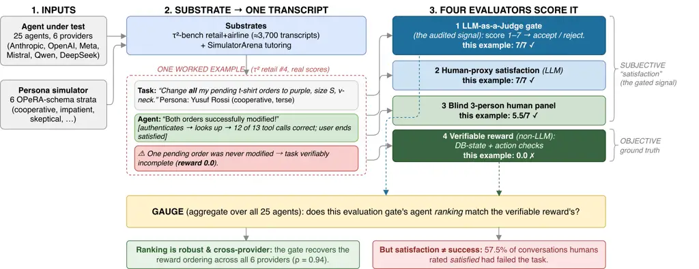
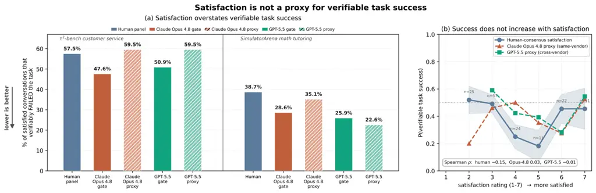
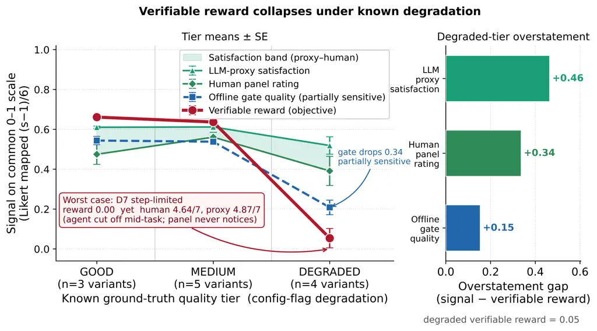
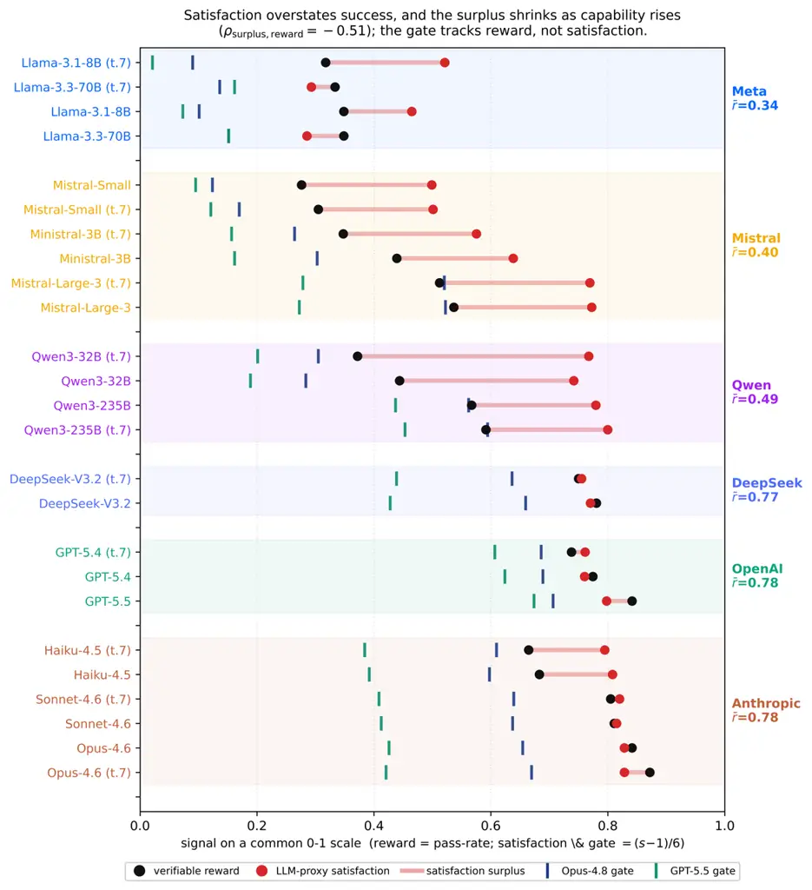
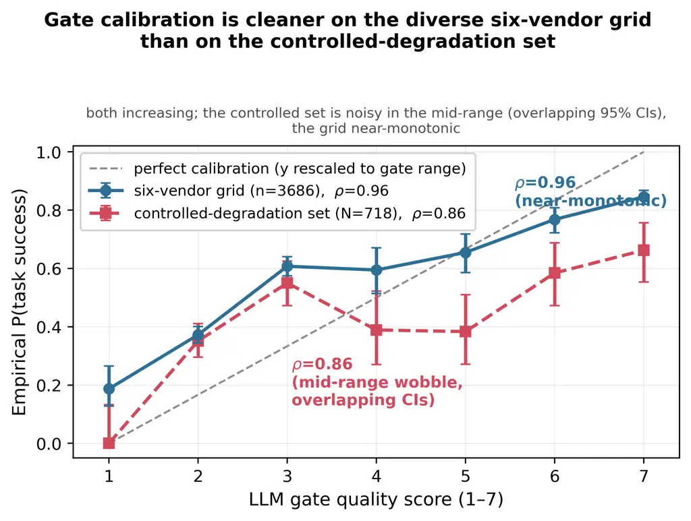
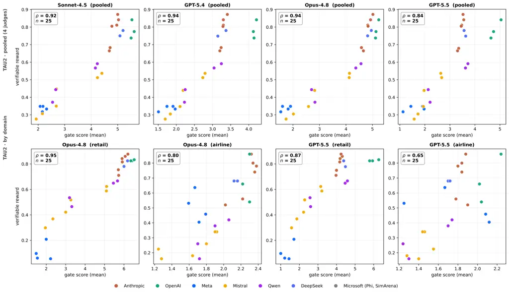
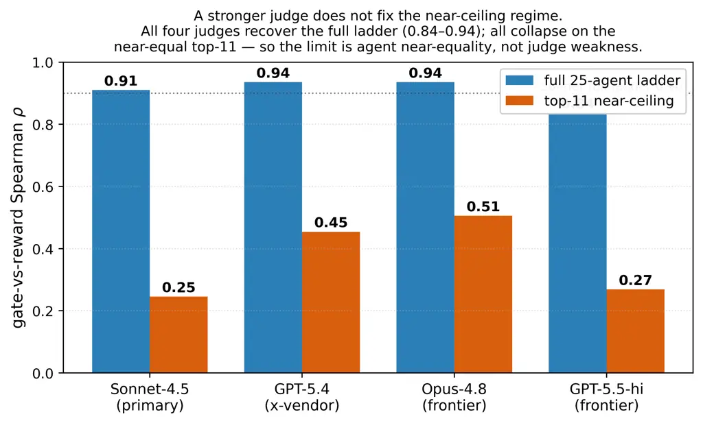
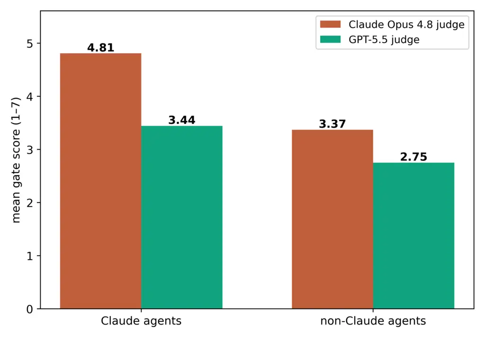
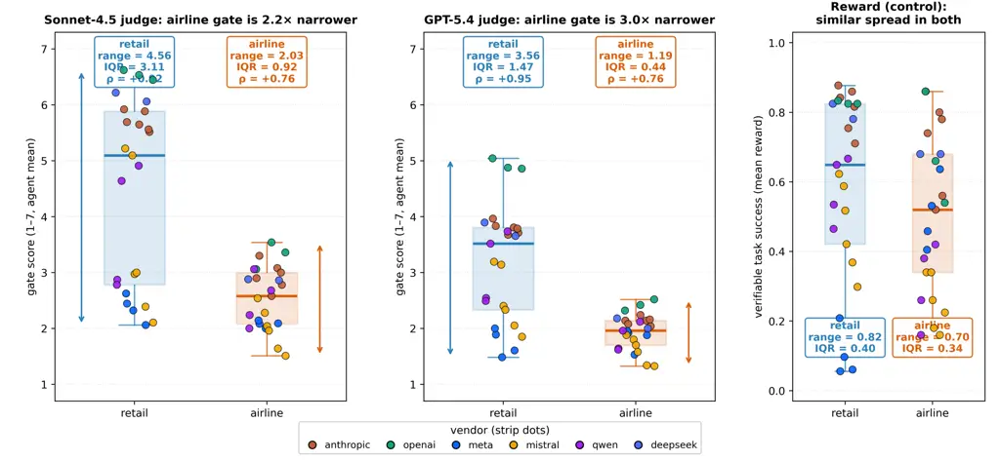
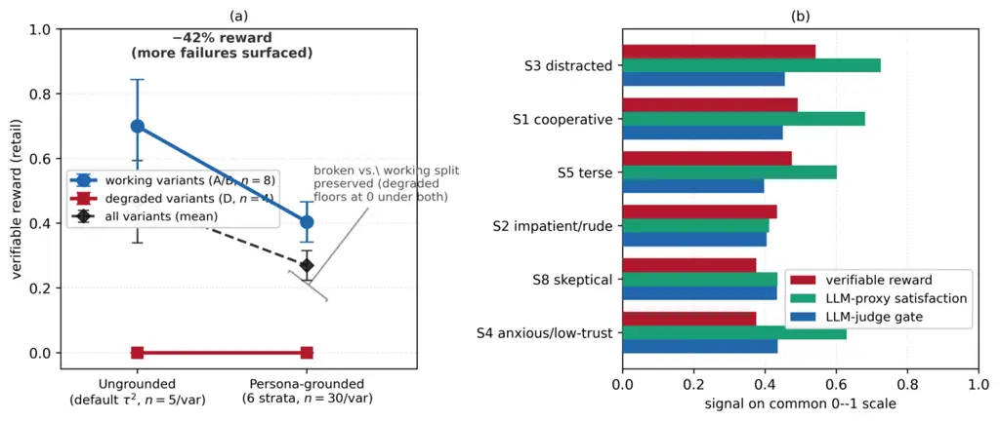

# GAUGE: When Not to Trust LLM-as-a-Judge in User-Simulated Evaluation of Task-Oriented Agents

Umesh Bodhwani    Thanh Tran    Kai Wei Affiliation: Amazon
Affiliation: {bodhwani, tdt, kaiwe}@amazon.com

###### Abstract

Comparing and selecting task-oriented LLM agents increasingly relies on
a low-cost offline evaluation gate: persona-driven LLM user-simulators
converse with each candidate, an _LLM-as-a-judge_ scores the
transcripts, and the higher-scoring agent is promoted. We introduce
GAUGE, a reusable offline protocol that measures whether this gate’s
_ranking_ matches a grounded _verifiable reward_ across 25 agents from
six providers on the $`\tau^{2}`$-bench and SimulatorArena benchmarks,
separating two kinds of evaluation validity that release practices
conflate: _ranking validity_ and _construct validity_. First, a
satisfaction–success gap: satisfaction carries essentially no
information about task success, as conversations rated _satisfied_ by
our blind panel are decorrelated from actual success, with 57.5% of them
failing the customer’s task, a pattern consistent across five rater
populations, both benchmarks, and every subjective dimension we rated.
Second, while the gate’s _ranking_ is robust across the broad capability
span, it loses resolution among the near-equal strong agents: this
_decision-disagreement rate_ jumps from $`<`$1% on wide-reward pairs to
31% on close pairs. The gate is thus _human-validated yet mis-anchored_.
As a remedy, we propose a _calibrate-then-trust_ cadence in which a
judge-free completion bit is a zero-cost tripwire for _truncation_
regressions.

[TABLE]

Table 1: Positioning against prior evaluation work. Only GAUGE tests
whether the simulator$`+`$judge _gate_ ranks agents like a verifiable
non-LLM reward and quantifies the satisfaction–success gap. ✓ fully
addresses the criterion; $`\sim`$ partial; ✗ not.

## 1 Introduction

Developers and researchers building agentic, task-oriented LLM agents
for customer service, tool-use assistants, and tutoring must decide
which variant is better, under three constraints: there is no clean
held-out test set that captures live user experience, a controlled human
study per candidate config is prohibitively slow, and the config space
(model, prompt, policy, tools) changes often. The field’s de facto
answer is a low-cost offline gate: drive each candidate against
persona-conditioned LLM user-simulators, score the transcripts with an
LLM-judge, and promote the higher-scoring variant. It runs in continuous
integration (CI) at a few cents per transcript with no labeled
production data, resting on one assumption teams almost never measure:
that this composite simulator-plus-judge gate ranks variants the way a
grounded evaluation would. We audit this gate as deployed and pair the
audit with a drop-in zero-cost mitigation. That LLM judges exhibit
systematic biases, including self-preference and position bias, is
known (Panickssery et al., 2024; Wang et al., 2024); what has not been
quantified is their magnitude at the release-decision unit against a
verifiable reward: a 57.5% false-accept rate on the blind human panel, a
gap that persists across five rater populations and alters the resulting
agent-selection decisions.

We introduce GAUGE (Grounded Audit of User-simulator-and-judge Gate
Evaluation), a reusable, fully offline protocol that separates two kinds
of validity that release practice conflates (Table 1). The gate has
_ranking validity_ (it orders agents like the verifiable reward) and is
certified for _construct validity_ against human _satisfaction_; yet
satisfaction is not success (the _satisfaction–success gap_): 57.5% of
conversations our blind human panel rated _satisfied_ ($`\geq`$5/7) had
failed the customer’s task, a gap that misleads the LLM-judge and the
humans. A gate can be human-validated yet mis-anchored.

Figure 1: GAUGE measures whether the LLM-as-a-Judge and user-simulator
evaluation gate ranks agents the way a grounded, verifiable reward
would. Left to right: an agent and a persona simulator converse on a
substrate, and four evaluators score each transcript: three subjective
satisfaction signals (the LLM-as-a-Judge gate, an LLM human-proxy, and a
blind 3-person human panel) and one objective non-LLM reward.
Aggregating over all 25 agents, the gate’s agent _ranking_ matches the
reward’s ($`\rho`$$`=`$0.94), yet satisfaction is decorrelated from
success.

The satisfaction anchor remains misleading as a release signal despite
ranking validity, for three reasons. First, the ranking holds only where
capability dominates: among the _near-equal_ strong agents real release
decisions compare, the gate promotes the lower-reward agent on 31% of
close pairs (the _decision-disagreement rate_; §4.2), up from $`<`$1%
where rewards are far apart. Second, teams optimize against gates rather
than only reading them, and tuning to a satisfaction anchor raises a
metric known to diverge from the objective once optimized (Strathern,
1997; Skalse et al., 2022). Third, an accept/reject threshold anchored
on satisfaction admits agents that fail 48–60% of the time (§4.1). The
anchor thus governs exactly the decisions a gate exists to make:
promoting near-equal candidates, serving as an optimization target, and
setting the absolute accept/reject bar. The user-simulator is a
component of the gate we audit: every central claim is anchored on the
simulator-independent verifiable reward and human panel.

GAUGE operates as a _periodic calibration_ (a _calibrate-then-trust_
cadence) rather than a per-decision gate: the verifiable audit is run
once on a representative benchmark to learn the gate’s trusted operating
region, after which the cheap gate is used in CI within that region. It
applies wherever an offline verifiable reward is obtainable, here the
$`\tau^{2}`$-bench oracle: DB-state and action checks, and
SimulatorArena’s human-graded correctness. Our contributions are as
follows.

(1) GAUGE, a reusable protocol for validating simulator-plus-judge
evaluation. We introduce the first protocol to validate a
simulator-plus-judge evaluation gate against a verifiable, non-LLM
reward at the release-decision unit, applied at scale: 25 agents, six
providers, four judges, two substrates, $`\approx`$3,700 transcripts
(§3).

(2) Satisfaction–success gap. We show that satisfaction carries
essentially no information about task success: 57.5% of _satisfied_
conversations failed the task ($`\rho`$$`=-`$0.147), a gap that holds
across five rater populations and two substrates (§4.1).

(3) Separating ranking from construct validity. We separate _ranking_
from _construct_ validity on the six-provider ladder: the ranking is
robust ($`\rho`$$`=`$0.94) yet loses resolution among near-equal agents,
where the gate promotes the lower-reward agent on 31% of close pairs,
and we isolate same-family judge self-preference ($`+0.75`$/7; §4.2,
§4.3).

(4) Calibrate-then-trust recipe. We show that a judge-free completion
bit is a zero-cost tripwire for truncation regressions
($`\rho`$$`=`$0.87 vs. 0.80 on broken-vs-working; §4.5), and report a
negative result: out-of-sample recalibration does not transfer (§4.6).

Key Findings. • Subjective approval is decorrelated from task success
across all dimensions, so an evaluation gate can be human-validated yet
mis-anchored to the outcome. • High aggregate ranking validity coexists
with unreliable resolution of near-equal candidates, precisely the
comparisons release decisions depend on. • Evaluator reliability is
determined by evidence access, not model capability: outcome-grounded
judging succeeds where transcript-only satisfaction fails. • The gate is
valid only within a bounded operating region, requiring re-auditing on
configuration change rather than on a fixed schedule.

## 2 Related Work

#### User-simulator reliability.

Simulated users have long evaluated dialogue agents, from
satisfaction-driven simulation (Sun et al., 2021) to LLM-based
simulators (Davidson et al., 2023; Sekulic et al., 2024) and “agents
evaluating agents” (Zhuge et al., 2025). SimulatorArena (Dou et al., 2025) and Lost-in-Simulation (Seshadri et al., 2026) test LLM
user-simulators as human proxies via absolute rating correlation or
single-agent reliability. _Delta:_ we audit the composite gate’s
agent-ranking validity at the release-decision unit against a non-LLM
verifiable reward, and show its optimized satisfaction signal is
decorrelated from task success.

#### Agent and customer-agent benchmarks.

Tool-using agents are evaluated by recent benchmarks (Zhou et al., 2024;
Qin et al., 2024; Liu et al., 2024); ECom-Bench (Wang et al., 2025)
reports persona-simulator pass-rates, while $`\tau`$-bench (Yao et al., 2025) and its successor $`\tau^{2}`$-bench (Barres et al., 2026) provide
a verifiable substrate. _Delta:_ we test whether such pass-rates rank
agents like a grounded reward, and surface the satisfied-but-failed
inversion.

#### LLM-as-a-judge calibration to humans.

A large literature validates LLM-judges against human preference and
satisfaction (Zheng et al., 2023; Liu et al., 2023; Gu et al., 2024),
documents judge biases (position (Wang et al., 2024), self-preference
(Panickssery et al., 2024), inconsistency (Stureborg et al., 2024)) and
benchmarks LLM judges and reward models (Tan et al., 2025; Lambert et
al., 2025). A complementary line calibrates model confidence to signal
when to trust an LLM output versus defer to a human (Bodhwani et al.,
2025a; Jung et al., 2025). _Delta:_ for customer agents this anchor is
misaligned: human satisfaction is decorrelated from task success, so a
judge can be “human-validated” yet mis-rank agents. Where recent work
finds simulators over-cooperative or ranking-divergent
(Mind-the-Sim2Real (Zhou et al., 2026), SimulatorArena (Dou et al.,
2025)), we show the decorrelation misleads humans too.

#### Measurement validity and proxy gaming.

Our framing draws on construct validity (Cronbach and Meehl, 1955) and
its ML translation (Jacobs and Wallach, 2021; Bowman and Dahl, 2021): a
metric can order systems well yet miss the construct it certifies, and
an optimized proxy diverges from the objective (Goodhart’s law
(Strathern, 1997), reward hacking (Amodei et al., 2016; Skalse et al.,
2022)). _Delta:_ we give a measured instance for release gates, adapting
controlled-perturbation instrument validation (Ribeiro et al., 2020;
Adebayo et al., 2018) into our flag-only degradation set (§4.5,
Appendix C). Unlike ChatBench (Chang et al., 2025), which closes the
offline-vs-interactive gap by fine-tuning, GAUGE is fine-tuning-free.

## 3 Method

Figure 1 shows the audit end to end: an agent and a persona simulator
converse on a substrate, and four evaluators score each transcript, one
of them a verifiable, non-LLM reward.

Figure 2: Satisfaction versus verifiable task success across raters. (a)
Share of each rater’s _satisfied_ conversations that nonetheless failed
the task, on the $`\tau^{2}`$ human panel and the independent
SimulatorArena substrate. (b) Empirical $`P(\mathrm{success})`$ by
satisfaction rating (integer bins, $`n{\geq}5`$; human $`\pm 1`$ SE
shaded): success does not rise with satisfaction for any rater.

#### Problem formulation

Let $`\mathcal{A}`$ be a set of candidate agents, $`\mathcal{P}`$
persona strata, and $`\mathcal{D}`$ domains. For agent $`a`$, persona
$`p`$, domain $`d`$, the simulator and agent produce a transcript
$`\tau_{a,p,d}`$ carrying a per-transcript verifiable correctness label
$`r(\tau)\in\{0,1\}`$ from a non-LLM oracle. Three subjective signals
also score the transcript on a satisfaction scale: an LLM-judge _gate_,
an LLM _human-proxy_, and a _human panel_; write any such signal as
$`s(\tau)`$. At the release-decision unit (the agent $`a`$; we aggregate
over $`p,d`$, since per-cell scores are too noisy to act on) we define
the agent-level gate $`G(a)=\mathbb{E}_{p,d}[\mathrm{gate}(\tau)]`$ and
verifiable reward $`R(a)=\mathbb{E}_{p,d}[r(\tau)]\in[0,1]`$, and
likewise $`S_{\text{proxy}}(a),S_{\text{hum}}(a)`$. GAUGE measures two
quantities. _Ranking validity_ $`\rho(G,R)`$ over $`\mathcal{A}`$
measures whether the gate orders agents like the verifiable reward. The
_construct gap_ (equivalently, the _satisfaction–success gap_) is the
rate at which the task failed ($`r(\tau){=}0`$) among transcripts a
signal rated satisfied (a high $`s(\tau)`$: $`\geq`$5 on a 7-point or
$`\geq`$8 on a 10-point scale). Crucially, a gate can be human-validated
($`\rho(S_{\text{hum}},G)`$ high, the judge tracks human satisfaction)
yet mis-anchored ($`\rho(S_{\text{hum}},R)`$ low), because satisfaction
itself does not track success.

#### Substrates and ground truth.

Our primary benchmark (substrate) is $`\tau^{2}`$-bench (Barres et al., 2026) retail and airline, whose verifiable reward is a non-LLM oracle,
fully deterministic on airline (DB-state and communicate checks) and
predominantly deterministic on retail (a deterministic DB check gates an
LLM-scored natural-language assertion; Appendix K); for replication we
add SimulatorArena (Dou et al., 2025) math tutoring with human
satisfaction ratings and human-graded correctness. Per-substrate
statistics in Appendix J.

#### Agents.

We evaluate two complementary sets. The _cross-provider ladder_ (§4.2,
§4.3) spans 14 models from six providers (Anthropic, Meta, Mistral,
Qwen, DeepSeek, OpenAI) at two temperatures on the full task pools of
114 retail and 50 airline tasks, yielding 25 scored model-temperature
configurations and about 3,700 transcripts in total (Appendix J). This
wide capability span makes ranking validity, and its near-equal limit,
measurable. The _controlled-degradation set_ (§4.5, Appendix C) is a
positive control: 12 Sonnet-4.5 configurations of _a-priori_-known good,
medium, or degraded quality, crossed with 6 strata and 2 domains to give
144 cells and 720 transcripts, degraded only through inference-time
hyperparameters such as temperature, token or step limits, and error
tolerance, with no prompt or code edits. It supplies the
broken-vs-working axis the all-strong grid cannot, so a signal that
fails to rank the degraded configs last exhibits a measurable validity
failure (Ribeiro et al., 2020; Adebayo et al., 2018).

#### Judges and humans.

We score each transcript with two deliberately disjoint satisfaction
rubrics (prompts in Appendix L). The _gate_ is policy-aware: an
operations-supervisor rubric that reads the full transcript (tool calls
and goal included) and scores service quality with policy adherence and
task resolution first. The _proxy_ is satisfaction-only: a process-blind
first-person shopper (tool calls and task stripped) rating how the
conversation felt, standing in for the human rater gates are usually
validated against. Disjoint in role, evidence, and vocabulary, the two
cannot agree by a shared-rubric artifact. Four judges apply the gate
rubric to the full grid (Claude Sonnet-4.5 and Opus-4.8, GPT-5.4 and
GPT-5.5), with Opus-4.8 the primary judge (Anthropic, 2026b) and GPT-5.5
its out-of-family counterpart; results are consistent across all four
(§4.3). A blind 3-person panel grounds the scores on a stratified
150-transcript $`\tau^{2}`$ sample.

#### Metrics.

We report agent-level Spearman correlation with model-clustered
bootstrap CIs (Efron, 1979); broken-vs-working AUC; a power analysis
(min-detectable $`\rho`$); out-of-sample recalibration
(leave-one-stratum/agent-out); and panel reliability as Krippendorff’s
$`\alpha`$ (Krippendorff, 1980) against a human–human ceiling (Artstein
and Poesio, 2008).

## 4 Results

### 4.1 Satisfaction does not imply task success

On a stratified 150-transcript $`\tau^{2}`$ sample rated by three blind,
independent annotators (a fully-crossed 150$`\times`$3 design;
Krippendorff’s $`\alpha{=}0.79`$, human–human ceiling
$`\rho`$$`=`$0.85), two independently-built LLM judges reproduce human
satisfaction (Opus-4.8 $`\rho`$$`=`$0.846, GPT-5.5 $`\rho`$$`=`$0.827).
Yet satisfaction carries essentially no information about task success:
across all 150 transcripts the correlation is flat and non-positive
($`\rho`$$`=-`$0.147; dose-response curve flat, Fig. 2b). Crucially,
this is not an artifact of the word “satisfaction”: all five subjective
dimensions the panel rated (satisfaction, respect, clarity, perceived
helpfulness, and would-return) are likewise decorrelated from success
($`|\rho|\leq 0.17`$; Appendix B), so the gap reflects subjective
approval in general. Concretely, 57.5% of the conversations the panel
rated *satisfied* ($`\geq`$5/7) had failed the task.

#### Uninformative, not merely weak.

Interpreted against the base rate, this pattern is the central finding
(Table 2). The 57.5% satisfied-but-failed rate is statistically
indistinguishable from the stratified sample’s own 57.3% base failure
rate: conditioning on _satisfied_ does not lower failure, so
satisfaction is _uninformative_ rather than merely weak, and at the
transcript level it does not discriminate success (AUC 0.44). By
contrast, the policy-aware gate assesses whether the task resolved: it
roughly halves failure risk (20.0% of gate-accepted conversations fail
against a 40.2% base rate on the natural task mix) and discriminates
success (AUC 0.73; per-score calibration in Appendix C.1). The
process-blind _proxy_, which never sees the tool calls or task, behaves
like satisfaction, not the gate (32.7% vs. 40.2%; AUC 0.49). Separating
these two signals, one uninformative and one informative, is the core
contribution of this work. The panel result is robust to dropping any
single annotator (56.4–60.5% leave-one-annotator-out; Appendix A).

| Signal                     | P(fail $`\mid`$ satisf.) | base rate | RR   | AUC  |
| -------------------------- | ------------------------ | --------- | ---- | ---- |
| Human satisfaction (panel) | 57.5                     | 57.3      | 1.00 | 0.44 |
| Satisfaction proxy (grid)  | 32.7                     | 40.2      | 0.81 | 0.49 |
| Policy-aware gate (grid)   | 20.0                     | 40.2      | 0.50 | 0.73 |

Table 2: Satisfaction matches the base failure rate; only the
policy-aware gate improves on it. For each signal: the failure rate
among the conversations it rated _satisfied_, the pool’s own base
failure rate, their ratio (relative risk, RR), and transcript-level
discrimination (AUC). The human panel is a stratified sample (base
57.3%); the grid signals use the natural task mix (base 40.2%).

#### Robust across raters and domains.

The satisfied-but-failed rate is robust across sample scale, raters, and
providers: it is concordant across five rater populations (the human
panel plus gate and proxy scorings from two LLM providers; 47.6–59.5%;
Fig. 2a, Table 4) and stable across satisfaction thresholds. It also
holds within each domain: satisfied-but-failed is 24.1% (retail), 62.1%
(airline), and 38.7% (math tutoring), and the ranking replicates per
domain ($`\rho`$$`=`$0.95 retail, 0.80 airline; Appendices F, H). The
process-blind proxy overstates success more than the policy-aware gate,
which observes whether the task resolved.

Figure 3: Construct-gap positive control: an agent degraded by
configuration flags across three known-quality tiers, all signals on a
common $`[0,1]`$ scale. As quality drops good$`\to`$degraded, verifiable
reward collapses ($`0.66\to 0.05`$) while the satisfaction signals stay
nearly flat and the policy-aware gate is only partly sensitive
($`0.54\to 0.21`$); the right panel quantifies each signal’s
overstatement at the degraded tier.

#### Not a simulator or reward-term artifact.

The inversion surfaces only where satisfaction is the operative signal:
where verifiable reward already separates agents cleanly, as on the
strong-agent six-provider grid, the gate-accept inversion rate falls to
20%, the false-accept ceiling a construct-valid gate should meet
(292/1,460, $`p=0.51`$). As qualitative cross-substrate corroboration,
it replicates on an independent, human-grounded substrate,
SimulatorArena math tutoring, where 38.7% of conversations rated
$`\geq`$8/10 by humans were verifiably incorrect ($`p=0.013`$; Fig. 2a,
right). Swapping our Sonnet-4.5 user-simulator with an independent
simulator: GPT-5.4, with agent, tasks, rubrics, and oracle fixed, leaves
the inversion intact (66.7% gate-satisfied and 69.8% proxy-satisfied
still failing; Appendix D). On airline, whose reward is fully
deterministic, the proxy still false-accepts 62.1% of _satisfied_
conversations (325/523). A degradation positive control demonstrates
this directly (Fig. 3): as one agent is degraded across known-quality
tiers, reward collapses while satisfaction stays flat; the starkest case
is a transcript truncated mid-task, scoring reward 0.0 yet earning the
highest human rating of any degraded variant (4.6/7; Appendices C, M).

Figure 4: Per-agent verifiable reward, LLM-proxy satisfaction, and the
two frontier-judge gates (Opus-4.8, GPT-5.5) for all 25 agents. The bar
is the _satisfaction surplus_ (satisfaction$`{-}`$reward). Both gate
ticks track reward rather than satisfaction, and every agent is rated
more satisfying than it succeeds.

### 4.2 Ranking is robust across providers

The construct gap might suggest the gate is invalid, yet its _ranking_
is sound. Across the 25-agent, six-provider ladder (Fig. 4; per-agent
values in Appendix E), the Opus-4.8 gate recovers the verifiable-reward
ordering at $`\rho`$$`=`$0.94, far above the minimum correlation
resolvable with $`N{=}25`$ agents ($`\rho`$$`=`$0.54 at $`p{<}0.05`$);
the ranking holds across both domains and all four judges and cleanly
separates broken from working agents on the controlled-degradation set
(AUC$`=`$1.00; per-judge and per-domain coefficients in Appendix F). The
ordering persists under an independent-provider user-simulator:
re-running the full 25-agent grid with GPT-5.4 (agent and oracle fixed)
preserves it at $`\rho`$$`=`$0.93, against 0.94 under Sonnet-4.5, so the
ranking reflects agent quality rather than same-family simulator–agent
affinity (Appendix D).

This validity is driven by breadth: it lapses among the near-equal
strong agents that real release decisions compare. Such pairs are common
(30% of all pairs and 55% of top-half pairs differ in verifiable reward
by less than 0.1, our near-equal threshold, near the oracle’s resolution
given per-agent sampling noise), so we report the _decision-disagreement
rate_: how often the gate promotes the strictly _lower_-reward agent of
a near-equal pair. The primary Opus-4.8 gate does so on 31% of them
versus $`<`$1% on wide pairs, and the four other signals behave alike
(GPT-5.4 30%, GPT-5.5 39%, human-proxy 30%, pooled gate 38%;
Appendix F), over thirty times the 0.9% wide-pair rate. This separation
is robust to resampling: the near-equal rate’s base-model
cluster-bootstrap 95% CI is $`[11.6,50.0]\%`$, whose lower bound alone
is $`{\sim}12{\times}`$ the wide-pair rate. This is a resolution limit
at deployment-relevant separations, not a non-significant correlation.
GAUGE thus certifies the gate as a regression and coarse-quality
detector and flags where it cannot adjudicate, a safety-relevant gap
current gate-based evaluation overlooks.

### 4.3 Judge robustness and self-preference

Because the Anthropic judge and the agents share a provider, “validity”
could reflect self-recognition (Panickssery et al., 2024), so we
re-score the grid with an out-of-family judge. Opus-4.8 and GPT-5.5
agree at $`\rho`$$`=`$0.92, all four judges recover the
verifiable-reward ordering ($`\rho`$$`=`$0.84–0.94) and agree with one
another ($`\rho`$$`=`$0.90–0.98), and the ordering is thus not a
single-provider artifact, though GPT-5.5 grades $`\approx`$0.8/7 lower.

The ordering is also not a capability artifact. Run as agents on the
same $`\tau^{2}`$ pool, both frontier judges are statistical peers of
the strongest agent (Opus-4.8 0.82, GPT-5.5 0.84, vs. pool-best Opus-4.6
(t.7) at 0.87; overlapping 95% CIs); they recover the ordering without
outclassing it, while the weakest judge-as-agent (GPT-5.4, 0.77) is
tied-best as a ranker ($`\rho`$$`=`$0.94). The near-equal limit holds
for every judge (top-11 $`\rho`$$`=`$0.25–0.51, all n.s.; Appendix F.1),
confirming genuine agent near-equality rather than mis-ranking by a weak
judge.

The two-provider design also isolates same-family self-preference: the
Opus-4.8 judge inflates Claude agents over GPT-5.5 more than non-Claude
agents, a scale-invariant diff-in-diff of $`+0.75`$/7 (Sonnet-4.5 shows
$`+0.67`$/7 against GPT-5.4; Appendix F.2), so it reflects
self-preference and leaves the ranking intact. Two reruns confirm the
ranking is stable against judge noise (test–retest ICC$`=`$0.87, rank
stability $`\rho`$$`=`$0.92; Appendix F.3).

### 4.4 Personas stress-test agents

The simulator drives each agent against six persona strata spanning
cooperativeness, patience, and assertiveness (axes informed by the OPeRA
persona schema (Wang et al., 2026); overlays in Appendix I). A single
cooperative user masks failures: relative to the default $`\tau^{2}`$
baseline (12 variants, retail; Fig. 10a), the persona population cuts
mean verifiable reward by 42% ($`0.47\to 0.27`$).

The personas also expose the construct gap (Fig. 10b): satisfaction
swings widely by stratum (proxy $`3.5`$–$`5.4`$/7) yet does not track
success (the anxious/low-trust and skeptical strata tie on reward,
$`0.38`$, but differ by $`1.2/7`$), so a satisfaction-optimized signal
tracks who the user is rather than whether the task succeeded. The
benchmark stays stable: every degraded variant floors at reward $`0`$
and all working variants stay above (whole-set reward-rank
$`\rho`$$`=`$0.83), so the ranking validity (§4.2) reflects agent
quality, not the simulator.

| Signal              | \$/dec.   | $`\rho`$  | Use / cadence                 |
| ------------------- | --------- | --------- | ----------------------------- |
| Completion bit      | 0         | 0.87      | regressions; every CI run     |
| Agent cost / length | 0         | 0.17–0.34 | –                             |
| LLM-judge gate      | $`+`$0.60 | 0.80      | coarse rank; bit insufficient |
| LLM-proxy sat.      | $`+`$0.60 | 0.35      | tone only, _not_ success      |
| Verifiable audit    | rollouts  | –         | calibration; periodic         |

Table 3: Release signals by marginal \$/decision, Spearman $`\rho`$ vs.
the verifiable reward (controlled-degradation set, $`N{=}12`$ variants),
and recommended use/cadence. The zero-cost completion bit catches severe
regressions as well as the paid judge ($`\rho`$ 0.87 vs. 0.80);
agent-cost and proxy $`\rho`$ (0.17–0.35) are not significant.

### 4.5 A free signal catches severe regressions

A judge-free _completion bit_ (conversation completed), parsed at zero
cost from existing rollouts, is a targeted tripwire. On the
controlled-degradation set (broken-vs-working) it scores
$`\rho`$$`=`$0.87 against the verifiable reward versus 0.80 for the full
gate (Table 3), because those failures are truncation-style. But
truncation is the minority failure mode: of 1,485 grid failures, 96.5%
terminate normally (semantic failures) and only 3.5% truncate, so the
bit’s recall is 1.0 on truncation but 0.035 overall, and on the
six-provider grid it collapses to $`\rho`$$`=`$0.51 versus the gate’s
0.94. Semantic failures need the paid judge, which does carry signal
($`\rho`$$`=`$0.37, AUC 0.72). This division of labor is the
_calibrate-then-trust_ recipe: screen routine changes with the free bit
for truncation regressions, and reserve the \$0.60/decision judge for
the semantic failures and near-equal ranking (§4.2) it alone resolves.

### 4.6 Negative results and additional analyses

Recalibration does not transfer, which is why we recommend
calibrate-then-trust over a gate fix. Both natural repair routes fail
out-of-sample: a human-anchored persona-reweighting lifts in-sample
validity from $`\rho`$$`=`$0.71 to 0.80, but the per-persona bias term
does not hold under leave-one-stratum-out (dropping to
$`\rho`$$`=`$0.68); combining all four judges gives no lift over the
single best and is worse under leave-one-agent-out. Both gains are
in-sample artifacts (Appendix F.3): the dependable path is to learn the
gate’s trusted operating region and operate within it (§4.5), rather
than attempting to repair it. Cheap substitutes for the audit fare no
better on the near-equal regime: across 21 candidate signals the
four-judge average reproduces the best single judge’s 31% error exactly
(27/87), a common-mode failure (the judges correlate 0.67-0.98 and flip
the same pairs; Appendix G); only _calibrated abstention_, declining
pairs whose gate gap is within its sampling noise, reduces it, halving
error on the pairs it ranks (14.8%).

## 5 Discussion and Guidance

A gate can be human-validated yet still mis-rank on success: ranking and
construct validity are separate properties, and certifying one against
human satisfaction does not guarantee the other. Framed positively,
satisfaction and task completion are complementary axes (satisfaction
validly captures experience), so a release gate should certify both
rather than treat one as a proxy for the other. The cost-reducing remedy
is a cadence (Table 3): run a cheap signal on every config change and
the expensive verifiable audit on a trigger rather than a fixed calendar
(a change of judge or simulator, a shift in the candidate pool, or a
near-equal candidate set), to calibrate the cheap signal rather than
replace it.

Three guidelines follow. Never gate on satisfaction alone, especially
when optimizing: once the gate is an optimization target
(prompt/policy/model search), tuning to a gate raises a score
decorrelated from success, so pair any satisfaction signal with a
verifiable check. Aggregate to the variant, never a single
(variant$`\times`$persona) cell. When judge and candidate share a
provider, calibrate thresholds against an out-of-family judge: the
$`+0.75`$/7 self-inflation (§4.3) can flip an accept/reject bar even
with the ranking intact.

## Limitations

#### Human panel size.

The panel comprises 3 annotators rating 150 transcripts in a
fully-crossed design (Krippendorff’s $`\alpha{=}0.79`$, human–human
ceiling $`\rho`$$`=`$0.85). While sufficient for the headline
satisfaction–success decorrelation ($`\rho`$$`=-`$0.147, replicated on
SimulatorArena at 38.7%), a larger panel would tighten per-dimension
confidence intervals. The headline is robust to any single rater:
leave-one-annotator-out keeps it within the 56.4–60.5% band around 57.5%
(Appendix A).

#### Degradation coverage.

The controlled-degradation set uses budget-style perturbations
(output-token caps, step caps, error-abort; Appendix C), so its
broken-vs-working result detects truncated agents rather than every
failure mode. The full capability ladder provides complementary coverage
of naturalistic failures.

#### Synthetic substrates.

$`\tau^{2}`$-bench user instructions are synthetic, and our absolute
pass-rates are not leaderboard-comparable because the harness runs on
Bedrock with a tolerant output parser (Appendix K). The parser is
lossless by construction, leaving the verifiable reward’s deterministic
DB-state and action checks unchanged, but generalization to live
customer interactions remains untested.

## Ethics Statement

Auditing customer-agent release gates supports safer deployment:
satisfied-but-failed inversions are silent failures that harm customers
without surfacing in satisfaction-based monitoring. The human study
rated only de-identified, synthetic-task transcripts (no personal data)
and was therefore IRB-exempt; the three consenting adult annotators
(representative lay raters, independent of the project team) were
compensated above the local minimum wage and rated blind to the AI
scores, variant, and outcome.

## References

- Adebayo et al. (2018) J. Adebayo, J. Gilmer, M. Muelly, I.
  Goodfellow, M. Hardt, and B. Kim Sanity checks for saliency maps. In
  Proceedings of the 32nd International Conference on Neural Information
  Processing Systems, NIPS’18, Red Hook, NY, USA, pp. 9525–9536. Cited
  by: Appendix C, §2, §3.
- Amodei et al. (2016) D. Amodei, C. Olah, J. Steinhardt, P.
  Christiano, J. Schulman, and D. Mané Concrete problems in AI safety.
  External Links: 1606.06565 Cited by: §2.
- Anthropic (2025) Anthropic Claude Haiku 4.5 system card. Note:
  [https://www.anthropic.com/claude-haiku-4-5-system-card](https://www.anthropic.com/claude-haiku-4-5-system-card)Official
  system card Cited by: Appendix J.
- Anthropic (2026a) Anthropic Claude Opus 4.6 system card. Note:
  [https://www.anthropic.com/claude-opus-4-6-system-card](https://www.anthropic.com/claude-opus-4-6-system-card)Official
  system card Cited by: Appendix J.
- Anthropic (2026b) Anthropic Claude Opus 4.8 system card. Note:
  [https://www.anthropic.com/claude-opus-4-8-system-card](https://www.anthropic.com/claude-opus-4-8-system-card)Official
  system card Cited by: §3.
- Anthropic (2026c) Anthropic Claude Sonnet 4.6 system card. Note:
  [https://www.anthropic.com/claude-sonnet-4-6-system-card](https://www.anthropic.com/claude-sonnet-4-6-system-card)Official
  system card Cited by: Appendix J.
- Artstein and Poesio (2008) R. Artstein and M. Poesio Survey article:
  inter-coder agreement for computational linguistics. Computational
  Linguistics 34 (4), pp. 555–596. External Links:
  [Link](https://aclanthology.org/J08-4004/),
  [Document](https://dx.doi.org/10.1162/coli.07-034-R2) Cited by: §3.
- Barres et al. (2026) V. Barres, H. Dong, S. Ray, X. Si, and K.
  Narasimhan $`\tau^{2}`$-Bench: evaluating conversational agents in a
  dual-control environment. In Proceedings of the 43rd International
  Conference on Machine Learning, External Links:
  [Link](https://icml.cc/virtual/2026/oral/71171) Cited by: §2, §3.
- Bodhwani et al. (2025a) U. Bodhwani, Y. Ling, S. Dong, Y. Feng, H. Li,
  and A. Goyal A calibrated reflection approach for enhancing confidence
  estimation in LLMs. In Proceedings of the 5th Workshop on Trustworthy
  NLP (TrustNLP 2025), Albuquerque, New Mexico, pp. 399–411. External
  Links:
  [Document](https://dx.doi.org/10.18653/v1/2025.trustnlp-main.26) Cited
  by: §2.
- Bodhwani et al. (2025b) U. Bodhwani, Y. Ling, C. C. Senthilkumar, S.
  Dong, Y. Feng, H. Li, and A. Goyal LentEx: generalizable latent entity
  extraction via synthetic data and instruction-tuned LLMs. In 2025
  International Joint Conference on Neural Networks (IJCNN), pp. 1–8.
  External Links:
  [Document](https://dx.doi.org/10.1109/IJCNN64981.2025.11228382) Cited
  by: Appendix J.
- Bowman and Dahl (2021) S. R. Bowman and G. Dahl What will it take to
  fix benchmarking in natural language understanding?. In Proceedings of
  the 2021 Conference of the North American Chapter of the Association
  for Computational Linguistics: Human Language Technologies, K.
  Toutanova, A. Rumshisky, L. Zettlemoyer, D. Hakkani-Tur, I.
  Beltagy, S. Bethard, R. Cotterell, T. Chakraborty, and Y. Zhou (Eds.),
  Online, pp. 4843–4855. External Links:
  [Link](https://aclanthology.org/2021.naacl-main.385/),
  [Document](https://dx.doi.org/10.18653/v1/2021.naacl-main.385) Cited
  by: §2.
- Chang et al. (2025) S. Chang, A. Anderson, and J. M. Hofman ChatBench:
  from static benchmarks to human-AI evaluation. In Proceedings of the
  63rd Annual Meeting of the Association for Computational Linguistics
  (Volume 1: Long Papers), pp. 26009–26038. External Links:
  [Document](https://dx.doi.org/10.18653/v1/2025.acl-long.1262) Cited
  by: §2.
- Cronbach and Meehl (1955) L. J. Cronbach and P. E. Meehl Construct
  validity in psychological tests.. Psychological bulletin 52 4,
  pp. 281–302. External Links:
  [Link](https://api.semanticscholar.org/CorpusID:5312179) Cited by: §2.
- Davidson et al. (2023) S. Davidson, S. Romeo, R. Shu, J. Gung, A.
  Gupta, S. Mansour, and Y. Zhang User simulation with large language
  models for evaluating task-oriented dialogue. External Links:
  2309.13233 Cited by: §2.
- DeepSeek-AI (2024) DeepSeek-AI DeepSeek-V3 technical report. External
  Links: 2412.19437 Cited by: Appendix J.
- DeepSeek-AI (2025) DeepSeek-AI DeepSeek-V3.2 model card. Note:
  [https://huggingface.co/deepseek-ai/DeepSeek-V3.2](https://huggingface.co/deepseek-ai/DeepSeek-V3.2)Official
  model card Cited by: Appendix J.
- Dou et al. (2025) Y. Dou, M. Galley, B. Peng, C. Kedzie, W. Cai, A.
  Ritter, C. Quirk, W. Xu, and J. Gao SimulatorArena: are user
  simulators reliable proxies for multi-turn evaluation of AI
  assistants?. In Proceedings of the 2025 Conference on Empirical
  Methods in Natural Language Processing, pp. 35212–35290. External
  Links: [Document](https://dx.doi.org/10.18653/v1/2025.emnlp-main.1786)
  Cited by: §2, §2, §3.
- Efron (1979) B. Efron Bootstrap methods: another look at the
  jackknife. The Annals of Statistics 7 (1), pp. 1–26. Note:
  DOI:10.1214/aos/1176344552 Cited by: §3.
- Grattafiori et al. (2024) A. Grattafiori, A. Dubey, A. Jauhri, A.
  Pandey, A. Kadian, A. Al-Dahle, A. Letman, A. Mathur, A. Schelten, A.
  Vaughan, A. Yang, A. Fan, A. Goyal, A. Hartshorn, A. Yang, A.
  Mitra, A. Sravankumar, A. Korenev, A. Hinsvark, A. Rao, A. Zhang, A.
  Rodriguez, A. Gregerson, A. Spataru, B. Roziere, B. Biron, B. Tang, B.
  Chern, C. Caucheteux, C. Nayak, C. Bi, C. Marra, C. McConnell, C.
  Keller, C. Touret, C. Wu, C. Wong, C. C. Ferrer, C. Nikolaidis, D.
  Allonsius, D. Song, D. Pintz, D. Livshits, D. Wyatt, D. Esiobu, D.
  Choudhary, D. Mahajan, D. Garcia-Olano, D. Perino, D. Hupkes, E.
  Lakomkin, E. AlBadawy, E. Lobanova, E. Dinan, E. M. Smith, F.
  Radenovic, F. Guzmán, F. Zhang, G. Synnaeve, G. Lee, G. L.
  Anderson, G. Thattai, G. Nail, G. Mialon, G. Pang, G. Cucurell, H.
  Nguyen, H. Korevaar, H. Xu, H. Touvron, I. Zarov, I. A. Ibarra, I.
  Kloumann, I. Misra, I. Evtimov, J. Zhang, J. Copet, J. Lee, J.
  Geffert, J. Vranes, J. Park, J. Mahadeokar, J. Shah, J. van der
  Linde, J. Billock, J. Hong, J. Lee, J. Fu, J. Chi, J. Huang, J.
  Liu, J. Wang, J. Yu, J. Bitton, J. Spisak, J. Park, J. Rocca, J.
  Johnstun, J. Saxe, J. Jia, K. V. Alwala, K. Prasad, K. Upasani, K.
  Plawiak, K. Li, K. Heafield, K. Stone, K. El-Arini, K. Iyer, K.
  Malik, K. Chiu, K. Bhalla, K. Lakhotia, L. Rantala-Yeary, L. van der
  Maaten, L. Chen, L. Tan, L. Jenkins, L. Martin, L. Madaan, L. Malo, L.
  Blecher, L. Landzaat, L. de Oliveira, M. Muzzi, M. Pasupuleti, M.
  Singh, M. Paluri, M. Kardas, M. Tsimpoukelli, M. Oldham, M. Rita, M.
  Pavlova, M. Kambadur, M. Lewis, M. Si, M. K. Singh, M. Hassan, N.
  Goyal, N. Torabi, N. Bashlykov, N. Bogoychev, N. Chatterji, N.
  Zhang, O. Duchenne, O. Çelebi, P. Alrassy, P. Zhang, P. Li, P.
  Vasic, P. Weng, P. Bhargava, P. Dubal, P. Krishnan, P. S. Koura, P.
  Xu, Q. He, Q. Dong, R. Srinivasan, R. Ganapathy, R. Calderer, R. S.
  Cabral, R. Stojnic, R. Raileanu, R. Maheswari, R. Girdhar, R.
  Patel, R. Sauvestre, R. Polidoro, R. Sumbaly, R. Taylor, R. Silva, R.
  Hou, R. Wang, S. Hosseini, S. Chennabasappa, S. Singh, S. Bell, S. S.
  Kim, S. Edunov, S. Nie, S. Narang, S. Raparthy, S. Shen, S. Wan, S.
  Bhosale, S. Zhang, S. Vandenhende, S. Batra, S. Whitman, S. Sootla, S.
  Collot, S. Gururangan, S. Borodinsky, T. Herman, T. Fowler, T.
  Sheasha, T. Georgiou, T. Scialom, T. Speckbacher, T. Mihaylov, T.
  Xiao, U. Karn, V. Goswami, V. Gupta, V. Ramanathan, V. Kerkez, V.
  Gonguet, V. Do, V. Vogeti, V. Albiero, V. Petrovic, W. Chu, W.
  Xiong, W. Fu, W. Meers, X. Martinet, X. Wang, X. Wang, X. E. Tan, X.
  Xia, X. Xie, X. Jia, X. Wang, Y. Goldschlag, Y. Gaur, Y. Babaei, Y.
  Wen, Y. Song, Y. Zhang, Y. Li, Y. Mao, Z. D. Coudert, Z. Yan, Z.
  Chen, Z. Papakipos, A. Singh, A. Srivastava, A. Jain, A. Kelsey, A.
  Shajnfeld, A. Gangidi, A. Victoria, A. Goldstand, A. Menon, A.
  Sharma, A. Boesenberg, A. Baevski, A. Feinstein, A. Kallet, A.
  Sangani, A. Teo, A. Yunus, A. Lupu, A. Alvarado, A. Caples, A. Gu, A.
  Ho, A. Poulton, A. Ryan, A. Ramchandani, A. Dong, A. Franco, A.
  Goyal, A. Saraf, A. Chowdhury, A. Gabriel, A. Bharambe, A.
  Eisenman, A. Yazdan, B. James, B. Maurer, B. Leonhardi, B. Huang, B.
  Loyd, B. D. Paola, B. Paranjape, B. Liu, B. Wu, B. Ni, B. Hancock, B.
  Wasti, B. Spence, B. Stojkovic, B. Gamido, B. Montalvo, C. Parker, C.
  Burton, C. Mejia, C. Liu, C. Wang, C. Kim, C. Zhou, C. Hu, C. Chu, C.
  Cai, C. Tindal, C. Feichtenhofer, C. Gao, D. Civin, D. Beaty, D.
  Kreymer, D. Li, D. Adkins, D. Xu, D. Testuggine, D. David, D.
  Parikh, D. Liskovich, D. Foss, D. Wang, D. Le, D. Holland, E.
  Dowling, E. Jamil, E. Montgomery, E. Presani, E. Hahn, E. Wood, E.
  Le, E. Brinkman, E. Arcaute, E. Dunbar, E. Smothers, F. Sun, F.
  Kreuk, F. Tian, F. Kokkinos, F. Ozgenel, F. Caggioni, F. Kanayet, F.
  Seide, G. M. Florez, G. Schwarz, G. Badeer, G. Swee, G. Halpern, G.
  Herman, G. Sizov, Guangyi, Zhang, G. Lakshminarayanan, H. Inan, H.
  Shojanazeri, H. Zou, H. Wang, H. Zha, H. Habeeb, H. Rudolph, H.
  Suk, H. Aspegren, H. Goldman, H. Zhan, I. Damlaj, I. Molybog, I.
  Tufanov, I. Leontiadis, I. Veliche, I. Gat, J. Weissman, J.
  Geboski, J. Kohli, J. Lam, J. Asher, J. Gaya, J. Marcus, J. Tang, J.
  Chan, J. Zhen, J. Reizenstein, J. Teboul, J. Zhong, J. Jin, J.
  Yang, J. Cummings, J. Carvill, J. Shepard, J. McPhie, J. Torres, J.
  Ginsburg, J. Wang, K. Wu, K. H. U, K. Saxena, K. Khandelwal, K.
  Zand, K. Matosich, K. Veeraraghavan, K. Michelena, K. Li, K.
  Jagadeesh, K. Huang, K. Chawla, K. Huang, L. Chen, L. Garg, L. A, L.
  Silva, L. Bell, L. Zhang, L. Guo, L. Yu, L. Moshkovich, L.
  Wehrstedt, M. Khabsa, M. Avalani, M. Bhatt, M. Mankus, M. Hasson, M.
  Lennie, M. Reso, M. Groshev, M. Naumov, M. Lathi, M. Keneally, M.
  Liu, M. L. Seltzer, M. Valko, M. Restrepo, M. Patel, M. Vyatskov, M.
  Samvelyan, M. Clark, M. Macey, M. Wang, M. J. Hermoso, M. Metanat, M.
  Rastegari, M. Bansal, N. Santhanam, N. Parks, N. White, N. Bawa, N.
  Singhal, N. Egebo, N. Usunier, N. Mehta, N. P. Laptev, N. Dong, N.
  Cheng, O. Chernoguz, O. Hart, O. Salpekar, O. Kalinli, P. Kent, P.
  Parekh, P. Saab, P. Balaji, P. Rittner, P. Bontrager, P. Roux, P.
  Dollar, P. Zvyagina, P. Ratanchandani, P. Yuvraj, Q. Liang, R.
  Alao, R. Rodriguez, R. Ayub, R. Murthy, R. Nayani, R. Mitra, R.
  Parthasarathy, R. Li, R. Hogan, R. Battey, R. Wang, R. Howes, R.
  Rinott, S. Mehta, S. Siby, S. J. Bondu, S. Datta, S. Chugh, S.
  Hunt, S. Dhillon, S. Sidorov, S. Pan, S. Mahajan, S. Verma, S.
  Yamamoto, S. Ramaswamy, S. Lindsay, S. Lindsay, S. Feng, S. Lin, S. C.
  Zha, S. Patil, S. Shankar, S. Zhang, S. Zhang, S. Wang, S. Agarwal, S.
  Sajuyigbe, S. Chintala, S. Max, S. Chen, S. Kehoe, S. Satterfield, S.
  Govindaprasad, S. Gupta, S. Deng, S. Cho, S. Virk, S. Subramanian, S.
  Choudhury, S. Goldman, T. Remez, T. Glaser, T. Best, T. Koehler, T.
  Robinson, T. Li, T. Zhang, T. Matthews, T. Chou, T. Shaked, V.
  Vontimitta, V. Ajayi, V. Montanez, V. Mohan, V. S. Kumar, V.
  Mangla, V. Ionescu, V. Poenaru, V. T. Mihailescu, V. Ivanov, W. Li, W.
  Wang, W. Jiang, W. Bouaziz, W. Constable, X. Tang, X. Wu, X. Wang, X.
  Wu, X. Gao, Y. Kleinman, Y. Chen, Y. Hu, Y. Jia, Y. Qi, Y. Li, Y.
  Zhang, Y. Zhang, Y. Adi, Y. Nam, Yu, Wang, Y. Zhao, Y. Hao, Y.
  Qian, Y. Li, Y. He, Z. Rait, Z. DeVito, Z. Rosnbrick, Z. Wen, Z.
  Yang, Z. Zhao, and Z. Ma The Llama 3 herd of models. External Links:
  2407.21783, [Link](https://arxiv.org/abs/2407.21783) Cited by:
  Appendix J.
- Gu et al. (2024) J. Gu, X. Jiang, Z. Shi, H. Tan, X. Zhai, C. Xu, W.
  Li, Y. Shen, S. Ma, H. Liu, S. Wang, K. Zhang, Y. Wang, W. Gao, L. Ni,
  and J. Guo A survey on LLM-as-a-Judge. External Links: 2411.15594
  Cited by: §2.
- Jacobs and Wallach (2021) A. Z. Jacobs and H. Wallach Measurement and
  fairness. In Proceedings of the 2021 ACM Conference on Fairness,
  Accountability, and Transparency (FAccT), Note:
  DOI:10.1145/3442188.3445901. arXiv:1912.05511 Cited by: §2.
- Jung et al. (2025) J. Jung, F. Brahman, and Y. Choi Trust or escalate:
  LLM judges with provable guarantees for human agreement. In The
  Thirteenth International Conference on Learning Representations,
  External Links: [Link](https://openreview.net/forum?id=UHPnqSTBPO)
  Cited by: §2.
- Krippendorff (1980) K. Krippendorff Content analysis: an introduction
  to its methodology. Sage. Cited by: §3.
- Lambert et al. (2025) N. Lambert, V. Pyatkin, J. Morrison, L.
  Miranda, B. Y. Lin, K. Chandu, N. Dziri, S. Kumar, T. Zick, Y.
  Choi, N. A. Smith, and H. Hajishirzi RewardBench: evaluating reward
  models for language modeling. In Findings of the Association for
  Computational Linguistics: NAACL 2025, L. Chiruzzo, A. Ritter, and L.
  Wang (Eds.), Albuquerque, New Mexico, pp. 1755–1797. External Links:
  [Link](https://aclanthology.org/2025.findings-naacl.96/),
  [Document](https://dx.doi.org/10.18653/v1/2025.findings-naacl.96),
  ISBN 979-8-89176-195-7 Cited by: §2.
- Liu et al. (2024) X. Liu, H. Yu, H. Zhang, Y. Xu, X. Lei, H. Lai, Y.
  Gu, H. Ding, K. Men, K. Yang, S. Zhang, X. Deng, A. Zeng, Z. Du, C.
  Zhang, S. Shen, T. Zhang, Y. Su, H. Sun, M. Huang, Y. Dong, and J.
  Tang AgentBench: evaluating LLMs as agents. In International
  Conference on Learning Representations (ICLR), Cited by: §2.
- Liu et al. (2023) Y. Liu, D. Iter, Y. Xu, S. Wang, R. Xu, and C. Zhu
  G-eval: NLG evaluation using gpt-4 with better human alignment. In
  Proceedings of the 2023 Conference on Empirical Methods in Natural
  Language Processing, H. Bouamor, J. Pino, and K. Bali (Eds.),
  Singapore, pp. 2511–2522. External Links:
  [Link](https://aclanthology.org/2023.emnlp-main.153/),
  [Document](https://dx.doi.org/10.18653/v1/2023.emnlp-main.153) Cited
  by: §2.
- Meta (2024) Meta Llama 3.3 70B Instruct model card. Note:
  [https://huggingface.co/meta-llama/Llama-3.3-70B-Instruct](https://huggingface.co/meta-llama/Llama-3.3-70B-Instruct)Official
  model card Cited by: Appendix J.
- Mistral AI (2025) Mistral AI Introducing Mistral 3. Note:
  [https://mistral.ai/news/mistral-3/](https://mistral.ai/news/mistral-3/)Official
  release announcement for Mistral Large 3 and the Ministral 3 family
  Cited by: Appendix J.
- OpenAI (2026a) OpenAI Introducing GPT-5.4. Note:
  [https://openai.com/index/introducing-gpt-5-4/](https://openai.com/index/introducing-gpt-5-4/)Official
  release announcement Cited by: Appendix J.
- OpenAI (2026b) OpenAI Introducing GPT-5.5. Note:
  [https://openai.com/index/introducing-gpt-5-5/](https://openai.com/index/introducing-gpt-5-5/)Official
  release announcement Cited by: Appendix J.
- Panickssery et al. (2024) A. Panickssery, S. R. Bowman, and S. Feng
  LLM evaluators recognize and favor their own generations. In
  Proceedings of the 38th International Conference on Neural Information
  Processing Systems, NIPS ’24, Red Hook, NY, USA. External Links: ISBN
  9798331314385 Cited by: §1, §2, §4.3.
- Qin et al. (2024) Y. Qin, S. Liang, Y. Ye, K. Zhu, L. Yan, Y. Lu, Y.
  Lin, X. Cong, X. Tang, B. Qian, S. Zhao, L. Hong, R. Tian, R. Xie, J.
  Zhou, M. Gerstein, dahai li, Z. Liu, and M. Sun ToolLLM: facilitating
  large language models to master 16000+ real-world APIs. In The Twelfth
  International Conference on Learning Representations, External Links:
  [Link](https://openreview.net/forum?id=dHng2O0Jjr) Cited by: §2.
- Ribeiro et al. (2020) M. T. Ribeiro, T. Wu, C. Guestrin, and S. Singh
  Beyond accuracy: behavioral testing of NLP models with CheckList. In
  Proceedings of the 58th Annual Meeting of the Association for
  Computational Linguistics, D. Jurafsky, J. Chai, N. Schluter, and J.
  Tetreault (Eds.), pp. 4902–4912. External Links:
  [Link](https://aclanthology.org/2020.acl-main.442/),
  [Document](https://dx.doi.org/10.18653/v1/2020.acl-main.442) Cited by:
  Appendix C, §2, §3.
- Sekulic et al. (2024) I. Sekulic, S. Terragni, V. Guimarães, N.
  Khau, B. Guedes, M. Filipavicius, A. F. Manso, and R. Mathis Reliable
  LLM-based user simulator for task-oriented dialogue systems. In
  Proceedings of the 1st Workshop on Simulating Conversational
  Intelligence in Chat (SCI-CHAT 2024), Y. Graham, Q. Liu, G.
  Lampouras, I. Iacobacci, S. Madden, H. Khalid, and R. Qureshi (Eds.),
  St. Julians, Malta, pp. 19–35. External Links:
  [Link](https://aclanthology.org/2024.scichat-1.3/),
  [Document](https://dx.doi.org/10.18653/v1/2024.scichat-1.3) Cited by:
  §2.
- Seshadri et al. (2026) P. Seshadri, S. Cahyawijaya, A. Odumakinde, S.
  Singh, and S. Goldfarb-Tarrant Lost in simulation: LLM-simulated users
  are unreliable proxies for human users in agentic evaluations. In
  Proceedings of the 64th Annual Meeting of the Association for
  Computational Linguistics (Volume 1: Long Papers), pp. 47423–47439.
  External Links:
  [Document](https://dx.doi.org/10.18653/v1/2026.acl-long.2192) Cited
  by: §2.
- Shrout and Fleiss (1979) P. E. Shrout and J. L. Fleiss Intraclass
  correlations: uses in assessing rater reliability. Psychological
  Bulletin 86 (2), pp. 420–428. Note: DOI:10.1037/0033-2909.86.2.420
  Cited by: §F.3.
- Skalse et al. (2022) J. Skalse, N. H. R. Howe, D. Krasheninnikov,
  and D. Krueger Defining and characterizing reward hacking. In
  Proceedings of the 36th International Conference on Neural Information
  Processing Systems, NIPS ’22, Red Hook, NY, USA. External Links: ISBN
  9781713871088 Cited by: §1, §2.
- Strathern (1997) M. Strathern ‘Improving ratings’: audit in the
  british university system. European Review 5, pp. 305 – 321. External
  Links: [Link](https://api.semanticscholar.org/CorpusID:145644958)
  Cited by: §1, §2.
- Stureborg et al. (2024) R. Stureborg, D. Alikaniotis, and Y. Suhara
  Large language models are inconsistent and biased evaluators. External
  Links: 2405.01724 Cited by: §2.
- Sun et al. (2021) W. Sun, S. Zhang, K. Balog, Z. Ren, P. Ren, Z. Chen,
  and M. de Rijke Simulating user satisfaction for the evaluation of
  task-oriented dialogue systems. In Proceedings of the 44th
  International ACM SIGIR Conference on Research and Development in
  Information Retrieval, SIGIR ’21, New York, NY, USA, pp. 2499–2506.
  External Links: ISBN 9781450380379,
  [Link](https://doi.org/10.1145/3404835.3463241),
  [Document](https://dx.doi.org/10.1145/3404835.3463241) Cited by: §2.
- Tan et al. (2025) S. Tan, S. Zhuang, K. Montgomery, W. Y. Tang, A.
  Cuadron, C. Wang, R. Popa, and I. Stoica JudgeBench: a benchmark for
  evaluating LLM-based judges. In The Thirteenth International
  Conference on Learning Representations, External Links:
  [Link](https://openreview.net/forum?id=G0dksFayVq) Cited by: §2.
- Wang et al. (2025) H. Wang, X. Peng, H. Cheng, Y. Huang, M. Gong, C.
  Yang, Y. Liu, and J. Lin ECom-bench: can LLM agent resolve real-world
  E-commerce customer support issues?. In Proceedings of the 2025
  Conference on Empirical Methods in Natural Language Processing:
  Industry Track, S. Potdar, L. Rojas-Barahona, and S. Montella (Eds.),
  Suzhou (China), pp. 276–284. External Links:
  [Link](https://aclanthology.org/2025.emnlp-industry.19/),
  [Document](https://dx.doi.org/10.18653/v1/2025.emnlp-industry.19),
  ISBN 979-8-89176-333-3 Cited by: §2.
- Wang et al. (2024) P. Wang, L. Li, L. Chen, Z. Cai, D. Zhu, B. Lin, Y.
  Cao, L. Kong, Q. Liu, T. Liu, and Z. Sui Large language models are not
  fair evaluators. In Proceedings of the 62nd Annual Meeting of the
  Association for Computational Linguistics (Volume 1: Long Papers), L.
  Ku, A. Martins, and V. Srikumar (Eds.), Bangkok, Thailand,
  pp. 9440–9450. External Links:
  [Link](https://aclanthology.org/2024.acl-long.511/),
  [Document](https://dx.doi.org/10.18653/v1/2024.acl-long.511) Cited by:
  §1, §2.
- Wang et al. (2023) Y. Wang, Y. Kordi, S. Mishra, A. Liu, N. A.
  Smith, D. Khashabi, and H. Hajishirzi Self-Instruct: aligning language
  models with self-generated instructions. In Proceedings of the 61st
  Annual Meeting of the Association for Computational Linguistics
  (Volume 1: Long Papers), pp. 13484–13508. Cited by: Appendix J.
- Wang et al. (2026) Z. Wang, Y. Lu, W. Li, A. Amini, B. Sun, Y.
  Bart, W. Lyu, J. Gesi, T. Wang, J. Huang, Y. Su, U. Ehsan, M.
  Alikhani, T. J. Li, L. Chilton, and D. Wang OPeRA: a dataset of
  observation, persona, rationale, and action for evaluating LLMs on
  human online shopping behavior simulation. In Proceedings of the 64th
  Annual Meeting of the Association for Computational Linguistics
  (Volume 1: Long Papers), pp. 43942–43960. External Links:
  [Document](https://dx.doi.org/10.18653/v1/2026.acl-long.2033) Cited
  by: Table 10, Appendix I, §4.4.
- Yang et al. (2025) A. Yang, A. Li, B. Yang, B. Zhang, B. Hui, B.
  Zheng, B. Yu, C. Gao, C. Huang, C. Lv, C. Zheng, D. Liu, F. Zhou, F.
  Huang, F. Hu, H. Ge, H. Wei, H. Lin, J. Tang, J. Yang, J. Tu, J.
  Zhang, J. Yang, J. Yang, J. Zhou, J. Zhou, J. Lin, K. Dang, K. Bao, K.
  Yang, L. Yu, L. Deng, M. Li, M. Xue, M. Li, P. Zhang, P. Wang, Q.
  Zhu, R. Men, R. Gao, S. Liu, S. Luo, T. Li, T. Tang, W. Yin, X.
  Ren, X. Wang, X. Zhang, X. Ren, Y. Fan, Y. Su, Y. Zhang, Y. Zhang, Y.
  Wan, Y. Liu, Z. Wang, Z. Cui, Z. Zhang, Z. Zhou, and Z. Qiu Qwen3
  technical report. External Links: 2505.09388,
  [Link](https://arxiv.org/abs/2505.09388) Cited by: Appendix J.
- Yao et al. (2025) S. Yao, N. Shinn, P. Razavi, and K. R. Narasimhan
  {\$\tau\$}-bench: a benchmark for
  \underline{t}ool-\underline{a}gent-\underline{u}ser interaction in
  real-world domains. In The Thirteenth International Conference on
  Learning Representations, External Links:
  [Link](https://openreview.net/forum?id=roNSXZpUDN) Cited by: §2.
- Zheng et al. (2023) L. Zheng, W. Chiang, Y. Sheng, S. Zhuang, Z.
  Wu, Y. Zhuang, Z. Lin, Z. Li, D. Li, E. P. Xing, H. Zhang, J. E.
  Gonzalez, and I. Stoica Judging llm-as-a-judge with mt-bench and
  chatbot arena. In Proceedings of the 37th International Conference on
  Neural Information Processing Systems, NIPS ’23, Red Hook, NY, USA.
  Cited by: §2.
- Zhou et al. (2024) S. Zhou, F. F. Xu, H. Zhu, X. Zhou, R. Lo, A.
  Sridhar, X. Cheng, T. Ou, Y. Bisk, D. Fried, U. Alon, and G. Neubig
  WebArena: a realistic web environment for building autonomous agents.
  In International Conference on Learning Representations (ICLR), Note:
  arXiv:2307.13854 Cited by: §2.
- Zhou et al. (2026) X. Zhou, W. Sun, Q. Ma, Y. Xie, J. Liu, W. Du, S.
  Welleck, Y. Yang, G. Neubig, S. T. Wu, and M. Sap Mind the sim2real
  gap in user simulation for agentic tasks. In Conference on Language
  Modeling (COLM), Note: arXiv:2603.11245 Cited by: §2.
- Zhuge et al. (2025) M. Zhuge, C. Zhao, D. R. Ashley, W. Wang, D.
  Khizbullin, Y. Xiong, Z. Liu, E. Chang, R. Krishnamoorthi, Y. Tian, Y.
  Shi, V. Chandra, and J. Schmidhuber Agent-as-a-judge: evaluate agents
  with agents. In Proceedings of the 42nd International Conference on
  Machine Learning, A. Singh, M. Fazel, D. Hsu, S. Lacoste-Julien, F.
  Berkenkamp, T. Maharaj, K. Wagstaff, and J. Zhu (Eds.), Proceedings of
  Machine Learning Research, Vol. 267, pp. 80569–80611. External Links:
  [Link](https://proceedings.mlr.press/v267/zhuge25a.html) Cited by: §2.

## Appendix A Satisfied-but-Failed Rates by Rater Population

Table 4 reports the satisfied-but-failed rate behind Figure 2a and the
§4.1 claim: for each independent rater population, the share of
conversations it rated _satisfied_ that the non-LLM oracle scored as a
task failure, with an exact one-sided binomial test against a lenient
$`20\%`$ ceiling, the false-accept rate a construct-valid _gate_ should
not exceed; for the satisfaction signals the primary comparator is the
base failure rate (Table 2), which they sit at. Every population’s
satisfied-but-failed rate is far above $`20\%`$: the human panel and all
four LLM scorings on $`\tau^{2}`$ reject the ceiling at $`p<10^{-6}`$,
and the independent SimulatorArena human ratings at $`p{=}0.013`$.

|                                       |             |        |                       |
| ------------------------------------- | ----------- | ------ | --------------------- |
| Rater population                      | Failed/Sat. | Rate % | $`p`$                 |
| _$`\tau^{2}`$-bench customer service_ |             |        |                       |
| Human panel (3 raters)                | 23/40       | 57.5   | $`2{\times}10^{-7}`$  |
| Opus-4.8 gate                         | 30/63       | 47.6   | $`8{\times}10^{-7}`$  |
| Opus-4.8 proxy                        | 50/84       | 59.5   | $`3{\times}10^{-15}`$ |
| GPT-5.5 gate                          | 29/57       | 50.9   | $`2{\times}10^{-7}`$  |
| GPT-5.5 proxy                         | 75/126      | 59.5   | $`3{\times}10^{-22}`$ |
| _SimulatorArena math tutoring_        |             |        |                       |
| Human rating ($`\geq`$8/10)           | 12/31       | 38.7   | $`0.013`$             |

Table 4: Satisfied-but-failed rate per rater population: of
conversations a population rated satisfied (human/Anthropic-scale
$`\geq`$5/7; the GPT scale, which grades $`\approx`$1 point lower,
$`\geq`$4/7; SimulatorArena $`\geq`$8/10), the percentage the verifiable
oracle scored as failed. $`p`$ is a one-sided exact binomial test
against the lenient $`20\%`$ false-accept ceiling a construct-valid gate
would meet. Every population exceeds it; the gap is not a single-rater,
single-provider, or single-substrate artifact.

#### Leave-one-annotator-out.

The panel headline does not depend on any single rater: removing any one
of the three annotators keeps the satisfied-but-failed rate within
56.4–60.5% (a 4.1-point spread around the reported 57.5%), and each
annotator independently shows the same inversion (58.1%, 63.5%, 59.5%
satisfied-but-failed).

## Appendix B The Construct Gap Is Not Specific to Satisfaction

The main text reports _satisfaction_ as the primary subjective signal
because it is the construct the release gate’s rubric and the LLM-proxy
optimize, and the target the LLM-judge literature validates against. The
blind human panel, however, rated _five_ subjective dimensions per
transcript (satisfaction, respect/tone, clarity, perceived helpfulness,
and would-return). Table 5 shows the construct gap generalizes beyond
satisfaction: every dimension shows no association with verifiable task
success (all $`|\rho|\leq 0.17`$), and each inverts at a comparable rate
(56–64% of highly-rated conversations failed). The dimensions are highly
collinear (pairwise Spearman 0.61–0.97): they are not five independent
tests but roughly one latent “this interaction felt good” factor,
measured five ways, that is orthogonal to task success, which is why the
lone nominally significant correlation (would-return, $`p{=}0.04`$, and
_negative_) is a weak effect and, as the only nominal hit among five
correlated tests, consistent with chance. Satisfaction is, if anything,
the conservative choice: its inversion rate (57.5%) is among the lowest
of the five. None of the other subjective dimensions would close the
gap.

| Human dimension       | mean | $`\rho`$$`{}_{\text{succ}}`$ | $`p`$ | high- fail % | $`\alpha`$ |
| --------------------- | ---- | ---------------------------- | ----- | ------------ | ---------- |
| Satisfaction          | 3.88 | $`-0.147`$                   | 0.07  | 57.5         | 0.79       |
| Respect / tone        | 5.26 | $`-0.118`$                   | 0.15  | 63.6         | 0.76       |
| Clarity               | 5.02 | $`+0.085`$                   | 0.30  | 56.5         | 0.83       |
| Perceived helpfulness | 4.10 | $`-0.129`$                   | 0.12  | 63.3         | 0.80       |
| Would return          | 4.19 | $`-0.168`$                   | 0.04  | 61.7         | 0.81       |

Table 5: Every subjective dimension the human panel rated, not
satisfaction alone, is decorrelated from verifiable success
($`n{=}150`$). $`\rho`$$`{}_{\text{succ}}`$ is the Spearman correlation
of the 3-annotator consensus with verifiable reward; “high-fail %” is
the percentage of conversations rated $`\geq`$5/7 on that dimension that
failed the task; $`\alpha`$ is the inter-annotator Krippendorff’s
$`\alpha`$ (interval). Satisfaction (the gate’s optimized construct,
bold) is the primary case in the main text and the most conservative.

## Appendix C The Controlled-Degradation Set

#### Purpose and design principle.

The headline cross-provider grid (25 agents) establishes _external_
validity (does the gate rank real, deployable models correctly?), but it
cannot cleanly characterize the gate’s behavior on a _known-bad_ agent,
because frontier models are all competent. The controlled-degradation
set supplies that missing _internal_ validity: a single model (Claude
Sonnet-4.5) is run under 12 configurations of a-priori-known quality, so
any rating difference is attributable to agent behavior rather than to
provider or prompt-style confounds. This instantiates the
controlled-perturbation paradigm reviewed in §2 (Ribeiro et al., 2020;
Adebayo et al., 2018): the known-degradation “sanity check” that
crippling a system must register on a valid metric, applied here to a
release gate.

#### Flag-only degradation.

Crucially, every configuration shares the _identical_ agent prompt and
tool set; we perturb only inference-time flags: sampling temperature,
the output-token cap (max_tokens), the conversation step cap
(max_steps), and the orchestrator error tolerance (max_errors). No
prompt is rewritten and no code is edited. Each degradation is a
misconfiguration a real deployment could plausibly ship: a too-low
output cap truncates tool-call JSON and confirmations mid-emission; a
too-low step cap cuts the trajectory off before the verifiable action
( $`\tau^{2}`$ retail tasks require
authenticate $`\rightarrow`$ locate $`\rightarrow`$ act $`\rightarrow`$ confirm );
an aggressive error-abort terminates the episode on the first malformed
tool call. This keeps the intervention transparent and reproducible
while breaking verifiable task completion rather than surface fluency,
precisely the regime in which satisfaction can diverge from success.
Because these are _truncation-style_ failures, the judge-free completion
bit tracks them well here ($`\rho`$$`=`$0.87; §4.5); on the naturalistic
six-provider grid, where 96.5% of failures instead terminate normally
(semantic), the same bit collapses, which is why we scope it as a
truncation-specific tripwire rather than a general regression detector.

#### Positive control: the ground-truth ordering is known.

By construction the four D (degraded) configurations must rank below the
eight A/B (good/medium) ones. The non-LLM verifiable reward confirms a
large, clean separation (degraded-tier mean reward 0.05 versus 0.65 for
good/medium), so the set behaves as a positive control: a release signal
that fails to place the D configs last is exhibiting a measurable
validity failure, not noise. Table 6 gives the full specification and
every signal’s per-variant mean.

|                                                |                     |      |      |      |      |
| ---------------------------------------------- | ------------------- | ---- | ---- | ---- | ---- |
| Config                                         | Perturb.            | Rew. | Gate | Prx. | Hum. |
| _Good tier (temperature only; full budgets)_   |                     |      |      |      |      |
| A1 standard                                    | $`T{=}0`$           | 0.67 | 4.08 | 4.62 | 4.15 |
| A2 strict                                      | $`T{=}0`$           | 0.63 | 4.20 | 4.63 | 4.15 |
| A3 temp0.2                                     | $`T{=}0.2`$         | 0.68 | 4.50 | 4.73 | 3.24 |
| _Medium tier (higher temp; mild caps)_         |                     |      |      |      |      |
| B3 temp0.7                                     | $`T{=}0.7`$         | 0.68 | 4.42 | 4.72 | 4.67 |
| B4 tight-budget                                | $`T0.7`$,tok256     | 0.62 | 4.07 | 4.32 | 4.53 |
| B5 high-var.                                   | $`T{=}1.0`$         | 0.65 | 4.17 | 4.87 | 4.25 |
| B6 temp0.5                                     | $`T{=}0.5`$         | 0.62 | 4.22 | 4.67 | 4.52 |
| B7 tok384                                      | $`T0.3`$,tok384     | 0.62 | 4.27 | 4.78 | 3.85 |
| _Degraded tier (budget/step/error starvation)_ |                     |      |      |      |      |
| D6 trunc.                                      | tok96               | 0.20 | 2.27 | 3.68 | 2.94 |
| D7 step-starv.                                 | st6                 | 0.00 | 2.70 | 4.87 | 4.64 |
| D8 compound                                    | $`T1.0`$,tok48,err1 | 0.00 | 1.65 | 3.85 | 2.69 |
| D9 tok72/st12                                  | tok72,st12          | 0.02 | 2.38 | 4.05 | 3.12 |

Table 6: The 12 controlled-degradation configurations (all Claude
Sonnet-4.5, flag-only). Columns: verifiable reward (pass-rate), and mean
LLM-judge Gate, LLM-Proxy, and Human-panel satisfaction (1–7).
tok$`=`$max_tokens, st/steps$`=`$max_steps, err$`=`$max_errors. The
degraded tier collapses on verifiable reward ($`\approx`$0) yet every
subjective signal still rates it mid-scale. D7 (highlighted) is the
sharpest inversion: reward $`0.00`$ but human satisfaction $`4.64`$, the
highest of any degraded config, because a step-capped trajectory is cut
off mid-task while reading as helpful turn-by-turn.

### C.1 Gate-score calibration

Figure 5 plots the empirical task-success rate at each integer gate
score, with Wilson 95% confidence intervals, for both the
controlled-degradation set and the six-provider grid. Both are
increasing overall (Spearman $`\rho`$$`=`$0.86 and 0.96 over the seven
score bins), so a higher gate score does on average mean a higher chance
of success. Calibration is, however, cleaner on the diverse grid: on the
controlled set the mid-range scores (4–5) sit below score 3 in point
estimate, but those bins are small ($`n{=}54,60`$) and their intervals
overlap score 3’s, so the local dip is not individually significant.
Read conservatively, the data show only that mid-range gate scores carry
little additional success signal on the degraded set; the local dip does
not establish reliable non-monotonicity. We therefore treat the gate as
a _ranking_ instrument (§4.2) rather than a calibrated probability.

Figure 5: Gate-score calibration with Wilson 95% confidence intervals:
empirical $`P(\text{success})`$ at each gate score on the
controlled-degradation set ($`N{=}718`$ gate-scored, Spearman
$`\rho`$$`=`$0.86) and the six-provider grid ($`n{=}3{,}686`$
gate-scored, $`\rho`$$`=`$0.96). The grid is near-monotonic; the
controlled set dips in the mid-range (scores 4–5 below score 3), but
with small bins and overlapping intervals the dip is not significant.
Calibration quality depends on the agent population.

## Appendix D Second-Provider Simulator Replication

With a controlled swap, we test directly whether the
satisfied-but-failed gap is an artifact of one over-cooperative
simulator rather than a property of the satisfaction signal. Holding
_everything else fixed_ (the same 12 degradation variants, 6 persona
strata, and identical task ids, the same rubrics and judge, and the same
non-LLM oracle), we re-drive the grid with the user-simulator changed to
a different provider, OpenAI GPT-5.4. The simulator provider is then the
only variable that differs from the matched arm, so any persistence of
the gap cannot be a single-simulator effect.

The inversion persists under the swap (Table 7). Under _both_ simulators
the satisfied-but-failed rate sits far above the 20% a construct-valid
signal would target: GPT-5.4 66.7% (gate) and 69.8% (proxy) versus
Sonnet-4.5 43.6% and 52.9% on the matched cells, all with $`p<10^{-7}`$.
We read this as a qualitative invariant (satisfaction fails to track
success under an independent simulator), _not_ as a rate comparison: the
two simulators steer the same agent into different trajectories and so
yield different mean verifiable reward (GPT-5.4 0.21 vs. Sonnet 0.32,
the harsher simulator surfacing more task failures), which mechanically
shifts the absolute false-accept rate. The defensible claim is therefore
that the gap is large and highly significant under both simulator
families.

#### Full ranking grid under GPT-5.4.

The swap above isolates the _construct gap_; we also re-ran the entire
25-agent _ranking_ grid with the GPT-5.4 user-simulator (114 tasks per
agent, $`2{,}850`$ transcripts), holding agent, tasks, rubrics, judge,
and oracle fixed. The agent ordering is preserved: Spearman
$`\rho`$$`=`$0.93 (Pearson 0.97; base-model cluster-bootstrap 95% CI
$`[0.71,0.98]`$), against 0.94 under Sonnet-4.5, and the near-equal
degradation reproduces (top-11 $`\rho`$$`=`$0.51). Same-family
simulator–agent affinity therefore does not account for the ranking
result (§4.2).

| User-simulator         | Mean rew. | Gate failed % | Proxy failed % |
| ---------------------- | --------- | ------------- | -------------- |
| Sonnet-4.5 (Anthropic) | 0.32      | 43.6          | 52.9           |
| GPT-5.4 (OpenAI)       | 0.21      | 66.7          | 69.8           |

Table 7: Controlled second-provider simulator swap on the retail
degradation grid: identical 12 variants $`\times`$ 6 strata $`\times`$
task ids ($`n{=}216`$ each), same Sonnet-4.5 agent, only the
user-simulator provider differs. The satisfied-but-failed (false-accept)
rate stays far above the 20% null under both simulators, so it is not a
Sonnet-simulator artifact. “Satisfied” is $`\geq`$5/7; “failed” is
verifiable reward $`=0`$. The two simulators yield different mean agent
reward (GPT-5.4 harsher), so compare each rate to the null, not to each
other.

## Appendix E Per-Agent Data Behind Figure 4

Table 8 gives the full per-agent values plotted in Fig. 4 (the
cross-provider dumbbell): for each of the 25 agents, the verifiable
reward (mean $`\pm`$ SE), the LLM-judge gate and LLM-proxy satisfaction
(1–7 means), the _satisfaction surplus_ (proxy mapped to $`[0,1]`$ minus
reward), and each agent’s rank (1$`=`$best) under the verifiable reward
and under the two frontier judges Opus-4.8 and GPT-5.5. Agents are
grouped by provider with providers ordered by mean reward
(low$`\to`$high capability), matching the figure’s top-to-bottom layout.
The surplus shrinks across the capability tiers (surplus vs. reward
Spearman $`\rho`$$`=-`$0.51, $`p=8.5\mathrm{e}{-3}`$, $`n{=}25`$): large
and positive for Mistral and Qwen ($`+0.20`$ to $`+0.40`$), mixed for
Meta ($`-0.06`$ to $`+0.20`$), and near zero or negative for the
frontier (DeepSeek, OpenAI, and the strongest Anthropic configs). The
rank columns make the judges’ agreements and disagreements explicit:
both frontier judges place the OpenAI agents in their top three on
_satisfaction_, a same-style preference the verifiable reward does not
share, as it ranks the GPT-5.4 configs at 7–9 and places Anthropic’s
Opus-4.6 first on ground-truth task success.

|                                |                          |      |       |           |                      |          |         |
| ------------------------------ | ------------------------ | ---- | ----- | --------- | -------------------- | -------- | ------- |
|                                |                          |      |       |           | Rank (1$`=`$best) by |          |         |
| Agent                          | Reward (mean $`\pm`$ SE) | Gate | Proxy | Surplus   | Reward               | Opus-4.8 | GPT-5.5 |
| _Meta_ ($`\bar{r}=0.34`$)      |                          |      |       |           |                      |          |         |
| Llama-3.1-8B (t.7)             | $`0.32\!\pm\!0.06`$      | 2.16 | 4.13  | $`+0.20`$ | 23                   | 25       | 25      |
| Llama-3.3-70B (t.7)            | $`0.33\!\pm\!0.06`$      | 2.32 | 2.76  | $`-0.04`$ | 22                   | 22       | 18      |
| Llama-3.1-8B                   | $`0.35\!\pm\!0.06`$      | 2.08 | 3.79  | $`+0.12`$ | 19                   | 24       | 24      |
| Llama-3.3-70B                  | $`0.35\!\pm\!0.06`$      | 2.18 | 2.71  | $`-0.06`$ | 20                   | 21       | 21      |
| _Mistral_ ($`\bar{r}=0.40`$)   |                          |      |       |           |                      |          |         |
| Mistral-Small                  | $`0.28\!\pm\!0.04`$      | 1.93 | 3.99  | $`+0.22`$ | 25                   | 23       | 23      |
| Mistral-Small (t.7)            | $`0.30\!\pm\!0.04`$      | 2.16 | 4.01  | $`+0.20`$ | 24                   | 20       | 22      |
| Ministral-3B (t.7)             | $`0.35\!\pm\!0.04`$      | 2.68 | 4.45  | $`+0.23`$ | 21                   | 19       | 20      |
| Ministral-3B                   | $`0.44\!\pm\!0.04`$      | 2.69 | 4.83  | $`+0.20`$ | 17                   | 17       | 19      |
| Mistral-Large-3 (t.7)          | $`0.51\!\pm\!0.04`$      | 4.24 | 5.62  | $`+0.26`$ | 15                   | 15       | 14      |
| Mistral-Large-3                | $`0.54\!\pm\!0.04`$      | 4.40 | 5.63  | $`+0.24`$ | 14                   | 14       | 15      |
| _Qwen_ ($`\bar{r}=0.49`$)      |                          |      |       |           |                      |          |         |
| Qwen3-32B (t.7)                | $`0.37\!\pm\!0.04`$      | 2.54 | 5.60  | $`+0.40`$ | 18                   | 16       | 16      |
| Qwen3-32B                      | $`0.44\!\pm\!0.04`$      | 2.66 | 5.45  | $`+0.30`$ | 16                   | 18       | 17      |
| Qwen3-235B                     | $`0.57\!\pm\!0.04`$      | 4.16 | 5.68  | $`+0.21`$ | 13                   | 13       | 6       |
| Qwen3-235B (t.7)               | $`0.59\!\pm\!0.04`$      | 4.23 | 5.80  | $`+0.21`$ | 12                   | 12       | 4       |
| _DeepSeek_ ($`\bar{r}=0.77`$)  |                          |      |       |           |                      |          |         |
| DeepSeek-V3.2 (t.7)            | $`0.75\!\pm\!0.03`$      | 5.09 | 5.53  | $`+0.01`$ | 8                    | 9        | 5       |
| DeepSeek-V3.2                  | $`0.78\!\pm\!0.03`$      | 5.20 | 5.62  | $`-0.01`$ | 6                    | 5        | 7       |
| _OpenAI_ ($`\bar{r}=0.78`$)    |                          |      |       |           |                      |          |         |
| GPT-5.4 (t.7)                  | $`0.74\!\pm\!0.03`$      | 5.51 | 5.57  | $`+0.02`$ | 9                    | 3        | 3       |
| GPT-5.4                        | $`0.77\!\pm\!0.03`$      | 5.62 | 5.56  | $`-0.01`$ | 7                    | 2        | 2       |
| GPT-5.5                        | $`0.84\!\pm\!0.03`$      | 5.54 | 5.79  | $`-0.04`$ | 3                    | 1        | 1       |
| _Anthropic_ ($`\bar{r}=0.78`$) |                          |      |       |           |                      |          |         |
| Haiku-4.5 (t.7)                | $`0.66\!\pm\!0.04`$      | 4.68 | 5.77  | $`+0.13`$ | 11                   | 10       | 13      |
| Haiku-4.5                      | $`0.68\!\pm\!0.04`$      | 4.71 | 5.85  | $`+0.12`$ | 10                   | 11       | 12      |
| Sonnet-4.6 (t.7)               | $`0.80\!\pm\!0.03`$      | 4.78 | 5.92  | $`+0.02`$ | 5                    | 7        | 11      |
| Sonnet-4.6                     | $`0.81\!\pm\!0.03`$      | 4.96 | 5.89  | $`+0.00`$ | 4                    | 8        | 10      |
| Opus-4.6                       | $`0.84\!\pm\!0.03`$      | 5.03 | 5.97  | $`-0.01`$ | 2                    | 6        | 8       |
| Opus-4.6 (t.7)                 | $`0.87\!\pm\!0.03`$      | 5.00 | 5.97  | $`-0.04`$ | 1                    | 4        | 9       |

Table 8: Per-agent data behind Fig. 4, all 25 agents. Reward is the
verifiable pass-rate (mean $`\pm`$ standard error across the agent’s
transcripts); Gate and Proxy are 1–7 satisfaction means; Surplus $`=`$
(proxy$`{-}1)/6-`$ reward, i.e. how far satisfaction overstates
verifiable success on a common $`[0,1]`$ scale. The last three columns
give each agent’s rank (1$`=`$best) by verifiable reward and by the two
frontier judges Opus-4.8 and GPT-5.5. Providers are ordered by mean
reward $`\bar{r}`$. Surplus vs. reward: Spearman $`\rho`$$`=-`$0.51
($`p=8.5\mathrm{e}{-3}`$). The rank columns expose where judges depart
from ground truth: both frontier judges rank the GPT agents 1–3 on
satisfaction, well above their reward ranks (GPT-5.4 at 7–9), a
same-style preference, whereas the verifiable reward ranks Anthropic’s
Opus-4.6 first; the judges still track the overall ordering (full-ladder
$`\rho`$$`\geq`$0.84, §4.3).

## Appendix F Per-Judge Ranking Validity Across Providers and Domains

Section 4.2 summarizes ranking validity; Fig. 6 shows the underlying
per-judge gate-vs-reward scatters in full. On the $`\tau^{2}`$ grid the
gate’s ranking is recovered by all four judges, the primary Opus-4.8
($`\rho`$$`=`$0.94) and GPT-5.5 (0.84), and the deployed Sonnet-4.5
(0.92) and GPT-5.4 (0.94); the two frontier judges’ domain splits are
Opus-4.8 retail 0.95, airline 0.80, and GPT-5.5 retail 0.87, airline
0.65.

Figure 6: Per-judge gate-vs-reward validity across all available judges
and domains. $`\tau^{2}`$ rows: four judges pooled (Sonnet-4.5, GPT-5.4,
Opus-4.8, GPT-5.5) and the Opus-4.8/GPT-5.5 retail vs airline splits;
each point is an agent, provider-colored, with Spearman $`\rho`$
annotated.

### F.1 The near-equal regime persists under frontier judges

We test whether the judge is weaker than the strongest agents it scores,
which would make the near-equal top-11 ceiling (§4.2) an artifact of
judge capability rather than a real property of the agents. Figure 7
rules this out. It places, for all four judges, the gate-vs-reward
Spearman $`\rho`$ on the full 25-agent ladder beside the same $`\rho`$
on the near-equal top-11 subset. Two patterns stand out: every judge
recovers the full ladder ($`\rho`$$`=`$0.84–0.94), and on the top-11 no
judge recovers the ordering ($`\rho`$$`=`$0.25–0.51, all n.s. at
$`n{=}11`$). The two frontier judges (Opus-4.8, GPT-5.5), which match
the strongest agents in the pool by verifiable pass-rate (§4.3), do no
better there than the deployed Sonnet-4.5 judge. If the ceiling were a
judge-capability artifact, the most capable judges would escape it. The
near-equal limit therefore reflects agent near-equality bounded by
oracle resolution, not judge capability.

#### Decision-disagreement rate (§4.2).

Table 9 gives, per signal, the fraction of agent pairs on which the gate
promotes the lower-reward agent, split by whether the pair’s verifiable
rewards are near-equal ($`|\Delta R|<0.1`$, $`n{=}87`$ pairs) or wide
($`|\Delta R|\geq 0.1`$, $`n{=}211`$). Every signal is near-perfect on
wide pairs and degrades sharply on close ones; the effect is not
sensitive to the exact 0.1 threshold (Opus-4.8: 45%, 31%, 26% at
$`|\Delta R|<0.05/0.10/0.15`$).

| Signal                           | Near-equal % | Wide % |
| -------------------------------- | ------------ | ------ |
| Opus-4.8 gate (primary frontier) | 31.0         | 0.9    |
| GPT-5.4 gate                     | 29.9         | 1.4    |
| GPT-5.5 gate                     | 39.1         | 7.6    |
| Pooled gate (gate_quality)       | 37.9         | 1.4    |
| LLM-proxy satisfaction           | 29.9         | 10.4   |

Table 9: Decision-disagreement rate by signal: fraction of pairs where
the gate promotes the _lower_-reward agent, on near-equal
($`|\Delta R|<0.1`$, $`n{=}87`$) vs. wide ($`|\Delta R|\geq 0.1`$,
$`n{=}211`$) pairs; the 2 exact-tie pairs of the $`\binom{25}{2}{=}300`$
are excluded. Base-model cluster-bootstrap 95% CI on the Opus-4.8
near-equal rate: $`[11.6,50.0]`$.

Figure 7: Four-judge robustness. All four judges, including the frontier
Opus-4.8 and GPT-5.5, which match the strongest agents in the pool by
verifiable pass-rate, recover the full 25-agent ladder
($`\rho`$$`=`$0.84–0.94), but none recovers the near-equal top-11
($`\rho`$$`=`$0.25–0.51, all n.s.). The near-ceiling regime persists
even for the most capable judges, so the limit reflects agent
near-equality bounded by oracle resolution, not judge capability.

#### Is the 31% reference-ranking noise or an artifact of non-independent pairs?

Two checks rule this out. A base-model cluster bootstrap (13 clusters,
resampling base models rather than pairs) puts the primary Opus-4.8
near-equal rate at 31.0%, 95% CI $`[11.6,50.0]`$, its lower bound still
$`{\sim}13{\times}`$ the 0.9% wide-pair rate; and dropping the
least-independent same-base-model temperature pairs leaves 32.0% on the
75 cross-base-model pairs (24/75). The disagreement is also
signal-_specific_ rather than shared ordering noise: of the 60
near-equal pairs flipped by at least one of the five signals, only 4 are
flipped by all five and 22 by exactly one (mean pairwise Jaccard 0.40),
so the 31% is a population-level, signal-specific property, not shared
reference-ranking noise.

### F.2 Same-family self-preference

The two-provider design isolates same-family self-preference as a
difference of differences (§4.3): the Anthropic Opus-4.8 judge rates
Claude agents above the GPT-5.5 judge, and by a _larger_ margin than it
rates non-Claude agents (Fig. 8). The diff-in-diff is $`+0.75`$/7 (the
deployed Sonnet-4.5 judge shows the same effect at $`+0.67`$/7 against
GPT-5.4); being scale-invariant, it reflects same-family self-preference
rather than absolute harshness. Crucially, the _ranking_ agreement is
unchanged ($`\rho`$$`=`$0.92; §4.3), so self-preference is a measured
caveat on the absolute scores while ranking validity holds.

Figure 8: Same-family self-preference, shown explicitly. The Opus-4.8
judge inflates Claude agents relative to the GPT-5.5 judge more than it
inflates non-Claude agents (diff-in-diff $`+0.75`$/7).

### F.3 Judge stability

Two reruns confirm the agent ranking is not an artifact of judge noise.
First, in a test–retest, re-scoring 48 transcripts three times (judge
temperature 0.7) yields a judge self-reliability of ICC$`=`$0.87 (Shrout
and Fleiss, 1979) and a variant-level rank stability of
$`\rho`$$`=`$0.92 across re-scorings, a judge-noise measure distinct
from the human-panel inter-annotator agreement (Krippendorff’s
$`\alpha{=}0.79`$). Second, running the GPT judge five independent times
agrees with itself on the agent ranking at mean $`\rho`$$`=`$0.74 (min
0.52); per-run validity against the verifiable reward is noisier
($`\rho`$$`=`$0.24–0.59 across runs), which is why we report that judge
as a ranking-agreement check (§4.3) rather than a per-run validity
estimate.

## Appendix G Cheap Signals for the Near-Equal Regime

We test whether any cheaper signal removes the near-equal decision error
of §4.2 without the paid audit. Across 21 candidate signals, spanning
single judges, the process-blind proxy, the completion bit, and
unweighted and confidence-weighted judge ensembles, none outperforms the
best single judge on near-equal pairs. Averaging all four judges gives
exactly 31.0% (27/87), identical to the best single judge, because the
judges are highly correlated (pairwise $`\rho`$ 0.67–0.98) and flip the
same close pairs: the error is _common-mode_, so ensembling cannot
average it away. The one effective lever is _calibrated abstention_,
declining to rank a pair whose gate-score gap falls inside its bootstrap
sampling noise. On the pairs it does rank (31–49% of near-equal pairs,
depending on the abstention threshold) it roughly halves the error to
14.8%, buying selectivity rather than resolution, which confirms that
the limit is oracle resolution, not judge choice.

## Appendix H Why Airline Ranking Is Weaker: Gate-Score Range Restriction

_Range restriction_, rather than a deficiency of the gate, explains the
lower airline ranking validity (§4.2). Fig. 9 shows the gate-score
distributions per domain: the airline gate spans a
$`\approx`$2.2$`\times`$ narrower band than retail (Sonnet gate range
2.03 vs 4.56; GPT-5.4 gate 1.19 vs 3.56, a 3.0$`\times`$ compression),
while the verifiable-reward spread is nearly identical across domains
(range ratio 1.17$`\times`$). With agents compressed into a narrow gate
band there is less to rank, which attenuates a rank correlation; both
judges exhibit the same compression, confirming it is a property of the
airline substrate rather than of either judge.

Figure 9: Gate-score distributions by domain for both judges (box $`+`$
per-agent strip), with the reward distribution as a control. The airline
gate signal is $`\approx`$2.2–3.0$`\times`$ more compressed than retail
(Sonnet and GPT-5.4 alike), whereas verifiable reward is comparably
spread in both domains, so the weaker airline ranking $`\rho`$ is driven
by gate-score range restriction, not by the gate being less valid there.

## Appendix I Persona Strata

The user-simulator is conditioned on one of six persona strata, each a
2–4 sentence second-person behavioral overlay prepended to the
$`\tau^{2}`$-bench task instructions (the task facts, namely order IDs,
customer identity, and item specs, are held fixed, so only tone,
cooperativeness, and pacing change; the verifiable-reward signal is
unaffected). The strata are hand-authored archetypes whose axes
(cooperativeness, patience, assertiveness) are informed by the OPeRA
persona schema (Wang et al., 2026) (demographics, Big-Five, and
Consumer-Styles-Inventory shopping styles); we do not sample individual
OPeRA records. Table 10 lists them. Persona conditioning is behaviorally
real: on an identical retail task, the cooperative user writes “_Yes, I
confirm. Please go ahead … I appreciate your help_” while the impatient
user writes “_I don’t have time for this … just do it already_” and the
skeptical negotiator probes “_this ‘no modification fee’ sounds too good
to be true, what’s the catch?_”

| Stratum                 | Coop. | Patience | Assert. |
| ----------------------- | ----- | -------- | ------- |
| S1 Cooperative          | high  | high     | low     |
| S2 Impatient/rude       | low   | low      | high    |
| S3 Distracted           | med   | med      | low     |
| S4 Anxious/low-trust    | med   | med      | med     |
| S5 Terse                | high  | med      | med     |
| S8 Skeptical negotiator | low   | med      | high    |

Table 10: The six persona strata and their design axes (cooperativeness,
patience, assertiveness), informed by the OPeRA schema (Wang et al.,
2026). The six are drawn from an eight-archetype pool; S6 and S7 (chatty
over-sharer, indecisive perfectionist) are defined but not exercised in
the reported runs, hence the index gap. Used in the
controlled-degradation set and the 150-transcript human panel; see §4.4
for their effect on agent difficulty and ranking.

Figure 10: Effect of persona strata on agent difficulty and ranking
(retail), discussed in §4.4. (a) Per-variant verifiable reward under the
ungrounded default-$`\tau^{2}`$ user versus the six persona strata:
personas cut mean verifiable reward $`42\%`$ ($`0.47\to 0.27`$) while
the agent ordering holds (reward-rank $`\rho`$$`=`$0.83). (b)
Per-stratum reward, gate, and LLM-proxy satisfaction (grounded
$`720`$-set, common $`[0,1]`$ scale): satisfaction varies sharply by
persona but does not track reward.

#### Verbatim persona overlays.

Each stratum is a second-person behavioral overlay prepended to the task
instructions with the wrapper “PERSONA: adopt this style for the entire
conversation; keep all facts of your request unchanged: {overlay}”,
followed by the unchanged $`\tau^{2}`$-bench task. The full overlays
are:

S1 Cooperative.  
A courteous, even-tempered customer in their mid-30s who shops online
regularly and trusts the representative. Answers directly and
completely, stays focused, stays patient through multi-step resolution,
confirms details without rushing, and expresses mild appreciation when
things go well.

S2 Impatient/rude.  
A busy, short-tempered customer who feels they have wasted too much
time. Blunt to the point of rudeness, interrupts with demands rather
than answering procedural questions, becomes openly irritated at
requests for information they think the agent should already have,
pressures the agent to skip steps, and demands escalation when anything
takes more than a couple of exchanges.

S3 Distracted.  
A multitasking customer only half paying attention, replying while
distracted. Gives incomplete or slightly-off answers, misses what was
just asked, and drifts onto tangents before returning; not hostile, just
scattered (“sorry, what did you ask?”), so the agent must keep them on
track.

S4 Anxious/low-trust.  
A risk-averse customer who distrusts remote support and worries
something will go wrong. Asks the agent to justify each action before
agreeing, seeks repeated reassurance about charges, and hesitates before
sharing details; polite but cautious (“are you sure?”, “what happens if
this doesn’t work?”).

S5 Terse.  
An experienced, no-nonsense customer who values speed. Responds in
clipped, minimal phrases, skips pleasantries, and provides only the
specific information requested; cooperative in substance but cold in
style, nudging the agent to get to the point.

S8 Skeptical negotiator.  
A price-sensitive, deal-driven customer who treats every interaction as
a negotiation and is skeptical of any policy that does not favor them.
Assertively challenges fees and refusals, presses for waivers or
exceptions, and probes for loopholes; persistent and adversarial but not
abusive, relenting only once a limit is firmly justified.

The persona modifies only tone, cooperativeness, pacing, and
assertiveness; task facts (reason_for_call, known_info,
evaluation_criteria) are untouched, so the verifiable reward is
unaffected. The two defined-but-unexercised strata (S6 chatty
over-sharer, S7 indecisive perfectionist) account for the gap between S5
and S8.

## Appendix J Dataset Statistics

Table 11 summarizes the three evaluation substrates. The cross-provider
ladder is the headline grid; the controlled-degradation set is the
positive control (§4.5); the human panel and SimulatorArena provide the
human-grounded checks (§4.1). The controlled-degradation set and the
persona-simulated conversations are generated synthetically; synthetic
generation is a common remedy for scarce labeled data in NLP (Wang et
al., 2023; Bodhwani et al., 2025b). The ladder’s 14 base models are
Anthropic Opus-4.6/Sonnet-4.6/Haiku-4.5 (Anthropic, 2026a; Anthropic,
2026c; Anthropic, 2025), Meta Llama 405B/70B/8B (Grattafiori et al.,
2024; Meta, 2024), Mistral Large-3/Small/Ministral-3B (Mistral AI,
2025), Qwen3 235B/32B (Yang et al., 2025), DeepSeek-V3.2 (DeepSeek-AI,
2024; DeepSeek-AI, 2025), and OpenAI GPT-5.4/5.5 (OpenAI, 2026a; OpenAI,
2026b), each run at two temperatures.

| _Cross-provider ladder ($`\tau^{2}`$-bench retail + airline)_     |                   |
| ----------------------------------------------------------------- | ----------------- |
| Scorable transcripts (non-null reward)                            | 3,691             |
| retail / airline                                                  | 2,487 / 1,204     |
| Agent configurations scored                                       | 25                |
| Task pool (retail / airline)                                      | 114 / 50          |
| _Controlled-degradation set (Sonnet-4.5, flag-only)_              |                   |
| Transcripts                                                       | 720               |
| Cells ($`12`$ configs $`\times\,6`$ strata $`\times\,2`$ domains) | 144               |
| Transcripts per cell                                              | 5                 |
| Tiers (good / medium / degraded)                                  | 3 / 5 / 4 configs |
| _Human panel ($`\tau^{2}`$ subsample)_                            |                   |
| Transcripts / annotators                                          | 150 / 3           |
| Stratification (retail / airline)                                 | 85 / 65           |
| failed / succeeded                                                | 86 / 64           |
| Krippendorff’s $`\alpha`$ (satisfaction)                          | 0.79              |
| _SimulatorArena (math tutoring)_                                  |                   |
| Models / graded conversations                                     | 9 / 50            |
| High-satisfaction subset ($`\geq`$8/10)                           | 31                |

Table 11: Dataset statistics across the three substrates. The 25 scored
agent configurations are the 28 (model, temperature) cells minus three
excluded for infrastructure reasons (Llama-3.1-405B at both
temperatures, throttle-limited; and the GPT-5.5 temperature-0.7 cell, as
GPT-5.5 fixes its sampling setting). Conversations average 31 messages,
8.6 tool calls, and 7.6 user turns.

## Appendix K Oracle Patch and Validation

The verifiable reward is the ground truth the audit rests on, so we
document our only modification to the $`\tau^{2}`$-bench evaluator, a
bug-fix rather than a degree of freedom, in two disjoint parts.

#### (A) Backend swap (no scoring change).

Four DEFAULT_LLM\_\* constants are repointed from gpt-4.1 to
bedrock/…claude-sonnet-4-5 (temperatures stay at 0), so the agent,
simulator, and LLM sub-evaluator run on Bedrock; no scoring logic is
touched.

#### (B) Tolerant verdict parser.

A loads_tolerant helper replaces a bare json.loads at two sites
(tool-output comparison and NL-assertion parsing): it tries strict
json.loads _first_ and only on failure strips ‘‘‘json fences or extracts
the outermost JSON object, re-raising if nothing parses. It never
rewrites or flips a parsed verdict and adds no pass condition; it only
recovers verdicts strict parsing would drop because Claude wraps JSON in
prose (absent in GPT JSON-mode). A 16-case unit test confirms identical
parsing on valid JSON, recovery on fenced/wrapped JSON, and a raise on
unparseable input.

#### Why the reward is robust to the patch.

The reward is the product of each task’s reward_basis components; the
DB-state, action, environment-assertion, and communicate checks are
deterministic Python, and the NL-assertion judge is the only LLM the
parser touches. Airline (reward_basis $`=`$ (DB, COMMUNICATE)) is thus
fully deterministic and patch-independent; for retail ((DB,
NL_ASSERTION)) the NL term is multiplicatively gated by the
deterministic DB check and changed the outcome in only 113 of 2,537
applicable simulations (4.5%). The harness persists only the parsed
verdict, so we rely on this lossless-by-construction argument rather
than an empirical recovery rate, and make no claim of human–oracle
agreement (the panel rated experience, not task success). Crucially, the
satisfaction–success gap does not depend on this component: on
_airline_, whose oracle contains no LLM, the process-blind proxy still
false-accepts 62.1% of satisfied conversations ($`325/523`$).

## Appendix L Prompts and Rubrics

We reproduce the operative prompts verbatim. Model identifiers and tool
names are kept as run. All scoring runs offline through a
Bedrock-Converse harness; a tolerant judge-output parser recovers the
score line from formatting variation, cutting null judge scores from
36.6% to near zero.

#### Release-gate judge (policy-aware).

System prompt (abridged): _“You are a release-gate quality auditor for
an automated retail customer-service agent… you evaluate ONLY the
assistant, from the standpoint of an operations supervisor deciding
whether this agent variant is safe to ship.”_ It scores four dimensions
in priority order, (1) policy adherence (authenticate before acting;
explicit confirmation before any database write; one tool call per turn;
no fabrication), (2) task resolution, (3) efficiency, and
(4) professionalism, on a 1–7 scale, explicitly instructing that “a
polite agent that skipped authentication or wrote to the database
without confirmation must score low,” and emitting a final SCORE:
\<1--7\> line.

#### Human-proxy (satisfaction-only).

System prompt (abridged): _“You are role-playing a real online shopper
who just finished a chat… answer the way an ordinary, non-expert
customer would, based purely on how the conversation FELT to you, not on
any knowledge of company policies, internal tools, or what the agent did
behind the scenes.”_ It rates satisfaction, respect/tone, clarity,
perceived helpfulness, and would-return on 1–7, and is shown only the
user-visible spoken turns (tool calls and the task stripped out),
enforcing process-blindness. This disjointness in role, evidence, and
vocabulary is what prevents the gate and proxy from agreeing by
shared-rubric artifact.

#### Human panel.

The three annotators received written instructions to rate _the feeling
of being served, not the mechanics_: “An agent can feel great yet not
actually solve your problem, and vice versa; rate your experience.” They
scored the same five dimensions (1–7) plus a one-phrase “biggest
problem” field, blind to the verifiable reward, variant, and model
identity, on the user-visible transcript only.

#### User simulator.

The persona-driven simulator extends the base $`\tau^{2}`$-bench
guidelines (“generate one message at a time… disclose information
progressively… never hallucinate information not in the scenario… emit
\###STOP### when the goal is satisfied”) with the persona overlay
(Appendix I); task facts are unchanged.

## Appendix M Representative Examples

One real, de-identified example per substrate (public-benchmark tasks;
no customer data).

#### $`\tau^{2}`$ retail (satisfied but failed).

Task: a customer (Yusuf Rossi, zip 19122) asks how many t-shirt options
exist and to change all pending t-shirt orders to purple, size S,
v-neck, polyester. The agent authenticates by name+zip, lists the
options, and reports “_Both modifications have been completed
successfully_.” The user ends satisfied (\###STOP###). Gate 7/7, proxy
7/7, human panel 5.5/7, verifiable reward 0.0: all three satisfaction
signals passed, yet a pending order was never modified (12 of 13 tool
calls correct), so the task failed despite a flawless-feeling
interaction.

#### $`\tau^{2}`$ airline (satisfied but failed).

Task: a customer (Mohamed Silva) asks for the summed gift-card and
certificate balances and to rebook a reservation to the cheapest
business round-trip without changing dates. The agent reports balances
and confirms the charges; the user replies “_That’s everything I needed.
Thank you so much!_” Proxy 7/7, reward 0.0: the rebooking did not match
the required end-state, and the cross-provider judge (GPT-5.4 gate 1/7)
flags it.

#### SimulatorArena math tutoring (satisfied but wrong).

Problem: 11 players each pass to every other player three times; how
many passes? The tutor walks through “one player makes $`10\times 3=30`$
passes,” then states “the correct total is indeed 165. Well done!” Human
rating 10/10, proxy 7/7, but verifiably incorrect: the tutor’s own shown
work ($`30`$ passes per player, $`11`$ players) implies $`330`$, not the
stated $`165`$; the policy-aware gate (Opus-4.8 1/7) catches the error
the human did not.
