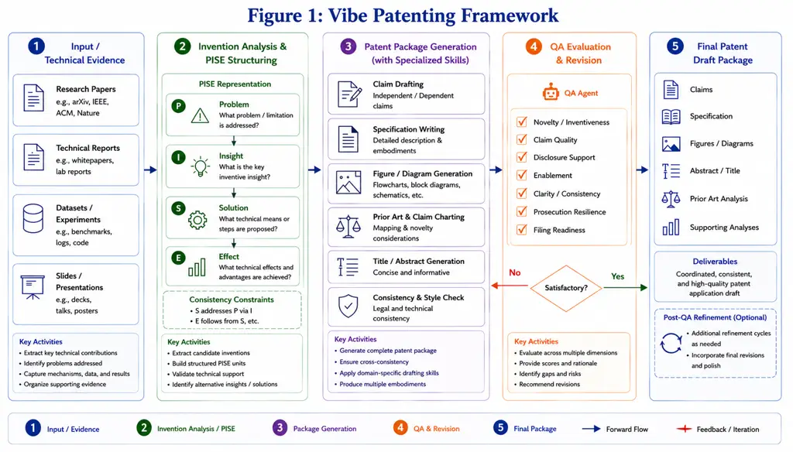
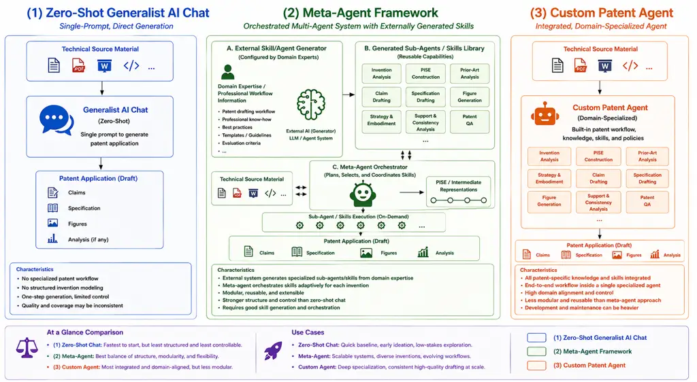
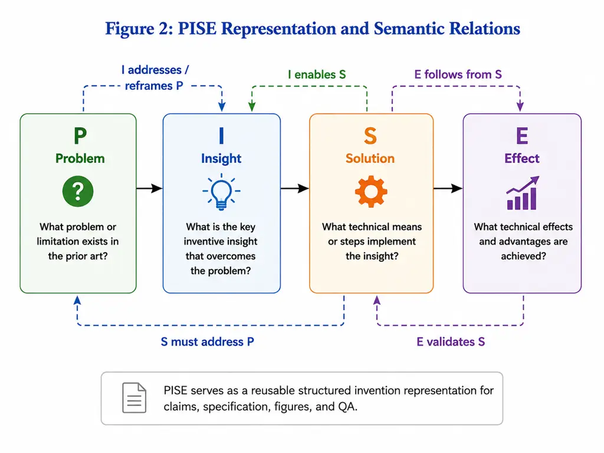
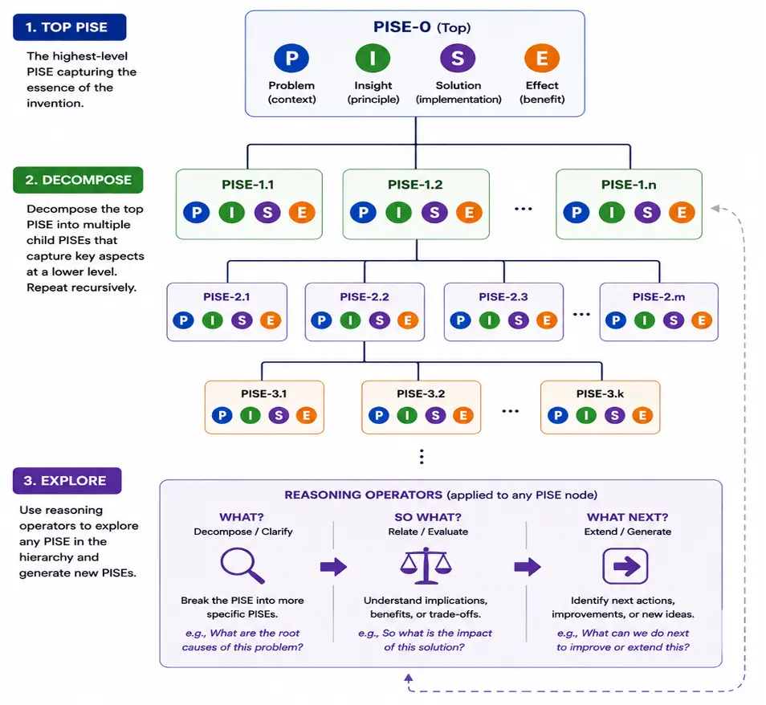
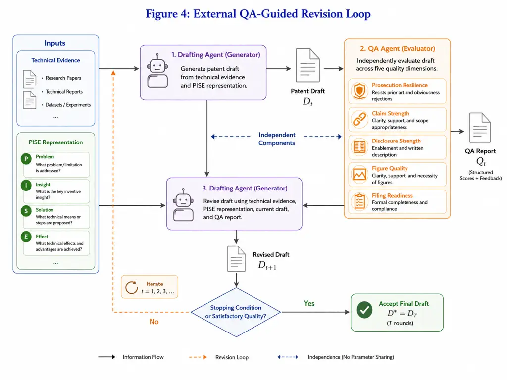
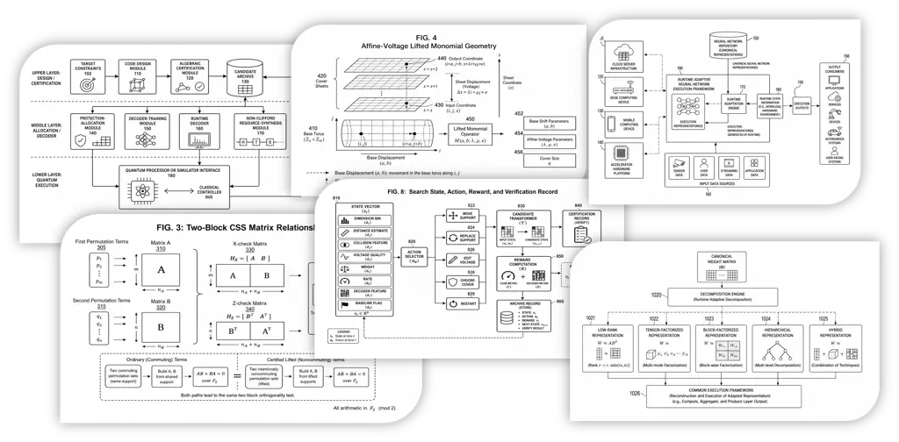
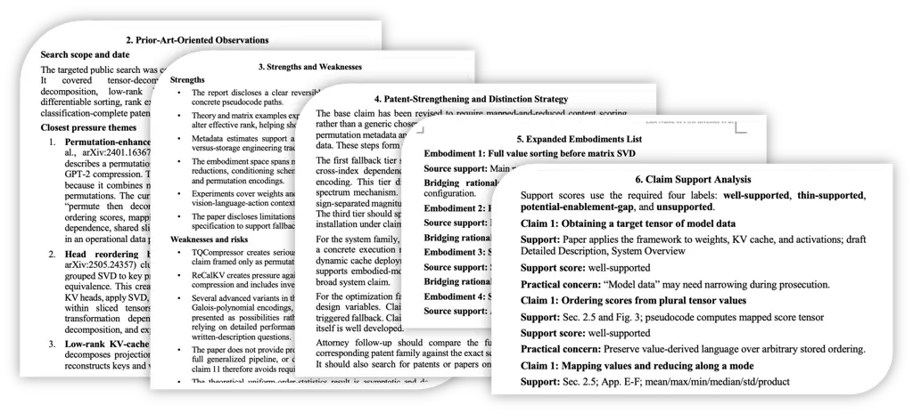
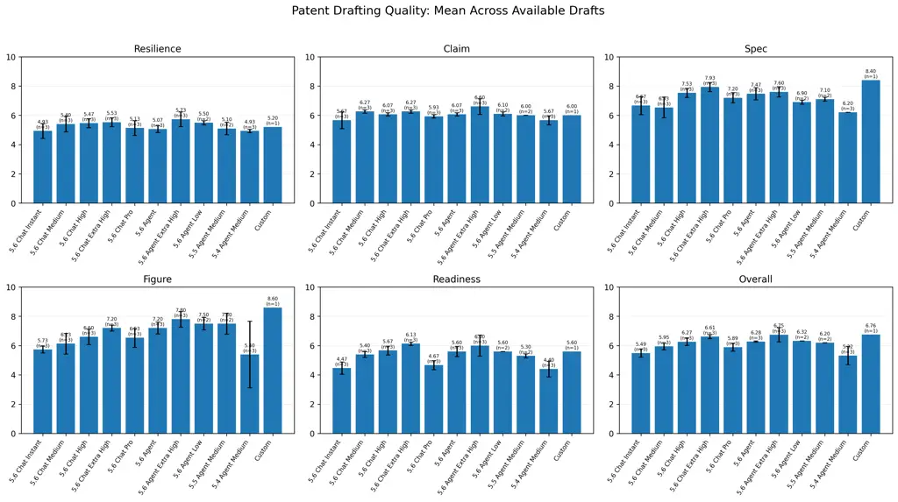

# Vibe Patenting: Evaluating LLM Judges for Professional Patent-Drafting Agents

Toshiaki Koike-Akino    Vladislav Blaykhman    Ye Wang    Jing Liu   
Gene V. Vinokur Affiliation: Mitsubishi Electric Research Laboratories
(MERL) Affiliation: 201 Broadway, Cambrdige, MA 02139
Affiliation: {koike, blyakhman, yewang, jiliu, vinokur}@merl.com

###### Abstract

LLM judges are increasingly used to evaluate and improve AI-generated
outputs, yet their reliability for complex professional work remains
unclear. We study this problem through Vibe Patenting, an end-to-end
patent-drafting testbed for AI-agent evaluation. A separately-invoked
LLM judge evaluates generated patent drafts and provides structured
feedback for iterative revision. Across multiple inventions and
drafting-agent configurations, judge-guided revision consistently
improves judge-assessed quality, while unguided revision tends to
saturate. Notably, iterative judge feedback enables a low-reasoning
agent to approach the performance of a substantially more expensive
high-reasoning agent. Stronger models and increased reasoning generally
improve judge-assessed drafting quality, while domain-specific agentic
workflows provide further gains. We validate the judge against
independent evaluation by a professional patent attorney and find
meaningful but strongly metric-dependent agreement and systematic
calibration differences. These results highlight both the utility and
limitations of LLM judges as evaluators and optimization signals for
complex professional workflows.

## 1 Introduction

Large language models (LLMs) are increasingly used not only to generate
content, but also to _evaluate_ it. LLM-as-a-judge methods provide
scalable evaluation of open-ended outputs for which conventional
automatic metrics are inadequate \[34, 17\]. As AI systems become more
agentic, however, the role of the judge is expanding from an offline
evaluation tool to an active component of the agentic pipeline: a judge
can critique an output, provide structured feedback, and guide
subsequent revision. _Can LLM judges provide reliable evaluation and
useful guidance for complex professional work?_

We investigate this question through Vibe Patenting, the automated
transformation of technical materials into professional patent drafts
with minimal human drafting effort. Patent drafting provides a
challenging evaluation setting because quality is multidimensional: a
complete draft must exhibit strong claims, sufficient technical
disclosure, coherent figures, prosecution resilience, and overall filing
readiness. Meaningful assessment ordinarily requires specialized
professional expertise.

We compare patent drafts produced by a skilled human drafter and LLM
systems spanning different model generations, reasoning budgets, and
agent architectures, using an independent LLM judge for patent quality
assurance (QA). We first examine how judge-assessed professional quality
varies across these drafting approaches. We then place the judge inside
an iterative revision loop and compare judge-guided refinement with
generic revision. Guided revision continues to improve judge-assessed
quality as unguided revision tends to saturate; notably, iterative
feedback enables a low-reasoning agent to approach the performance of a
substantially more expensive high-reasoning agent.

Finally, we separately validate the LLM judge against evaluations from a
professional patent attorney. Agreement is strongly metric dependent:
some quality dimensions exhibit meaningful ranking agreement despite
systematic score bias, whereas others show substantially weaker
correlation. Thus, improvement under an automated judge does not by
itself establish improvement under professional expert judgment. Our
results position patent drafting as a practical testbed for studying the
_validity, calibration, and feedback-loop behavior_ of LLM judges in
professional agentic workflows.



Figure 1: Vibe Patenting framework. AI agent first analyzes technical
evidence into a shared representation. Patent-specific skills then
generate coordinated claims, specification, figures, and supporting
analyses. QA judge agent evaluates the resulting package and can
initiate revision cycle.

## 2 Vibe Patenting: Professional Evaluation Testbed

We use _Vibe Patenting_ as a testbed for studying LLM judges in a
complex professional workflow. Given technical source material $`X`$,
the AI drafting system produces a coordinated patent package
$`D=\{C,S,F,A\}`$, where $`C`$ denotes claims, $`S`$ the written
specification, $`F`$ patent figures, and $`A`$ supporting analyses.
Unlike ordinary text generation, these components are mutually
constrained: claim scope should be supported by the specification,
figures should reflect the disclosed embodiments, and terminology and
technical content should remain consistent across the package. Figure 1
summarizes the overall workflow (See Appendix B).

Our AI agent can incorporate professional skills and domain expertise
analogous to those used by a patent attorney in drafting. Specifically,
the drafting pipeline first analyzes the source material, and structures
the candidate invention using a Problem–Insight–Solution–Effect (PISE)
representation (see Appendix C). PISE captures the technical problem,
the inventive insight, the proposed solution, and its resulting
technical effects, and provides a shared representation for downstream
drafting. Patent-oriented skills then use it to generate coordinated
claims, specification, embodiments, figures, and supporting analysis. We
evaluate several drafting configurations: general-purpose chat AI; meta
agent; and domain-specialized custom agent systems (see Appendix B).

##### LLM judge.

A separate patent-QA LLM judge evaluates each completed draft along five
professional quality dimensions: _Prosecution Resilience_, _Claim
Strength_, _Disclosure Strength_, _Figure Quality_, and _Filing
Readiness_. The QA judge uses rubric-coordinated scoring from 1 to 10
and provides structured critique and revision recommendations (see
Appendix D). Each draft is evaluated independently five times, and we
average the repeated scores for each dimension; the overall score is the
mean across the five dimensions.

##### Judge-guided revision.

The QA judge can initiate an iterative optimization loop. At revision
round $`t`$, the judge evaluates draft $`D_{t}`$ to produce a structured
QA report $`Q_{t}=f_{\mathrm{judge}}(D_{t}).`$ The drafting AI agent
then receives the current draft and the QA report to produce a revision
$`D_{t+1}=f_{\mathrm{rev}}(X,D_{t},Q_{t})`$. We compare this
judge-guided procedure with a generic revision control in which the same
drafting AI agent is asked to improve $`D_{t}`$ without access to
$`Q_{t}`$ as $`D_{t+1}^{\prime}=f_{\mathrm{rev}}(X,D_{t})`$. See
Appendix E.

Finally, we distinguish two human roles in our experiments. A _skilled
human drafter_ (having hundreds of filed coinventions) provides a
human-generation baseline, whereas a separate _professional patent
attorney evaluator_ independently scores available drafts for validating
the LLM judge. The attorney evaluation is therefore used as expert
reference judgment, not as the human drafting baseline.

## 3 Experiments and Results

##### Experimental setup.

We evaluate more than one hundred patent drafts generated from ten
scientific reports spanning multiple technical domains. Drafting
configurations include GPT-5.6 Sol chat mode with different reasoning
levels (Instant, Extra-High, Pro, etc.), GPT-5.4–5.6 agent modes, a
domain-specialized custom patent agent, and a skilled human drafter
baseline. Each completed draft is independently evaluated five times by
the LLM-based QA judge. The judge assigns integer scores from 1–10 for
five dimensions; we report their mean across dimensions as the overall
score.

### 3.1 Scaling Professional Patent-Drafting Agents

Figure 2 (Left) compares drafting approaches under GPT-5.6 Sol. Agentic
scaffolding improves upon zero-shot generation, while the
domain-specialized custom agent achieves the highest overall judge
score. Under the LLM judge, most AI configurations receive scores higher
than the skilled-drafter baseline, particularly for Disclosure and
Figure Quality. Importantly, the human drafter is a _generation
baseline_ and is distinct from the professional patent attorney used
later for independent expert evaluation.

Figure 2 (Right) further compares overall judge score with mean thinking
time across LLM model, reasoning, and agent configurations. Quality
generally increases with computation (Pearson $`r=0.63`$), but execution
time alone does not determine performance: configurations with similar
thinking times can achieve substantially different scores. This suggests
that how computation is structured—through model capability, reasoning,
and agentic scaffolding—matters in addition to its amount.

Figure 2: Left: Judge-assessed patent quality across drafting
configurations. Right: Overall judge score versus mean thinking time
across model, reasoning, and agent configurations.

### 3.2 Judge-Guided Iterative Revision

We next test whether the LLM judge can serve as an optimization signal
rather than only an offline evaluator. We compare a $`2\times 2`$ design
consisting of Instant and Extra-High reasoning, each with either
structured QA feedback or a generic revision without access to the QA
report.

As shown in Fig. 3(a), generic revision produces substantial initial
improvements but tends to saturate, whereas judge-guided revision
continues to improve through round 4. For Instant reasoning, the overall
judge score increases from $`5.43`$ to $`6.71`$ with QA guidance,
compared with $`6.33`$ under generic revision. Extra-High with QA
increases from $`6.26`$ to $`7.18`$, compared with $`6.73`$ without QA.

Notably, iterative feedback substantially closes the initial reasoning
gap. Although Instant begins $`0.84`$ points below Extra-High,
Instant+QA reaches $`6.71`$ by round 4, nearly matching Extra-High
without QA ($`6.73`$). Thus, structured evaluator feedback can partially
trade revision depth for single-pass inference strength. However, these
improvements in LLM-judge scores should not by themselves be interpreted
as equivalent improvements under professional evaluation.

(a) Judge-guided iterative revision

(b) LLM judge vs. patent attorney

Figure 3: LLM judge as an evaluator and optimization signal. (a) Overall
judge score over revision rounds for Instant and Extra-High reasoning
with and without structured QA feedback, averaged across nine
inventions. (b) LLM-QA score vs. independent professional
patent-attorney evaluation.

### 3.3 Agreement with Professional Evaluation

Finally, we test whether the LLM judge reflects professional judgment. A
professional patent attorney independently scores matched patent drafts
using the same five quality dimensions. For each draft, we compare the
attorney score with the mean score of five independent LLM-QA
evaluations. Figure 3(b) and Table 1 show significant overall
association (Pearson $`r=0.717`$), but agreement is strongly metric
dependent. Figure Quality exhibits the strongest relationship, and
Disclosure Strength also tracks professional judgments, whereas several
other dimensions show weak correlation.

Correlation and calibration further capture different properties of the
judge. Claim Strength, for example, exhibits weak correlation
($`r=0.103`$) but small absolute error and little systematic bias
($`0.06`$). Conversely, Figure and Disclosure scores better track
relative expert judgments while being systematically higher than the
attorney scores. Thus, an LLM judge may provide a useful ranking or
optimization signal without its numerical scores being calibrated to
professional ratings.

These results support LLM-based QA as a scalable experimental evaluator,
but also expose an important limitation of judge-guided optimization:
increasing the judge’s score does not establish corresponding
improvement under professional judgment. Metric-specific calibration and
independent expert validation therefore remain important for
professional agentic workflows.

| Metric                 | Pearson $`r`$ ($`p`$-value) | Spearman $`\rho`$ ($`p`$-value) | MAE  | Bias  |
| ---------------------- | --------------------------- | ------------------------------- | ---- | ----- |
| Prosecution Resilience | 0.042 (0.853)               | 0.082 (0.717)                   | 1.58 | +1.58 |
| Claim Strength         | 0.103 (0.649)               | 0.014 (0.949)                   | 0.32 | +0.06 |
| Disclosure Strength    | 0.624 (0.002)               | 0.527 (0.012)                   | 3.41 | +3.41 |
| Figure Quality         | 0.825 (0.000)               | 0.693 (0.000)                   | 2.61 | +2.61 |
| Filing Readiness       | 0.207 (0.356)               | 0.119 (0.597)                   | 1.57 | +1.57 |
| Overall                | 0.717 (0.000)               | 0.513 (0.015)                   | 1.85 | +1.85 |

Table 1: Agreement between repeated AI QA scores and professional
patent-attorney scores across 22 matched draft–condition pairs. Bias is
AI minus human score.

## 4 Conclusion

We studied LLM-as-a-judge evaluation through _Vibe Patenting_, a testbed
for complex professional AI workflows. Judge-guided revision
consistently improves judge-assessed patent quality and enables a
low-reasoning agent to approach the performance of substantially more
expensive high-reasoning generation. Nonetheless, comparison with a
professional patent attorney reveals strongly metric-dependent agreement
and calibration. These results suggest that LLM judges can provide
useful evaluation and optimization signals, while improvements against
the judge should not be assumed to translate directly into improvements
under expert evaluation.

## References

- \[1\] D. A. Boiko, R. MacKnight, B. Kline, and G. Gomes (2023)
  Autonomous chemical research with large language models. Nature 624,
  pp. 570–578. External Links:
  [Document](https://dx.doi.org/10.1038/s41586-023-06792-0),
  [Link](https://doi.org/10.1038/s41586-023-06792-0) Cited by: §A.1.
- \[2\] A. M. Bran, S. Cox, O. Schilter, C. Baldassari, A. D. White,
  and P. Schwaller (2024) Augmenting large language models with
  chemistry tools. Nature Machine Intelligence 6, pp. 525–535. External
  Links: [Document](https://dx.doi.org/10.1038/s42256-024-00832-8),
  [Link](https://doi.org/10.1038/s42256-024-00832-8) Cited by: §A.1.
- \[3\] Clarivate (2026) Rowan patents. Note:
  [https://clarivate.com/intellectual-property/ip-management-software/rowan-patents/](https://clarivate.com/intellectual-property/ip-management-software/rowan-patents/)Commercial
  product page; accessed 2026-08-27 Cited by: §A.1.
- \[4\] DeepIP (2026) AI patent drafting. Note:
  [https://www.deepip.ai/products/patent-drafting](https://www.deepip.ai/products/patent-drafting)Commercial
  product page; accessed 2026-08-27 Cited by: §A.1.
- \[5\] A. Ghafarollahi and M. J. Buehler (2025) SciAgents: automating
  scientific discovery through bioinspired multi-agent intelligent graph
  reasoning. Advanced Materials 37 (22), pp. e2413523. External Links:
  [Document](https://dx.doi.org/10.1002/adma.202413523),
  [Link](https://doi.org/10.1002/adma.202413523) Cited by: §A.1.
- \[6\] A. E. Ghareeb, B. Chang, L. Mitchener, A. Yiu, C. J.
  Szostkiewicz, D. Shved, G. J. Gyimesi, J. M. Laurent, S. M.
  Wright, M. T. Razzak, A. D. White, S. C. Finnemann, M. M. Hinks, et
  al. (2026) A multi-agent system for automating scientific discovery.
  Nature 655, pp. 497–505. External Links:
  [Document](https://dx.doi.org/10.1038/s41586-026-10652-y),
  [Link](https://doi.org/10.1038/s41586-026-10652-y) Cited by: §A.1.
- \[7\] J. Gottweis, W. Weng, A. Daryin, T. Tu, P. Sirkovic, A.
  Myaskovsky, G. Glowaty, F. Weissenberger, A. Orlandi, et al. (2026)
  Accelerating scientific discovery with co-scientist. Nature 655,
  pp. 487–496. External Links:
  [Document](https://dx.doi.org/10.1038/s41586-026-10644-y),
  [Link](https://doi.org/10.1038/s41586-026-10644-y) Cited by: §A.1.
- \[8\] M. Gridach, J. Nanavati, K. Zine El Abidine, L. Mendes, and C.
  Mack (2025) Agentic AI for scientific discovery: a survey of progress,
  challenges, and future directions. arXiv preprint arXiv:2503.08979.
  External Links: [Link](https://arxiv.org/abs/2503.08979) Cited by:
  §A.1.
- \[9\] J. Gu, X. Jiang, Z. Shi, H. Tan, X. Zhai, C. Xu, W. Li, Y.
  Shen, S. Ma, H. Liu, S. Wang, K. Zhang, Y. Wang, W. Gao, L. Ni, and J.
  Guo (2026) A survey on LLM-as-a-judge. The Innovation 7 (6),
  pp. 101253. External Links:
  [Document](https://dx.doi.org/10.1016/j.xinn.2025.101253),
  [Link](https://doi.org/10.1016/j.xinn.2025.101253) Cited by: §A.1.
- \[10\] S. Hong, M. Zhuge, J. Chen, X. Zheng, Y. Cheng, J. Wang, C.
  Zhang, Z. Wang, S. Yau, Z. Lin, L. Zhou, C. Ran, L. Xiao, C. Wu,
  and J. Schmidhuber (2024) MetaGPT: meta programming for a multi-agent
  collaborative framework. In International Conference on Learning
  Representations, Cited by: §A.1.
- \[11\] L. Jiang, P. A. Scherz, and S. Goetz (2025) Towards better
  evaluation for generated patent claims. In Proceedings of the 63rd
  Annual Meeting of the Association for Computational Linguistics,
  External Links: [Link](https://aclanthology.org/2025.acl-long.190/)
  Cited by: §A.1.
- \[12\] L. Jiang, C. Zhang, P. A. Scherz, and S. Goetz (2025) Can large
  language models generate high-quality patent claims?. In Findings of
  the Association for Computational Linguistics: NAACL 2025,
  pp. 1272–1287. External Links:
  [Document](https://dx.doi.org/10.18653/v1/2025.findings-naacl.70)
  Cited by: §A.1.
- \[13\] S. Kim, J. Shin, Y. Cho, J. Jang, S. Longpre, H. Lee, S.
  Yun, S. Shin, S. Kim, J. Thorne, and M. Seo (2024) Prometheus:
  inducing fine-grained evaluation capability in language models. In
  International Conference on Learning Representations, External Links:
  [Link](https://openreview.net/forum?id=8euJaTveKw) Cited by: §A.1.
- \[14\] LexisNexis (2026) PatentOptimizer. Note:
  [https://www.lexisnexis.com/en-us/products/patent-optimizer-for-legal.page](https://www.lexisnexis.com/en-us/products/patent-optimizer-for-legal.page)Commercial
  product page; accessed 2026-08-27 Cited by: §A.1.
- \[15\] D. Li, B. Jiang, L. Huang, A. Beigi, C. Zhao, Z. Tan, A.
  Bhattacharjee, Y. Jiang, C. Chen, T. Wu, K. Shu, L. Cheng, and H.
  Liu (2025) From generation to judgment: opportunities and challenges
  of LLM-as-a-judge. In Proceedings of the 2025 Conference on Empirical
  Methods in Natural Language Processing, pp. 2757–2791. External Links:
  [Document](https://dx.doi.org/10.18653/v1/2025.emnlp-main.138),
  [Link](https://aclanthology.org/2025.emnlp-main.138/) Cited by: §A.1.
- \[16\] J. Li, S. Sun, W. Yuan, R. Fan, H. Zhao, and P. Liu (2024)
  Generative judge for evaluating alignment. In International Conference
  on Learning Representations, External Links:
  [Link](https://gair-nlp.github.io/auto-j/) Cited by: §A.1.
- \[17\] Y. Liu, D. Iter, Y. Xu, S. Wang, R. Xu, and C. Zhu (2023)
  G-Eval: NLG evaluation using GPT-4 with better human alignment. In
  Proceedings of the 2023 Conference on Empirical Methods in Natural
  Language Processing, pp. 2511–2522. External Links:
  [Document](https://dx.doi.org/10.18653/v1/2023.emnlp-main.153),
  [Link](https://aclanthology.org/2023.emnlp-main.153/) Cited by: §A.1,
  §1.
- \[18\] C. Lu, C. Lu, R. T. Lange, Y. Yamada, S. Hu, J. Foerster, D.
  Ha, and J. Clune (2026) Towards end-to-end automation of AI research.
  Nature 651 (8107), pp. 914–919. External Links:
  [Document](https://dx.doi.org/10.1038/s41586-026-10265-5),
  [Link](https://doi.org/10.1038/s41586-026-10265-5) Cited by: §A.1.
- \[19\] A. Madaan, N. Tandon, P. Gupta, S. Hallinan, L. Gao, S.
  Wiegreffe, U. Alon, N. Dziri, S. Prabhumoye, Y. Yang, S. Gupta, B. P.
  Majumder, K. Hermann, S. Welleck, A. Yazdanbakhsh, and P. Clark (2023)
  Self-Refine: iterative refinement with self-feedback. In Advances in
  Neural Information Processing Systems, Vol. 36. External Links:
  [Document](https://dx.doi.org/10.52202/075280-2019) Cited by: §A.1.
- \[20\] Patlytics (2026) AI-powered patent application drafting. Note:
  [https://www.patlytics.ai/patent-application-drafting](https://www.patlytics.ai/patent-application-drafting)Commercial
  product page; accessed 2026-08-27 Cited by: §A.1.
- \[21\] Patsnap (2026) Eureka IP: AI patent drafting. Note:
  [https://eureka.patsnap.com/ip-drafting](https://eureka.patsnap.com/ip-drafting)Commercial
  product page; accessed 2026-08-27 Cited by: §A.1.
- \[22\] S. Schmidgall, Y. Su, Z. Wang, X. Sun, J. Wu, X. Yu, J. Liu, M.
  Moor, Z. Liu, and E. Barsoum (2025) Agent laboratory: using LLM agents
  as research assistants. In Findings of the Association for
  Computational Linguistics: EMNLP 2025, pp. 5977–6043. External Links:
  [Document](https://dx.doi.org/10.18653/v1/2025.findings-emnlp.320),
  [Link](https://aclanthology.org/2025.findings-emnlp.320/) Cited by:
  §A.1.
- \[23\] N. Shinn, F. Cassano, A. Gopinath, K. Narasimhan, and S.
  Yao (2023) Reflexion: language agents with verbal reinforcement
  learning. In Advances in Neural Information Processing Systems, Vol. 36. External Links:
  [Document](https://dx.doi.org/10.52202/075280-0377) Cited by: §A.1.
- \[24\] C. Snell, J. Lee, K. Xu, and A. Kumar (2024) Scaling LLM
  test-time compute optimally can be more effective than scaling model
  parameters. arXiv preprint arXiv:2408.03314. Cited by: §A.1.
- \[25\] S. Tan, S. Zhuang, K. Montgomery, W. Y. Tang, A. Cuadron, C.
  Wang, R. A. Popa, and I. Stoica (2024) JudgeBench: a benchmark for
  evaluating LLM-based judges. arXiv preprint arXiv:2410.12784. External
  Links: [Link](https://arxiv.org/abs/2410.12784) Cited by: §A.1.
- \[26\] P. Verga, S. Hofstatter, S. Althammer, Y. Su, A. Piktus, A.
  Arkhangorodsky, M. Xu, N. White, and P. Lewis (2024) Replacing judges
  with juries: evaluating LLM generations with a panel of diverse
  models. arXiv preprint arXiv:2404.18796. External Links:
  [Link](https://arxiv.org/abs/2404.18796) Cited by: §A.1.
- \[27\] X. Wang, J. Wei, D. Schuurmans, Q. V. Le, E. H. Chi, S.
  Narang, A. Chowdhery, and D. Zhou (2023) Self-consistency improves
  chain of thought reasoning in language models. In International
  Conference on Learning Representations, Cited by: §A.1.
- \[28\] K. Wataoka, T. Takahashi, and R. Ri (2024) Self-preference bias
  in LLM-as-a-judge. In NeurIPS 2024 Workshop on Safe Generative AI,
  External Links: [Link](https://arxiv.org/abs/2410.21819) Cited by:
  §A.1.
- \[29\] Q. Wu, G. Bansal, J. Zhang, Y. Wu, B. Li, E. Zhu, L. Jiang, X.
  Zhang, S. Zhang, J. Liu, A. H. Awadallah, R. W. White, D. Burger,
  and C. Wang (2023) AutoGen: enabling next-gen LLM applications via
  multi-agent conversation. arXiv preprint arXiv:2308.08155. Cited by:
  §A.1.
- \[30\] S. Yao, D. Yu, J. Zhao, I. Shafran, T. L. Griffiths, Y. Cao,
  and K. Narasimhan (2023) Tree of thoughts: deliberate problem solving
  with large language models. arXiv preprint arXiv:2305.10601. Cited by:
  §A.1.
- \[31\] S. Yao, J. Zhao, D. Yu, N. Du, I. Shafran, K. Narasimhan,
  and Y. Cao (2023) ReAct: synergizing reasoning and acting in language
  models. In International Conference on Learning Representations,
  External Links: [Link](https://arxiv.org/abs/2210.03629) Cited by:
  §A.1.
- \[32\] Y. Yoo, Q. Xu, and L. Cao (2025) PatentScore: multi-dimensional
  evaluation of LLM-generated patent claims. In Proceedings of the 2025
  Conference on Empirical Methods in Natural Language Processing,
  External Links:
  [Document](https://dx.doi.org/10.18653/v1/2025.emnlp-main.1564) Cited
  by: §A.1.
- \[33\] Z. Zeng, J. Yu, T. Gao, Y. Meng, T. Goyal, and D. Chen (2024)
  Evaluating large language models at evaluating instruction following.
  In International Conference on Learning Representations, External
  Links: [Link](https://arxiv.org/abs/2310.07641) Cited by: §A.1.
- \[34\] L. Zheng, W. Chiang, Y. Sheng, S. Zhuang, Z. Wu, Y. Zhuang, Z.
  Lin, Z. Li, D. Li, E. P. Xing, H. Zhang, J. E. Gonzalez, and I.
  Stoica (2023) Judging LLM-as-a-judge with MT-Bench and chatbot arena.
  In Advances in Neural Information Processing Systems, External Links:
  [Link](https://arxiv.org/abs/2306.05685) Cited by: §A.1, §1.

## Appendix A Related Work

### A.1 LLM-as-a-Judge

Large language models are increasingly used as scalable evaluators for
open-ended generation, where conventional reference-based metrics often
correlate poorly with human judgment. Early influential work such as
MT-Bench and Chatbot Arena showed that strong LLM judges can achieve
substantial agreement with human preferences, while also exposing
systematic failure modes including position, verbosity, and
self-enhancement biases \[34\]. G-Eval further demonstrated that
rubric-based prompting with explicit evaluation steps can improve human
alignment for natural-language generation evaluation \[17\]. Subsequent
work has developed evaluator-specific models, including Prometheus for
fine-grained rubric-conditioned scoring \[13\] and Auto-J for generative
alignment judgments with natural-language critiques \[16\]. These
studies establish LLM judging as a practical alternative to costly human
evaluation, particularly when multidimensional criteria and free-form
outputs make automatic metrics inadequate.

Recent work has increasingly focused on the _reliability of the judges
themselves_. LLMBar constructs adversarial instruction-following
comparisons that reveal substantial variation across evaluator models
and prompting strategies \[33\], while JudgeBench evaluates judges on
difficult knowledge, reasoning, mathematics, and coding comparisons and
shows that strong general-purpose models can still struggle on
objectively verifiable cases \[25\]. Other studies examine systematic
evaluator bias: self-preference can favor outputs that are more familiar
to the judging model \[28\], and panels of diverse evaluators can reduce
intra-model bias while improving cost efficiency relative to a single
large judge \[26\]. Recent surveys synthesize these developments around
reliability, consistency, bias mitigation, benchmarking, and
deployment \[15, 9\].

Our setting differs from most prior work in two respects. First, we
evaluate _complete professional artifacts_ rather than short-form
responses or pairwise preferences: a patent draft is judged along
prosecution resilience, claim strength, disclosure strength, figure
quality, and filing readiness. Second, the judge is not used only for
offline evaluation; its structured critique is fed back to the drafting
agent as an optimization signal over multiple revision rounds. We
therefore study both whether an LLM judge correlates with professional
patent-attorney evaluation and how judge-guided optimization differs
from generic self-revision, providing a professional testbed for the
reliability of LLM judges inside iterative agentic workflows.

##### LLM agents and domain-expert workflows.

Large language models have increasingly been extended from passive text
generators to agents that reason, use tools, and execute multi-step
workflows. ReAct \[31\] interleaves reasoning and actions, while
AutoGen \[29\] provides a general framework for orchestrating
conversations among multiple customizable agents. Particularly relevant
to our setting, MetaGPT \[10\] encodes human standard operating
procedures into structured multi-agent workflows, demonstrating how
human workflow structure can support complex LLM-based tasks. Our work
follows this broader direction but studies a high-stakes professional
task in which an agent must transform technical source material into a
set of mutually constrained artifacts. We encode patent-domain expertise
through specialized drafting and analysis procedures and a shared
_Problem–Insight–Solution–Effect (PISE)_ representation, which organizes
an invention before coordinated generation of claims, specification, and
figures. Rather than treating domain expertise as an alternative to
stronger models, we empirically study how agentic scaffolding interacts
with model capability and inference-time reasoning effort.

##### Agentic AI for scientific discovery.

Agentic systems are also increasingly being used to automate substantial
portions of the scientific process, providing a particularly relevant
precedent for professional agents operating on technical
knowledge \[8\]. In chemistry, ChemCrow \[2\] augments an LLM with
expert-designed chemistry tools for synthesis planning, execution, drug
discovery, and materials design, while Coscientist \[1\] combines
literature and documentation search, code execution, and laboratory
automation to design and perform chemical experiments. SciAgents \[5\]
couples multi-agent reasoning with ontological knowledge graphs to
generate and refine hypotheses for materials discovery. More general
research agents target longer portions of the scientific workflow: Agent
Laboratory \[22\] automates literature review, experimentation, and
report writing from a human-provided research idea, whereas The AI
Scientist \[18\] spans idea generation, implementation, experimentation,
analysis, manuscript writing, and automated review. Recent systems move
further toward iterative scientific reasoning and validation.
Co-Scientist \[7\] uses specialized agents for hypothesis generation,
reflection, ranking, and evolution, together with scalable test-time
computation and experimental validation, while Robin \[6\] closes a
laboratory-in-the-loop cycle by connecting literature-based hypothesis
generation, experimental data analysis, and subsequent hypothesis
refinement. Collectively, these systems suggest that scientific agents
benefit from explicit workflow decomposition, domain-specific tools and
representations, and iterative evaluation rather than monolithic
generation alone. Our work is complementary: instead of automating
scientific discovery itself, we study the downstream transformation of
scientific and technical evidence into a coordinated professional
intellectual-property artifact, using PISE as an invention-centered
intermediate representation and evaluating how agentic structure
interacts with model capability, inference-time reasoning, and external
QA-guided revision.

##### Test-time scaling and iterative refinement.

A complementary line of research improves LLM performance by allocating
additional computation at inference time. Self-consistency \[27\]
samples multiple reasoning trajectories and aggregates their answers,
while Tree of Thoughts \[30\] explicitly searches over intermediate
reasoning states. Snell et al. \[24\] systematically study test-time
compute scaling and show that its effectiveness depends on problem
difficulty and the strategy used to allocate inference compute. These
findings motivate our evaluation across multiple reasoning-effort
settings: we do not assume that domain-specific agent design replaces
test-time scaling, but instead examine model capability, reasoning
effort, and professional agentic structure as complementary dimensions
of performance.

Iterative feedback provides another form of test-time improvement.
Self-Refine \[19\] repeatedly generates feedback on an LLM’s own output
and uses that feedback for revision, while Reflexion \[23\] uses
linguistic feedback and reflective memory to improve subsequent agent
behavior. Our QA-guided revision loop is related in spirit but separates
the drafting and evaluation roles: an external patent-quality agent
evaluates a complete draft along multiple professional criteria, and its
structured report is subsequently provided to a drafting agent for the
next revision. We evaluate this process over multiple rounds and across
different drafting configurations.

##### AI for patent generation and evaluation.

Patent-language generation has recently attracted attention as a
specialized application of LLMs. Jiang et al. \[12\] systematically
evaluate LLM-based patent-claim generation and find that general-purpose
frontier models can generate strong first independent claims, while
dependent claims remain substantially more challenging and expert
revision is still required. Evaluation itself is difficult because
conventional text-generation metrics do not capture the structural,
technical, and legal properties of patent claims. Patent-CE and
PatClaimEval \[11\] introduce expert-annotated, multidimensional
evaluation of generated claims, and PatentScore \[32\] develops a
structured claim-evaluation framework that reports strong correlation
with expert annotations. These works motivate our use of
multidimensional quality assessment and expert validation. Our
evaluation differs in scope by assessing complete patent drafts rather
than isolated claims, including prosecution resilience, claim strength,
disclosure strength, figure quality, and filing readiness, and by
directly comparing repeated AI assessments with scores from a
professional patent attorney.

Commercial interest in AI-assisted patent preparation has also grown
rapidly. Current products include Patsnap Eureka IP \[21\],
DeepIP \[4\], Patlytics \[20\], Rowan Patents \[3\], and LexisNexis
PatentOptimizer \[14\]. Public product descriptions span
invention-disclosure processing, prior-art analysis, claim and
specification drafting, drawing support, consistency checking, and
prosecution assistance. These systems demonstrate substantial practical
demand for AI-assisted patent workflows, but their internal
architectures, model and reasoning configurations, evaluation protocols,
and controlled comparisons are generally proprietary. Consequently, our
objective is not to claim the first use of AI for patent drafting, but
to use patent drafting as a controlled testbed for studying how _model
capability, inference-time reasoning, structured domain expertise, and
iterative QA-guided refinement_ jointly affect the quality and
efficiency of professional AI agents.

## Appendix B Vibe Patenting: Agentic Framework

We develop _Vibe Patenting_, an agentic AI framework that transforms
scientific and technical source materials into a coordinated patent
draft package. Unlike zero-shot prompting, in which an LLM directly
converts source text into patent prose, our framework explicitly
decomposes patent drafting into invention understanding,
protection-oriented reasoning, document generation, and quality
assurance. The system accepts heterogeneous technical evidence—such as
research papers, technical reports, slides, experimental results, and
source code—and produces claims, a specification, patent figures, and
supporting analysis reports. Figure 1 illustrates the overall workflow.

### B.1 From Technical Evidence to Patent Package

Let $`\mathcal{X}`$ denote a collection of technical source materials
describing a candidate invention. The objective is to produce a patent
package
$`\mathcal{D}=\{\mathcal{C},\mathcal{S},\mathcal{F},\mathcal{A}\}`$,
where $`\mathcal{C}`$ denotes claims, $`\mathcal{S}`$ the written
specification, $`\mathcal{F}`$ patent figures, and $`\mathcal{A}`$
auxiliary analyses such as invention characterization,
prior-art-oriented observations, embodiment expansion, support analysis,
and quality assessment.

This formulation differs from ordinary long-form generation because the
output components are mutually constrained. Independent claims should
capture the inventive concept while maintaining support in the written
description; dependent claims should provide meaningful fallback
positions; embodiments should broaden implementation coverage; figures
should correspond to the terminology and structures described in the
specification; and all components should remain consistent with the
technical evidence. We therefore treat patent generation as a
coordinated reasoning problem rather than independent document
generation. The overall process consists of four stages:

1.  1.  Technical evidence ingestion: analyze the source material and
        extract technical contributions, assumptions, mechanisms,
        experimental evidence, and candidate inventive concepts.
2.  2.  Invention structuring: organize the candidate invention through the
        PISE representation described below.
3.  3.  Patent package generation: invoke specialized patent-oriented skills
        for protection strategy, claim drafting, specification drafting,
        embodiment expansion, figure generation, and supporting analysis.
4.  4.  Quality assurance and revision: evaluate the complete draft using an
        external QA process and, when necessary, feed the resulting analysis
        back to the drafting agent.

### B.2 PISE: A Structured Invention Representation

A central component of both of our agentic implementations is the
_Problem–Insight–Solution–Effect (PISE)_ representation. Given technical
evidence $`\mathcal{X}`$, the agent first constructs
$`\mathcal{Z}_{\mathrm{PISE}}=(P,I,S,E)`$, where:

- •
  $`P`$ (Problem) describes the technical limitation, unmet need, or
  deficiency being addressed;
- •
  $`I`$ (Insight) captures the key technical recognition or inventive
  idea that enables a solution;
- •
  $`S`$ (Solution) describes the technical mechanism, structure,
  procedure, or combination that realizes the insight; and
- •
  $`E`$ (Effect) identifies the technical consequences, improvements,
  capabilities, or measurable advantages produced by the solution.

PISE is intended to make latent invention structure explicit before
patent text is generated. In particular, the four elements are
constrained semantically rather than being independent summaries. The
solution should address the problem through the identified insight, and
the stated effects should be technically attributable to the solution.
These relations can be expressed abstractly as
$`I\Rightarrow S,S\models P,S\Rightarrow E`$, where the notation
represents semantic consistency rather than formal logical implication.

A technical work may contain multiple related inventive concepts. In
such cases, the system can construct a hierarchy or collection of PISE
units,
$`\mathcal{Z}=\{\mathcal{Z}^{(1)}_{\mathrm{PISE}},\ldots,\mathcal{Z}^{(K)}_{\mathrm{PISE}}\}`$,
allowing the agent to separate a broad inventive concept from narrower
implementations and alternative embodiments. This structured
representation becomes the shared reasoning state used by downstream
drafting modules.

The motivation for PISE is that papers and technical reports are
generally organized to communicate scientific results, whereas patents
must organize the same technical knowledge around protectable inventive
concepts. PISE provides an intermediate abstraction between these two
document structures.

### B.3 Professional Patent-Drafting Skills

After construction of the invention representation, the agent invokes a
collection of patent-oriented reasoning and generation skills. The
workflow used in our system includes technical insight and invention
analysis; prior-art-oriented analysis; strength and weakness assessment;
protection and claim strategy; alternative embodiment generation;
independent and dependent claim drafting; specification drafting; patent
figure generation; support and consistency analysis; and quality review
and revision.

These skills are not intended to act as independent text generators.
They operate on a shared representation of the invention and on
artifacts produced by earlier stages. For example, claim drafting uses
the PISE representation together with the selected protection strategy;
specification drafting expands the same concepts into enabling
embodiments; and figure generation converts important structures and
relationships into graphical form consistent with the specification.

The resulting computation can be summarized as
$`\mathcal{X}\xrightarrow{f_{\mathrm{inv}}}\mathcal{Z}_{\mathrm{PISE}}\xrightarrow{f_{\mathrm{strategy}}}\mathcal{R}\xrightarrow{f_{\mathrm{draft}}}\mathcal{D}`$,
where $`\mathcal{R}`$ represents intermediate patent strategy and
embodiment decisions. This decomposition enables the system to perform
explicit invention-oriented reasoning before committing to detailed
patent language.

### B.4 Professional Agent Implementations

We investigate three implementations of professional AI patent drafting,
illustrated in Figure 4.



Figure 4: Three agent architectures. The generalist AI chat reasons
about how to convert technical materials into patent drafts in zero-shot
fashion. The meta-agentic framework constructs reusable patent-oriented
skills and workflow to orchestrate. The custom patent agent directly
integrates patent-specific workflow logic, and specialized drafting
skills.

##### Generalist chat AI.

The simplest approach uses a modern general-purpose chat LLM to convert
technical materials directly into a patent draft in a zero-shot manner.
The AI makes its own reasoning effort to generate a patent package.

##### Meta-agentic framework.

The second implementation is to use a general-purpose agent to generate
professional skills and to orchestrate sub-agents, from expert knowledge
and patent-specific workflow. The agent receives a high-level
patent-generation task and dynamically invokes reusable skills for
invention analysis, PISE construction, claim drafting, specification
drafting, figure generation, and related subtasks. Intermediate
artifacts provide context for later stages of the workflow autonomously.

##### Custom patent agent.

The third implementation packages professional patent-drafting behavior
into a dedicated domain agent. Patent-specific workflow instructions,
drafting guidelines, templates, reference materials, and specialized
skills are directly available to the agent. The agent is instructed to
perform invention analysis, construct the PISE representation, develop a
protection strategy, and coordinate the generation of the complete
patent package. This architecture places substantial domain knowledge
inside the agent configuration. It therefore provides a strong form of
professional scaffolding and serves as our most specialized system.

Conceptually, the custom agent encodes professional behavior primarily
through a dedicated agent configuration, whereas the meta-agentic system
externalizes more of this behavior into modular skills and workflow
components through the use of generalist AI agent. This distinction
allows us to examine whether professional capability can be obtained
through reusable agentic scaffolding rather than only through a strongly
customized domain agent.

### B.5 End-to-End Workflow

Given technical source material $`\mathcal{X}`$, both of our agentic
implementations execute a workflow of the general form

```math
\mathcal{X}\rightarrow\mathcal{Z}_{\mathrm{PISE}}\rightarrow\mathcal{R}\rightarrow\{\mathcal{C},\mathcal{S},\mathcal{F},\mathcal{A}\}\rightarrow\mathcal{Q}, \tag{1}
```

where $`\mathcal{Z}_{\mathrm{PISE}}`$ is the structured invention
representation, $`\mathcal{R}`$ denotes protection-strategy and
embodiment decisions, $`\mathcal{C}`$ denotes claims, $`\mathcal{S}`$
the specification, $`\mathcal{F}`$ the figures, $`\mathcal{A}`$
supporting analyses, and $`\mathcal{Q}`$ the QA report.

Table 2 summarizes the major skills used in the system.

| Skill                        | Purpose                                                           | Primary Input                  | Output                        |
| ---------------------------- | ----------------------------------------------------------------- | ------------------------------ | ----------------------------- |
| Technical analysis           | Identify contributions, mechanisms, assumptions, and evidence     | Paper/report/slides/code       | Structured technical findings |
| Invention discovery          | Identify potentially patentable concepts and abstractions         | Technical findings             | Candidate inventions          |
| PISE construction            | Represent each invention as Problem–Insight–Solution–Effect       | Candidate invention + evidence | PISE representation           |
| Prior-art-oriented analysis  | Identify likely novelty and obviousness pressure points           | PISE + technical context       | Prior-art-oriented analysis   |
| Strength/weakness analysis   | Identify protection opportunities, gaps, and design-around risks  | PISE + analysis                | Strategic assessment          |
| Patent strategy              | Determine protection hierarchy and independent-claim concepts     | PISE + strategic assessment    | Claim/protection strategy     |
| Embodiment expansion         | Generate alternative implementations and fallback positions       | PISE + technical context       | Embodiment set                |
| Claim drafting               | Generate independent and dependent claim hierarchy                | PISE + strategy + embodiments  | Claims                        |
| Specification drafting       | Generate enabling disclosure consistent with claims               | Claims + PISE + embodiments    | Specification                 |
| Figure generation            | Generate patent-oriented system, process, and embodiment diagrams | PISE + claims + specification  | Patent figures                |
| Support/consistency analysis | Check terminology, claim support, and figure/spec alignment       | Complete draft                 | Support analysis              |
| Patent QA                    | Score and critique complete patent package                        | Draft + figures                | Multi-axis scores + report    |
| Revision                     | Address identified QA weaknesses                                  | Draft + QA report              | Revised draft                 |

Table 2: Representative professional skills used by the Vibe Patenting
framework.

### B.6 Custom Patent Agent

The custom implementation integrates the patent-specific workflow,
professional instructions, reference materials, templates, and
specialized skills into a dedicated domain agent. The agent is
explicitly instructed to reason about the technical material before
drafting and to generate a coordinated patent package rather than
independent document fragments.

The custom agent therefore has access to:

- •
  patent-drafting workflow instructions;
- •
  structured PISE reasoning;
- •
  patent strategy and embodiment-expansion procedures;
- •
  claim and specification drafting skills;
- •
  patent-figure generation procedures;
- •
  support and quality-analysis skills; and
- •
  revision procedures for addressing QA feedback.

The custom implementation represents a strongly domain-specialized
configuration in which professional knowledge is embedded directly into
the agent environment.

### B.7 Meta-Agentic Implementation

The meta-agentic implementation separates the general orchestration
agent from the patent-specific skills. The LLM agent first constructs
professional skills and workflow logic from expert information. A
general-purpose agent then dynamically invokes reusable
capabilities/skills for invention analysis, PISE construction, claim
generation, specification drafting, figures, and QA.

This design externalizes more of the professional knowledge into
reusable skills and intermediate artifacts:

```math
\text{Meta-Agent}+\{\text{Patent Skills}\}+\mathcal{Z}_{\mathrm{PISE}}\rightarrow\text{Patent Package}. \tag{2}
```

The distinction between the two implementations is therefore not whether
professional structure is used—both systems use it—but where that
structure is represented. The custom agent encodes more professional
behavior in a dedicated agent configuration, whereas the meta-agentic
system composes modular skills through a more general orchestrator.

## Appendix C PISE Representation and Examples

### C.1 PISE Structure

PISE represents an invention using

```math
\mathcal{Z}_{\mathrm{PISE}}=(P,I,S,E), \tag{3}
```

where $`P`$, $`I`$, $`S`$, and $`E`$ denote Problem, Insight, Solution,
and Effect, respectively.

The purpose of PISE is not simply to summarize a technical paper.
Instead, it reorganizes the source material according to
invention-oriented semantics:

- •
  the Problem identifies the relevant technical limitation;
- •
  the Insight captures the inventive recognition that enables a new
  approach;
- •
  the Solution identifies the technical mechanism implementing that
  insight; and
- •
  the Effect describes the resulting technical consequence or
  improvement.

Figure 5 shows the PISE representation and its semantic relations.
Specifically, the AI agent makes a reasoning process: what
problem/limitation exists in the prior art; what is the key invention
insight that overcomes the problem; what technical steps/methods
implement the insight; what technical effects/advantages are achieved.



Figure 5: PISE structured invention representation. The solution should
address the identified problem through the inventive insight, while the
resulting technical effect should follow from the solution. The same
representation is reused for patent strategy, claims, specification,
figures, and QA.

The following simplified example illustrates the representation format.
The text is schematic and is intended to show structure rather than
reproduce any confidential invention.

> Problem: Existing inference-time compression methods may rely on fixed
> transformations that do not adapt to the structure of the particular
> input or activation instance.
>
> Insight: The compressibility of a tensor can depend strongly on how
> its dimensions or indexed components are organized, and this
> organization can be adapted using information available at inference
> time.
>
> Solution: Determine an input-dependent ordering or transformation of
> tensor components, apply the resulting transformation, and compress
> the transformed representation using a structured low-complexity
> model.
>
> Effect: The transformed representation can exhibit lower effective
> complexity, enabling reduced storage or computation while preserving
> inference quality.

The structured invention model can then be reused across downstream
artifacts:

```math
\mathcal{Z}_{\mathrm{PISE}}\rightarrow\begin{cases}\text{claim scope},\\
\text{fallback limitations},\\
\text{embodiments},\\
\text{specification},\\
\text{figures},\\
\text{QA criteria}.\end{cases} \tag{4}
```

### C.2 Multiple PISE Units

A technical work may support multiple inventive concepts. In such cases,
the system maintains a set

```math
\mathcal{Z}=\left\{\mathcal{Z}^{(1)}_{\mathrm{PISE}},\ldots,\mathcal{Z}^{(K)}_{\mathrm{PISE}}\right\}. \tag{5}
```

These units may represent a broad parent invention, narrower
implementation mechanisms, alternative embodiments, hardware-specific
realizations, or complementary inventions. The drafting workflow can
selectively combine these units when constructing independent claims and
fallback positions.

Figure 6 illustrates the PISE hierarchy. From the technical
evidence/materials, the agent first extracts a set of PISE units, and
extends them into one core unified top PISE to cover all PISE units. The
agent also explores new PISE units through reasoning: what are the root
causes of problems; what is the impact of the solution; how the solution
can be extended or improved.



Figure 6: PISE hierarchy for constrained exploration of unconstrained
knowledge: Extract top PISE core; extend PISE trees; and explore new
PISE nodes through reasoning.

## Appendix D AI Judge for Patent Quality Assurance (QA)

### D.1 Patent QA Skill

We built a reusable patent QA skill, which performs rigorous pre-filing
quality assurance of U.S. utility patent drafts under USPTO practice. It
produces an attorney-grade report with strict integer-only 1-10 scores
for five defined axes and supports hybrid draft-based plus web-assisted
review. It attempts to identify defects that could reduce claim value,
create prosecution difficulty, weaken §112 support, impair
enforceability, or make the package unready to file. It always analyzes
the actual draft and figures before scoring without inferring quality
from polish alone.

Review workflow follows the sequence:

1.  1.  Inventory the supplied files and identify the primary patent draft,
        claim set, complete patent figure set, and any supplemental
        technical sources.
2.  2.  Read the entire patent draft, including claims, specification,
        abstract, tables, comments, tracked changes, placeholders, and
        embedded figures when accessible.
3.  3.  Inspect every patent figure visually at useful resolution. Do not
        rely only on extracted text or alt text.
4.  4.  If a supplemental technical report, invention disclosure,
        experimental report, or academic-paper draft is supplied, read it
        carefully as a separate technical source, including its figures,
        tables, equations, appendices, and experimental details. Read
        references/technical-source-crosscheck.md.
5.  5.  Build a working model of the invention using all supplied technical
        information, while preserving a strict distinction between what the
        patent application itself discloses and what appears only in
        supplemental material.
6.  6.  Cross-check claims against the patent specification and patent
        figures. For each material independent-claim limitation, locate
        written-description support, enabling disclosure, and relevant
        patent-figure support where appropriate. Do not count report-only
        material as patent-application support.
7.  7.  Cross-check the patent draft against supplemental technical sources
        for omitted embodiments, mechanisms, variants, parameters,
        terminology, experimental evidence, technical advantages, and
        inconsistencies that matter to claim scope or filing value.
8.  8.  Analyze prosecution and claim risks under current U.S. utility
        patent practice. Read legal-research-framework.md when evaluating
        §101/102/103/112, prior art, legal guidance, web research, or
        possible publication/public-disclosure issues.
9.  9.  Perform or recommend web-assisted review as described below. Keep
        intrinsic patent-draft findings, supplemental-source findings, and
        web-assisted findings distinct.
10. 10. Review the patent figure set for substantive coverage, clarity,
        consistency, reference numerals, and filing-quality issues.
11. 11. Review filing-readiness defects: unresolved drafting notes,
        inconsistent terminology, broken dependencies or antecedent basis,
        missing sections/figures, mismatched numbering, unsupported
        statements, report-only technical content that should be
        incorporated before filing, and other substantive or formal issues
        visible from the supplied package.
12. 12. Prioritize findings by severity, then assign scores only after the
        qualitative analysis is complete. Read scoring-rubric.md before
        scoring.
13. 13. Create the final report using report-format.md.

The review standards are as follows:

##### Claims

Review every independent claim closely and the dependent-claim strategy
as a set. Evaluate at least:

- •
  scope relative to the disclosed inventive contribution;
- •
  unnecessary narrowing and accidental overbreadth;
- •
  functional/result-oriented language and structural or procedural
  support;
- •
  antecedent basis, dependency, clarity, and internal claim consistency;
- •
  claim categories and coverage of commercially relevant
  implementations;
- •
  fallback positions and useful dependent limitations;
- •
  enforceability concerns, divided-infringement or actor issues when
  relevant;
- •
  design-around opportunities and whether the claims protect the actual
  inventive center;
- •
  support for each material limitation in the specification and figures;
- •
  terminology drift between claims, specification, and figures.

Do not reward breadth by itself. Broad claims unsupported by disclosure
or exposed to known art are weak claims.

##### Disclosure

Evaluate §112 support from the patent application itself across the
intended claim scope. Supplemental technical sources may reveal what is
missing, but they do not cure an omission unless the substance is
included in the application before filing. Evaluate at least:

- •
  written description for claimed combinations and alternatives;
- •
  enablement across the claimed scope without undue experimentation;
- •
  implementation detail proportionate to predictability of the
  technology;
- •
  embodiments, alternatives, ranges, optionality, substitutions, and
  fallback disclosure;
- •
  definitions and consistent use of important terms;
- •
  support for functional language and any means-plus-function concerns;
- •
  consistency among summary, detailed description, claims, abstract, and
  figures;
- •
  whether likely amendments during prosecution would have clear original
  support.

Distinguish missing disclosure that cannot safely be added after filing
from ordinary editorial improvements. Treat the former as much more
serious.

##### Figures

Evaluate both substantive coverage and drawing quality. Check whether
the figures:

- •
  cover each important embodiment, architecture, flow, state, component
  relationship, or variation that materially supports the claims;
- •
  use consistent FIG. numbers, reference numerals, labels, arrows, and
  terminology;
- •
  correspond to the written description and brief description of the
  drawings;
- •
  avoid unexplained elements, orphan numerals, missing numerals, and
  conflicting labels;
- •
  are legible and understandable without guessing;
- •
  provide enough visual disclosure to support key structural/functional
  relationships;
- •
  appear suitable for filing or need formal drawing cleanup.

Do not equate visual neatness with substantive figure completeness.

### D.2 Scoring Rubric

Score calibration is as follows:

- Score
  General meaning
- 10
  Exceptional and essentially filing-ready on this axis; no material
  deficiency found. Reserve for rare drafts.
- 9
  Filing-ready on this axis with only minor, non-substantive cleanup.
- 8
  Strong; limited meaningful improvements remain, but no major weakness.
- 7
  Generally solid but meaningful revisions are advisable before filing.
- 6
  Material weaknesses exist and should be addressed before filing.
- 5
  Multiple material weaknesses or one major weakness; not comfortably
  filing-ready.
- 4
  Significant deficiencies affect value, support, prosecution, or
  completeness.
- 3
  Major systemic deficiencies create substantial prosecution or validity
  risk.
- 2
  Severe deficiencies across core aspects of the axis.
- 1
  Fundamentally deficient; substantial reconstruction is required.

### D.3 Patent Quality Dimensions for QA Scoring

Our QA framework evaluates a patent draft along five dimensions:

1.  1.  Prosecution Resilience: withstanding prosecution challenges,
        including prior art, novelty, obviousness, eligibility, and other
        §101/102/103 risks;
2.  2.  Claim Strength: quality and breadth of the claims, including
        independent-claim scope, fallback positions, enforceability, and
        design-around resistance;
3.  3.  Disclosure Strength: strength of §112 support, including written
        description, enablement, embodiments, alternatives, terminology, and
        internal consistency;
4.  4.  Figure Quality: completeness and clarity of the figure set,
        including coverage of key embodiments/variations, readability,
        consistency, and support for the specification and claims; and
5.  5.  Filing Readiness: overall readiness for filing, considering
        substantive gaps, drafting issues, claims, specification, and
        figures.

Each dimension is scored on a ten-point scale. The meta-agent built an
independent agent skill for QA evaluations, and we use mean score among
5 QA agents. This multidimensional evaluation enables us to compare
general-purpose chat models, reasoning-effort settings, agentic systems,
model generations, and QA-guided revision under a common quality
framework. We additionally compare the AI assessments with evaluations
from a professional patent attorney.

## Appendix E QA Judge-Guided Revision

Generating a complete patent package in a single pass can leave
weaknesses such as insufficient support, overly narrow or broad claims,
terminology inconsistencies, missing embodiments, or inadequate figure
coverage. We therefore introduce a QA-guided revision loop in which the
drafting and evaluation functions are separated.

Let $`\mathcal{D}_{t}`$ denote the patent draft produced at revision
round $`t`$. An independent QA agent evaluates the draft and produces a
structured report $`\mathcal{Q}_{t}=f_{\mathrm{QA}}(\mathcal{D}_{t})`$,
where $`\mathcal{Q}_{t}`$ contains numerical assessments together with
identified weaknesses and revision suggestions.

The drafting agent then receives the current patent draft, the
corresponding QA report, and the original technical context:
$`\mathcal{D}_{t+1}=f_{\mathrm{rev}}\left(\mathcal{X},\mathcal{Z}_{\mathrm{PISE}},\mathcal{D}_{t},\mathcal{Q}_{t}\right)`$.
The process can be iterated for several rounds:
$`\mathcal{D}_{1}\rightarrow\mathcal{Q}_{1}\rightarrow\mathcal{D}_{2}\rightarrow\mathcal{Q}_{2}\rightarrow\cdots\rightarrow\mathcal{D}_{T}`$.

Figure 7 illustrates this external revision mechanism.



Figure 7: External QA-guided revision loop. A drafting agent first
generates a patent draft from the technical evidence and structured
invention representation. A separate QA process evaluates the complete
draft and returns structured scores and feedback. The drafting agent
then revises the patent using the QA report, and the process can be
repeated for multiple rounds.

This setup differs from simply prompting the drafting agent to “improve”
its own output. The QA report provides a stable domain-specific
interface between evaluation and generation, allowing the same
evaluation procedure to guide different models and agent configurations.
It also enables us to experimentally measure how patent quality evolves
as additional revision rounds are allocated.

### E.1 Agent Instructions and Prompting

This section documents the principal prompting interfaces used in our
experiments. We distinguish between the minimal baseline prompts used
for generic LLM generation and the richer instructions available to the
professional agentic systems.

#### E.1.1 Instruction Prompting

Each agent receives the source technical material together with a
concise request to generate a patent draft. The prompt intentionally
does not expose the full professional workflow or modular patent skills
used by the proposed systems. All agents receive the same instruction
prompts as follows:

> Use this technical report to create a full patent draft package,
> including prior-art-oriented analysis, strengths and weaknesses,
> embodiment expansion, 3 independent claims, 17 dependent claims,
> specification sections, a patent draft markdown file, a patent draft
> DOCX file, direct high-resolution black-and-white patent figure
> images, the corresponding figure generation prompt markdown file, and
> a patent-analysis note.

The same task is used across reasoning-effort settings whenever possible
so that the principal changed variable is the agent configuration, the
model or inference configuration.

#### E.1.2 Patent QA Prompt

The QA agent receives a completed patent draft and, when available,
associated patent figures. It evaluates five dimensions on a ten-point
scale and provides structured justification and recommendations. The
instruction prompt is just to invoke the patent-qa skill.

> Use @patent-qa skill

#### E.1.3 QA Judge-Guided Revision Prompt

At revision round $`t+1`$, the drafting agent receives the previous
draft $`\mathcal{D}_{t}`$ together with the QA report
$`\mathcal{Q}_{t}`$. The same instruction prompt with an additional
sentence to use the QA report is given as follows:

> Use this technical report to create a full patent draft package,
> including prior-art-oriented analysis, strengths and weaknesses,
> embodiment expansion, 3 independent claims, 17 dependent claims,
> specification sections, a patent draft markdown file, a patent draft
> DOCX file, direct high-resolution black-and-white patent figure
> images, the corresponding figure generation prompt markdown file, and
> a patent-analysis note. NOTE: please revise and improve the initial
> draft package attached according to the quality analysis report given.

We intentionally separate the QA report from the drafting process so
that the same feedback interface can be used across different model and
agent configurations.

#### E.1.4 QA Judge-Unguided Generic Revision Prompt

At revision round $`t+1`$, the drafting agent receives the previous
draft $`\mathcal{D}_{t}`$ without using the QA report
$`\mathcal{Q}_{t}`$. The same instruction prompt except for the last few
words is given as follows:

> Use this technical report to create a full patent draft package,
> including prior-art-oriented analysis, strengths and weaknesses,
> embodiment expansion, 3 independent claims, 17 dependent claims,
> specification sections, a patent draft markdown file, a patent draft
> DOCX file, direct high-resolution black-and-white patent figure
> images, the corresponding figure generation prompt markdown file, and
> a patent-analysis note. NOTE: please revise and improve the initial
> draft package attached.

We intentionally separate the QA report from the drafting process so
that the same feedback interface can be used across different model and
agent configurations.

## Appendix F Examples of Generated Patent Artifacts

This section provides representative outputs generated by the agentic
workflow. The purpose is not to evaluate the legal merit of an
individual patent application, but to illustrate the diversity and
coordination of artifacts produced from a single technical input.

### F.1 Representative Patent Figures

The framework generates patent-oriented figures rather than directly
copying figures from the source publication. Depending on the invention,
generated figures may include:

- •
  overall system architectures;
- •
  algorithmic process diagrams;
- •
  component-level architectures;
- •
  training or inference workflows;
- •
  hardware embodiments;
- •
  alternative implementations; and
- •
  interaction diagrams among system components.

Figure 8 shows representative outputs.



Figure 8: Representative patent figures generated from technical source
material. The system can generate figures that reorganize or expand the
technical content into patent-oriented system, process, and embodiment
views.

### F.2 Representative Claim Generation

A generated patent package includes a hierarchy of independent and
dependent claims. The agent first determines broad protection concepts
from the PISE representation and then introduces narrower limitations as
fallback positions.

> Illustrative independent claim excerpt:
>
> 14. A non-transitory computer-readable medium storing instructions
>     that, when executed by one or more processors, cause the one or more
>     processors to perform operations comprising: enumerating candidate
>     tensor-encoding configurations, each candidate tensor-encoding
>     configuration specifying a folding of a source tensor, a value
>     mapping, a reduction across one or more slice modes, a permutation
>     scope, a tensor-decomposition topology, one or more tensor ranks, and
>     a permutation encoding; for each of a plurality of the candidate
>     tensor-encoding configurations: generating a score field by applying
>     the value mapping to values of the source tensor and applying the
>     reduction across the one or more slice modes; deriving, from the score
>     field, a candidate reversible permutation within the permutation
>     scope; applying the candidate reversible permutation to multiple
>     slices of the source tensor to obtain a candidate ordered tensor;
>     forming candidate tensor cores by decomposing the candidate ordered
>     tensor according to the tensor-decomposition topology and the one or
>     more tensor ranks; determining a reconstruction-error measure and an
>     encoded-storage measure that includes storage for the candidate tensor
>     cores and storage for the candidate reversible permutation under the
>     permutation encoding; selecting a selected tensor-encoding
>     configuration from the plurality of the candidate tensor-encoding
>     configurations based on the reconstruction-error measures and the
>     encoded-storage measures; producing a compressed representation
>     comprising selected tensor cores, selected permutation data, and a
>     descriptor of the selected tensor-encoding configuration; and
>     reconstructing at least a portion of the source tensor, or performing
>     a consumer computation corresponding to the at least a portion, using
>     the selected tensor cores, the selected permutation data, and the
>     descriptor.
>
> Illustrative dependent claim excerpt:
>
> 16. The non-transitory computer-readable medium of claim 14, wherein
>     at least one candidate tensor-encoding configuration specifies a group
>     sorting operation that leaves a within-group order unchanged or a
>     sequential-axis sorting operation that sorts different subsets of
>     tensor modes in sequence.

The claim-generation skill is coordinated with specification drafting so
that important claim elements are supported by corresponding embodiments
and terminology.

### F.3 Representative Specification Expansion

The specification-generation stage expands the core invention beyond the
narrow implementation appearing in the technical source. Typical
expansions include:

- •
  alternative architectures;
- •
  alternative parameterizations;
- •
  software and hardware embodiments;
- •
  centralized and distributed implementations;
- •
  optional processing stages;
- •
  alternative ordering of operations; and
- •
  variations addressing foreseeable design-arounds.

## Appendix G Patent Analysis and QA Report Examples

In addition to the patent draft itself, the system produces analysis
artifacts intended to expose the reasoning behind the generated
protection strategy.

### G.1 Patent Analysis

The AI agent produces a patent analysis report during patent drafting to
improve the quality inside an internal review loop. A representative
analysis report contains sections such as:

- •
  Invention analysis (problem/solution/concepts/effect/evidence/missing
  facts);
- •
  Prior-art analysis (pressure point/weakness/eligibility/entablement);
- •
  Strengthening and distinction strategy (tree architecture/fallback
  positions/claim support crosswalk);
- •
  Embodiment expansion lists;
- •
  Claim support analysis (coverage/limitation/support/concern);
- •
  Figure and description alignment review;
- •
  Summary and recommended plan.



Figure 9: Sample of patent analysis report for patent drafting.

### G.2 QA Report

The QA report is generated by a separate independent agent: LLM judge. A
representative analysis report contains sections such as:

- •
  Executive assessment;
- •
  Priority issues before filing;
- •
  Claim analysis (tree architecture/fallback positions/claim support
  crosswalk);
- •
  Disclosure and §112 analysis
  (description/enablement/definiteness/terminologies);
- •
  Figure analysis (coverage/quality/consistency);
- •
  Web-assisted research findings;
- •
  Recommended revision plan;
- •
  Scoring and summary.

The QA agent evaluates the complete draft along the five dimensions used
in the experiments. Table 3 illustrates a representative scoring report.

| Dimension              | Score | Rationals                                                                                                                                                                                                                                                                                         |
| ---------------------- | ----- | ------------------------------------------------------------------------------------------------------------------------------------------------------------------------------------------------------------------------------------------------------------------------------------------------- |
| Prosecution Resilience | 6     | The draft has plausible technical distinctions, but the art landscape contains variational state preparation, hardware-efficient brickwork/alternating ansätze, and resource-aware compilation. A targeted screen was performed, but not an exhaustive search; obviousness risk remains material. |
| Claim Strength         | 6     | Claim 1 captures a concrete architectural distinction, but the three independent claims protect different centers and the dependent claims need stronger combination ladders. Claim 18 carries a support/provenance concern.                                                                      |
| Disclosure Strength    | 6     | Core fixed-topology embodiments are well described and broadly supported. Drafting-origin admissions for adaptive growth and learned prediction, plus limited quantitative detail for the key empirical effects, are material weaknesses.                                                         |
| Figure Quality         | 8     | All 20 figures were present, legible, and substantially consistent with the specification. Improvements are mainly evidentiary/formal: schematic empirical plots, unexplained FIG. 18 numbers, and a few dense drawings.                                                                          |
| Filing Readiness       | 5     | The package should not be filed unchanged because inventor-possession/provenance issues and placeholders remain, and claim strategy should be tightened. The core invention is captured, so reconstruction is not required.                                                                       |

Table 3: Example of QA report scoring.

## Appendix H Extended Experimental Results

### H.1 Model, Reasoning, and Agent Scaling

Figure 10: Patent quality across model, reasoning-effort, and agentic
configurations. Scores are first averaged over five independent QA
evaluations and then averaged over the available patent drafts. The
sixth group shows the overall mean across the five quality dimensions.
The number of available patents differs for several configurations and
is reported with the corresponding results.

Figure 10 compares the five quality dimensions and overall score for the
evaluated configurations. For GPT-5.6 Sol chat mode, increasing
reasoning effort generally improves drafting quality. The overall score
increases from $`5.53`$ for Instant to $`5.97`$ for Medium, $`6.36`$ for
High, and $`6.58`$ for Extra High. This trend supports inference-time
scaling for the professional drafting task, although performance is not
strictly monotonic across all available configurations; in particular,
the observed Pro score is $`5.93`$.

Agentic execution also produces strong results. The GPT-5.6 agent
obtains an overall score of $`6.15`$, while its Extra-High reasoning
configuration reaches $`6.80`$. The GPT-5.4 and GPT-5.5 agent
configurations obtain overall scores of $`5.32`$ and $`6.20`$,
respectively, providing additional evidence that underlying model
capability contributes substantially to professional-task performance.

The custom patent agent obtains an overall score of 7.02 across the two
available patents, with particularly strong Disclosure and Figure
scores. Because the custom-agent configuration is available for only two
patents, compared with seven for several other configurations, we treat
this result as illustrative rather than as a fully balanced comparison.

Taken together, the results do not suggest that agentic structure
replaces model or inference-time scaling. Rather, they indicate that
_model capability, inference-time reasoning, and domain-specific agentic
scaffolding are complementary mechanisms for improving professional
drafting performance_.

### H.2 Per-Dimension Model and Agent Results

Figure 11 reports the five individual quality dimensions and overall
score for the evaluated model and agent configurations.



Figure 11: Extended quality comparison across model, reasoning-effort,
and agentic configurations. Error bars summarize variability across the
available patent drafts.

### H.3 Inference-Time Scaling

We next examine the computational cost of the different configurations
using measured end-to-end thinking time during patent generation.
Figure 12 reports mean generation time with one standard deviation over
repeated patent-drafting runs.

Figure 12: Mean patent-drafting thinking time for different model and
agent configurations. Error bars indicate one standard deviation across
available drafting runs.

Chat-mode inference is substantially faster than full agent execution.
For example, mean drafting times are approximately $`5.3`$, $`4.8`$,
$`7.6`$, and $`12.1`$ minutes for Instant, Medium, High, and Extra-High
chat configurations, respectively. GPT-5.6 Pro requires approximately
$`26.2`$ minutes, while the GPT-5.6 agent with Medium reasoning requires
$`28.3`$ minutes and the Extra-High agent approximately $`41.5`$
minutes.

### H.4 Quality Versus Thinking Time by Dimension

The relationship between drafting time and quality differs across
evaluation dimensions. Figure 13 shows separate configuration-level
scatter plots.

Figure 13: Patent-drafting quality versus mean thinking time for each of
the five quality dimensions and the overall score. Each point represents
one model/reasoning/agent configuration.

In our current configuration-level measurements, the Pearson
correlations between thinking time and the five dimensions are
approximately

```math
\displaystyle r_{\mathrm{Resilience}} \displaystyle=0.40, \tag{6}
```

```math
\displaystyle r_{\mathrm{Claim}} \displaystyle=0.02, \tag{7}
```

```math
\displaystyle r_{\mathrm{Disclosure}} \displaystyle=0.68, \tag{8}
```

```math
\displaystyle r_{\mathrm{Figure}} \displaystyle=0.79, \tag{9}
```

```math
\displaystyle r_{\mathrm{Readiness}} \displaystyle=0.46, \tag{10}
```

with an overall correlation of approximately $`r=0.63`$. These values
are descriptive because the number of configurations is small and the
observations are not randomized allocations of inference compute.

### H.5 Per-Dimension QA-Guided Revision

Figure 14 provides the full five-axis revision trajectories that
complement the overall-score trends shown in the main paper.

Figure 14: QA-guided revision trajectory for each patent-quality
dimension and the overall score.

### H.6 Thinking Time Over Revision

Figure 15 shows the accumulated thinking time over patent revision with
and without QA judge guidance. Instant reasoning is approximately
3.3-times faster than Extra-High reasoning.

Figure 15: Thinking time across revisions: mean and standard deviation.

### H.7 AI–Expert Agreement

Figure 16 shows the complete AI-versus-attorney comparison. Figure 17
plots the correlation between AI score and professional attorney score:
Pearson $`r`$ and Spearman $`\rho`$.

Figure 16: AI QA score versus professional patent-attorney score for the
five quality dimensions and the overall score. AI scores are averaged
over five independent QA runs.

The results demonstrate two different forms of agreement. Some
dimensions show strong relative association but systematic absolute
bias, whereas other dimensions exhibit similar absolute scale but weak
discrimination across drafts. This motivates reporting both correlation
and calibration-oriented metrics such as MAE and bias.

Figure 17: Correlation in QA evaluations between AI score and
professional patent-attorney score.

### H.8 QA Agent Repeatability

Because each draft is evaluated five times, we can also characterize the
stability of the AI evaluator. For draft $`i`$ and quality dimension
$`k`$, we compute

```math
\sigma_{i,k}=\mathrm{Std}\left(q_{i,k}^{(1)},\ldots,q_{i,k}^{(5)}\right). \tag{11}
```

Low $`\sigma_{i,k}`$ indicates that repeated QA executions return
similar judgments, whereas high variability identifies dimensions or
drafts for which the evaluator is less stable.

Figure 18 shows the mean of within-class standard deviation across QA
agent runs. We observe that the standard deviation is mostly less than
0.5 for integer scoring. It suggests that the QA agent gives relatively
stable scores.

Figure 18: Run-to-run variability of repeated AI QA evaluation across
patent-quality dimensions.

### H.9 Summary of Findings

Our experiments yield several complementary observations. First,
judge-assessed patent quality generally improves with stronger model
capability, greater inference-time reasoning, and domain-specific
agentic scaffolding, although additional computation alone does not
guarantee proportional gains. The skilled human drafter provides a
separate generation baseline, distinct from the professional patent
attorney used for expert evaluation.

Second, iterative revision substantially improves the LLM judge’s
scores. Generic revision provides considerable initial gains but tends
to saturate, whereas QA-guided revision continues to improve through the
evaluated revision rounds. This effect is particularly pronounced for
the low-reasoning generator. After repeated judge-guided refinement,
low-reasoning generation approaches the judge-assessed quality achieved
by substantially more expensive high-reasoning generation, suggesting
that revision depth and structured evaluator feedback can partially
compensate for inference strength.

Third, comparison with the professional patent attorney shows that
LLM-judge reliability is strongly dependent on the quality dimension.
Some dimensions exhibit meaningful relative agreement with expert
judgments despite systematic score bias, while others show weak ranking
agreement. Conversely, good absolute calibration does not necessarily
imply strong correlation with expert rankings. These results emphasize
that correlation, calibration, and repeatability capture distinct
properties of an automated judge.

Finally, the revision experiment illustrates an important limitation of
judge-in-the-loop optimization. Increasing scores under repeated
optimization demonstrates that the judge provides an actionable
optimization signal, but does not by itself establish corresponding
improvement under professional expert evaluation. Together, our findings
suggest that LLM judges can be useful components of professional agentic
workflows, while independent expert validation remains important when
interpreting judge-optimized performance.

## Appendix I Limitations and Responsible Use

### I.1 Experimental Limitations

Our experiments are intended as an initial controlled study of
professional agentic drafting and have several limitations.

First, the number of technical inventions is modest, and not every model
or agent configuration was evaluated on every patent. We therefore
distinguish balanced evaluations from illustrative results and
explicitly report the number of contributing cases where appropriate.

Second, expert human evaluation is currently based on a single
professional patent attorney. Patent quality involves subjective
professional judgment, and future evaluation should include multiple
practitioners to characterize inter-expert variability and establish an
appropriate human performance range.

Third, the underlying frontier models and their reasoning modes are
rapidly evolving. Configuration names such as Instant, High, Extra High,
and Pro identify product-level inference settings rather than stable
computational algorithms. The precise behavior, resource allocation, and
latency of such systems may change over time.

Fourth, the automatic QA evaluator is itself an LLM-based system.
Although we compare its scores with professional evaluation, it exhibits
dimension-dependent calibration bias and should not be interpreted as an
objective ground-truth metric.

Finally, our present evaluation measures draft quality before
prosecution. Long-term patent value depends on factors that cannot be
established from an initial application alone, including examiner search
results, prosecution history, allowed claim scope, enforceability,
litigation outcomes, and commercial relevance.

### I.2 Professional Oversight

Vibe Patenting is intended to automate substantial portions of _patent
production_, not to eliminate professional judgment from the
intellectual-property process. Important decisions remain outside the
scope of autonomous drafting, including:

- •
  determining whether an invention should be patented;
- •
  verifying technical accuracy with the inventors;
- •
  determining inventorship;
- •
  assessing legal obligations and disclosure requirements;
- •
  making final patentability and claim-strategy judgments;
- •
  approving the application for filing; and
- •
  conducting prosecution before a patent office.

A useful operating model is therefore

```math
\text{Researchers create and validate}\rightarrow\text{AI structures and drafts}\rightarrow\text{Professionals review and approve}. \tag{12}
```

The objective is to reduce repetitive drafting and coordination effort
so that researchers and patent practitioners can spend more time on
technical truth, strategic judgment, and portfolio decisions.

### I.3 Confidentiality and Data Governance

Patent drafting frequently involves unpublished and commercially
sensitive technical information. Deployment of an automated
patent-drafting system therefore requires appropriate controls over data
retention, model access, logging, external tool usage, and disclosure of
confidential materials. Organizations should ensure that the AI
infrastructure used for drafting is compatible with their
confidentiality, security, and intellectual-property policies.

### I.4 Future Work

Several directions follow naturally from the present study:

- •
  evaluation on a substantially larger and more diverse collection of
  inventions;
- •
  evaluation by multiple patent practitioners and measurement of
  human–human agreement;
- •
  comparison with commercial patent-drafting systems where reproducible
  access is available;
- •
  controlled ablation of individual professional skills and PISE
  components;
- •
  evaluation using open-weight models and reproducible inference
  budgets;
- •
  optimization of the quality–compute trade-off through adaptive
  reasoning allocation;
- •
  learned stopping criteria for QA-guided revision;
- •
  longitudinal evaluation using prosecution outcomes and allowed claim
  scope; and
- •
  extension of structured professional-agent workflows to other
  scientific, engineering, legal, and business tasks.
