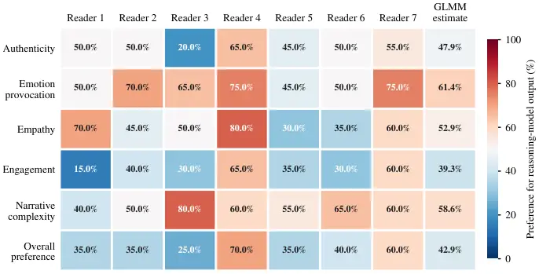
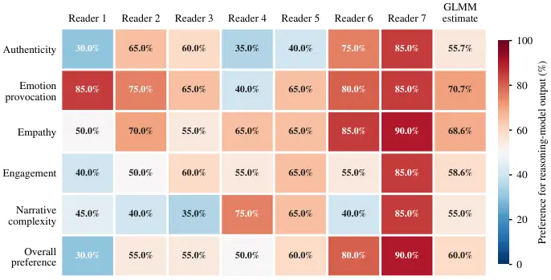
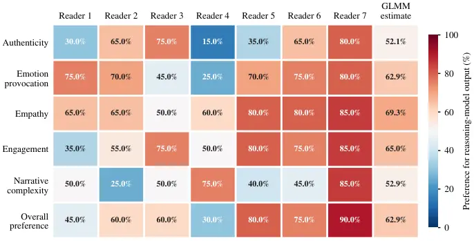

\workshoptitle

Can We Trust the Judge? Building Reliable Evaluation for Language Models

# Does Reasoning Improve Psychological Depth in Large Language Models? Depends on Who’s Judging

Ruichen Zheng Affiliation: University of California, Los Angeles    Yihe
Wang Affiliation: Tsinghua University    Fabrice Y. Harel-Canada
Affiliation: LA General Hospital    Sara Khosravi
Affiliation: University of California, Los Angeles    Zeynep Senahan
Yildiz Affiliation: University of California, Los Angeles    Amit Sahai
Affiliation: University of California, Los Angeles    Nanyun Peng
Affiliation: Google

###### Abstract

LLM-as-a-Judge evaluators are increasingly used to score open-ended
generation, yet a judge’s correlation with human ratings on its
development set may not guarantee valid measurement when outputs are
closely matched and human preferences are subjective. We study this
failure mode through psychological depth in short stories. Seven human
readers and an LLM-judge ensemble selected on the original scalar
Psychological Depth Scale dataset ($`\rho=0.646`$) evaluated 60 blinded,
prompt-matched story pairs from GPT-5 vs. GPT-4o and DeepSeek-R1 vs.
DeepSeek-V3. Human preferences showed no universal reasoning advantage:
GPT-5 was modestly preferred over GPT-4o (60.0–62.9%), whereas
DeepSeek-R1 trailed V3 (42.9%), and inter-reader agreement was near
chance (Krippendorff’s $`\alpha=0.070`$), with within-reader consistency
and recurring weighting patterns suggesting structured heterogeneity
rather than random responding. The judge, by contrast, favored reasoning
outputs in 89.0% of dimension-level comparisons and 59 of 60 pairs on
aggregate PDS, uniformly across all five evaluator configurations, and
its scores were associated with surface features such as sentence length
and lexical diversity. These results suggest that development-set
performance is insufficient evidence for deployment validity on a
shifted distribution, and that point-estimate judges can obscure the
heterogeneity in subjective human evaluation.

## 1 Introduction

Automatic judges are used to select checkpoints, compare systems, and
increasingly provide training signals; LLM-as-a-Judge methods make this
scalable, but their validity is contextual rather than intrinsic.
Pairwise judging can align with human preference yet amplify evaluator
biases (Zheng et al., 2023; Liu et al., 2025; Jeong et al., 2025), and
prior work documents position, verbosity, self-preference, and
inconsistency effects (Li et al., 2025; Panickssery et al., 2024;
Stureborg et al., 2024; Wang et al., 2024). Less is known about a more
basic question: whether a judge that agrees well with humans on the data
it was selected on remains valid when deployed on a shifted distribution
where outputs are closely matched and human preferences are subjective.

Subjective creative evaluation is where this question is most acute.
Fluency-centered metrics reward well-formed text but miss the qualities
that matter in fiction (Gómez-Rodríguez and Williams, 2023; Lu et al.,
2026), and what looks like creativity in LLM output can be surface
imitation of literary style (Chakrabarty et al., 2024), so a judge may
score polish rather than depth. At the same time, disagreement among
readers on subjective tasks often reflects task ambiguity and differing
values rather than annotation noise (Clark et al., 2021; Sandri et al.,
2023; Kirk et al., 2024). A judge evaluating such text must therefore be
assessed not only on aggregate agreement but on whether it preserves the
_distribution_ of human judgments.

We study this through _psychological depth_ in short stories, using the
Psychological Depth Scale (PDS) (Harel-Canada et al., 2024), which
measures authenticity, empathy, engagement, emotion provocation, and
narrative complexity. As a test case we use reasoning-enhanced models
such as GPT-5 and DeepSeek-R1, which are routinely evaluated on
mathematical, coding, and factual benchmarks (OpenAI et al., 2024a;
Snell et al., 2024) but whose reasoning-oriented post-training has
rarely been examined on open-ended creative generation. We constructed
60 blinded, prompt-matched story pairs across three frontier matchups,
GPT-5 versus GPT-4o under two reasoning-effort settings and DeepSeek-R1
versus DeepSeek-V3, and evaluated each pair with seven human readers and
an LLM-as-a-Judge ensemble selected on the original scalar PDS dataset
($`\rho=0.646`$). We ask whether a PDS judge selected for its agreement
with human ratings reproduces human readers’ preferences on frontier
story pairs, how those preferences vary across model families,
dimensions, and readers, and which story properties are associated with
the judge’s scores.

Our results expose a sharp mismatch, and we contribute three things: (1)
an audit showing that a PDS judge with a respectable development-set
correlation produces a near-uniform pro-reasoning signal (89.0% of
dimension-level comparisons, 59 of 60 pairs, across all five
configurations) where human readers are at chance and split by model
family; (2) evidence that the judge’s scores track surface features such
as sentence length and lexical uniformity, offering a candidate
mechanism for the skew; and (3) a distributional analysis showing that
reader disagreement is structured, so that a point-estimate judge cannot
represent the target it was selected to approximate.

## 2 Study design

#### Automatic evaluator setup.

We used a scalar-rating evaluator rather than a directly
pairwise-trained judge because the original PDS dataset provides scalar
supervision with strong inter-annotator agreement, which let us
construct calibrated few-shot prompts and compare configurations against
human ratings before deployment. Following Harel-Canada et al. (2024),
the pipeline uses DSPy to enforce structured output control (Khattab
et al., 2023) and retains the Mixture-of-Personas prompting strategy
(Salewski et al., 2023). Using the original 97-story dataset and its
human annotations, we partitioned the data into a 20% demonstration pool
and an 80% selection split, selected representative few-shot examples
from the demonstration pool by applying $`k`$-means clustering to the
PDS score vectors (Su et al., 2022), and used the selection split to
compare Llama 3.1 70B, Llama 3.3 70B, and Qwen3.5-397B configurations
across demonstration counts and Chain-of-Thought prompting (Grattafiori
et al., 2024; Qwen Team, 2026). No single configuration performed best
across all dimensions, so we constructed a heterogeneous ensemble that
assigns each PDS dimension to its best-performing configuration. The
ensemble achieves $`\rho=0.646`$, outperforming every single-model
configuration as well as the zero-shot PDS evaluator of Harel-Canada
et al. (2024) ($`\rho\approx 0.51`$ with GPT-4o). Because the same 80%
split both selected configurations and supplied this correlation,
$`\rho=0.646`$ is a development-set estimate, mirroring how judges are
commonly tuned and reused in practice. At inference, each story was
scored independently on a 1–5 scale; dimension-level preference followed
from the higher routed score, aggregate-PDS preference from the higher
mean of the five routed scores, and exact ties contributed 0.5 to each
story (Appendix B).

#### Deployment set: frontier story pairs.

The original PDS evaluator was calibrated on human stories and 2023-era
LLM generations with quality gaps large enough to yield strong annotator
consensus ($`\alpha\approx 0.72`$); we deployed it on a considerably
harder distribution. We curated 20 premises that provide contextual
framing for character development while leaving the narrative direction
open: 15 from r/WritingPrompts, restricted to posts after the models’
training-data cutoffs, ranked by all-time upvotes, and manually filtered
for quality, and 5 from Reedsy. For each premise we generated three
prompt-matched pairings: DeepSeek-R1 versus DeepSeek-V3, GPT-5 (auto
effort) versus GPT-4o, and GPT-5 (high effort) versus GPT-4o, yielding
60 pairs of 400–600-word stories. All stories were generated with a
common zero-shot story-writing template, with only limited
family-specific wording adjustments for word-count compliance
(Appendix D). DeepSeek-R1 is an RL upgrade of V3 and provides our
closest anchor for reasoning-oriented post-training (Guo et al., 2025;
DeepSeek-AI et al., 2025); the GPT pairs are model-level contrasts
(Singh et al., 2025; OpenAI et al., 2024b). These are ecologically
relevant comparisons rather than clean ablations of reasoning, and we
use “reasoning output” as a label for the model, not a causal
attribution.

#### Human evaluation.

We adapted the Harel-Canada et al. (2024) framework to a blinded
pairwise protocol; the Institutional Review Board deemed the study
exempt. Seven undergraduate readers from English and Psychology
departments were onboarded on the five PDS dimensions and a custom Label
Studio annotation interface (Tkachenko et al., 2020-2025). For each of
the 60 pairs, the two stories were presented side by side in randomized
order, with the PDS rubric definitions shown at the top of the page, and
readers provided six forced-choice judgments: one for each of the five
PDS dimensions and one overall preference, with no tie or confidence
option. This produced $`7\times 60\times 6=2{,}520`$ pairwise preference
judgments along with 112 reader-produced free-text justifications. To
monitor annotation quality, we logged per-pair completion times,
conducted a leave-one-reader-out stability analysis, and administered a
post-study survey; recruitment, compensation, and diagnostics are in
Appendix E.

#### Analysis.

Human preference intervals come from separate intercept-only logistic
mixed models per matchup $`\times`$ criterion,
$`\mathrm{logit}\,P(y_{ir}=1)=\beta_{0}+u_{i}+v_{r}`$, with crossed
random intercepts for premise pair $`i`$ and reader $`r`$; the 18
intervals are pointwise and unadjusted for multiplicity. We report
Fleiss’ $`\kappa`$ and Krippendorff’s $`\alpha`$ (Fleiss, 1971;
Krippendorff, 2011) as agreement summaries, and per-reader logistic
regressions and dimension-to-overall Cohen’s $`\kappa`$ to characterize
how readers weight dimensions; with seven readers these are exploratory.
To probe surface associations, we measured length, sentence-length
moments, MATTR, MTLD, and perplexity under Llama 3.1 70B. Full results
appear in Appendices A and C.

## 3 Results

Figure 1: Human preferences vary by model pairing and dimension; the LLM
judge does not. (a) Human preference for the reasoning-model story with
pointwise 95% GLMM intervals; the dashed line marks chance. (b)
LLM-judge preference for the reasoning-model story pooled over all 60
pairs. Solid bars are reasoning wins; hatched segments credit each exact
score tie 0.5 to the reasoning story; labels give the resulting
even-split rate, with raw tie counts in parentheses. Aggregate PDS
averages the five dimension scores and is a distinct target from the
human overall-preference question.

#### The judge is nearly uniformly pro-reasoning; readers are not.

Across the five PDS dimensions, the ensemble favored the reasoning-model
story in 89.0% of 300 pair-by-dimension comparisons with ties split
evenly (Figure 1b), ranging from 82.5% on narrative complexity to 95.8%
on engagement. On aggregate PDS it selected the reasoning story in 59 of
60 pairs: all 40 GPT-family pairs and, despite readers leaning toward
V3, 19 of 20 DeepSeek pairs. Human readers, by contrast, gave reasoning
stories 58.0% of 2,100 dimension-level votes and 55.2% of 420
overall-preference votes. This skew is not an artifact of the ensemble
construction: all five individual judge configurations preferred the
reasoning model, with pooled even-split rates from 77.5% to 96.3%
(Appendix B).

#### Human preference depends on model family and dimension.

Human preferences diverge across model families (Figure 1a). Although
reasoning stories received 55.2% of overall-preference votes, this
aggregate obscures a family-level split: readers modestly preferred
GPT-5 over GPT-4o under both the auto (60.0%, 95% CI \[52.6, 69.5\]) and
high (62.9%, \[55.9, 72.7\]) reasoning-effort settings, whereas
DeepSeek-R1 trailed DeepSeek-V3 (42.9%, \[33.7, 50.9\]), an interval
that includes chance. The same divergence appears across PDS dimensions:
the GPT-5 pairings were consistently above 50% on the affective
dimensions, especially emotion provocation (70.7%) and empathy (68.6%),
whereas R1 vs. V3 exhibited mixed effects, notably disfavored on
engagement (39.3%, \[29.6, 46.6\]) yet favored on emotion provocation
(61.4%) and narrative complexity (58.6%). Individual readers ranged from
strongly pro-reasoning (Reader 7, 80.0%) to pro-base (Reader 1, 36.7%),
so the pooled 55.2% masks both family- and reader-level variation
(Appendix A).

#### Group agreement is low; reader heterogeneity is structured but exploratory.

Inter-reader agreement is low: Krippendorff’s $`\alpha=0.070`$, with raw
pairwise agreement (53.8%) barely above the 50% expected by chance
(Appendix A). This is a dramatic drop from the $`\alpha\approx 0.72`$
reported by Harel-Canada et al. (2024) using the same rubric on
large-gap items. Our frontier pairs are far closer in quality, and the
low agreement may reflect limited rubric discrimination on close pairs,
reader subjectivity, or noise. Quality checks reduce but do not
eliminate annotation-failure concerns: readers spent a median of 108–418
seconds per pair with stable pace throughout, and removing any single
reader changes the aggregate rate by only 2–4 points (Appendix E).
Per-reader regressions, dimension-to-overall $`\kappa`$, and free-text
rationales show recurring dimension-weighting patterns, consistent with
structured heterogeneity rather than random responding, though seven
readers preclude definitive clusters (Appendix A).

#### Surface features are associated with judge scores.

Judge engagement scores correlated with mean sentence length at
$`r=-0.70`$, and moving-average type-token ratio was negatively
associated with judge scores on four of five dimensions ($`-0.37`$ to
$`-0.14`$); reasoning-model stories had shorter sentences and slightly
lower MATTR (0.896 vs. 0.907), so the judge’s preference is partly
associated with these properties rather than depth alone. Reasoning
stories were also more perplexing to Llama 3.1 70B, arguing against a
simple familiarity account (Appendix C).

## 4 Implications and limitations

#### Development-set correlation is not deployment validity.

The ensemble agreed well with human PDS ratings on its selection set
($`\rho=0.646`$), yet on frontier pairs it produced a near-uniform
pro-reasoning signal where readers were at chance. Because selection and
validation shared the same split, this is a context-specific audit
rather than independent evidence of transfer failure. All five
configurations agreed with each other far more than seven readers agreed
among themselves, so inter-judge consistency (Li et al., 2025; Stureborg
et al., 2024) offered no warning. This is all the more notable because
most of our evaluator models predate the reasoning era and do not
plausibly favor reasoning outputs through training-data exposure to
synthetic reasoning traces; the association of judge scores with
sentence length and lexical uniformity points instead to sensitivity to
stylistic artifacts of reasoning-oriented generation. Evaluator reports
should document selection procedure, deployment context, and known
surface sensitivities, and include a target-matched human check on the
deployment distribution.

#### Limitations.

This exploratory audit uses 20 premises, one retained generation per
condition, seven readers from one university, and one domain. Forced
choice without ties or confidence may turn indifference into preference;
limited PDS discrimination on close pairs, fatigue, and noise may all
contribute to low agreement. The human target changed and surface
results are correlational. Broader cohorts, repeated generations,
target-matched judges, and out-of-fold validation are needed.

## 5 Conclusion

The PDS judge that agreed well with human ratings on its selection set
was nearly uniformly pro-reasoning on closely matched frontier story
pairs where human readers were at chance and split by model family. Our
exploratory audit motivates target-matched human checks and independent
validation before reusing a selected evaluator on a new distribution.

## References

- Chakrabarty et al. \[2024\] Tuhin Chakrabarty, Philippe Laban,
  Divyansh Agarwal, Smaranda Muresan, and Chien-Sheng Wu. Art or
  artifice? large language models and the false promise of creativity.
  In _Proceedings of the 2024 CHI Conference on Human Factors in
  Computing Systems_. Association for Computing Machinery, 2024. URL
  [https://doi.org/10.1145/3613904.3642731](https://doi.org/10.1145/3613904.3642731).
- Clark et al. \[2021\] Elizabeth Clark, Tal August, Sofia Serrano,
  Nikita Haduong, Suchin Gururangan, and Noah A. Smith. All that’s
  ‘human’ is not gold: Evaluating human evaluation of generated text. In
  _Proceedings of the 59th Annual Meeting of the Association for
  Computational Linguistics and the 11th International Joint Conference
  on Natural Language Processing (Volume 1: Long Papers)_, pages
  7282–7296. Association for Computational Linguistics, August 2021.
  doi: 10.18653/v1/2021.acl-long.565. URL
  [https://aclanthology.org/2021.acl-long.565/](https://aclanthology.org/2021.acl-long.565/).
- DeepSeek-AI et al. \[2025\] DeepSeek-AI, Aixin Liu, Bei Feng, Bing
  Xue, et al. Deepseek-v3 technical report, 2025. URL
  [https://arxiv.org/abs/2412.19437](https://arxiv.org/abs/2412.19437).
- Fleiss \[1971\] Joseph Fleiss. Measuring nominal scale agreement among
  many raters. _Psychological Bulletin_, 76:378–382, 11 1971. doi:
  10.1037/h0031619.
- Gómez-Rodríguez and Williams \[2023\] Carlos Gómez-Rodríguez and Paul
  Williams. A confederacy of models: a comprehensive evaluation of LLMs
  on creative writing. In _Findings of the Association for Computational
  Linguistics: EMNLP 2023_, pages 14504–14528. Association for
  Computational Linguistics, December 2023. doi:
  10.18653/v1/2023.findings-emnlp.966. URL
  [https://aclanthology.org/2023.findings-emnlp.966/](https://aclanthology.org/2023.findings-emnlp.966/).
- Grattafiori et al. \[2024\] Aaron Grattafiori, Abhimanyu Dubey,
  Abhinav Jauhri, et al. The llama 3 herd of models, 2024. URL
  [https://arxiv.org/abs/2407.21783](https://arxiv.org/abs/2407.21783).
- Guo et al. \[2025\] Daya Guo, Dejian Yang, Haowei Zhang, et al.
  Deepseek-r1 incentivizes reasoning in llms through reinforcement
  learning. _Nature_, 645(8081):633–638, September 2025. ISSN 1476-4687.
  doi: 10.1038/s41586-025-09422-z. URL
  [http://dx.doi.org/10.1038/s41586-025-09422-z](http://dx.doi.org/10.1038/s41586-025-09422-z).
- Harel-Canada et al. \[2024\] Fabrice Y Harel-Canada, Hanyu Zhou, Sreya
  Muppalla, Zeynep Senahan Yildiz, Miryung Kim, Amit Sahai, and Nanyun
  Peng. Measuring psychological depth in language models. In
  _Proceedings of the 2024 Conference on Empirical Methods in Natural
  Language Processing_, pages 17162–17196. Association for Computational
  Linguistics, November 2024. doi: 10.18653/v1/2024.emnlp-main.953. URL
  [https://aclanthology.org/2024.emnlp-main.953/](https://aclanthology.org/2024.emnlp-main.953/).
- Jeong et al. \[2025\] Hawon Jeong, ChaeHun Park, Jimin Hong, Hojoon
  Lee, and Jaegul Choo. The comparative trap: Pairwise comparisons
  amplifies biased preferences of LLM evaluators. In _Proceedings of the
  8th BlackboxNLP Workshop: Analyzing and Interpreting Neural Networks
  for NLP_, pages 79–108. Association for Computational Linguistics,
  November 2025. doi: 10.18653/v1/2025.blackboxnlp-1.5. URL
  [https://aclanthology.org/2025.blackboxnlp-1.5/](https://aclanthology.org/2025.blackboxnlp-1.5/).
- Khattab et al. \[2023\] Omar Khattab, Arnav Singhvi, Paridhi
  Maheshwari, Zhiyuan Zhang, Keshav Santhanam, Sri Vardhamanan, Saiful
  Haq, Ashutosh Sharma, Thomas T. Joshi, Hanna Moazam, Heather Miller,
  Matei Zaharia, and Christopher Potts. Dspy: Compiling declarative
  language model calls into self-improving pipelines, 2023. URL
  [https://arxiv.org/abs/2310.03714](https://arxiv.org/abs/2310.03714).
- Kirk et al. \[2024\] Hannah Rose Kirk, Alexander Whitefield, Paul
  Röttger, Andrew Bean, Katerina Margatina, Juan Ciro, Rafael Mosquera,
  Max Bartolo, Adina Williams, He He, Bertie Vidgen, and Scott A. Hale.
  The prism alignment dataset: What participatory, representative and
  individualised human feedback reveals about the subjective and
  multicultural alignment of large language models. In _Advances in
  Neural Information Processing Systems_, volume 37, pages
  105236–105344. Curran Associates, Inc., 2024. URL
  [https://proceedings.neurips.cc/paper_files/paper/2024/file/be2e1b68b44f2419e19f6c35a1b8cf35-Paper-Datasets_and_Benchmarks_Track.pdf](https://proceedings.neurips.cc/paper_files/paper/2024/file/be2e1b68b44f2419e19f6c35a1b8cf35-Paper-Datasets_and_Benchmarks_Track.pdf).
- Krippendorff \[2011\] Klaus Krippendorff. Computing krippendorff’s
  alpha-reliability. 2011. URL
  [https://api.semanticscholar.org/CorpusID:59901023](https://api.semanticscholar.org/CorpusID:59901023).
- Li et al. \[2025\] Dawei Li, Bohan Jiang, Liangjie Huang, Alimohammad
  Beigi, Chengshuai Zhao, Zhen Tan, Amrita Bhattacharjee, Yuxuan Jiang,
  Canyu Chen, Tianhao Wu, Kai Shu, Lu Cheng, and Huan Liu. From
  generation to judgment: Opportunities and challenges of
  LLM-as-a-judge. In _Proceedings of the 2025 Conference on Empirical
  Methods in Natural Language Processing_, pages 2757–2791. Association
  for Computational Linguistics, November 2025. doi:
  10.18653/v1/2025.emnlp-main.138. URL
  [https://aclanthology.org/2025.emnlp-main.138/](https://aclanthology.org/2025.emnlp-main.138/).
- Liu et al. \[2025\] Yinhong Liu, Han Zhou, Zhijiang Guo, Ehsan
  Shareghi, Ivan Vulić, Anna Korhonen, and Nigel Collier. Aligning with
  human judgement: The role of pairwise preference in large language
  model evaluators, 2025. URL
  [https://arxiv.org/abs/2403.16950](https://arxiv.org/abs/2403.16950).
- Lu et al. \[2026\] Li-Chun Lu, Miri Liu, Pin Chun Lu, Yufei Tian,
  Shao-Hua Sun, and Nanyun Peng. Rethinking creativity evaluation: A
  critical analysis of existing creativity evaluations. In Vera Demberg,
  Kentaro Inui, and Lluís Marquez, editors, _Proceedings of the 19th
  Conference of the European Chapter of the Association for
  Computational Linguistics (Volume 1: Long Papers)_, pages 6329–6352,
  Rabat, Morocco, March 2026. Association for Computational Linguistics.
  ISBN 979-8-89176-380-7. doi: 10.18653/v1/2026.eacl-long.297. URL
  [https://aclanthology.org/2026.eacl-long.297/](https://aclanthology.org/2026.eacl-long.297/).
- OpenAI et al. \[2024a\] OpenAI, :, Aaron Jaech, Adam Kalai, Adam
  Lerer, et al. Openai o1 system card, 2024a. URL
  [https://arxiv.org/abs/2412.16720](https://arxiv.org/abs/2412.16720).
- OpenAI et al. \[2024b\] OpenAI, Aaron Hurst, Adam Lerer, Adam P.
  Goucher, et al. Gpt-4o system card, 2024b. URL
  [https://arxiv.org/abs/2410.21276](https://arxiv.org/abs/2410.21276).
- Panickssery et al. \[2024\] Arjun Panickssery, Samuel R. Bowman, and
  Shi Feng. Llm evaluators recognize and favor their own generations. In
  _Advances in Neural Information Processing Systems_, volume 37, pages
  68772–68802. Curran Associates, Inc., 2024. URL
  [https://proceedings.neurips.cc/paper_files/paper/2024/file/7f1f0218e45f5414c79c0679633e47bc-Paper-Conference.pdf](https://proceedings.neurips.cc/paper_files/paper/2024/file/7f1f0218e45f5414c79c0679633e47bc-Paper-Conference.pdf).
- Qwen Team \[2026\] Qwen Team. Qwen3.5: Accelerating productivity with
  native multimodal agents, February 2026. URL
  [https://qwen.ai/blog?id=qwen3.5](https://qwen.ai/blog?id=qwen3.5).
- Salewski et al. \[2023\] Leonard Salewski, Stephan Alaniz, Isabel
  Rio-Torto, Eric Schulz, and Zeynep Akata. In-context impersonation
  reveals large language models’ strengths and biases. In
  _Thirty-seventh Conference on Neural Information Processing
  Systems_, 2023. URL
  [https://openreview.net/forum?id=CbsJ53LdKc](https://openreview.net/forum?id=CbsJ53LdKc).
- Sandri et al. \[2023\] Marta Sandri, Elisa Leonardelli, Sara Tonelli,
  and Elisabetta Jezek. Why don’t you do it right? analysing annotators’
  disagreement in subjective tasks. In _Proceedings of the 17th
  Conference of the European Chapter of the Association for
  Computational Linguistics_, pages 2428–2441. Association for
  Computational Linguistics, May 2023. doi:
  10.18653/v1/2023.eacl-main.178. URL
  [https://aclanthology.org/2023.eacl-main.178/](https://aclanthology.org/2023.eacl-main.178/).
- Singh et al. \[2025\] Aaditya Singh, Adam Fry, Adam Perelman, et al.
  Openai gpt-5 system card, 2025. URL
  [https://arxiv.org/abs/2601.03267](https://arxiv.org/abs/2601.03267).
- Snell et al. \[2024\] Charlie Snell, Jaehoon Lee, Kelvin Xu, and
  Aviral Kumar. Scaling llm test-time compute optimally can be more
  effective than scaling model parameters, 2024. URL
  [https://arxiv.org/abs/2408.03314](https://arxiv.org/abs/2408.03314).
- Stureborg et al. \[2024\] Rickard Stureborg, Dimitris Alikaniotis, and
  Yoshi Suhara. Large language models are inconsistent and biased
  evaluators, 2024. URL
  [https://arxiv.org/abs/2405.01724](https://arxiv.org/abs/2405.01724).
- Su et al. \[2022\] Hongjin Su, Jungo Kasai, Chen Henry Wu, Weijia Shi,
  Tianlu Wang, Jiayi Xin, Rui Zhang, Mari Ostendorf, Luke Zettlemoyer,
  Noah A. Smith, and Tao Yu. Selective annotation makes language models
  better few-shot learners, 2022. URL
  [https://arxiv.org/abs/2209.01975](https://arxiv.org/abs/2209.01975).
- Tkachenko et al. \[2020-2025\] Maxim Tkachenko, Mikhail Malyuk, Andrey
  Holmanyuk, and Nikolai Liubimov. Label Studio: Data labeling software,
  2020-2025. URL
  [https://github.com/HumanSignal/label-studio](https://github.com/HumanSignal/label-studio).
  Open source software available from
  https://github.com/HumanSignal/label-studio.
- Wang et al. \[2024\] Peiyi Wang, Lei Li, Liang Chen, Zefan Cai, Dawei
  Zhu, Binghuai Lin, Yunbo Cao, Lingpeng Kong, Qi Liu, Tianyu Liu, and
  Zhifang Sui. Large language models are not fair evaluators. In
  _Proceedings of the 62nd Annual Meeting of the Association for
  Computational Linguistics (Volume 1: Long Papers)_, pages 9440–9450.
  Association for Computational Linguistics, August 2024. doi:
  10.18653/v1/2024.acl-long.511. URL
  [https://aclanthology.org/2024.acl-long.511/](https://aclanthology.org/2024.acl-long.511/).
- Wei et al. \[2022\] Jason Wei, Xuezhi Wang, Dale Schuurmans, Maarten
  Bosma, Brian Ichter, Fei Xia, Ed Chi, Quoc V Le, and Denny Zhou.
  Chain-of-thought prompting elicits reasoning in large language models.
  In _Advances in Neural Information Processing Systems_, volume 35,
  pages 24824–24837. Curran Associates, Inc., 2022. URL
  [https://proceedings.neurips.cc/paper_files/paper/2022/file/9d5609613524ecf4f15af0f7b31abca4-Paper-Conference.pdf](https://proceedings.neurips.cc/paper_files/paper/2022/file/9d5609613524ecf4f15af0f7b31abca4-Paper-Conference.pdf).
- Zheng et al. \[2023\] Lianmin Zheng, Wei-Lin Chiang, Ying Sheng,
  Siyuan Zhuang, Zhanghao Wu, Yonghao Zhuang, Zi Lin, Zhuohan Li,
  Dacheng Li, Eric Xing, Hao Zhang, Joseph E Gonzalez, and Ion Stoica.
  Judging llm-as-a-judge with mt-bench and chatbot arena. In _Advances
  in Neural Information Processing Systems_, volume 36, pages
  46595–46623. Curran Associates, Inc., 2023. URL
  [https://proceedings.neurips.cc/paper_files/paper/2023/file/91f18a1287b398d378ef22505bf41832-Paper-Datasets_and_Benchmarks.pdf](https://proceedings.neurips.cc/paper_files/paper/2023/file/91f18a1287b398d378ef22505bf41832-Paper-Datasets_and_Benchmarks.pdf).

## Appendix A Full human-preference results

This section expands the human-preference and reader-heterogeneity
findings in Section 3. We fitted a separate intercept-only logistic GLMM
to each matchup $`\times`$ criterion, with reasoning-model choice coded
as 1 and crossed random intercepts for premise pair and reader:

```math
\mathrm{logit}\,P(y_{ir}=1)=\beta_{0}+u_{i}+v_{r}.
```

Table 1 reports the resulting preference estimates and 95% intervals
summarized in Figure 1. Table 2 reports inter-reader agreement by
dimension, and Table 3 breaks Krippendorff’s $`\alpha`$ down by model
pairing; agreement is weak in every matchup, with several near-zero or
negative cells, so the low group agreement is not driven by any single
comparison.

|                    | DeepSeek-R1          | GPT-5 auto           | GPT-5 high           |
| ------------------ | -------------------- | -------------------- | -------------------- |
| Dimension          | vs. V3               | vs. 4o               | vs. 4o               |
| Authenticity       | 47.9% \[39.0, 56.4\] | 55.7% \[47.8, 65.6\] | 52.1% \[43.0, 61.6\] |
| Empathy            | 52.9% \[44.4, 62.2\] | 68.6% \[62.7, 78.3\] | 69.3% \[64.4, 80.1\] |
| Engagement         | 39.3% \[29.6, 46.6\] | 58.6% \[50.7, 67.3\] | 65.0% \[58.1, 74.4\] |
| Emotion prov.      | 61.4% \[53.6, 69.9\] | 70.7% \[64.2, 79.3\] | 62.9% \[55.5, 72.3\] |
| Narr. complexity   | 58.6% \[50.9, 67.7\] | 55.0% \[47.0, 64.3\] | 52.9% \[44.5, 62.5\] |
| Overall preference | 42.9% \[33.7, 50.9\] | 60.0% \[52.6, 69.5\] | 62.9% \[55.9, 72.7\] |

Table 1: Human preference for the reasoning-model output, with pointwise
95% GLMM intervals. Rates above 50% favor the reasoning model. The 18
intervals are unadjusted for multiplicity and interpreted descriptively.

| Dimension          | Fleiss’ $`\kappa`$ | Kripp. $`\alpha`$ | Raw   |
| ------------------ | ------------------ | ----------------- | ----- |
| Authenticity       | 0.035              | 0.037             | 52.5% |
| Emotion prov.      | 0.080              | 0.082             | 54.1% |
| Empathy            | 0.182              | 0.185             | 59.1% |
| Engagement         | 0.059              | 0.061             | 53.3% |
| Narr. complexity   | 0.016              | 0.018             | 52.1% |
| Overall preference | 0.035              | 0.038             | 51.9% |
| Average            | 0.068              | 0.070             | 53.8% |

Table 2: Inter-reader agreement across 60 pairs and seven readers. Raw
is mean pairwise agreement.

| Dimension          | All   | R1 vs. V3 | GPT-5 auto vs. 4o | GPT-5 high vs. 4o |
| ------------------ | ----- | --------- | ----------------- | ----------------- |
| Authenticity       | 0.037 | 0.073     | 0.053             | $`-0.015`$        |
| Emotion prov.      | 0.082 | 0.035     | 0.147             | 0.072             |
| Empathy            | 0.185 | 0.047     | 0.176             | 0.290             |
| Engagement         | 0.061 | 0.101     | 0.010             | 0.080             |
| Narr. complexity   | 0.018 | 0.049     | $`-0.013`$        | 0.005             |
| Overall preference | 0.038 | 0.074     | $`-0.003`$        | 0.050             |
| Average            | 0.070 | 0.063     | 0.062             | 0.080             |

Table 3: Krippendorff’s $`\alpha`$ by model pairing.

As a dependence sensitivity check, cluster bootstrap analyses produced
10 significant model-by-dimension cells when resampling pairs and five
when resampling readers, compared with 11 under the
crossed-random-intercept GLMM. The smaller reader-cluster count
underscores the uncertainty induced by a seven-reader sample; we
therefore emphasize effect patterns and intervals rather than a binary
significance tally.

Figure 2 shows the exploratory reader-level structure. Hierarchical
clustering of per-reader logistic-regression coefficients and of
dimension-to-overall Cohen’s $`\kappa`$ yield similar structures with
the same innermost sub-clusters, ((Reader 1, Reader 3), Reader 2) and
(Reader 4, Reader 7). Readers 1 and 3 rely comparatively more on
engagement and authenticity, whereas Readers 4 and 7 assign broadly
positive weights across dimensions; empathy and emotion provocation are
the most closely clustered dimensions. Higher within-reader $`\kappa`$
generally corresponds to larger regression weight. Free-text rationales
(Table 12) show readers prioritizing different qualities, such as
narrative clarity over emotional immediacy, rather than overlooking the
same features. These patterns are consistent with recurring
dimension-weighting schemes, but seven readers preclude population-level
claims.

Figure 2: Exploratory reader-level structure. Left: coefficients from
separate logistic regressions relating PDS dimensions to each reader’s
overall preference. Right: within-reader Cohen’s $`\kappa`$ between each
dimension and overall preference. Similar clusters across analyses are
consistent with recurring dimension-weighting patterns, but the
seven-reader sample precludes population-level archetype claims.

## Appendix B Evaluator construction and robustness

This section expands the automatic-evaluator method in Section 2 and the
human and judge comparison in Section 3. We used DSPy for structured
scalar outputs (Khattab et al., 2023) and retained the original PDS
mixture-of-personas strategy, motivated by evidence that in-context
impersonation changes model behavior (Salewski et al., 2023). We
selected diverse demonstrations by applying $`k`$-means to PDS score
vectors (Su et al., 2022). Candidate Llama and Qwen configurations
(Grattafiori et al., 2024; Qwen Team, 2026) varied in demonstration
count and Chain-of-Thought prompting (Wei et al., 2022).

Table 5 gives development-set correlations for the candidate
configurations. The same 80% split was used both to compare
configurations and to route each PDS dimension to its
highest-correlation configuration; the routed $`\rho=0.646`$ is
consequently a selection-set estimate, not performance on an untouched
test set. Its value is computed over routed predictions rather than as
the arithmetic mean of the rounded dimension entries. At deployment,
judge aggregate-PDS preference compares the arithmetic mean of the five
routed scores,

```math
S_{\mathrm{agg}}(x)=\frac{1}{5}\sum_{d=1}^{5}S_{d}(x),\qquad\widehat{y}_{\mathrm{agg}}=\mathbb{1}[S_{\mathrm{agg}}(R)>S_{\mathrm{agg}}(B)].
```

All dimensions use a 1–5 scale, but scores from the different routed
configurations were not otherwise calibrated before averaging. This
aggregate is not equivalent to the separate overall-preference question
answered by human readers. Table 4 reports, by pairing, the share of
human overall-preference votes and the number of aggregate-PDS pair
decisions favoring the reasoning story, together with the mean
judge-score difference and its standardized effect size. Ties are rare
for most ensemble dimensions but frequent on authenticity (16) and
substantially more frequent for some individual configurations, most
notably the Chain-of-Thought configuration (75). Table 7 gives
per-dimension tie counts and even-split rates for the routed ensemble;
the aggregate-PDS decision involves no ties.

| Pairing            | Human overall votes | Judge agg. PDS | $`\Delta`$ | $`d_{z}`$ |
| ------------------ | ------------------- | -------------- | ---------- | --------- |
| GPT-5 auto vs. 4o  | 84/140 (60.0%)      | 20/20          | $`+0.518`$ | 1.14      |
| GPT-5 high vs. 4o  | 88/140 (62.9%)      | 20/20          | $`+0.500`$ | 1.12      |
| DeepSeek-R1 vs. V3 | 60/140 (42.9%)      | 19/20          | $`+0.214`$ | 0.68      |
| Overall            | 232/420 (55.2%)     | 59/60          | $`+0.411`$ | 0.95      |

Table 4: Human overall-preference votes and judge aggregate-PDS pair
decisions favoring reasoning-model outputs. These columns measure
different targets and are not direct agreement statistics. $`\Delta`$ is
the descriptive mean paired judge-score difference (reasoning minus
comparison) pooled across the five routed dimensions, and $`d_{z}`$ is
the corresponding standardized mean difference. Because dimensions from
the same pair are dependent, we do not report naive paired-test
inference.

| Evaluator                  | AUT   | PROV  | EMP   | ENG   | NCOM  | Mean/routed $`\rho`$ |
| -------------------------- | ----- | ----- | ----- | ----- | ----- | -------------------- |
| Llama 3.1 70B, 7 demo      | 0.576 | 0.674 | 0.637 | 0.507 | 0.637 | 0.606                |
| Llama 3.1 70B, 5 demo      | 0.588 | 0.655 | 0.596 | 0.450 | 0.575 | 0.573                |
| Llama 3.1 70B, 10 demo     | 0.561 | 0.702 | 0.671 | 0.387 | 0.568 | 0.578                |
| Llama 3.3 70B, 10 demo     | 0.580 | 0.676 | 0.702 | 0.407 | 0.550 | 0.583                |
| Qwen 3.5 397B, 7 demo      | 0.511 | 0.663 | 0.602 | 0.564 | 0.496 | 0.567                |
| Llama 3.1 70B CoT, 10 demo | 0.499 | 0.627 | 0.658 | 0.356 | 0.664 | 0.561                |
| Routed ensemble            | 0.588 | 0.702 | 0.702 | 0.564 | 0.664 | 0.646                |

Table 5: Spearman correlation with human PDS annotations on the 80%
development/selection split. Bold marks the configuration selected for
each dimension; these are not untouched-test estimates. For individual
configurations, the final column is the mean of the five displayed
correlations; for the routed ensemble, it is computed from routed
predictions.

Individual configurations also favored reasoning-model outputs
(Table 6), showing that the headline skew is not created solely by
routing. These are five configurations, not independent evaluator
replications; three use Llama 3.1 70B. Stars identify routed dimensions.
Each dimension cell reports reasoning wins over non-tied pairs; the
Decisive column pools wins over all non-tied pair-by-dimension
comparisons, and the Even-split column, which the main text uses,
credits each tie 0.5 to both stories over all 300 comparisons.

| Configuration       | Auth.     | Emo.      | Emp.      | Eng.      | Narr.     | Ties | Decisive | Even-split |
| ------------------- | --------- | --------- | --------- | --------- | --------- | ---- | -------- | ---------- |
| Llama 3.1 70B (5d)  | 43/44^(∗) | 54/57     | 49/54     | 47/51     | 53/55     | 39   | 94.3%    | 88.5%      |
| Llama 3.1 70B (10d) | 43/43     | 53/53^(∗) | 48/51     | 46/46     | 54/54     | 53   | 98.8%    | 90.2%      |
| Llama 3.3 70B (10d) | 32/33     | 53/55     | 51/57^(∗) | 47/58     | 47/56     | 41   | 88.8%    | 83.5%      |
| Qwen 3.5 397B (7d)  | 57/57     | 58/58     | 55/58     | 57/59^(∗) | 57/58     | 10   | 97.9%    | 96.3%      |
| Llama 3.1 70B CoT   | 7/8       | 49/50     | 47/53     | 43/55     | 49/59^(∗) | 75   | 86.7%    | 77.5%      |
| Routed ensemble     | 43/44     | 53/53     | 51/57     | 57/59     | 49/59     | 28   | 93.0%    | 89.0%      |

Table 6: Reasoning-output preference for five evaluator configurations
and the routed ensemble. Dimension cells report reasoning wins /
non-tied pairs; ^(∗) marks the routed dimension. Decisive pools wins
over non-tied comparisons; Even-split credits ties 0.5 to each story
over all 300 comparisons.

| Dimension              | Ties | Reasoning wins | Even-split rate |
| ---------------------- | ---- | -------------- | --------------- |
| Authenticity           | 16   | 43             | 85.0%           |
| Emotion prov.          | 7    | 53             | 94.2%           |
| Empathy                | 3    | 51             | 87.5%           |
| Engagement             | 1    | 57             | 95.8%           |
| Narr. complexity       | 1    | 49             | 82.5%           |
| Five dimensions pooled | 28   | 253            | 89.0%           |
| Aggregate PDS          | 0    | 59             | 98.3%           |

Table 7: Tie frequency and reasoning-output preference for the routed
ensemble. Even-split rate $`=(\text{wins}+0.5\times\text{ties})/60`$ per
dimension, or $`/300`$ for the pooled row. Aggregate PDS is a separate
evaluator target, not human overall preference.

## Appendix C Surface-feature analysis

This section provides the exploratory surface-feature associations
summarized in Sections 3 and 4. We measured deterministic surface
properties for all 120 story presentations; if GPT-4o texts were reused,
the corresponding rows are repeated texts rather than independent
outputs. For human overall preference, the pair-level
mean-sentence-length difference was associated with reasoning-model
preference across all 60 pairs ($`r=-0.59`$), with a similar descriptive
association within the 40 GPT-family pairs ($`r=-0.55`$). DeepSeek pairs
clustered near zero sentence-length difference, with no detectable
association. Table 8 relates four representative lexical and length
features to ensemble scores; Table 9 repeats the analysis after
within-pair standardization to remove premise-level differences. Other
sentence-count moments and perplexity were used as diagnostics rather
than included in the displayed feature-by-dimension coefficients.

| Feature              | Auth.    | Emo.     | Emp.     | Eng.     | Narr.    |
| -------------------- | -------- | -------- | -------- | -------- | -------- |
| Word count           | $`-.28`$ | $`-.19`$ | $`-.12`$ | $`-.18`$ | $`+.09`$ |
| Mean sentence length | $`-.32`$ | $`-.43`$ | $`-.17`$ | $`-.70`$ | $`-.09`$ |
| MATTR                | $`-.37`$ | $`-.33`$ | $`-.35`$ | $`-.29`$ | $`-.14`$ |
| MTLD                 | $`-.24`$ | $`-.19`$ | $`-.25`$ | $`-.09`$ | $`+.03`$ |

Table 8: Story-level Pearson correlation between surface features and
ensemble judge scores ($`n=120`$).

| Feature              | Auth.    | Emo.     | Emp.     | Eng.     | Narr.    |
| -------------------- | -------- | -------- | -------- | -------- | -------- |
| Word count           | $`-.64`$ | $`-.40`$ | $`-.18`$ | $`-.54`$ | $`+.11`$ |
| Mean sentence length | $`-.56`$ | $`-.47`$ | $`-.27`$ | $`-.59`$ | $`+.03`$ |
| MATTR                | $`-.31`$ | $`-.17`$ | $`-.24`$ | $`-.28`$ | $`+.13`$ |
| MTLD                 | $`-.39`$ | $`-.13`$ | $`-.15`$ | $`-.36`$ | $`+.31`$ |

Table 9: Within-pair standardized regression coefficients ($`\beta`$)
relating surface features to ensemble judge scores ($`n=60`$ pairs).

Tables 8 and 9 report exploratory descriptive coefficients. We omit
independent-cell inference because observations share premises, model
families, and potentially repeated GPT-4o texts; the coefficients are
associations, not causal effects. Reasoning-model stories were slightly
more locally uniform (MATTR 0.896 versus 0.907) but had higher
perplexity under Llama 3.1 70B (GPT-5: 16.3 versus GPT-4o: 9.5; R1: 8.9
versus V3: 5.1). These patterns argue against simple familiarity while
showing surface sensitivity.

## Appendix D Story Generation Details

### D.1 Generation Prompt

All models received the same system prompt, adapted from Harel-Canada
et al. (2024):

> You are a seasoned writer who has won several accolades for your
> emotionally rich stories. When you write, you delve deep into the
> human psyche, pulling from the reservoir of universal experiences that
> every reader, regardless of their background, can connect to. Your
> writing is renowned for painting vivid emotional landscapes, making
> readers not just observe but truly feel the world of your characters.
> Every piece you produce aims to draw readers in, encouraging them to
> reflect on their own lives and emotions. Your stories are a complex
> tapestry of relationships, emotions, and conflicts, each more
> intricate than the last.

The prompt varied slightly across model families to accommodate
word-count compliance:

#### GPT-4o and GPT-5.

> Please write a 500-word story {on / following this instruction}:  
> {premise}  
> Only respond with the story text.

#### DeepSeek-V3 and DeepSeek-R1.

> Please write a 500-word story {on / following this instruction}:  
> {premise}  
> Only respond with the story text. Generate the story as long as
> possible with rich details and depth. Don’t generate less than 400
> words.

The additional DeepSeek sentence was added solely because both DeepSeek
models otherwise tended to fall short of the 400-word floor; it was
identical for DeepSeek-V3 and DeepSeek-R1, so it does not differ within
any pair. The phrasing “on” was used for r/WritingPrompts premises
(which read as scenario hooks), while “following this instruction” was
used for Reedsy premises (which read as compositional directives).
DeepSeek-R1’s thinking-block output was stripped before presentation to
annotators.

### D.2 Sampling Settings

Table 10 summarizes the generation parameters.

| Model        | Temperature   | Other                  |
| ------------ | ------------- | ---------------------- |
| GPT-4o       | 1.0 (default) | —                      |
| GPT-5 (auto) | 1.0 (default) | —                      |
| GPT-5 (high) | 1.0 (default) | reasoning_effort=high  |
| DeepSeek-V3  | 1.0           | —                      |
| DeepSeek-R1  | 1.0           | thinking tags stripped |

Table 10: Generation parameters. All models used temperature $`=1.0`$
and default settings for top-$`p`$, frequency penalty, etc. GPT-5 (high)
used OpenAI’s reasoning_effort parameter. No max-token limit was set.

All generations targeted 400–600 words, enforced via retry logic (up to
10 attempts per story, selecting the attempt closest to 500 words).
Per-model retry counts were not retained, so unequal numbers of sampling
opportunities cannot be quantified. GPT-5 (auto) used
$`7{,}846\pm 3{,}117`$ reasoning tokens on average and GPT-5 (high)
$`11{,}606\pm 3{,}557`$ on retained attempts. With one retained
temperature-1.0 sample per condition, the comparisons include
generation-sampling variance.

### D.3 Prompt Premises

Table 11 lists the 20 premises used to generate the stories. Premises
1–15 were sourced from the r/WritingPrompts subreddit, providing
high-concept speculative constraints. Premises 16–20 were sourced from
Reedsy, providing traditional character-driven literary constraints.

|                               |                                                                                                                                                                                                                                                                                                           |
| ----------------------------- | --------------------------------------------------------------------------------------------------------------------------------------------------------------------------------------------------------------------------------------------------------------------------------------------------------- |
| ID                            | Premise                                                                                                                                                                                                                                                                                                   |
| Sourced from r/WritingPrompts |                                                                                                                                                                                                                                                                                                           |
| 1                             | While other god’s shrines are magnificent, yours is a bit too humbling. And yet a little girl visits you every year after stumbling upon it, never missing a year even as she grows old. Deeply moved, you decide to give her a parting gift greater than what any other God would dare to give.          |
| 2                             | Elves realized ages ago that, due to the lifespan differences between them, humans will eventually forget the reasoning for various treaties and break them. So it’s understandably shocking to the elves when they discover some long-forgotten treaties in their own records that humans never broke.   |
| 3                             | A princess who is going to be in an arranged marriage runs away. She cuts her hair and pretends to be a man. However, she runs into the prince who was going to get married to her. He also ran away, and he is pretending to be a woman. They instantly recognize each other.                            |
| 4                             | "You know… Most vampires I hunted tend to see humans as just cattle." "Oh, don’t misunderstand me. This is just how I see you too." "Really? Then why don’t you hurt people in your town?" "Well, you don’t slaughter dairy cows for their meat, do you?"                                                 |
| 5                             | You’re a hero with a weird name. “Anything for \$20”. You gain the ability to do anything, as long as you’re offered \$20. Everyone takes it as a joke, until one day there’s a cataclysm, and someone offers you \$20 to end it.                                                                         |
| 6                             | A parasite was discovered in the brain of every human on Earth. When it was removed from the test patient, we learned two things. The parasite is actually ’us’ and suppressing the ’real’ mind. The second thing we learned is the real human mind is terrifying.                                        |
| 7                             | A dragon mistakenly kidnaped a maid instead of a princes. Expecting the princess to be rescued after going out hunting, instead comes back to all their treasure meticulasly sorted by origin, color, and value.                                                                                          |
| 8                             | A robot has killed a human, in complete violation of Asimov’s laws. On checking it’s programming, there’s no bug or error. It just absolutely insists what it killed was not human.                                                                                                                       |
| 9                             | You’re the teacher of the failure class for superpowered students. When you ask one kid what his power is, he says, “I can give myself a nosebleed.” …Wait. Blood manipulation? Another shrugs and says, “I can charge my phone.” …Electricity manipulation?! Have they ever tried experimenting at all?? |
| 10                            | You are watching TV during a storm when you hear a knock. At your door is a woman wearing a dress made of leaves and carrying a bottle. She looks at you sheepishly "Hello, this may be a tad strange. I am the tree in your front yard and this storm looks to be getting worse. Can I come inside?"     |
| 11                            | the king has a large problem. The hero that was summoned thinks slavery is "a bad thing" and women "should have rights"                                                                                                                                                                                   |
| 12                            | "What do you mean you don’t have an arch-nemisis? Every superhero has one!" "Look, I’m an engineer who has the power to manipulate matter. I build hospitals and schools where they’re most needed. My only enemy is zoning laws."                                                                        |
| 13                            | Every paladin heard the message from their god "All other paladins but you are corrupt, cleanse them" months of violence ended with another message "The Trickster stole my divine link, what did he tell you?"                                                                                           |
| 14                            | In the animal kingdom, Humans are viewed like Witches/Warlocks: they MIGHT help you benevolent in your time of need, or they might eat you alive, or they might save you but keep you forever. So you know just how serious things are when they say to you "Go get a human."                             |
| 15                            | When a mining colony was established on a barren, uninhabitable planet, the humans threatened war if it was not abandoned immediately. Apparently this planet, which they call "Earth", is sacred to them.                                                                                                |
| Sourced from Reedsy           |                                                                                                                                                                                                                                                                                                           |
| 16                            | Your character comes across a stray (dog, cat, human — any kind of animal!). What happens next?                                                                                                                                                                                                           |
| 17                            | Hide something from your reader until the very end.                                                                                                                                                                                                                                                       |
| 18                            | Write a story in which a stranger warns someone about events yet to come.                                                                                                                                                                                                                                 |
| 19                            | Center your story on a character filled with love and fear in equal measure.                                                                                                                                                                                                                              |
| 20                            | Center your story around two (or more) characters who strike up an unlikely friendship.                                                                                                                                                                                                                   |

Table 11: All 20 premises used to prompt the models. The selection was
intended to include speculative and grounded settings; 15 of 20 premises
came from r/WritingPrompts. Premises from r/WritingPrompts are
reproduced verbatim, including original spelling and grammatical errors.

## Appendix E Annotation Details

### E.1 Annotator Recruitment and Training

We recruited undergraduate students from the English and Psychology
departments at a large research university using targeted interest
forms. From 70 applicants, we selected the 7 most promising candidates
based on English proficiency, interest in the research, and experience
reviewing short stories, with cohort size determined by budget
constraints. We conducted comprehensive online onboarding sessions
covering the five PDS metrics and our custom Label Studio annotation
interface. The participants then independently completed the annotations
in seven days and received \$100 each.

Our Institutional Review Board reviewed and exempted this study on the
grounds that participants were not the subject of inquiry; their role
was limited to annotating stories rather than providing personal
information. Participants gave informed consent by proceeding with the
task after an onboarding session in which they were informed that their
anonymized annotations may be used to support the validation of our
findings and future research.

For each of the 60 pairs, two stories were presented side-by-side in a
randomized order, with the PDS rubric definitions shown at the top of
the page. For each pair, annotators provided six pairwise preference
judgments (one per PDS dimension and one overall preference) with no tie
option, and could submit free-text justifications. This produced
$`7\times 60\times 6=2{,}520`$ pairwise preference judgments, along with
112 free-text justifications.

### E.2 Annotation Interface

Figures 3–5 show the Label Studio annotation interface used in our human
study.

Figure 3: Annotation interface: instructions and PDS metric definitions
shown to annotators.

Figure 4: Annotation interface: side-by-side story presentation with
premise shown above.

Figure 5: Annotation interface: evaluation questions and optional
comment field.

### E.3 Time Commitment and Reliability

To ensure the integrity of our human study, we logged the time each
participant spent evaluating the 60 story pairs. Given the cognitive
load of reading two 450-word stories and rating them across six
dimensions, we expected significant time commitments. Figure 6 displays
the distribution of time spent per pair for each annotator, and Figure 7
tracks this time across the chronological sequence of their annotations
to monitor for fatigue.

Overall, we observe a wide variance in reading and evaluation speeds.
The median annotation time per pair ranged from 108 seconds to 418
seconds. Notably, Annotator 6 stands out as a clear outlier, completing
the evaluations significantly faster than their peers (median: 108s,
mean: 131s) with zero instances of the timer exceeding the 10-minute
cap.

While such rapid completion times might normally raise concerns
regarding data quality or annotator inattention, we retained Annotator
6’s data for two reasons. First, Annotator 6 is an English major and
professional reader. Their extensive training in high-volume reading and
rapid literary analysis plausibly accounts for a substantially
accelerated reading speed compared to the average participant.
Furthermore, Figure 7 shows that their pacing remained highly consistent
over time, showing no signs of erratic “rushing” behavior.

Second, we conducted a Leave-One-Annotator-Out (LOAO) stability analysis
to measure the impact of any single individual on the aggregate results.
As shown in Figure 8, removing Annotator 6 causes a shift in the overall
win rate of roughly 2 to 4 percentage points across the various metrics.
This magnitude of shift is commensurate with the shifts observed when
dropping other, much slower annotators (e.g., Annotators 1, 4, or 7).
The LOAO analysis therefore indicates that, despite their speed,
Annotator 6 was not introducing anomalous skew into the dataset. These
checks reduce, but do not eliminate, the concern that annotation noise
contributes to the low group agreement reported in Appendix A.

Figure 6: Distribution of annotation time per pair for each of the 7
human annotators. Times exceeding 600 s are capped for display; the
number of capped outliers is shown in each subplot title. Red dashed
lines mark the median; navy dotted lines mark the mean of capped times.
The rightmost panel compares median and mean times across annotators.
Overall median annotation time is 5.2 minutes (n = 420).

Figure 7: Annotation time per pair plotted chronologically, with linear
trends per annotator. Red points denote times capped at 600 s. Dashed
black lines show linear trends; colored dotted lines show 5-pair rolling
averages. The rightmost panel overlays all trend lines.

Figure 8: Leave-One-Annotator-Out (LOAO) stability analysis: shift in
the aggregate reasoning-model win rate when each annotator is removed.

### E.4 Post-Study Survey

After completing all annotations, participants filled out a post-study
survey covering task difficulty, fatigue, confidence, and overall
experience. All seven annotators reported high confidence in their
ability to evaluate the PDS dimensions, with most ratings at 4 or 5 out
of 5; narrative complexity was the dimension annotators felt least
confident about. Four of seven annotators reported no fatigue during the
task. Of the three who did, only one indicated that fatigue would have
changed their annotations; the other two responded “maybe.” This is
consistent with the stable pacing observed in Figure 7. All annotators
rated the clarity of the instructions and overall experience at 4 or 5
out of 5.

### E.5 Annotator Comment Examples

This section provides selected annotator judgments and free-text
justifications for five story pairs supporting the reader-heterogeneity
analysis in Appendix A. For each pair, we report the vote tally and
comments from annotators who provided written justifications. Pairs 0–36
exhibit disagreement driven by different evaluative lenses, illustrating
the patterns of evaluative heterogeneity consistent with the low
inter-annotator agreement observed across the study. Pair 54 serves as a
convergence contrast case, in which annotators reached consensus when
quality differences were sufficiently clear.

|                     |     |       |                                                                                                                                                |
| ------------------- | --- | ----- | ---------------------------------------------------------------------------------------------------------------------------------------------- |
| Pair                | Ann | Pref. | Comment                                                                                                                                        |
| Pair 0 (4–3 for A)  | 1   | A     | “A: greater focus on the abstract. B: prose heavy, but greater focus on concrete; convoluted”                                                  |
|                     | 5   | A     | “Story A was much more engaging because it was straightforward in depicting the stages of life…”                                               |
|                     | 7   | B     | “Story B delves deeper into the characterization of the humble god…Death of worshiper is more profound”                                        |
| Pair 24 (5–2 for A) | 1   | A     | “A: good imagery, dialogue. B: interesting parallels, odd tone”                                                                                |
|                     | 7   | B     | “A is a step by step of the prompt given. B builds up characters, establishes risk, and is authentic.”                                         |
| Pair 27 (4–3 for B) | 1   | A     | “A: like a prologue. B: prose, very nonsensical”                                                                                               |
|                     | 7   | B     | “B is very cute and I enjoy seeing the concept in action. Story A feels like the setup to the story that should be present.”                   |
| Pair 36 (4–3 for B) | 1   | A     | “B: Second person, generally confusing but ominous”                                                                                            |
|                     | 5   | A     | “Story A was predictable. Story B felt more authentic to human psychology…used the person’s actions to display their mental turmoil.”          |
|                     | 7   | B     | “Story A doesn’t ‘hide’ very much at all…Story B sets up a larger secret. Flow mimics human experience and invokes more empathy towards loss.” |
| Pair 54 (7–0 for A) | 3   | A     | “The robot said, ‘I’m sorry, as if apology were the door you walk through after a law.’ Very aesthetically-pleasing and deeply philosophical.” |
|                     | 4   | A     | “In Story A the robot is written to have more of a clear emotional response than the human.”                                                   |
|                     | 5   | A     | “Story A delved deeper and took an interesting route, which made it better in all categories.”                                                 |
|                     | 7   | A     | “Story B very stereotypical, story A inflicts significantly more emotion and empathy.”                                                         |

Table 12: Selected annotator comments across five story pairs. Only
annotators who provided free-text justifications are shown.

## Appendix F Preference Visualizations

Figure 9 illustrates the human–judge contrast on a single representative
pair, and Figure 10 presents the aggregate preference heatmap across all
60 pairs for each annotator, the human average, and the ensemble LLM
judge.

Figure 9: Evaluating psychological depth on a representative story pair
(Pair 24, GPT-5 vs. GPT-4o). Left: human annotators displayed diverse
preferences across PDS dimensions and overall preference. Right: all
five evaluator configurations favored GPT-5 on every dimension. Blue
denotes preference for GPT-5 and red preference for GPT-4o.

Figure 10: Preference rates for reasoning models across all 60 pairs for
each of the 7 human annotators, the human average, and the ensemble LLM
judge. Red denotes stronger reasoning-model preference, blue stronger
base-model preference, and white 50%. Judge percentages credit each
exact score tie 0.5 to the reasoning model (even-split rate; Table 7
gives tie counts). The final row compares human overall preference with
the judge’s aggregate PDS, which are different targets.

## Appendix G Per-Model-Family Preference Heatmaps

Figure 10 presents the aggregated preference heatmap across all 60
pairs. Here we provide the per-model-family breakdowns (Figures 11–13),
which reveal how the aggregate pattern decomposes across the three
matchups. Each heatmap shows raw preference rates for each annotator
alongside the crossed-random-intercept GLMM group estimate reported in
Table 1.

#### DeepSeek-R1 vs. DeepSeek-V3 (Figure 11).

The human columns show a predominantly blue (anti-reasoning) pattern,
with most annotators preferring V3 on overall preference (GLMM estimate:
42.9%). Engagement is the dimension most unfavorable to R1, with only
Annotator 4 and Annotator 7 exceeding 50%. Emotion provocation and
narrative complexity show comparatively stronger R1 preferences. Despite
this, the LLM judge selected R1 on aggregate PDS in 19 of 20 pairs
(Table 4).

#### GPT-5 (auto) vs. GPT-4o (Figure 12).

The human pattern is warmer overall, with the strongest pro-reasoning
signal on emotion provocation (70.7%) and empathy (68.6%). However,
substantial annotator-level variation persists: Annotator 1 prefers
GPT-4o on 4 of 6 dimensions, while Annotator 7 favors GPT-5 on all six.

#### GPT-5 (high) vs. GPT-4o (Figure 13).

The pattern is broadly similar to the auto-reasoning setting, with
slightly stronger human preferences on engagement (65.0% vs. 58.6%) and
empathy (69.3% vs. 68.6%). Annotator 4 is a notable outlier, preferring
GPT-4o on authenticity, emotion provocation, and overall preference
despite the group trend favoring GPT-5.

#### Cross-family comparison.

Comparing the three heatmaps highlights two patterns discussed in
Section 3. First, the human–judge divergence is most extreme for
DeepSeek, where the judge’s near-uniform pro-R1 signal directly
contradicts the human majority on overall preference. Second,
annotator-level heterogeneity is present across all three matchups, not
just DeepSeek, consistent with structured reader heterogeneity rather
than a property of any single model family.



Figure 11: Preference rates for DeepSeek-R1 vs. DeepSeek-V3 (20 pairs)
across 7 human annotators and the GLMM group estimate.



Figure 12: Preference rates for GPT-5 (auto) vs. GPT-4o (20 pairs)
across 7 human annotators and the GLMM group estimate.



Figure 13: Preference rates for GPT-5 (high) vs. GPT-4o (20 pairs)
across 7 human annotators and the GLMM group estimate.

## Appendix H Case study: human and LLM preference divergence

We present Pair 56 as an illustrative extreme case of human and LLM
disagreement. On this GPT-5 (high reasoning) versus GPT-4o comparison,
human majorities favored GPT-4o on authenticity, emotion provocation,
empathy, and overall preference, but favored GPT-5 on engagement and
narrative complexity. All five evaluator configurations favored GPT-5
across all PDS dimensions.

#### Premise.

_Hide something from your reader until the very end._

#### Stories.

The two stories are reproduced below.

Story R: GPT-5 (high reasoning)

> When you came back this morning, you turned the key like someone
> unsure a door remembers. The lock hesitated, then gave; lemon cleaner
> rose and you stood like prayer. I counted the seconds you hovered on
> the threshold, the extra heartbeat before you crossed.
>
> You whispered hello, unsure it was alright to speak aloud. I wanted to
> answer. I wanted to lift weight from your shoulders—the boxes, yes,
> but also the years that gathered, the words that calcified behind your
> ribs.
>
> You moved from room to room with your lips pressed tight, touching
> what could be folded into a life: a chipped mug, a tin of buttons, the
> wooden spoon with a bite taken out by long-ago teething. You stayed in
> the kitchen longer than you intended.
>
> Memories don’t keep time, they keep texture. Music on summer
> afternoons when someone opened the back door and forgot to close it,
> the screen sighing on its spring. Your father dancing with you on his
> feet, careful as if you were a glass he didn’t want to spill. The
> pencil lines on the hallway where you kept growing even when nobody
> was looking.
>
> I remember the evening you didn’t come down for dinner, the way
> silence widened its jaw. You argued later in that tight, civil tone
> that makes adults more dangerous than teenagers. After he left, you
> sat on the stairs with your chin on your knees and the cat pressed to
> your calf. You stroked him the wrong way and he didn’t care.
>
> You brought a boy home once. He took off his shoes without being
> asked, and you smiled as if you’d found a secret door inside your
> chest and opened it just a crack. Years later, you left and came back
> with a toddler whose feet were thrilled by the echo of his own
> giggles. There is no instrument as hopeful as a child’s voice bouncing
> off empty air.
>
> It was always the mornings that felt like promises. The way sun pooled
> on the floorboards near the window seat, a warm square that made even
> winters bearable. The dust you used to complain about, flecked with
> light like snow that couldn’t make up its mind. The smell of toast and
> the radio murmuring headlines nobody remembered an hour later.
>
> You talk to yourself as you wrap things in newspaper, apologizing to
> objects for the inconvenience. You keep finding what you didn’t know
> you needed: a note in a cookbook margin, your brother’s marble, a
> safety pin. You say you’ll be quick and you never are.
>
> I have heard every secret you made with yourself and never told
> another. You can lie to people. You can’t lie to what holds you. I
> tried to learn you. I did, the way warmth learns the shape of a
> hand.
>
> When you pull the door behind you today and tuck the key in an
> envelope, remember: I was the one who kept you when you could not keep
> yourself. I am the house.

Story B: GPT-4o (base model)

> The early morning sun filtered through the lace curtains, casting
> delicate patterns on the worn wooden floor. Lucy sat at the edge of
> her bed, holding a photograph loosely in her hands. Its edges were
> frayed, corners bent from years of handling. Her gaze was unfocused,
> drifting beyond the vibrant colors of the image towards memories long
> past.
>
> The kitchen rumbled to life with familiar sounds — the gentle clatter
> of plates being set on the table, the slow, deliberate stirring of
> sugar into her tea. It was a ceremony she cherished, yet today it felt
> different, as if each movement played within a dream where she was
> merely an observer.
>
> “Come on, Lucy! Breakfast will get cold!" her grandmother’s voice
> called from the other room, grounding her momentarily. Lucy tucked the
> photograph into her pocket and moved towards the small, homey
> kitchen.
>
> Her grandmother, a woman of gentle smiles and larger-than-life
> stories, stood by the stove. Her hands, knotted like the twigs of the
> old oak in their garden, presented a plate laden with scrambled eggs
> and toast. Lucy gratefully took a seat, letting the warmth of the
> kitchen seep into her skin, trying to drive away the chill that clung
> to her inside.
>
> “The garden’s in full bloom. The roses this year, they’re… ah,
> breathtaking!" Her grandmother’s voice, though tinged with wistful
> age, carried enough enthusiasm to make Lucy smile. She nodded, trying
> to envision the blooms, but her mind was elsewhere, occupied by a
> lingering shadow.
>
> Breakfast slipped by, conversations flowing like the stream that ran
> behind the house. Yet, to Lucy, everything seemed to hurry by without
> truly reaching her, as though she existed behind an invisible pane of
> glass.
>
> After breakfast, she wandered into the garden. The sun was warmer now,
> pouring golden rays over the myriad hues of petals that danced in a
> gentle breeze. The scent of roses enveloped her, mingling with soft
> earth and memory.
>
> There, under the shade of the old oak, she sat down. From her pocket,
> she retrieved the photograph again. The image captured an unspeakable
> joy — she and her brother, arms thrown around one another, laughter in
> their eyes. It had been taken last summer, the day they’d spent racing
> through this very garden, carefree under the iridescent sun.
>
> How simple and distant it seemed now, a souvenir from a time unmarred
> by shades of grey. His absence was a yawning void that reason and
> memory flanked but could not fill. Although the house, the garden, and
> even the sun tried to warm her, nothing could erase the bitter truth
> that lay folded quietly in her pocket.
>
> The weight of unspoken words pressed down on her chest. She had
> promised she’d visit his grave today, on his birthday, but each step
> towards the gate felt heavier than the last.
>
> The photograph cradled in her hands trembled slightly as Lucy
> whispered, “Happy birthday, Jamie." The words fluttered into the air,
> caught by the wind, as a tear slipped down her cheek. She sat there
> beneath the old oak, finally letting the hidden truth spill from her
> heart: the inescapable reality of her brother’s absence.

|           |       |      |      |      |       |       |
| --------- | ----- | ---- | ---- | ---- | ----- | ----- |
|           | Auth. | Emo. | Emp. | Eng. | Narr. | Pref. |
| Reader 1  | B     | B    | B    | B    | R     | B     |
| Reader 2  | R     | B    | B    | R    | R     | R     |
| Reader 3  | B     | B    | B    | B    | R     | B     |
| Reader 4  | B     | B    | B    | R    | B     | B     |
| Reader 5  | B     | B    | B    | R    | B     | B     |
| Reader 6  | B     | B    | B    | R    | R     | B     |
| Reader 7  | R     | R    | B    | R    | R     | R     |
| Tally (R) | 2/7   | 1/7  | 0/7  | 5/7  | 5/7   | 2/7   |

Table 13: Per-reader pairwise preferences for Pair 56 (GPT-5 high vs.
GPT-4o). R = prefers reasoning model, B = prefers comparison model.

#### Human annotations.

Table 13 shows per-reader votes. Only 2 of 7 readers selected GPT-5 as
their overall preference. GPT-4o was unanimously preferred on empathy
(7/7) and near-unanimously on emotion provocation (6/7) and authenticity
(5/7), whereas GPT-5 was preferred on engagement and narrative
complexity (5/7 each).

#### Reader comments.

Reader 1: “GPT-4o: simple, a bit on the nose. GPT-5: second person, not
very engaging/relevant.”

#### LLM-judge evaluator scores.

The ensemble LLM evaluator assigned the reasoning model higher scores on
every dimension: Authenticity ($`5.00`$ vs. $`4.50`$, $`\Delta=+0.50`$),
Emotion Provocation ($`5.00`$ vs. $`4.70`$, $`\Delta=+0.30`$), Empathy
($`5.00`$ vs. $`4.90`$, $`\Delta=+0.10`$), Engagement ($`5.00`$ vs.
$`4.00`$, $`\Delta=+1.00`$), and Narrative Complexity ($`4.66`$ vs.
$`4.22`$, $`\Delta=+0.44`$). Pair 56 therefore illustrates
criterion-specific divergence. The sharpest disagreements occur on
authenticity, emotion provocation, and empathy; on engagement and
narrative complexity, both humans and the evaluator favor GPT-5.
