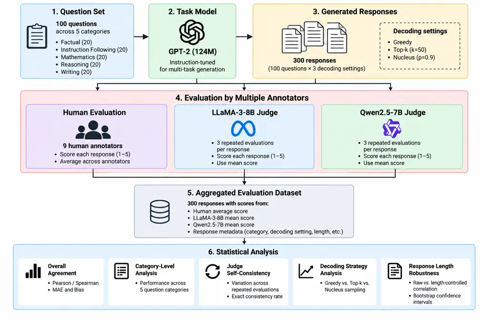
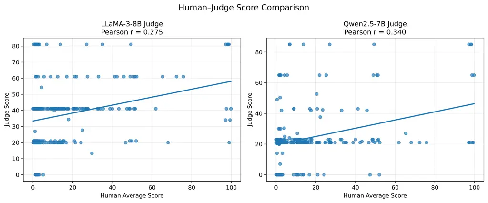
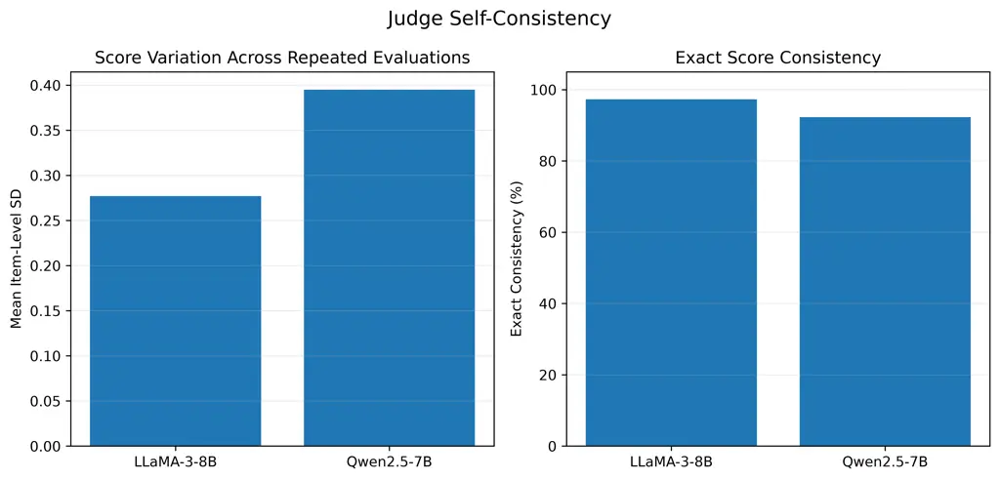
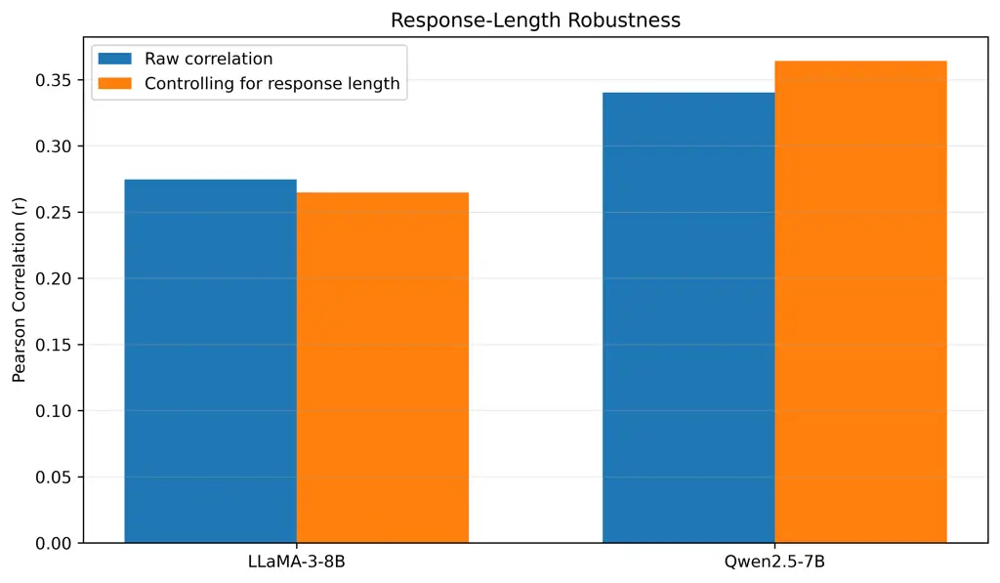

# When Consistency Does Not Mean Reliability: Evaluating Local LLM Judges Against Human Ratings

Aakash Kumar Tiwari Affiliation: Department of Mathematics
Affiliation: Indian Institute of Technology Kharagpur
Email: [tiwariaakash1025@kgpian.iitkgp.ac.in](mailto:)

###### Abstract

Large language models (LLMs) are increasingly used to evaluate the
responses of other language models. This approach, known as
LLM-as-a-Judge, is faster and cheaper than human evaluation. However, a
judge may produce consistent scores without necessarily agreeing with
human evaluators. In this work, we study this issue using two local
open-weight LLM judges, LLaMA-3-8B and Qwen2.5-7B. We evaluate 300
responses generated by an instruction-tuned GPT-2 (124M) model for 100
questions covering five categories: factual knowledge, instruction
following, mathematics, reasoning, and writing. Each response is scored
by nine human annotators and is evaluated three times by each LLM judge
using the same rubric. We compare the judge scores with the average
human scores using Pearson correlation, Spearman correlation, mean
absolute error (MAE), signed bias, and self-consistency. LLaMA-3-8B
shows a Pearson correlation of 0.275 with human scores, while Qwen2.5-7B
achieves 0.340. Their MAEs are 27.71 and 18.64, respectively. Despite
this limited agreement, both judges show high self-consistency, with
exact consistency rates of 97.3% for LLaMA-3-8B and 92.3% for
Qwen2.5-7B. These results show that high self-consistency does not
necessarily indicate high agreement with human judgments. Our findings
highlight the need to evaluate both consistency and human alignment when
using local LLMs as automatic judges.

⁰⁰footnotetext: AI writing assistance was used during manuscript
preparation for language editing, organization, and clarity. The study
design, experiments, analysis, results, and scientific claims were
developed and verified by the authors.

Keywords: LLM-as-a-Judge, Large Language Models, Human Evaluation, LLM
Evaluation, Judge Reliability, Self-Consistency, Human Alignment,
Open-Weight Models

## 1 Introduction

Large language models (LLMs) have achieved strong performance across
tasks such as question answering, summarization, reasoning, and
instruction following. As their capabilities increase, evaluating
generated responses has become an important research problem.
Traditional metrics such as BLEU, ROUGE, and BERTScore are useful for
text generation but may not adequately capture correctness, instruction
following, reasoning quality, and overall response quality Papineni et
al. (2002); Lin (2004); Zhang et al. (2020). Large-scale benchmarks such
as BIG-bench and PromptBench further emphasize the need for systematic
evaluation of modern language models BIG-bench Authors (2023); Zhu et
al. (2024). Human evaluation remains an important reference for
open-ended responses because human evaluators can assess correctness,
relevance, clarity, and instruction adherence. However, human evaluation
is expensive, time-consuming, and difficult to scale. Platforms such as
Chatbot Arena demonstrate the value of human judgments at scale, but
large-scale annotation still requires substantial effort Chiang et al.
(2024). These limitations have motivated the use of language models as
automatic evaluators. The use of an LLM to evaluate another model is
commonly referred to as _LLM-as-a-Judge_. Zheng et al. showed that
capable LLMs can serve as judges for open-ended evaluation and achieve
substantial agreement with human preferences Zheng et al. (2023). G-Eval
similarly demonstrated that GPT-4-based evaluation can achieve strong
human alignment on several natural language generation tasks Liu et al.
(2023). These results establish LLM-based judging as a scalable
alternative to fully manual evaluation. However, using an LLM as a judge
introduces a separate question: _how reliable is the judge itself?_ A
judge may assign similar scores when the same response is evaluated
repeatedly. We refer to this property as _self-consistency_. Such
internal stability, however, does not necessarily imply agreement with
independent human evaluators. A judge may therefore be highly stable
while systematically assigning scores that differ from human judgments.
This issue is particularly relevant for local and open-weight judges.
JudgeLM investigated fine-tuned language models as scalable judges,
while Prometheus and Prometheus 2 developed open evaluators for
fine-grained and rubric-based assessment Zhu et al. (2023); Kim et al.
(2023); Kim et al. (2024). FLASK further explored fine-grained
evaluation through alignment skill sets Ye et al. (2024). These studies
demonstrate the potential of open-weight evaluators while also
indicating that judge behavior can depend on the model, evaluation
criterion, and task. Recent studies have raised further concerns about
human–judge agreement and evaluation bias. Huang et al. found that
fine-tuned judges may perform well in particular settings without being
general substitutes for stronger judges such as GPT-4 Huang et al.
(2024). Chen et al. showed that both humans and LLM judges can exhibit
systematic judgment biases Chen et al. (2024). JudgeBench emphasized the
importance of evaluating the judges themselves Tan et al. (2025), while
Bavaresco et al. reported substantial variation in agreement between LLM
judges and humans across models and NLP tasks Bavaresco et al. (2025).
Despite this progress, an important question remains: _does a highly
consistent LLM judge necessarily provide reliable judgments from a human
perspective?_ Existing work has examined human alignment, judge biases,
open and fine-tuned evaluators, and judge benchmarking. Our study
focuses specifically on separating _self-consistency_ from _human
alignment_. Repeated agreement between a judge’s own scores measures the
stability of its evaluation process, whereas comparison with independent
human ratings measures its alignment with human judgments. To
investigate this distinction, we construct a controlled evaluation
setting using an instruction-tuned GPT-2 (124M) model. We evaluate 300
generated responses from 100 questions across five categories: factual
knowledge, instruction following, mathematics, reasoning, and writing.
Each response is independently scored by nine human annotators and
evaluated three times by two local open-weight judges, LLaMA-3-8B and
Qwen2.5-7B, using the same explicit scoring rubric. This design allows
us to measure both human–judge agreement and repeated judge consistency.
The results show a clear difference between these properties. LLaMA-3-8B
achieves a Pearson correlation of $`0.275`$ with human scores, while
Qwen2.5-7B achieves $`0.340`$. In contrast, both judges show high
repeatability, with exact consistency rates of $`97.3\%`$ and
$`92.3\%`$, respectively. Thus, a judge can remain highly stable in
repeated evaluations while showing limited agreement with human
evaluators. The main contributions of this work are as follows:

- •
  We provide a controlled empirical study of two local open-weight LLM
  judges, LLaMA-3-8B and Qwen2.5-7B, using a common rubric and repeated
  evaluation protocol.
- •
  We explicitly distinguish _self-consistency_ from _human alignment_
  using repeated judge evaluations and independent human ratings.
- •
  We evaluate human–judge agreement using Pearson correlation, Spearman
  correlation, MAE, signed bias, and self-consistency.
- •
  We analyze judge behavior across question categories and
  response-generation decoding configurations.
- •
  We examine response length as a potential factor by comparing raw and
  length-controlled human–judge correlations.

Overall, this study highlights that _consistency alone should not be
treated as evidence of reliability_. Local LLM judges should be
evaluated using both repeated-evaluation consistency and agreement with
independent human judgments.

## 2 Related Work

The evaluation of language model outputs has traditionally relied on
automatic metrics and human judgments. With increasingly capable
language models, LLM-based evaluation has become an important research
direction. This section reviews automatic evaluation metrics,
LLM-as-a-Judge methods, open and fine-tuned evaluators, and human
alignment and judge reliability.

### 2.1 Automatic Evaluation of Generated Text

Early evaluation of generated text mainly relied on reference-based
metrics. BLEU measures modified n-gram precision Papineni et al. (2002),
while ROUGE evaluates lexical overlap for generated summaries Lin
(2004). BERTScore later introduced contextual representations from
pretrained language models to measure semantic similarity Zhang et al.
(2020). Although computationally efficient, these metrics may not
adequately capture factual correctness, instruction following, reasoning
quality, or other qualitative properties. This limitation is important
for open-ended generation, where valid responses may differ
substantially in wording. BIG-bench and PromptBench support systematic
evaluation across diverse capabilities and prompting settings BIG-bench
Authors (2023); Zhu et al. (2024). Sottana et al. further showed that
model-based evaluation can be useful for sequence-to-sequence tasks
while exhibiting task-dependent variation Sottana et al. (2023). These
limitations motivated more flexible evaluators for assessing multiple
response properties.

### 2.2 LLM-as-a-Judge

LLM-as-a-Judge uses a language model to evaluate the outputs of another
language model, typically with criteria or a rubric covering properties
such as correctness, relevance, coherence, and instruction following.
Zheng et al. systematically studied LLM judges using MT-Bench and
Chatbot Arena and showed that capable LLMs can provide scalable
evaluation while exhibiting systematic biases Zheng et al. (2023).
G-Eval used GPT-4 with explicit criteria and forms for reference-free
natural language generation evaluation, demonstrating improved human
alignment Liu et al. (2023). However, these studies do not directly
establish whether smaller local models provide similarly reliable
judgments. Human preference evaluation remains an important reference
for validating automated evaluators. Chatbot Arena uses large-scale
human pairwise preferences to compare language models Chiang et al.
(2024), while AlpacaFarm provides a framework for collecting and
simulating human preference data for language model alignment Dubois et
al. (2023).

### 2.3 Open and Fine-Tuned LLM Judges

The cost of proprietary models has motivated research on open and
fine-tuned evaluators. JudgeLM investigated fine-tuned language models
as scalable judges and analyzed evaluation biases Zhu et al. (2023).
Prometheus introduced an open evaluator for fine-grained, rubric-based
assessment with customizable criteria Kim et al. (2023). Prometheus 2
extended this approach to direct assessment and pairwise ranking using
user-defined criteria Kim et al. (2024). FLASK proposed skill-based
fine-grained evaluation based on individual alignment capabilities Ye et
al. (2024). These studies demonstrate the scalability and flexibility of
open evaluators while indicating that performance can depend on the
model, task, scoring criterion, and prompt. Therefore, stable scores
from an open judge do not by themselves establish human-aligned
reliability.

### 2.4 Human Alignment, Bias, and Judge Reliability

A central issue in LLM-based evaluation is the relationship between
judge scores and human judgments. Huang et al. found that fine-tuned
judges can perform well in particular settings without being general
substitutes for stronger evaluators such as GPT-4 Huang et al. (2024).
Chen et al. showed that both humans and LLM judges can exhibit
systematic judgment biases and sensitivity to factors unrelated to
response quality Chen et al. (2024). Recent work has increasingly
focused on evaluating the judges themselves. JudgeBench introduced a
benchmark for assessing LLM-based judges on challenging evaluation cases
Tan et al. (2025). Bavaresco et al. conducted a large-scale study across
20 NLP evaluation tasks and reported substantial variation across
models, tasks, and evaluation properties Bavaresco et al. (2025). Leiter
et al. additionally emphasized the importance of explainable evaluation
metrics, since numerical scores alone may not reveal the basis of an
evaluation Leiter et al. (2024).

### 2.5 Research Gap

Existing work has examined human alignment, judge bias, open evaluators,
and judge benchmarking Zheng et al. (2023); Huang et al. (2024); Chen et
al. (2024); Tan et al. (2025); Bavaresco et al. (2025). However, an
important distinction remains between the _stability_ of a judge’s
decisions and its _agreement_ with independent human judgments. Our
study explicitly evaluates these two properties of local LLM judges. We
repeatedly evaluate the same responses using the same rubric and compare
the resulting scores with independent human ratings. This design tests
whether a judge can remain highly consistent across repeated evaluations
while still showing limited agreement with humans. We therefore treat
self-consistency as a property that should be measured separately from
human alignment rather than as an implicit indicator of evaluator
reliability.

| Study                                    | Evaluator             | Evaluation Setting             | Main Focus                                          |
| ---------------------------------------- | --------------------- | ------------------------------ | --------------------------------------------------- |
| Zheng et al. Zheng et al. (2023)         | Strong LLM judges     | MT-Bench and Chatbot Arena     | Human preference alignment and judge biases         |
| Liu et al. Liu et al. (2023)             | GPT-4                 | NLG evaluation                 | Human-aligned reference-free evaluation             |
| Huang et al. Huang et al. (2024)         | Fine-tuned LLM judges | Multiple evaluation dimensions | Generalization and limitations of fine-tuned judges |
| Zhu et al. Zhu et al. (2023)             | JudgeLM               | LLM response evaluation        | Scalable open-source judging and judge biases       |
| Kim et al. Kim et al. (2023)             | Prometheus            | Rubric-based evaluation        | Fine-grained and customizable evaluation            |
| Ye et al. Ye et al. (2024)               | FLASK                 | Skill-based LLM evaluation     | Fine-grained alignment skill assessment             |
| Kim et al. Kim et al. (2024)             | Prometheus 2          | Direct and pairwise evaluation | Open-source evaluator models                        |
| Chen et al. Chen et al. (2024)           | Humans and LLM judges | Multiple evaluation settings   | Judgment bias and robustness                        |
| Tan et al. Tan et al. (2025)             | Multiple LLM judges   | JudgeBench                     | Reliability of LLM-based judges                     |
| Bavaresco et al. Bavaresco et al. (2025) | Multiple LLMs         | 20 NLP evaluation tasks        | Agreement between LLM judges and humans             |

Table 1: Representative studies on LLM-based evaluation and
LLM-as-a-Judge.

## 3 Methodology

This section describes the experimental design used to evaluate local
LLM judges against human ratings, focusing on human alignment and
repeated-evaluation consistency. The complete study pipeline is shown in
Figure 1.

### 3.1 Research Questions

Our study is guided by the following research questions:

- •
  RQ1: How strongly do local LLM judges agree with independent human
  ratings of generated responses?
- •
  RQ2: How consistent are the judges when the same response is evaluated
  repeatedly using the same protocol?
- •
  RQ3: Does human–judge agreement vary across question categories and
  response-generation settings?
- •
  RQ4: To what extent does response length explain the relationship
  between human ratings and judge scores?

### 3.2 Overall Study Design

The study follows four stages. First, 100 questions covering five
evaluation categories are prepared. Second, an instruction-tuned GPT-2
model with 124 million parameters generates three responses per
question, producing 300 responses. Third, the responses are evaluated
independently by nine human annotators and two local LLM judges,
LLaMA-3-8B and Qwen2.5-7B. Finally, human and judge scores are compared
using agreement, error, bias, consistency, category, decoding, and
response-length analyses. Each response is evaluated three times by each
automated judge, giving

```math
300\times 2\times 3=1800 \tag{1}
```

automated judge evaluations. Human and automated evaluations are
performed independently, and human annotators do not have access to
automated judge scores.



Figure 1: Overall study framework. One hundred questions are used to
generate 300 responses with an instruction-tuned GPT-2 model. The
responses are independently evaluated by nine human annotators and two
local LLM judges using three repeated evaluations. The resulting scores
are compared using agreement, error, consistency, category, decoding,
and response-length analyses.

### 3.3 Dataset and Response Generation

The evaluation set contains 100 questions divided equally into five
categories: factual knowledge, instruction following, mathematics,
reasoning, and writing, with 20 questions per category. Three responses
are generated for each question using three decoding configurations,
producing 300 responses in total and 60 responses per category. The
GPT-2 model is instruction-tuned with 124 million parameters. For each
question, it receives the instruction and, when available, an additional
input. Generated responses are evaluated without manual correction.

### 3.4 Human Evaluation

Each generated response is independently evaluated by nine human
annotators on a 0–100 scale, where higher scores indicate higher
response quality. Annotators evaluate responses with respect to the
given instruction without access to decoding configurations or automated
judge scores. For response $`i`$, let $`H_{ij}`$ denote the score
assigned by human annotator $`j`$. The human reference score is

```math
H_{i}=\frac{1}{9}\sum_{j=1}^{9}H_{ij}. \tag{2}
```

Human–human agreement is measured using pairwise Pearson correlation and
ICC(2,k), following established principles of annotation reliability
Krippendorff (2011).

### 3.5 Local LLM Judges and Evaluation Rubric

Two locally deployed open-weight instruction-tuned models are used as
automated judges:

- •
  LLaMA-3-8B, deployed locally through Ollama.
- •
  Qwen2.5-7B, deployed locally through Ollama.

For each response, both judges receive the original instruction,
optional input, and generated response, and assign a score from 0 to 100
using the same explicit rubric, referred to as _Judge Prompt v2_. The
rubric evaluates:

1.  1.  correctness,
2.  2.  instruction following,
3.  3.  relevance and completeness,
4.  4.  clarity and coherence, and
5.  5.  writing constraints.

Score anchors are provided for the ranges 0–20, 21–40, 41–60, 61–80, and
81–100. Judges return a final integer score and are not provided with
human scores. The same rubric is used for both judges and all repeated
evaluations.

### 3.6 Repeated Judge Evaluation and Self-Consistency

Each response is evaluated three times by each automated judge using the
same response, instruction, input, and rubric. For judge $`m`$, response
$`i`$, and repetition $`r`$, let $`J_{im}^{(r)}`$ denote the assigned
score, where $`r\in\{1,2,3\}`$. The final judge score is the mean of the
three evaluations:

```math
J_{im}=\frac{1}{3}\sum_{r=1}^{3}J_{im}^{(r)}. \tag{3}
```

Score variability is measured using the standard deviation:

```math
SD_{im}=\sqrt{\frac{1}{3}\sum_{r=1}^{3}\left(J_{im}^{(r)}-J_{im}\right)^{2}}. \tag{4}
```

Lower standard deviation indicates greater stability. We additionally
report exact consistency, defined as the percentage of responses for
which all three evaluations produce exactly the same integer score.
Self-consistency is evaluated separately from human alignment because
stable repeated scores do not necessarily agree with human judgments.

### 3.7 Evaluation Metrics

Human–judge agreement is evaluated using Pearson correlation, Spearman
correlation, Mean Absolute Error (MAE), and signed bias. Pearson
measures linear association, while Spearman measures rank association
between human and judge scores. MAE measures numerical disagreement:

```math
MAE=\frac{1}{N}\sum_{i=1}^{N}|J_{i}-H_{i}|. \tag{5}
```

Signed bias measures systematic over- or under-scoring:

```math
Bias=\frac{1}{N}\sum_{i=1}^{N}(J_{i}-H_{i}). \tag{6}
```

Lower MAE indicates closer numerical agreement, while positive and
negative bias indicate higher and lower judge scores relative to the
human reference, respectively. Human–human agreement is reported
separately using pairwise Pearson correlation and ICC(2,k).

### 3.8 Category and Decoding Analysis

Pearson correlation and MAE are reported separately for factual
knowledge, instruction following, mathematics, reasoning, and writing to
examine task-dependent judge behavior. The three GPT-2 decoding
configurations are also analyzed separately. Because subgroup sizes are
smaller than the complete dataset, these results are interpreted
primarily as descriptive evidence.

### 3.9 Response Length Analysis

Response length is measured as the number of characters in each
generated response. We calculate Pearson correlations between length and
the human reference and between length and each judge score. We then
compare the raw human–judge Pearson correlation with a partial Pearson
correlation controlling for response length. For each judge, we report
the raw correlation, length-controlled partial correlation, and their
difference. This analysis is treated as a robustness check rather than a
causal analysis.

### 3.10 Statistical Analysis

Non-parametric bootstrap resampling is used to quantify uncertainty. For
each analysis, 5,000 bootstrap samples are generated by sampling
responses with replacement and recomputing the corresponding statistic.
We report 95% bootstrap percentile confidence intervals for the main
correlations, MAE, signed bias, and other relevant statistics. The
bootstrap random seed is fixed at 20260908 for reproducibility. For the
response-length analysis, bootstrap confidence intervals are also
calculated for the difference between the raw and length-controlled
human–judge correlations.

## 4 Results and Discussion

This section presents the results for the two local LLM judges, focusing
on human–judge agreement, self-consistency, category-wise behavior,
decoding effects, and response-length robustness. Unless otherwise
stated, results are computed over all 300 generated responses.

### 4.1 Human–Human Agreement

Agreement among the nine human annotators is first examined to establish
the stability of the human reference. The mean pairwise Pearson
correlation is $`0.967`$, with individual correlations ranging from
$`0.939`$ to $`0.990`$, and the overall absolute agreement measured
using ICC(2,k) is $`0.996`$. Thus, the human reference is highly
consistent, making substantial human–judge disagreement unlikely to be
explained primarily by annotator variability.

| Metric                         | Value |
| ------------------------------ | ----- |
| Number of annotators           | 9     |
| Mean pairwise Pearson $`r`$    | 0.967 |
| Minimum pairwise Pearson $`r`$ | 0.939 |
| Maximum pairwise Pearson $`r`$ | 0.990 |
| ICC(2,k) absolute agreement    | 0.996 |

Table 2: Agreement among the nine human annotators.

### 4.2 Overall Human–Judge Agreement

Table 3 shows positive but limited agreement between both automated
judges and the human reference. LLaMA-3-8B achieves Pearson $`r=0.275`$
and Spearman $`r=0.258`$, whereas Qwen2.5-7B achieves $`0.340`$ and
$`0.303`$, respectively. Qwen2.5-7B therefore shows stronger linear and
rank-based agreement. The MAE is $`27.71`$ for LLaMA-3-8B and $`18.64`$
for Qwen2.5-7B. Both judges exhibit positive signed bias, $`+23.04`$ and
$`+9.54`$, respectively, indicating a tendency to assign higher scores
than the human reference. The corresponding Pearson 95% bootstrap
confidence intervals are $`[0.145,0.405]`$ and $`[0.178,0.491]`$, while
the MAE intervals are $`[25.67,29.89]`$ and $`[16.96,20.45]`$.

| Metric               | LLaMA-3-8B        | Qwen2.5-7B       |
| -------------------- | ----------------- | ---------------- |
| Pearson correlation  | 0.275             | 0.340            |
| Pearson 95% CI       | \[0.145, 0.405\]  | \[0.178, 0.491\] |
| Spearman correlation | 0.258             | 0.303            |
| Spearman 95% CI      | \[0.145, 0.367\]  | \[0.194, 0.405\] |
| MAE                  | 27.71             | 18.64            |
| MAE 95% CI           | \[25.67, 29.89\]  | \[16.96, 20.45\] |
| Signed bias          | +23.04            | +9.54            |
| Bias 95% CI          | \[+20.30,+25.72\] | \[+7.04,+12.00\] |

Table 3: Overall agreement between human ratings and automated judges.
Confidence intervals are 95% bootstrap percentile intervals.

Figure 2 illustrates the limited human–judge agreement and the positive
scoring tendency.



Figure 2: Comparison of human average scores with automated judge scores
for LLaMA-3-8B and Qwen2.5-7B. Each point represents one generated
response. The plots illustrate the limited human–judge agreement and the
positive scoring tendency observed for both judges.

The two automated judges show a Pearson correlation of $`0.531`$,
Spearman correlation of $`0.481`$, and MAE of $`16.86`$. Their
judge–judge correlation is higher than either judge’s correlation with
the human reference; however, agreement between automated judges does
not establish human-aligned reliability.

### 4.3 Self-Consistency of the Judges

Each response was evaluated three times using the same rubric and
protocol. LLaMA-3-8B has a mean item-level standard deviation of
$`0.277`$ and exact consistency of $`97.3\%`$, while Qwen2.5-7B has
values of $`0.395`$ and $`92.3\%`$, respectively. Thus, both judges are
highly stable across repeated evaluations. Notably, LLaMA-3-8B has
higher exact consistency but lower human–judge correlation and higher
MAE, demonstrating that self-consistency and human alignment capture
different properties.



Figure 3: Self-consistency of LLaMA-3-8B and Qwen2.5-7B across repeated
evaluations. The figure reports mean item-level standard deviation and
exact consistency.

### 4.4 Category-Wise Performance

Overall correlations can conceal differences across task types. Table 4
shows that LLaMA-3-8B performs best on factual knowledge ($`r=0.592`$)
and instruction following ($`r=0.462`$), but has much lower correlations
for mathematics ($`0.026`$), reasoning ($`0.076`$), and writing
($`0.156`$). Qwen2.5-7B also performs best on factual knowledge
($`r=0.678`$) and shows a relatively strong correlation for mathematics
($`0.506`$), while its correlations for instruction following,
reasoning, and writing are $`0.154`$, $`0.130`$, and $`0.132`$,
respectively. The MAE results provide a complementary view. LLaMA-3-8B
has its highest MAE for mathematics ($`35.95`$), whereas Qwen2.5-7B
ranges from $`16.39`$ for instruction following to $`21.71`$ for
writing. These results indicate substantial task dependence in judge
behavior.

| Category              | LLaMA-3-8B    |       | Qwen2.5-7B    |       |
| --------------------- | ------------- | ----- | ------------- | ----- |
|                       | Pearson $`r`$ | MAE   | Pearson $`r`$ | MAE   |
| Factual knowledge     | 0.592         | 25.79 | 0.678         | 19.46 |
| Instruction following | 0.462         | 24.64 | 0.154         | 16.39 |
| Mathematics           | 0.026         | 35.95 | 0.506         | 17.32 |
| Reasoning             | 0.076         | 25.52 | 0.130         | 18.34 |
| Writing               | 0.156         | 26.64 | 0.132         | 21.71 |

Table 4: Human–judge agreement across question categories.

### 4.5 Effect of Response-Generation Decoding

Human–judge agreement also varies with the decoding configuration used
to generate GPT-2 responses. For LLaMA-3-8B, Pearson correlations are
$`0.264`$, $`0.372`$, and $`0.165`$ for high-, medium-, and
low-temperature settings, with MAEs of $`24.33`$, $`26.81`$, and
$`31.97`$, respectively. For Qwen2.5-7B, the corresponding correlations
are $`0.184`$, $`0.436`$, and $`0.314`$, with MAEs of $`14.74`$,
$`19.13`$, and $`22.06`$, respectively. The medium-temperature setting
produces the highest correlation for both judges. Because each decoding
group contains fewer observations than the full dataset, these results
are interpreted descriptively.

| Setting            | LLaMA-3-8B    |       | Qwen2.5-7B    |       |
| ------------------ | ------------- | ----- | ------------- | ----- |
|                    | Pearson $`r`$ | MAE   | Pearson $`r`$ | MAE   |
| Low temperature    | 0.165         | 31.97 | 0.314         | 22.06 |
| Medium temperature | 0.372         | 26.81 | 0.436         | 19.13 |
| High temperature   | 0.264         | 24.33 | 0.184         | 14.74 |

Table 5: Human–judge agreement across GPT-2 decoding configurations.

### 4.6 Response-Length Analysis

Across the 300 responses, the mean response length is $`129.59`$
characters, with a median of $`77`$ and a range of $`3`$–$`365`$
characters. Human scores have a weak positive correlation with response
length ($`r=0.159`$, $`p=0.00574`$; bootstrap 95% CI $`[0.050,0.290]`$).
For LLaMA-3-8B, the judge–length correlation is $`0.091`$ ($`p=0.1172`$;
CI $`[-0.001,0.182]`$). For Qwen2.5-7B, it is $`-0.108`$ with analytical
$`p=0.06285`$ and bootstrap CI $`[-0.195,-0.015]`$. Given the difference
between the analytical test and bootstrap interval, this is treated as a
weak trend rather than strong evidence of a significant association.
Controlling for response length changes the LLaMA-3-8B correlation from
$`0.275`$ to $`0.265`$, giving $`\Delta r=+0.010`$ under the
raw-minus-partial definition, with bootstrap 95% CI $`[-0.003,0.031]`$.
For Qwen2.5-7B, the correlation increases from $`0.340`$ to $`0.364`$,
giving $`\Delta r=-0.024`$ under the same definition, with bootstrap 95%
CI $`[-0.051,-0.006]`$. Overall, controlling for response length
produces only modest changes in the human–judge relationships,
indicating that response length alone does not explain the observed
disagreement.

| Metric                         | LLaMA-3-8B | Qwen2.5-7B |
| ------------------------------ | ---------- | ---------- |
| Judge–length Pearson $`r`$     | 0.091      | -0.108     |
| Judge–length $`p`$-value       | 0.1172     | 0.06285    |
| Raw human–judge $`r`$          | 0.275      | 0.340      |
| Length-controlled $`r`$        | 0.265      | 0.364      |
| Raw $`-`$ partial $`\Delta r`$ | +0.010     | -0.024     |

Table 6: Response-length analysis and length-controlled human–judge
correlations.



Figure 4: Raw and response-length-controlled Pearson correlations
between human ratings and automated judge scores. Controlling for
response length produces only modest changes in the observed human–judge
relationships.

### 4.7 Discussion of Research Questions

The results provide answers to all four research questions. Both judges
show positive but limited agreement with human ratings, with Qwen2.5-7B
performing better overall than LLaMA-3-8B (Pearson $`0.340`$ vs.
$`0.275`$; MAE $`18.64`$ vs. $`27.71`$), while both remain highly
self-consistent. Judge performance also varies across question
categories and decoding configurations. Finally, controlling for
response length produces only modest changes in human–judge
correlations, indicating that response length alone does not explain the
observed disagreement. Overall, the results show that self-consistency
and human alignment should be evaluated as separate properties of an
automated judge.

## 5 Conclusion and Future Work

This study investigated whether a consistent local LLM judge is
necessarily well aligned with human judgments. Using 300 responses
generated by an instruction-tuned GPT-2 model, we compared ratings from
nine human annotators with those from LLaMA-3-8B and Qwen2.5-7B, with
each judge evaluating every response three times using the same rubric.
The results demonstrate a clear distinction between self-consistency and
human alignment. Both judges showed high repeatability, but their
agreement with human ratings was substantially lower, and both exhibited
positive scoring bias. Judge performance also varied across question
categories and decoding configurations, while response-length control
produced only modest changes in human–judge correlations. Therefore,
repeatability alone is not sufficient to establish human-aligned
reliability.

### 5.1 Future Work

Future work can extend the evaluation to larger and more diverse
datasets, additional local and open-weight judges, and more task
categories. Alternative rubrics, pairwise evaluation, and prompting
strategies can be investigated to improve judge calibration and human
alignment. More complex reasoning and domain-specific tasks can also
provide a broader understanding of when local LLM judges can be used
reliably.

## 6 Limitations

This study has several limitations that should be considered when
interpreting the results.

- •
  Dataset and model scope: The study uses 100 questions and 300
  responses across five categories, all generated by an
  instruction-tuned GPT-2 (124M) model. Larger and more diverse datasets
  and response-generation models are needed to assess broader
  generalization.
- •
  Limited judge coverage: Only LLaMA-3-8B and Qwen2.5-7B are evaluated.
  The observed consistency–alignment relationship may differ across
  other model families and sizes.
- •
  Evaluation protocol: Both judges use the same rubric and each response
  is evaluated three times. Alternative rubrics, prompts, evaluation
  formats, or more repetitions may produce different results.
- •
  Controlled setting: The study focuses on numerical scoring against
  human ratings and does not examine all possible LLM-judge biases or
  real-world evaluation scenarios.

These limitations restrict the scope of interpretation and motivate
larger and more diverse evaluations of the consistency–alignment gap.

## 7 Ethical Statement and Reproducibility

### 7.1 Ethical Statement

This study evaluates language model responses using human ratings and
automated LLM-based judges. The evaluation focuses on response quality
and does not require the collection or analysis of sensitive personal
information. Human ratings are used only to construct an aggregate
reference score, and annotator identities are not used in the analysis.

### 7.2 Reproducibility

The study uses a fixed evaluation protocol with the same rubric,
repeated evaluation procedure, and 0–100 scoring scale. The evaluation
comprises 100 questions, 300 generated responses, nine human annotators,
two automated judges, and three repeated evaluations per response.
Statistical analysis uses 5,000 bootstrap resamples with a fixed random
seed of 20260908. The evaluation procedure, scoring criteria,
experimental settings, and analysis methodology are reported to support
reproducibility.

## References

- Bavaresco et al. (2025) A. Bavaresco, R. Bernardi, L. Bertolazzi, D.
  Elliott, R. Fernández, A. Gatt, E. Ghaleb, M. Giulianelli, M.
  Hanna, A. Koller, A. Martins, P. Mondorf, V. Neplenbroek, S.
  Pezzelle, B. Plank, D. Schlangen, A. Suglia, A. K. Surikuchi, E.
  Takmaz, and A. Testoni LLMs instead of human judges? a large scale
  empirical study across 20 nlp evaluation tasks. In Proceedings of the
  63rd Annual Meeting of the Association for Computational Linguistics,
  pp. 238–255. External Links:
  [Document](https://dx.doi.org/10.18653/v1/2025.acl-short.20) Cited by:
  §1, §2.4, §2.5, Table 1.
- BIG-bench Authors (2023) BIG-bench Authors Beyond the imitation game:
  quantifying and extrapolating the capabilities of language models.
  Transactions on Machine Learning Research 2023 (5), pp. 1–95. Cited
  by: §1, §2.1.
- Chen et al. (2024) G. H. Chen, S. Chen, Z. Liu, F. Jiang, and B. Wang
  Humans or llms as the judge? a study on judgement bias. In Proceedings
  of the 2024 Conference on Empirical Methods in Natural Language
  Processing, pp. 8301–8327. External Links:
  [Document](https://dx.doi.org/10.18653/v1/2024.emnlp-main.474) Cited
  by: §1, §2.4, §2.5, Table 1.
- Chiang et al. (2024) W. Chiang, L. Zheng, Y. Sheng, A. N.
  Angelopoulos, T. Li, D. Li, B. Zhu, H. Zhang, M. Jordan, J. E.
  Gonzalez, and I. Stoica Chatbot arena: an open platform for evaluating
  llms by human preference. In Proceedings of the 41st International
  Conference on Machine Learning, Vol. 235, pp. 8359–8388. Cited by: §1,
  §2.2.
- Dubois et al. (2023) Y. Dubois, X. Li, R. Taori, T. Zhang, I.
  Gulrajani, J. Ba, C. Guestrin, P. Liang, and T. B. Hashimoto
  AlpacaFarm: a simulation framework for methods that learn from human
  feedback. In Advances in Neural Information Processing Systems, Vol. 36. Cited by: §2.2.
- Huang et al. (2024) H. Huang, Y. Qu, X. Bu, H. Zhou, J. Liu, M.
  Yang, B. Xu, and T. Zhao An empirical study of LLM-as-a-judge for LLM
  evaluation: fine-tuned judge model is not a general substitute for
  GPT-4. arXiv preprint arXiv:2403.02839. Cited by: §1, §2.4, §2.5,
  Table 1.
- Kim et al. (2023) S. Kim, J. Shin, Y. Cho, J. Jang, S. Longpre, H.
  Lee, S. Yun, S. Shin, S. Kim, J. Thorne, and M. Seo Prometheus:
  inducing fine-grained evaluation capability in language models. arXiv
  preprint arXiv:2310.08491. Cited by: §1, §2.3, Table 1.
- Kim et al. (2024) S. Kim, J. Suk, S. Longpre, B. Y. Lin, J. Shin, S.
  Welleck, G. Neubig, M. Lee, K. Lee, and M. Seo Prometheus 2: an open
  source language model specialized in evaluating other language models.
  In Proceedings of the 2024 Conference on Empirical Methods in Natural
  Language Processing, pp. 4334–4353. External Links:
  [Document](https://dx.doi.org/10.18653/v1/2024.emnlp-main.248) Cited
  by: §1, §2.3, Table 1.
- Krippendorff (2011) K. Krippendorff Agreement and information in the
  reliability of coding. Communication Methods and Measures 5 (2),
  pp. 93–112. External Links:
  [Document](https://dx.doi.org/10.1080/19312458.2011.568376) Cited by:
  §3.4.
- Leiter et al. (2024) C. Leiter, P. Lertvittayakumjorn, M.
  Fomicheva, W. Zhao, Y. Gao, and S. Eger Towards explainable evaluation
  metrics for machine translation. Journal of Machine Learning Research
  25 (75), pp. 1–49. Cited by: §2.4.
- Lin (2004) C. Lin ROUGE: a package for automatic evaluation of
  summaries. In Text Summarization Branches Out, pp. 74–81. Cited by:
  §1, §2.1.
- Liu et al. (2023) Y. Liu, D. Iter, Y. Xu, S. Wang, R. Xu, and C. Zhu
  G-eval: nlg evaluation using gpt-4 with better human alignment. In
  Proceedings of the 2023 Conference on Empirical Methods in Natural
  Language Processing, pp. 2511–2522. External Links:
  [Document](https://dx.doi.org/10.18653/v1/2023.emnlp-main.153) Cited
  by: §1, §2.2, Table 1.
- Papineni et al. (2002) K. Papineni, S. Roukos, T. Ward, and W. Zhu
  BLEU: a method for automatic evaluation of machine translation. In
  Proceedings of the 40th Annual Meeting of the Association for
  Computational Linguistics, pp. 311–318. External Links:
  [Document](https://dx.doi.org/10.3115/1073083.1073135) Cited by: §1,
  §2.1.
- Sottana et al. (2023) A. Sottana, B. Liang, K. Zou, and Z. Yuan
  Evaluation metrics in the era of GPT-4: reliably evaluating large
  language models on sequence to sequence tasks. arXiv preprint
  arXiv:2310.13800. Cited by: §2.1.
- Tan et al. (2025) S. Tan, S. Zhuang, K. Montgomery, W. Y. Tang, A.
  Cuadron, C. Wang, R. A. Popa, and I. Stoica JudgeBench: a benchmark
  for evaluating llm-based judges. In International Conference on
  Learning Representations, Cited by: §1, §2.4, §2.5, Table 1.
- Ye et al. (2024) S. Ye, D. Kim, S. Kim, H. Hwang, S. Kim, Y. Jo, J.
  Thorne, J. Kim, and M. Seo FLASK: fine-grained language model
  evaluation based on alignment skill sets. In International Conference
  on Learning Representations, Cited by: §1, §2.3, Table 1.
- Zhang et al. (2020) T. Zhang, V. Kishore, F. Wu, K. Q. Weinberger,
  and Y. Artzi BERTScore: evaluating text generation with bert. In
  International Conference on Learning Representations, Cited by: §1,
  §2.1.
- Zheng et al. (2023) L. Zheng, W. Chiang, Y. Sheng, S. Zhuang, Z.
  Wu, Y. Zhuang, Z. Lin, Z. Li, D. Li, E. P. Xing, H. Zhang, J. E.
  Gonzalez, and I. Stoica Judging LLM-as-a-judge with MT-bench and
  chatbot arena. In Advances in Neural Information Processing Systems,
  Vol. 36. Cited by: §1, §2.2, §2.5, Table 1.
- Zhu et al. (2024) K. Zhu, Q. Zhao, H. Chen, J. Wang, and X. Xie
  PromptBench: a unified library for evaluation of large language
  models. Journal of Machine Learning Research 25 (254), pp. 1–22. Cited
  by: §1, §2.1.
- Zhu et al. (2023) L. Zhu, X. Wang, and X. Wang JudgeLM: fine-tuned
  large language models are scalable judges. arXiv preprint
  arXiv:2310.17631. Cited by: §1, §2.3, Table 1.
