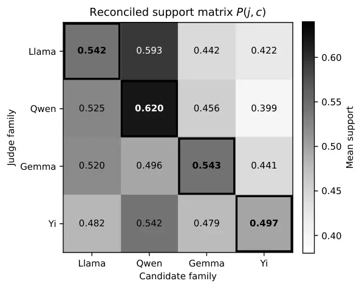

# Who Judges Matters: Measuring Family-Conditioned Preference in LLM-as-Judge Panels

David Ababio Awuni    Luke E. K. Achenie ^(†)^(†)thanks: Corresponding
author.    Benjamin Tei Partey Affiliation: Elvis Gyasi Owusu    Nii-Nai
Derrick Sowah

###### Abstract

Who the judge is can affect an LLM-as-judge result, but measuring that
effect without confusing it with candidate quality is difficult. We
study four open-weight families (Llama 3.1, Qwen 2.5, Gemma 2, and Yi
1.5) in a fully crossed pairwise design with 9,312 judgments. A common
per-family statistic is strongly confounded with candidate quality and
correlates with Bradley–Terry ability at $`r=0.95`$. We derive a
corrected estimator that holds the candidate family fixed and compares
judges. All four families then show a positive same-family lift (3.4–8.4
percentage points), with global FPS 0.067 (95% CI \[0.053, 0.084\],
permutation $`p=0.0002`$). The effect remains under panel-based quality
controls, an independent human-consensus anchor, and a float16 judging
replication. Judge-side likelihood is closely related to the effect:
adding likelihood advantage reduces the controlled coefficient by 61%,
which we treat as descriptive attenuation rather than causal mediation.
Position is a separate failure mode. Across the panel, 55.4% of AB/BA
pairs reverse, and reversal above 50% is incompatible with a simple
independent content-noise model. Relative to a family-balanced
reference, panel composition changes 18.5% of pairwise outcomes. A
complete reproducibility archive has been prepared for public release.

## 1 Introduction

LLM judges are now used to rank models, select preference data, and
support model-development decisions. This use assumes that, after
ordinary quality differences are accounted for, changing the judge
should not systematically change which response wins. A Qwen judge and a
Yi judge will disagree on some examples; the concern is whether one
judge family consistently gives extra support to one candidate family.

We test for that pattern in a fully crossed panel of open-weight models.
We call it _family-conditioned preference_: extra support for a
candidate when the judge comes from the same model family. No judge
evaluates its own generations, so this is not ordinary self-preference,
and the setting is a fixed evaluation panel rather than a training
pipeline with possible preference leakage.

Judge identity is already known to affect evaluation. LLM judges show
position, verbosity, and self-enhancement biases (Zheng et al., 2023;
Wang et al., 2024; Shi et al., 2025); some favor their own outputs
(Panickssery et al., 2024; Liu et al., 2024; Wataoka et al., 2024).
Family affinity has also appeared in pointwise and rubric-based settings
(Spiliopoulou et al., 2025; Pombal et al., 2026), while functional
similarity between judge and candidate can shift scores (Goel et al.,
2025). We therefore focus on three measurement questions rather than
claiming to discover family-related preference itself.

#### First, how should family preference be measured in a zero-sum pairwise panel?

The obvious statistic compares how much a judge supports its own family
with how much it supports other candidate families. In a zero-sum
pairwise panel, that comparison mixes candidate quality with the
judge–candidate interaction. The problem is large in our data: the
row-wise statistic correlates with Bradley–Terry ability at $`r=0.95`$.
It makes Qwen look strongly biased ($`+0.160`$) and Yi almost unbiased
($`-0.004`$). We instead hold the candidate family fixed and compare
judges: _does the same candidate receive more support from its
same-family judge than from the other judges?_ This column-wise
comparison removes the candidate main effect. The resulting lifts are
positive for all four families, ranging from 0.034 to 0.084.

#### Second, does the effect survive quality controls?

We next test whether measured quality differences explain the result. A
nested fractional-logit analysis adds Bradley–Terry quality, style
similarity, response length, candidate-side orientation, and family
fixed effects, with little change in the same-family coefficient; a
separate quasi-binomial GEE provides a correlation-structure robustness
check. Because several controls come from the audited panel, we also use
blind human consensus as an independent anchor; on the matched subset,
adding the human label changes the coefficient from 0.370 to 0.382. A
separate float16 judging run gives 0.066 globally, compared with 0.067
in the main quantized stack.

#### Third, what measurable property of the judge–candidate pair is associated with the effect?

A plausible explanation is familiarity: judges may favor text they find
easier to predict (Wataoka et al., 2024; Stureborg et al., 2024; Oi
et al., 2024). Same-family responses have a 0.69 natural-log-unit higher
mean per-token log-probability than cross-family responses. Adding
judge-side likelihood advantage to the fully controlled model reduces
the same-family coefficient from 0.299 to 0.116, a 61% attenuation,
while likelihood advantage strongly predicts support ($`\beta=0.144`$,
$`p=7\times 10^{-6}`$). We treat this as descriptive rather than causal,
and a smaller significant family effect remains.

Position instability is a different problem. Across the panel, 55.4% of
AB/BA pairs choose different winners, with Gemma at 78.8%. A simple
independent symmetric content-noise model cannot produce reversal above
50%, so higher rates indicate systematic order dependence.
Counterbalanced reconciliation cancels pure position-following, but
reversed pairs become ties and any genuine family-preference signal on
those pairs is lost. Position bias and family preference therefore need
separate diagnostics.

The effect is also large enough to matter in practice. The 6.7
percentage-point global lift exceeds 8 of 9 adjacent length-controlled
win-rate gaps in the AlpacaEval 2.0 top-10 snapshot used here, whose
median adjacent gap is 1.09 pp. The exact reference table used for this
comparison is included in the prepared reproducibility archive. This is
only a scale comparison, not a claim that our panel reproduces or
reranks AlpacaEval. Relative to a family-balanced reference, panel
composition changes 18.5% of pairwise outcomes.

#### Contributions.

The paper contributes five pieces of evidence and methodology:

- •
  We show why the natural row-wise per-family contrast is confounded by
  candidate quality and give a column-wise estimator that isolates the
  judge–candidate family interaction.
- •
  With the corrected estimator, every tested family has a positive and
  individually significant same-family lift. All four families also
  replicate in the positive direction under an independent float16
  judging stack.
- •
  We check quality using panel-derived controls, off-diagonal
  Bradley–Terry estimates, and an independent human-consensus anchor.
- •
  We measure a likelihood-familiarity channel. Judge-side likelihood
  advantage is strongly associated with support and reduces the
  controlled same-family coefficient by 61%, while a significant
  residual remains.
- •
  We treat position instability as a separate problem and show why
  counterbalanced reconciliation removes position-following while also
  attenuating genuine preference signal on reversed pairs.

## 2 Related Work

#### LLM judges as measurement instruments.

Early LLM-as-judge work reported high human agreement alongside
position, verbosity, and self-enhancement biases (Zheng et al., 2023).
Later studies showed that response order can change pairwise rankings
(Wang et al., 2024) and developed more direct position-bias diagnostics
(Shi et al., 2025). Recent work treats the judge itself as part of the
measurement system that needs auditing (Yang et al., 2026b; Usami
et al., 2026); JudgeArena similarly makes judges and backends swappable
while retaining detailed metadata (Lushtaku et al., 2026). Our fully
crossed design follows this view by treating judge provenance as an
experimental factor.

#### Self-preference, family preference, and quality confounding.

Self-preference work asks whether a judge favors its own generations
(Panickssery et al., 2024; Liu et al., 2024; Wataoka et al., 2024; Yang
et al., 2026a); our judges never score their own outputs, so the
relevant overlap is family-level. Quality adjustment is also central.
Chen et al. (2025a) use verifiable tasks to separate harmful
self-preference from genuinely better own-family outputs, and Chen
et al. (2025b) show that naive differences can mix bias with response
quality. Spiliopoulou et al. (2025) adjust for completion quality and
report family bias, while Pombal et al. (2026) find same-family
preference in rubric-based evaluation. In our fully crossed zero-sum
pairwise panel, this issue appears as a specific per-family
identification error that can be corrected without a gold score for
every response.

#### Similarity, familiarity, and likelihood.

Similarity provides one possible explanation. Goel et al. (2025) find
that judges favor functionally similar models, extending the concern
beyond exact self-preference. Other work connects self-preference to
perplexity (Wataoka et al., 2024), familiarity to evaluator
inconsistency (Stureborg et al., 2024), and likelihood to biased
evaluation (Oi et al., 2024). We therefore log judge-side token
likelihood for each candidate response and measure how the controlled
family coefficient changes when this signal is added.

#### Panels, correlated errors, and pipeline effects.

Panels can reduce single-judge errors without eliminating dependence
between judges. Diverse juries can outperform individual judges (Verga
et al., 2024), but correlated errors reduce effective panel diversity
(Kohli, 2026). Preference leakage creates a related provenance problem
during training when evaluator and synthetic-data sources overlap (Li
et al., 2026). We study evaluation instead: how panel composition
changes pairwise decisions relative to a family-balanced reference.
Concurrent mitigation work likewise finds that reliability depends on
the judge, prompt, and bias-control strategy (Yang et al., 2026a;
Soumik, 2026).

#### Positioning.

Prior work therefore establishes several routes through which evaluator
provenance can matter. Our claim is narrower: in fully crossed zero-sum
pairwise panels, we correct a per-family measurement error, show
positive corrected lifts across all four tested families, relate much of
the controlled coefficient to judge-side likelihood, and distinguish the
result from position instability.

## 3 Experimental Design

#### Panel.

The panel contains four open-weight families at two scales: Llama 3.1
(70B/8B), Qwen 2.5 (72B/7B), Gemma 2 (27B/9B), and Yi 1.5 (34B/9B). The
main stack uses GGUF Q4_K_M models with llama-cpp-python and no
proprietary API. Falcon 40B was piloted but excluded from the Primary-4
headline under criteria set before FPS was computed: its judge tie rate
was 88.5% versus a 3.4% retained-panel mean, and its mean candidate
support was 0.063 versus 0.56–0.65. Including Falcon would therefore mix
a major response-health/quality failure with the preference quantity.
Full-5 results appear only as specification-curve sensitivity evidence
(Appendix A).

#### Prompts.

A timestamped stratified split assigned 200 prompts to 134 exploratory
and 66 confirmatory items before analysis. Six prompts, two exploratory
and four confirmatory, failed the pre-specified response-health check
because at least one candidate response did not meet the required
length/quality condition. The primary set contains 194 prompts: 132
exploratory and 62 confirmatory, drawn from MT-Bench (78), AlpacaEval
2.0 (68), and WildBench (48) across 12 task categories (Zheng et al.,
2023; Dubois et al., 2024; Lin et al., 2025). Split and health-filter
files are included in the release.

#### Fully crossed trials.

Every judge family evaluates every unordered pair of candidate families
under both response orders. The design contains

```math
194\ \text{prompts}\times 6\ \text{pairs}\times 2\ \text{orders}\times 4\ \text{judges}=9{,}312
```

This produces 9,312 raw trials and 4,656 reconciled judge–prompt–pair
observations. Each of the 16 judge$`\times`$candidate cells has exactly
582 observations. The matrix estimators therefore do not depend on
unequal cell counts.

#### AB/BA reconciliation.

For each focal candidate, an order-specific verdict is coded as
$`w\in\{0,0.5,1\}`$, after which AB and BA are aligned to the same focal
orientation and averaged. If the two orders name different winners, the
reconciled score is $`s=0.5`$. Raw order dependence is substantial: the
first-position A-rate is 0.778 and AB/BA agreement is 0.446. We
therefore do not use single-presentation estimates as primary evidence;
Section 8 explains what reconciliation removes and what signal it can
also discard.

#### Judge-side likelihood.

For every trial, we compute the judge’s teacher-forced mean per-token
log-probability for each candidate response using the first 400
characters. This adds one forward pass per response and gives the
familiarity measure used in Section 7.

#### Human reference set.

Three graduate-level NLP researchers labeled 400 blinded pairwise items
as A/B/Tie with 1–5 confidence, stratified across all six
candidate-family pairs with provenance hidden. One annotator was
excluded before any FPS analysis under pre-specified quality criteria
(Appendix B). The two retained annotators reached consensus on 266 items
(Cohen’s $`\kappa=0.482`$; 66.5% exact agreement). On those items, the
panel matches human consensus 57.1% of the time, 15.0 pp above the 42.1%
majority-class baseline. We use these labels as an independent quality
control and task-difficulty reference, not to define or validate FPS.

## 4 Measuring Per-Family Preference Correctly

Let $`P(j,c)`$ be the mean reconciled support that judge family $`j`$
gives candidate family $`c`$. Every pairwise comparison distributes one
unit of support across the two candidates. Because the candidate design
is balanced, each judge row in $`P`$ sums to 2.00. That equality comes
from the design rather than from the observed behavior.

We first define a global Family Preference Score (FPS) as diagonal
support minus off-diagonal support:

```math
\mathrm{FPS}=\frac{1}{|F|}\sum_{f}P(f,f)-\frac{1}{|F|(|F|-1)}\sum_{j\neq c}P(j,c). \tag{1}
```

The global quantity is straightforward; assigning FPS to a specific
family is where the identification problem appears.

### 4.1 Why the natural per-family contrast is confounded

Write the cell mean as

```math
P(j,c)=\mu+a_{j}+b_{c}+\gamma_{jc}, \tag{2}
```

Here $`a_{j}`$ is a judge main effect, $`b_{c}`$ a candidate-family main
effect, and $`\gamma_{jc}`$ the judge$`\times`$candidate interaction. We
use the standard double-centered identification constraints
$`\sum_{c}b_{c}=0`$, $`\sum_{c}\gamma_{jc}=0`$ for every judge $`j`$,
and $`\sum_{j}\gamma_{jc}=0`$ for every candidate $`c`$. Because every
judge row has mean 0.5 in the balanced zero-sum design, these
constraints set $`\mu=0.5`$ and absorb the additive judge main effect.
Candidate main effects remain and capture average candidate-family
strength.

The seemingly natural statistic compares a judge’s diagonal cell with
the other cells in the same row:

```math
\displaystyle\mathrm{FPS}^{\text{row}}_{f} \displaystyle=P(f,f)-\frac{1}{3}\sum_{c\neq f}P(f,c) \tag{3}
```

```math
\displaystyle=\frac{4}{3}(b_{f}+\gamma_{ff}). \tag{4}
```

The problem is the $`b_{f}`$ term. A strong candidate family can make
its same-family judge appear biased even when the interaction is modest,
while a weak candidate can conceal a real same-family lift.

To identify the interaction, we keep the candidate family fixed and
change the judge:

```math
\displaystyle\mathrm{FPS}^{\text{col}}_{f} \displaystyle=P(f,f)-\frac{1}{3}\sum_{j\neq f}P(j,f) \tag{5}
```

```math
\displaystyle=\frac{4}{3}\gamma_{ff}. \tag{6}
```

This asks the question we actually care about: does candidate family
$`f`$ receive more support from its same-family judge than from judges
in the other families?

Figure 1 shows the practical consequence. Bradley–Terry family abilities
are Qwen $`+0.190`$, Llama $`+0.052`$, Gemma $`-0.060`$, and Yi
$`-0.182`$, and the naive row-wise scores track them closely
($`r=0.95`$): Qwen appears highly biased (0.160) while Yi appears almost
unbiased ($`-0.004`$). After candidate strength is removed, the
correlation falls to $`r=-0.24`$ and all four lifts are positive.
Candidate quality adds about $`+0.084`$ to Qwen’s naive score and a
roughly $`-0.080`$ term hides Yi’s positive interaction.

Figure 1: The same data tell a different story when candidate quality is
held fixed. Open markers show the naive row-wise contrast; filled
markers show the identified column-wise contrast. The naive statistic
closely tracks Bradley–Terry candidate ability ($`r=0.95`$). The
identified statistic compares judges on the same candidate family and no
longer follows ability ($`r=-0.24`$). Table 1 reports inference for the
identified estimator.

### 4.2 Three independent checks give the same answer

Three checks lead to the same correction. Double-centering the
$`4\times 4`$ matrix isolates the diagonal interaction terms, and
Bradley–Terry residualization gives lifts of 0.025/0.057/0.063/0.057.
Prompt-level permutation explains why the naive null is not centered at
zero: its per-family means are $`+0.023/+0.084/-0.026/-0.080`$, matching
$`\tfrac{4}{3}b_{f}`$ to four decimals. Re-centering by those means
recovers the identified estimate and supplies the per-family
$`p`$-values in Table 1, followed by two-sided Benjamini–Hochberg
correction.

## 5 Results: The Corrected Effect Is Positive in All Four Families

Global FPS is 0.067, with mean diagonal support of 0.551 versus 0.483
off the diagonal. Every identified family score is also positive and
individually significant (Table 1), with a corrected range of
0.034–0.084 that no longer tracks candidate strength. Qwen has the
highest BT ability but a middle-sized lift, while Gemma has the largest
lift despite being neither the strongest candidate nor a stable judge by
position (Section 8).

| Family | FPS   | 95% CI           | $`p`$ (BH) |
| ------ | ----- | ---------------- | ---------- |
| Global | 0.067 | \[0.053, 0.084\] | 0.0002     |
| Gemma  | 0.084 | \[0.056, 0.111\] | $`<0.001`$ |
| Yi     | 0.076 | \[0.050, 0.103\] | $`<0.001`$ |
| Qwen   | 0.076 | \[0.050, 0.102\] | $`<0.001`$ |
| Llama  | 0.034 | \[0.007, 0.060\] | 0.012      |

Table 1: Identified Family Preference Score. Global CI: prompt-cluster
bootstrap ($`n=2{,}000`$); global $`p`$: prompt-level permutation
($`n=5{,}000`$). Per-family intervals and two-sided BH-corrected
$`p`$-values use the permutation distribution re-centered on the correct
quality-dependent null.

The full matrix in Figure 2 shows the same pattern directly. Each
diagonal cell is higher than the mean support given by the other three
judges to that candidate family: Llama 0.542 versus 0.509, Qwen 0.620
versus 0.544, Gemma 0.543 versus 0.459, and Yi 0.497 versus 0.421. Minor
differences from printed rounded values arise from rounding before
averaging. The corrected pattern is four elevated diagonals, not a
single unusually high Qwen cell.



Figure 2: Reconciled support matrix $`P(j,c)`$. Rows are judge families
and columns are candidate families. Each row sums to 2.00 by
construction. Boxed diagonal cells are the same-family cells. Each
diagonal cell is above the mean support given by the other three judges
to that same candidate family.

## 6 The Effect Survives Measured Quality Controls

### 6.1 Panel-internal controls

We test whether measured quality and representation features absorb the
effect with a sequence of fractional-logit generalized linear models
using a Binomial family, logit link, and prompt-clustered sandwich
standard errors. The 4,656 reconciled judge–prompt–pair observations are
represented as 9,312 candidate-orientation rows. Controls enter the
model in blocks (Table 2). A separate quasi-binomial GEE with an
exchangeable working correlation is used as a robustness check
(Appendix C).

| M   | Controls added           | $`\hat{\beta}`$ | OR   | $`p`$                     |
| --- | ------------------------ | --------------- | ---- | ------------------------- |
| 1   | same-family only         | 0.270           | 1.31 | $`4.5\!\times\!10^{-18}`$ |
| 2   | \+ BT quality            | 0.274           | 1.32 | $`7.2\!\times\!10^{-18}`$ |
| 3   | \+ style similarity      | 0.260           | 1.30 | $`1.4\!\times\!10^{-15}`$ |
| 4   | \+ length, cand. side    | 0.294           | 1.34 | $`1.8\!\times\!10^{-16}`$ |
| 5   | \+ judge/candidate FE    | 0.298           | 1.35 | $`4.1\!\times\!10^{-17}`$ |
| 6   | \+ opponent, category FE | 0.301           | 1.35 | $`1.9\!\times\!10^{-17}`$ |

Table 2: Nested fractional-logit controls. The same-family log-odds
coefficient remains stable as quality, similarity, length,
candidate-side orientation, and family controls are added.
Prompt-clustered sandwich SEs are approximately 0.031–0.036.

The same-family coefficient does not decline as controls are added,
moving from 0.270 in M1 to 0.301 in M6; M5 is 0.298. Because
Bradley–Terry quality is panel-derived, we also re-estimate BT after
removing all 2,328 same-family pairs; family abilities stay unchanged to
four decimals and the M2 coefficient is 0.271. Style similarity from
all-mpnet-base-v2 embedding cosine is not predictive ($`p=0.91`$). This
measure captures broad semantic and stylistic similarity, not individual
surface features such as markdown structure, list use, or hedging.

### 6.2 Independent human quality anchor

Panel-derived controls can still be circular, so we repeat the analysis
using blind human consensus as an external quality signal. Of the 266
consensus items, 248 join to reconciled data from all four primary
judges. The resulting matched set contains 992 reconciled judge–pair
observations, represented as 1,984 orientation rows across 154 prompt
clusters.

On the fixed human-matched subset, the same-family coefficient is 0.370
without the human control (SE 0.059, $`p=2.7\times 10^{-10}`$) and 0.382
with it (SE 0.060, $`p=2.0\times 10^{-10}`$); the human quality
coefficient is 0.416 ($`p=4.1\times 10^{-8}`$). The relevant comparison
is within this subset, not between 0.370 and the full-sample M1 value of
0.270. An external quality signal therefore does not attenuate the
family coefficient.

The human result supports the main finding without proving that all
quality confounding is absent. Agreement is noisy ($`\kappa=0.482`$;
266/400 consensus), so smaller unmeasured differences could remain; the
value of this anchor is its independence from the LLM panel.

## 7 Likelihood Familiarity as an Explanatory Channel

One possible explanation for extra same-family support is familiarity.
Prior work finds that LLM evaluators can favor text with higher
likelihood or lower perplexity (Wataoka et al., 2024; Stureborg et al.,
2024; Oi et al., 2024). Our audit logs judge-side likelihoods, allowing
us to test whether the same pattern extends across model families.

#### Same-family text is more predictable to the judge.

Same-family responses have a judge-side mean per-token log-probability
of $`-0.69`$, compared with $`-1.38`$ for cross-family responses. The
0.69 natural-log-unit difference is roughly a twofold ratio in
geometric-mean token probability. Family overlap is therefore strongly
associated with a directly observed familiarity measure.

#### Adding likelihood advantage reduces the family coefficient.

We add z-scored judge-side likelihood advantage, defined as candidate
minus opponent, to a fully controlled GEE with BT quality advantage,
style advantage, length ratio, and judge/candidate fixed effects.
Likelihood coverage is 99.5% ($`n=9{,}264`$ orientation rows). Before
likelihood is added, the same-family coefficient is 0.299. This is
nearly the same as Table 2’s M5 estimate of 0.298.

| Model                 | $`\beta_{same}`$ | $`p`$         | $`\beta_{lik}`$ | $`p`$               |
| --------------------- | ---------------- | ------------- | --------------- | ------------------- |
| Full controls         | 0.299            | $`<10^{-17}`$ | –               | –                   |
| \+ likelihood adv.    | 0.116            | 0.006         | 0.144           | $`7\times 10^{-6}`$ |
| \+ same$`\times`$lik. | 0.109            | 0.010         | 0.142           | $`7\times 10^{-6}`$ |

Table 3: Likelihood-familiarity adjustment. Adding judge-side likelihood
advantage reduces the same-family coefficient by 61%. The interaction
coefficient in the final model is 0.010 ($`p=0.001`$).

After likelihood advantage is added, the same-family coefficient drops
from 0.299 to 0.116, a 61% attenuation. Likelihood advantage itself
strongly predicts support ($`\beta=0.144`$, $`p=7\times 10^{-6}`$),
while the remaining same-family coefficient is still significant
($`p=0.006`$). In the interaction model, $`\beta_{same}=0.109`$
($`p=0.010`$), $`\beta_{lik}=0.142`$ ($`p=7\times 10^{-6}`$), and the
same-family$`\times`$likelihood interaction is small and positive
($`\beta=0.010`$, $`p=0.001`$).

Figure 3: Coefficient attenuation after adding judge-side likelihood
advantage. The same-family coefficient decreases by 61%, while
likelihood advantage is itself strongly predictive. The 61% number is
descriptive coefficient attenuation across nested nonlinear models, not
a causal mediated proportion.

#### Interpretation boundary.

The 61% reduction is not a causal share. Non-collapsibility and
rescaling can change coefficients across nested nonlinear models, and a
common cause could make same-family text both easier to predict and more
highly rated. Familiarity may also capture quality that a judge
genuinely values, as Chen et al. (2025a) note for self-preference. The
supported conclusion is narrower: much of the controlled family
coefficient co-varies with a measurable judge–candidate property, and a
smaller significant family effect remains after it is included.
Judge-side log-probability is therefore a useful audit signal even
though its causal role remains unresolved.

## 8 Position Bias Is a Separate Failure Mode

Across all AB/BA presentation pairs, 55.4% produce different winners.
Gemma reverses on 78.8% of pairs, Yi on 53.4%, Llama on 47.3%, and Qwen
on 42.1% ($`\chi^{2}(3)=373.5`$, $`p<0.001`$). Such reversal can be
described loosely as judgment noise, but these rates allow a sharper
test.

#### A simple content-noise model has a 50% ceiling.

Assume the judge has a stable latent content preference and
independently selects that preferred response with probability $`p`$ in
each presentation. Then the AB/BA reversal probability is

```math
R_{noise}=2p(1-p)\leq 0.5. \tag{7}
```

The bound also holds for mixtures of different $`p`$ values across
items. Under this simple independent symmetric content-noise model,
reversal cannot exceed 50%.

Pure position-following has a different signature. If a judge chooses
the first-shown response with probability $`q`$, the probability that AB
and BA identify different candidate families is

```math
R_{slot}=q^{2}+(1-q)^{2}, \tag{8}
```

This quantity is above 0.5 whenever $`q\neq 0.5`$ and approaches 1 as
first-position following becomes deterministic. Equation 8 has symmetric
solutions, $`q`$ and $`1-q`$; the panel’s raw first-position preference
(A-rate 0.778) selects the $`q>0.5`$ branch. Under the pure
slot-following model, Gemma’s 78.8% reversal corresponds to
$`q\approx 0.88`$, while Yi’s 53.4% corresponds to $`q\approx 0.63`$.
Llama and Qwen are below the 50% bound, so reversal alone cannot tell
whether their instability comes from ordinary content noise or milder
position bias.

#### Counterbalancing removes position-following, but attenuates preference.

Because every pair is judged in both orders, a reversed pair receives
$`s=0.5`$. Pure position-following then contributes no signed preference
after reconciliation, which is the intended protection. The same rule
also removes any genuine family-preference signal on that reversed pair.
High reversal can therefore reduce reconciled FPS even when
family-conditioned preference is present.

If we restrict the analysis to position-consistent pairs, global FPS
rises to 0.211, roughly three times the headline estimate. We report
this as sensitivity evidence only. Consistency is a post-outcome
selection that changes both the subset and the judge composition; Qwen
contributes many more stable pairs than Gemma. The 0.211 value is
therefore neither a corrected estimate nor a formal bound. What is fixed
by the design is simpler: reversed pairs contribute exactly zero signed
preference to the headline estimator.

This distinction explains the most extreme panel behavior. A Gemma-only
judge disagrees with the family-balanced reference on 58.3% of
comparisons, which could look like extreme family bias. Under the
position model, however, about 88% of Gemma’s single-order choices
follow the first position, leaving little stable content signal in a
single-presentation Gemma panel. Position-following and
family-conditioned preference are systematic but distinct problems and
should be diagnosed separately.

## 9 Robustness

#### Full-precision judging replication.

We repeat judging with all four smaller judges loaded at float16 in
transformers, removing GGUF quantization from the judging stack. The run
uses the original 66-prompt confirmatory allocation and yields 3,168
trials with a 95.5% parse rate. Candidate responses remain fixed, so the
comparison changes only the judging stack. Global FPS is 0.066 (95% CI
\[0.045, 0.089\]), almost identical to the main estimate of 0.067. All
four per-family point estimates remain positive: Gemma 0.115 \[0.066,
0.166\], Yi 0.083 \[0.042, 0.122\], Qwen 0.037 \[$`-0.001`$, 0.076\],
and Llama 0.031 \[0.000, 0.062\]. Gemma and Yi are individually bounded
away from zero at this holdout size; Qwen and Llama replicate in
direction but not with individual significance.

#### Confirmatory holdout and specification multiverse.

The main-stack confirmatory holdout contains 62 prompts after the
response-health filter and gives FPS 0.062 (95% CI \[0.039, 0.086\],
$`p<0.001`$). Across 72 Primary-4 specifications varying tie treatment,
prompt source, and judge scale, every estimate is positive, ranging from
0.039 to 0.231 with median 0.105; the 0.067 headline lies in the
conservative quartile. The multiverse supports the direction of the
effect while showing that its magnitude depends on evaluation choices.

| Condition                          | Global FPS        |
| ---------------------------------- | ----------------- |
| Headline (rubric, large judges)    | 0.067             |
| Full-precision fp16 judges         | 0.066             |
| Neutral system prompt              | 0.063             |
| MT-Bench + AlpacaEval only         | 0.077             |
| WildBench only                     | 0.039             |
| Small judges (7–9B)                | 0.046             |
| Confirmatory holdout               | 0.062             |
| Position-consistent pairs only     | 0.211             |
| LOO judge (remove Qwen)            | 0.037             |
| LOO judge (other removals)         | 0.071–0.091       |
| LOO candidate (range)              | 0.063–0.102       |
| Multiverse, 72 specs (min/med/max) | 0.039/0.105/0.231 |

Table 4: Robustness suite. All reported global FPS estimates are
positive. The range demonstrates directional stability, not a claim that
the magnitude is invariant to design choices.

No leave-one-out analysis removes the effect, although the families do
not contribute equally. Removing Qwen as a judge lowers global FPS from
0.067 to 0.037, the largest single-family change; removing any other
judge leaves 0.071–0.091. Removing candidate families gives 0.063–0.102.
A coarser family-label placebo shuffle produces a null centered near
zero, with the observed FPS above 96.2% of draws ($`p=0.038`$). We treat
that placebo as supplementary to the prompt-level permutation test
($`p=0.0002`$), not as a substitute for it.

## 10 Consequences for Evaluation Practice

#### Panel composition changes decisions.

Panel composition changes decisions as well as scores. Relative to a
family-balanced four-judge reference, a panel where one judge shares a
family with one candidate changes 18.5% of pairwise outcomes (Wilson 95%
CI \[16.4, 20.8\]). Single-family panels diverge by 22.1% for Qwen and
58.3% for Gemma, while removing one family from an otherwise balanced
panel changes 2.2–13.4%. The winner can therefore depend on who judges.

#### The effect is large relative to common leaderboard gaps.

The 6.7 pp global lift exceeds 8 of 9 adjacent length-controlled
win-rate gaps in the AlpacaEval 2.0 top-10 snapshot retrieved on
2026-05-07, whose median adjacent gap is 1.09 pp (Dubois et al., 2024).
Because FPS and AlpacaEval win-rate are different quantities, this is
only a scale comparison. The observed evaluator-family effect is
nevertheless large relative to margins often used to separate
neighboring systems.

#### A minimal audit protocol.

For a pairwise LLM-as-judge panel, our results motivate five basic
checks:

1.  1.  Use a per-family statistic that identifies the family interaction.
        In a balanced zero-sum matrix, this can be the column-wise FPS or an
        equivalent permutation de-centering. The naive row-wise diagonal
        contrast should not be interpreted as family bias.
2.  2.  Do not let one candidate family also dominate the judge panel.
3.  3.  Judge both response orders and report the AB/BA reversal rate. Under
        the simple independent content-noise model used here, reversal above
        50% is incompatible with content noise alone and makes
        single-presentation conclusions difficult to trust.
4.  4.  Record judge-side response likelihoods. A large same-family
        likelihood gap is a warning that familiarity may be related to
        verdicts.
5.  5.  Report how outcomes change when panel composition changes,
        preferably relative to a family-balanced reference.

## 11 Conclusion

Who judges matters, but the effect has to be measured correctly. In our
fully crossed open-weight panel, the usual row-wise per-family contrast
is strongly confounded with candidate ability and gives a distorted view
of family differences. Holding the candidate family fixed produces a
simpler result: every tested family receives more support from its
same-family judge, with identified lifts of 3.4–8.4 percentage points
and global FPS 0.067.

Measured quality differences do not remove the effect: it remains under
panel-based controls, an independent human-consensus anchor, and an
unquantized float16 judging replication. Judge-side likelihood accounts
for much of the statistical association, reducing the controlled
coefficient by 61%, while a smaller significant family effect remains.
This is descriptive attenuation, not a causal mechanism estimate; a
direct mechanism test would manipulate predictability while holding
response quality fixed.

Position creates a second source of evaluator dependence. High AB/BA
reversal shows that some judges follow presentation order strongly;
counterbalancing removes pure position-following but also suppresses
family-preference signal on reversed pairs. Reliable LLM-as-judge
evaluation therefore requires provenance-aware measurement alongside
explicit judge diagnostics. The prepared reproducibility archive
includes the prompts, inference settings, all 9,312 judgments, per-trial
judge-side likelihoods, human annotations, and analysis artifacts needed
to reproduce the audit.

## Limitations

The evidence covers four open-weight families at the tested versions, an
English open-ended prompt distribution, and one main inference stack. We
do not test closed-weight judges or verifiable domains such as code and
mathematics, where ground truth can change how apparent self- or
family-preference should be interpreted. Chen et al. (2025a) show that
some self-preference on verifiable tasks reflects genuinely better
outputs, while proof-domain judge audits report different reliability
patterns (Gonzalez et al., 2026).

The 61% likelihood result compares coefficients across nested nonlinear
models; it is not causal mediation. A stronger mechanism experiment
would vary predictability or familiarity while keeping response quality
fixed. Our likelihood feature also uses only the first 400 characters of
each response. We have not shown that the attenuation percentage is
unchanged under other truncation windows, although the prepared
likelihood cache permits those checks.

The position-consistent FPS of 0.211 comes from a selected subset with a
different mix of trials and judges, so it is sensitivity evidence rather
than a corrected estimate or formal bound. Response quality has no
perfect gold standard here: standard BT, off-diagonal-only BT, and blind
human consensus all leave the effect in place, but unmeasured
differences remain possible. The float16 replication also uses the
smaller judges on the confirmatory allocation; a full-scale,
full-precision replication would give tighter family-level intervals and
a stronger quantization test.

## Ethical Considerations

Human annotation involved three researchers with graduate-level NLP
training who were recruited independently of the authors. One annotator
was excluded under the pre-specified quality criteria in Appendix B; the
other two provide the consensus and human-anchor analyses reported in
the paper. We collected no demographic data, targeted no vulnerable
population, and used no deception.

The audit is dual-use because evaluator provenance could be used to
construct a panel that favors one model family. We plan to release the
measurements because they also expose that risk and support direct
mitigations through balanced panels, order counterbalancing, likelihood
logging, and composition-sensitivity reporting. Original annotations,
judgments, and analysis artifacts are intended for release under CC BY
4.0, with code under an open-source software license; third-party
prompts, model weights, and derived materials remain under their
original licenses.

## References

- Chen et al. (2025a) Wei-Lin Chen, Zhepei Wei, Xinyu Zhu, Shi Feng, and
  Yu Meng. 2025a. Do LLM evaluators prefer themselves for a reason?
  arXiv preprint arXiv:2504.03846.
- Chen et al. (2025b) Zhi-Yuan Chen, Hao Wang, Xinyu Zhang, Enrui Hu,
  and Yankai Lin. 2025b. Beyond the Surface: Measuring Self-Preference
  in LLM Judgments. In Proceedings of EMNLP 2025, pages 1653–1672.
- Dubois et al. (2024) Yann Dubois, Balazs Galambosi, Percy Liang, and
  Tatsunori B. Hashimoto. 2024. Length-controlled AlpacaEval: A simple
  way to debias automatic evaluators. arXiv preprint arXiv:2404.04475.
- Goel et al. (2025) Shashwat Goel, Joschka Struber, Ilze Amanda Auzina,
  Karuna K. Chandra, Ponnurangam Kumaraguru, Douwe Kiela, Ameya Prabhu,
  Matthias Bethge, and Jonas Geiping. 2025. Great Models Think Alike and
  this Undermines AI Oversight. In Proceedings of the 42nd International
  Conference on Machine Learning.
- Gonzalez et al. (2026) Santiago Gonzalez et al. 2026. QEDBENCH:
  Quantifying the alignment gap in automated evaluation of
  university-level mathematical proofs. arXiv preprint arXiv:2602.20629.
- Kohli (2026) Guneet Kohli. 2026. Nine judges, two effective votes:
  Correlated errors undermine LLM evaluation panels. arXiv preprint
  arXiv:2605.29800.
- Landis and Koch (1977) J. Richard Landis and Gary G. Koch. 1977. The
  measurement of observer agreement for categorical data. Biometrics,
  33(1):159–174.
- Li et al. (2026) Dawei Li, Renliang Sun, Yue Huang, Ming Zhong, Bohan
  Jiang, Jiawei Han, Xiangliang Zhang, Wei Wang, and Huan Liu. 2026.
  Preference Leakage: A Contamination Problem in LLM-as-a-Judge. In
  International Conference on Learning Representations.
- Lin et al. (2025) Bill Yuchen Lin, Yuntian Deng, Khyathi Chandu, Faeze
  Brahman, Abhilasha Ravichander, Valentina Pyatkin, Nouha Dziri, Ronan
  Le Bras, and Yejin Choi. 2025. WildBench: Benchmarking LLMs with
  challenging tasks from real users in the wild. In International
  Conference on Learning Representations.
- Liu et al. (2024) Yiqi Liu, Nafise Moosavi, and Chenghua Lin. 2024.
  LLMs as narcissistic evaluators: When ego inflates evaluation scores.
  In Findings of ACL 2024, pages 12688–12701.
- Lushtaku et al. (2026) Erlis Lushtaku, Bora Kargi, Ali Elganzory,
  Fabio Ferreira, Alejandro R. Salamanca, Julia Kreutzer, and David
  Salinas. 2026. JudgeArena: A Unified Framework for Reproducible
  LLM-Judge Evaluation. arXiv preprint arXiv:2608.02620.
- Oi et al. (2024) Masanari Oi, Masahiro Kaneko, Ryuto Koike, Mengsay
  Loem, and Naoaki Okazaki. 2024. Likelihood-based Mitigation of
  Evaluation Bias in Large Language Models. In Findings of ACL 2024,
  pages 3237–3245.
- Panickssery et al. (2024) Arjun Panickssery, Samuel R. Bowman, and Shi
  Feng. 2024. LLM evaluators recognize and favor their own generations.
  In Advances in Neural Information Processing Systems, volume 37.
- Pombal et al. (2026) Jose Pombal, Ricardo Rei, and Andre F. T.
  Martins. 2026. Self-preference bias in rubric-based evaluation of
  large language models. arXiv preprint arXiv:2604.06996.
- Shi et al. (2025) Lin Shi, Chiyu Ma, Wenhua Liang, Xingjian Diao,
  Weicheng Ma, and Soroush Vosoughi. 2025. Judging the Judges: A
  Systematic Study of Position Bias in LLM-as-a-Judge. In Proceedings of
  IJCNLP-AACL, pages 292–314.
- Soumik (2026) Sadman Kabir Soumik. 2026. Judging the Judges: A
  Systematic Evaluation of Bias Mitigation Strategies in LLM-as-a-Judge
  Pipelines. Transactions on Machine Learning Research.
- Spiliopoulou et al. (2025) Evangelia Spiliopoulou, Riccardo Fogliato,
  Hanna Burnsky, Tamer Soliman, Jie Ma, Graham Horwood, and Miguel
  Ballesteros. 2025. Play Favorites: A Statistical Method to Measure
  Self-Bias in LLM-as-a-Judge. arXiv preprint arXiv:2508.06709.
- Stureborg et al. (2024) Rickard Stureborg, Dimitris Alikaniotis, and
  Yoshi Suhara. 2024. Large language models are inconsistent and biased
  evaluators. arXiv preprint arXiv:2405.01724.
- Usami et al. (2026) Hiroyasu Usami, Keisuke Hara, Ayato Tsuboi, and
  Naohiko Matsuda. 2026. LLM Judges Have Dark Current: A Psychometric
  Datasheet for LLM-as-a-Judge Evaluation. arXiv preprint
  arXiv:2606.15610.
- Verga et al. (2024) Pat Verga, Sebastian Hofstatter, Sophia Althammer,
  Yixuan Su, Aleksandra Piktus, Arkady Arkhangorodsky, Minjie Xu, Naomi
  White, and Patrick Lewis. 2024. Replacing Judges with Juries:
  Evaluating LLM Generations with a Panel of Diverse Models. arXiv
  preprint arXiv:2404.18796.
- Wang et al. (2024) Peiyi Wang, Lei Li, Liang Chen, Zefan Cai, Dawei
  Zhu, Binghuai Lin, Yunbo Cao, Lingpeng Kong, Qi Liu, Tianyu Liu, and
  Zhifang Sui. 2024. Large language models are not fair evaluators. In
  Proceedings of ACL 2024, pages 9440–9450.
- Wataoka et al. (2024) Koki Wataoka, Tsubasa Takahashi, and Ryokan
  Ri. 2024. Self-preference bias in LLM-as-a-Judge. arXiv preprint
  arXiv:2410.21819.
- Yang et al. (2026a) Jinming Yang, Zheng Hu, Chuxian Qiu, Zhenyu Deng,
  Xinshan Jiao, and Tao Zhou. 2026a. Quantifying and mitigating
  self-preference bias of LLM judges. arXiv preprint arXiv:2604.22891.
- Yang et al. (2026b) Zongyou Yang, Yinghan Hou, and Xiaokun Yang.
  2026b. When the Judge Changes, So Does the Measurement: Auditing
  LLM-as-Judge Reliability. arXiv preprint arXiv:2607.08535.
- Zheng et al. (2023) Lianmin Zheng, Wei-Lin Chiang, Ying Sheng, Siyuan
  Zhuang, Zhanghao Wu, Yonghao Zhuang, Zi Lin, Zhuohan Li, Dacheng Li,
  Eric P. Xing, Hao Zhang, Joseph E. Gonzalez, and Ion Stoica. 2023.
  Judging LLM-as-a-Judge with MT-Bench and Chatbot Arena. In Advances in
  Neural Information Processing Systems, volume 36.

## Appendix A Falcon 40B Exclusion and Position Diagnostics

Falcon 40B was excluded from the Primary-4 headline under two criteria
set before FPS was computed. Its judge tie rate was 88.5%, versus a 3.4%
mean for retained families, and its mean candidate support was 0.063
versus 0.56–0.65. Candidate support is the mean reconciled support
received as a candidate across judges and opponents. Including Falcon
would therefore mix a major response-health/quality failure into the
preference quantity, so Full-5 results are kept only as sensitivity rows
in the specification curve.

AB/BA reversal rates by judge are Gemma 78.8%, Yi 53.4%, Llama 47.3%,
and Qwen 42.1%; the global rate is 55.4% ($`\chi^{2}(3)=373.49`$,
$`p<0.001`$). Under the content-noise model in Section 8, reversal is
$`2p(1-p)\leq 0.5`$. Under pure first-slot following it is
$`q^{2}+(1-q)^{2}`$, which is above 0.5 whenever $`q\neq 0.5`$. Using
the observed first-position preference to choose the $`q>0.5`$ branch
gives $`q\approx 0.88`$ for Gemma and $`q\approx 0.63`$ for Yi. Llama
and Qwen stay below the 50% diagnostic bound, so their reversal rates
alone cannot separate content noise from mild position bias.

## Appendix B Human Annotation Protocol

Three graduate-level NLP annotators labeled 400 blinded pairwise items
as A/B/Tie with 1–5 confidence. One annotator was excluded before any
FPS analysis after meeting all three pre-specified criteria: nearly
uniform 4–5 confidence, zero notes while each retained annotator left at
least 229, and Cohen’s $`\kappa\approx 0.14`$–0.18 with both retained
annotators, below the 0.40 moderate-agreement threshold in the plan
(Landis and Koch, 1977).

The retained annotators have $`\kappa=0.482`$, 66.5% exact agreement,
and 266 consensus items. On this set, the LLM panel matches 57.1% of
labels versus 42.1% for the majority-class baseline, a 15.0 pp gain. The
fully matched 248-item human-GEE subset has 61.3% exact panel–human
agreement; treating all 134 non-consensus items as ties gives 38.0%
exact match. These labels provide an independent quality control and
task-difficulty reference, not a definition or validation of FPS.

## Appendix C Regression Specification and GEE Robustness

The nested M1–M6 control table uses a fractional-logit generalized
linear model with a Binomial family and logit link. Reconciled support
in $`[0,1]`$ is the outcome; 62.3% of observations are fractional after
reconciliation. The model is fit with statsmodels.formula.api.glm, and
uncertainty uses sandwich covariance clustered at prompt_id ($`n=194`$
clusters). The candidate-side indicator records whether the expanded
orientation row corresponds to canonical family_1 or family_2; it is not
the original AB/BA presentation position.

Main nested-model covariates are Bradley–Terry candidate-minus-opponent
advantage, judge–candidate style similarity and style advantage, log
token-length ratio, the candidate-side indicator, and progressively
added judge, candidate, opponent, and category fixed effects. A separate
quasi-binomial GEE with a Binomial family, logit link, exchangeable
working correlation, and prompt-level sandwich standard errors is used
as a robustness check. To avoid the collinearity that arises when
Bradley–Terry advantage and candidate/opponent fixed effects are entered
together, that GEE uses the quality contrast without the saturated
candidate/opponent fixed-effect block. The likelihood models in
Section 7 are also prompt-clustered GEE specifications and add
logprob_advz, the z-scored candidate-minus-opponent difference in
judge-side mean per-token log-probability over the first 400 characters.
The nested fractional-logit table is the main control ladder; the GEE is
a separate robustness analysis.

## Appendix D Full-Precision Replication Detail

The full-precision replication loads the four smaller judges
(Llama-3.1-8B-Instruct, Qwen2.5-7B-Instruct, Gemma-2-9B-it, and
Yi-1.5-9B-Chat) at float16 with transformers, without GGUF or
quantization. They re-judge the original 66-prompt confirmatory
allocation across all six candidate pairs and both response orders,
giving 3,168 trials. This is the pre-filter set; Section 9 uses the 62
prompts remaining after the response-health filter. Candidate responses
are unchanged, decoding is greedy, parse rate is 95.5%, and raw tie rate
is 11.5%. Reconciliation and FPS definitions are unchanged. Global FPS
is 0.066 (95% CI \[0.045, 0.089\]); family scores are Gemma 0.115
\[0.066, 0.166\], Yi 0.083 \[0.042, 0.122\], Qwen 0.037 \[$`-0.001`$,
0.076\], and Llama 0.031 \[0.000, 0.062\].
