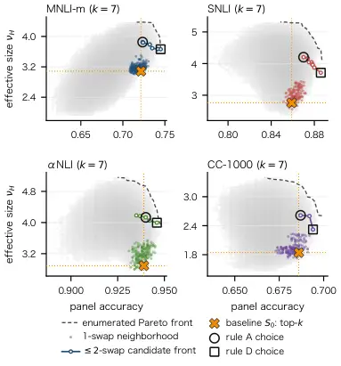
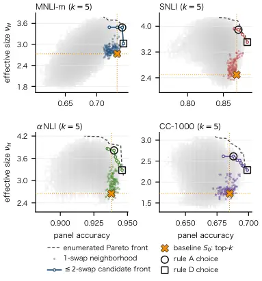

\[BoldFont=texgyretermes-bold.otf,ItalicFont=texgyretermes-italic.otf,BoldItalicFont=texgyretermes-bolditalic.otf\]
\[BoldFont=texgyreheros-bold.otf\] \[BoldFont=texgyrecursor-bold.otf\]

# How Many Humans Are 32 LLM Judges Worth?

Chao Li Yingying Yu Yunfeng Li Tsinghua University University College
London Hebei University of Economics and Business lichaocasia@gmail.com
yuyingying311@gmail.com liyunfengxiaolong@gmail.com ^(†)^(†)thanks:
Corresponding author.

###### Abstract

A panel’s human-equivalent size is target-specific. Matching a fixed
32-judge panel to empirical human label distributions on three ChaosNLI
tasks yields two distinct effective sizes: distributional-error matching
gives $`\nu_{\mathrm{MSE}}=2.304`$, $`3.750`$, and $`3.445`$, whereas
spectral matching gives $`\nu_{H}=4.242`$, $`6.459`$, and $`6.499`$, a
gap of $`1.72`$–$`1.89\times`$; a binary-error diagnostic credits the
same panels with only $`1.971`$–$`2.227`$ effective votes. Extrapolating
the distributional-error curve at fixed squared mean residual, mean
member variance, and normalized mean covariance gives asymptotes of
$`2.392`$, $`3.990`$, and $`3.655`$, with 32 judges already reaching
$`94.0`$–$`96.3\%`$. An exact spectral identity explains the gap: error
depends on member energy and on the orientation of residual variation
relative to averaging, information that the participation ratio (PR)
discards. A realizable hard-label construction confirms that higher
spectral diversity can coexist with worse distribution recovery even
under equal member energies and nonnegative correlations, and the
consensus direction retains $`\gamma_{\mathrm{co}}=43.8\%`$, $`33.7\%`$,
and $`35.9\%`$ of centered residual variance. An external check on
CC-1000, a 1,000-item Civil Comments subset with a different panel,
gives $`\nu_{H}=2.84`$. For panel choice, we establish an existence
result and one feasible path: exhaustive enumeration at $`k\in\{5,7\}`$
shows that panels beating the accuracy-top-$`k`$ baseline on both
accuracy and $`\nu_{H}`$ always exist, and greedily swapping at most two
members reaches $`24.8`$–$`56.0\%`$ higher $`\nu_{H}`$ at
$`0.10`$–$`1.10`$ percentage points higher accuracy. Our dataset and
code are available at
[https://github.com/Chao1208/32judges-votes](https://github.com/Chao1208/32judges-votes).

## 1 Introduction

Language models increasingly supply judgments for evaluation and data
annotation. Their agreement with human judgments motivates using them in
place of costly manual assessment (Zheng et al., 2023), but every judge
added to a panel also adds correlated responses. An effective-vote
analysis found that nine judges could supply roughly two independent
votes (Kohli, 2026b). On three ChaosNLI tasks, we find that a 32-judge
panel still yields only 1.971–2.227 binary-error effective votes, while
its distributional-error effective size is 2.304–3.750. A panel’s
nominal size therefore says little about what its judgments contribute.

An effective count also needs an explicit target. Binary errors relative
to a single gold label record whether a judge agrees with that label,
but collapse the identities of all alternatives. If human label
frequencies are $`(0.6,0.3,0.1)`$, choosing the second or third label
incurs the same binary error while deviating from human judgments in
different directions. Human disagreement in language inference has
reproducible structure (Pavlick and Kwiatkowski, 2019), and label
variation matters for evaluation (Plank, 2022). Dense annotations in
ChaosNLI (Nie et al., 2020) let us measure model residuals relative to
that distribution.

This reference also distinguishes residual diversity from distribution
recovery. A panel can span several residual directions while its average
label frequencies remain far from the human distribution. Participation
ratio (PR) summarizes spectral dimension (Mazzucato et al., 2016); the
squared error of an average also depends on member error energies and on
the alignment of residual directions with averaging. Prior analyses
study correlated model errors (Kim et al., 2025), diversity versus
majority-vote gains (Kim, 2026), and common errors retained by
aggregation (Afrin and Shihab, 2026). We quantify these distinctions on
the same answers and identify the energy and orientation information
that spectral diversity discards.

The study covers a fixed pool of 32 models on three categorical
language-inference tasks from ChaosNLI and one external check on
CC-1000, a frozen 1,000-item Civil Comments toxicity subset with a
different item domain, human-label design, and judge panel. Our target
is each item’s empirical human label distribution. We connect spectral
size $`\nu_{H}`$, error-matched size $`\nu_{\mathrm{MSE}}`$, and
binary-error effective votes $`n_{\mathrm{eff}}`$, explain their
divergence, and find joint improvements in panel accuracy and effective
size.

We make three contributions.

1.  1.  Target-specific effective sizes expose sharply diminishing returns
        beyond 32 judges. The same panels give $`\nu_{\mathrm{MSE}}=2.304`$,
        $`3.750`$, and $`3.445`$ against $`\nu_{H}=4.242`$, $`6.459`$, and
        $`6.499`$ (ratios of 1.841, 1.723, and 1.887), while the
        binary-error diagnostic stays near two votes. Extrapolating the
        distributional-error curve, holding the observed squared mean
        residual, mean member variance, and normalized mean covariance
        fixed, gives asymptotes of $`2.392`$, $`3.990`$, and $`3.655`$, with
        the 32-judge panels already reaching 94.0–96.3%.
2.  2.  An exact spectral identity explains the divergence between diversity
        and recovery. The identity separates member energy and alignment
        with the equal-weight averaging direction from the eigenvalues that
        PR retains. A realizable equal-energy panel with nonnegative
        correlations raises PR by 14.3% and squared error by 25%.
        Empirically it is task-dependent within one pool: at
        $`k\in\{4,8,16,24,31\}`$, PR–error ranking agreement is 0.960–0.977
        on MNLI-m but 0.223–0.419 on $`\alpha`$NLI, and scaling error by
        mean member energy raises the $`\alpha`$NLI figures to 0.937–0.960.
        The consensus direction retains 43.8%, 33.7%, and 35.9% of centered
        residual variance on MNLI-m, SNLI, and $`\alpha`$NLI.
3.  3.  Joint gains in accuracy and effective size exist and are reachable
        by at most two swaps. Exhaustive enumeration at $`k\in\{5,7\}`$ on
        all four datasets shows that panels beating the accuracy-top-$`k`$
        baseline on both accuracy and $`\nu_{H}`$ exist in all eight cases;
        the baseline never lies on the Pareto front. One bounded search,
        greedily swapping at most two members and inspecting under 2% of the
        panels, raises $`\nu_{H}`$ by 24.8–56.0% while raising accuracy by
        0.10–1.10 percentage points. The models swapped in rank 15–32 in
        single-judge accuracy while those swapped out rank 1–6; the gain
        comes from removing mutually redundant strong models. The same
        panels improve distribution recovery in all eight cases and reach
        $`96.0`$–$`100\%`$ of the optimal $`\nu_{\mathrm{MSE}}`$ in the same
        candidate set under the same accuracy constraint ($`70.6`$–$`100\%`$
        of the available gain).

The public repository (Li et al., 2026) contains the final judge votes
and analysis metadata for the ChaosNLI study and CC-1000. It supports
audit and reuse without redistributing comment text or raw model
responses. Equal member weights give majority labels for decisions and
unthresholded label frequencies for distribution recovery. Sections 2–4
position the contribution, define the measurements, and test the claims.

## 2 Related Work

##### Model judges and panels.

Strong agreement with human preferences motivates model-based evaluation
(Zheng et al., 2023), but judge behavior can be unstable or exploitable
(Thakur et al., 2025). Multi-model panels can improve human agreement
and reduce cost (Verga et al., 2024). Cross-model consensus has also
shown benefits over resampling one model for selecting reasoning answers
(Liu, 2026). We evaluate categorical inference and binary toxicity
judgments against human label distributions, measuring both residual
diversity and distributional recovery error.

##### Dependence and ensemble gains.

Independence underlies classical voting and variance-reduction arguments
(Condorcet, 1785; Dietterich, 2000). Correlated errors limit the gains
from adding models (Kim et al., 2025; Kohli, 2026b), and cross-family
similarity also appears in open-ended generation (Jiang et al., 2025).
Conditional-information criteria address member selection (Turkmen
et al., 2026); diversity audits distinguish member capability from
diversity in majority-vote gains (Kim, 2026). Our distributional
residuals retain label information lost by binary errors, and our
recovery target evaluates the panel’s full label frequencies. PR and an
exact quadratic-form identity separate spectral diversity from recovery;
the observed divergence depends on the task and tracks member energy.

##### Human disagreement and annotation budgets.

Variation among human labels need not be removable noise (Pavlick and
Kwiatkowski, 2019; Plank, 2022). ChaosNLI provides dense item-level
labels for studying such variation (Nie et al., 2020). This differs from
recovering a latent true label under annotator-error models (Dawid and
Skene, 1979; Raykar et al., 2010): our target is a specified empirical
distribution. Annotation allocation also depends on the objective.
Stable ranking probabilities assess repeatability under labeling budgets
(Riley et al., 2024); sufficiently large budgets can favor labeling more
items over relabeling the same items under particular binary-comparison
assumptions (Dorner and Hardt, 2026). Soft-label learning can have
different annotation saturation points for distribution matching and
uncertainty ranking (Kohli, 2026a). Prediction-powered inference
formalizes how model predictions can supplement a smaller labeled sample
for inference (Angelopoulos et al., 2023); Chaganty et al. quantify a
related effective-data question for automatic metrics (Chaganty et al.,
2018). Our analysis holds model answers and items fixed and matches
panel residuals to an explicit empirical human-distribution target.

##### Effective size and common variation.

Design effects express variance inflation as an effective sample size
(Kish, 1965); in LLM judge panels, correlated errors can make a nominal
panel yield only a small effective vote count (Kohli, 2026b).
Participation ratio measures spectral dimension (Mazzucato et al.,
2016). Human-label savings in assisted evaluation (Dorner et al., 2025)
and cost-optimal allocation between judges (Angelopoulos et al., 2025)
concern estimation precision and cost; $`\nu_{H}`$ concerns residual
diversity. Common-direction analyses include market modes in correlation
matrices (Laloux et al., 1999), independent components under
identification assumptions (Comon, 1994), and constrained components
informed by prior directions (Lu and Rajapakse, 2005). CARE separates
quality and shared confounding under a latent-variable model (Zhao
et al., 2026); Afrin and Shihab (2026) analyze common errors retained by
aggregation and contamination from noisy references. These studies use
different error targets. Our analysis retains the empirical human
distribution, separates member energy from orientation relative to
averaging, and uses a fixed equal-weight direction without
independent-component identification.

## 3 Human-Referenced Panel Measurements

### 3.1 Judgments and measurement targets

Let $`n`$ be the number of items, $`k`$ the number of judges, and
$`h_{i}\in\mathbb{R}^{L}`$ the empirical human distribution over $`L`$
label categories on item $`i`$. Judge $`a`$ returns a categorical label
$`l(a,i)`$, represented by a one-hot vector $`e_{l(a,i)}`$. The
reference $`h_{i}`$ is an empirical target, not an error-free population
distribution. We condition the measurements on this target and the fixed
judge responses; the data and collection protocol are described in
Section 4.1.

Table 1 distinguishes the quantities used throughout the study and the
question each one answers. The two human-reference sizes match different
panel statistics. The variance share describes a component of residual
averaging, while binary-error effective votes supply a comparison based
on agreement with one gold label.

| Quantity                 | Measurement target                                                                          | Answers the question                                              |
| ------------------------ | ------------------------------------------------------------------------------------------- | ----------------------------------------------------------------- |
| $`\nu_{H}`$              | PR of the normalized residual Gram matrix, matched to independent draws from $`h`$.         | How many independent draws have comparable spectral diversity?    |
| $`\nu_{\mathrm{MSE}}`$   | Squared error of the panel label distribution relative to $`h`$, matched to the same draws. | How many independent draws have comparable distributional error?  |
| $`\gamma_{\mathrm{co}}`$ | Share of centered residual variance along the equal-weight judge direction.                 | How much centered variation survives equal-weight averaging?      |
| $`n_{\mathrm{eff}}`$     | Signed-correlation summary of binary errors relative to the supplied gold label.            | How many effective votes does the binary-error diagnostic report? |

Table 1: Measurement targets in the panel study.

### 3.2 Residual representation

Judge $`a`$’s residual relative to the empirical human label
distribution is

```math
r_{a,i}=e_{l(a,i)}-h_{i}\in\mathbb{R}^{L}. \tag{1}
```

Residual coordinates sum to zero. We use an orthonormal basis of this
$`(L-1)`$-dimensional subspace: for the ordered labels entailment,
neutral, contradiction, $`v_{1}=(1,0,-1)^{\top}/\sqrt{2}`$ and
$`v_{2}=(-1,2,-1)^{\top}/\sqrt{6}`$; for binary labels,
$`v_{1}=(1,-1)^{\top}/\sqrt{2}`$. The two three-label coordinates
preserve interpretable axes: $`v_{1}`$ measures polarity and $`v_{2}`$
measures neutrality excess relative to the extremes.

Let $`c_{a,i}`$ contain the coordinates $`v_{t}^{\top}r_{a,i}`$.
Averaging $`c_{a,i}c_{b,i}^{\top}`$ over items gives a second-moment
block $`B_{a,b}`$. We form a normalized residual Gram matrix

```math
C_{a,b}=\frac{\operatorname{tr}B_{a,b}}{\sqrt{\operatorname{tr}B_{a,a}\operatorname{tr}B_{b,b}}}. \tag{2}
```

This is the normalized inner product between flattened residual arrays.
We retain their across-item means, so $`C`$ includes average
displacement from the reference. With positive residual energy for each
judge, $`C`$ is positive semidefinite, has unit diagonal, and has
$`\operatorname{tr}(C)=k`$. Taking block traces discards the full
cross-label block structure.

### 3.3 Spectral effective size $`\nu_{H}`$

The participation ratio (PR) measures effective spectral dimension
(Mazzucato et al., 2016). For eigenvalues $`\lambda_{j}`$ of $`C`$ and
the mean squared inner product $`\bar{q}`$ over unordered off-diagonal
pairs, its unit diagonal gives

```math
\mathrm{PR}=\frac{(\sum_{j=1}^{k}\lambda_{j})^{2}}{\sum_{j=1}^{k}\lambda_{j}^{2}}=\frac{k}{1+(k-1)\bar{q}}. \tag{3}
```

PR lies in $`[1,k]`$; it measures spectral concentration and does not
retain inner-product signs. For $`k=1`$, we set $`\mathrm{PR}=1`$.

We express PR in human-reference units using direct Monte Carlo sampling
(Robert and Casella, 2004). Conditional on $`h`$, draw each of $`m`$
simulated labels per item independently from
$`\operatorname{Cat}(h_{i})`$ and compute the resulting panel PR. At
each grid size, the mean of $`N=12`$ replicates is
$`\mathrm{PR}_{0}(m)`$. This fixed computational budget and its
replicate spread are documented in Appendix A. For the first adjacent
grid points that bracket $`\mathrm{PR}_{\mathrm{obs}}`$, define

```math
\displaystyle\nu_{H}={} \displaystyle m_{j}+(m_{j+1}-m_{j}) \tag{4}
```

```math
\displaystyle\cdot\frac{\mathrm{PR}_{\mathrm{obs}}-\mathrm{PR}_{0}(m_{j})}{\mathrm{PR}_{0}(m_{j+1})-\mathrm{PR}_{0}(m_{j})}.
```

The grid is $`2,\ldots,12,16,24,32,48,64,96,128`$. All mean reference
curves used here are strictly increasing. Under this Monte-Carlo curve,
values at or below the first mean are reported as $`\nu_{H}\leq 2`$, and
values above the final mean are out of range.

We call $`\nu_{H}`$ the _human-referenced effective panel size_. It may
be noninteger and differs from the nominal panel size $`k`$. Within one
strictly increasing reference curve, it preserves PR’s ranking. This is
exact under the analytic calibration below and holds above the censored
lower end under the Monte-Carlo curve. The matching supplies units
without adding ranking information. Its scale depends on $`h`$, the item
set, and the residual and simulation protocols. At finite $`n`$,
$`\mathrm{PR}_{0}(m)`$ is generally below $`m`$. For fixed $`m`$,
independent item draws and a positive lower bound on average human-label
variance suffice for $`\mathrm{PR}_{0}(m)\to m`$ as $`n`$ grows.
$`\nu_{H}`$ matches spectral diversity; distributional error is matched
on its own target in Section 3.4.

##### An analytic approximation to the reference.

Panel selection requires calibration below the grid’s $`m=2`$ boundary.
We derive a closed-form approximation for these comparisons. For two
conditionally independent draws from $`h`$ over $`n`$ items, replacing
their squared inner product and their two residual energies by
expectations gives

```math
\displaystyle\delta \displaystyle=\frac{\langle s_{2}-2s_{3}+s_{2}^{2}\rangle_{i}}{n\langle 1-s_{2}\rangle_{i}^{2}}, \tag{5}
```

```math
\displaystyle s_{2} \displaystyle=\sum_{l}h_{il}^{2},\qquad s_{3}=\sum_{l}h_{il}^{3},
```

which has no free parameter. It is a ratio of expectations rather than
the expected squared normalized inner product, and the two differ at
small $`n`$. Substituting $`\bar{q}=\delta`$ in Equation (3) gives the
approximate reference $`\mathrm{PR}_{\delta}(m)=m/(1+(m-1)\delta)`$,
whose exact inverse is

```math
\nu_{H}=\frac{\mathrm{PR}(1-\delta)}{1-\mathrm{PR}\,\delta}. \tag{6}
```

Equation (6) is defined and strictly increasing on
$`\mathrm{PR}\in[1,1/\delta)`$, so it requires no censoring and
preserves the PR order of every candidate panel exactly, including below
two draws. Our item sets give $`\delta=7.80\times 10^{-4}`$,
$`1.02\times 10^{-3}`$, $`1.93\times 10^{-3}`$, and
$`1.15\times 10^{-3}`$ on MNLI-m, SNLI, $`\alpha`$NLI, and CC-1000, so
$`1/\delta>517`$ and every panel we report lies inside that domain. At
$`n=1000`$, this approximation agrees closely with Monte Carlo: over
every grid point on all four item sets the largest gap between
$`\mathrm{PR}_{\delta}(m)`$ and $`\mathrm{PR}_{0}(m)`$ is $`0.18\%`$,
and the resulting $`\nu_{H}`$ differ by $`0.027\%`$–$`0.077\%`$ on the
four full 32-judge panels, with a largest difference of $`0.15\%`$ on
the selected panels the grid covers. All panel-selection $`\nu_{H}`$
values use Equation (6); other $`\nu_{H}`$ values use the Monte-Carlo
curve of Equation (4).

### 3.4 What spectral size implies for distribution recovery

To compare residual diversity with distribution recovery, we measure the
squared error of the panel’s label frequencies. Let
$`\bar{p}_{i}=k^{-1}\sum_{a}e_{l(a,i)}`$ be its label frequencies, with
no majority-vote threshold. Define

```math
\mathcal{E}=\frac{1}{n}\sum_{i}\|\bar{p}_{i}-h_{i}\|^{2}. \tag{7}
```

For $`m`$ conditionally independent human-reference labels per item, the
expected error is $`J/m`$, where $`J=n^{-1}\sum_{i}(1-\|h_{i}\|^{2})`$.
Matching this target yields

```math
\nu_{\mathrm{MSE}}=\frac{J}{\mathcal{E}}. \tag{8}
```

It is finite and positive when $`J,\mathcal{E}>0`$; no finite match
exists for $`\mathcal{E}=0<J`$, and the reference degenerates when
$`J=0`$. It is the intersection of panel error with the human-draw curve
$`J/m`$. In the fixed-moment extension of Section 4.2, panel error
reaches a positive floor and $`\nu_{\mathrm{MSE}}`$ saturates.

Let $`\langle\cdot\rangle_{i}`$ denote an item average,
$`K_{a,b}=\langle r_{a,i}^{\top}r_{b,i}\rangle_{i}`$ the unnormalized
Gram matrix, $`\omega_{a}=K_{a,a}`$ the member energy, and
$`D=\operatorname{diag}(\sqrt{\omega_{1}},\ldots,\sqrt{\omega_{k}})`$.
Then

```math
C=D^{-1}KD^{-1},\qquad\mathcal{E}=\frac{1}{k^{2}}\mathbf{1}^{\top}K\mathbf{1}. \tag{9}
```

PR uses the eigenvalues of normalized $`C`$, whereas error uses a
quadratic form of $`K`$. The following identity makes this distinction
explicit.

Exact identity (error and spectral orientation). Assume $`\omega_{a}>0`$
for all members, so the normalized Gram matrix is defined. Write
$`C=\sum_{j=1}^{k}\lambda_{j}w_{j}w_{j}^{\top}`$ with orthonormal
$`w_{j}`$, and let $`d=(\sqrt{\omega_{a}})_{a=1}^{k}`$,
$`\Omega=d^{\top}d`$, and $`b_{j}=(w_{j}^{\top}d)^{2}/\Omega`$. Then

```math
\mathcal{E}=\frac{\Omega}{k^{2}}\sum_{j=1}^{k}\lambda_{j}b_{j},\qquad\sum_{j=1}^{k}b_{j}=1. \tag{10}
```

Here $`b_{j}`$ is the squared alignment of the energy-weighted averaging
direction with eigenvector $`w_{j}`$. Error depends on these weights and
the energy scale $`\Omega`$, while PR depends only on
$`\sum_{j}\lambda_{j}^{2}`$. The identity follows by substituting the
eigendecomposition into $`d^{\top}Cd/k^{2}`$; Appendix C discusses
repeated eigenvalues and gives realizable equal-spectrum panels with
different errors. Normalizing members removes their energy scales, and
retaining eigenvalues alone discards orientation.

Even equal member energies do not make PR an error ranking. If
$`\omega_{a}=\omega`$, and $`\bar{c}_{C},v_{C}`$ are the mean and
variance of off-diagonal $`C_{a,b}`$, then

```math
\bar{q}=\bar{c}_{C}^{\,2}+v_{C},\qquad\frac{\mathcal{E}}{\omega}=\frac{1+(k-1)\bar{c}_{C}}{k}. \tag{11}
```

The second moment $`\bar{q}`$ controls PR, while the signed first moment
controls error. Their different dependence on $`v_{C}`$ permits
conflicting changes. A realizable construction with $`k=4`$ and
$`h_{i}=(1/2,1/2)`$ has equal energies, zero mean residuals, and
nonnegative correlations, yet increasing PR from $`2`$ to $`16/7`$
increases $`\mathcal{E}`$ from $`1/4`$ to $`5/16`$. Appendix C gives the
labels and derivations. Larger PR or $`\nu_{H}`$ therefore does not
guarantee smaller $`\mathcal{E}`$ or larger $`\nu_{\mathrm{MSE}}`$, even
in this benign setting. Section 4.3 examines the empirical extent of
this mismatch.

### 3.5 Consensus-direction variance share

To measure variation retained by equal-weight averaging, we project onto
the fixed judge-space direction $`u_{1}=\mathbf{1}/\sqrt{k}`$ (Afrin and
Shihab, 2026). For label coordinate $`t`$, form
$`X_{i,a}=(c_{a,i})_{t}`$, center each column across items to obtain
$`X_{c}`$, and let $`S=X_{c}^{\top}X_{c}/n`$.

For $`k\geq 2`$ and $`\operatorname{tr}S>0`$, write
$`\bar{v}=\operatorname{tr}S/k`$ for mean judge variance and $`\bar{c}`$
for mean off-diagonal covariance. Their ratio is

```math
\bar{\rho}=\frac{\bar{c}}{\bar{v}}=\frac{\sum_{a\neq b}S_{a,b}}{(k-1)\operatorname{tr}S},\qquad\bar{v}=\frac{\operatorname{tr}S}{k}. \tag{12}
```

This normalized mean covariance generally differs from the mean of
pairwise Pearson correlations. The consensus-direction variance share is

```math
\gamma_{\mathrm{co}}=\frac{u_{1}^{\top}Su_{1}}{\operatorname{tr}S}=\frac{1+(k-1)\bar{\rho}}{k}. \tag{13}
```

It lies in $`[0,1]`$ and equals $`1/k`$ when mean covariance is zero,
linking it to the design-effect form (Kish, 1965). It measures centered
shared fluctuations, not statistical bias or the across-item mean
residual. Across label coordinates, we use total-variance weighting:
$`\gamma_{\mathrm{co,all}}=\sum_{t}u_{1}^{\top}S_{t}u_{1}/\sum_{t}\operatorname{tr}S_{t}`$,
with positive total trace. Unless a label coordinate is specified, we
use $`\gamma_{\mathrm{co}}`$ as shorthand for this pooled share.

Only the consensus component survives the full equal-weight average;
components orthogonal to $`\mathbf{1}`$ cancel. For a uniformly selected
subset $`I`$ of $`m`$ judges from this fixed pool, let
$`\bar{x}_{I}=m^{-1}\sum_{a\in I}(X_{c})_{:,a}`$. Using empirical
variance with denominator $`n`$,

```math
\displaystyle V_{m} \displaystyle=\mathbb{E}_{I:|I|=m}[\operatorname{Var}_{n}(\bar{x}_{I})] \tag{14}
```

```math
\displaystyle=\bar{c}+\frac{\bar{v}-\bar{c}}{m},\qquad 1\leq m\leq k.
```

Thus $`V_{m}/\bar{v}=1/m+(1-1/m)\bar{\rho}`$. Substituting the full
panel’s observed $`\bar{\rho}`$ gives an analytic curve for averaging
within the fixed pool.

The consensus share connects centered variation to the distributional
error defined in Section 3.4. For $`\mu_{a}=\langle r_{a,i}\rangle_{i}`$
and $`\bar{\mu}=k^{-1}\sum_{a}\mu_{a}`$, the raw-scale channel
covariances give

```math
\mathcal{E}=\|\bar{\mu}\|^{2}+\frac{\sum_{t}\operatorname{tr}S_{t}}{k}\gamma_{\mathrm{co,all}}. \tag{15}
```

The two terms are the squared mean residual and the variation of the
aggregated residual across items. The share $`\gamma_{\mathrm{co,all}}`$
must therefore be interpreted together with total variance and mean
displacement (Afrin and Shihab, 2026).

### 3.6 Strict joint improvement over the top-$`k`$ baseline

The fixed-pool search asks whether a panel can improve accuracy and
spectral size simultaneously. For a panel $`S`$ of fixed size $`k`$, let
$`\mathrm{acc}(S)`$ be the agreement between its majority vote and
$`\mathrm{gold}_{i}`$, scoring ties as the expectation under uniform
tie-breaking rather than resolving them. Equation (3) makes the search
tractable: PR depends on the panel only through the mean squared inner
product $`\bar{q}(S)`$, and the analytic calibration of Equation (6) is
strictly increasing in PR, so $`\nu_{H}`$ is a strictly decreasing
function of $`\bar{q}`$ with no censoring at the low end. Since
$`\bar{q}`$ is determined by the pairwise entries of $`C`$, any
candidate panel’s $`\nu_{H}`$ reads off a precomputed $`C`$ with no
further simulation.

The baseline $`S_{0}`$ consists of the $`k`$ most accurate available
models with equal weights. We define the joint-improvement set

```math
\displaystyle D(S_{0})=\{S: \displaystyle\mathrm{acc}(S)>\mathrm{acc}(S_{0}), \tag{16}
```

```math
\displaystyle\nu_{H}(S)>\nu_{H}(S_{0})\},
```

with both inequalities strict and evaluated on the same items.
Exhaustive enumeration in Section 4.10 finds $`D(S_{0})\neq\varnothing`$
in all eight dataset–size cases.

A single greedy step supplies a feasible path: choose the best panel in
a bounded neighborhood of $`S_{0}`$. Replacing one or two members of
$`S_{0}`$ gives the candidate sets $`N_{1}`$ and $`N_{2}`$, with
$`k(32-k)`$ and $`\binom{k}{2}\binom{32-k}{2}`$ panels. On
$`N=N_{1}\cup N_{2}`$, with the feasible set
$`N^{+}=\{S\in N:\mathrm{acc}(S)>\mathrm{acc}(S_{0})\}`$, we report
three rules:

Rule A ($`\max\nu_{H}`$).  
$`S_{A}=\arg\max_{S\in N^{+}}\nu_{H}(S)`$: accuracy is the constraint
and effective size the objective.

Rule D ($`\max\mathrm{acc}`$).  
$`S_{D}=\arg\max_{S\in N}\mathrm{acc}(S)`$, with accuracy ties broken by
$`\nu_{H}`$.

Rule E ($`\min\mathcal{E}`$).  
$`S_{E}=\arg\min_{S\in N^{+}}\mathcal{E}(S)`$, with $`\mathcal{E}`$ the
distributional error of Section 3.4; the direct-recovery control.

Remaining ties go to the first candidate in the enumeration order of
Appendix A.6. Because PR discards member energy and orientation, a panel
chosen for spectral size need not recover the distribution well; rule E
selects for recovery directly, so comparing the two answers what
selecting on $`\nu_{H}`$ costs on the target it does not optimize.

## 4 Experiments

### 4.1 Data and audit protocol

We use MNLI-m, SNLI, and $`\alpha`$NLI from ChaosNLI (Nie et al., 2020).
MNLI-m and SNLI distinguish entailment, neutral, and contradiction
(Williams et al., 2018; Bowman et al., 2015); $`\alpha`$NLI chooses
between two abductive hypotheses (Bhagavatula et al., 2020). Each
selected ChaosNLI item has 100 human labels. We sample 1,000 items per
dataset approximately equally across human-entropy terciles, with seed 42. A full-population recheck with six replacement judges changes
$`\nu_{H}`$ by up to 1.3% and $`\nu_{\mathrm{MSE}}`$ by up to 5.6%
relative to its retained sample. It confirms joint selection gains on
all three full tasks (Appendix D.6). Task agreement uses the
dataset-provided 100-label mode $`\mathrm{gold}_{i}`$, preserving its
original tie choices. We additionally check the same measurements on one
external set, CC-1000: a frozen 1,000-item subset drawn from the Civil
Comments toxicity data (Borkan et al., 2019; Jigsaw and Conversation AI,
2019).

For the three ChaosNLI tasks, the fixed panel contains 32 requested
model identifiers (Appendix A, Table A1). Each ChaosNLI model responds
separately at temperature 0, with one user message, no system message,
and a label-only instruction. Requested model identifiers are recorded
in the supplement; they do not independently authenticate the service’s
underlying provider version. Table 2 summarizes the collection and
analysis design.

| Component       | Scope and treatment                                                                                                                           |
| --------------- | --------------------------------------------------------------------------------------------------------------------------------------------- |
| Baseline        | $`32\times 1{,}000\times 3=96{,}000`$ records; 95,994 parseable. The 6 failures (0.00625%) retain flagged placeholders: 1/0/5 by task.        |
| Human reference | 100 labels per item; $`h_{i}`$ is their empirical frequency vector.                                                                           |
| Panel audit     | 54,139 unique member sets per task; 150,372 fixed member additions. Shared judges and items make these overlapping comparisons.               |
| Item stability  | Fixed 500/500 halves; compares stability within observed data. Failed-item sensitivity is recorded separately.                                |
| Presentation    | 122,000 records, including cache reuse; its own original-response snapshot. Complete-case sets contain 489/492/492 items and 31/31/29 judges. |
| CC-1000 check   | 1,000 items, 32 judges, and 176,251 human toxicity votes; score-only public release.                                                          |

Table 2: Collection and analysis design.

The baseline results use the recorded matrices. Six deterministic
placeholder labels are treated as invalid responses (1 on MNLI-m, 0 on
SNLI, and 5 on $`\alpha`$NLI) and excluded from the model-judgment
count. Excluding the affected items changes the full-panel distribution
error by less than 0.3% and leaves the stable-conflict pattern intact
(Appendix D.5). The label, tie, filtering, and reference-draw rules are
in Appendix A; the supplementary reproduction map links each result to
its available records and saved outputs.

### 4.2 Effective sizes and reference choices

On the three ChaosNLI tasks, distributional-error matching gives
$`\nu_{\mathrm{MSE}}=2.304`$, $`3.750`$, and $`3.445`$, while spectral
matching gives $`\nu_{H}=4.242`$, $`6.459`$, and $`6.499`$ (Table 3).
The two targets therefore differ by factors of 1.841, 1.723, and 1.887;
the binary-error diagnostic remains 1.971, 2.227, and 1.999 effective
votes. The gap persists when human disagreement is retained in the
residual reference.

| Measurement                    | MNLI-m  | SNLI    | $`\alpha`$NLI |
| ------------------------------ | ------- | ------- | ------------- |
| $`n_{\mathrm{eff}}`$           | 1.97    | 2.23    | 2.00          |
| $`\nu_{H}`$                    | 4.24    | 6.46    | 6.50          |
| $`\nu_{\mathrm{MSE}}`$         | 2.30    | 3.75    | 3.44          |
| $`\nu_{H}/\nu_{\mathrm{MSE}}`$ | 1.84    | 1.72    | 1.89          |
| $`\mathcal{E}`$                | 0.19691 | 0.09068 | 0.04825       |
| $`\gamma_{\mathrm{co,all}}`$   | 43.8%   | 33.7%   | 35.9%         |

Table 3: Measurement values for the same 32-judge panels on ChaosNLI.

The same decomposition gives a fixed-pool asymptote for the
distributional target. Let $`\mu_{2}=\|\bar{\mu}\|^{2}`$,
$`\bar{v}=(\mathcal{E}-\mu_{2})/\gamma_{\mathrm{co,all}}`$, and
$`\bar{\rho}=(k\gamma_{\mathrm{co,all}}-1)/(k-1)`$ at $`k=32`$. Under an
extension that holds the squared mean residual $`\mu_{2}`$, mean member
variance $`\bar{v}`$, and normalized mean centered covariance
$`\bar{\rho}`$ fixed for additional members,

```math
\mathcal{E}_{\infty}=\mu_{2}+\bar{v}\bar{\rho},\qquad\nu_{\mathrm{MSE},\infty}=J/\mathcal{E}_{\infty}. \tag{17}
```

For MNLI-m, SNLI, and $`\alpha`$NLI this gives
$`\nu_{\mathrm{MSE},\infty}=2.392`$, $`3.990`$, and $`3.655`$; the
observed 32-judge values are 96.3%, 94.0%, and 94.2% of them. In the
same curve, projected values at $`k=64`$ are only 0.043, 0.117, and
0.102 higher than at $`k=32`$. Which moments are held fixed matters for
where the asymptote sits. Holding the _uncentered_ Gram moments fixed
instead, with mean member energy $`\bar{\omega}`$ and mean off-diagonal
$`\bar{c}_{K}`$, makes
$`\mathbb{E}_{|I|=m}[\mathcal{E}(I)]=\bar{c}_{K}+(\bar{\omega}-\bar{c}_{K})/m`$
an exact fixed-pool curve whose limit is $`\bar{c}_{K}`$, which differs
from $`\mathcal{E}_{\infty}`$ by
$`k^{-1}\sum_{a}\|\mu_{a}-\bar{\mu}\|^{2}/(k-1)`$ and gives $`2.397`$,
$`4.003`$, and $`3.656`$ (Appendix C). The difference is under
$`0.4\%`$, so the diminishing-returns reading holds under either
extension. Section 4.10 quantifies the gains from choosing members.

Binary-error effective votes $`n_{\mathrm{eff}}`$ are approximately 2
(Kish, 1965; Kohli, 2026b). The difference from $`\nu_{H}`$ involves
both representation, including encoding, reference, and centering, and
summarization. Keeping the binary-error Pearson matrix but replacing the
signed-correlation summary by PR gives 3.54, 4.38, and 3.79. Using
human-distribution residuals then gives PR of 4.23, 6.42, and 6.43. The
conversion from this PR to $`\nu_{H}`$ changes the values by only
0.3%–1.1%; the complete representation and summarization account for
most of the difference from binary effective votes. Table 4 isolates the
anchor, varying it within the same uncentered residual construction.
Appendix C gives the crossed comparison.

The next comparison keeps the answers and spectral summary fixed while
changing the residual anchor $`A`$: uniform labels, a human-mode vector
$`A_{\mathrm{mode}}`$, or the full distribution $`h`$. Ties in
$`A_{\mathrm{mode}}`$ take the first label in the order of Section 3.2;
this can differ from the supplied $`\mathrm{gold}_{i}`$. Simulated
labels always come from $`h`$, while both model and simulated residuals
subtract the same $`A`$, with a separate reference curve for each
anchor.

|                                        |        |       |               |
| -------------------------------------- | ------ | ----- | ------------- |
| Anchor $`A`$                           | MNLI-m | SNLI  | $`\alpha`$NLI |
| Mean squared inner product $`\bar{q}`$ |        |       |               |
| Uniform $`1/L`$                        | 0.412  | 0.531 | 0.676         |
| Mode $`A_{\mathrm{mode}}`$             | 0.425  | 0.284 | 0.287         |
| Distribution $`h`$                     | 0.212  | 0.128 | 0.128         |
| Effective size $`\nu_{H}`$             |        |       |               |
| Uniform $`1/L`$                        | 2.75   | 2.57  | 2.33          |
| Mode $`A_{\mathrm{mode}}`$             | 2.76   | 4.32  | 3.94          |
| Distribution $`h`$                     | 4.24   | 6.46  | 6.50          |

Table 4: Effective sizes under three residual anchors.

Using the full distribution as the residual anchor yields lower
$`\bar{q}`$ and higher $`\nu_{H}`$ on every task (Table 4). The mode and
uniform anchors give similar effective sizes on MNLI-m; using the mode
already raises the value on SNLI and $`\alpha`$NLI. Retaining the full
distribution raises it further on all three. The anchor therefore
changes which dependence is visible in the same model answers.

### 4.3 Spectral diversity versus distribution recovery

Section 3.4 rules out a general monotone relationship between
$`\nu_{H}`$ and distribution recovery. In the observed pool, ranking
agreement depends on the task, and member additions can move the two
objectives in opposite directions.

#### 4.3.1 Within-size rankings and member energy

For each $`k=2,\ldots,31`$, we deduplicate the 2,000 sampled panels by
member set and compute the Spearman correlation of PR with
$`-\mathcal{E}`$. The minus sign makes larger values favorable for both
quantities. Within a strictly increasing reference curve’s matched
range, these rankings also correspond to those of $`\nu_{H}`$ and
$`\nu_{\mathrm{MSE}}`$. Working with PR retains small panels below the
human-matching lower limit.

Because normalization removes member energy, we also compare PR with
$`-\mathcal{E}/\bar{\omega}`$, where
$`\bar{\omega}=k^{-1}\sum_{a}\omega_{a}`$ is mean member residual
energy. This measures error relative to the members’ average squared
deviation.

Figure 1: Within-size Spearman correlations between spectral and
distribution-recovery rankings.

At sizes $`k=4,8,16,24,31`$, the correlation between PR and
$`-\mathcal{E}`$ ranges from 0.960 to 0.977 on MNLI-m and from 0.711 to
0.867 on SNLI, but only from 0.223 to 0.419 on $`\alpha`$NLI (Figure 1).
Spectral and distributional rankings align closely on MNLI-m and diverge
sharply on $`\alpha`$NLI.

Scaling error by member energy raises the $`\alpha`$NLI correlations to
0.937–0.960; at $`k=16`$, the increase is from 0.338 to 0.937. The
ranking mismatch is closely associated with member error energy: a panel
can offer diverse residual directions while its members deviate farther
from the human distribution. This motivates reporting member error
energy together with diversity (Kim, 2026).

#### 4.3.2 Member additions and item stability

For each unique panel at $`k=4,8,16,24,31`$, we add every model outside
the panel. Define spectral gain
$`\Delta\mathrm{PR}=\mathrm{PR}_{\mathrm{new}}-\mathrm{PR}_{\mathrm{old}}`$
and error improvement
$`\Delta\mathcal{E}=\mathcal{E}_{\mathrm{old}}-\mathcal{E}_{\mathrm{new}}`$.
Opposite signs mean the objectives conflict.

We repeat the calculation on two fixed 500-item halves. Table 5 counts
additions with the same direction of conflict on the full set and both
halves, and with both relative changes at least 1% on each set. The
relative changes use the original panel’s values:
$`|\Delta\mathrm{PR}|/\mathrm{PR}_{\mathrm{old}}`$ and
$`|\Delta\mathcal{E}|/\mathcal{E}_{\mathrm{old}}`$. We use a fixed
descriptive 1% filter; the split assesses stability within the observed
items.

| Addition     | Examined | MNLI-m | SNLI | $`\alpha`$NLI |
| ------------ | -------- | ------ | ---- | ------------- |
| $`4\to 5`$   | 54,348   | 2,116  | 309  | 1,127         |
| $`8\to 9`$   | 48,000   | 332    | 441  | 1,085         |
| $`16\to 17`$ | 32,000   | 0      | 7    | 447           |
| $`24\to 25`$ | 15,992   | 0      | 0    | 85            |
| $`31\to 32`$ | 32       | 0      | 0    | 0             |

Table 5: Stable conflicting member additions by panel size.

For $`4\to 5`$, 3.89%, 0.57%, and 2.07% of additions meet this
criterion. A member can improve spectral diversity while worsening
distribution recovery, or the reverse. The frequencies generally decline
with size; none of the $`31\to 32`$ additions passes the filter.

Panel rankings themselves depend on item composition. The correlation of
PR rankings between the two halves is only 0.370–0.554 on $`\alpha`$NLI,
compared with 0.915–0.942 on MNLI-m. Appendix D gives the full curves
and protocol. The within-size associations and stable conflicts answer
different questions. A high overall correlation can coexist with
individual reversals. Distributional error evaluates the recovery target
directly; spectral diversity measures a different property of the same
responses.

### 4.4 Geometry of model and constructed residuals

Model residuals differ from human sampling noise in both shape and
orientation. Figure 2 compares the two on the three-label tasks. For
each judge, anisotropy $`A_{a}`$ is the difference between its two
residual second-moment eigenvalues divided by their sum; larger values
mean greater concentration along one axis. The angle
$`\Delta\theta_{a}`$ measures rotation of that principal axis from the
analytic human reference. Simulated labels drawn itemwise from $`h`$
give the comparison cloud. Appendix B defines these coordinates and
cloud distances.

Figure 2: Residual geometry relative to human sampling.

Most model points lie above and to the left of the simulated cloud
center: 28 of 32 on MNLI-m and 23 of 32 on SNLI. Upward displacement
means greater anisotropy; leftward displacement means a negative
principal-axis rotation. The constructed judge $`J_{\mathrm{gold}}`$,
which returns $`\mathrm{gold}_{i}`$ without model inference, also lies
above the cloud. Its anisotropy excess is 76.9% and 99.1% of the mean
model excess. Both this judge and the simulations output one-hot labels,
but one deterministically chooses the human mode while the other samples
from $`h`$. Thus mode selection can produce similar upward displacement;
one-hot encoding alone does not explain the contrast.

Aggregating all 32 judges into $`J_{\mathrm{maj}}`$ shifts the point
left relative to $`J_{\mathrm{gold}}`$ by approximately $`2.10^{\circ}`$
and $`3.09^{\circ}`$. Here $`J_{\mathrm{maj}}`$ returns the panel’s
modal label, resolving ties in canonical label order. Majority vote
retains a directional deviation shared by the individual model points.
The next section measures the judge-space direction whose variation
survives equal-weight averaging.

### 4.5 Shared variation retained by averaging

Using all 32 judges, the two channel-specific consensus-direction
variance shares $`\gamma_{\mathrm{co}}`$ are 44.8% and 43.4% on MNLI-m,
and 36.0% and 32.8% on SNLI. Total-variance weighting gives 43.8% and
33.7%; the single $`\alpha`$NLI channel gives 35.9% (Table 3). These
shares quantify centered residual variation retained along the fixed
equal-weight direction.

Figure 3: Projection of consensus and orthogonal directions in a
10-model panel.

Figure 3 illustrates the same alignment in a separate 10-model panel
with one member per family. The projection makes the consensus direction
and residual geometry visible in two principal components; the full
consensus vector need not lie in that plane.

Figure 4: Expected variance of a random-subpanel mean.

Equations (13)–(14) show how this common variation survives averaging
and produces diminishing variance reduction (Figure 4). Decomposing
full-panel distributional error with Equation (15), the squared mean
residual $`\|\bar{\mu}\|^{2}`$ accounts for 11.3%, 4.8%, and 0.1% of
$`\mathcal{E}`$. Most error thus comes from aggregated residuals that
vary across items, rather than a fixed across-item displacement.

### 4.6 Diminishing returns from panel expansion

The median $`\nu_{H}`$ of random subpanels increases with nominal size,
with diminishing gains (Figure 5).

Figure 5: Random-subpanel $`\nu_{H}`$ by panel size.

Searched subpanels exceed the full panel’s $`\nu_{H}`$, while
provider-family diversity yields task-dependent gains (Appendix D).
Option presentation provides another source of residual diversity.

### 4.7 Presentation changes and residual association

Changing how the same options are presented does move judges’ labels,
but the moved labels retain more residual association than matched
independent transitions. We replace one judge at a time by its
option-reordered responses, keeping all other responses fixed. Define
$`\Delta\bar{q}=\bar{q}_{\mathrm{alt}}-\bar{q}_{\mathrm{base}}`$, so
negative values indicate reduced squared residual association. An
independent-transition reference samples each item’s replacement from
that judge’s empirical transition probabilities conditional on its
original label. This reference includes unchanged labels and matches
conditional flip rates and destination frequencies in expectation.

Missing variants leave $`31+31+29=91`$ model–dataset combinations, using
489, 492, and 492 common complete-case items. The comparisons use the
presentation experiment’s own stored original-response panel, with cache
reuse in the response records. They cannot isolate presentation-order
effects from repeat-call variation. Appendix A gives the full response
and simulation protocols.

Figure 6: Observed presentation changes and an independent-transition
reference.

Under the independent-transition reference, points would fluctuate
around $`y=x`$ in Figure 6a. Instead, 86 of 91 descriptive comparisons
lie above their corresponding reference’s 97.5th percentile; the other 5
fall within its interval. The reordered responses retain more residual
association than the matched independent-transition draws. The reference
mean change is negative for every combination, whereas the observed
change is positive in 37 cases. The median absolute-change ratios are
6.57, 4.91, and 2.22 (Figure 6b). The observed response changes
therefore differ from independent transitions with the same conditional
flip rates. Additional flip and subpanel diagnostics appear in
Appendix D.

### 4.8 Sensitivity to the human reference

How many human labels define the reference also matters: the measured
effective size approaches its full-reference value as that number grows.
Keeping all 32 model judges fixed, we estimate an anchor $`A_{M}`$ by
drawing $`M`$ labels without replacement from each item’s 100-label
count pool. Model and simulated residuals subtract $`A_{M}`$, while
simulated labels still come from the full $`h`$. This changes reference
estimation while holding model answers fixed.

Median $`\nu_{H}`$ is 3.35, 4.36, and 4.32 at $`M=5`$, and 3.70, 5.10,
and 5.12 at $`M=10`$. It approaches the full-reference values 4.24,
6.46, and 6.50 as $`M`$ increases; distributions at adjacent larger
$`M`$ overlap substantially. Appendix A, Figure A1, gives the complete
sensitivity curves.

Anchor error enters every model residual as the same vector,
$`r_{a,i}^{A}=r_{a,i}^{h}+(h_{i}-A_{M,i})`$. This shared displacement
arises from estimating the reference, not from changing the model.
Appendix A gives its expected squared magnitude.

### 4.9 External check on CC-1000

The external CC-1000 check uses a frozen 1,000-item Civil Comments
subset with a binary toxicity task (Borkan et al., 2019). We sample
1,000 training comments from the official Kaggle Jigsaw Unintended Bias
archive (Jigsaw and Conversation AI, 2019), with 200 items in each of
five toxicity-fraction strata, distinct articles, and at least 50 human
annotations per item. The sample contains 176,251 human votes, with a
median of 67 annotations per item (range 50–2,196). Each item’s
empirical reference is $`h_{i}=(1-p_{i},p_{i})`$, where $`p_{i}`$ is its
human toxicity fraction. All 32 judges have valid labels on all 1,000
items. The panel has the same nominal size as the ChaosNLI panel but
different members and family composition, so this is not a controlled
comparison of datasets.

Table 6 summarizes the results. The spectral effective size is
$`\nu_{H}=2.838`$, while the empirical-reference error-matched size is
$`\nu_{\mathrm{MSE}}=1.490`$. A finite-annotation sensitivity
calculation gives 1.549 under the conditional-independence assumptions
in the supplementary protocol; it is not the same target as the
empirical-reference match. The consensus-direction variance share is
$`\gamma_{\mathrm{co}}=57.1\%`$: over half of the centered residual
variance lies along the direction retained by equal-weight averaging.
The binary-error diagnostic gives $`n_{\mathrm{eff}}=1.677`$ using the
thresholded human majority, with 10 tied items excluded.

| Measurement                                | CC-1000 |
| ------------------------------------------ | ------- |
| $`\nu_{H}`$                                | 2.838   |
| $`\nu_{\mathrm{MSE}}`$ (empirical)         | 1.490   |
| $`\nu_{\mathrm{MSE}}`$ (finite annotation) | 1.549   |
| $`n_{\mathrm{eff}}`$                       | 1.677   |
| $`\gamma_{\mathrm{co}}`$                   | 57.1%   |

Table 6: Measurements for the external CC-1000 check.

The separation persists on a binary task with a different panel:
$`\nu_{H}`$ is $`1.90\times`$ $`\nu_{\mathrm{MSE}}`$, and the
consensus-direction share exceeds one-half.

### 4.10 Selecting a panel in the fixed pool

##### Setup.

We enumerate every panel of size $`k=5`$ and $`k=7`$ on the three
ChaosNLI tasks and on CC-1000. This gives $`\binom{32}{5}=201{,}376`$
and $`\binom{32}{7}=3{,}365{,}856`$ panels per dataset; for each panel
we compute $`\mathrm{acc}`$ and analytically calibrated $`\nu_{H}`$. We
use odd $`k`$ because binary majority votes can tie only at even $`k`$:
the panel-level mean tie rate is $`0`$–$`1.3\%`$ at $`k\in\{5,7\}`$
against $`2.1\%`$–$`12.3\%`$ at $`k\in\{4,8\}`$. The baseline $`S_{0}`$
is the top-$`k`$ panel by single-judge accuracy, and the candidate set
is the at-most-two-swap neighborhood, $`1.81\%`$ of all panels at
$`k=5`$ and $`0.19\%`$ at $`k=7`$. Effective sizes in this section come
from the analytic calibration of Equation (6), which, unlike the
Monte-Carlo grid, is defined below two independent draws; the two
CC-1000 baselines fall there, at $`\nu_{H}=1.724`$ and $`1.843`$.
Figure 7 shows the full $`(\mathrm{acc},\nu_{H})`$ plane at $`k=7`$;
Figure D4 in the appendix is its $`k=5`$ counterpart. The distributional
readings of Result 3 come from the Gram identity of Equation (9)
evaluated on that same candidate set, so the three rules are compared on
identical panels with no further sampling.



Figure 7: Enumeration and candidate panels in the
$`(\mathrm{acc},\nu_{H})`$ plane at $`k=7`$.

##### Result 1: the top-$`k`$ baseline is dominated in all eight cases.

Panels strictly more accurate than $`S_{0}`$ exist in all eight
dataset–size cases (four datasets $`\times`$ two sizes $`k`$), between
$`109`$ and $`577{,}093`$ of them, and $`98.55\%`$–$`100\%`$ of those
also have a larger $`\nu_{H}`$. The joint-improvement set $`D(S_{0})`$
of Section 3.6 is thus nonempty in every case, and in this pool an
accuracy gain almost never costs effective size. The Pareto fronts are
stronger still: their most extreme dominating panel improves accuracy by
$`0.10`$–$`0.90`$ percentage points and $`\nu_{H}`$ by
$`33.6\%`$–$`91.4\%`$. Figure 7 places the baseline below the Pareto
front, with both front and candidate panels in its upper-right
joint-improvement region. Its $`\nu_{H}`$ ranks at the $`0.00`$–$`47.1`$
percentile, and it never lies on the Pareto front. Selecting the most
accurate individual models therefore leaves joint gains unrealized in
all eight cases.

##### Result 2: one greedy step improves both targets in all eight cases.

Table 7 reports both rules on the at-most-two-swap candidate set. Rule A
improves accuracy by $`0.10`$–$`1.10`$ percentage points and $`\nu_{H}`$
by $`24.8\%`$–$`56.0\%`$ in all eight cases; rule D improves accuracy by
$`0.70`$–$`2.70`$ percentage points and $`\nu_{H}`$ by
$`10.8\%`$–$`40.6\%`$. Although it inspects under $`2\%`$ of the panels,
rule D attains the exact enumeration-maximal accuracy in four of the
eight cases and falls $`0.10`$–$`0.50`$ points short in the rest, while
rule A reaches $`77.0\%`$–$`92.0\%`$ of the largest $`\nu_{H}`$
available at that size. Two swaps deliver larger gains, while one swap
already suffices to dominate the baseline. Between $`13`$ and $`118`$ of
the one-swap panels ($`9.6\%`$–$`67.4\%`$ of $`N_{1}`$) lie in
$`D(S_{0})`$, and rule A restricted to $`N_{1}`$ raises $`\nu_{H}`$ by
$`11.9\%`$–$`29.5\%`$ at $`0.10`$–$`0.85`$ percentage points more
accuracy in all eight cases, roughly half the two-swap gain. Every
one-swap panel is dominated by a two-swap candidate, so the candidate
front contains only two-swap panels. Under rule A the models swapped in
rank $`15`$–$`32`$ by single-judge accuracy while those swapped out rank
$`1`$–$`6`$ (over both rules, $`11`$–$`32`$ in and $`1`$–$`7`$ out), and
under rule A the mean squared inner product $`\bar{q}`$ falls by
$`35.4\%`$–$`71.4\%`$ while mean member energy $`\bar{\omega}`$ rises by
$`2.8\%`$–$`32.2\%`$. The improvement comes from removing mutually
redundant strong models, not from adding stronger ones.

##### Result 3: the panels chosen for spectral size also recover the distribution better.

Rule A also improves distribution recovery in all eight cases:
$`\mathcal{E}`$ falls by $`10.1\%`$–$`24.9\%`$ and
$`\nu_{\mathrm{MSE}}`$ rises by $`11.3\%`$–$`33.2\%`$ relative to
$`S_{0}`$ (Table 8). Rule D improves $`\nu_{\mathrm{MSE}}`$ in all eight
cases as well, by $`7.5\%`$–$`29.6\%`$, and beats rule A on this target
in one of them. Rule E directly minimizes $`\mathcal{E}`$ under the same
accuracy constraint, achieving the candidate set’s optimal
$`\nu_{\mathrm{MSE}}`$, $`15.4\%`$–$`34.4\%`$ above $`S_{0}`$. Rule A
reaches $`96.0\%`$–$`100\%`$ of that optimum, which is
$`70.6\%`$–$`100\%`$ of the improvement it makes available, and in three
of the eight cases the two rules return the same panel. Rule E reaches
$`92.2\%`$–$`100\%`$ of the largest feasible $`\nu_{H}`$ and lies inside
$`D(S_{0})`$ of Equation (16) in every case. Mean member energy moves
upward: $`\bar{\omega}`$ _rises_ by $`2.8\%`$–$`32.2\%`$ under rule A,
so these panels use members that individually fit $`h`$ worse. Writing
Equation (9) as
$`\mathcal{E}=\bar{\omega}/k+k^{-2}\sum_{a\neq b}K_{a,b}`$, the fall in
the signed cross terms outweighs that rise in every case (Appendix A.6).
The two objectives remain distinct, yet spectral selection improves
recovery in every case; its smallest share of the available
$`\nu_{\mathrm{MSE}}`$ gain is $`70.6\%`$, on $`\alpha`$NLI at $`k=5`$.

|               |       |                    |             |               |                   |               |                   |
| ------------- | ----- | ------------------ | ----------- | ------------- | ----------------- | ------------- | ----------------- |
|               |       | Baseline top-$`k`$ |             | Rule A        |                   | Rule D        |                   |
| Dataset       | $`k`$ | acc                | $`\nu_{H}`$ | $`\Delta`$acc | $`\Delta\nu_{H}`$ | $`\Delta`$acc | $`\Delta\nu_{H}`$ |
| MNLI-m        | 5     | 0.7325             | 2.732       | $`+0.80`$     | $`+27.6`$         | $`+1.00`$     | $`+10.8`$         |
| MNLI-m        | 7     | 0.7215             | 3.085       | $`+0.20`$     | $`+24.8`$         | $`+2.35`$     | $`+18.7`$         |
| SNLI          | 5     | 0.8685             | 2.495       | $`+0.25`$     | $`+56.0`$         | $`+1.50`$     | $`+40.6`$         |
| SNLI          | 7     | 0.8590             | 2.759       | $`+1.10`$     | $`+52.3`$         | $`+2.70`$     | $`+34.5`$         |
| $`\alpha`$NLI | 5     | 0.9380             | 2.651       | $`+0.20`$     | $`+43.9`$         | $`+0.80`$     | $`+23.8`$         |
| $`\alpha`$NLI | 7     | 0.9390             | 2.890       | $`+0.10`$     | $`+43.0`$         | $`+0.70`$     | $`+38.2`$         |
| CC-1000       | 5     | 0.6850             | 1.724       | $`+0.30`$     | $`+51.6`$         | $`+1.40`$     | $`+32.6`$         |
| CC-1000       | 7     | 0.6860             | 1.843       | $`+0.10`$     | $`+41.9`$         | $`+0.80`$     | $`+26.0`$         |

Table 7: Accuracy and $`\nu_{H}`$ changes for panels selected by rules A
and D.

|               |       |                    |                        |                                  |           |           |                            |
| ------------- | ----- | ------------------ | ---------------------- | -------------------------------- | --------- | --------- | -------------------------- |
|               |       | Baseline top-$`k`$ |                        | $`\Delta\nu_{\mathrm{MSE}}`$ (%) |           |           |                            |
| Dataset       | $`k`$ | $`\mathcal{E}`$    | $`\nu_{\mathrm{MSE}}`$ | A                                | D         | E         | $`\Delta\bar{\omega}_{A}`$ |
| MNLI-m        | 5     | 0.2135             | 2.125                  | $`+19.9`$                        | $`+7.5`$  | $`+19.9`$ | $`+5.7`$                   |
| MNLI-m        | 7     | 0.2066             | 2.196                  | $`+13.4`$                        | $`+14.6`$ | $`+15.4`$ | $`+4.4`$                   |
| SNLI          | 5     | 0.1367             | 2.487                  | $`+31.0`$                        | $`+29.6`$ | $`+31.2`$ | $`+26.6`$                  |
| SNLI          | 7     | 0.1317             | 2.581                  | $`+33.2`$                        | $`+22.9`$ | $`+34.4`$ | $`+18.9`$                  |
| $`\alpha`$NLI | 5     | 0.0600             | 2.768                  | $`+11.3`$                        | $`+10.6`$ | $`+15.9`$ | $`+32.2`$                  |
| $`\alpha`$NLI | 7     | 0.0588             | 2.825                  | $`+17.2`$                        | $`+16.1`$ | $`+18.6`$ | $`+22.7`$                  |
| CC-1000       | 5     | 0.2971             | 1.184                  | $`+28.3`$                        | $`+19.0`$ | $`+28.3`$ | $`+4.1`$                   |
| CC-1000       | 7     | 0.2890             | 1.217                  | $`+23.7`$                        | $`+15.6`$ | $`+23.7`$ | $`+2.8`$                   |

Table 8: Distributional recovery for panels selected by rules A, D, and
E.

## 5 Conclusion

A 32-judge panel has target-specific human-equivalent size. On the three
ChaosNLI tasks, distributional-error matching gives
$`\nu_{\mathrm{MSE}}=2.304`$, $`3.750`$, and $`3.445`$, while spectral
matching gives $`\nu_{H}=4.242`$, $`6.459`$, and $`6.499`$; the
binary-error diagnostic remains near two effective votes. The exact
identity explains the gap: recovery error depends on member energy and
residual orientation, whereas PR retains only normalized spectral
concentration. The equal-energy hard-label construction and the CC-1000
check ($`\nu_{H}=2.84`$ versus empirical-reference
$`\nu_{\mathrm{MSE}}=1.490`$) demonstrate this distinction.

With the observed moments held fixed, the distributional-error
asymptotes are $`2.392`$, $`3.990`$, and $`3.655`$, and 32 judges
already reach 96.3%, 94.0%, and 94.2% of them. In this pool, member
choice matters more than panel extension: exhaustive enumeration finds
joint accuracy–$`\nu_{H}`$ improvements in all eight dataset–size cases,
while a search over at most two swaps yields 24.8%–56.0% higher
$`\nu_{H}`$ at 0.10–1.10 percentage points higher accuracy. The selected
panels improve distribution recovery in all eight cases and attain
96.0%–100% of the candidate set’s optimal $`\nu_{\mathrm{MSE}}`$ under
the same accuracy constraint.

### Limitations

Our primary evidence covers three categorical language-inference
datasets and one fixed model pool. CC-1000 is a score-only external
check with a different panel and a high-annotation, stratified sample.
The empirical human distributions have finite-label sampling error, and
the fixed-pool asymptote holds the observed squared mean residual,
member variance, and covariance fixed when extrapolating beyond 32
judges; a different extension of the same moments shifts it slightly,
and neither version bounds what selection or reweighting could reach.
The reported quantities measure fixed responses relative to specified
targets; they are not general human-replacement rates, out-of-pool
selection guarantees, or majority-vote error bounds, and the selected
panels are evaluated on the items they were chosen on. Presentation
records include cache reuse, and panel additions overlap in judges and
items, so those diagnostics are descriptive rather than independent
replications.

### Data Availability

The vote archive and the score-only CC-1000 release are available from
the public vote repository (Li et al., 2026).

## References

- Afrin and Shihab (2026) F. Afrin and I. F. Shihab. 2026. [Evaluator
  ensembles under reward hacking: Covariance geometry and finite-search
  guarantees](https://arxiv.org/abs/2608.08002v1). ArXiv:2608.08002v1.
- Angelopoulos et al. (2025) A. N. Angelopoulos, J. Eisenstein,
  J. Berant, A. Agarwal, and A. Fisch. 2025. [Cost-optimal active AI
  model evaluation](https://arxiv.org/abs/2506.07949v1).
  ArXiv:2506.07949v1.
- Angelopoulos et al. (2023) Anastasios N. Angelopoulos, Stephen Bates,
  Clara Fannjiang, Michael I. Jordan, and Tijana Zrnic. 2023.
  [Prediction-powered
  inference](https://doi.org/10.1126/science.adi6000). _Science_,
  382(6671):669–674.
- Bhagavatula et al. (2020) C. Bhagavatula, R. Le Bras, C. Malaviya,
  K. Sakaguchi, A. Holtzman, H. Rashkin, D. Downey, S. W.-t. Yih, and
  Y. Choi. 2020. Abductive commonsense reasoning. In International
  Conference on Learning Representations (ICLR).
- Borkan et al. (2019) D. Borkan, L. Dixon, J. Sorensen, N. Thain, and
  L. Vasserman. 2019. [Nuanced metrics for measuring unintended bias
  with real data for text
  classification](https://arxiv.org/abs/1903.04561). ArXiv:1903.04561.
- Bowman et al. (2015) S. R. Bowman, G. Angeli, C. Potts, and C. D.
  Manning. 2015. A large annotated corpus for learning natural language
  inference. In Proceedings of the 2015 Conference on Empirical Methods
  in Natural Language Processing (EMNLP), 632–642.
- Chaganty et al. (2018) Arun T. Chaganty, Stephen Mussmann, and Percy
  Liang. 2018. [The price of debiasing automatic metrics in natural
  language evaluation](https://doi.org/10.18653/v1/P18-1060). In
  _Proceedings of the 56th Annual Meeting of the Association for
  Computational Linguistics (Volume 1: Long Papers)_, pages 643–653.
  Association for Computational Linguistics.
- Comon (1994) P. Comon. 1994. Independent component analysis, A new
  concept? Signal Processing, 36(3), 287–314.
- Condorcet (1785) M. J. A. N. de Caritat, marquis de Condorcet. 1785.
  Essai sur l’application de l’analyse à la probabilité des décisions
  rendues à la pluralité des voix. Paris: Imprimerie Royale.
- Dawid and Skene (1979) A. P. Dawid and A. M. Skene. 1979. Maximum
  likelihood estimation of observer error-rates using the EM algorithm.
  Journal of the Royal Statistical Society, Series C (Applied
  Statistics), 28(1), 20–28.
- Dietterich (2000) T. G. Dietterich. 2000. Ensemble methods in machine
  learning. In Multiple Classifier Systems (MCS 2000), Lecture Notes in
  Computer Science, 1857, 1–15. Springer.
- Dorner and Hardt (2026) F. E. Dorner and M. Hardt. 2026. [Don’t label
  twice: Quantity beats quality when comparing binary classifiers on a
  budget](https://arxiv.org/abs/2402.02249v3). ArXiv:2402.02249v3.
- Dorner et al. (2025) F. E. Dorner, V. Y. Nastl, and M. Hardt. 2025.
  Limits to scalable evaluation at the frontier: LLM as judge won’t beat
  twice the data. In International Conference on Learning
  Representations (ICLR).
- Jiang et al. (2025) L. Jiang, Y. Chai, M. Li, M. Liu, R. Fok,
  N. Dziri, Y. Tsvetkov, M. Sap, A. Albalak, and Y. Choi. 2025.
  [Artificial hivemind: The open-ended homogeneity of language models
  (and beyond)](https://arxiv.org/abs/2510.22954v1). In Advances in
  Neural Information Processing Systems (NeurIPS 2025).
  arXiv:2510.22954v1.
- Jigsaw and Conversation AI (2019) Jigsaw and Conversation AI. 2019.
  [Jigsaw Unintended Bias in Toxicity
  Classification](https://www.kaggle.com/c/jigsaw-unintended-bias-in-toxicity-classification).
  Civil Comments archive, Kaggle competition data.
- Kim (2026) Donghwan Kim. 2026. [Are Diversity Metrics Measuring
  Diversity? A Capability-Controlled Audit of Majority-Vote Gain in LLM
  Ensembles](https://arxiv.org/abs/2607.20768v1). ArXiv:2607.20768v1.
- Kim et al. (2025) E. M. Kim, A. Garg, K. Peng, and N. Garg. 2025.
  Correlated errors in large language models. In Proceedings of the 42nd
  International Conference on Machine Learning, PMLR, 267, 30038–30066.
- Kish (1965) L. Kish. 1965. Survey Sampling. New York: John Wiley &
  Sons.
- Kohli (2026a) G. Kohli. 2026a. [Metric-dependent annotation saturation
  for learning from label
  distributions](https://arxiv.org/abs/2605.29797v1).
  ArXiv:2605.29797v1.
- Kohli (2026b) G. Kohli. 2026b. [Nine judges, two effective votes:
  Correlated errors undermine LLM evaluation
  panels](https://arxiv.org/abs/2605.29800v1). ArXiv:2605.29800v1.
- Laloux et al. (1999) L. Laloux, P. Cizeau, J.-P. Bouchaud, and
  M. Potters. 1999. Noise dressing of financial correlation matrices.
  Physical Review Letters, 83(7), 1467–1470.
- Li et al. (2026) C. Li, Y. Yu, and Y. Li. 2026. [32judges-votes: Judge
  votes and analysis metadata for human-referenced panel
  measurements](https://github.com/Chao1208/32judges-votes). Public data
  repository.
  [https://github.com/Chao1208/32judges-votes](https://github.com/Chao1208/32judges-votes).
- Lipsitch et al. (2010) M. Lipsitch, E. Tchetgen Tchetgen, and
  T. Cohen. 2010. Negative controls: a tool for detecting confounding
  and bias in observational studies. Epidemiology, 21(3), 383–388.
- Liu (2026) N. Liu. 2026. [LLMs as a jury: Cross-model consensus can
  outperform process reward models for LLM
  reasoning](https://arxiv.org/abs/2607.10139v3). ArXiv:2607.10139v3.
- Lu and Rajapakse (2005) W. Lu and J. C. Rajapakse. 2005. Approach and
  applications of constrained ICA. IEEE Transactions on Neural Networks,
  16(1), 203–212.
- Mardia and Jupp (2000) K. V. Mardia and P. E. Jupp. 2000. Directional
  Statistics. Chichester: John Wiley & Sons.
- Mazzucato et al. (2016) L. Mazzucato, A. Fontanini, and
  G. La Camera. 2016. Stimuli reduce the dimensionality of cortical
  activity. Frontiers in Systems Neuroscience, 10, 11.
- Nie et al. (2020) Y. Nie, X. Zhou, and M. Bansal. 2020. What can we
  learn from collective human opinions on natural language inference
  data? In Proceedings of the 2020 Conference on Empirical Methods in
  Natural Language Processing (EMNLP), 9131–9143.
- Pavlick and Kwiatkowski (2019) E. Pavlick and T. Kwiatkowski. 2019.
  Inherent disagreements in human textual inferences. Transactions of
  the Association for Computational Linguistics, 7, 677–694.
- Plank (2022) B. Plank. 2022. The “problem” of human label variation:
  On ground truth in data, modeling and evaluation. In Proceedings of
  the 2022 Conference on Empirical Methods in Natural Language
  Processing (EMNLP), 10671–10682.
- Raykar et al. (2010) V. C. Raykar, S. Yu, L. H. Zhao,
  G. Hermosillo Valadez, C. Florin, L. Bogoni, and L. Moy. 2010.
  Learning from crowds. Journal of Machine Learning Research, 11,
  1297–1322.
- Riley et al. (2024) P. Riley, D. Deutsch, G. Foster, V. Ratnakar,
  A. Dabirmoghaddam, and M. Freitag. 2024. [Finding replicable human
  evaluations via stable ranking
  probability](https://arxiv.org/abs/2404.01474v1). ArXiv:2404.01474v1.
- Robert and Casella (2004) Christian P. Robert and George
  Casella. 2004. [_Monte Carlo Statistical
  Methods_](https://doi.org/10.1007/978-1-4757-4145-2), 2 edition.
  Springer, New York.
- Thakur et al. (2025) A. S. Thakur, K. Choudhary, V. S. Ramayapally,
  S. Vaidyanathan, and D. Hupkes. 2025. Judging the judges: Evaluating
  alignment and vulnerabilities in LLMs-as-judges. In Proceedings of the
  Fourth Workshop on Generation, Evaluation and Metrics (GEM²), 404–430.
  Association for Computational Linguistics.
- Turkmen et al. (2026) Y. Turkmen, B. Buyukates, and M. Bastopcu. 2026.
  [Don’t always pick the highest-performing model: An information
  theoretic view of LLM ensemble
  selection](https://arxiv.org/abs/2602.08003v1). ArXiv:2602.08003v1.
- Verga et al. (2024) P. Verga, S. Hofstätter, S. Althammer, Y. Su,
  A. Piktus, A. Arkhangorodsky, M. Xu, N. White, and P. Lewis. 2024.
  [Replacing judges with juries: Evaluating LLM generations with a panel
  of diverse models](https://arxiv.org/abs/2404.18796v2).
  ArXiv:2404.18796v2.
- Williams et al. (2018) A. Williams, N. Nangia, and S. R. Bowman. 2018.
  A broad-coverage challenge corpus for sentence understanding through
  inference. In Proceedings of the 2018 Conference of the North American
  Chapter of the Association for Computational Linguistics: Human
  Language Technologies (NAACL-HLT), Volume 1 (Long Papers), 1112–1122.
- Zhao et al. (2026) J. Zhao, C. Shin, T.-H. Huang, S. S. S.
  Namburi GNVV, and F. Sala. 2026. [CARE: Confounder-aware aggregation
  for reliable LLM evaluation](https://arxiv.org/abs/2603.00039v1).
  ArXiv:2603.00039v1.
- Zheng et al. (2023) L. Zheng, W.-L. Chiang, Y. Sheng, S. Zhuang,
  Z. Wu, Y. Zhuang, Z. Lin, Z. Li, D. Li, E. P. Xing, H. Zhang, J. E.
  Gonzalez, and I. Stoica. 2023. Judging LLM-as-a-judge with MT-Bench
  and Chatbot Arena. In Advances in Neural Information Processing
  Systems 36 (NeurIPS 2023), Datasets and Benchmarks Track, 46595–46623.

## Appendix A Collection and Analysis Protocols

### A.1 Model panel

Table A1 lists the fixed model pool. Requested service identifiers and
collection limits are documented in the vote supplement.

| Provider      | Models                                                         |
| ------------- | -------------------------------------------------------------- |
| OpenAI (5)    | GPT5.6-sol, GPT5.6-terra, GPT5.4, o4-mini, GPT4.1              |
| Alibaba (4)   | Qwen3.8-max, Qwen3.7-plus, Qwen3.5-plus, Qwen3-max             |
| Google (4)    | Gemini3.7-flash, Gemini3.6-flash, Gemini3.1-pro, Gemini2.5-pro |
| Moonshot (4)  | KimiK3, KimiK2.7-code, KimiK2.6, KimiK2.5                      |
| Zhipu (4)     | GLM5.3, GLM5.2, GLM5.1, GLM5                                   |
| Anthropic (3) | Claude-opus5, Claude-sonnet4.6, Claude-haiku4.5                |
| DeepSeek (3)  | DeepSeekV4-pro, DeepSeekV4-flash, DeepSeekV3.2                 |
| ByteDance (2) | Doubao-seed2.0-pro, Doubao-seed1.8                             |
| xAI (2)       | Grok4.6, Grok4.5                                               |
| MiniMax (1)   | MiniMaxM3                                                      |

Table A1: The fixed panel of 32 model judges.

### A.2 Prompts and response sets

All tasks use temperature 0, one user message, and no system message.
MNLI-m and SNLI share the following prompt:

Given the following premise and hypothesis, determine the relationship
between them. Premise: {premise} Hypothesis: {hypothesis} What is the
relationship? Reply with ONLY one word: "entailment", "neutral", or
"contradiction". The $`\alpha`$NLI prompt is:

Given two observations and two hypotheses, determine which hypothesis
better explains what happened between the two observations. Observation
1: {obs1} Observation 2: {obs2} Hypothesis 1: {hyp1} Hypothesis 2:
{hyp2} Which hypothesis is more plausible? Reply with ONLY one word: "1"
or "2". Presentation variants reorder the three label names or exchange
the two abductive hypotheses. Responses are mapped back to canonical
labels. Parsing accepts the legal labels and specified aliases;
unparseable responses are flagged. Baseline placeholders are retained as
stated in Section 4.1; presentation comparisons require parseable paired
responses.

The initial 500 presentation items are the first 500 rows of the stored
entropy-stratified sample, ordered by original dataset row; the
procedure uses no second random item sample. MNLI-m and SNLI require all
31 retained models to be parseable in the original and two reordered
prompt versions; $`\alpha`$NLI requires all 29 models in the original
and first reordered version. This leaves 489, 492, and 492 items.
Baseline and presentation analyses use separately stored response
snapshots. Presentation analyses use the original prompt version for
every member of the original panel rather than the full baseline matrix.
Figure 6 compares the original and first reordered versions on the
common all-variant item set. Model and item lists accompany the protocol
and item manifest.

### A.3 Human simulation and anchor size

Each grid point uses 12 direct Monte Carlo replicates. Inverting each
replicate’s curve separately gives sample standard deviations of
$`\nu_{H}`$ of 0.0052, 0.0134, and 0.0203 for the three full panels.
These describe simulation spread only. Replicate random numbers are
reused across grid sizes and anchor configurations. All nine mean
reference curves for three tasks and three anchors are strictly
increasing.

The mode anchor in Table 4 selects the first maximal count in the order
entailment, neutral, contradiction (or option 1, option 2). Its tie rule
differs from the supplied $`\mathrm{gold}_{i}`$ on 6, 2, and 2 items.

For $`M=5,10,20,30,50,75,100`$, draw $`M`$ labels without replacement
from each item’s 100-label pool and normalize to obtain $`A_{M,i}`$.
Each partial-count setting uses 60 anchor replicates; each replicate
recomputes the observed PR and reference curve. Simulated labels always
come from full $`h_{i}`$, and both model and simulated residuals
subtract $`A_{M,i}`$. Figure A1 shows medians and 5th–95th percentiles;
$`M=100`$ is deterministic.

Figure A1: Human-reference label count $`M`$ and the resulting
$`\nu_{H}`$.

Conditional on the finite label pool, the shared anchor-estimation
displacement has expected squared magnitude

```math
\displaystyle\mathbb{E}_{A\mid h}\left[\frac{1}{n}\sum_{i}\|A_{M,i}-h_{i}\|^{2}\right] \tag{A1}
```

```math
\displaystyle=\frac{100-M}{99M}\frac{1}{n}\sum_{i}(1-\|h_{i}\|^{2}).
```

It decreases to zero at $`M=100`$. This finite-pool statement is not an
error estimate relative to an unknown human population.

### A.4 Subpanel sampling and search

For 9-judge diverse panels, omit one family with probability
proportional to $`1/s_{g}`$, where $`s_{g}`$ is its size, then select
one member uniformly from each remaining family. This samples uniformly
over valid panels. For size 16, require at least one member from every
family and minimize $`\sum_{g}\binom{b_{g}}{2}`$ over family allocations
$`b_{g}`$. Weight optimal allocations by
$`\prod_{g}\binom{s_{g}}{b_{g}}`$ and sample uniformly without
replacement within families. This again samples uniformly over valid
panels. Each design uses 2,000 draws.

The search in Figure D2 uses sizes $`2,4,6,8,12,16,24,32`$. At fixed
size, minimizing $`Q(I)=\sum_{a,b\in I,\ a\neq b}C_{a,b}^{2}`$ maximizes
$`\mathrm{PR}_{I}=|I|^{2}/(|I|+Q(I))`$. Start from the model with
smallest squared-inner-product row sum and from 20 random starts. Add
members greedily by the smallest increase in $`Q`$, then apply improving
one-in/one-out swaps and keep the best candidate.

Panel search and evaluation use all items in Figure D2a. For Figure D2b,
50 random half splits generate candidates on the first half and rebuild
the human reference for evaluation on the second half. The full panel is
a candidate. Because the second half also selects the size, these gains
are exploratory rather than independent test performance.

### A.5 Independent-transition reference

For each model, estimate a transition matrix $`T_{a}`$ from paired
responses, conditional on the original label. Independently sample each
item’s replacement from the corresponding row, leaving other models
unchanged. An unobserved original-label row is defined as no change.
This matches conditional flip rates and destination frequencies in
expectation.

Each model uses 200 replicates. The bands in Figure 6a are their
2.5th–97.5th percentiles, without multiplicity correction. Figure 6b
plots
$`|\mathbb{E}_{\mathrm{sim}}\Delta\bar{q}_{\mathrm{sim}}|/|\Delta\bar{q}_{\mathrm{swap}}|`$,
which is undefined for a zero denominator.

### A.6 Selection protocol and verification materials

This subsection fixes the rules behind Section 4.10, Tables 7 and 8, and
Figures 7 and D4.

##### Accuracy and ties.

Panel accuracy never breaks a tie. With $`\bar{p}_{i}`$ the equal-weight
label frequencies and
$`M_{i}=\{l:\bar{p}_{i}[l]\geq\max_{l}\bar{p}_{i}[l]\}`$ the set of
modal labels, the item score is
$`\mathbf{1}[\mathrm{gold}_{i}\in M_{i}]/|M_{i}|`$, the expectation
under uniform tie-breaking. Because $`|M_{i}|\in\{1,2,3\}`$, scores
scaled by $`\operatorname{lcm}(1,2,3)=6`$ are integers, so panel
accuracy is an exact integer sum and comparisons between candidates
carry no floating-point ties. The task majority vote in Appendix A
resolves ties by a deterministic hash for fixed-panel readings;
selection results use the rule above. A tie among all $`L`$ labels
requires $`L\mid k`$, so odd $`k`$ eliminates ties only for $`L=2`$: at
$`L=3`$ two-way ties need no such divisibility and remain possible
($`2`$–$`2`$–$`1`$ at $`k=5`$, $`3`$–$`3`$–$`1`$ at $`k=7`$) while
three-way ties are identically zero for $`k\in\{4,5,7,8\}`$. Measured on
the baseline panels, tie rates are $`1.1\%`$, $`0.3\%`$, $`0`$, and
$`0`$ at $`k=5`$ and $`0.6\%`$, $`0.2\%`$, $`0`$, and $`0`$ at $`k=7`$,
against $`12.4\%`$, $`7.3\%`$, $`2.1\%`$, and $`7.0\%`$ at $`k=4`$ and
$`6.2\%`$, $`3.2\%`$, $`2.1\%`$, and $`4.0\%`$ at $`k=8`$ on MNLI-m,
SNLI, $`\alpha`$NLI, and CC-1000. Gold labels are used as supplied.

##### Baseline and candidate set.

$`S_{0}`$ takes the $`k`$ highest single-judge accuracies against
$`\mathrm{gold}_{i}`$; exact ties are ordered by model name, a rule that
does not bind at the cut in any of the eight cases. The candidate set is
$`N_{1}\cup N_{2}`$ with $`|N_{1}|=k(32-k)`$ and
$`|N_{2}|=\binom{k}{2}\binom{32-k}{2}`$, giving $`135+3{,}510`$ at
$`k=5`$ and $`175+6{,}300`$ at $`k=7`$. Rules A and E share the feasible
set $`\{\mathrm{acc}>\mathrm{acc}(S_{0})\}`$, of size $`85`$, $`908`$,
$`282`$, $`4{,}311`$, $`773`$, $`981`$, $`576`$, and $`449`$ in the
eight cases; within it, $`85`$, $`906`$, $`282`$, $`4{,}258`$, $`756`$,
$`981`$, $`555`$, and $`439`$ candidates also raise $`\nu_{H}`$ and lie
in $`D(S_{0})`$. Restricted to $`N_{1}`$, the panels dominating
$`S_{0}`$ number $`13`$, $`43`$, $`14`$, $`118`$, $`79`$, $`60`$,
$`39`$, and $`25`$. Rule A compares $`\nu_{H}`$, rule E compares
$`\mathcal{E}`$, and rule D compares accuracy and then $`\nu_{H}`$. A
tie after a rule’s comparisons goes to the first candidate in
enumeration order, which lists $`N_{1}`$ before $`N_{2}`$, each ordered
by the members removed and then by those added, and so prefers the
smaller edit. Accuracy is compared as an exact integer sum; $`\nu_{H}`$
and $`\mathcal{E}`$ are compared as double-precision values with no
tolerance. Effective sizes use the analytic calibration of Equation (6);
$`\mathcal{E}`$ uses Equation (9).

##### Error decomposition.

Writing $`\mathcal{E}=\bar{\omega}/k+B`$ with the signed cross term
$`B=k^{-2}\sum_{a\neq b}K_{a,b}`$ of Equation (9), rule A increases
$`\bar{\omega}/k`$ by $`0.0016`$–$`0.0121`$ and lowers $`B`$ by
$`0.0121`$–$`0.0687`$ relative to $`S_{0}`$ in all eight cases, so the
fall in $`B`$ outweighs the rise in member energy. On MNLI-m at $`k=5`$,
the changes are $`+0.0044`$ and $`-0.0398`$, giving
$`\Delta\mathcal{E}=-0.0354`$. Because $`\bar{q}`$ averages squared
normalized inner products, it discards the signs retained by $`B`$; a
fall in $`\bar{q}`$ alone does not imply a fall in $`\mathcal{E}`$.

##### Selected panels.

Table A2 gives $`S_{0}`$ and the swaps for the three rules in all eight
dataset–size cases. Parenthesized numbers are single-judge accuracy
ranks.

| Dataset       | $`k`$ | Baseline and selected panels (parenthesized values are single-judge accuracy ranks)                                                                                                                                                                                                                                                                                                                  |
| ------------- | ----- | ---------------------------------------------------------------------------------------------------------------------------------------------------------------------------------------------------------------------------------------------------------------------------------------------------------------------------------------------------------------------------------------------------- |
| MNLI-m        | 5     | $`S_{0}`$: KimiK3, KimiK2.5, o4-mini, KimiK2.6, Qwen3.7-plus; A: $`-`$KimiK2.5(2), $`-`$Qwen3.7-plus(5), $`+`$GPT5.6-terra(18), $`+`$Claude-haiku4.5(24); D: $`-`$o4-mini(3), $`-`$Qwen3.7-plus(5), $`+`$Claude-opus5(13), $`+`$GPT5.6-terra(18); E: same as A.                                                                                                                                      |
| MNLI-m        | 7     | $`S_{0}`$: KimiK3, KimiK2.5, o4-mini, KimiK2.6, Qwen3.7-plus, Qwen3-max, GLM5.3; A: $`-`$KimiK2.5(2), $`-`$Qwen3.7-plus(5), $`+`$DeepSeekV3.2(15), $`+`$Claude-haiku4.5(24); D: $`-`$Qwen3-max(6), $`-`$GLM5.3(7), $`+`$GPT5.6-terra(18), $`+`$Claude-haiku4.5(24); E: $`-`$KimiK2.5(2), $`-`$Qwen3-max(6), $`+`$DeepSeekV3.2(15), $`+`$Claude-haiku4.5(24).                                         |
| SNLI          | 5     | $`S_{0}`$: Gemini3.1-pro, Claude-opus5, Qwen3.7-plus, Qwen3.8-max, GLM5.1; A: $`-`$Gemini3.1-pro(1), $`-`$Qwen3.8-max(4), $`+`$Claude-haiku4.5(30), $`+`$DeepSeekV3.2(32); D: $`-`$Claude-opus5(2), $`-`$Qwen3.8-max(4), $`+`$GPT5.4(21), $`+`$DeepSeekV3.2(32); E: $`-`$Qwen3.7-plus(3), $`-`$Qwen3.8-max(4), $`+`$KimiK2.6(23), $`+`$GPT5.6-terra(29).                                             |
| SNLI          | 7     | $`S_{0}`$: Gemini3.1-pro, Claude-opus5, Qwen3.7-plus, Qwen3.8-max, GLM5.1, Gemini3.6-flash, Qwen3.5-plus; A: $`-`$Gemini3.1-pro(1), $`-`$Qwen3.8-max(4), $`+`$Claude-haiku4.5(30), $`+`$DeepSeekV3.2(32); D: $`-`$Qwen3.8-max(4), $`-`$Gemini3.6-flash(6), $`+`$GLM5.2(11), $`+`$GPT5.6-terra(29); E: $`-`$Qwen3.8-max(4), $`-`$Gemini3.6-flash(6), $`+`$Claude-haiku4.5(30), $`+`$DeepSeekV3.2(32). |
| $`\alpha`$NLI | 5     | $`S_{0}`$: Grok4.6, Grok4.5, Qwen3.8-max, Claude-opus5, Gemini3.1-pro; A: $`-`$Grok4.5(2), $`-`$Gemini3.1-pro(5), $`+`$GPT5.6-terra(24), $`+`$DeepSeekV3.2(32); D: $`-`$Grok4.5(2), $`-`$Qwen3.8-max(3), $`+`$DeepSeekV4-flash(12), $`+`$MiniMaxM3(21); E: $`-`$Grok4.5(2), $`-`$Qwen3.8-max(3), $`+`$Gemini2.5-pro(18), $`+`$o4-mini(25).                                                           |
| $`\alpha`$NLI | 7     | $`S_{0}`$: Grok4.6, Grok4.5, Qwen3.8-max, Claude-opus5, Gemini3.1-pro, Gemini3.6-flash, Gemini3.7-flash; A: $`-`$Grok4.5(2), $`-`$Gemini3.6-flash(6), $`+`$GPT5.6-terra(24), $`+`$DeepSeekV3.2(32); D: $`-`$Gemini3.6-flash(6), $`-`$Gemini3.7-flash(7), $`+`$GPT5.6-terra(24), $`+`$DeepSeekV3.2(32); E: $`-`$Gemini3.6-flash(6), $`-`$Gemini3.7-flash(7), $`+`$o4-mini(25), $`+`$DeepSeekV3.2(32). |
| CC-1000       | 5     | $`S_{0}`$: Doubao-seed1.8, GPT5.5, GLM5.2, Claude-opus5, Qwen3.8-max; A: $`-`$Doubao-seed1.8(1), $`-`$Claude-opus5(4), $`+`$Claude-haiku4.5(21), $`+`$KimiK2.7-code(30); D: $`-`$Claude-opus5(4), $`-`$Qwen3.8-max(5), $`+`$GLM5.1(18), $`+`$Claude-haiku4.5(21); E: same as A.                                                                                                                      |
| CC-1000       | 7     | $`S_{0}`$: Doubao-seed1.8, GPT5.5, GLM5.2, Claude-opus5, Qwen3.8-max, Doubao-seed2.0-pro, GPT4.1; A: $`-`$Claude-opus5(4), $`-`$Doubao-seed2.0-pro(6), $`+`$Claude-haiku4.5(21), $`+`$KimiK2.6(31); D: $`-`$Doubao-seed2.0-pro(6), $`-`$GPT4.1(7), $`+`$Qwen3.7-plus(15), $`+`$Claude-haiku4.5(21); E: same as A.                                                                                    |

Table A2: Baseline and selected panels for the eight dataset–size cases.

### A.7 Binary-error size and majority vote

Define $`\varepsilon_{a,i}=\mathbf{1}[l(a,i)\neq\mathrm{gold}_{i}]`$ and
let $`\bar{\phi}`$ be the mean pairwise Pearson correlation of these
errors. Table 3 uses $`n_{\mathrm{eff}}=k/[1+(k-1)\bar{\phi}]`$ (Kish,
1965; Kohli, 2026b), requiring nonzero error variances and positive
denominator. This design effect describes averaging standardized errors;
it directly gives a variance ratio for raw mean errors only under equal
error variances.

Task majority vote selects among tied labels using a deterministic hash
of the item and complete response vector. The geometric
$`J_{\mathrm{maj}}`$ instead selects the first modal label in canonical
order. Results use their respective definitions. Exact requested model
identifiers, seeds, and tie algorithms are recorded in the protocol.

## Appendix B Geometric References and Projections

### B.1 Individual residual geometry

For three-label tasks, the $`2\times 2`$ second moment $`G_{a}=B_{a,a}`$
describes an individual judge’s residual geometry. With eigenvalues
$`\sigma_{a,1}^{2}\geq\sigma_{a,2}^{2}`$ and positive trace, define
anisotropy

```math
A_{a}=\frac{\sigma_{a,1}^{2}-\sigma_{a,2}^{2}}{\sigma_{a,1}^{2}+\sigma_{a,2}^{2}}\in[0,1]. \tag{B1}
```

Larger $`A_{a}`$ means greater concentration along one axis. The
principal-axis angle $`\theta_{a}`$ is defined modulo $`\pi`$ relative
to $`v_{1}`$ (Mardia and Jupp, 2000); it is unidentified when the
eigenvalues coincide. Binary residuals are one-dimensional, so we do not
apply this geometry to $`\alpha`$NLI.

We compare each judge with simulated label sequences drawn itemwise from
$`h`$. The analytic human second moment sets the angular origin. A
Mahalanobis distance measures displacement in angle–anisotropy
coordinates relative to the simulated cloud, accounting for their scale
and covariance.

Two constructed judges clarify these displacements.
$`J_{\mathrm{gold}}`$ returns $`\mathrm{gold}_{i}`$ on each item without
model inference, providing a comparison inspired by negative controls
(Lipsitch et al., 2010). $`J_{\mathrm{maj}}`$ returns the panel’s modal
label, resolving ties in the canonical order of Section 3.2. It is used
for geometry; task-agreement results use the separate majority-vote tie
rule in Appendix A.

### B.2 Human geometry and cloud distance

Let $`V=[v_{1},v_{2}]`$. For itemwise human-reference labels
$`Y_{i}\sim h_{i}`$, the expected uncentered residual second moment is

```math
G_{*}=\frac{1}{n}\sum_{i}V^{\top}[\operatorname{diag}(h_{i})-h_{i}h_{i}^{\top}]V. \tag{B2}
```

If $`w_{a}`$ is the leading unit eigenvector of $`G_{a}`$, its axial
angle is $`\theta_{a}=\operatorname{atan2}(w_{a,2},w_{a,1})\bmod\pi`$.
Applying the same definition to $`G_{*}`$ gives $`\theta_{*}`$ and
reference anisotropy $`A_{*}`$. The plotted difference is

```math
\Delta\theta_{a}=((\theta_{a}-\theta_{*}+\pi/2)\bmod\pi)-\pi/2. \tag{B3}
```

It is converted to degrees and is invariant to eigenvector sign.
Repeated leading eigenvalues leave the axis unidentified.

For a simulated sequence $`b`$, set
$`z_{b}=((180/\pi)\Delta\theta_{b},A_{b})^{\top}`$. The mean of 6,400
simulated points is $`\mu_{0}`$, and their sample covariance, with
denominator 6,399, is $`\Sigma_{0}`$. Assuming positive definiteness,

```math
d(z)=\sqrt{(z-\mu_{0})^{\top}\Sigma_{0}^{-1}(z-\mu_{0})}. \tag{B4}
```

Ellipses at $`d=1,2`$ are equal-distance contours, not confidence
regions of specified coverage. The angle origin uses the analytic
reference; distances use the empirical cloud center.

With $`\mu_{A,0}`$ the center’s anisotropy, the gold-to-model excess
ratio is
$`(A_{J_{\mathrm{gold}}}-\mu_{A,0})/(k^{-1}\sum_{a}A_{a}-\mu_{A,0})`$,
requiring nonzero denominator. It compares displacement magnitudes and
is not an additive fraction of explained error.

### B.3 Projecting the consensus direction

Figure 3 selects the first model name in lexicographic order within each
family: Doubao-seed1.8, DeepSeekV3.2, Gemini2.5-pro, GLM5, GPT4.1,
Grok4.5, Claude-haiku4.5, KimiK2.5, MiniMaxM3, and Qwen3.5-plus.

Let $`P_{2}`$ contain the first two orthonormal eigenvectors of $`S`$,
and set $`w=P_{2}^{\top}u_{1}=(w_{1},w_{2})^{\top}`$. For $`\|w\|>0`$,
the displayed directions are

```math
u_{\parallel}=\frac{P_{2}w}{\|w\|},\qquad u_{\perp}=\frac{P_{2}(-w_{2},w_{1})^{\top}}{\|w\|}. \tag{B5}
```

They form an orthonormal basis of the displayed plane, but
$`u_{\parallel}`$ need not equal the full $`u_{1}`$. The projection is
undefined at $`w=0`$; a tie between the second and third eigenvalues
makes the plane nonunique. Plot axes have equal scale and limits at the
99th percentile of $`\max(|\mathrm{PC1}|,|\mathrm{PC2}|)`$; a small
number of points lie outside the frame. The displayed PC scores in
Figure 3 use residual coordinates uniformly rescaled by $`\sqrt{2}`$
before projection; this does not change directions or normalized
variance shares.

## Appendix C Spectral Size and Distributional Error

### C.1 Representation and summary

For a symmetric positive semidefinite unit-diagonal matrix $`R`$ with
$`k\geq 2`$, let $`\bar{r}`$ and $`\overline{r^{2}}`$ be the mean and
mean square over unordered off-diagonal pairs. Signed aggregation
$`k/[1+(k-1)\bar{r}]`$, when its denominator is positive, and PR
$`k/[1+(k-1)\overline{r^{2}}]`$ summarize different moments. Table C1
crosses these summaries with the binary-error Pearson matrix $`\Phi`$
and human-residual Gram matrix $`C`$. The signed summary of $`\Phi`$ is
$`n_{\mathrm{eff}}`$. Applying the same expression to $`C`$ is
descriptive and is not a separate human-count equivalence.

Moving from $`\Phi`$ to $`C`$ changes the representation, including
encoding, reference, and centering: Pearson correlations center binary
errors, whereas $`C`$ retains the means of distributional residuals.
Table 4 isolates the anchor, varying it within the same uncentered
residual construction and recalibrating each.

|                                      |                |       |
| ------------------------------------ | -------------- | ----- |
| Dataset                              | Signed summary | PR    |
| Binary-error Pearson matrix $`\Phi`$ |                |       |
| MNLI-m                               | 1.971          | 3.536 |
| SNLI                                 | 2.227          | 4.383 |
| $`\alpha`$NLI                        | 1.999          | 3.792 |
| Human-residual Gram matrix $`C`$     |                |       |
| MNLI-m                               | 2.201          | 4.228 |
| SNLI                                 | 2.877          | 6.422 |
| $`\alpha`$NLI                        | 2.736          | 6.427 |

Table C1: Dependence summaries under binary-error and human-residual
representations.

### C.2 Error identities

For a one-hot label $`Y\sim h_{i}`$, $`\mathbb{E}Y=h_{i}`$ and
$`\operatorname{tr}\operatorname{Cov}(Y)=1-\|h_{i}\|^{2}`$. Averaging
$`m`$ conditionally independent labels divides this variance by $`m`$.
Averaging over items yields $`\mathcal{E}_{H}(m)=J/m`$ and hence
Equation (8). This expectation concerns within-item draws and does not
require independence across items.

Decompose the raw Gram matrix as
$`K_{a,b}=\sum_{t}(S_{t})_{a,b}+\mu_{a}^{\top}\mu_{b}`$. Substitution
into $`k^{-2}\mathbf{1}^{\top}K\mathbf{1}`$ yields Equation (15). The
covariances use denominator $`n`$ and the original residual scale;
member-normalized covariances cannot replace them.

##### Two ways to hold moments fixed.

The fixed-pool asymptote of Equation (17) depends on which moments the
extension preserves. Write $`\bar{\omega}=k^{-1}\operatorname{tr}K`$ and
$`\bar{c}_{K}`$ for the mean off-diagonal entry of $`K`$, so that
$`\bar{c}_{K}=(k\mathcal{E}-\bar{\omega})/(k-1)`$ at $`k=32`$. For a
uniformly drawn subset $`I`$ of $`m`$ members from the fixed pool,

```math
\mathbb{E}_{I:|I|=m}[\mathcal{E}(I)]=\bar{c}_{K}+\frac{\bar{\omega}-\bar{c}_{K}}{m}, \tag{C1}
```

which is exact for $`1\leq m\leq k`$: it follows from averaging
$`m^{-2}\mathbf{1}^{\top}K_{I}\mathbf{1}`$ over subsets, and we verify
it against exhaustive enumeration at $`m=2`$ and $`m=3`$. Extending that
curve holds the uncentered moments fixed and gives the limit
$`\bar{c}_{K}`$, whereas Equation (17) extends the centered curve and
holds $`\mu_{2}`$, $`\bar{v}`$, and $`\bar{\rho}`$ fixed. With
$`\delta_{\mu}=k^{-1}\sum_{a}\|\mu_{a}-\bar{\mu}\|^{2}`$,

```math
\bar{c}_{K}=\bar{c}_{S}+\mu_{2}-\frac{\delta_{\mu}}{k-1},\qquad\mathcal{E}_{\infty}=\bar{c}_{K}+\frac{\delta_{\mu}}{k-1}, \tag{C2}
```

where $`\bar{c}_{S}`$ is the mean off-diagonal centered covariance
summed over channels. The two limits therefore differ by
$`\delta_{\mu}/(k-1)`$: $`3.97\times 10^{-4}`$, $`2.74\times 10^{-4}`$,
and $`1.74\times 10^{-5}`$ in $`\mathcal{E}`$ on MNLI-m, SNLI, and
$`\alpha`$NLI, or $`0.21\%`$, $`0.32\%`$, and $`0.04\%`$, which moves
$`\nu_{\mathrm{MSE},\infty}`$ from $`2.392`$, $`3.990`$, and $`3.655`$
to $`2.397`$, $`4.003`$, and $`3.656`$. The observed panels reach over
$`93\%`$ of either limit. Both limits describe extensions of the
observed second moments; neither bounds what selection, reweighting, or
a different class of judges could achieve, and $`\delta_{\mu}`$ is
computable from each member’s mean label frequencies alone, since
subtracting the same reference cancels in differences between members.

### C.3 Spectral orientation identity

Under the positive-energy assumption, $`K=DCD`$ and $`D\mathbf{1}=d`$.
Substituting an orthonormal eigendecomposition gives

```math
\displaystyle\mathcal{E} \displaystyle=\frac{d^{\top}Cd}{k^{2}}=\frac{1}{k^{2}}\sum_{j}\lambda_{j}(w_{j}^{\top}d)^{2} \tag{C3}
```

```math
\displaystyle=\frac{\Omega}{k^{2}}\sum_{j}\lambda_{j}b_{j}.
```

Parseval’s identity gives $`\sum_{j}b_{j}=1`$. For a repeated
eigenvalue, individual $`b_{j}`$ depend on the basis within its
eigenspace, but their sum over that eigenspace and the weighted sum in
Equation (10) do not. The identity decomposes the observed error; PR
alone cannot predict it. It uses the uncentered Gram matrix; replacing
it by centered covariance would drop the mean-residual term.

### C.4 Realizable hard-label counterexamples

Equal spectra can produce different errors. With four items and
$`h_{i}=(1/2,1/2)`$, encode labels by signs and set
$`a=(1,1,-1,-1)^{\top}`$, $`b=(1,-1,1,-1)^{\top}`$. Panels $`[a,a,b,b]`$
and $`[a,-a,b,-b]`$ both have normalized Gram eigenvalues $`(2,2,0,0)`$,
PR of 2, and member energies $`1/2`$. Their distributional errors are
$`1/4`$ and 0. What differs is the eigenvector orientation relative to
equal-weight averaging.

The nonnegative-correlation construction in Section 3.4 uses rows as
items and columns as judges:

```math
\displaystyle Z \displaystyle=\begin{pmatrix}1&1&1&1\\
1&1&-1&-1\\
-1&-1&1&1\\
-1&-1&-1&-1\end{pmatrix}, \tag{C4}
```

```math
\displaystyle H \displaystyle=\begin{pmatrix}1&1&1&1\\
1&-1&1&-1\\
1&1&-1&-1\\
1&-1&-1&1\end{pmatrix}.
```

Form $`Z_{A}=[Z;Z]`$ and
$`Z_{B}=[H;\mathbf{1}_{4}\mathbf{1}_{4}^{\top}]`$, then append each
matrix’s negation: $`[Z_{A};-Z_{A}]`$ and $`[Z_{B};-Z_{B}]`$. Both
panels now have 16 items with the same $`h_{i}=(1/2,1/2)`$. Mapping
signs to one-hot labels gives energy $`1/2`$ for every member and zero
across-item mean residual. Their normalized Gram matrices are

```math
\displaystyle C^{(A)} \displaystyle=\begin{pmatrix}1&1&0&0\\
1&1&0&0\\
0&0&1&1\\
0&0&1&1\end{pmatrix}, \tag{C5}
```

```math
\displaystyle C^{(B)} \displaystyle=\tfrac{1}{2}I_{4}+\tfrac{1}{2}\mathbf{1}_{4}\mathbf{1}_{4}^{\top}.
```

Panel $`A`$ has $`(\bar{c}_{C},v_{C},\bar{q})=(1/3,2/9,1/3)`$; panel
$`B`$ has $`(1/2,0,1/4)`$. Equations (3) and (11) give PR $`2\to 16/7`$
and error $`1/4\to 5/16`$. The conflict requires neither negative
correlations, unequal energies, nor an across-item mean displacement.

## Appendix D Presentation and Ranking Diagnostics

### D.1 Individual agreement and error clustering

Agreement with $`\mathrm{gold}_{i}`$ ranges from 59.7% to 72.0% on
MNLI-m, 71.2% to 85.3% on SNLI, and 84.4% to 93.5% on $`\alpha`$NLI; the
corresponding model means are 66.0%, 81.2%, and 90.6%. Rankings differ
by task: Grok4.6 has the lowest agreement on MNLI-m and the highest on
$`\alpha`$NLI. Panel majority vote achieves 68.6%, 86.5%, and 93.0%,
exceeding the best individual model only on SNLI.

Errors also cluster across judges (Figure D1). All 32 judges disagree
with gold on 38, 8, and 4 items, respectively. A reference that
multiplies the judges’ marginal error probabilities predicts far fewer
than one such item. This comparison rejects the unconditional
independence description of these data; item-difficulty heterogeneity
can also produce clustering, so it does not identify a specific source
of shared model error.

Figure D1: (a) Individual agreement with human gold. (b) Observed error
counts and an unconditional-independence reference.

### D.2 Exploratory search in the fixed pool

Larger panels do not always have larger $`\nu_{H}`$. Among the searched
candidates in Figure D2a, MNLI-m and $`\alpha`$NLI peak at $`k=16`$,
reaching 5.067 and 6.958. SNLI peaks at $`k=24`$ with 7.268, close to
7.254 at $`k=16`$. All full 32-model panels lie below these peaks. This
is a property of the searched candidates in this pool, distinct from the
trend in random-panel medians.

Figure D2b uses 50 half-item splits. Candidates are generated at each
size on one half, then evaluated on the other half, where the final size
is also selected. Median gains over the full panel are 0.690, 0.656, and
0.035. Because the full panel is a candidate and the second half also
selects the size, these gains are exploratory search diagnostics rather
than held-out selection benefits.

Figure D2: Subpanel search in the fixed model pool. (a) Best candidates
by size. (b) Half-split search results.

### D.3 Provider families

To test family membership as a diversity proxy, we compare 2,000 random
9-judge panels with 2,000 panels containing at most one judge per
family. Family diversity yields small median $`\nu_{H}`$ gains on SNLI
and $`\alpha`$NLI and almost no change on MNLI-m (Table D1). Its value
depends on the task even within the same model pool.

| Dataset       | Random | Diverse | Difference |
| ------------- | ------ | ------- | ---------- |
| MNLI-m        | 3.384  | 3.382   | -0.003     |
| SNLI          | 4.509  | 4.615   | +0.105     |
| $`\alpha`$NLI | 4.468  | 4.577   | +0.108     |

Table D1: Median $`\nu_{H}`$ for random and family-diverse 9-judge
panels.

### D.4 Additional presentation diagnostics

Section 4.7 and Figure 6 compare observed presentation changes with
independent transitions. We also examine changes in spectral size and
the destinations of changed labels within the same saved responses.

For 200 random 10-judge subpanels, replacing each member once gives
2,000 comparisons per dataset. Mean changes in $`\nu_{H}`$ are
$`+0.006`$, $`-0.014`$, and $`+0.096`$. The observed replacements
provide no consistent cross-task increase in $`\nu_{H}`$.

##### Flip destinations.

The fraction of originally incorrect responses among flips is 1.62,
2.81, and 5.36 times the overall error rate among valid model–item
pairs. Pooling 1,524 MNLI-m flips and 1,127 SNLI flips, 87.4% and 91.7%
go to the highest-human-support label after excluding the original
label; ties take the first label in canonical order. For binary
$`\alpha`$NLI, removing the original leaves no destination choice.

The originally correct subsets have 701 and 549 flips, with
corresponding destination rates 90.3% and 92.5%. The originally
incorrect subsets have 823 and 578 flips, with rates 84.9% and 90.8%,
equal to their rates of switching to gold. These data therefore do not
distinguish choosing a well-supported alternative from choosing gold
among originally incorrect responses.

On $`\alpha`$NLI, flips favor the first-presented option for 22 judges
and the other option for 7. The median judge-level fraction selecting
the first-presented option after a flip is 61.5%, whereas pooling all
flips gives 53.9%.

Figure D3: Within-size rank correlations between fixed item halves for
PR and distributional error $`\mathcal{E}`$.

### D.5 Within-size comparisons and item stability

For each $`k=2,\ldots,31`$, we draw 2,000 panels without replacement
within a panel but with possible repeats across draws. Deduplicating
member sets and including the full 32-judge panel leaves 54,139 panels
per dataset. There is no within-size correlation at $`k=32`$, where only
one panel exists. The protocol supplies seeds and member lists.

For $`k=4,8,16,24,31`$, adding each absent model gives 150,372
original-panel/added-member records per dataset. Different additions can
yield the same enlarged panel and share both judges and items.
Item-identifier hashes define two fixed 500-item groups; raw Gram
matrices and PR are recomputed within each group. The split lists
accompany the supplement.

Table 5 requires the same conflict direction on the full set and both
halves, with both absolute relative changes at least 1% on every set.
Numerical ties are excluded at $`|\Delta\mathrm{PR}|\leq 10^{-10}`$ or
$`|\Delta\mathcal{E}|\leq 10^{-12}`$. These overlapping records describe
the fixed pool and are not independent replications.

##### Failed-item sensitivity.

Removing the 1/0/5 affected items on MNLI-m, SNLI, and $`\alpha`$NLI
changes full-panel $`\mathcal{E}`$ from 0.196911 to 0.197088 on MNLI-m
and from 0.048254 to 0.048357 on $`\alpha`$NLI; SNLI is unchanged. For
$`4\to 5`$, stable conflicts passing the same 1% filter change from
2,116/309/1,127 to 2,079/309/1,055 out of 54,348 additions per task. The
filtered views retain the original item-half memberships without
refilling removed items. These saved sensitivity results preserve the
presence of conflicts and their task-dependent frequencies. The
selection results of Section 4.10 use the placeholder-retained items.
Rerunning the whole selection, including $`\delta`$ and the full
enumeration, on the filtered views leaves $`S_{0}`$, all 18 ChaosNLI
A/D/E panels, and every enumeration count unchanged; the largest shifts
are $`0.004`$ percentage points in accuracy gain and $`0.34`$ points in
$`\nu_{H}`$ gain, and the largest $`S_{0}`$ percentile moves from
$`47.1`$ to $`47.4`$. CC-1000 has no placeholder labels.

Figure D3 reports rank agreement between item halves across all panel
sizes. On $`\alpha`$NLI, both PR and error rankings are less stable than
on MNLI-m, demonstrating sensitivity to item composition even within a
fixed model pool.

### D.6 Full item populations

The main analyses use 1,000 items per ChaosNLI task, drawn as 334, 333,
and 333 items from the three human-entropy terciles of the full task,
cut on ChaosNLI’s entropy field. On MNLI-m and SNLI each tercile holds
one-third of the population, so this allocation is proportional; on
$`\alpha`$NLI the population shares are 28.5%, 36.3%, and 35.2%.

A later collection round scored every item of the three tasks with a
32-judge panel that shares 26 models with the fixed panel and replaces
the other six. Items with any unparseable response are dropped, leaving
1,596, 1,513, and 1,525 of 1,599, 1,514, and 1,532 items. Where the two
rounds share models and items, all 77,844 votes coincide. We run the
unchanged pipeline, including code, reference grid, 12 replicates, seed,
and selection rules, on this panel twice, on the sample items it retains
and on its full item sets, so that only the item set differs between the
two runs (Table D2).

| Dataset       | Items | $`\nu_{H}`$ | $`\nu_{\mathrm{MSE}}`$ | Ratio | Share |
| ------------- | ----- | ----------- | ---------------------- | ----- | ----- |
| MNLI-m        | 999   | 4.220       | 2.269                  | 1.86  | 96.4% |
|               | 1,596 | 4.242       | 2.278                  | 1.86  | 96.4% |
| SNLI          | 1,000 | 6.650       | 3.739                  | 1.78  | 94.0% |
|               | 1,513 | 6.737       | 3.804                  | 1.77  | 93.9% |
| $`\alpha`$NLI | 995   | 6.283       | 3.335                  | 1.88  | 94.5% |
|               | 1,525 | 6.287       | 3.149                  | 2.00  | 94.3% |

Table D2: Effective sizes for the replacement panel on retained samples
and full item sets.

Moving to the full item sets changes $`\nu_{H}`$ by $`+0.5\%`$,
$`+1.3\%`$, and $`+0.1\%`$ and $`\nu_{\mathrm{MSE}}`$ by $`+0.4\%`$,
$`+1.7\%`$, and $`-5.6\%`$. The spectral size stays 1.86, 1.77, and 2.00
times the error-matched size, and 32 judges attain 96.4%, 93.9%, and
94.3% of the fixed-pool asymptote. The largest change is on
$`\alpha`$NLI, whose allocation is not proportional. Exchanging the six
models on the same sample items moves $`\nu_{H}`$ by $`-0.5\%`$,
$`+3.0\%`$, and $`-3.3\%`$ and $`\nu_{\mathrm{MSE}}`$ by $`-1.6\%`$,
$`-0.3\%`$, and $`-3.2\%`$, the same order as the change of item set.

On the full item sets, enumeration at $`k\in\{5,7\}`$ finds panels that
beat the accuracy-top-$`k`$ baseline in both accuracy and $`\nu_{H}`$ in
all six cases (294 to 39,682 panels per case), and the baseline is never
on the Pareto front. Swapping at most two members raises $`\nu_{H}`$ by
23.5–47.8% at 0.03–0.26 percentage points higher accuracy. On the
retained sample items one case differs: the replacement panel’s top-5 on
MNLI-m already has the highest accuracy of all 201,376 five-judge
panels, so no panel beats it on both, although equal-accuracy panels
with higher $`\nu_{H}`$ keep it off the Pareto front. All main-text
results use the fixed panel on the 1,000-item samples, the configuration
of the released votes and the presentation experiments.

### D.7 Candidate fronts at $`k=5`$

Figure D4 repeats Figure 7 of Section 4.10 at $`k=5`$, with identical
elements and colors. The candidate set holds $`|N_{1}|=135`$ and
$`|N_{2}|=3{,}510`$ panels, $`3{,}645`$ in total, which is $`1.81\%`$ of
the $`\binom{32}{5}=201{,}376`$ enumerated panels. On all four datasets
the one-swap neighborhood again hugs the baseline: $`13`$–$`79`$ of its
$`135`$ panels dominate $`S_{0}`$, yet none of them lies on the
at-most-two-swap candidate front, each being dominated by a two-swap
candidate. The four $`k=5`$ rows of Table 7 give the corresponding
values.



Figure D4: Enumeration and candidate panels in the
$`(\mathrm{acc},\nu_{H})`$ plane at $`k=5`$.
