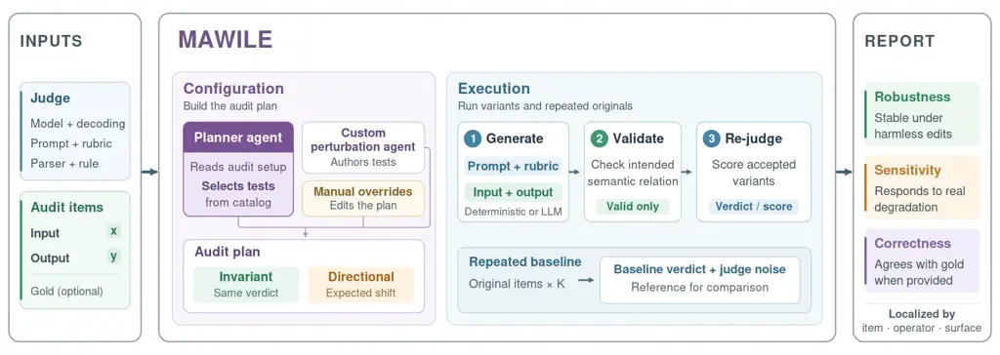
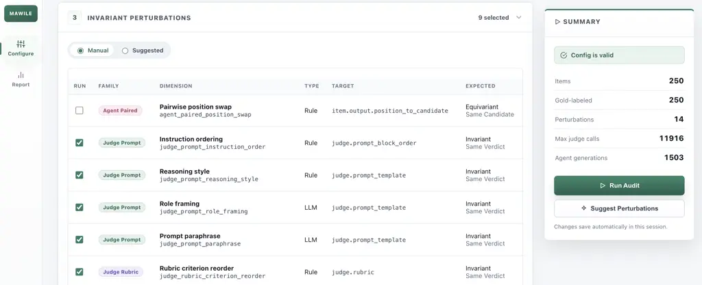
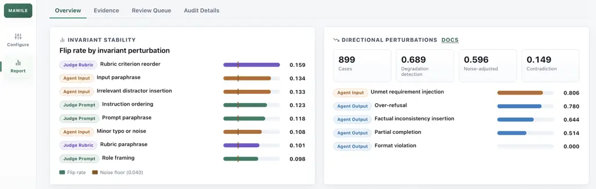
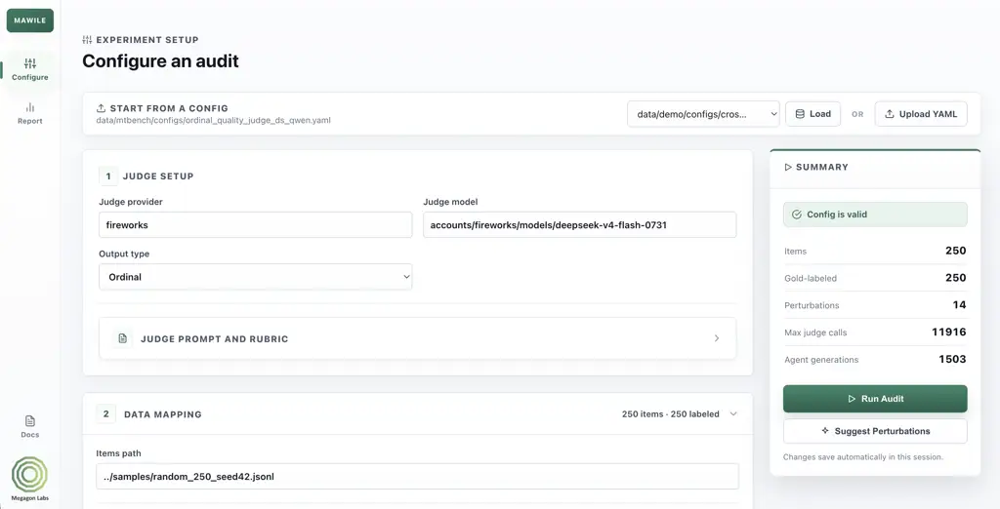
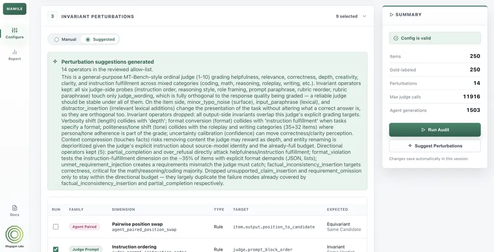
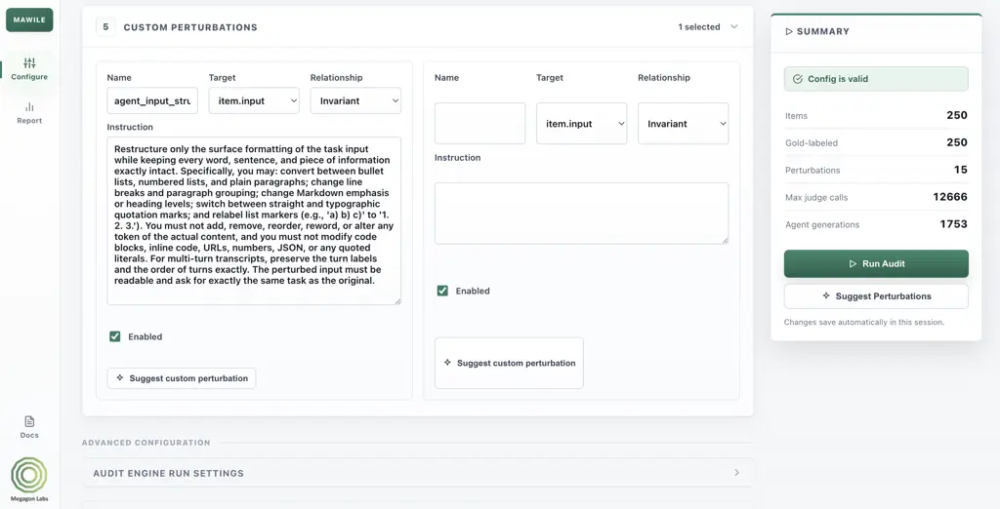
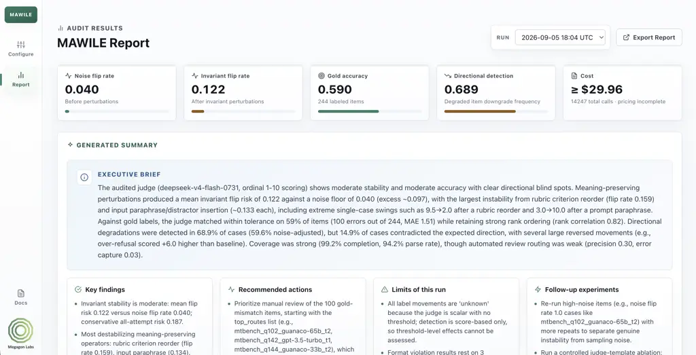
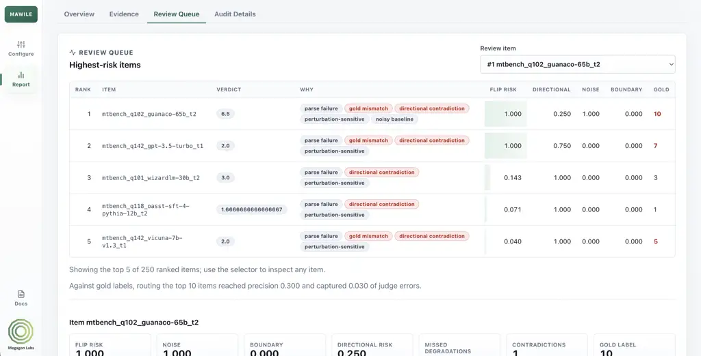

# MAWILE: Multi-Axis Workbench for Inspecting LLM Evaluators

Jackson Hassell    Farima Fatahi Bayat    Pouya Pezeshkpour    Estevam
Hruschka Affiliation: Megagon Labs Affiliation: {jackson, farima, pouya,
estevam}@megagon.ai

###### Abstract

Large language model (LLM) judges provide a flexible and scalable method
for evaluating model and agent outputs, but their verdicts can be
sensitive to incidental changes in the evaluated response, judge
instructions, and scoring rubric. Existing systems examine important
subsets of these failure modes, but auditing a configured judge requires
testing both the judge instrument and the items it evaluates. We
introduce Mawile, a developer-facing workbench for auditing judge
sensitivity across four surfaces: the judge prompt, judge rubric,
target-system input, and target-system output. Given a user-supplied
judge and representative evaluation items, Mawile constructs and
validates controlled perturbations, re-executes the judge, and localizes
the resulting sensitivity. Each perturbation declares whether the
verdict should remain invariant or change in a specified direction,
allowing the same system to measure both robustness to irrelevant
variations and sensitivity to meaningful changes. Mawile audits binary,
ordinal, and pairwise judges without requiring gold labels. The code for
this tool is available at:
[github.com/megagonlabs/mawile-judge](https://github.com/megagonlabs/mawile-judge).

## 1 Introduction



Figure 1: The Mawile end-to-end judge-auditing workflow. Given a
configured judge and representative audit items, the planner agent
produces an editable suite of invariant and directional probes. Mawile
then generates and validates these variants, re-executes the judge
alongside repeated unmodified baselines, and reports robustness,
degradation sensitivity, and—when gold labels are available—correctness.

Large language models (LLMs) are increasingly used as flexible, scalable
evaluators of model and agent outputs (Zheng et al., 2023; Chen et al.,
2024; Fu et al., 2024; Zhuge et al., 2025). However, their judgments can
be sensitive to incidental choices such as candidate order, prompt
wording, and rubric presentation (Zheng et al., 2023; Bellibatlu et al.,
2026; Li et al., 2026a). This sensitivity can undermine the reliability
of the resulting judgments. While a judge may agree with human labels on
a static test set, it may change its decision under semantically
irrelevant edits, or fail to adjust when an evaluated output is
meaningfully degraded.

Controlled perturbations expose these failures by testing whether a
judge remains stable under irrelevant changes and responds appropriately
to meaningful ones (Ribeiro et al., 2020; Li et al., 2026a). We
distinguish four perturbation surfaces: the judge rubric, which defines
the evaluation criteria and scoring semantics; the judge prompt, which
specifies how to perform and return the judgment; the evaluated system’s
input, such as a user query; and one or more candidate outputs, such as
candidate responses to that query. Existing approaches examine
complementary subsets of these surfaces, motivating an integrated audit
of both the judge instrument and the items it evaluates.

We introduce Mawile (see Figure 1), a developer-facing workbench that
integrates these tests into an interactive audit workflow. Given a
configured judge and representative evaluation items, a planning agent
proposes applicable perturbation operators, which users can edit or
extend with custom operators. Mawile then constructs variants of the
selected judge or item fields. Each operator specifies whether the
semantic verdict should remain unchanged (invariant) or move in a
prescribed direction (directional). A validation stage checks whether
variants satisfy the intended constraints, helping prevent unintended
changes from being misinterpreted as judge failures. Finally, Mawile
re-executes the judge and reports sensitivity by evaluation surface,
operator, and item, with the underlying evidence available for
inspection.

We make the following three contributions. First, we combine item-side
and judge-instrument reliability tests within a single end-to-end
workflow. Second, we introduce a typed probe interface with explicit
applicability, expected-relation, and validation semantics (e.g.,
context-aware modifications of input-output pairs). Third, we provide an
interactive audit process that localizes failures and preserves the
evidence needed to inspect and compare judge configurations. Mawile
supports more reliable development and deployment of LLM-based
evaluators by making their failure modes easier to identify, diagnose,
and compare.

## 2 Related Work

### 2.1 Perturbation-Based Evaluation

Mawile builds on existing work that associates controlled
transformations with an expected relation between the original and
transformed predictions (Ribeiro et al., 2020). This principle has been
applied to several components of LLM evaluation. FBI (Doddapaneni et
al., 2024) injects known quality degradations into evaluated responses
to test whether judges detect them, while CALM (Ye et al., 2025)
perturbs judge instructions or evaluated responses to quantify a catalog
of biases. JudgeSense (Bellibatlu et al., 2026) focuses on decision
instability under semantically equivalent paraphrases of the judge
prompt. reWordBench (Wu et al., 2025) studies robustness under
transformations of reward-model prompts and responses. Complementary
rubric-focused work studies score-rubric ordering, preference drift
under natural-language rubric edits, and rubric auditing and repair (Li
et al., 2026a; Ding et al., 2026). Mawile unifies these perturbation
principles across judge and item fields, with each operator declaring
its applicability, expected verdict relation, and validation
requirements.

### 2.2 Judge Audit Systems

The Judge Reliability Harness (JRH) (Dev et al., 2026) generates and
validates reliability tests for binary and ordinal judges, aggregates
metrics, and supports human review. Its interventions primarily target
evaluated responses or agent messages. EvalSense (Dejl and Pearson, 2026) provides an interactive framework for configuring and comparing
evaluation methods through perturbation-based meta-evaluation.
RobustJudge (Li et al., 2026b) evaluates response attacks and defenses
while examining judge models and prompt configurations.

Mawile audits a configured judge across its prompt, rubric,
target-system input, and candidate outputs within one editable workflow.
It supports context-aware transformations of individual fields and
coupled input–output pairs, and reports failures with their supporting
evidence. Table 1 compares the intervention surfaces covered by these
systems and related perturbation frameworks.

|                                      |                  |              |                    |              |                 |                               |
| ------------------------------------ | ---------------- | ------------ | ------------------ | ------------ | --------------- | ----------------------------- |
|                                      | Judge Instrument |              | Evaluated Instance |              |                 | Developer-Facing Audit System |
| Method                               | Rubric $`R`$     | Prompt $`P`$ | Input $`x`$        | Output $`y`$ | Coupled $`x,y`$ |                               |
| FBI (Doddapaneni et al., 2024)       | –                | –            | –                  | ✓            | –               | –                             |
| reWordBench (Wu et al., 2025)        | –                | –            | ✓                  | ✓            | ✓               | –                             |
| CALM (Ye et al., 2025)               | –                | ✓            | –                  | ✓            | –               | –                             |
| JudgeSense (Bellibatlu et al., 2026) | –                | ✓            | –                  | –            | –               | –                             |
| JRH (Dev et al., 2026)               | –                | –            | –                  | ✓            | –               | ✓                             |
| EvalSense (Dejl and Pearson, 2026)   | –                | –            | –                  | ✓            | –               | ✓                             |
| RobustJudge (Li et al., 2026b)       | ✓                | ✓            | –                  | ✓            | –               | ✓                             |
| MAWILE                               | ✓                | ✓            | ✓                  | ✓            | ✓               | ✓                             |

Table 1: Comparison with prior judge-auditing systems and perturbation
frameworks. A checkmark indicates that the method automatically
constructs or applies controlled variants of the corresponding surface
as an intervention target, not that a given surface is merely
configurable.

## 3 Methodology

Mawile audits a user-supplied LLM judge by applying controlled changes
to the judge instrument and the items it evaluates. As shown in
Figure 1, an audit begins with a configured judge and a representative
collection of evaluation items. Mawile first establishes the judge’s
baseline behavior and estimates judge consistency by repeatedly
evaluating the unmodified items. It then selects applicable
perturbations, constructs and validates the corresponding variants,
re-executes the judge, and checks whether verdicts remain stable under
invariant perturbations or move in the expected direction under
directional perturbations. The resulting report localizes sensitivity by
evaluation surface, perturbation type, and item.

### 3.1 Audit Setup

We represent a configured judge as
$`\mathcal{J}=(M,P,R,\kappa,\mathcal{Z})`$, where $`M`$ specifies the
judge model and decoding configuration, $`P`$ is the evaluation prompt,
$`R`$ is the rubric, the judge harness $`\kappa`$ processes the raw
judge response, and $`\mathcal{Z}`$ is the verdict space. An evaluation
item contains a target-system input $`x_{i}`$ and one or more
target-system outputs $`y_{i}`$. A judge call produces

```math
z_{i}=\kappa\bigl(M(P,R,x_{i},y_{i})\bigr),\qquad z_{i}\in\mathcal{Z}. \tag{1}
```

This decomposition exposes four perturbation surfaces: the judge prompt
$`P`$, judge rubric $`R`$, target-system input $`x_{i}`$, and
target-system output(s) $`y_{i}`$. These four surfaces are varied within
an audit, while $`M`$, $`\kappa`$, and $`\mathcal{Z}`$ are held fixed.

The verdict space $`\mathcal{Z}`$ depends on the type of judge. Binary
judges specify pass or fail, ordinal judges rank an output along a
specified score scale, and pairwise judges choose which of two options
is the better response to the input.

Before applying perturbations, Mawile repeatedly evaluates each original
item. These runs establish a baseline verdict $`b_{i}`$, defined as the
modal class for categorical judges and the mean score for numeric
judges. Mawile also measures disagreement across repeated calls to
quantify the judge’s intrinsic stochasticity. Together, these statistics
help distinguish perturbation-induced sensitivity from ordinary
run-to-run variation.

### 3.2 Typed Perturbation Operators

A perturbation operator perturbs one or more of the four audit surfaces.
Each operator declares its target surface, applicability conditions,
generation procedure, validation procedure, and the expected relation
between the original and perturbed verdicts as shown in Figure 1. Mawile
supports two relation types. Invariant operators introduce perturbations
that should not affect the semantic verdict, such as swapping the order
of two candidates in pairwise evaluation. Directional operators,
conversely, introduce perturbations with a known expected effect on the
verdict. The operator specifies both the intended direction and the
orientation of the judge’s output scale. For example, adding a new
requirement to $`x_{i}`$ while leaving the corresponding output
unchanged should lower the evaluation score.

Directional operators are restricted to binary and ordinal judges. In
pairwise evaluation, degrading one candidate does not necessarily imply
a preference reversal; establishing such an expectation would require
verifying its quality relative to the unchanged candidate. For pointwise
judges, directional perturbations are only applied to positive items
(for binary judges) or items not already at the bottom of the scale (for
ordinal judges).

Together, these two relation types test two complementary properties.
Invariant probes measure robustness to changes that should preserve the
underlying decision, while directional probes measure whether the judge
responds to changes that should alter it.

### 3.3 Audit Planning and Perturbation Construction

Mawile provides a catalog of perturbation operators spanning the four
evaluation surfaces. The catalog includes deterministic transformations,
such as candidate-order swaps and structure-preserving formatting
changes, as well as LLM-generated transformations, such as semantic
paraphrases, controlled degradations, and task-dependent modifications
(see Tables 3 and 4 for the full included perturbation catalog). Users
may select operators directly, add custom operators, or ask a planner
agent to propose an audit based on the judge configuration and
representative dataset items. The proposed plan remains editable before
execution, keeping task-specific requirements under user control.

LLM-generated perturbations receive the context needed to preserve a
coherent evaluation instance. When modifying a target-system output
$`y_{i}`$, the generator also observes its corresponding input
$`x_{i}`$, and vice versa. We use this context-aware construction to
avoid attributing judge failures to perturbations that instead create
incoherent or implausible input–output pairs. Operators may also modify
both $`x_{i}`$ and $`y_{i}`$ jointly, enabling transformations such as
consistent entity renaming to probe potential social biases in the
judge.

Validation checks whether each variant satisfies its operator-specific
requirements. Some operators, such as candidate-position swaps, satisfy
their constraints by construction, as they preserve both candidate
content and identity. Variants requiring semantic assessment are instead
checked by a separate validation agent. Invariant perturbations must
preserve the properties relevant to the judgment, while directional
perturbations must introduce the specified degradation. Rejected
variants are excluded from judge execution. The generator, validator,
and judge are independently configurable roles.

### 3.4 Report Generation

The final report aggregates results by evaluation surface, operator, and
item. Users can inspect the original and perturbed fields, canonical
judge outputs, validation outcomes, and violations of each operator’s
expected behavior, such as a preference change after a position swap or
failure to lower a score after a validated degradation. This supports
analysis of both global sensitivity trends and local inspection of the
items driving them. If gold labels are available, the report also
includes judge accuracy. In addition to automatically computed metrics,
Mawile provides an LLM-generated summary of key findings and recommended
follow-up actions to improve judge reliability and robustness
(Figure 7).



Figure 2: Screenshot of the Mawile Web UI’s editable perturbation
catalog. During configuration, developers can inspect each operator’s
family, construction method, target field, and expected verdict
relation, then enable or disable it before execution. A planner agent
can also suggest perturbations tailored to the dataset.



Figure 3: Screenshot of the Mawile web UI’s per-operator results for the
MT-Bench walkthrough using DeepSeek-V4-Flash as the judge and Kimi K3 as
the perturbation generator.

## 4 User Interface Walkthrough

We illustrate the Mawile system through an audit of DeepSeek-V4-Flash on
250 MT-Bench items (the same items used in Table 2), using Kimi K3 to
generate perturbations.

#### Configuration.

During the configuration step, the developer can set or override audit
hyperparameters. In this experiment, the developer defined a rubric that
grades each item on a 1–10 scale , allows a one-point change to count as
invariant, and treats any score decrease as a valid directional
degradation. The planning agent proposed nine invariant and five
directional operators, along with rationales for each choice. For
example, the planner excluded verbosity shifts from the invariant suite
because response depth is explicitly included in the rubric and may
legitimately affect the score. It includes rubric reordering, which
changes the presentation of the scoring criteria while preserving their
content (see Figure 5 for the full justification). In the editable
catalog (Figure 2), the developer can review the selected operators and
their expected effects, and enable or disable each operator.

#### Generated Report.

Mawile constructed and validated the perturbations, then evaluated the
accepted variants against the repeated baseline. The report combines
aggregate metrics, an LLM-generated summary, per-perturbation results,
and items flagged for manual review. Figure 3 (left) shows that rubric
reordering produces the highest invariant flip rate, at 15.9% compared
with the 4.0% baseline flip rate on unmodified items. The right panel
shows that the judge is completely unable to detect the format-violation
errors, but is substantially more sensitive to injected unmet
requirements.

#### Evidence Inspection.

The developer can also examine the examples underlying these reported
findings. In this experiment, the generated summary highlighted an item
whose score drops from 9.5 to 2.0 (averaged across multiple calls) after
rubric reordering. The developer can review this case in the Review
Queue tab (Figure 8) to inspect that item manually. Under the Evidence
tab, they can inspect examples of perturbed questions to verify that the
results are coherent in context. This supports both rapid interpretation
of aggregate findings and deeper verification of the evidence behind
them.

|                       |                        |                   |                       |                                 |                                    |                                         |
| --------------------- | ---------------------- | ----------------- | --------------------- | ------------------------------- | ---------------------------------- | --------------------------------------- |
|                       |                        |                   | Baseline              |                                 | Perturbation Response              |                                         |
| Dataset               | Perturbation Generator | Judge             | Accuracy $`\uparrow`$ | Repeat Flip Rate $`\downarrow`$ | Invariant Flip Rate $`\downarrow`$ | Degradation Detection Rate $`\uparrow`$ |
| MT-Bench Ordinal      | Qwen 3.8 Max           | GPT-5.6 Luna      | 56.0                  | 2.3                             | 6.0                                | 62.9                                    |
|                       |                        | DeepSeek-V4-Flash | 59.1                  | 5.3                             | 11.7                               | 65.4                                    |
|                       |                        | Gemma 3 4B        | 51.2                  | 0.5                             | 2.8                                | 47.4                                    |
|                       | Kimi K3                | GPT-5.6 Luna      | 53.6                  | 3.2                             | 5.7                                | 65.4                                    |
|                       |                        | DeepSeek-V4-Flash | 59.0                  | 4.0                             | 12.2                               | 68.9                                    |
|                       |                        | Gemma 3 4B        | 49.6                  | 0.1                             | 2.4                                | 53.0                                    |
| Search Arena Pairwise | Qwen 3.8 Max           | GPT-5.6 Luna      | 62.0                  | 5.3                             | 10.5                               | –                                       |
|                       |                        | DeepSeek-V4-Flash | 64.1                  | 1.6                             | 8.6                                | –                                       |
|                       |                        | Gemma 3 4B        | 53.3                  | 0.3                             | 16.0                               | –                                       |
|                       | Kimi K3                | GPT-5.6 Luna      | 58.0                  | 5.2                             | 10.5                               | –                                       |
|                       |                        | DeepSeek-V4-Flash | 66.1                  | 2.6                             | 8.1                                | –                                       |
|                       |                        | Gemma 3 4B        | 53.3                  | 0.4                             | 13.8                               | –                                       |
| GSM8K Binary          | Qwen 3.8 Max           | GPT-5.6 Luna      | 96.8                  | 0.1                             | 0.7                                | 41.1                                    |
|                       |                        | DeepSeek-V4-Flash | 98.4                  | 0.3                             | 0.3                                | 48.6                                    |
|                       |                        | Gemma 3 4B        | 90.4                  | 0.7                             | 3.9                                | 10.0                                    |
|                       | Kimi K3                | GPT-5.6 Luna      | 96.0                  | 0.1                             | 0.7                                | 54.9                                    |
|                       |                        | DeepSeek-V4-Flash | 98.0                  | 0.3                             | 0.6                                | 67.6                                    |
|                       |                        | Gemma 3 4B        | 90.8                  | 0.4                             | 3.6                                | 9.2                                     |

Table 2: Aggregate audit results for ordinal, pairwise, and binary
judges across two perturbation generators and three judge models. Within
each dataset, bold and underlining mark the best and second-best judges
in each metric, respectively. All numbers are percentages. For each
dataset, a Kimi K3 planner selected one operator suite, which is held
fixed across all six generator-judge combinations.

## 5 Experimental Setup

### 5.1 Datasets

We evaluate Mawile on three datasets chosen to span common judge output
types, evaluation domains, and interaction settings, ranging from scalar
scoring to pairwise preference and binary correctness judgments. In
MT-Bench Zheng et al. (2023), the judge grades an agent’s multi-turn
conversation with a user on a rubric of 1-10. In Search Arena Miroyan et
al. (2026), given two agentic responses (with traces) to a user query
that requires searching the internet, the judge evaluates which of the
two is better. In GSM8K Cobbe et al. (2021), given a math problem and an
agent’s answer and justification, the judge decides if the agent’s
answer and decision process is correct or not.

### 5.2 Model and Perturbation Setup

We run a full $`3\times 3\times 2`$ comparison across three datasets,
using GPT-5.6 Luna (OpenAI, 2026), DeepSeek-V4-Flash (DeepSeek-AI,
2026), and Gemma 3 4B (Gemma Team, 2025) as judges, and Qwen3.8-Max
(Qwen Team, 2026) and Kimi K3 (Kimi Team, 2026) as perturbation
generators. To isolate the effect of the perturbation generator, Kimi K3
selects one fixed set of perturbation operators for each dataset. The
same operator set is then used for every judge–generator combination.

### 5.3 Metrics

We report four aggregate metrics. _Accuracy_ measures agreement between
the baseline judgment and the provided correct answer. _Repeat flip
rate_ measures disagreement across repeated calls on the unmodified
item, capturing the judge’s intrinsic instability. _Invariant flip rate_
measures how often an accepted meaning-preserving perturbation changes
the judgment beyond the permitted tolerance. Lastly, _degradation
detection rate_ measures how often a directional perturbation moves the
judgment in the expected direction.

## 6 Experimental Results

#### Accuracy does not imply robustness.

Across all six dataset–generator settings, DeepSeek-V4-Flash achieves
the highest accuracy, followed by GPT-5.6 Luna and Gemma 3 4B. The same
ordering holds for degradation detection wherever directional probes are
applicable, suggesting that more accurate judges are also generally
better at recognizing meaningful degradations. Invariant robustness,
however, is task-dependent: on MT-Bench, Gemma 3 4B has the lowest
invariant flip rates (2.4–2.8pp), followed by GPT-5.6 Luna (5.7–6.0pp)
and DeepSeek-V4-Flash (11.7–12.2pp), while on Search Arena and GSM8K
DeepSeek-V4-Flash is most robust and Gemma 3 4B least robust. Thus,
robustness to meaning-preserving changes cannot be inferred from
accuracy alone.

#### Repeatability does not imply perturbation robustness.

On Search Arena, Gemma 3 4B exhibits only 0.3–0.4% repeat flips on
unmodified items, but 13.8–16.0% invariant flips after
meaning-preserving perturbations. Similar gaps elsewhere show that
perturbation sensitivity captures failures beyond ordinary run-to-run
stochasticity.

#### Directional probes are more sensitive to the perturbation generator.

Switching between Qwen 3.8 Max and Kimi K3 yields mean absolute
differences of 0.5 percentage points in invariant flip rate and 7.5
points in degradation detection. Kimi K3 improves detection for all
judges on MT-Bench and for GPT-5.6 Luna and DeepSeek-V4-Flash on GSM8K,
suggesting that generator choice matters more for constructing
meaningful degradations than invariant variants.

## 7 Conclusion

We introduced Mawile, a developer-facing system for auditing this
distinction through validated perturbations to the judge prompt, rubric,
evaluated input, and evaluated output. Across ordinal, pairwise, and
binary evaluations, our experiments show that judge sensitivity depends
on both the model and task. Higher accuracy is often associated with
better detection of meaningful degradations, but does not necessarily
imply greater robustness to irrelevant perturbations. These findings
motivate evaluating judge accuracy alongside repeatability and
perturbation sensitivity. By localizing failures to individual
operators, items, and evaluation surfaces, Mawile provides an
inspectable basis for diagnosing unreliable judge behavior, including in
settings where gold labels are unavailable.

## Limitations

Mawile measures judge sensitivity, not necessarily judge correctness. A
judge that remains stable under every tested perturbation may still
apply an incorrect rubric or reproduce systematic biases. Gold labels
can reveal some such failures when available, but label-free audits
cannot certify that a stable verdict is valid.

The conclusions of an audit also depend on the coverage and validity of
its perturbations. The operator catalog represents only a subset of
possible real-world variation (though we allow both manual and
LLM-authored custom perturbations to mitigate this), while LLM-generated
perturbations and their validators may introduce their own errors or
biases. Passing the resulting suite is therefore evidence of reliability
under the tested conditions, rather than a general guarantee.

## References

- Bellibatlu et al. (2026) R. R. Bellibatlu, E. Raff, and W. Zhang
  JudgeSense: a benchmark for prompt sensitivity in llm-as-a-judge
  systems. External Links: 2604.23478,
  [Link](https://arxiv.org/abs/2604.23478) Cited by: §1, §2.1, Table 1.
- Chen et al. (2024) D. Chen, R. Chen, S. Zhang, Y. Wang, Y. Liu, H.
  Zhou, Q. Zhang, Y. Wan, P. Zhou, and L. Sun MLLM-as-a-judge: assessing
  multimodal llm-as-a-judge with vision-language benchmark. In
  Proceedings of the 41st International Conference on Machine Learning,
  ICML’24. Cited by: §1.
- Cobbe et al. (2021) K. Cobbe, V. Kosaraju, M. Bavarian, M. Chen, H.
  Jun, L. Kaiser, M. Plappert, J. Tworek, J. Hilton, R. Nakano, C.
  Hesse, and J. Schulman Training verifiers to solve math word problems.
  External Links: 2110.14168, [Link](https://arxiv.org/abs/2110.14168)
  Cited by: §5.1.
- DeepSeek-AI (2026) DeepSeek-AI DeepSeek-V4: towards highly efficient
  million-token context intelligence. arXiv preprint arXiv:2606.19348.
  External Links: [Link](https://arxiv.org/abs/2606.19348) Cited by:
  §5.2.
- Dejl and Pearson (2026) A. Dejl and J. Pearson EvalSense: a framework
  for domain-specific LLM (meta-)evaluation. In Proceedings of the 19th
  Conference of the European Chapter of the Association for
  Computational Linguistics (Volume 3: System Demonstrations), D.
  Croce, J. Leidner, and N. S. Moosavi (Eds.), Rabat, Marocco,
  pp. 480–491. External Links:
  [Link](https://aclanthology.org/2026.eacl-demo.33/),
  [Document](https://dx.doi.org/10.18653/v1/2026.eacl-demo.33), ISBN
  979-8-89176-382-1 Cited by: §2.2, Table 1.
- Dev et al. (2026) S. Dev, A. Sloan, J. Kavner, N. Kong, and M. Sandler
  Judge reliability harness: stress testing the reliability of llm
  judges. External Links: 2603.05399,
  [Link](https://arxiv.org/abs/2603.05399) Cited by: §2.2, Table 1.
- Ding et al. (2026) R. Ding, Y. Pang, H. Sun, Y. Wang, S. Wu, and Z.
  Deng Rubrics as an attack surface: stealthy preference drift in LLM
  judges. In Third Conference on Language Modeling, External Links:
  [Link](https://openreview.net/forum?id=2STAJbBdJY) Cited by: §2.1.
- Doddapaneni et al. (2024) S. Doddapaneni, M. S. U. R. Khan, S. Verma,
  and M. M. Khapra Finding blind spots in evaluator LLMs with
  interpretable checklists. In Proceedings of the 2024 Conference on
  Empirical Methods in Natural Language Processing, Y. Al-Onaizan, M.
  Bansal, and Y. Chen (Eds.), Miami, Florida, USA, pp. 16279–16309.
  External Links: [Link](https://aclanthology.org/2024.emnlp-main.911/),
  [Document](https://dx.doi.org/10.18653/v1/2024.emnlp-main.911) Cited
  by: §2.1, Table 1.
- Fu et al. (2024) J. Fu, S. Ng, Z. Jiang, and P. Liu GPTScore: evaluate
  as you desire. In Proceedings of the 2024 Conference of the North
  American Chapter of the Association for Computational Linguistics:
  Human Language Technologies (Volume 1: Long Papers), K. Duh, H. Gomez,
  and S. Bethard (Eds.), Mexico City, Mexico, pp. 6556–6576. External
  Links: [Link](https://aclanthology.org/2024.naacl-long.365/),
  [Document](https://dx.doi.org/10.18653/v1/2024.naacl-long.365) Cited
  by: §1.
- Gemma Team (2025) Gemma Team Gemma 3 technical report. arXiv preprint
  arXiv:2503.19786. External Links:
  [Link](https://arxiv.org/abs/2503.19786) Cited by: §5.2.
- Kimi Team (2026) Kimi Team Kimi K3: open frontier intelligence. arXiv
  preprint arXiv:2607.24653. External Links:
  [Link](https://arxiv.org/abs/2607.24653) Cited by: §5.2.
- Li et al. (2026a) Q. Li, S. Dou, K. Shao, C. Chen, and H. Hu
  Evaluating scoring bias in llm-as-a-judge. In Database Systems for
  Advanced Applications, H. Jung, T. Wang, M. Toyoda, H. Kwon, and J.
  Lee (Eds.), Singapore, pp. 19–34. External Links: ISBN
  978-981-92-0372-7 Cited by: §1, §1, §2.1.
- Li et al. (2026b) S. Li, C. Xu, J. Wang, X. Gong, C. Chen, J.
  Zhang, J. Wang, K. Lam, and S. Ji LLMs cannot reliably judge (yet?): a
  comprehensive assessment on the robustness of llm-as-a-judge. External
  Links: 2506.09443, [Link](https://arxiv.org/abs/2506.09443) Cited by:
  §2.2, Table 1.
- Miroyan et al. (2026) M. Miroyan, T. Wu, L. King, T. Li, J. Pan, X.
  Hu, W. Chiang, A. N. Angelopoulos, T. Darrell, N. Norouzi, and J. E.
  Gonzalez Search arena: analyzing search-augmented LLMs. In The
  Fourteenth International Conference on Learning Representations,
  External Links: [Link](https://openreview.net/forum?id=MMGRlDnhtI)
  Cited by: §5.1.
- OpenAI (2026) OpenAI GPT-5.6 system card. External Links:
  [Link](https://deploymentsafety.openai.com/gpt-5-6) Cited by: §5.2.
- Qwen Team (2026) Qwen Team Qwen3.8-Max: a new bar for coding and
  cowork. External Links: [Link](https://qwen.ai/blog?id=qwen3.8) Cited
  by: §5.2.
- Ribeiro et al. (2020) M. T. Ribeiro, T. Wu, C. Guestrin, and S. Singh
  Beyond accuracy: behavioral testing of NLP models with CheckList. In
  Proceedings of the 58th Annual Meeting of the Association for
  Computational Linguistics, D. Jurafsky, J. Chai, N. Schluter, and J.
  Tetreault (Eds.), Online, pp. 4902–4912. External Links:
  [Link](https://aclanthology.org/2020.acl-main.442/),
  [Document](https://dx.doi.org/10.18653/v1/2020.acl-main.442) Cited by:
  §1, §2.1.
- Wu et al. (2025) Z. Wu, M. Yasunaga, A. Cohen, Y. Kim, A. Celikyilmaz,
  and M. Ghazvininejad ReWordBench: benchmarking and improving the
  robustness of reward models with transformed inputs. In Proceedings of
  the 2025 Conference on Empirical Methods in Natural Language
  Processing, C. Christodoulopoulos, T. Chakraborty, C. Rose, and V.
  Peng (Eds.), Suzhou, China, pp. 3383–3409. External Links:
  [Link](https://aclanthology.org/2025.emnlp-main.167/),
  [Document](https://dx.doi.org/10.18653/v1/2025.emnlp-main.167), ISBN
  979-8-89176-332-6 Cited by: §2.1, Table 1.
- Ye et al. (2025) J. Ye, Y. Wang, Y. Huang, D. Chen, Q. Zhang, N.
  Moniz, T. Gao, W. Geyer, C. Huang, P. Chen, N. V. Chawla, and X. Zhang
  Justice or prejudice? quantifying biases in LLM-as-a-judge. In The
  Thirteenth International Conference on Learning Representations,
  External Links: [Link](https://openreview.net/forum?id=3GTtZFiajM)
  Cited by: §2.1, Table 1.
- Zheng et al. (2023) L. Zheng, W. Chiang, Y. Sheng, S. Zhuang, Z.
  Wu, Y. Zhuang, Z. Lin, Z. Li, D. Li, E. P. Xing, H. Zhang, J. E.
  Gonzalez, and I. Stoica Judging llm-as-a-judge with mt-bench and
  chatbot arena. In Proceedings of the 37th International Conference on
  Neural Information Processing Systems, NIPS ’23, Red Hook, NY, USA.
  Cited by: §1, §5.1.
- Zhuge et al. (2025) M. Zhuge, C. Zhao, D. R. Ashley, W. Wang, D.
  Khizbullin, Y. Xiong, Z. Liu, E. Chang, R. Krishnamoorthi, Y. Tian, Y.
  Shi, V. Chandra, and J. Schmidhuber Agent-as-a-judge: evaluate agents
  with agents. In Proceedings of the 42nd International Conference on
  Machine Learning, A. Singh, M. Fazel, D. Hsu, S. Lacoste-Julien, F.
  Berkenkamp, T. Maharaj, K. Wagstaff, and J. Zhu (Eds.), Proceedings of
  Machine Learning Research, Vol. 267, pp. 80569–80611. External Links:
  [Link](https://proceedings.mlr.press/v267/zhuge25a.html) Cited by: §1.

## Appendix A Appendix

### A.1 Additional Walkthrough Screenshots

Figures 4, 5, 6, 7, and 8 supplement the MT-Bench walkthrough with
additional views of audit configuration and result inspection. They show
the judge and dataset settings, the planner’s justifications, custom
perturbation authoring, and the report overview and review queue. These
interfaces allow developers to inspect and revise the proposed
perturbation suite before execution, then examine the individual items
underlying the reported findings.



Figure 4: Screenshot of the Mawile web UI for configuring a judge and
audit dataset.



Figure 5: Screenshot of the Mawile planning agent’s proposed
perturbation suite for the MT-Bench walkthrough, with justification.



Figure 6: Screenshot of the Mawile web UI for defining a custom
perturbation, with an example of an LLM-suggested custom perturbation.



Figure 7: Screenshot of the Mawile report overview for the MT-Bench
walkthrough.



Figure 8: Screenshot of the Mawile review queue for inspecting flagged
items from the MT-Bench walkthrough.

### A.2 Decoding Parameters

All models used reasoning medium effort and default temperature for all
calls.

### A.3 Perturbation Catalog

The built-in catalog contains 16 invariant operators and 7 directional
degradation operators (Tables 3 and 4). Invariant probes should preserve
the verdict; directional probes intentionally make an item worse and
should therefore elicit a worse verdict. “Rule” denotes a deterministic
edit and “LLM” a perturbation-model rewrite. Semantic validation is
independent of the judge under test and applies to both LLM rewrites and
rule-based edits when needed. Judge-level edits apply globally while
item-level edits are applied each item independently.

|                                |                                 |      |                                                                          |
| ------------------------------ | ------------------------------- | ---- | ------------------------------------------------------------------------ |
| Invariant Perturbation Catalog |                                 |      |                                                                          |
| Surface                        | Perturbation                    | Gen. | Description                                                              |
| Judge prompt                   | Instruction ordering            | Rule | Moves output-format instructions before the prompt and rubric.           |
|                                | Reasoning style                 | LLM  | Requests direct, step-by-step, or criterion-by-criterion reasoning.      |
|                                | Role framing                    | LLM  | Changes the evaluator persona without changing the task.                 |
|                                | Prompt paraphrase               | LLM  | Rewords the judge instructions while preserving their meaning.           |
| Judge rubric                   | Rubric criterion reorder        | Rule | Reorders independent rubric blocks without changing their content.       |
|                                | Rubric paraphrase               | LLM  | Rewords scoring criteria while preserving their meaning and thresholds.  |
| Agent input                    | Minor typo or noise             | LLM  | Introduces minor prose typos without changing task meaning.              |
|                                | Input paraphrase                | LLM  | Rewords the input while preserving the task and requirements.            |
|                                | Irrelevant distractor insertion | LLM  | Adds plausible but irrelevant context to the input.                      |
|                                | Context compression             | LLM  | Removes redundant input context while retaining needed information.      |
| Agent output                   | Output format conversion        | LLM  | Changes the response format while preserving the answer.                 |
|                                | Politeness or tone shift        | LLM  | Changes response tone while preserving its substance.                    |
|                                | Uncertainty calibration         | LLM  | Changes expressed confidence without changing the answer.                |
|                                | Verbosity shift                 | LLM  | Shortens or lengthens the response without changing substantive claims.  |
| Agent paired                   | Pairwise position swap          | Rule | Swaps candidate display positions while preserving candidate identities. |
|                                | Entity renaming                 | LLM  | Renames entities consistently across the input and output.               |

Table 3: Built-in invariant perturbations.

|                                  |                                 |      |                                                                       |
| -------------------------------- | ------------------------------- | ---- | --------------------------------------------------------------------- |
| Directional Perturbation Catalog |                                 |      |                                                                       |
| Surface                          | Perturbation                    | Gen. | Description                                                           |
| Agent input                      | Unmet requirement injection     | LLM  | Adds a task requirement that the existing response does not satisfy.  |
| Agent output                     | Partial completion              | Rule | Removes the final separable part of a response.                       |
|                                  | Format violation                | LLM  | Breaks one previously satisfied output-format requirement.            |
|                                  | Unsupported claim insertion     | LLM  | Adds one unsupported substantive claim to the response.               |
|                                  | Factual inconsistency insertion | LLM  | Introduces one factual or reasoning inconsistency.                    |
|                                  | Requirement omission            | LLM  | Removes or weakens content that satisfies a task requirement.         |
|                                  | Over-refusal                    | LLM  | Replaces an answer to an answerable task with an unnecessary refusal. |

Table 4: Built-in directional degradation perturbations. Directional
probes are available only for pointwise audits.
